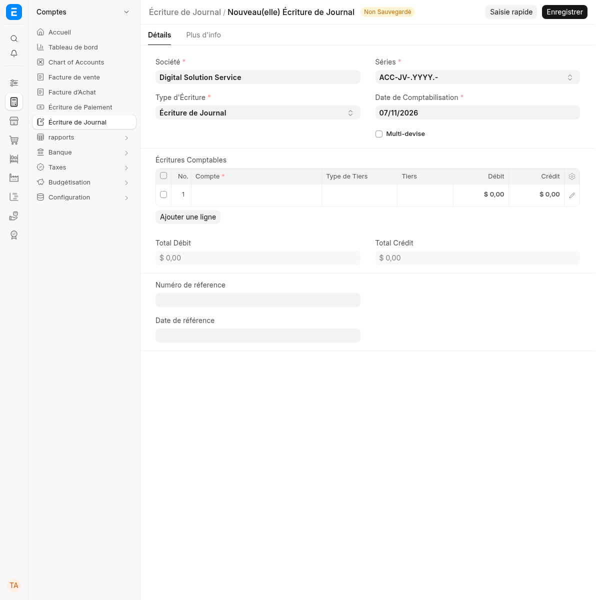
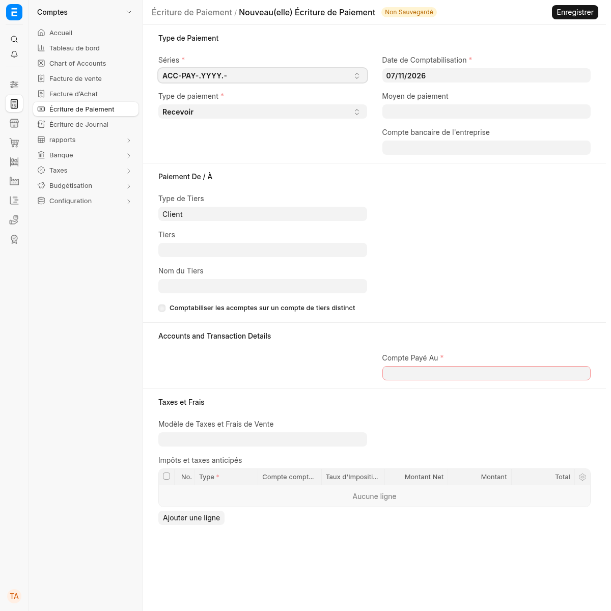
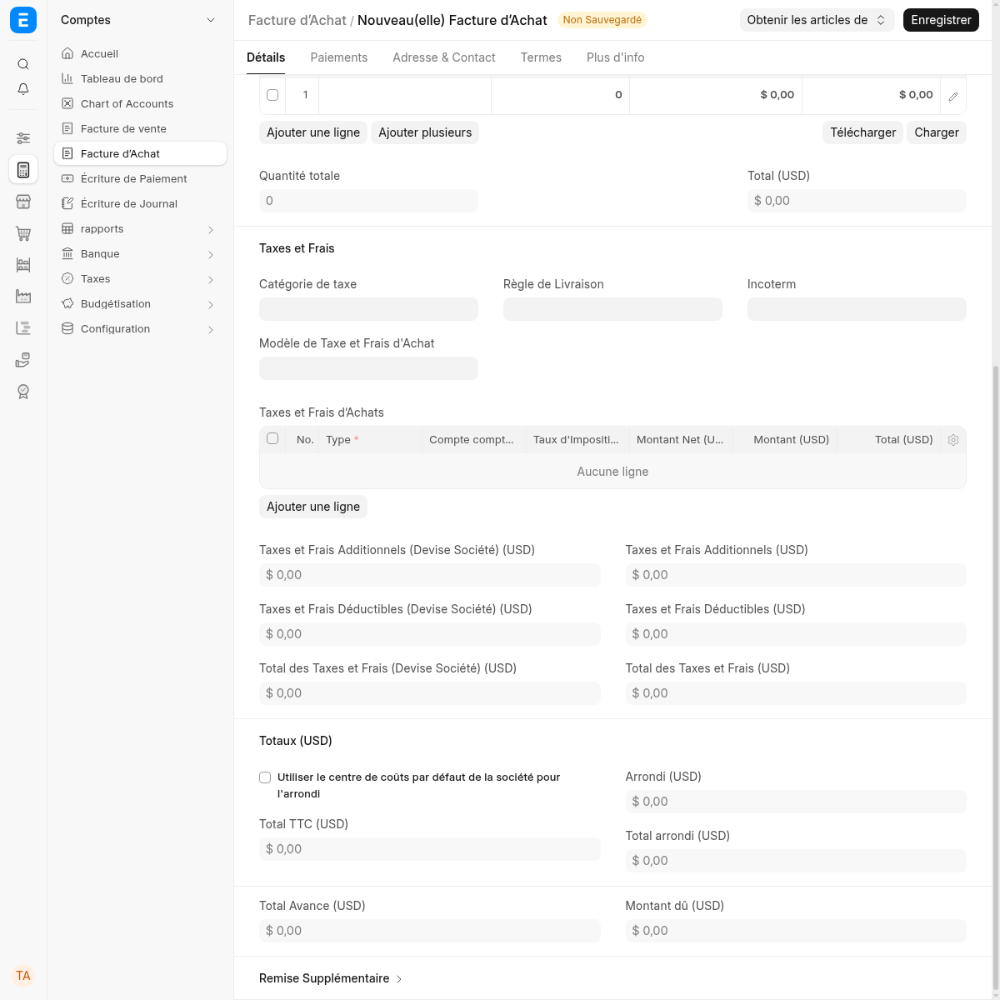
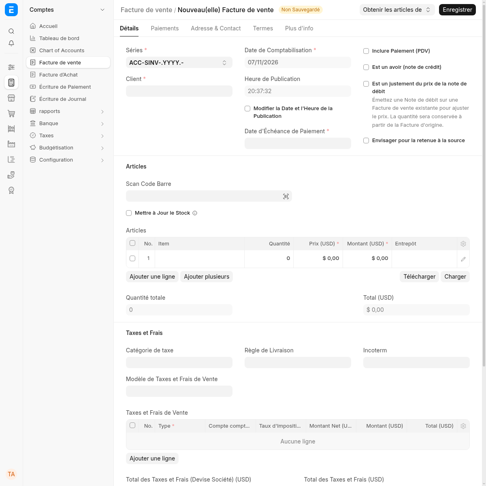
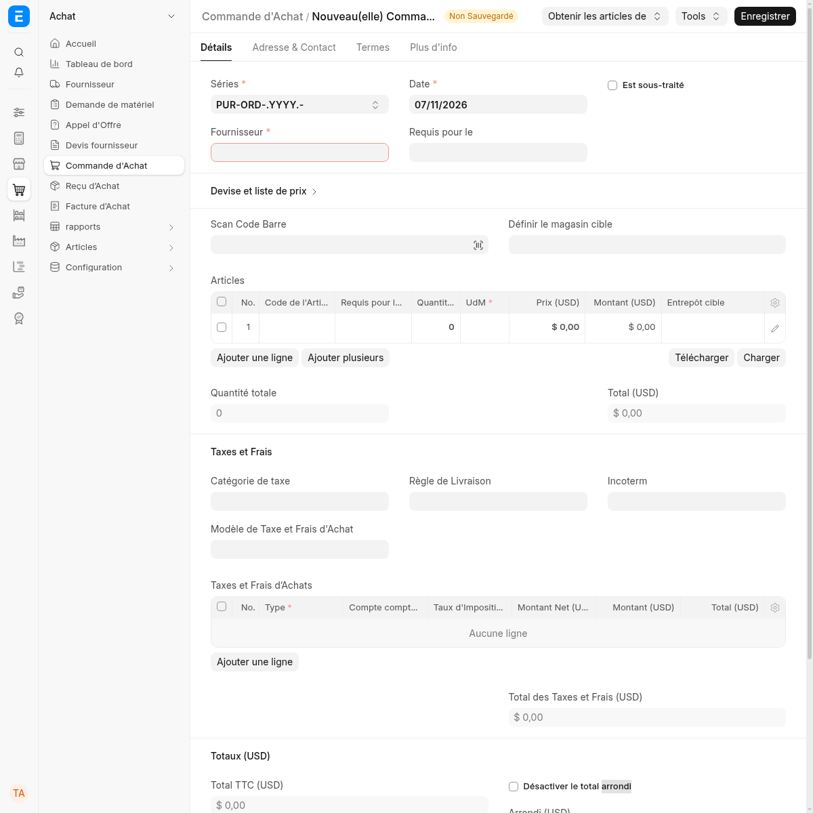
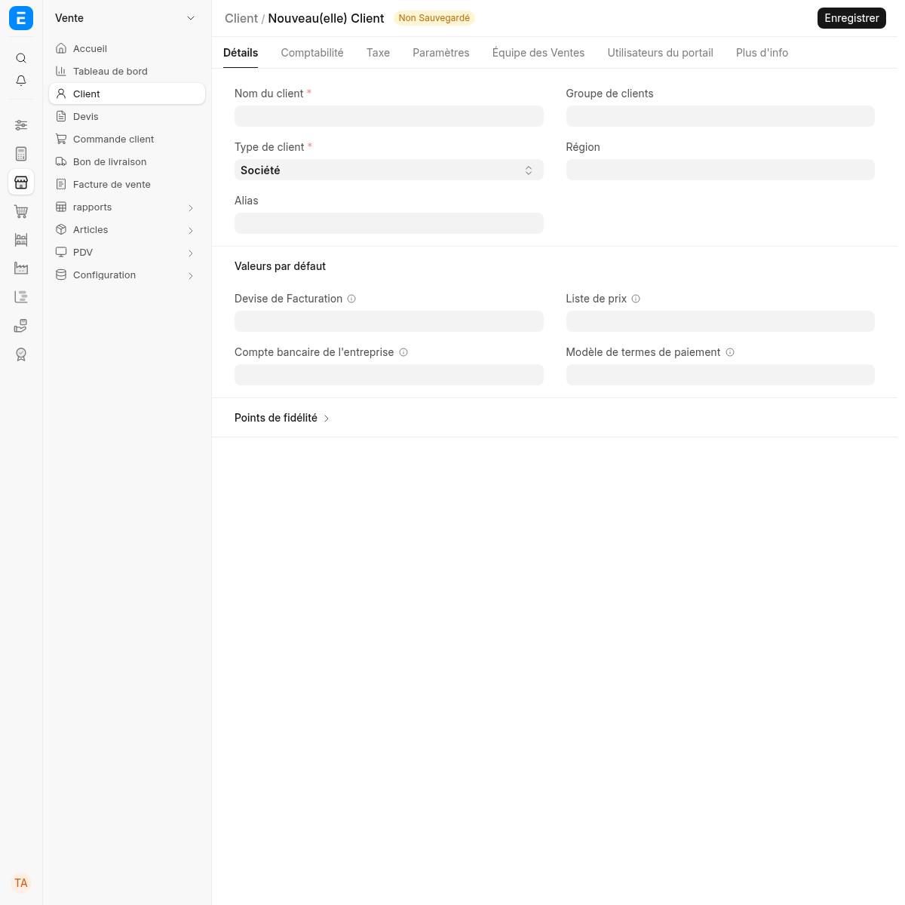
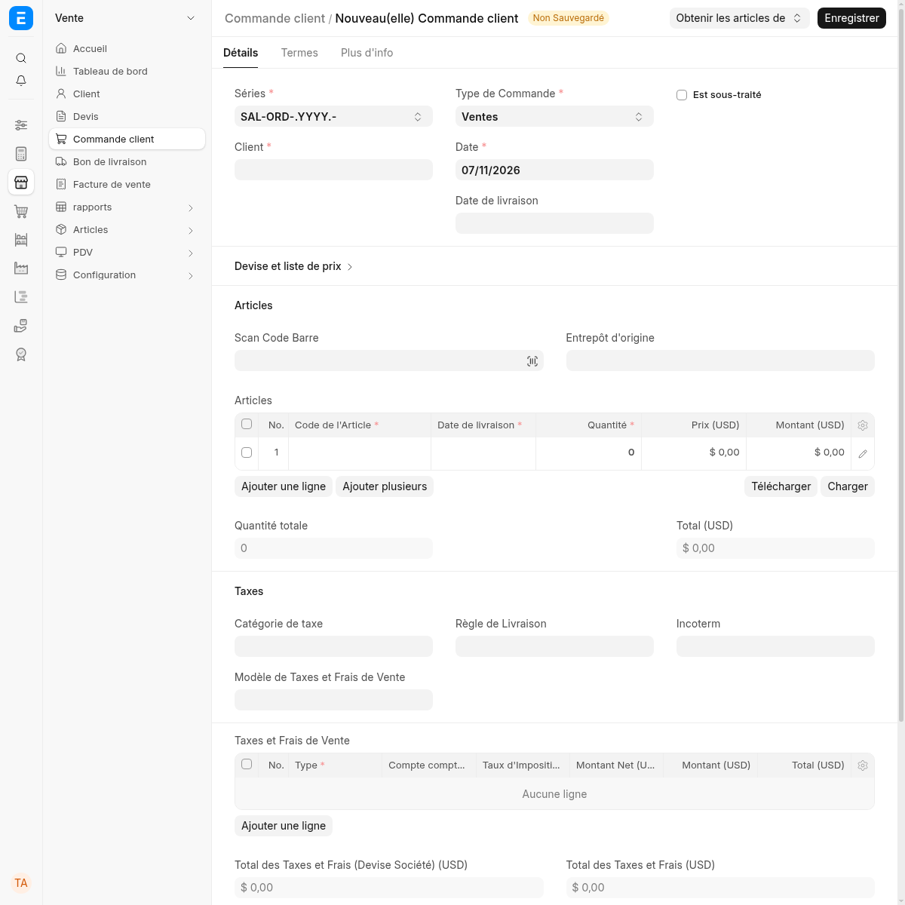
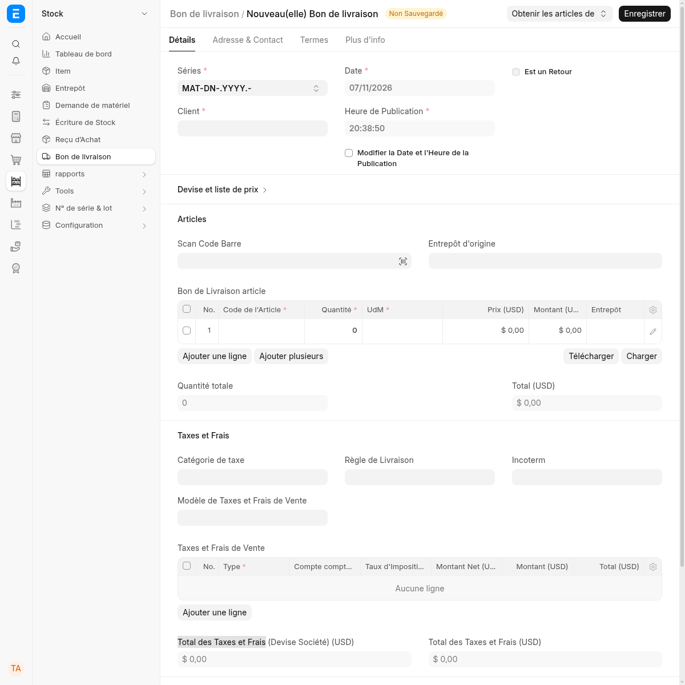
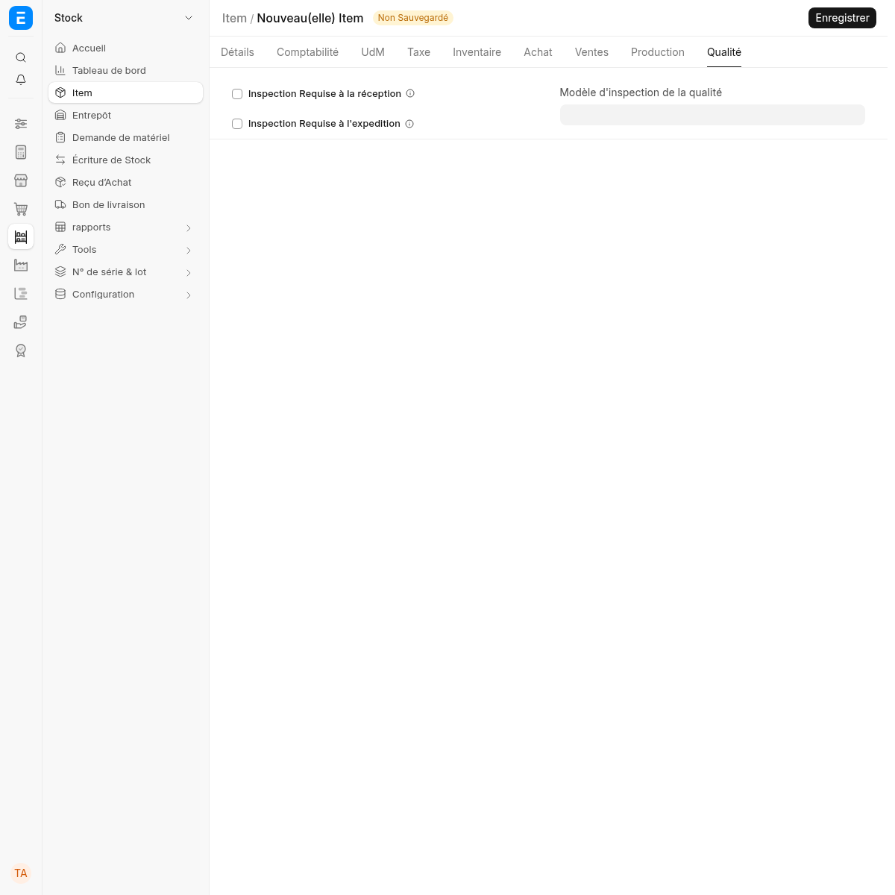
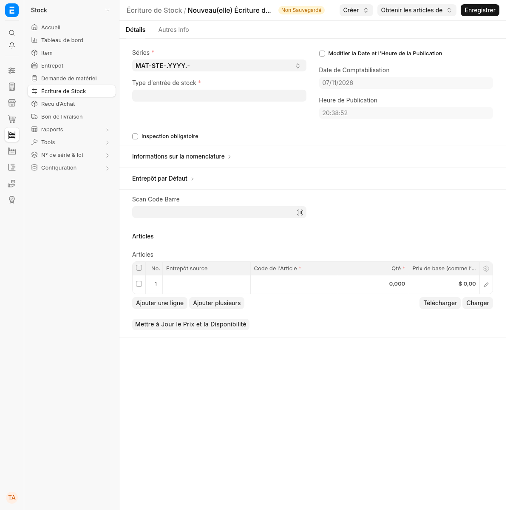

# Rebuild dossier: Open-source web ERP (accounting, selling, buying, stock, manufacturing)

> Generated by `node tools/reborn.mjs dossier erpnext` from inputs `76c0e2caade6aa50` (the same cards always give the same dossier).
> Source of truth: the YAML files next to this document. Do not edit this file by hand.
> Clean room: this dossier describes **behaviour**. It contains no original code, assets or branding.

## At a glance

| | |
|---|---|
| Target | Open-source web ERP (accounting, selling, buying, stock, manufacturing) |
| Kind / platforms | saas / web |
| Domain | ERP for small and medium businesses (accounting, selling, buying, stock, manufacturing, projects, HR-adjacent) |
| Versions studied | ERPNext 16.51.2, Frappe 16.55.2 |
| Technology | unknown |
| Features | 472: must 71, should 173, could 228 / confirmed 1, partial 471 |
| Rules, screens, entities | 7, 471, 835 |
| Open questions | 2 |
| Exploration | 4 missions, 15 runs, 0 observations |
| Evidence entries | 7 |

## Features

| ID | Feature | Module | Priority | Status | Confidence | Screens | Rules | Tests |
|---|---|---|---|---|---|---|---|---|
| [F-001](#f-001) | Create a sales invoice with discounts and taxes | Accounts | must | confirmed | high |  | R-001, R-002, R-003, R-004, R-005, R-006, R-007 | 2 |
| [F-016](#f-016) | Create, submit and cancel a Bank Guarantee | Accounts | must | partial | medium | S-015 |  | 1 |
| [F-020](#f-020) | Create, submit and cancel a Bank Transaction | Accounts | must | partial | medium | S-019 |  | 1 |
| [F-024](#f-024) | Create, submit and cancel a Budget | Accounts | must | partial | medium | S-023 |  | 1 |
| [F-025](#f-025) | Create, submit and cancel a Cashier Closing | Accounts | must | partial | medium | S-024 |  | 1 |
| [F-029](#f-029) | Create, submit and cancel a Cost Center Allocation | Accounts | must | partial | medium | S-028 |  | 1 |
| [F-032](#f-032) | Create, submit and cancel a Dunning | Accounts | must | partial | medium | S-031 |  | 1 |
| [F-034](#f-034) | Create, submit and cancel a Exchange Rate Revaluation | Accounts | must | partial | medium | S-033 |  | 1 |
| [F-039](#f-039) | Create, submit and cancel a Invoice Discounting | Accounts | must | partial | medium | S-038 |  | 1 |
| [F-041](#f-041) | Create, submit and cancel a Journal Entry | Accounts | must | partial | medium | S-040 |  | 1 |
| [F-052](#f-052) | Create, submit and cancel a Payment Entry | Accounts | must | partial | medium | S-051 |  | 1 |
| [F-055](#f-055) | Create, submit and cancel a Payment Order | Accounts | must | partial | medium | S-054 |  | 1 |
| [F-057](#f-057) | Create, submit and cancel a Payment Request | Accounts | must | partial | medium | S-056 |  | 1 |
| [F-061](#f-061) | Create, submit and cancel a Period Closing Voucher | Accounts | must | partial | medium | S-060 |  | 1 |
| [F-062](#f-062) | Create, submit and cancel a POS Closing Entry | Accounts | must | partial | medium | S-061 |  | 1 |
| [F-063](#f-063) | Create, submit and cancel a POS Invoice | Accounts | must | partial | medium | S-062 |  | 1 |
| [F-064](#f-064) | Create, submit and cancel a POS Invoice Merge Log | Accounts | must | partial | medium | S-063 |  | 1 |
| [F-065](#f-065) | Create, submit and cancel a POS Opening Entry | Accounts | must | partial | medium | S-064 |  | 1 |
| [F-069](#f-069) | Create, submit and cancel a Process Deferred Accounting | Accounts | must | partial | medium | S-068 |  | 1 |
| [F-070](#f-070) | Create, submit and cancel a Process Payment Reconciliation | Accounts | must | partial | medium | S-069 |  | 1 |
| [F-072](#f-072) | Create, submit and cancel a Process Period Closing Voucher | Accounts | must | partial | medium | S-071 |  | 1 |
| [F-074](#f-074) | Create, submit and cancel a Process Subscription | Accounts | must | partial | medium | S-073 |  | 1 |
| [F-076](#f-076) | Create, submit and cancel a Purchase Invoice | Accounts | must | partial | medium | S-075 |  | 1 |
| [F-078](#f-078) | Create, submit and cancel a Repost Accounting Ledger | Accounts | must | partial | medium | S-077 |  | 1 |
| [F-079](#f-079) | Create, submit and cancel a Repost Payment Ledger | Accounts | must | partial | medium | S-078 |  | 1 |
| [F-080](#f-080) | Create, submit and cancel a Sales Invoice | Accounts | must | partial | medium | S-079 |  | 1 |
| [F-082](#f-082) | Create, submit and cancel a Share Transfer | Accounts | must | partial | medium | S-081 |  | 1 |
| [F-093](#f-093) | Create, submit and cancel a Unreconcile Payment | Accounts | must | partial | medium | S-092 |  | 1 |
| [F-094](#f-094) | Create, submit and cancel a Asset | Assets | must | partial | medium | S-093 |  | 1 |
| [F-096](#f-096) | Create, submit and cancel a Asset Capitalization | Assets | must | partial | medium | S-095 |  | 1 |
| [F-098](#f-098) | Create, submit and cancel a Asset Depreciation Schedule | Assets | must | partial | medium | S-097 |  | 1 |
| [F-100](#f-100) | Create, submit and cancel a Asset Maintenance Log | Assets | must | partial | medium | S-099 |  | 1 |
| [F-102](#f-102) | Create, submit and cancel a Asset Movement | Assets | must | partial | medium | S-101 |  | 1 |
| [F-103](#f-103) | Create, submit and cancel a Asset Repair | Assets | must | partial | medium | S-102 |  | 1 |
| [F-104](#f-104) | Create, submit and cancel a Asset Shift Allocation | Assets | must | partial | medium | S-103 |  | 1 |
| [F-106](#f-106) | Create, submit and cancel a Asset Value Adjustment | Assets | must | partial | medium | S-105 |  | 1 |
| [F-121](#f-121) | Create, submit and cancel a Purchase Order | Buying | must | partial | medium | S-120 |  | 1 |
| [F-122](#f-122) | Create, submit and cancel a Request for Quotation | Buying | must | partial | medium | S-121 |  | 1 |
| [F-124](#f-124) | Create, submit and cancel a Supplier Quotation | Buying | must | partial | medium | S-123 |  | 1 |
| [F-127](#f-127) | Create, submit and cancel a Supplier Scorecard Period | Buying | must | partial | medium | S-126 |  | 1 |
| [F-204](#f-204) | Create, submit and cancel a Contract | CRM | must | partial | medium | S-203 |  | 1 |
| [F-295](#f-295) | Create, submit and cancel a Blanket Order | Manufacturing | must | partial | medium | S-294 |  | 1 |
| [F-296](#f-296) | Create, submit and cancel a BOM | Manufacturing | must | partial | medium | S-295 |  | 1 |
| [F-297](#f-297) | Create, submit and cancel a BOM Creator | Manufacturing | must | partial | medium | S-296 |  | 1 |
| [F-298](#f-298) | Create, submit and cancel a BOM Update Log | Manufacturing | must | partial | medium | S-297 |  | 1 |
| [F-301](#f-301) | Create, submit and cancel a Job Card | Manufacturing | must | partial | medium | S-300 |  | 1 |
| [F-306](#f-306) | Create, submit and cancel a Production Plan | Manufacturing | must | partial | medium | S-305 |  | 1 |
| [F-308](#f-308) | Create, submit and cancel a Sales Forecast | Manufacturing | must | partial | medium | S-307 |  | 1 |
| [F-309](#f-309) | Create, submit and cancel a Work Order | Manufacturing | must | partial | medium | S-308 |  | 1 |
| [F-326](#f-326) | Create, submit and cancel a Project Update | Projects | must | partial | medium | S-325 |  | 1 |
| [F-330](#f-330) | Create, submit and cancel a Timesheet | Projects | must | partial | medium | S-329 |  | 1 |
| [F-346](#f-346) | Create, submit and cancel a Installation Note | Selling | must | partial | medium | S-345 |  | 1 |
| [F-349](#f-349) | Create, submit and cancel a Proforma Invoice | Selling | must | partial | medium | S-348 |  | 1 |
| [F-350](#f-350) | Create, submit and cancel a Quotation | Selling | must | partial | medium | S-349 |  | 1 |
| [F-351](#f-351) | Create, submit and cancel a Sales Order | Selling | must | partial | medium | S-350 |  | 1 |
| [F-379](#f-379) | Create, submit and cancel a Transaction Deletion Record | Setup | must | partial | medium | S-378 |  | 1 |
| [F-386](#f-386) | Create, submit and cancel a Delivery Note | Stock | must | partial | medium | S-385 |  | 1 |
| [F-388](#f-388) | Create, submit and cancel a Delivery Trip | Stock | must | partial | medium | S-387 |  | 1 |
| [F-397](#f-397) | Create, submit and cancel a Landed Cost Voucher | Stock | must | partial | medium | S-396 |  | 1 |
| [F-399](#f-399) | Create, submit and cancel a Material Request | Stock | must | partial | medium | S-398 |  | 1 |
| [F-400](#f-400) | Create, submit and cancel a Packing Slip | Stock | must | partial | medium | S-399 |  | 1 |
| [F-401](#f-401) | Create, submit and cancel a Pick List | Stock | must | partial | medium | S-400 |  | 1 |
| [F-403](#f-403) | Create, submit and cancel a Purchase Receipt | Stock | must | partial | medium | S-402 |  | 1 |
| [F-405](#f-405) | Create, submit and cancel a Quality Inspection | Stock | must | partial | medium | S-404 |  | 1 |
| [F-410](#f-410) | Create, submit and cancel a Repost Item Valuation | Stock | must | partial | medium | S-409 |  | 1 |
| [F-411](#f-411) | Create, submit and cancel a Serial and Batch Bundle | Stock | must | partial | medium | S-410 |  | 1 |
| [F-413](#f-413) | Create, submit and cancel a Shipment | Stock | must | partial | medium | S-412 |  | 1 |
| [F-416](#f-416) | Create, submit and cancel a Stock Closing Entry | Stock | must | partial | medium | S-415 |  | 1 |
| [F-417](#f-417) | Create, submit and cancel a Stock Entry | Stock | must | partial | medium | S-416 |  | 1 |
| [F-420](#f-420) | Create, submit and cancel a Stock Reconciliation | Stock | must | partial | medium | S-419 |  | 1 |
| [F-422](#f-422) | Create, submit and cancel a Stock Reservation Entry | Stock | must | partial | medium | S-421 |  | 1 |
| [F-002](#f-002) | Create and edit a Account | Accounts | should | partial | medium | S-001 |  | 1 |
| [F-003](#f-003) | Create and edit a Account Category | Accounts | should | partial | medium | S-002 |  | 1 |
| [F-004](#f-004) | Create and edit a Account Closing Balance | Accounts | should | partial | medium | S-003 |  | 1 |
| [F-005](#f-005) | Create and edit a Accounting Dimension | Accounts | should | partial | medium | S-004 |  | 1 |
| [F-006](#f-006) | Create and edit a Accounting Dimension Filter | Accounts | should | partial | medium | S-005 |  | 1 |
| [F-007](#f-007) | Create and edit a Accounting Period | Accounts | should | partial | medium | S-006 |  | 1 |
| [F-008](#f-008) | Configure Accounts Settings | Accounts | should | partial | medium | S-007 |  | 1 |
| [F-009](#f-009) | Create and edit a Advance Payment Ledger Entry | Accounts | should | partial | medium | S-008 |  | 1 |
| [F-010](#f-010) | Create and edit a Bank | Accounts | should | partial | medium | S-009 |  | 1 |
| [F-011](#f-011) | Create and edit a Bank Account | Accounts | should | partial | medium | S-010 |  | 1 |
| [F-012](#f-012) | Create and edit a Bank Account Balance | Accounts | should | partial | medium | S-011 |  | 1 |
| [F-013](#f-013) | Create and edit a Bank Account Subtype | Accounts | should | partial | medium | S-012 |  | 1 |
| [F-014](#f-014) | Create and edit a Bank Account Type | Accounts | should | partial | medium | S-013 |  | 1 |
| [F-015](#f-015) | Configure Bank Clearance | Accounts | should | partial | medium | S-014 |  | 1 |
| [F-017](#f-017) | Configure Bank Reconciliation Tool | Accounts | should | partial | medium | S-016 |  | 1 |
| [F-018](#f-018) | Create and edit a Bank Statement Import | Accounts | should | partial | medium | S-017 |  | 1 |
| [F-019](#f-019) | Create and edit a Bank Statement Import Log | Accounts | should | partial | medium | S-018 |  | 1 |
| [F-021](#f-021) | Create and edit a Bank Transaction Rule | Accounts | should | partial | medium | S-020 |  | 1 |
| [F-022](#f-022) | Configure Bisect Accounting Statements | Accounts | should | partial | medium | S-021 |  | 1 |
| [F-023](#f-023) | Create and edit a Bisect Nodes | Accounts | should | partial | medium | S-022 |  | 1 |
| [F-026](#f-026) | Configure Chart of Accounts Importer | Accounts | should | partial | medium | S-025 |  | 1 |
| [F-027](#f-027) | Create and edit a Cheque Print Template | Accounts | should | partial | medium | S-026 |  | 1 |
| [F-028](#f-028) | Create and edit a Cost Center | Accounts | should | partial | medium | S-027 |  | 1 |
| [F-030](#f-030) | Create and edit a Coupon Code | Accounts | should | partial | medium | S-029 |  | 1 |
| [F-031](#f-031) | Configure Currency Exchange Settings | Accounts | should | partial | medium | S-030 |  | 1 |
| [F-033](#f-033) | Create and edit a Dunning Type | Accounts | should | partial | medium | S-032 |  | 1 |
| [F-035](#f-035) | Create and edit a Finance Book | Accounts | should | partial | medium | S-034 |  | 1 |
| [F-036](#f-036) | Create and edit a Financial Report Template | Accounts | should | partial | medium | S-035 |  | 1 |
| [F-037](#f-037) | Create and edit a Fiscal Year | Accounts | should | partial | medium | S-036 |  | 1 |
| [F-038](#f-038) | Create and edit a GL Entry | Accounts | should | partial | medium | S-037 |  | 1 |
| [F-040](#f-040) | Create and edit a Item Tax Template | Accounts | should | partial | medium | S-039 |  | 1 |
| [F-042](#f-042) | Create and edit a Journal Entry Template | Accounts | should | partial | medium | S-041 |  | 1 |
| [F-043](#f-043) | Create and edit a Ledger Health | Accounts | should | partial | medium | S-042 |  | 1 |
| [F-044](#f-044) | Configure Ledger Health Monitor | Accounts | should | partial | medium | S-043 |  | 1 |
| [F-045](#f-045) | Create and edit a Ledger Merge | Accounts | should | partial | medium | S-044 |  | 1 |
| [F-046](#f-046) | Create and edit a Loyalty Point Entry | Accounts | should | partial | medium | S-045 |  | 1 |
| [F-047](#f-047) | Create and edit a Loyalty Program | Accounts | should | partial | medium | S-046 |  | 1 |
| [F-048](#f-048) | Create and edit a Mode of Payment | Accounts | should | partial | medium | S-047 |  | 1 |
| [F-049](#f-049) | Create and edit a Monthly Distribution | Accounts | should | partial | medium | S-048 |  | 1 |
| [F-050](#f-050) | Configure Opening Invoice Creation Tool | Accounts | should | partial | medium | S-049 |  | 1 |
| [F-051](#f-051) | Create and edit a Party Link | Accounts | should | partial | medium | S-050 |  | 1 |
| [F-053](#f-053) | Create and edit a Payment Gateway Account | Accounts | should | partial | medium | S-052 |  | 1 |
| [F-054](#f-054) | Create and edit a Payment Ledger Entry | Accounts | should | partial | medium | S-053 |  | 1 |
| [F-056](#f-056) | Configure Payment Reconciliation | Accounts | should | partial | medium | S-055 |  | 1 |
| [F-058](#f-058) | Create and edit a Payment Term | Accounts | should | partial | medium | S-057 |  | 1 |
| [F-059](#f-059) | Create and edit a Payment Terms Template | Accounts | should | partial | medium | S-058 |  | 1 |
| [F-060](#f-060) | Configure Pegged Currencies | Accounts | should | partial | medium | S-059 |  | 1 |
| [F-066](#f-066) | Create and edit a POS Profile | Accounts | should | partial | medium | S-065 |  | 1 |
| [F-067](#f-067) | Configure POS Settings | Accounts | should | partial | medium | S-066 |  | 1 |
| [F-068](#f-068) | Create and edit a Pricing Rule | Accounts | should | partial | medium | S-067 |  | 1 |
| [F-071](#f-071) | Create and edit a Process Payment Reconciliation Log | Accounts | should | partial | medium | S-070 |  | 1 |
| [F-073](#f-073) | Create and edit a Process Statement Of Accounts | Accounts | should | partial | medium | S-072 |  | 1 |
| [F-075](#f-075) | Create and edit a Promotional Scheme | Accounts | should | partial | medium | S-074 |  | 1 |
| [F-077](#f-077) | Create and edit a Purchase Taxes and Charges Template | Accounts | should | partial | medium | S-076 |  | 1 |
| [F-081](#f-081) | Create and edit a Sales Taxes and Charges Template | Accounts | should | partial | medium | S-080 |  | 1 |
| [F-083](#f-083) | Create and edit a Share Type | Accounts | should | partial | medium | S-082 |  | 1 |
| [F-084](#f-084) | Create and edit a Shareholder | Accounts | should | partial | medium | S-083 |  | 1 |
| [F-085](#f-085) | Create and edit a Shipping Rule | Accounts | should | partial | medium | S-084 |  | 1 |
| [F-086](#f-086) | Create and edit a Subscription | Accounts | should | partial | medium | S-085 |  | 1 |
| [F-087](#f-087) | Create and edit a Subscription Plan | Accounts | should | partial | medium | S-086 |  | 1 |
| [F-088](#f-088) | Configure Subscription Settings | Accounts | should | partial | medium | S-087 |  | 1 |
| [F-089](#f-089) | Create and edit a Tax Category | Accounts | should | partial | medium | S-088 |  | 1 |
| [F-090](#f-090) | Create and edit a Tax Rule | Accounts | should | partial | medium | S-089 |  | 1 |
| [F-091](#f-091) | Create and edit a Tax Withholding Category | Accounts | should | partial | medium | S-090 |  | 1 |
| [F-092](#f-092) | Create and edit a Tax Withholding Group | Accounts | should | partial | medium | S-091 |  | 1 |
| [F-095](#f-095) | Create and edit a Asset Activity | Assets | should | partial | medium | S-094 |  | 1 |
| [F-097](#f-097) | Create and edit a Asset Category | Assets | should | partial | medium | S-096 |  | 1 |
| [F-099](#f-099) | Create and edit a Asset Maintenance | Assets | should | partial | medium | S-098 |  | 1 |
| [F-101](#f-101) | Create and edit a Asset Maintenance Team | Assets | should | partial | medium | S-100 |  | 1 |
| [F-105](#f-105) | Create and edit a Asset Shift Factor | Assets | should | partial | medium | S-104 |  | 1 |
| [F-107](#f-107) | Create and edit a Location | Assets | should | partial | medium | S-106 |  | 1 |
| [F-120](#f-120) | Configure Buying Settings | Buying | should | partial | medium | S-119 |  | 1 |
| [F-123](#f-123) | Create and edit a Supplier | Buying | should | partial | medium | S-122 |  | 1 |
| [F-125](#f-125) | Create and edit a Supplier Scorecard | Buying | should | partial | medium | S-124 |  | 1 |
| [F-126](#f-126) | Create and edit a Supplier Scorecard Criteria | Buying | should | partial | medium | S-125 |  | 1 |
| [F-128](#f-128) | Create and edit a Supplier Scorecard Standing | Buying | should | partial | medium | S-127 |  | 1 |
| [F-129](#f-129) | Create and edit a Supplier Scorecard Variable | Buying | should | partial | medium | S-128 |  | 1 |
| [F-200](#f-200) | Create and edit a Appointment | CRM | should | partial | medium | S-199 |  | 1 |
| [F-201](#f-201) | Configure Appointment Booking Settings | CRM | should | partial | medium | S-200 |  | 1 |
| [F-202](#f-202) | Create and edit a Campaign | CRM | should | partial | medium | S-201 |  | 1 |
| [F-203](#f-203) | Create and edit a Competitor | CRM | should | partial | medium | S-202 |  | 1 |
| [F-205](#f-205) | Create and edit a Contract Template | CRM | should | partial | medium | S-204 |  | 1 |
| [F-206](#f-206) | Configure CRM Settings | CRM | should | partial | medium | S-205 |  | 1 |
| [F-207](#f-207) | Create and edit a Email Campaign | CRM | should | partial | medium | S-206 |  | 1 |
| [F-208](#f-208) | Create and edit a Lead | CRM | should | partial | medium | S-207 |  | 1 |
| [F-209](#f-209) | Create and edit a Market Segment | CRM | should | partial | medium | S-208 |  | 1 |
| [F-210](#f-210) | Create and edit a Opportunity | CRM | should | partial | medium | S-209 |  | 1 |
| [F-211](#f-211) | Create and edit a Opportunity Lost Reason | CRM | should | partial | medium | S-210 |  | 1 |
| [F-212](#f-212) | Create and edit a Opportunity Type | CRM | should | partial | medium | S-211 |  | 1 |
| [F-213](#f-213) | Create and edit a Prospect | CRM | should | partial | medium | S-212 |  | 1 |
| [F-214](#f-214) | Create and edit a Sales Stage | CRM | should | partial | medium | S-213 |  | 1 |
| [F-299](#f-299) | Configure BOM Update Tool | Manufacturing | should | partial | medium | S-298 |  | 1 |
| [F-300](#f-300) | Create and edit a Downtime Entry | Manufacturing | should | partial | medium | S-299 |  | 1 |
| [F-302](#f-302) | Configure Manufacturing Settings | Manufacturing | should | partial | medium | S-301 |  | 1 |
| [F-303](#f-303) | Create and edit a Master Production Schedule | Manufacturing | should | partial | medium | S-302 |  | 1 |
| [F-304](#f-304) | Create and edit a Operation | Manufacturing | should | partial | medium | S-303 |  | 1 |
| [F-305](#f-305) | Create and edit a Plant Floor | Manufacturing | should | partial | medium | S-304 |  | 1 |
| [F-307](#f-307) | Create and edit a Routing | Manufacturing | should | partial | medium | S-306 |  | 1 |
| [F-310](#f-310) | Create and edit a Workstation | Manufacturing | should | partial | medium | S-309 |  | 1 |
| [F-311](#f-311) | Create and edit a Workstation Operating Component | Manufacturing | should | partial | medium | S-310 |  | 1 |
| [F-312](#f-312) | Create and edit a Workstation Type | Manufacturing | should | partial | medium | S-311 |  | 1 |
| [F-321](#f-321) | Create and edit a Activity Cost | Projects | should | partial | medium | S-320 |  | 1 |
| [F-322](#f-322) | Create and edit a Activity Type | Projects | should | partial | medium | S-321 |  | 1 |
| [F-323](#f-323) | Create and edit a Project | Projects | should | partial | medium | S-322 |  | 1 |
| [F-324](#f-324) | Create and edit a Project Template | Projects | should | partial | medium | S-323 |  | 1 |
| [F-325](#f-325) | Create and edit a Project Type | Projects | should | partial | medium | S-324 |  | 1 |
| [F-327](#f-327) | Configure Projects Settings | Projects | should | partial | medium | S-326 |  | 1 |
| [F-328](#f-328) | Create and edit a Task | Projects | should | partial | medium | S-327 |  | 1 |
| [F-329](#f-329) | Create and edit a Task Type | Projects | should | partial | medium | S-328 |  | 1 |
| [F-343](#f-343) | Create and edit a Customer | Selling | should | partial | medium | S-342 |  | 1 |
| [F-344](#f-344) | Create and edit a Delivery Schedule Item | Selling | should | partial | medium | S-343 |  | 1 |
| [F-345](#f-345) | Create and edit a Industry Type | Selling | should | partial | medium | S-344 |  | 1 |
| [F-347](#f-347) | Create and edit a Party Specific Item | Selling | should | partial | medium | S-346 |  | 1 |
| [F-348](#f-348) | Create and edit a Product Bundle | Selling | should | partial | medium | S-347 |  | 1 |
| [F-352](#f-352) | Create and edit a Sales Partner Type | Selling | should | partial | medium | S-351 |  | 1 |
| [F-353](#f-353) | Configure Selling Settings | Selling | should | partial | medium | S-352 |  | 1 |
| [F-354](#f-354) | Configure SMS Center | Selling | should | partial | medium | S-353 |  | 1 |
| [F-355](#f-355) | Configure Authorization Control | Setup | should | partial | medium | S-354 |  | 1 |
| [F-356](#f-356) | Create and edit a Authorization Rule | Setup | should | partial | medium | S-355 |  | 1 |
| [F-357](#f-357) | Create and edit a Branch | Setup | should | partial | medium | S-356 |  | 1 |
| [F-358](#f-358) | Create and edit a Brand | Setup | should | partial | medium | S-357 |  | 1 |
| [F-359](#f-359) | Create and edit a Company | Setup | should | partial | medium | S-358 |  | 1 |
| [F-360](#f-360) | Create and edit a Currency Exchange | Setup | should | partial | medium | S-359 |  | 1 |
| [F-361](#f-361) | Create and edit a Customer Group | Setup | should | partial | medium | S-360 |  | 1 |
| [F-362](#f-362) | Create and edit a Department | Setup | should | partial | medium | S-361 |  | 1 |
| [F-363](#f-363) | Create and edit a Designation | Setup | should | partial | medium | S-362 |  | 1 |
| [F-364](#f-364) | Create and edit a Driver | Setup | should | partial | medium | S-363 |  | 1 |
| [F-365](#f-365) | Create and edit a Email Digest | Setup | should | partial | medium | S-364 |  | 1 |
| [F-366](#f-366) | Create and edit a Employee | Setup | should | partial | medium | S-365 |  | 1 |
| [F-367](#f-367) | Create and edit a Employee Group | Setup | should | partial | medium | S-366 |  | 1 |
| [F-368](#f-368) | Configure Global Defaults | Setup | should | partial | medium | S-367 |  | 1 |
| [F-369](#f-369) | Create and edit a Holiday List | Setup | should | partial | medium | S-368 |  | 1 |
| [F-370](#f-370) | Create and edit a Incoterm | Setup | should | partial | medium | S-369 |  | 1 |
| [F-371](#f-371) | Create and edit a Item Group | Setup | should | partial | medium | S-370 |  | 1 |
| [F-372](#f-372) | Create and edit a Party Type | Setup | should | partial | medium | S-371 |  | 1 |
| [F-373](#f-373) | Create and edit a Quotation Lost Reason | Setup | should | partial | medium | S-372 |  | 1 |
| [F-374](#f-374) | Create and edit a Sales Partner | Setup | should | partial | medium | S-373 |  | 1 |
| [F-375](#f-375) | Create and edit a Sales Person | Setup | should | partial | medium | S-374 |  | 1 |
| [F-376](#f-376) | Create and edit a Supplier Group | Setup | should | partial | medium | S-375 |  | 1 |
| [F-377](#f-377) | Create and edit a Terms and Conditions | Setup | should | partial | medium | S-376 |  | 1 |
| [F-378](#f-378) | Create and edit a Territory | Setup | should | partial | medium | S-377 |  | 1 |
| [F-380](#f-380) | Create and edit a UOM | Setup | should | partial | medium | S-379 |  | 1 |
| [F-381](#f-381) | Create and edit a UOM Conversion Factor | Setup | should | partial | medium | S-380 |  | 1 |
| [F-382](#f-382) | Create and edit a Vehicle | Setup | should | partial | medium | S-381 |  | 1 |
| [F-383](#f-383) | Create and edit a Batch | Stock | should | partial | medium | S-382 |  | 1 |
| [F-384](#f-384) | Create and edit a Bin | Stock | should | partial | medium | S-383 |  | 1 |
| [F-385](#f-385) | Create and edit a Customs Tariff Number | Stock | should | partial | medium | S-384 |  | 1 |
| [F-387](#f-387) | Configure Delivery Settings | Stock | should | partial | medium | S-386 |  | 1 |
| [F-389](#f-389) | Create and edit a Inventory Dimension | Stock | should | partial | medium | S-388 |  | 1 |
| [F-390](#f-390) | Create and edit a Item | Stock | should | partial | medium | S-389 |  | 1 |
| [F-391](#f-391) | Create and edit a Item Alternative | Stock | should | partial | medium | S-390 |  | 1 |
| [F-392](#f-392) | Create and edit a Item Attribute | Stock | should | partial | medium | S-391 |  | 1 |
| [F-393](#f-393) | Create and edit a Item Lead Time | Stock | should | partial | medium | S-392 |  | 1 |
| [F-394](#f-394) | Create and edit a Item Manufacturer | Stock | should | partial | medium | S-393 |  | 1 |
| [F-395](#f-395) | Create and edit a Item Price | Stock | should | partial | medium | S-394 |  | 1 |
| [F-396](#f-396) | Configure Item Variant Settings | Stock | should | partial | medium | S-395 |  | 1 |
| [F-398](#f-398) | Create and edit a Manufacturer | Stock | should | partial | medium | S-397 |  | 1 |
| [F-402](#f-402) | Create and edit a Price List | Stock | should | partial | medium | S-401 |  | 1 |
| [F-404](#f-404) | Create and edit a Putaway Rule | Stock | should | partial | medium | S-403 |  | 1 |
| [F-406](#f-406) | Create and edit a Quality Inspection Parameter | Stock | should | partial | medium | S-405 |  | 1 |
| [F-407](#f-407) | Create and edit a Quality Inspection Parameter Group | Stock | should | partial | medium | S-406 |  | 1 |
| [F-408](#f-408) | Create and edit a Quality Inspection Template | Stock | should | partial | medium | S-407 |  | 1 |
| [F-409](#f-409) | Configure Quick Stock Balance | Stock | should | partial | medium | S-408 |  | 1 |
| [F-412](#f-412) | Create and edit a Serial No | Stock | should | partial | medium | S-411 |  | 1 |
| [F-414](#f-414) | Create and edit a Shipment Parcel Template | Stock | should | partial | medium | S-413 |  | 1 |
| [F-415](#f-415) | Create and edit a Stock Closing Balance | Stock | should | partial | medium | S-414 |  | 1 |
| [F-418](#f-418) | Create and edit a Stock Entry Type | Stock | should | partial | medium | S-417 |  | 1 |
| [F-419](#f-419) | Create and edit a Stock Ledger Entry | Stock | should | partial | medium | S-418 |  | 1 |
| [F-421](#f-421) | Configure Stock Reposting Settings | Stock | should | partial | medium | S-420 |  | 1 |
| [F-423](#f-423) | Configure Stock Settings | Stock | should | partial | medium | S-422 |  | 1 |
| [F-424](#f-424) | Create and edit a UOM Category | Stock | should | partial | medium | S-423 |  | 1 |
| [F-425](#f-425) | Create and edit a Warehouse | Stock | should | partial | medium | S-424 |  | 1 |
| [F-426](#f-426) | Create and edit a Warehouse Type | Stock | should | partial | medium | S-425 |  | 1 |
| [F-108](#f-108) | Create and edit a Assignment Rule | Automation | could | partial | medium | S-107 |  | 1 |
| [F-109](#f-109) | Create and edit a Auto Repeat | Automation | could | partial | medium | S-108 |  | 1 |
| [F-110](#f-110) | Create and edit a Automation Event Subscription | Automation | could | partial | medium | S-109 |  | 1 |
| [F-111](#f-111) | Create and edit a Automation Flow | Automation | could | partial | medium | S-110 |  | 1 |
| [F-112](#f-112) | Create and edit a Automation Run | Automation | could | partial | medium | S-111 |  | 1 |
| [F-113](#f-113) | Configure Automation Settings | Automation | could | partial | medium | S-112 |  | 1 |
| [F-114](#f-114) | Create and edit a Automation Trigger Queue | Automation | could | partial | medium | S-113 |  | 1 |
| [F-115](#f-115) | Create and edit a Milestone | Automation | could | partial | medium | S-114 |  | 1 |
| [F-116](#f-116) | Create and edit a Milestone Tracker | Automation | could | partial | medium | S-115 |  | 1 |
| [F-117](#f-117) | Create and edit a Reminder | Automation | could | partial | medium | S-116 |  | 1 |
| [F-118](#f-118) | Create and edit a Bulk Transaction Log | Bulk Transaction | could | partial | medium | S-117 |  | 1 |
| [F-119](#f-119) | Create and edit a Bulk Transaction Log Detail | Bulk Transaction | could | partial | medium | S-118 |  | 1 |
| [F-130](#f-130) | Create and edit a Communication Medium | Communication | could | partial | medium | S-129 |  | 1 |
| [F-131](#f-131) | Create and edit a Address | Contacts | could | partial | medium | S-130 |  | 1 |
| [F-132](#f-132) | Create and edit a Address Template | Contacts | could | partial | medium | S-131 |  | 1 |
| [F-133](#f-133) | Create and edit a Contact | Contacts | could | partial | medium | S-132 |  | 1 |
| [F-134](#f-134) | Create and edit a Gender | Contacts | could | partial | medium | S-133 |  | 1 |
| [F-135](#f-135) | Create and edit a Salutation | Contacts | could | partial | medium | S-134 |  | 1 |
| [F-136](#f-136) | Create and edit a Access Log | Core | could | partial | medium | S-135 |  | 1 |
| [F-137](#f-137) | Create and edit a Activity Log | Core | could | partial | medium | S-136 |  | 1 |
| [F-138](#f-138) | Create and edit a API Request Log | Core | could | partial | medium | S-137 |  | 1 |
| [F-139](#f-139) | Configure Audit Trail | Core | could | partial | medium | S-138 |  | 1 |
| [F-140](#f-140) | Create and edit a Comment | Core | could | partial | medium | S-139 |  | 1 |
| [F-141](#f-141) | Create and edit a Communication | Core | could | partial | medium | S-140 |  | 1 |
| [F-142](#f-142) | Create and edit a Custom DocPerm | Core | could | partial | medium | S-141 |  | 1 |
| [F-143](#f-143) | Create and edit a Custom Role | Core | could | partial | medium | S-142 |  | 1 |
| [F-144](#f-144) | Configure Data Export | Core | could | partial | medium | S-143 |  | 1 |
| [F-145](#f-145) | Create and edit a Data Import | Core | could | partial | medium | S-144 |  | 1 |
| [F-146](#f-146) | Create and edit a Data Import Log | Core | could | partial | medium | S-145 |  | 1 |
| [F-147](#f-147) | Create and edit a Deleted Document | Core | could | partial | medium | S-146 |  | 1 |
| [F-148](#f-148) | Create and edit a DocShare | Core | could | partial | medium | S-147 |  | 1 |
| [F-149](#f-149) | Create and edit a DocType | Core | could | partial | medium | S-148 |  | 1 |
| [F-150](#f-150) | Create and edit a DocType Settings Map | Core | could | partial | medium | S-149 |  | 1 |
| [F-151](#f-151) | Create and edit a Document Naming Rule | Core | could | partial | medium | S-150 |  | 1 |
| [F-152](#f-152) | Configure Document Naming Settings | Core | could | partial | medium | S-151 |  | 1 |
| [F-153](#f-153) | Create and edit a Document Share Key | Core | could | partial | medium | S-152 |  | 1 |
| [F-154](#f-154) | Create and edit a Domain | Core | could | partial | medium | S-153 |  | 1 |
| [F-155](#f-155) | Configure Domain Settings | Core | could | partial | medium | S-154 |  | 1 |
| [F-156](#f-156) | Create, submit and cancel a DuckDB Sync | Core | could | partial | medium | S-155 |  | 1 |
| [F-157](#f-157) | Create and edit a Error Log | Core | could | partial | medium | S-156 |  | 1 |
| [F-158](#f-158) | Create and edit a File | Core | could | partial | medium | S-157 |  | 1 |
| [F-159](#f-159) | Configure Installed Applications | Core | could | partial | medium | S-158 |  | 1 |
| [F-160](#f-160) | Create and edit a Language | Core | could | partial | medium | S-159 |  | 1 |
| [F-161](#f-161) | Configure Log Settings | Core | could | partial | medium | S-160 |  | 1 |
| [F-162](#f-162) | Create and edit a Module Def | Core | could | partial | medium | S-161 |  | 1 |
| [F-163](#f-163) | Create and edit a Module Profile | Core | could | partial | medium | S-162 |  | 1 |
| [F-164](#f-164) | Configure Navbar Settings | Core | could | partial | medium | S-163 |  | 1 |
| [F-165](#f-165) | Create and edit a Package | Core | could | partial | medium | S-164 |  | 1 |
| [F-166](#f-166) | Create and edit a Package Import | Core | could | partial | medium | S-165 |  | 1 |
| [F-167](#f-167) | Create and edit a Package Release | Core | could | partial | medium | S-166 |  | 1 |
| [F-168](#f-168) | Create and edit a Page | Core | could | partial | medium | S-167 |  | 1 |
| [F-169](#f-169) | Create and edit a Patch Log | Core | could | partial | medium | S-168 |  | 1 |
| [F-170](#f-170) | Configure Permission Inspector | Core | could | partial | medium | S-169 |  | 1 |
| [F-171](#f-171) | Create and edit a Permission Log | Core | could | partial | medium | S-170 |  | 1 |
| [F-172](#f-172) | Create and edit a Permission Type | Core | could | partial | medium | S-171 |  | 1 |
| [F-173](#f-173) | Create and edit a Prepared Report | Core | could | partial | medium | S-172 |  | 1 |
| [F-174](#f-174) | Create and edit a Recorder | Core | could | partial | medium | S-173 |  | 1 |
| [F-175](#f-175) | Create and edit a Report | Core | could | partial | medium | S-174 |  | 1 |
| [F-176](#f-176) | Create and edit a Role | Core | could | partial | medium | S-175 |  | 1 |
| [F-177](#f-177) | Configure Role Permission for Page and Report | Core | could | partial | medium | S-176 |  | 1 |
| [F-178](#f-178) | Create and edit a Role Profile | Core | could | partial | medium | S-177 |  | 1 |
| [F-179](#f-179) | Create and edit a RQ Job | Core | could | partial | medium | S-178 |  | 1 |
| [F-180](#f-180) | Create and edit a RQ Worker | Core | could | partial | medium | S-179 |  | 1 |
| [F-181](#f-181) | Create and edit a Scheduled Job Log | Core | could | partial | medium | S-180 |  | 1 |
| [F-182](#f-182) | Create and edit a Scheduled Job Type | Core | could | partial | medium | S-181 |  | 1 |
| [F-183](#f-183) | Create and edit a Scheduler Event | Core | could | partial | medium | S-182 |  | 1 |
| [F-184](#f-184) | Configure Security Settings | Core | could | partial | medium | S-183 |  | 1 |
| [F-185](#f-185) | Create and edit a Server Script | Core | could | partial | medium | S-184 |  | 1 |
| [F-186](#f-186) | Configure Session Default Settings | Core | could | partial | medium | S-185 |  | 1 |
| [F-187](#f-187) | Create and edit a SMS Log | Core | could | partial | medium | S-186 |  | 1 |
| [F-188](#f-188) | Configure SMS Settings | Core | could | partial | medium | S-187 |  | 1 |
| [F-189](#f-189) | Create and edit a Submission Queue | Core | could | partial | medium | S-188 |  | 1 |
| [F-190](#f-190) | Create and edit a Success Action | Core | could | partial | medium | S-189 |  | 1 |
| [F-191](#f-191) | Configure System Settings | Core | could | partial | medium | S-190 |  | 1 |
| [F-192](#f-192) | Create and edit a Translation | Core | could | partial | medium | S-191 |  | 1 |
| [F-193](#f-193) | Create and edit a User | Core | could | partial | medium | S-192 |  | 1 |
| [F-194](#f-194) | Create and edit a User Group | Core | could | partial | medium | S-193 |  | 1 |
| [F-195](#f-195) | Create and edit a User Invitation | Core | could | partial | medium | S-194 |  | 1 |
| [F-196](#f-196) | Create and edit a User Permission | Core | could | partial | medium | S-195 |  | 1 |
| [F-197](#f-197) | Create and edit a User Type | Core | could | partial | medium | S-196 |  | 1 |
| [F-198](#f-198) | Create and edit a Version | Core | could | partial | medium | S-197 |  | 1 |
| [F-199](#f-199) | Create and edit a View Log | Core | could | partial | medium | S-198 |  | 1 |
| [F-215](#f-215) | Create and edit a Client Script | Custom | could | partial | medium | S-214 |  | 1 |
| [F-216](#f-216) | Create and edit a Custom Field | Custom | could | partial | medium | S-215 |  | 1 |
| [F-217](#f-217) | Configure Customize Form | Custom | could | partial | medium | S-216 |  | 1 |
| [F-218](#f-218) | Create and edit a DocType Layout | Custom | could | partial | medium | S-217 |  | 1 |
| [F-219](#f-219) | Create and edit a Property Setter | Custom | could | partial | medium | S-218 |  | 1 |
| [F-220](#f-220) | Configure Bulk Update | Desk | could | partial | medium | S-219 |  | 1 |
| [F-221](#f-221) | Create and edit a Calendar View | Desk | could | partial | medium | S-220 |  | 1 |
| [F-222](#f-222) | Create and edit a Console Log | Desk | could | partial | medium | S-221 |  | 1 |
| [F-223](#f-223) | Create and edit a Custom HTML Block | Desk | could | partial | medium | S-222 |  | 1 |
| [F-224](#f-224) | Create and edit a Custom Sidebar | Desk | could | partial | medium | S-223 |  | 1 |
| [F-225](#f-225) | Create and edit a Custom Workspace | Desk | could | partial | medium | S-224 |  | 1 |
| [F-226](#f-226) | Create and edit a Dashboard | Desk | could | partial | medium | S-225 |  | 1 |
| [F-227](#f-227) | Create and edit a Dashboard Chart | Desk | could | partial | medium | S-226 |  | 1 |
| [F-228](#f-228) | Create and edit a Dashboard Chart Source | Desk | could | partial | medium | S-227 |  | 1 |
| [F-229](#f-229) | Create and edit a Dashboard Settings | Desk | could | partial | medium | S-228 |  | 1 |
| [F-230](#f-230) | Create and edit a Desktop Icon | Desk | could | partial | medium | S-229 |  | 1 |
| [F-231](#f-231) | Create and edit a Desktop Layout | Desk | could | partial | medium | S-230 |  | 1 |
| [F-232](#f-232) | Configure Desktop Settings | Desk | could | partial | medium | S-231 |  | 1 |
| [F-233](#f-233) | Create and edit a Dock | Desk | could | partial | medium | S-232 |  | 1 |
| [F-234](#f-234) | Create and edit a Event | Desk | could | partial | medium | S-233 |  | 1 |
| [F-235](#f-235) | Create and edit a Form Tour | Desk | could | partial | medium | S-234 |  | 1 |
| [F-236](#f-236) | Configure Global Search Settings | Desk | could | partial | medium | S-235 |  | 1 |
| [F-237](#f-237) | Create and edit a Kanban Board | Desk | could | partial | medium | S-236 |  | 1 |
| [F-238](#f-238) | Create and edit a List Filter | Desk | could | partial | medium | S-237 |  | 1 |
| [F-239](#f-239) | Create and edit a List View Settings | Desk | could | partial | medium | S-238 |  | 1 |
| [F-240](#f-240) | Create and edit a Module Onboarding | Desk | could | partial | medium | S-239 |  | 1 |
| [F-241](#f-241) | Create and edit a Note | Desk | could | partial | medium | S-240 |  | 1 |
| [F-242](#f-242) | Create and edit a Notification Log | Desk | could | partial | medium | S-241 |  | 1 |
| [F-243](#f-243) | Create and edit a Notification Settings | Desk | could | partial | medium | S-242 |  | 1 |
| [F-244](#f-244) | Create and edit a Notification Type | Desk | could | partial | medium | S-243 |  | 1 |
| [F-245](#f-245) | Create and edit a Number Card | Desk | could | partial | medium | S-244 |  | 1 |
| [F-246](#f-246) | Create and edit a Onboarding Step | Desk | could | partial | medium | S-245 |  | 1 |
| [F-247](#f-247) | Create and edit a Route History | Desk | could | partial | medium | S-246 |  | 1 |
| [F-248](#f-248) | Create and edit a Sidebar | Desk | could | partial | medium | S-247 |  | 1 |
| [F-249](#f-249) | Create and edit a Sidebar Item Group | Desk | could | partial | medium | S-248 |  | 1 |
| [F-250](#f-250) | Configure System Console | Desk | could | partial | medium | S-249 |  | 1 |
| [F-251](#f-251) | Configure System Health Report | Desk | could | partial | medium | S-250 |  | 1 |
| [F-252](#f-252) | Create and edit a Tag | Desk | could | partial | medium | S-251 |  | 1 |
| [F-253](#f-253) | Create and edit a Tag Link | Desk | could | partial | medium | S-252 |  | 1 |
| [F-254](#f-254) | Create and edit a ToDo | Desk | could | partial | medium | S-253 |  | 1 |
| [F-255](#f-255) | Create and edit a Workspace | Desk | could | partial | medium | S-254 |  | 1 |
| [F-256](#f-256) | Create and edit a Workspace Sidebar | Desk | could | partial | medium | S-255 |  | 1 |
| [F-257](#f-257) | Create and edit a Code List | EDI | could | partial | medium | S-256 |  | 1 |
| [F-258](#f-258) | Create and edit a Common Code | EDI | could | partial | medium | S-257 |  | 1 |
| [F-259](#f-259) | Create and edit a Auto Email Report | Email | could | partial | medium | S-258 |  | 1 |
| [F-260](#f-260) | Create and edit a Document Follow | Email | could | partial | medium | S-259 |  | 1 |
| [F-261](#f-261) | Create and edit a Email Account | Email | could | partial | medium | S-260 |  | 1 |
| [F-262](#f-262) | Create and edit a Email Domain | Email | could | partial | medium | S-261 |  | 1 |
| [F-263](#f-263) | Create and edit a Email Flag Queue | Email | could | partial | medium | S-262 |  | 1 |
| [F-264](#f-264) | Create and edit a Email Group | Email | could | partial | medium | S-263 |  | 1 |
| [F-265](#f-265) | Create and edit a Email Group Member | Email | could | partial | medium | S-264 |  | 1 |
| [F-266](#f-266) | Create and edit a Email Queue | Email | could | partial | medium | S-265 |  | 1 |
| [F-267](#f-267) | Create and edit a Email Rule | Email | could | partial | medium | S-266 |  | 1 |
| [F-268](#f-268) | Create and edit a Email Template | Email | could | partial | medium | S-267 |  | 1 |
| [F-269](#f-269) | Create and edit a Email Unsubscribe | Email | could | partial | medium | S-268 |  | 1 |
| [F-270](#f-270) | Create and edit a Notification | Email | could | partial | medium | S-269 |  | 1 |
| [F-271](#f-271) | Create and edit a Unhandled Email | Email | could | partial | medium | S-270 |  | 1 |
| [F-272](#f-272) | Configure Plaid Settings | ERPNext Integrations | could | partial | medium | S-271 |  | 1 |
| [F-273](#f-273) | Create and edit a Country | Geo | could | partial | medium | S-272 |  | 1 |
| [F-274](#f-274) | Create and edit a Currency | Geo | could | partial | medium | S-273 |  | 1 |
| [F-275](#f-275) | Create and edit a Connected App | Integrations | could | partial | medium | S-274 |  | 1 |
| [F-276](#f-276) | Configure Geolocation Settings | Integrations | could | partial | medium | S-275 |  | 1 |
| [F-277](#f-277) | Create and edit a Google Calendar | Integrations | could | partial | medium | S-276 |  | 1 |
| [F-278](#f-278) | Create and edit a Google Contacts | Integrations | could | partial | medium | S-277 |  | 1 |
| [F-279](#f-279) | Configure Google Settings | Integrations | could | partial | medium | S-278 |  | 1 |
| [F-280](#f-280) | Create and edit a Integration Request | Integrations | could | partial | medium | S-279 |  | 1 |
| [F-281](#f-281) | Configure LDAP Settings | Integrations | could | partial | medium | S-280 |  | 1 |
| [F-282](#f-282) | Create and edit a OAuth Authorization Code | Integrations | could | partial | medium | S-281 |  | 1 |
| [F-283](#f-283) | Create and edit a OAuth Bearer Token | Integrations | could | partial | medium | S-282 |  | 1 |
| [F-284](#f-284) | Create and edit a OAuth Client | Integrations | could | partial | medium | S-283 |  | 1 |
| [F-285](#f-285) | Configure OAuth Provider Settings | Integrations | could | partial | medium | S-284 |  | 1 |
| [F-286](#f-286) | Configure OAuth Settings | Integrations | could | partial | medium | S-285 |  | 1 |
| [F-287](#f-287) | Configure Push Notification Settings | Integrations | could | partial | medium | S-286 |  | 1 |
| [F-288](#f-288) | Create and edit a Slack Webhook URL | Integrations | could | partial | medium | S-287 |  | 1 |
| [F-289](#f-289) | Create and edit a Social Login Key | Integrations | could | partial | medium | S-288 |  | 1 |
| [F-290](#f-290) | Create and edit a Token Cache | Integrations | could | partial | medium | S-289 |  | 1 |
| [F-291](#f-291) | Create and edit a Webhook | Integrations | could | partial | medium | S-290 |  | 1 |
| [F-292](#f-292) | Create and edit a Webhook Request Log | Integrations | could | partial | medium | S-291 |  | 1 |
| [F-293](#f-293) | Create, submit and cancel a Maintenance Schedule | Maintenance | could | partial | medium | S-292 |  | 1 |
| [F-294](#f-294) | Create, submit and cancel a Maintenance Visit | Maintenance | could | partial | medium | S-293 |  | 1 |
| [F-313](#f-313) | Create and edit a Letter Head | Printing | could | partial | medium | S-312 |  | 1 |
| [F-314](#f-314) | Create and edit a Network Printer Settings | Printing | could | partial | medium | S-313 |  | 1 |
| [F-315](#f-315) | Create and edit a Print Format | Printing | could | partial | medium | S-314 |  | 1 |
| [F-316](#f-316) | Create and edit a Print Format Field Template | Printing | could | partial | medium | S-315 |  | 1 |
| [F-317](#f-317) | Create and edit a Print Format Snippet | Printing | could | partial | medium | S-316 |  | 1 |
| [F-318](#f-318) | Create and edit a Print Heading | Printing | could | partial | medium | S-317 |  | 1 |
| [F-319](#f-319) | Configure Print Settings | Printing | could | partial | medium | S-318 |  | 1 |
| [F-320](#f-320) | Create and edit a Print Style | Printing | could | partial | medium | S-319 |  | 1 |
| [F-331](#f-331) | Create and edit a Non Conformance | Quality Management | could | partial | medium | S-330 |  | 1 |
| [F-332](#f-332) | Create and edit a Quality Action | Quality Management | could | partial | medium | S-331 |  | 1 |
| [F-333](#f-333) | Create and edit a Quality Feedback | Quality Management | could | partial | medium | S-332 |  | 1 |
| [F-334](#f-334) | Create and edit a Quality Feedback Template | Quality Management | could | partial | medium | S-333 |  | 1 |
| [F-335](#f-335) | Create and edit a Quality Goal | Quality Management | could | partial | medium | S-334 |  | 1 |
| [F-336](#f-336) | Create and edit a Quality Meeting | Quality Management | could | partial | medium | S-335 |  | 1 |
| [F-337](#f-337) | Create and edit a Quality Procedure | Quality Management | could | partial | medium | S-336 |  | 1 |
| [F-338](#f-338) | Create and edit a Quality Review | Quality Management | could | partial | medium | S-337 |  | 1 |
| [F-339](#f-339) | Create and edit a Import Supplier Invoice | Regional | could | partial | medium | S-338 |  | 1 |
| [F-340](#f-340) | Create and edit a Lower Deduction Certificate | Regional | could | partial | medium | S-339 |  | 1 |
| [F-341](#f-341) | Create and edit a South Africa VAT Settings | Regional | could | partial | medium | S-340 |  | 1 |
| [F-342](#f-342) | Create and edit a UAE VAT Settings | Regional | could | partial | medium | S-341 |  | 1 |
| [F-427](#f-427) | Create and edit a Subcontracting BOM | Subcontracting | could | partial | medium | S-426 |  | 1 |
| [F-428](#f-428) | Create, submit and cancel a Subcontracting Inward Order | Subcontracting | could | partial | medium | S-427 |  | 1 |
| [F-429](#f-429) | Create, submit and cancel a Subcontracting Order | Subcontracting | could | partial | medium | S-428 |  | 1 |
| [F-430](#f-430) | Create, submit and cancel a Subcontracting Receipt | Subcontracting | could | partial | medium | S-429 |  | 1 |
| [F-431](#f-431) | Create and edit a Issue | Support | could | partial | medium | S-430 |  | 1 |
| [F-432](#f-432) | Create and edit a Issue Priority | Support | could | partial | medium | S-431 |  | 1 |
| [F-433](#f-433) | Create and edit a Issue Type | Support | could | partial | medium | S-432 |  | 1 |
| [F-434](#f-434) | Create and edit a Service Level Agreement | Support | could | partial | medium | S-433 |  | 1 |
| [F-435](#f-435) | Configure Support Settings | Support | could | partial | medium | S-434 |  | 1 |
| [F-436](#f-436) | Create and edit a Warranty Claim | Support | could | partial | medium | S-435 |  | 1 |
| [F-437](#f-437) | Create and edit a Call Log | Telephony | could | partial | medium | S-436 |  | 1 |
| [F-438](#f-438) | Create and edit a Incoming Call Settings | Telephony | could | partial | medium | S-437 |  | 1 |
| [F-439](#f-439) | Create, submit and cancel a Telephony Call Type | Telephony | could | partial | medium | S-438 |  | 1 |
| [F-440](#f-440) | Create and edit a Voice Call Settings | Telephony | could | partial | medium | S-439 |  | 1 |
| [F-441](#f-441) | Configure Rename Tool | Utilities | could | partial | medium | S-440 |  | 1 |
| [F-442](#f-442) | Create and edit a Video | Utilities | could | partial | medium | S-441 |  | 1 |
| [F-443](#f-443) | Configure Video Settings | Utilities | could | partial | medium | S-442 |  | 1 |
| [F-444](#f-444) | Configure About Us Settings | Website | could | partial | medium | S-443 |  | 1 |
| [F-445](#f-445) | Create and edit a Color | Website | could | partial | medium | S-444 |  | 1 |
| [F-446](#f-446) | Configure Contact Us Settings | Website | could | partial | medium | S-445 |  | 1 |
| [F-447](#f-447) | Create and edit a Discussion Reply | Website | could | partial | medium | S-446 |  | 1 |
| [F-448](#f-448) | Create and edit a Discussion Topic | Website | could | partial | medium | S-447 |  | 1 |
| [F-449](#f-449) | Create and edit a Help Article | Website | could | partial | medium | S-448 |  | 1 |
| [F-450](#f-450) | Create and edit a Help Category | Website | could | partial | medium | S-449 |  | 1 |
| [F-451](#f-451) | Create and edit a Personal Data Deletion Request | Website | could | partial | medium | S-450 |  | 1 |
| [F-452](#f-452) | Create and edit a Personal Data Download Request | Website | could | partial | medium | S-451 |  | 1 |
| [F-453](#f-453) | Configure Portal Settings | Website | could | partial | medium | S-452 |  | 1 |
| [F-454](#f-454) | Create and edit a UTM Campaign | Website | could | partial | medium | S-453 |  | 1 |
| [F-455](#f-455) | Create and edit a UTM Medium | Website | could | partial | medium | S-454 |  | 1 |
| [F-456](#f-456) | Create and edit a UTM Source | Website | could | partial | medium | S-455 |  | 1 |
| [F-457](#f-457) | Create and edit a Web Form | Website | could | partial | medium | S-456 |  | 1 |
| [F-458](#f-458) | Create and edit a Web Form Request | Website | could | partial | medium | S-457 |  | 1 |
| [F-459](#f-459) | Create and edit a Web Page | Website | could | partial | medium | S-458 |  | 1 |
| [F-460](#f-460) | Create and edit a Web Page View | Website | could | partial | medium | S-459 |  | 1 |
| [F-461](#f-461) | Create and edit a Web Template | Website | could | partial | medium | S-460 |  | 1 |
| [F-462](#f-462) | Create and edit a Website Route Meta | Website | could | partial | medium | S-461 |  | 1 |
| [F-463](#f-463) | Configure Website Script | Website | could | partial | medium | S-462 |  | 1 |
| [F-464](#f-464) | Configure Website Settings | Website | could | partial | medium | S-463 |  | 1 |
| [F-465](#f-465) | Create and edit a Website Sidebar | Website | could | partial | medium | S-464 |  | 1 |
| [F-466](#f-466) | Create and edit a Website Slideshow | Website | could | partial | medium | S-465 |  | 1 |
| [F-467](#f-467) | Create and edit a Website Theme | Website | could | partial | medium | S-466 |  | 1 |
| [F-468](#f-468) | Create and edit a Workflow | Workflow | could | partial | medium | S-467 |  | 1 |
| [F-469](#f-469) | Create and edit a Workflow Action | Workflow | could | partial | medium | S-468 |  | 1 |
| [F-470](#f-470) | Create and edit a Workflow Action Master | Workflow | could | partial | medium | S-469 |  | 1 |
| [F-471](#f-471) | Create and edit a Workflow State | Workflow | could | partial | medium | S-470 |  | 1 |
| [F-472](#f-472) | Create and edit a Workflow Transition Tasks | Workflow | could | partial | medium | S-471 |  | 1 |

### F-001

**Create a sales invoice with discounts and taxes** · Accounts · priority **must** · confirmed (high confidence)

**Goal.** As an accountant, I invoice a customer for items, with line or invoice discounts and one or several taxes, and the program computes every total.

**Actors.** accountant

**Preconditions.**
- a customer and items exist
- the tax accounts exist in the chart of accounts

**Inputs.**

| Label | Field | Type | Required | Default | Validation |
|---|---|---|---|---|---|
| Customer | SalesInvoice.customer | ref | yes |  |  |
| Quantity | SalesInvoiceItem.qty | decimal | yes |  |  |
| Rate | SalesInvoiceItem.rate | money |  |  |  |
| Discount (%) | SalesInvoiceItem.discount_percentage | percent |  |  |  |
| Additional discount (%) | SalesInvoice.additional_discount_percentage | percent |  |  |  |

**Steps.**
1. _user_: chooses the customer and adds lines (item, quantity, rate or list price with a discount)
2. _user_: adds tax rows (charge type, account, rate) and, if needed, a discount on the whole invoice
3. _system_: computes line amounts, net total, each tax with its running total, grand total and rounded total (R-001, R-002, R-003, R-004, R-005)
4. _system_: refuses a fractional quantity in a whole-number unit (R-006)

**Business rules applied.**
- **R-001** Line amount, line discount and net total: A line's amount is its quantity times its rate. A line discount percentage lowers the rate from the list price (rate = list price times one minus the discount). The net total is the sum of the line amounts. `rate       = price_list_rate * (1 - discount_percentage / 100)
amount     = qty * rate
net_total  = sum(amount)
`
- **R-002** Taxes by charge type, with a running total: Each tax row has a charge type. "On Net Total" applies its rate to the net total. "On Previous Row Amount" applies its rate to the tax amount of the row it points to. "On Previous Row Total" applies its rate to the running total of that row (net total plus every tax up to it), which makes taxes compound. "Actual" adds a fixed amount and is not a base for the "On Net Total" rows. Each row carries a running total; the grand total is the net total plus all taxes. `On Net Total:           tax = net_total * rate
On Previous Row Amount: tax = tax_of(row_id) * rate
On Previous Row Total:  tax = total_of(row_id) * rate
Actual:                 tax = fixed amount
total(row) = total(previous row, or net_total) + tax(row)
grand_total = net_total + sum(tax)
`
- **R-003** Discount on the whole invoice: A discount percentage can apply to the whole invoice, either on the net total or on the grand total. On the net total it lowers the base before taxes. On the grand total it is computed on the amount including tax and spread back so that the net total and the taxes both shrink. With a single tax on the net total, both give the same totals. `on Net Total:   net_total = sum(amount) * (1 - pct);  taxes on the reduced net
on Grand Total: discount = grand_total_before * pct;  net and taxes reduced so grand_total = before - discount
`
- **R-004** Price that already includes the tax: A tax row can be marked as included in the price. The rate typed on the line is then the price including tax, and the program works the net amount back from it: net = price including tax divided by one plus the tax rate. `net_amount = qty * rate_incl_tax / (1 + tax_rate)
tax = qty * rate_incl_tax - net_amount
`
- **R-005** Rounding of amounts (banker's rounding to the cent): Amounts are rounded to the currency's precision (two decimals here) with banker's rounding: a value exactly halfway goes to the even digit. The method is a system setting. The rounded total is rounded to the smallest currency unit (the cent), so 40.50 stays 40.50 on this site. `round(x) = round_half_to_even(x, 2)        # system setting "Banker's Rounding"
rounded_total = round to the smallest currency fraction
`
- **R-006** Whole quantities for units that require them: Each unit of measure says whether its quantities must be whole numbers. A line with a fractional quantity in such a unit (for example 2.5 "Nos") is refused with an error naming the row; the same quantity in a unit that allows fractions (for example kilograms) is accepted. `if uom.must_be_whole_number and qty is not an integer: refuse ("row N: quantity cannot be a fraction")
`
- **R-007** Two tax rows on the same tax account share one rate: When two tax rows of an invoice use the same tax account, the earlier "On Net Total" row was computed with the rate of the later row, not with its own. Observed twice; the cause (one rate kept per account) is not established. `observed: rows on the same account -> the "On Net Total" row uses the last row's rate
`

**Outputs.**
- _document_: draft sales invoice with all totals computed (SalesInvoice, SalesInvoiceItem, SalesTaxesAndCharges)

**Errors and edge cases.**
- When a fractional quantity is entered for a unit that requires whole numbers: the invoice is refused and the row is named Message: "row N: the quantity cannot be a fraction"

**Acceptance scenarios.**
- **AC-001** Given one line, 3 units at 10.00, one tax of 20% on the net total; when the invoice is saved as a draft; then net total 30.00, tax 6.00, grand total 36.00, rounded total 36.00. Expected: net_total=30, total_taxes_and_charges=6, grand_total=36, rounded_total=36. (observed in run-20261107T191450-api-sales-invoice)
- **AC-002** Given 10 units at 10.00, a 10% tax on the net total, then a 5% tax on that row's total (two tax accounts); when the invoice is saved as a draft; then taxes 10.00 and 5.50, grand total 115.50. Expected: net_total=100, tax_1=10, tax_2=5.5, grand_total=115.5. (observed in run-20261107T191620-api-sales-invoice-2)

**Rebuild notes.**

Compute in a decimal type with banker's rounding to the currency's precision, read from settings (R-005). Keep a running total per tax row (R-002). Use one tax account per row and warn on duplicates (R-007).

**Evidence.** h-run 4: `run-20261107T191450-ap...`, `run-20261107T191620-ap...`, `run-20261107T194304-h-...`, `run-20261107T194304-h-...`

**Open questions.** U-001, U-002

### F-016

**Create, submit and cancel a Bank Guarantee** · Accounts · priority **must** · partial (medium confidence)

**Goal.** A guarantee a bank gives on your behalf, or on a customer's or supplier's.

**Entry points.** S-015 (Bank Guarantee): open the form

**Inputs.**

| Label | Field | Type | Required | Default | Validation |
|---|---|---|---|---|---|
| Bank Guarantee Type | BankGuarantee.bg_type | enum | yes |  |  |
| Amount | BankGuarantee.amount | money | yes |  |  |
| Start Date | BankGuarantee.start_date | date | yes |  |  |

**Steps.**
1. _user_: opens the Bank Guarantee form [S-015]
2. _user_: fills the mandatory fields: Bank Guarantee Type, Amount, Start Date
3. _system_: saves the record as a draft after checking mandatory fields and links
4. _user_: submits it: it becomes read only; it can then only be cancelled, and a cancelled one amended into a new draft

**Outputs.**
- _data-change_: a Bank Guarantee record stored (BankGuarantee)

**Errors and edge cases.**
- When only the mandatory fields are filled with test values: the program refuses to save the draft Message: "frappe.exceptions.ValidationError: Veuillez sélectionner le client ou le fournisseur."

**Acceptance scenarios.**
- **AC-017** Given every mandatory field filled with a valid value; when the record is saved; then a draft record is stored.

**Rebuild notes.**

Generated from the program's declared definition: form, mandatory fields, lines and life cycle are certain; behaviour beyond that is not observed yet. Documented in the vendor manual (page "bank-guarantee").

**Evidence.** rea 1, h-run 1: `rb_c973157dea4f00b3069...`, `run-20261107T193858-ap...`

### F-020

**Create, submit and cancel a Bank Transaction** · Accounts · priority **must** · partial (medium confidence)

**Goal.** A line from your bank statement, ready to be matched with a payment.

**Entry points.** S-019 (Bank Transaction): open the form

**Inputs.**

| Label | Field | Type | Required | Default | Validation |
|---|---|---|---|---|---|
| Series | BankTransaction.naming_series | enum | yes |  |  |

**Steps.**
1. _user_: opens the Bank Transaction form [S-019]
2. _user_: fills the mandatory fields: Series
3. _user_: adds lines in: Payment Entries
4. _system_: saves the record as a draft after checking mandatory fields and links
5. _user_: submits it: it becomes read only; it can then only be cancelled, and a cancelled one amended into a new draft

**Outputs.**
- _data-change_: a Bank Transaction record stored (BankTransaction)

**Acceptance scenarios.**
- **AC-021** Given every mandatory field filled with a valid value; when the record is saved; then a draft record is stored. Expected: saved_as_draft=true. (observed in run-20261107T193858-api-probe)

**Rebuild notes.**

Generated from the program's declared definition: form, mandatory fields, lines and life cycle are certain; behaviour beyond that is not observed yet. Documented in the vendor manual (page "bank-transaction").

**Evidence.** rea 1, h-run 1: `rb_c973157dea4f00b3069...`, `run-20261107T193858-ap...`

### F-024

**Create, submit and cancel a Budget** · Accounts · priority **must** · partial (medium confidence)

**Goal.** How much a cost center or project may spend over a fiscal year.

**Entry points.** S-023 (Budget): open the form

**Inputs.**

| Label | Field | Type | Required | Default | Validation |
|---|---|---|---|---|---|
| Series | Budget.naming_series | enum | yes |  |  |
| Budget Against | Budget.budget_against | enum | yes |  |  |
| Company | Budget.company | ref | yes |  |  |
| Account | Budget.account | ref | yes |  |  |
| From Fiscal Year | Budget.from_fiscal_year | ref | yes |  |  |
| To Fiscal Year | Budget.to_fiscal_year | ref | yes |  |  |
| Distribution Frequency | Budget.distribution_frequency | enum | yes |  |  |
| Budget Amount | Budget.budget_amount | money | yes |  |  |

**Steps.**
1. _user_: opens the Budget form [S-023]
2. _user_: fills the mandatory fields: Series, Budget Against, Company, Account, From Fiscal Year, To Fiscal Year, Distribution Frequency, Budget Amount
3. _user_: adds lines in: Budget Distribution
4. _system_: saves the record as a draft after checking mandatory fields and links
5. _user_: submits it: it becomes read only; it can then only be cancelled, and a cancelled one amended into a new draft

**Outputs.**
- _data-change_: a Budget record stored (Budget)

**Acceptance scenarios.**
- **AC-025** Given every mandatory field filled with a valid value; when the record is saved; then a draft record is stored.

**Rebuild notes.**

Generated from the program's declared definition: form, mandatory fields, lines and life cycle are certain; behaviour beyond that is not observed yet. Documented in the vendor manual (page "budget").

**Evidence.** rea 1: `rb_c973157dea4f00b3069...`

### F-025

**Create, submit and cancel a Cashier Closing** · Accounts · priority **must** · partial (medium confidence)

**Goal.** As a user, I record and maintain Cashier Closing records.

**Entry points.** S-024 (Cashier Closing): open the form

**Inputs.**

| Label | Field | Type | Required | Default | Validation |
|---|---|---|---|---|---|
| From Time | CashierClosing.from_time | time | yes |  |  |
| To Time | CashierClosing.time | time | yes |  |  |

**Steps.**
1. _user_: opens the Cashier Closing form [S-024]
2. _user_: fills the mandatory fields: From Time, To Time
3. _user_: adds lines in: Payments
4. _system_: saves the record as a draft after checking mandatory fields and links
5. _user_: submits it: it becomes read only; it can then only be cancelled, and a cancelled one amended into a new draft

**Outputs.**
- _data-change_: a Cashier Closing record stored (CashierClosing)

**Errors and edge cases.**
- When only the mandatory fields are filled with test values: the program refuses to save the draft Message: "frappe.exceptions.ValidationError: Du temps devrait être moins que du temps"

**Acceptance scenarios.**
- **AC-026** Given every mandatory field filled with a valid value; when the record is saved; then a draft record is stored.

**Rebuild notes.**

Generated from the program's declared definition: form, mandatory fields, lines and life cycle are certain; behaviour beyond that is not observed yet.

**Evidence.** rea 1, h-run 1: `rb_c973157dea4f00b3069...`, `run-20261107T193858-ap...`

### F-029

**Create, submit and cancel a Cost Center Allocation** · Accounts · priority **must** · partial (medium confidence)

**Goal.** Splits one cost center's amounts across others by percentage.

**Entry points.** S-028 (Cost Center Allocation): open the form

**Inputs.**

| Label | Field | Type | Required | Default | Validation |
|---|---|---|---|---|---|
| Main Cost Center | CostCenterAllocation.main_cost_center | ref | yes |  |  |
| Company | CostCenterAllocation.company | ref | yes |  |  |
| Valid From | CostCenterAllocation.valid_from | date | yes |  |  |

**Steps.**
1. _user_: opens the Cost Center Allocation form [S-028]
2. _user_: fills the mandatory fields: Main Cost Center, Company, Valid From
3. _user_: adds lines in: Cost Center Allocation Percentages
4. _system_: saves the record as a draft after checking mandatory fields and links
5. _user_: submits it: it becomes read only; it can then only be cancelled, and a cancelled one amended into a new draft

**Outputs.**
- _data-change_: a Cost Center Allocation record stored (CostCenterAllocation)

**Errors and edge cases.**
- When only the mandatory fields are filled with test values: the program refuses to save the draft Message: "erpnext.accounts.doctype.cost_center_allocation.cost_center_allocation.WrongPercentageAllocation: Le pourcentage total contre les centres de coûts doit être de 100"

**Acceptance scenarios.**
- **AC-030** Given every mandatory field filled with a valid value; when the record is saved; then a draft record is stored.

**Rebuild notes.**

Generated from the program's declared definition: form, mandatory fields, lines and life cycle are certain; behaviour beyond that is not observed yet. Documented in the vendor manual (page "cost-center-allocation").

**Evidence.** rea 1, h-run 1: `rb_c973157dea4f00b3069...`, `run-20261107T193858-ap...`

### F-032

**Create, submit and cancel a Dunning** · Accounts · priority **must** · partial (medium confidence)

**Goal.** A reminder to a customer about an overdue invoice.

**Entry points.** S-031 (Dunning): open the form

**Inputs.**

| Label | Field | Type | Required | Default | Validation |
|---|---|---|---|---|---|
| Customer | Dunning.customer | ref | yes |  |  |
| Company | Dunning.company | ref | yes |  |  |
| Date | Dunning.posting_date | date | yes |  |  |

**Steps.**
1. _user_: opens the Dunning form [S-031]
2. _user_: fills the mandatory fields: Customer, Company, Date
3. _user_: adds lines in: Overdue Payments
4. _system_: saves the record as a draft after checking mandatory fields and links
5. _user_: submits it: it becomes read only; it can then only be cancelled, and a cancelled one amended into a new draft

**Outputs.**
- _data-change_: a Dunning record stored (Dunning)

**Acceptance scenarios.**
- **AC-033** Given every mandatory field filled with a valid value; when the record is saved; then a draft record is stored. Expected: saved_as_draft=true. (observed in run-20261107T193858-api-probe)

**Rebuild notes.**

Generated from the program's declared definition: form, mandatory fields, lines and life cycle are certain; behaviour beyond that is not observed yet. Documented in the vendor manual (page "dunning").

**Evidence.** rea 1, h-run 1: `rb_c973157dea4f00b3069...`, `run-20261107T193858-ap...`

### F-034

**Create, submit and cancel a Exchange Rate Revaluation** · Accounts · priority **must** · partial (medium confidence)

**Goal.** Restates foreign currency balances at today's exchange rate.

**Entry points.** S-033 (Exchange Rate Revaluation): open the form

**Inputs.**

| Label | Field | Type | Required | Default | Validation |
|---|---|---|---|---|---|
| Posting Date | ExchangeRateRevaluation.posting_date | date | yes |  |  |
| Company | ExchangeRateRevaluation.company | ref | yes |  |  |

**Steps.**
1. _user_: opens the Exchange Rate Revaluation form [S-033]
2. _user_: fills the mandatory fields: Posting Date, Company
3. _user_: adds lines in: Exchange Rate Revaluation Account
4. _system_: saves the record as a draft after checking mandatory fields and links
5. _user_: submits it: it becomes read only; it can then only be cancelled, and a cancelled one amended into a new draft

**Outputs.**
- _data-change_: a Exchange Rate Revaluation record stored (ExchangeRateRevaluation)

**Acceptance scenarios.**
- **AC-035** Given every mandatory field filled with a valid value; when the record is saved; then a draft record is stored.

**Rebuild notes.**

Generated from the program's declared definition: form, mandatory fields, lines and life cycle are certain; behaviour beyond that is not observed yet. Documented in the vendor manual (page "exchange-rate-revaluation").

**Evidence.** rea 1: `rb_c973157dea4f00b3069...`

### F-039

**Create, submit and cancel a Invoice Discounting** · Accounts · priority **must** · partial (medium confidence)

**Goal.** Raise money against unpaid sales invoices.

**Entry points.** S-038 (Invoice Discounting): open the form

**Inputs.**

| Label | Field | Type | Required | Default | Validation |
|---|---|---|---|---|---|
| Posting Date | InvoiceDiscounting.posting_date | date | yes |  |  |
| Company | InvoiceDiscounting.company | ref | yes |  |  |
| Short Term Loan Account | InvoiceDiscounting.short_term_loan | ref | yes |  |  |
| Bank Account | InvoiceDiscounting.bank_account | ref | yes |  |  |
| Bank Charges Account | InvoiceDiscounting.bank_charges_account | ref | yes |  |  |
| Accounts Receivable Credit Account | InvoiceDiscounting.accounts_receivable_credit | ref | yes |  |  |
| Accounts Receivable Discounted Account | InvoiceDiscounting.accounts_receivable_discounted | ref | yes |  |  |
| Accounts Receivable Unpaid Account | InvoiceDiscounting.accounts_receivable_unpaid | ref | yes |  |  |

**Steps.**
1. _user_: opens the Invoice Discounting form [S-038]
2. _user_: fills the mandatory fields: Posting Date, Company, Short Term Loan Account, Bank Account, Bank Charges Account, Accounts Receivable Credit Account, Accounts Receivable Discounted Account, Accounts Receivable Unpaid Account
3. _user_: adds lines in: Invoices
4. _system_: saves the record as a draft after checking mandatory fields and links
5. _user_: submits it: it becomes read only; it can then only be cancelled, and a cancelled one amended into a new draft

**Outputs.**
- _data-change_: a Invoice Discounting record stored (InvoiceDiscounting)

**Acceptance scenarios.**
- **AC-040** Given every mandatory field filled with a valid value; when the record is saved; then a draft record is stored. Expected: saved_as_draft=true. (observed in run-20261107T193858-api-probe)

**Rebuild notes.**

Generated from the program's declared definition: form, mandatory fields, lines and life cycle are certain; behaviour beyond that is not observed yet. Documented in the vendor manual (page "invoice-discounting").

**Evidence.** rea 1, h-run 1: `rb_c973157dea4f00b3069...`, `run-20261107T193858-ap...`

### F-041

**Create, submit and cancel a Journal Entry** · Accounts · priority **must** · partial (medium confidence)

**Goal.** A direct entry in your books, for anything without its own form.

**Entry points.** S-040 (Journal Entry): open the form

**Inputs.**

| Label | Field | Type | Required | Default | Validation |
|---|---|---|---|---|---|
| Company | JournalEntry.company | ref | yes |  |  |
| Entry Type | JournalEntry.voucher_type | enum | yes |  |  |
| Series | JournalEntry.naming_series | enum | yes |  |  |
| Posting Date | JournalEntry.posting_date | date | yes |  |  |

**Steps.**
1. _user_: opens the Journal Entry form [S-040]
2. _user_: fills the mandatory fields: Company, Entry Type, Series, Posting Date
3. _user_: adds lines in: Accounting Entries, Tax Withholding Entries
4. _system_: saves the record as a draft after checking mandatory fields and links
5. _user_: submits it: it becomes read only; it can then only be cancelled, and a cancelled one amended into a new draft

**Outputs.**
- _data-change_: a Journal Entry record stored (JournalEntry)

**Errors and edge cases.**
- When only the mandatory fields are filled with test values: the program refuses to save the draft Message: "frappe.exceptions.ValidationError: Vous avez sélectionné le groupe de comptes 1 - Comptes de Capitaux - DSS comme compte Écriture de Journal à la ligne 1. Veuillez sélectionner un seul compte."

**Acceptance scenarios.**
- **AC-042** Given every mandatory field filled with a valid value; when the record is saved; then a draft record is stored.

**Rebuild notes.**

Generated from the program's declared definition: form, mandatory fields, lines and life cycle are certain; behaviour beyond that is not observed yet. Documented in the vendor manual (page "journal-entry").

**Evidence.** rea 1, h-run 1: `rb_c973157dea4f00b3069...`, `run-20261107T193858-ap...`

### F-052

**Create, submit and cancel a Payment Entry** · Accounts · priority **must** · partial (medium confidence)

**Goal.** Money you received or paid, matched against invoices.

**Entry points.** S-051 (Payment Entry): open the form

**Inputs.**

| Label | Field | Type | Required | Default | Validation |
|---|---|---|---|---|---|
| Series | PaymentEntry.naming_series | enum | yes |  |  |
| Payment Type | PaymentEntry.payment_type | enum | yes |  |  |
| Posting Date | PaymentEntry.posting_date | date | yes |  |  |
| Company | PaymentEntry.company | ref | yes |  |  |
| Account Paid From | PaymentEntry.paid_from | ref | yes |  |  |
| Account Paid To | PaymentEntry.paid_to | ref | yes |  |  |
| Paid Amount | PaymentEntry.paid_amount | money | yes |  |  |
| Source Exchange Rate | PaymentEntry.source_exchange_rate | decimal | yes |  |  |
| Received Amount | PaymentEntry.received_amount | money | yes |  |  |
| Target Exchange Rate | PaymentEntry.target_exchange_rate | decimal | yes |  |  |

**Steps.**
1. _user_: opens the Payment Entry form [S-051]
2. _user_: fills the mandatory fields: Series, Payment Type, Posting Date, Company, Account Paid From, Account Paid To, Paid Amount, Source Exchange Rate, Received Amount, Target Exchange Rate
3. _user_: adds lines in: Payment References, Advance Taxes and Charges, Payment Deductions or Loss, Tax Withholding Entries
4. _system_: saves the record as a draft after checking mandatory fields and links
5. _user_: submits it: it becomes read only; it can then only be cancelled, and a cancelled one amended into a new draft

**Outputs.**
- _data-change_: a Payment Entry record stored (PaymentEntry)

**Errors and edge cases.**
- When only the mandatory fields are filled with test values: the program refuses to save the draft Message: "frappe.exceptions.ValidationError: Type de Tiers Obligatoire"

**Acceptance scenarios.**
- **AC-053** Given every mandatory field filled with a valid value; when the record is saved; then a draft record is stored.

**Rebuild notes.**

Generated from the program's declared definition: form, mandatory fields, lines and life cycle are certain; behaviour beyond that is not observed yet. Documented in the vendor manual (page "payment-entry").

**Evidence.** rea 1, h-run 1: `rb_c973157dea4f00b3069...`, `run-20261107T193858-ap...`

### F-055

**Create, submit and cancel a Payment Order** · Accounts · priority **must** · partial (medium confidence)

**Goal.** A batch of payments to send to your bank.

**Entry points.** S-054 (Payment Order): open the form

**Inputs.**

| Label | Field | Type | Required | Default | Validation |
|---|---|---|---|---|---|
| Series | PaymentOrder.naming_series | enum | yes |  |  |
| Company | PaymentOrder.company | ref | yes |  |  |
| Company Bank Account | PaymentOrder.company_bank_account | ref | yes |  |  |

**Steps.**
1. _user_: opens the Payment Order form [S-054]
2. _user_: fills the mandatory fields: Series, Company, Company Bank Account
3. _user_: adds lines in: Payment Order Reference
4. _system_: saves the record as a draft after checking mandatory fields and links
5. _user_: submits it: it becomes read only; it can then only be cancelled, and a cancelled one amended into a new draft

**Outputs.**
- _data-change_: a Payment Order record stored (PaymentOrder)

**Acceptance scenarios.**
- **AC-056** Given every mandatory field filled with a valid value; when the record is saved; then a draft record is stored.

**Rebuild notes.**

Generated from the program's declared definition: form, mandatory fields, lines and life cycle are certain; behaviour beyond that is not observed yet. Documented in the vendor manual (page "payment-order").

**Evidence.** rea 1: `rb_c973157dea4f00b3069...`

### F-057

**Create, submit and cancel a Payment Request** · Accounts · priority **must** · partial (medium confidence)

**Goal.** Ask a customer to pay, by email with a payment link.

**Entry points.** S-056 (Payment Request): open the form

**Inputs.**

| Label | Field | Type | Required | Default | Validation |
|---|---|---|---|---|---|
| Payment Request Type | PaymentRequest.payment_request_type | enum | yes |  |  |
| Series | PaymentRequest.naming_series | enum | yes |  |  |
| Amount | PaymentRequest.grand_total | money | yes |  |  |

**Steps.**
1. _user_: opens the Payment Request form [S-056]
2. _user_: fills the mandatory fields: Payment Request Type, Series, Amount
3. _user_: adds lines in: Payment Reference, Subscription Plans
4. _system_: saves the record as a draft after checking mandatory fields and links
5. _user_: submits it: it becomes read only; it can then only be cancelled, and a cancelled one amended into a new draft

**Outputs.**
- _data-change_: a Payment Request record stored (PaymentRequest)

**Errors and edge cases.**
- When only the mandatory fields are filled with test values: the program refuses to save the draft Message: "frappe.exceptions.ValidationError: Pour créer une Demande de Paiement, un document de référence est requis"

**Acceptance scenarios.**
- **AC-058** Given every mandatory field filled with a valid value; when the record is saved; then a draft record is stored.

**Rebuild notes.**

Generated from the program's declared definition: form, mandatory fields, lines and life cycle are certain; behaviour beyond that is not observed yet. Documented in the vendor manual (page "payment-request").

**Evidence.** rea 1, h-run 1: `rb_c973157dea4f00b3069...`, `run-20261107T193858-ap...`

### F-061

**Create, submit and cancel a Period Closing Voucher** · Accounts · priority **must** · partial (medium confidence)

**Goal.** Closes a fiscal year by moving its profit or loss to equity.

**Entry points.** S-060 (Period Closing Voucher): open the form

**Inputs.**

| Label | Field | Type | Required | Default | Validation |
|---|---|---|---|---|---|
| Company | PeriodClosingVoucher.company | ref | yes |  |  |
| Fiscal Year | PeriodClosingVoucher.fiscal_year | ref | yes |  |  |
| Period Start Date | PeriodClosingVoucher.period_start_date | date | yes |  |  |
| Period End Date | PeriodClosingVoucher.period_end_date | date | yes |  |  |
| Closing Account Head | PeriodClosingVoucher.closing_account_head | ref | yes |  |  |
| Remarks | PeriodClosingVoucher.remarks | string | yes |  |  |

**Steps.**
1. _user_: opens the Period Closing Voucher form [S-060]
2. _user_: fills the mandatory fields: Company, Fiscal Year, Period Start Date, Period End Date, Closing Account Head, Remarks
3. _system_: saves the record as a draft after checking mandatory fields and links
4. _user_: submits it: it becomes read only; it can then only be cancelled, and a cancelled one amended into a new draft

**Outputs.**
- _data-change_: a Period Closing Voucher record stored (PeriodClosingVoucher)

**Acceptance scenarios.**
- **AC-062** Given every mandatory field filled with a valid value; when the record is saved; then a draft record is stored.

**Rebuild notes.**

Generated from the program's declared definition: form, mandatory fields, lines and life cycle are certain; behaviour beyond that is not observed yet. Documented in the vendor manual (page "period-closing-voucher").

**Evidence.** rea 1: `rb_c973157dea4f00b3069...`

### F-062

**Create, submit and cancel a POS Closing Entry** · Accounts · priority **must** · partial (medium confidence)

**Goal.** Closes a POS shift and totals what was collected.

**Entry points.** S-061 (POS Closing Entry): open the form

**Inputs.**

| Label | Field | Type | Required | Default | Validation |
|---|---|---|---|---|---|
| Period End Date | POSClosingEntry.period_end_date | datetime | yes |  |  |
| Posting Date | POSClosingEntry.posting_date | date | yes |  |  |
| Posting Time | POSClosingEntry.posting_time | time | yes |  |  |
| POS Opening Entry | POSClosingEntry.pos_opening_entry | ref | yes |  |  |

**Steps.**
1. _user_: opens the POS Closing Entry form [S-061]
2. _user_: fills the mandatory fields: Period End Date, Posting Date, Posting Time, POS Opening Entry
3. _user_: adds lines in: POS Transactions, Sales Invoice Transactions, Taxes, Payment Reconciliation
4. _system_: saves the record as a draft after checking mandatory fields and links
5. _user_: submits it: it becomes read only; it can then only be cancelled, and a cancelled one amended into a new draft

**Outputs.**
- _data-change_: a POS Closing Entry record stored (POSClosingEntry)

**Acceptance scenarios.**
- **AC-063** Given every mandatory field filled with a valid value; when the record is saved; then a draft record is stored.

**Rebuild notes.**

Generated from the program's declared definition: form, mandatory fields, lines and life cycle are certain; behaviour beyond that is not observed yet.

**Evidence.** rea 1: `rb_c973157dea4f00b3069...`

### F-063

**Create, submit and cancel a POS Invoice** · Accounts · priority **must** · partial (medium confidence)

**Goal.** A sale made at the point of sale.

**Entry points.** S-062 (POS Invoice): open the form

**Inputs.**

| Label | Field | Type | Required | Default | Validation |
|---|---|---|---|---|---|
| Series | POSInvoice.naming_series | enum | yes |  |  |
| Company | POSInvoice.company | ref | yes |  |  |
| Date | POSInvoice.posting_date | date | yes |  |  |
| Currency | POSInvoice.currency | ref | yes |  |  |
| Exchange Rate | POSInvoice.conversion_rate | decimal | yes |  |  |
| Price List | POSInvoice.selling_price_list | ref | yes |  |  |
| Price List Exchange Rate | POSInvoice.plc_conversion_rate | decimal | yes |  |  |
| Debit To | POSInvoice.debit_to | ref | yes |  |  |

**Steps.**
1. _user_: opens the POS Invoice form [S-062]
2. _user_: fills the mandatory fields: Series, Company, Date, Currency, Exchange Rate, Price List, Price List Exchange Rate, Debit To
3. _user_: adds lines in: Items, Pricing Rule Detail, Packed Items, Time Sheets, Sales Taxes and Charges, Item Wise Tax Details, Sales Invoice Payment, Advances, Payment Schedule, Sales Team
4. _system_: saves the record as a draft after checking mandatory fields and links
5. _user_: submits it: it becomes read only; it can then only be cancelled, and a cancelled one amended into a new draft

**Outputs.**
- _data-change_: a POS Invoice record stored (POSInvoice)

**Errors and edge cases.**
- When only the mandatory fields are filled with test values: the program refuses to save the draft Message: "frappe.exceptions.ValidationError: S'il vous plaît sélectionnez d'abord le client"

**Acceptance scenarios.**
- **AC-064** Given every mandatory field filled with a valid value; when the record is saved; then a draft record is stored.

**Rebuild notes.**

Generated from the program's declared definition: form, mandatory fields, lines and life cycle are certain; behaviour beyond that is not observed yet.

**Evidence.** rea 1, h-run 1: `rb_c973157dea4f00b3069...`, `run-20261107T193858-ap...`

### F-064

**Create, submit and cancel a POS Invoice Merge Log** · Accounts · priority **must** · partial (medium confidence)

**Goal.** Shows which POS invoices were merged into a sales invoice.

**Entry points.** S-063 (POS Invoice Merge Log): open the form

**Inputs.**

| Label | Field | Type | Required | Default | Validation |
|---|---|---|---|---|---|
| Company | POSInvoiceMergeLog.company | ref | yes |  |  |
| Posting Date | POSInvoiceMergeLog.posting_date | date | yes |  |  |
| Posting Time | POSInvoiceMergeLog.posting_time | time | yes |  |  |
| Merge Invoices Based On | POSInvoiceMergeLog.merge_invoices_based_on | enum | yes |  |  |
| Customer | POSInvoiceMergeLog.customer | ref | yes |  |  |

**Steps.**
1. _user_: opens the POS Invoice Merge Log form [S-063]
2. _user_: fills the mandatory fields: Company, Posting Date, Posting Time, Merge Invoices Based On, Customer
3. _user_: adds lines in: POS Invoices
4. _system_: saves the record as a draft after checking mandatory fields and links
5. _user_: submits it: it becomes read only; it can then only be cancelled, and a cancelled one amended into a new draft

**Outputs.**
- _data-change_: a POS Invoice Merge Log record stored (POSInvoiceMergeLog)

**Acceptance scenarios.**
- **AC-065** Given every mandatory field filled with a valid value; when the record is saved; then a draft record is stored.

**Rebuild notes.**

Generated from the program's declared definition: form, mandatory fields, lines and life cycle are certain; behaviour beyond that is not observed yet.

**Evidence.** rea 1: `rb_c973157dea4f00b3069...`

### F-065

**Create, submit and cancel a POS Opening Entry** · Accounts · priority **must** · partial (medium confidence)

**Goal.** Opens a POS shift with the cash in the drawer.

**Entry points.** S-064 (POS Opening Entry): open the form

**Inputs.**

| Label | Field | Type | Required | Default | Validation |
|---|---|---|---|---|---|
| Period Start Date | POSOpeningEntry.period_start_date | datetime | yes |  |  |
| Posting Date | POSOpeningEntry.posting_date | date | yes |  |  |
| Company | POSOpeningEntry.company | ref | yes |  |  |
| POS Profile | POSOpeningEntry.pos_profile | ref | yes |  |  |
| Cashier | POSOpeningEntry.user | ref | yes |  |  |

**Steps.**
1. _user_: opens the POS Opening Entry form [S-064]
2. _user_: fills the mandatory fields: Period Start Date, Posting Date, Company, POS Profile, Cashier
3. _user_: adds lines in: Opening Balance Details
4. _system_: saves the record as a draft after checking mandatory fields and links
5. _user_: submits it: it becomes read only; it can then only be cancelled, and a cancelled one amended into a new draft

**Outputs.**
- _data-change_: a POS Opening Entry record stored (POSOpeningEntry)

**Acceptance scenarios.**
- **AC-066** Given every mandatory field filled with a valid value; when the record is saved; then a draft record is stored.

**Rebuild notes.**

Generated from the program's declared definition: form, mandatory fields, lines and life cycle are certain; behaviour beyond that is not observed yet.

**Evidence.** rea 1: `rb_c973157dea4f00b3069...`

### F-069

**Create, submit and cancel a Process Deferred Accounting** · Accounts · priority **must** · partial (medium confidence)

**Goal.** Books deferred revenue or expense for a period.

**Entry points.** S-068 (Process Deferred Accounting): open the form

**Inputs.**

| Label | Field | Type | Required | Default | Validation |
|---|---|---|---|---|---|
| Company | ProcessDeferredAccounting.company | ref | yes |  |  |
| Type | ProcessDeferredAccounting.type | enum | yes |  |  |
| Posting Date | ProcessDeferredAccounting.posting_date | date | yes |  |  |
| Service Start Date | ProcessDeferredAccounting.start_date | date | yes |  |  |
| Service End Date | ProcessDeferredAccounting.end_date | date | yes |  |  |

**Steps.**
1. _user_: opens the Process Deferred Accounting form [S-068]
2. _user_: fills the mandatory fields: Company, Type, Posting Date, Service Start Date, Service End Date
3. _system_: saves the record as a draft after checking mandatory fields and links
4. _user_: submits it: it becomes read only; it can then only be cancelled, and a cancelled one amended into a new draft

**Outputs.**
- _data-change_: a Process Deferred Accounting record stored (ProcessDeferredAccounting)

**Acceptance scenarios.**
- **AC-070** Given every mandatory field filled with a valid value; when the record is saved; then a draft record is stored.

**Rebuild notes.**

Generated from the program's declared definition: form, mandatory fields, lines and life cycle are certain; behaviour beyond that is not observed yet. Documented in the vendor manual (page "process-deferred-accounting").

**Evidence.** rea 1: `rb_c973157dea4f00b3069...`

### F-070

**Create, submit and cancel a Process Payment Reconciliation** · Accounts · priority **must** · partial (medium confidence)

**Goal.** Matches payments to invoices in the background.

**Entry points.** S-069 (Process Payment Reconciliation): open the form

**Inputs.**

| Label | Field | Type | Required | Default | Validation |
|---|---|---|---|---|---|
| Company | ProcessPaymentReconciliation.company | ref | yes |  |  |
| Party Type | ProcessPaymentReconciliation.party_type | ref | yes |  |  |
| Party | ProcessPaymentReconciliation.party | string | yes |  |  |
| Receivable/Payable Account | ProcessPaymentReconciliation.receivable_payable_account | ref | yes |  |  |

**Steps.**
1. _user_: opens the Process Payment Reconciliation form [S-069]
2. _user_: fills the mandatory fields: Company, Party Type, Party, Receivable/Payable Account
3. _system_: saves the record as a draft after checking mandatory fields and links
4. _user_: submits it: it becomes read only; it can then only be cancelled, and a cancelled one amended into a new draft

**Outputs.**
- _data-change_: a Process Payment Reconciliation record stored (ProcessPaymentReconciliation)

**Acceptance scenarios.**
- **AC-071** Given every mandatory field filled with a valid value; when the record is saved; then a draft record is stored.

**Rebuild notes.**

Generated from the program's declared definition: form, mandatory fields, lines and life cycle are certain; behaviour beyond that is not observed yet.

**Evidence.** rea 1: `rb_c973157dea4f00b3069...`

### F-072

**Create, submit and cancel a Process Period Closing Voucher** · Accounts · priority **must** · partial (medium confidence)

**Goal.** As a user, I record and maintain Process Period Closing Voucher records.

**Entry points.** S-071 (Process Period Closing Voucher): open the form

**Inputs.**

| Label | Field | Type | Required | Default | Validation |
|---|---|---|---|---|---|
| PCV | ProcessPeriodClosingVoucher.parent_pcv | ref | yes |  |  |

**Steps.**
1. _user_: opens the Process Period Closing Voucher form [S-071]
2. _user_: fills the mandatory fields: PCV
3. _user_: adds lines in: Dates to Process, Opening Balances
4. _system_: saves the record as a draft after checking mandatory fields and links
5. _user_: submits it: it becomes read only; it can then only be cancelled, and a cancelled one amended into a new draft

**Outputs.**
- _data-change_: a Process Period Closing Voucher record stored (ProcessPeriodClosingVoucher)

**Acceptance scenarios.**
- **AC-073** Given every mandatory field filled with a valid value; when the record is saved; then a draft record is stored.

**Rebuild notes.**

Generated from the program's declared definition: form, mandatory fields, lines and life cycle are certain; behaviour beyond that is not observed yet.

**Evidence.** rea 1: `rb_c973157dea4f00b3069...`

### F-074

**Create, submit and cancel a Process Subscription** · Accounts · priority **must** · partial (medium confidence)

**Goal.** As a user, I record and maintain Process Subscription records.

**Entry points.** S-073 (Process Subscription): open the form

**Inputs.**

| Label | Field | Type | Required | Default | Validation |
|---|---|---|---|---|---|
| Posting Date | ProcessSubscription.posting_date | date | yes |  |  |

**Steps.**
1. _user_: opens the Process Subscription form [S-073]
2. _user_: fills the mandatory fields: Posting Date
3. _system_: saves the record as a draft after checking mandatory fields and links
4. _user_: submits it: it becomes read only; it can then only be cancelled, and a cancelled one amended into a new draft

**Outputs.**
- _data-change_: a Process Subscription record stored (ProcessSubscription)

**Acceptance scenarios.**
- **AC-075** Given every mandatory field filled with a valid value; when the record is saved; then a draft record is stored.

**Rebuild notes.**

Generated from the program's declared definition: form, mandatory fields, lines and life cycle are certain; behaviour beyond that is not observed yet.

**Evidence.** rea 1: `rb_c973157dea4f00b3069...`

### F-076

**Create, submit and cancel a Purchase Invoice** · Accounts · priority **must** · partial (medium confidence)

**Goal.** A bill from a supplier for what you bought.

**Entry points.** S-075 (Purchase Invoice): open the form

**Inputs.**

| Label | Field | Type | Required | Default | Validation |
|---|---|---|---|---|---|
| Series | PurchaseInvoice.naming_series | enum | yes |  |  |
| Supplier | PurchaseInvoice.supplier | ref | yes |  |  |
| Posting Date | PurchaseInvoice.posting_date | date | yes |  |  |
| Credit To | PurchaseInvoice.credit_to | ref | yes |  |  |

**Steps.**
1. _user_: opens the Purchase Invoice form [S-075]
2. _user_: fills the mandatory fields: Series, Supplier, Posting Date, Credit To
3. _user_: adds lines in: Items, Purchase Taxes and Charges, Tax Withholding Entries, Item Wise Tax Details, Pricing Rule Detail, Supplied Items, Advances, Payment Schedule
4. _system_: saves the record as a draft after checking mandatory fields and links
5. _user_: submits it: it becomes read only; it can then only be cancelled, and a cancelled one amended into a new draft

**Outputs.**
- _data-change_: a Purchase Invoice record stored (PurchaseInvoice)

**Acceptance scenarios.**
- **AC-077** Given every mandatory field filled with a valid value; when the record is saved; then a draft record is stored.

**Rebuild notes.**

Generated from the program's declared definition: form, mandatory fields, lines and life cycle are certain; behaviour beyond that is not observed yet. Documented in the vendor manual (page "purchase-invoice").

**Evidence.** rea 1: `rb_c973157dea4f00b3069...`

### F-078

**Create, submit and cancel a Repost Accounting Ledger** · Accounts · priority **must** · partial (medium confidence)

**Goal.** Rebuilds the ledger entries of transactions that were posted wrongly.

**Entry points.** S-077 (Repost Accounting Ledger): open the form

**Steps.**
1. _user_: opens the Repost Accounting Ledger form [S-077]
2. _user_: fills the fields it needs (none is mandatory)
3. _user_: adds lines in: Vouchers
4. _system_: saves the record as a draft after checking mandatory fields and links
5. _user_: submits it: it becomes read only; it can then only be cancelled, and a cancelled one amended into a new draft

**Outputs.**
- _data-change_: a Repost Accounting Ledger record stored (RepostAccountingLedger)

**Acceptance scenarios.**
- **AC-079** Given the form opened; when the record is saved; then a draft record is stored.

**Rebuild notes.**

Generated from the program's declared definition: form, mandatory fields, lines and life cycle are certain; behaviour beyond that is not observed yet. Documented in the vendor manual (page "repost-accounting-ledger").

**Evidence.** rea 1: `rb_c973157dea4f00b3069...`

### F-079

**Create, submit and cancel a Repost Payment Ledger** · Accounts · priority **must** · partial (medium confidence)

**Goal.** Rebuilds the payment ledger so outstanding amounts are right again.

**Entry points.** S-078 (Repost Payment Ledger): open the form

**Inputs.**

| Label | Field | Type | Required | Default | Validation |
|---|---|---|---|---|---|
| Company | RepostPaymentLedger.company | ref | yes |  |  |
| Posting Date | RepostPaymentLedger.posting_date | date | yes |  |  |

**Steps.**
1. _user_: opens the Repost Payment Ledger form [S-078]
2. _user_: fills the mandatory fields: Company, Posting Date
3. _user_: adds lines in: Selected Vouchers
4. _system_: saves the record as a draft after checking mandatory fields and links
5. _user_: submits it: it becomes read only; it can then only be cancelled, and a cancelled one amended into a new draft

**Outputs.**
- _data-change_: a Repost Payment Ledger record stored (RepostPaymentLedger)

**Acceptance scenarios.**
- **AC-080** Given every mandatory field filled with a valid value; when the record is saved; then a draft record is stored.

**Rebuild notes.**

Generated from the program's declared definition: form, mandatory fields, lines and life cycle are certain; behaviour beyond that is not observed yet.

**Evidence.** rea 1: `rb_c973157dea4f00b3069...`

### F-080

**Create, submit and cancel a Sales Invoice** · Accounts · priority **must** · partial (medium confidence)

**Goal.** A bill to a customer for what you sold.

**Entry points.** S-079 (Sales Invoice): open the form

**Inputs.**

| Label | Field | Type | Required | Default | Validation |
|---|---|---|---|---|---|
| Company | SalesInvoice.company | ref | yes |  |  |
| Series | SalesInvoice.naming_series | enum | yes |  |  |
| Customer | SalesInvoice.customer | ref | yes |  |  |
| Posting Date | SalesInvoice.posting_date | date | yes |  |  |
| Currency | SalesInvoice.currency | ref | yes |  |  |
| Exchange Rate | SalesInvoice.conversion_rate | decimal | yes |  |  |
| Price List | SalesInvoice.selling_price_list | ref | yes |  |  |
| Price List Exchange Rate | SalesInvoice.plc_conversion_rate | decimal | yes |  |  |
| Debit To | SalesInvoice.debit_to | ref | yes |  |  |

**Steps.**
1. _user_: opens the Sales Invoice form [S-079]
2. _user_: fills the mandatory fields: Company, Series, Customer, Posting Date, Currency, Exchange Rate, Price List, Price List Exchange Rate, Debit To
3. _user_: adds lines in: Items, Sales Taxes and Charges, Tax Withholding Entries, Item Wise Tax Details, Pricing Rule Detail, Packed Items, Time Sheets, Sales Invoice Payment, Advances, Payment Schedule, Sales Contributions and Incentives
4. _system_: saves the record as a draft after checking mandatory fields and links
5. _user_: submits it: it becomes read only; it can then only be cancelled, and a cancelled one amended into a new draft

**Outputs.**
- _data-change_: a Sales Invoice record stored (SalesInvoice)

**Acceptance scenarios.**
- **AC-081** Given every mandatory field filled with a valid value; when the record is saved; then a draft record is stored. Expected: saved_as_draft=true. (observed in run-20261107T191450-api-sales-invoice)

**Rebuild notes.**

Generated from the program's declared definition: form, mandatory fields, lines and life cycle are certain; behaviour beyond that is not observed yet. Documented in the vendor manual (page "sales-invoice").

**Evidence.** rea 1, h-run 1: `rb_c973157dea4f00b3069...`, `run-20261107T191450-ap...`

### F-082

**Create, submit and cancel a Share Transfer** · Accounts · priority **must** · partial (medium confidence)

**Goal.** A record of shares issued, bought back or moved between shareholders.

**Entry points.** S-081 (Share Transfer): open the form

**Inputs.**

| Label | Field | Type | Required | Default | Validation |
|---|---|---|---|---|---|
| Transfer Type | ShareTransfer.transfer_type | enum | yes |  |  |
| Date | ShareTransfer.date | date | yes |  |  |
| Equity/Liability Account | ShareTransfer.equity_or_liability_account | ref | yes |  |  |
| Share Type | ShareTransfer.share_type | ref | yes |  |  |
| From No | ShareTransfer.from_no | integer | yes |  |  |
| Rate | ShareTransfer.rate | money | yes |  |  |
| No of Shares | ShareTransfer.no_of_shares | integer | yes |  |  |
| To No | ShareTransfer.to_no | integer | yes |  |  |
| Company | ShareTransfer.company | ref | yes |  |  |

**Steps.**
1. _user_: opens the Share Transfer form [S-081]
2. _user_: fills the mandatory fields: Transfer Type, Date, Equity/Liability Account, Share Type, From No, Rate, No of Shares, To No, Company
3. _system_: saves the record as a draft after checking mandatory fields and links
4. _user_: submits it: it becomes read only; it can then only be cancelled, and a cancelled one amended into a new draft

**Outputs.**
- _data-change_: a Share Transfer record stored (ShareTransfer)

**Acceptance scenarios.**
- **AC-083** Given every mandatory field filled with a valid value; when the record is saved; then a draft record is stored.

**Rebuild notes.**

Generated from the program's declared definition: form, mandatory fields, lines and life cycle are certain; behaviour beyond that is not observed yet. Documented in the vendor manual (page "share-transfer").

**Evidence.** rea 1: `rb_c973157dea4f00b3069...`

### F-093

**Create, submit and cancel a Unreconcile Payment** · Accounts · priority **must** · partial (medium confidence)

**Goal.** Undo a payment's match against invoices.

**Entry points.** S-092 (Unreconcile Payment): open the form

**Steps.**
1. _user_: opens the Unreconcile Payment form [S-092]
2. _user_: fills the fields it needs (none is mandatory)
3. _user_: adds lines in: Allocations
4. _system_: saves the record as a draft after checking mandatory fields and links
5. _user_: submits it: it becomes read only; it can then only be cancelled, and a cancelled one amended into a new draft

**Outputs.**
- _data-change_: a Unreconcile Payment record stored (UnreconcilePayment)

**Acceptance scenarios.**
- **AC-094** Given the form opened; when the record is saved; then a draft record is stored.

**Rebuild notes.**

Generated from the program's declared definition: form, mandatory fields, lines and life cycle are certain; behaviour beyond that is not observed yet.

**Evidence.** rea 1: `rb_c973157dea4f00b3069...`

### F-094

**Create, submit and cancel a Asset** · Assets · priority **must** · partial (medium confidence)

**Goal.** Something your business owns and uses over time, like a machine or a laptop.

**Entry points.** S-093 (Asset): open the form

**Inputs.**

| Label | Field | Type | Required | Default | Validation |
|---|---|---|---|---|---|
| Item Code | Asset.item_code | ref | yes |  |  |
| Asset Name | Asset.asset_name | string | yes |  |  |
| Location | Asset.location | ref | yes |  |  |
| Company | Asset.company | ref | yes |  |  |
| Purchase Date | Asset.purchase_date | date | yes |  |  |

**Steps.**
1. _user_: opens the Asset form [S-093]
2. _user_: fills the mandatory fields: Item Code, Asset Name, Location, Company, Purchase Date
3. _user_: adds lines in: Finance Books
4. _system_: saves the record as a draft after checking mandatory fields and links
5. _user_: submits it: it becomes read only; it can then only be cancelled, and a cancelled one amended into a new draft

**Outputs.**
- _data-change_: a Asset record stored (Asset)

**Acceptance scenarios.**
- **AC-095** Given every mandatory field filled with a valid value; when the record is saved; then a draft record is stored.

**Rebuild notes.**

Generated from the program's declared definition: form, mandatory fields, lines and life cycle are certain; behaviour beyond that is not observed yet. Documented in the vendor manual (page "asset").

**Evidence.** rea 1: `rb_c973157dea4f00b3069...`

### F-096

**Create, submit and cancel a Asset Capitalization** · Assets · priority **must** · partial (medium confidence)

**Goal.** Turns stock items or services into an asset, or one asset into another.

**Entry points.** S-095 (Asset Capitalization): open the form

**Inputs.**

| Label | Field | Type | Required | Default | Validation |
|---|---|---|---|---|---|
| Series | AssetCapitalization.naming_series | enum | yes |  |  |
| Company | AssetCapitalization.company | ref | yes |  |  |
| Target Asset | AssetCapitalization.target_asset | ref | yes |  |  |
| Posting Date | AssetCapitalization.posting_date | date | yes |  |  |
| Posting Time | AssetCapitalization.posting_time | time | yes |  |  |

**Steps.**
1. _user_: opens the Asset Capitalization form [S-095]
2. _user_: fills the mandatory fields: Series, Company, Target Asset, Posting Date, Posting Time
3. _user_: adds lines in: Stock Items, Assets, Services
4. _system_: saves the record as a draft after checking mandatory fields and links
5. _user_: submits it: it becomes read only; it can then only be cancelled, and a cancelled one amended into a new draft

**Outputs.**
- _data-change_: a Asset Capitalization record stored (AssetCapitalization)

**Acceptance scenarios.**
- **AC-097** Given every mandatory field filled with a valid value; when the record is saved; then a draft record is stored.

**Rebuild notes.**

Generated from the program's declared definition: form, mandatory fields, lines and life cycle are certain; behaviour beyond that is not observed yet. Documented in the vendor manual (page "asset-capitalization").

**Evidence.** rea 1: `rb_c973157dea4f00b3069...`

### F-098

**Create, submit and cancel a Asset Depreciation Schedule** · Assets · priority **must** · partial (medium confidence)

**Goal.** When an asset depreciates, and by how much.

**Entry points.** S-097 (Asset Depreciation Schedule): open the form

**Inputs.**

| Label | Field | Type | Required | Default | Validation |
|---|---|---|---|---|---|
| Asset | AssetDepreciationSchedule.asset | ref | yes |  |  |

**Steps.**
1. _user_: opens the Asset Depreciation Schedule form [S-097]
2. _user_: fills the mandatory fields: Asset
3. _user_: adds lines in: Depreciation Schedule
4. _system_: saves the record as a draft after checking mandatory fields and links
5. _user_: submits it: it becomes read only; it can then only be cancelled, and a cancelled one amended into a new draft

**Outputs.**
- _data-change_: a Asset Depreciation Schedule record stored (AssetDepreciationSchedule)

**Acceptance scenarios.**
- **AC-099** Given every mandatory field filled with a valid value; when the record is saved; then a draft record is stored.

**Rebuild notes.**

Generated from the program's declared definition: form, mandatory fields, lines and life cycle are certain; behaviour beyond that is not observed yet.

**Evidence.** rea 1: `rb_c973157dea4f00b3069...`

### F-100

**Create, submit and cancel a Asset Maintenance Log** · Assets · priority **must** · partial (medium confidence)

**Goal.** A record of maintenance done on an asset.

**Entry points.** S-099 (Asset Maintenance Log): open the form

**Inputs.**

| Label | Field | Type | Required | Default | Validation |
|---|---|---|---|---|---|
| Series | AssetMaintenanceLog.naming_series | enum | yes |  |  |
| Maintenance Status | AssetMaintenanceLog.maintenance_status | enum | yes |  |  |

**Steps.**
1. _user_: opens the Asset Maintenance Log form [S-099]
2. _user_: fills the mandatory fields: Series, Maintenance Status
3. _system_: saves the record as a draft after checking mandatory fields and links
4. _user_: submits it: it becomes read only; it can then only be cancelled, and a cancelled one amended into a new draft

**Outputs.**
- _data-change_: a Asset Maintenance Log record stored (AssetMaintenanceLog)

**Errors and edge cases.**
- When only the mandatory fields are filled with test values: the program refuses to save the draft Message: "frappe.exceptions.ValidationError: Please select a Task"

**Acceptance scenarios.**
- **AC-101** Given every mandatory field filled with a valid value; when the record is saved; then a draft record is stored.

**Rebuild notes.**

Generated from the program's declared definition: form, mandatory fields, lines and life cycle are certain; behaviour beyond that is not observed yet. Documented in the vendor manual (page "asset-maintenance-log").

**Evidence.** rea 1, h-run 1: `rb_c973157dea4f00b3069...`, `run-20261107T193858-ap...`

### F-102

**Create, submit and cancel a Asset Movement** · Assets · priority **must** · partial (medium confidence)

**Goal.** Moves an asset to another location or person.

**Entry points.** S-101 (Asset Movement): open the form

**Inputs.**

| Label | Field | Type | Required | Default | Validation |
|---|---|---|---|---|---|
| Company | AssetMovement.company | ref | yes |  |  |
| Purpose | AssetMovement.purpose | enum | yes |  |  |
| Transaction Date | AssetMovement.transaction_date | datetime | yes |  |  |

**Steps.**
1. _user_: opens the Asset Movement form [S-101]
2. _user_: fills the mandatory fields: Company, Purpose, Transaction Date
3. _user_: adds lines in: Assets
4. _system_: saves the record as a draft after checking mandatory fields and links
5. _user_: submits it: it becomes read only; it can then only be cancelled, and a cancelled one amended into a new draft

**Outputs.**
- _data-change_: a Asset Movement record stored (AssetMovement)

**Acceptance scenarios.**
- **AC-103** Given every mandatory field filled with a valid value; when the record is saved; then a draft record is stored.

**Rebuild notes.**

Generated from the program's declared definition: form, mandatory fields, lines and life cycle are certain; behaviour beyond that is not observed yet. Documented in the vendor manual (page "asset-movement").

**Evidence.** rea 1: `rb_c973157dea4f00b3069...`

### F-103

**Create, submit and cancel a Asset Repair** · Assets · priority **must** · partial (medium confidence)

**Goal.** A repair made to an asset, and what it cost.

**Entry points.** S-102 (Asset Repair): open the form

**Inputs.**

| Label | Field | Type | Required | Default | Validation |
|---|---|---|---|---|---|
| Series | AssetRepair.naming_series | enum | yes |  |  |
| Asset | AssetRepair.asset | ref | yes |  |  |
| Failure Date | AssetRepair.failure_date | datetime | yes |  |  |

**Steps.**
1. _user_: opens the Asset Repair form [S-102]
2. _user_: fills the mandatory fields: Series, Asset, Failure Date
3. _user_: adds lines in: Repair Purchase Invoices, Stock Items
4. _system_: saves the record as a draft after checking mandatory fields and links
5. _user_: submits it: it becomes read only; it can then only be cancelled, and a cancelled one amended into a new draft

**Outputs.**
- _data-change_: a Asset Repair record stored (AssetRepair)

**Acceptance scenarios.**
- **AC-104** Given every mandatory field filled with a valid value; when the record is saved; then a draft record is stored.

**Rebuild notes.**

Generated from the program's declared definition: form, mandatory fields, lines and life cycle are certain; behaviour beyond that is not observed yet. Documented in the vendor manual (page "asset-repair").

**Evidence.** rea 1: `rb_c973157dea4f00b3069...`

### F-104

**Create, submit and cancel a Asset Shift Allocation** · Assets · priority **must** · partial (medium confidence)

**Goal.** Changes how many shifts an asset works, which changes its depreciation.

**Entry points.** S-103 (Asset Shift Allocation): open the form

**Inputs.**

| Label | Field | Type | Required | Default | Validation |
|---|---|---|---|---|---|
| Asset | AssetShiftAllocation.asset | ref | yes |  |  |
| Naming Series | AssetShiftAllocation.naming_series | enum | yes |  |  |

**Steps.**
1. _user_: opens the Asset Shift Allocation form [S-103]
2. _user_: fills the mandatory fields: Asset, Naming Series
3. _user_: adds lines in: Depreciation Schedule
4. _system_: saves the record as a draft after checking mandatory fields and links
5. _user_: submits it: it becomes read only; it can then only be cancelled, and a cancelled one amended into a new draft

**Outputs.**
- _data-change_: a Asset Shift Allocation record stored (AssetShiftAllocation)

**Acceptance scenarios.**
- **AC-105** Given every mandatory field filled with a valid value; when the record is saved; then a draft record is stored.

**Rebuild notes.**

Generated from the program's declared definition: form, mandatory fields, lines and life cycle are certain; behaviour beyond that is not observed yet. Documented in the vendor manual (page "asset-shift-allocation").

**Evidence.** rea 1: `rb_c973157dea4f00b3069...`

### F-106

**Create, submit and cancel a Asset Value Adjustment** · Assets · priority **must** · partial (medium confidence)

**Goal.** Changes an asset's value outside its depreciation.

**Entry points.** S-105 (Asset Value Adjustment): open the form

**Inputs.**

| Label | Field | Type | Required | Default | Validation |
|---|---|---|---|---|---|
| Asset | AssetValueAdjustment.asset | ref | yes |  |  |
| Date | AssetValueAdjustment.date | date | yes |  |  |
| New Asset Value | AssetValueAdjustment.new_asset_value | money | yes |  |  |
| Difference Account | AssetValueAdjustment.difference_account | ref | yes |  |  |

**Steps.**
1. _user_: opens the Asset Value Adjustment form [S-105]
2. _user_: fills the mandatory fields: Asset, Date, New Asset Value, Difference Account
3. _system_: saves the record as a draft after checking mandatory fields and links
4. _user_: submits it: it becomes read only; it can then only be cancelled, and a cancelled one amended into a new draft

**Outputs.**
- _data-change_: a Asset Value Adjustment record stored (AssetValueAdjustment)

**Acceptance scenarios.**
- **AC-107** Given every mandatory field filled with a valid value; when the record is saved; then a draft record is stored.

**Rebuild notes.**

Generated from the program's declared definition: form, mandatory fields, lines and life cycle are certain; behaviour beyond that is not observed yet. Documented in the vendor manual (page "asset-value-adjustment").

**Evidence.** rea 1: `rb_c973157dea4f00b3069...`

### F-121

**Create, submit and cancel a Purchase Order** · Buying · priority **must** · partial (medium confidence)

**Goal.** An order you place with a supplier.

**Entry points.** S-120 (Purchase Order): open the form

**Inputs.**

| Label | Field | Type | Required | Default | Validation |
|---|---|---|---|---|---|
| Series | PurchaseOrder.naming_series | enum | yes |  |  |
| Supplier | PurchaseOrder.supplier | ref | yes |  |  |
| Date | PurchaseOrder.transaction_date | date | yes |  |  |
| Company | PurchaseOrder.company | ref | yes |  |  |
| Currency | PurchaseOrder.currency | ref | yes |  |  |
| Exchange Rate | PurchaseOrder.conversion_rate | decimal | yes |  |  |

**Steps.**
1. _user_: opens the Purchase Order form [S-120]
2. _user_: fills the mandatory fields: Series, Supplier, Date, Company, Currency, Exchange Rate
3. _user_: adds lines in: Items, Purchase Order Pricing Rule, Purchase Taxes and Charges, Item Wise Tax Details, Payment Schedule, Supplied Items
4. _system_: saves the record as a draft after checking mandatory fields and links
5. _user_: submits it: it becomes read only; it can then only be cancelled, and a cancelled one amended into a new draft

**Outputs.**
- _data-change_: a Purchase Order record stored (PurchaseOrder)

**Acceptance scenarios.**
- **AC-122** Given every mandatory field filled with a valid value; when the record is saved; then a draft record is stored.

**Rebuild notes.**

Generated from the program's declared definition: form, mandatory fields, lines and life cycle are certain; behaviour beyond that is not observed yet. Documented in the vendor manual (page "purchase-order").

**Evidence.** rea 1: `rb_c973157dea4f00b3069...`

### F-122

**Create, submit and cancel a Request for Quotation** · Buying · priority **must** · partial (medium confidence)

**Goal.** Ask suppliers for prices on the items you need.

**Entry points.** S-121 (Request for Quotation): open the form

**Inputs.**

| Label | Field | Type | Required | Default | Validation |
|---|---|---|---|---|---|
| Series | RequestForQuotation.naming_series | enum | yes |  |  |
| Company | RequestForQuotation.company | ref | yes |  |  |
| Date | RequestForQuotation.transaction_date | date | yes |  |  |
| Subject | RequestForQuotation.subject | string | yes |  |  |

**Steps.**
1. _user_: opens the Request for Quotation form [S-121]
2. _user_: fills the mandatory fields: Series, Company, Date, Subject
3. _user_: adds lines in: Suppliers, Items
4. _system_: saves the record as a draft after checking mandatory fields and links
5. _user_: submits it: it becomes read only; it can then only be cancelled, and a cancelled one amended into a new draft

**Outputs.**
- _data-change_: a Request for Quotation record stored (RequestForQuotation)

**Acceptance scenarios.**
- **AC-123** Given every mandatory field filled with a valid value; when the record is saved; then a draft record is stored.

**Rebuild notes.**

Generated from the program's declared definition: form, mandatory fields, lines and life cycle are certain; behaviour beyond that is not observed yet. Documented in the vendor manual (page "request-for-quotation").

**Evidence.** rea 1: `rb_c973157dea4f00b3069...`

### F-124

**Create, submit and cancel a Supplier Quotation** · Buying · priority **must** · partial (medium confidence)

**Goal.** Prices a supplier offered you.

**Entry points.** S-123 (Supplier Quotation): open the form

**Inputs.**

| Label | Field | Type | Required | Default | Validation |
|---|---|---|---|---|---|
| Series | SupplierQuotation.naming_series | enum | yes |  |  |
| Supplier | SupplierQuotation.supplier | ref | yes |  |  |
| Company | SupplierQuotation.company | ref | yes |  |  |
| Date | SupplierQuotation.transaction_date | date | yes |  |  |
| Currency | SupplierQuotation.currency | ref | yes |  |  |
| Exchange Rate | SupplierQuotation.conversion_rate | decimal | yes |  |  |

**Steps.**
1. _user_: opens the Supplier Quotation form [S-123]
2. _user_: fills the mandatory fields: Series, Supplier, Company, Date, Currency, Exchange Rate
3. _user_: adds lines in: Items, Purchase Taxes and Charges, Item Wise Tax Details, Pricing Rule Detail
4. _system_: saves the record as a draft after checking mandatory fields and links
5. _user_: submits it: it becomes read only; it can then only be cancelled, and a cancelled one amended into a new draft

**Outputs.**
- _data-change_: a Supplier Quotation record stored (SupplierQuotation)

**Acceptance scenarios.**
- **AC-125** Given every mandatory field filled with a valid value; when the record is saved; then a draft record is stored.

**Rebuild notes.**

Generated from the program's declared definition: form, mandatory fields, lines and life cycle are certain; behaviour beyond that is not observed yet. Documented in the vendor manual (page "supplier-quotation").

**Evidence.** rea 1: `rb_c973157dea4f00b3069...`

### F-127

**Create, submit and cancel a Supplier Scorecard Period** · Buying · priority **must** · partial (medium confidence)

**Goal.** As a user, I record and maintain Supplier Scorecard Period records.

**Entry points.** S-126 (Supplier Scorecard Period): open the form

**Inputs.**

| Label | Field | Type | Required | Default | Validation |
|---|---|---|---|---|---|
| Naming Series | SupplierScorecardPeriod.naming_series | enum | yes |  |  |
| Start Date | SupplierScorecardPeriod.start_date | date | yes |  |  |
| End Date | SupplierScorecardPeriod.end_date | date | yes |  |  |
| Supplier Scorecard Setup | SupplierScorecardPeriod.scorecard | ref | yes |  |  |

**Steps.**
1. _user_: opens the Supplier Scorecard Period form [S-126]
2. _user_: fills the mandatory fields: Naming Series, Start Date, End Date, Supplier Scorecard Setup
3. _user_: adds lines in: Criteria, Variables
4. _system_: saves the record as a draft after checking mandatory fields and links
5. _user_: submits it: it becomes read only; it can then only be cancelled, and a cancelled one amended into a new draft

**Outputs.**
- _data-change_: a Supplier Scorecard Period record stored (SupplierScorecardPeriod)

**Acceptance scenarios.**
- **AC-128** Given every mandatory field filled with a valid value; when the record is saved; then a draft record is stored.

**Rebuild notes.**

Generated from the program's declared definition: form, mandatory fields, lines and life cycle are certain; behaviour beyond that is not observed yet.

**Evidence.** rea 1: `rb_c973157dea4f00b3069...`

### F-204

**Create, submit and cancel a Contract** · CRM · priority **must** · partial (medium confidence)

**Goal.** An agreement with a customer, supplier or employee.

**Entry points.** S-203 (Contract): open the form

**Inputs.**

| Label | Field | Type | Required | Default | Validation |
|---|---|---|---|---|---|
| Party Type | Contract.party_type | enum | yes |  |  |
| Party Name | Contract.party_name | string | yes |  |  |
| Contract Terms | Contract.contract_terms | string | yes |  |  |

**Steps.**
1. _user_: opens the Contract form [S-203]
2. _user_: fills the mandatory fields: Party Type, Party Name, Contract Terms
3. _user_: adds lines in: Fulfilment Terms
4. _system_: saves the record as a draft after checking mandatory fields and links
5. _user_: submits it: it becomes read only; it can then only be cancelled, and a cancelled one amended into a new draft

**Outputs.**
- _data-change_: a Contract record stored (Contract)

**Acceptance scenarios.**
- **AC-205** Given every mandatory field filled with a valid value; when the record is saved; then a draft record is stored.

**Rebuild notes.**

Generated from the program's declared definition: form, mandatory fields, lines and life cycle are certain; behaviour beyond that is not observed yet. Documented in the vendor manual (page "contract").

**Evidence.** rea 1: `rb_c973157dea4f00b3069...`

### F-295

**Create, submit and cancel a Blanket Order** · Manufacturing · priority **must** · partial (medium confidence)

**Goal.** An agreement to buy or sell an item at a fixed price over a period.

**Entry points.** S-294 (Blanket Order): open the form

**Inputs.**

| Label | Field | Type | Required | Default | Validation |
|---|---|---|---|---|---|
| Series | BlanketOrder.naming_series | enum | yes |  |  |
| Order Type | BlanketOrder.blanket_order_type | enum | yes |  |  |
| From Date | BlanketOrder.from_date | date | yes |  |  |
| To Date | BlanketOrder.to_date | date | yes |  |  |
| Company | BlanketOrder.company | ref | yes |  |  |
| Currency | BlanketOrder.currency | ref | yes |  |  |
| Exchange Rate | BlanketOrder.conversion_rate | decimal | yes |  |  |

**Steps.**
1. _user_: opens the Blanket Order form [S-294]
2. _user_: fills the mandatory fields: Series, Order Type, From Date, To Date, Company, Currency, Exchange Rate
3. _user_: adds lines in: Item
4. _system_: saves the record as a draft after checking mandatory fields and links
5. _user_: submits it: it becomes read only; it can then only be cancelled, and a cancelled one amended into a new draft

**Outputs.**
- _data-change_: a Blanket Order record stored (BlanketOrder)

**Errors and edge cases.**
- When only the mandatory fields are filled with test values: the program refuses to save the draft Message: "frappe.exceptions.MandatoryError: Client is mandatory for a Vente Blanket Order"

**Acceptance scenarios.**
- **AC-296** Given every mandatory field filled with a valid value; when the record is saved; then a draft record is stored.

**Rebuild notes.**

Generated from the program's declared definition: form, mandatory fields, lines and life cycle are certain; behaviour beyond that is not observed yet. Documented in the vendor manual (page "blanket-order").

**Evidence.** rea 1, h-run 1: `rb_c973157dea4f00b3069...`, `run-20261107T193858-ap...`

### F-296

**Create, submit and cancel a BOM** · Manufacturing · priority **must** · partial (medium confidence)

**Goal.** The materials and operations it takes to make an item.

**Entry points.** S-295 (BOM): open the form

**Inputs.**

| Label | Field | Type | Required | Default | Validation |
|---|---|---|---|---|---|
| Company | BOM.company | ref | yes |  |  |
| Item to Manufacture | BOM.item | ref | yes |  |  |
| Quantity (Output Qty) | BOM.quantity | decimal | yes |  |  |
| Currency | BOM.currency | ref | yes |  |  |
| Conversion Rate | BOM.conversion_rate | decimal | yes |  |  |

**Steps.**
1. _user_: opens the BOM form [S-295]
2. _user_: fills the mandatory fields: Company, Item to Manufacture, Quantity (Output Qty), Currency, Conversion Rate
3. _user_: adds lines in: Operations, Components, Secondary Items, Exploded Items
4. _system_: saves the record as a draft after checking mandatory fields and links
5. _user_: submits it: it becomes read only; it can then only be cancelled, and a cancelled one amended into a new draft

**Outputs.**
- _data-change_: a BOM record stored (BOM)

**Acceptance scenarios.**
- **AC-297** Given every mandatory field filled with a valid value; when the record is saved; then a draft record is stored. Expected: saved_as_draft=true. (observed in run-20261107T193858-api-probe)

**Rebuild notes.**

Generated from the program's declared definition: form, mandatory fields, lines and life cycle are certain; behaviour beyond that is not observed yet.

**Evidence.** rea 1, h-run 1: `rb_c973157dea4f00b3069...`, `run-20261107T193858-ap...`

### F-297

**Create, submit and cancel a BOM Creator** · Manufacturing · priority **must** · partial (medium confidence)

**Goal.** Build a multi-level BOM by hand or from a CAD design, plan its operations, and create the BOMs.

**Entry points.** S-296 (BOM Creator): open the form

**Inputs.**

| Label | Field | Type | Required | Default | Validation |
|---|---|---|---|---|---|
| Finished Good | BOMCreator.item_code | ref | yes |  |  |
| Company | BOMCreator.company | ref | yes |  |  |
| Finished Good Quantity | BOMCreator.qty | decimal | yes |  |  |
| Rate Of Materials Based On | BOMCreator.rm_cost_as_per | enum | yes |  |  |
| Currency | BOMCreator.currency | ref | yes |  |  |
| Series | BOMCreator.naming_series | enum | yes |  |  |

**Steps.**
1. _user_: opens the BOM Creator form [S-296]
2. _user_: fills the mandatory fields: Finished Good, Company, Finished Good Quantity, Rate Of Materials Based On, Currency, Series
3. _user_: adds lines in: Items, Operations, Materials
4. _system_: saves the record as a draft after checking mandatory fields and links
5. _user_: submits it: it becomes read only; it can then only be cancelled, and a cancelled one amended into a new draft

**Outputs.**
- _data-change_: a BOM Creator record stored (BOMCreator)

**Errors and edge cases.**
- When only the mandatory fields are filled with test values: the program refuses to save the draft Message: "frappe.exceptions.ValidationError: Une nomenclature non fantôme ne peut pas être créée pour l'article non stocké TEST-ART-001."

**Acceptance scenarios.**
- **AC-298** Given every mandatory field filled with a valid value; when the record is saved; then a draft record is stored.

**Rebuild notes.**

Generated from the program's declared definition: form, mandatory fields, lines and life cycle are certain; behaviour beyond that is not observed yet. Documented in the vendor manual (page "bom-creator").

**Evidence.** rea 1, h-run 1: `rb_c973157dea4f00b3069...`, `run-20261107T193858-ap...`

### F-298

**Create, submit and cancel a BOM Update Log** · Manufacturing · priority **must** · partial (medium confidence)

**Goal.** The progress of a BOM replacement or cost update.

**Entry points.** S-297 (BOM Update Log): open the form

**Steps.**
1. _user_: opens the BOM Update Log form [S-297]
2. _user_: fills the fields it needs (none is mandatory)
3. _user_: adds lines in: bom_batches
4. _system_: saves the record as a draft after checking mandatory fields and links
5. _user_: submits it: it becomes read only; it can then only be cancelled, and a cancelled one amended into a new draft

**Outputs.**
- _data-change_: a BOM Update Log record stored (BOMUpdateLog)

**Errors and edge cases.**
- When only the mandatory fields are filled with test values: the program refuses to save the draft Message: "erpnext.manufacturing.doctype.bom_update_log.bom_update_log.BOMMissingError: Veuillez indiquer la nomenclature actuelle et la nouvelle nomenclature pour le remplacement."

**Acceptance scenarios.**
- **AC-299** Given the form opened; when the record is saved; then a draft record is stored.

**Rebuild notes.**

Generated from the program's declared definition: form, mandatory fields, lines and life cycle are certain; behaviour beyond that is not observed yet.

**Evidence.** rea 1, h-run 1: `rb_c973157dea4f00b3069...`, `run-20261107T193858-ap...`

### F-301

**Create, submit and cancel a Job Card** · Manufacturing · priority **must** · partial (medium confidence)

**Goal.** The work done for one operation of a work order.

**Entry points.** S-300 (Job Card): open the form

**Inputs.**

| Label | Field | Type | Required | Default | Validation |
|---|---|---|---|---|---|
| Work Order | JobCard.work_order | ref | yes |  |  |
| Operation | JobCard.operation | ref | yes |  |  |
| Workstation | JobCard.workstation | ref | yes |  |  |
| Company | JobCard.company | ref | yes |  |  |
| Naming Series | JobCard.naming_series | enum | yes |  |  |

**Steps.**
1. _user_: opens the Job Card form [S-300]
2. _user_: fills the mandatory fields: Work Order, Operation, Workstation, Company, Naming Series
3. _user_: adds lines in: Employee, Items, Scheduled Time Logs, Time Logs, Sub Operations, Secondary Items
4. _system_: saves the record as a draft after checking mandatory fields and links
5. _user_: submits it: it becomes read only; it can then only be cancelled, and a cancelled one amended into a new draft

**Outputs.**
- _data-change_: a Job Card record stored (JobCard)

**Acceptance scenarios.**
- **AC-302** Given every mandatory field filled with a valid value; when the record is saved; then a draft record is stored.

**Rebuild notes.**

Generated from the program's declared definition: form, mandatory fields, lines and life cycle are certain; behaviour beyond that is not observed yet. Documented in the vendor manual (page "job-card").

**Evidence.** rea 1: `rb_c973157dea4f00b3069...`

### F-306

**Create, submit and cancel a Production Plan** · Manufacturing · priority **must** · partial (medium confidence)

**Goal.** Plans the work orders and materials needed for your demand.

**Entry points.** S-305 (Production Plan): open the form

**Inputs.**

| Label | Field | Type | Required | Default | Validation |
|---|---|---|---|---|---|
| Naming Series | ProductionPlan.naming_series | enum | yes |  |  |
| Company | ProductionPlan.company | ref | yes |  |  |
| Posting Date | ProductionPlan.posting_date | date | yes |  |  |

**Steps.**
1. _user_: opens the Production Plan form [S-305]
2. _user_: fills the mandatory fields: Naming Series, Company, Posting Date
3. _user_: adds lines in: Sales Orders, Material Requests, Assembly Items, Production Plan Item Reference, sub_assembly_items, Raw Materials, Warehouses
4. _system_: saves the record as a draft after checking mandatory fields and links
5. _user_: submits it: it becomes read only; it can then only be cancelled, and a cancelled one amended into a new draft

**Outputs.**
- _data-change_: a Production Plan record stored (ProductionPlan)

**Acceptance scenarios.**
- **AC-307** Given every mandatory field filled with a valid value; when the record is saved; then a draft record is stored.

**Rebuild notes.**

Generated from the program's declared definition: form, mandatory fields, lines and life cycle are certain; behaviour beyond that is not observed yet. Documented in the vendor manual (page "production-plan").

**Evidence.** rea 1: `rb_c973157dea4f00b3069...`

### F-308

**Create, submit and cancel a Sales Forecast** · Manufacturing · priority **must** · partial (medium confidence)

**Goal.** How much you expect to sell, to plan production.

**Entry points.** S-307 (Sales Forecast): open the form

**Inputs.**

| Label | Field | Type | Required | Default | Validation |
|---|---|---|---|---|---|
| Naming Series | SalesForecast.naming_series | enum | yes |  |  |
| Company | SalesForecast.company | ref | yes |  |  |
| From Date | SalesForecast.from_date | date | yes |  |  |
| Frequency | SalesForecast.frequency | enum | yes |  |  |
| Number of Weeks / Months | SalesForecast.demand_number | integer | yes |  |  |
| Parent Warehouse | SalesForecast.parent_warehouse | ref | yes |  |  |

**Steps.**
1. _user_: opens the Sales Forecast form [S-307]
2. _user_: fills the mandatory fields: Naming Series, Company, From Date, Frequency, Number of Weeks / Months, Parent Warehouse
3. _user_: adds lines in: Select Items, Items
4. _system_: saves the record as a draft after checking mandatory fields and links
5. _user_: submits it: it becomes read only; it can then only be cancelled, and a cancelled one amended into a new draft

**Outputs.**
- _data-change_: a Sales Forecast record stored (SalesForecast)

**Errors and edge cases.**
- When only the mandatory fields are filled with test values: the program refuses to save the draft Message: "frappe.exceptions.MandatoryError: [Sales Forecast, SF26-000001]: item_code"

**Acceptance scenarios.**
- **AC-309** Given every mandatory field filled with a valid value; when the record is saved; then a draft record is stored.

**Rebuild notes.**

Generated from the program's declared definition: form, mandatory fields, lines and life cycle are certain; behaviour beyond that is not observed yet.

**Evidence.** rea 1, h-run 1: `rb_c973157dea4f00b3069...`, `run-20261107T193858-ap...`

### F-309

**Create, submit and cancel a Work Order** · Manufacturing · priority **must** · partial (medium confidence)

**Goal.** An order to make a quantity of an item.

**Entry points.** S-308 (Work Order): open the form

**Inputs.**

| Label | Field | Type | Required | Default | Validation |
|---|---|---|---|---|---|
| Company | WorkOrder.company | ref | yes |  |  |
| Series | WorkOrder.naming_series | enum | yes |  |  |
| Item To Manufacture | WorkOrder.production_item | ref | yes |  |  |
| BOM No | WorkOrder.bom_no | ref | yes |  |  |
| Qty To Manufacture | WorkOrder.qty | decimal | yes |  |  |
| Planned Start Date | WorkOrder.planned_start_date | datetime | yes |  |  |

**Steps.**
1. _user_: opens the Work Order form [S-308]
2. _user_: fills the mandatory fields: Company, Series, Item To Manufacture, BOM No, Qty To Manufacture, Planned Start Date
3. _user_: adds lines in: Operations, required_items, Additional Costs (as per BOM), Secondary Items (as per BOM)
4. _system_: saves the record as a draft after checking mandatory fields and links
5. _user_: submits it: it becomes read only; it can then only be cancelled, and a cancelled one amended into a new draft

**Outputs.**
- _data-change_: a Work Order record stored (WorkOrder)

**Acceptance scenarios.**
- **AC-310** Given every mandatory field filled with a valid value; when the record is saved; then a draft record is stored.

**Rebuild notes.**

Generated from the program's declared definition: form, mandatory fields, lines and life cycle are certain; behaviour beyond that is not observed yet. Documented in the vendor manual (page "work-order").

**Evidence.** rea 1: `rb_c973157dea4f00b3069...`

### F-326

**Create, submit and cancel a Project Update** · Projects · priority **must** · partial (medium confidence)

**Goal.** A progress update collected from the project team.

**Entry points.** S-325 (Project Update): open the form

**Inputs.**

| Label | Field | Type | Required | Default | Validation |
|---|---|---|---|---|---|
| Project | ProjectUpdate.project | ref | yes |  |  |

**Steps.**
1. _user_: opens the Project Update form [S-325]
2. _user_: fills the mandatory fields: Project
3. _user_: adds lines in: Users
4. _system_: saves the record as a draft after checking mandatory fields and links
5. _user_: submits it: it becomes read only; it can then only be cancelled, and a cancelled one amended into a new draft

**Outputs.**
- _data-change_: a Project Update record stored (ProjectUpdate)

**Acceptance scenarios.**
- **AC-327** Given every mandatory field filled with a valid value; when the record is saved; then a draft record is stored.

**Rebuild notes.**

Generated from the program's declared definition: form, mandatory fields, lines and life cycle are certain; behaviour beyond that is not observed yet. Documented in the vendor manual (page "project-update").

**Evidence.** rea 1: `rb_c973157dea4f00b3069...`

### F-330

**Create, submit and cancel a Timesheet** · Projects · priority **must** · partial (medium confidence)

**Goal.** Time spent on tasks and activities, to bill or cost.

**Entry points.** S-329 (Timesheet): open the form

**Inputs.**

| Label | Field | Type | Required | Default | Validation |
|---|---|---|---|---|---|
| Series | Timesheet.naming_series | enum | yes |  |  |

**Steps.**
1. _user_: opens the Timesheet form [S-329]
2. _user_: fills the mandatory fields: Series
3. _user_: adds lines in: Time Sheets
4. _system_: saves the record as a draft after checking mandatory fields and links
5. _user_: submits it: it becomes read only; it can then only be cancelled, and a cancelled one amended into a new draft

**Outputs.**
- _data-change_: a Timesheet record stored (Timesheet)

**Acceptance scenarios.**
- **AC-331** Given every mandatory field filled with a valid value; when the record is saved; then a draft record is stored. Expected: saved_as_draft=true. (observed in run-20261107T193858-api-probe)

**Rebuild notes.**

Generated from the program's declared definition: form, mandatory fields, lines and life cycle are certain; behaviour beyond that is not observed yet.

**Evidence.** rea 1, h-run 1: `rb_c973157dea4f00b3069...`, `run-20261107T193858-ap...`

### F-346

**Create, submit and cancel a Installation Note** · Selling · priority **must** · partial (medium confidence)

**Goal.** As a user, I record and maintain Installation Note records.

**Entry points.** S-345 (Installation Note): open the form

**Inputs.**

| Label | Field | Type | Required | Default | Validation |
|---|---|---|---|---|---|
| Series | InstallationNote.naming_series | enum | yes |  |  |
| Customer | InstallationNote.customer | ref | yes |  |  |
| Territory | InstallationNote.territory | ref | yes |  |  |
| Installation Date | InstallationNote.inst_date | date | yes |  |  |
| Company | InstallationNote.company | ref | yes |  |  |

**Steps.**
1. _user_: opens the Installation Note form [S-345]
2. _user_: fills the mandatory fields: Series, Customer, Territory, Installation Date, Company
3. _user_: adds lines in: Items
4. _system_: saves the record as a draft after checking mandatory fields and links
5. _user_: submits it: it becomes read only; it can then only be cancelled, and a cancelled one amended into a new draft

**Outputs.**
- _data-change_: a Installation Note record stored (InstallationNote)

**Acceptance scenarios.**
- **AC-347** Given every mandatory field filled with a valid value; when the record is saved; then a draft record is stored. Expected: saved_as_draft=true. (observed in run-20261107T193858-api-probe)

**Rebuild notes.**

Generated from the program's declared definition: form, mandatory fields, lines and life cycle are certain; behaviour beyond that is not observed yet. Documented in the vendor manual (page "installation-note").

**Evidence.** rea 1, h-run 1: `rb_c973157dea4f00b3069...`, `run-20261107T193858-ap...`

### F-349

**Create, submit and cancel a Proforma Invoice** · Selling · priority **must** · partial (medium confidence)

**Goal.** As a user, I record and maintain Proforma Invoice records.

**Entry points.** S-348 (Proforma Invoice): open the form

**Inputs.**

| Label | Field | Type | Required | Default | Validation |
|---|---|---|---|---|---|
| Series | ProformaInvoice.naming_series | enum | yes |  |  |
| Date | ProformaInvoice.proforma_date | date | yes |  |  |

**Steps.**
1. _user_: opens the Proforma Invoice form [S-348]
2. _user_: fills the mandatory fields: Series, Date
3. _user_: adds lines in: Items
4. _system_: saves the record as a draft after checking mandatory fields and links
5. _user_: submits it: it becomes read only; it can then only be cancelled, and a cancelled one amended into a new draft

**Outputs.**
- _data-change_: a Proforma Invoice record stored (ProformaInvoice)

**Errors and edge cases.**
- When only the mandatory fields are filled with test values: the program refuses to save the draft Message: "frappe.exceptions.ValidationError: La facture proforma n'est pas activée dans les Paramètres de Vente."

**Acceptance scenarios.**
- **AC-350** Given every mandatory field filled with a valid value; when the record is saved; then a draft record is stored.

**Rebuild notes.**

Generated from the program's declared definition: form, mandatory fields, lines and life cycle are certain; behaviour beyond that is not observed yet. Documented in the vendor manual (page "proforma-invoice").

**Evidence.** rea 1, h-run 1: `rb_c973157dea4f00b3069...`, `run-20261107T193858-ap...`

### F-350

**Create, submit and cancel a Quotation** · Selling · priority **must** · partial (medium confidence)

**Goal.** Prices you offer a customer or lead.

**Entry points.** S-349 (Quotation): open the form

**Inputs.**

| Label | Field | Type | Required | Default | Validation |
|---|---|---|---|---|---|
| Series | Quotation.naming_series | enum | yes |  |  |
| Quotation To | Quotation.quotation_to | ref | yes |  |  |
| Date | Quotation.transaction_date | date | yes |  |  |
| Order Type | Quotation.order_type | enum | yes |  |  |
| Company | Quotation.company | ref | yes |  |  |
| Currency | Quotation.currency | ref | yes |  |  |
| Exchange Rate | Quotation.conversion_rate | decimal | yes |  |  |
| Price List | Quotation.selling_price_list | ref | yes |  |  |
| Price List Exchange Rate | Quotation.plc_conversion_rate | decimal | yes |  |  |

**Steps.**
1. _user_: opens the Quotation form [S-349]
2. _user_: fills the mandatory fields: Series, Quotation To, Date, Order Type, Company, Currency, Exchange Rate, Price List, Price List Exchange Rate
3. _user_: adds lines in: Items, Sales Taxes and Charges, Item Wise Tax Details, Bundle Items, Pricing Rule Detail, Payment Schedule, Lost Reasons, Competitors
4. _system_: saves the record as a draft after checking mandatory fields and links
5. _user_: submits it: it becomes read only; it can then only be cancelled, and a cancelled one amended into a new draft

**Outputs.**
- _data-change_: a Quotation record stored (Quotation)

**Errors and edge cases.**
- When only the mandatory fields are filled with test values: the program refuses to save the draft Message: "frappe.exceptions.ValidationError: La liste de prix Standard Buying ne peut pas être utilisée pour une transaction de vente"

**Acceptance scenarios.**
- **AC-351** Given every mandatory field filled with a valid value; when the record is saved; then a draft record is stored.

**Rebuild notes.**

Generated from the program's declared definition: form, mandatory fields, lines and life cycle are certain; behaviour beyond that is not observed yet. Documented in the vendor manual (page "quotation").

**Evidence.** rea 1, h-run 1: `rb_c973157dea4f00b3069...`, `run-20261107T193858-ap...`

### F-351

**Create, submit and cancel a Sales Order** · Selling · priority **must** · partial (medium confidence)

**Goal.** A customer's confirmed order.

**Entry points.** S-350 (Sales Order): open the form

**Inputs.**

| Label | Field | Type | Required | Default | Validation |
|---|---|---|---|---|---|
| Company | SalesOrder.company | ref | yes |  |  |
| Series | SalesOrder.naming_series | enum | yes |  |  |
| Customer | SalesOrder.customer | ref | yes |  |  |
| Order Type | SalesOrder.order_type | enum | yes |  |  |
| Date | SalesOrder.transaction_date | date | yes |  |  |
| Currency | SalesOrder.currency | ref | yes |  |  |
| Exchange Rate | SalesOrder.conversion_rate | decimal | yes |  |  |
| Price List | SalesOrder.selling_price_list | ref | yes |  |  |
| Price List Exchange Rate | SalesOrder.plc_conversion_rate | decimal | yes |  |  |

**Steps.**
1. _user_: opens the Sales Order form [S-350]
2. _user_: fills the mandatory fields: Company, Series, Customer, Order Type, Date, Currency, Exchange Rate, Price List, Price List Exchange Rate
3. _user_: adds lines in: Items, Sales Taxes and Charges, Item Wise Tax Details, Packed Items, Pricing Rule Detail, Payment Schedule, Sales Team
4. _system_: saves the record as a draft after checking mandatory fields and links
5. _user_: submits it: it becomes read only; it can then only be cancelled, and a cancelled one amended into a new draft

**Outputs.**
- _data-change_: a Sales Order record stored (SalesOrder)

**Errors and edge cases.**
- When only the mandatory fields are filled with test values: the program refuses to save the draft Message: "frappe.exceptions.ValidationError: La liste de prix Standard Buying ne peut pas être utilisée pour une transaction de vente"

**Acceptance scenarios.**
- **AC-352** Given every mandatory field filled with a valid value; when the record is saved; then a draft record is stored.

**Rebuild notes.**

Generated from the program's declared definition: form, mandatory fields, lines and life cycle are certain; behaviour beyond that is not observed yet. Documented in the vendor manual (page "sales-order").

**Evidence.** rea 1, h-run 1: `rb_c973157dea4f00b3069...`, `run-20261107T193858-ap...`

### F-379

**Create, submit and cancel a Transaction Deletion Record** · Setup · priority **must** · partial (medium confidence)

**Goal.** Deletes a company's transactions, keeping its masters.

**Entry points.** S-378 (Transaction Deletion Record): open the form

**Inputs.**

| Label | Field | Type | Required | Default | Validation |
|---|---|---|---|---|---|
| Company | TransactionDeletionRecord.company | ref | yes |  |  |

**Steps.**
1. _user_: opens the Transaction Deletion Record form [S-378]
2. _user_: fills the mandatory fields: Company
3. _user_: adds lines in: Summary, DocTypes To Delete, Excluded DocTypes
4. _system_: saves the record as a draft after checking mandatory fields and links
5. _user_: submits it: it becomes read only; it can then only be cancelled, and a cancelled one amended into a new draft

**Outputs.**
- _data-change_: a Transaction Deletion Record record stored (TransactionDeletionRecord)

**Acceptance scenarios.**
- **AC-380** Given every mandatory field filled with a valid value; when the record is saved; then a draft record is stored.

**Rebuild notes.**

Generated from the program's declared definition: form, mandatory fields, lines and life cycle are certain; behaviour beyond that is not observed yet.

**Evidence.** rea 1: `rb_c973157dea4f00b3069...`

### F-386

**Create, submit and cancel a Delivery Note** · Stock · priority **must** · partial (medium confidence)

**Goal.** Items shipped to a customer.

**Entry points.** S-385 (Delivery Note): open the form

**Inputs.**

| Label | Field | Type | Required | Default | Validation |
|---|---|---|---|---|---|
| Series | DeliveryNote.naming_series | enum | yes |  |  |
| Customer | DeliveryNote.customer | ref | yes |  |  |
| Date | DeliveryNote.posting_date | date | yes |  |  |
| Posting Time | DeliveryNote.posting_time | time | yes |  |  |
| Company | DeliveryNote.company | ref | yes |  |  |
| Currency | DeliveryNote.currency | ref | yes |  |  |
| Exchange Rate | DeliveryNote.conversion_rate | decimal | yes |  |  |
| Price List | DeliveryNote.selling_price_list | ref | yes |  |  |
| Price List Exchange Rate | DeliveryNote.plc_conversion_rate | decimal | yes |  |  |

**Steps.**
1. _user_: opens the Delivery Note form [S-385]
2. _user_: fills the mandatory fields: Series, Customer, Date, Posting Time, Company, Currency, Exchange Rate, Price List, Price List Exchange Rate
3. _user_: adds lines in: Delivery Note Item, Sales Taxes and Charges, Item Wise Tax Details, Packed Items, Pricing Rule Detail, Sales Team
4. _system_: saves the record as a draft after checking mandatory fields and links
5. _user_: submits it: it becomes read only; it can then only be cancelled, and a cancelled one amended into a new draft

**Outputs.**
- _data-change_: a Delivery Note record stored (DeliveryNote)

**Errors and edge cases.**
- When only the mandatory fields are filled with test values: the program refuses to save the draft Message: "frappe.exceptions.ValidationError: La liste de prix Standard Buying ne peut pas être utilisée pour une transaction de vente"

**Acceptance scenarios.**
- **AC-387** Given every mandatory field filled with a valid value; when the record is saved; then a draft record is stored.

**Rebuild notes.**

Generated from the program's declared definition: form, mandatory fields, lines and life cycle are certain; behaviour beyond that is not observed yet. Documented in the vendor manual (page "delivery-note").

**Evidence.** rea 1, h-run 1: `rb_c973157dea4f00b3069...`, `run-20261107T193858-ap...`

### F-388

**Create, submit and cancel a Delivery Trip** · Stock · priority **must** · partial (medium confidence)

**Goal.** A vehicle's route to deliver to several customers.

**Entry points.** S-387 (Delivery Trip): open the form

**Inputs.**

| Label | Field | Type | Required | Default | Validation |
|---|---|---|---|---|---|
| Company | DeliveryTrip.company | ref | yes |  |  |
| Vehicle | DeliveryTrip.vehicle | ref | yes |  |  |
| Departure Time | DeliveryTrip.departure_time | datetime | yes |  |  |

**Steps.**
1. _user_: opens the Delivery Trip form [S-387]
2. _user_: fills the mandatory fields: Company, Vehicle, Departure Time
3. _user_: adds lines in: Delivery Stop
4. _system_: saves the record as a draft after checking mandatory fields and links
5. _user_: submits it: it becomes read only; it can then only be cancelled, and a cancelled one amended into a new draft

**Outputs.**
- _data-change_: a Delivery Trip record stored (DeliveryTrip)

**Acceptance scenarios.**
- **AC-389** Given every mandatory field filled with a valid value; when the record is saved; then a draft record is stored.

**Rebuild notes.**

Generated from the program's declared definition: form, mandatory fields, lines and life cycle are certain; behaviour beyond that is not observed yet. Documented in the vendor manual (page "delivery-trip").

**Evidence.** rea 1: `rb_c973157dea4f00b3069...`

### F-397

**Create, submit and cancel a Landed Cost Voucher** · Stock · priority **must** · partial (medium confidence)

**Goal.** Adds freight, duty and other charges to the cost of received items.

**Entry points.** S-396 (Landed Cost Voucher): open the form

**Inputs.**

| Label | Field | Type | Required | Default | Validation |
|---|---|---|---|---|---|
| Series | LandedCostVoucher.naming_series | enum | yes |  |  |
| Company | LandedCostVoucher.company | ref | yes |  |  |
| Posting Date | LandedCostVoucher.posting_date | date | yes |  |  |
| Distribute Charges Based On | LandedCostVoucher.distribute_charges_based_on | enum | yes |  |  |

**Steps.**
1. _user_: opens the Landed Cost Voucher form [S-396]
2. _user_: fills the mandatory fields: Series, Company, Posting Date, Distribute Charges Based On
3. _user_: adds lines in: Vouchers, Receipt Items, Vendor Invoices, Landed Cost
4. _system_: saves the record as a draft after checking mandatory fields and links
5. _user_: submits it: it becomes read only; it can then only be cancelled, and a cancelled one amended into a new draft

**Outputs.**
- _data-change_: a Landed Cost Voucher record stored (LandedCostVoucher)

**Acceptance scenarios.**
- **AC-398** Given every mandatory field filled with a valid value; when the record is saved; then a draft record is stored.

**Rebuild notes.**

Generated from the program's declared definition: form, mandatory fields, lines and life cycle are certain; behaviour beyond that is not observed yet. Documented in the vendor manual (page "landed-cost-voucher").

**Evidence.** rea 1: `rb_c973157dea4f00b3069...`

### F-399

**Create, submit and cancel a Material Request** · Stock · priority **must** · partial (medium confidence)

**Goal.** A request to buy, transfer or make items.

**Entry points.** S-398 (Material Request): open the form

**Inputs.**

| Label | Field | Type | Required | Default | Validation |
|---|---|---|---|---|---|
| Series | MaterialRequest.naming_series | enum | yes |  |  |
| Purpose | MaterialRequest.material_request_type | enum | yes |  |  |
| Company | MaterialRequest.company | ref | yes |  |  |
| Transaction Date | MaterialRequest.transaction_date | date | yes |  |  |

**Steps.**
1. _user_: opens the Material Request form [S-398]
2. _user_: fills the mandatory fields: Series, Purpose, Company, Transaction Date
3. _user_: adds lines in: Items
4. _system_: saves the record as a draft after checking mandatory fields and links
5. _user_: submits it: it becomes read only; it can then only be cancelled, and a cancelled one amended into a new draft

**Outputs.**
- _data-change_: a Material Request record stored (MaterialRequest)

**Acceptance scenarios.**
- **AC-400** Given every mandatory field filled with a valid value; when the record is saved; then a draft record is stored. Expected: saved_as_draft=true. (observed in run-20261107T193858-api-probe)

**Rebuild notes.**

Generated from the program's declared definition: form, mandatory fields, lines and life cycle are certain; behaviour beyond that is not observed yet. Documented in the vendor manual (page "material-request").

**Evidence.** rea 1, h-run 1: `rb_c973157dea4f00b3069...`, `run-20261107T193858-ap...`

### F-400

**Create, submit and cancel a Packing Slip** · Stock · priority **must** · partial (medium confidence)

**Goal.** The contents and weight of each package in a delivery.

**Entry points.** S-399 (Packing Slip): open the form

**Inputs.**

| Label | Field | Type | Required | Default | Validation |
|---|---|---|---|---|---|
| Delivery Note | PackingSlip.delivery_note | ref | yes |  |  |
| Series | PackingSlip.naming_series | enum | yes |  |  |
| From Package No. | PackingSlip.from_case_no | integer | yes |  |  |

**Steps.**
1. _user_: opens the Packing Slip form [S-399]
2. _user_: fills the mandatory fields: Delivery Note, Series, From Package No.
3. _user_: adds lines in: Items
4. _system_: saves the record as a draft after checking mandatory fields and links
5. _user_: submits it: it becomes read only; it can then only be cancelled, and a cancelled one amended into a new draft

**Outputs.**
- _data-change_: a Packing Slip record stored (PackingSlip)

**Acceptance scenarios.**
- **AC-401** Given every mandatory field filled with a valid value; when the record is saved; then a draft record is stored.

**Rebuild notes.**

Generated from the program's declared definition: form, mandatory fields, lines and life cycle are certain; behaviour beyond that is not observed yet. Documented in the vendor manual (page "packing-slip").

**Evidence.** rea 1: `rb_c973157dea4f00b3069...`

### F-401

**Create, submit and cancel a Pick List** · Stock · priority **must** · partial (medium confidence)

**Goal.** The items and quantities to pick from the warehouse.

**Entry points.** S-400 (Pick List): open the form

**Inputs.**

| Label | Field | Type | Required | Default | Validation |
|---|---|---|---|---|---|
| Company | PickList.company | ref | yes |  |  |
| Series | PickList.naming_series | enum | yes |  |  |

**Steps.**
1. _user_: opens the Pick List form [S-400]
2. _user_: fills the mandatory fields: Company, Series
3. _user_: adds lines in: Item Locations
4. _system_: saves the record as a draft after checking mandatory fields and links
5. _user_: submits it: it becomes read only; it can then only be cancelled, and a cancelled one amended into a new draft

**Outputs.**
- _data-change_: a Pick List record stored (PickList)

**Errors and edge cases.**
- When only the mandatory fields are filled with test values: the program refuses to save the draft Message: "frappe.exceptions.ValidationError: La quantité de l'article Produit fini doit être supérieure à 0."

**Acceptance scenarios.**
- **AC-402** Given every mandatory field filled with a valid value; when the record is saved; then a draft record is stored.

**Rebuild notes.**

Generated from the program's declared definition: form, mandatory fields, lines and life cycle are certain; behaviour beyond that is not observed yet. Documented in the vendor manual (page "pick-list").

**Evidence.** rea 1, h-run 1: `rb_c973157dea4f00b3069...`, `run-20261107T193858-ap...`

### F-403

**Create, submit and cancel a Purchase Receipt** · Stock · priority **must** · partial (medium confidence)

**Goal.** Items received from a supplier.

**Entry points.** S-402 (Purchase Receipt): open the form

**Inputs.**

| Label | Field | Type | Required | Default | Validation |
|---|---|---|---|---|---|
| Series | PurchaseReceipt.naming_series | enum | yes |  |  |
| Supplier | PurchaseReceipt.supplier | ref | yes |  |  |
| Date | PurchaseReceipt.posting_date | date | yes |  |  |
| Posting Time | PurchaseReceipt.posting_time | time | yes |  |  |
| Company | PurchaseReceipt.company | ref | yes |  |  |
| Currency | PurchaseReceipt.currency | ref | yes |  |  |
| Exchange Rate | PurchaseReceipt.conversion_rate | decimal | yes |  |  |

**Steps.**
1. _user_: opens the Purchase Receipt form [S-402]
2. _user_: fills the mandatory fields: Series, Supplier, Date, Posting Time, Company, Currency, Exchange Rate
3. _user_: adds lines in: Items, Purchase Taxes and Charges, Item Wise Tax Details, Pricing Rule Detail, Consumed Items
4. _system_: saves the record as a draft after checking mandatory fields and links
5. _user_: submits it: it becomes read only; it can then only be cancelled, and a cancelled one amended into a new draft

**Outputs.**
- _data-change_: a Purchase Receipt record stored (PurchaseReceipt)

**Acceptance scenarios.**
- **AC-404** Given every mandatory field filled with a valid value; when the record is saved; then a draft record is stored.

**Rebuild notes.**

Generated from the program's declared definition: form, mandatory fields, lines and life cycle are certain; behaviour beyond that is not observed yet. Documented in the vendor manual (page "purchase-receipt").

**Evidence.** rea 1: `rb_c973157dea4f00b3069...`

### F-405

**Create, submit and cancel a Quality Inspection** · Stock · priority **must** · partial (medium confidence)

**Goal.** Checks an item against its quality parameters.

**Entry points.** S-404 (Quality Inspection): open the form

**Inputs.**

| Label | Field | Type | Required | Default | Validation |
|---|---|---|---|---|---|
| Series | QualityInspection.naming_series | enum | yes |  |  |
| Report Date | QualityInspection.report_date | date | yes |  |  |
| Status | QualityInspection.status | enum | yes |  |  |
| Inspection Type | QualityInspection.inspection_type | enum | yes |  |  |
| Reference Type | QualityInspection.reference_type | enum | yes |  |  |
| Reference Name | QualityInspection.reference_name | string | yes |  |  |
| Item Code | QualityInspection.item_code | ref | yes |  |  |
| Sample Size | QualityInspection.sample_size | decimal | yes |  |  |
| Inspected By | QualityInspection.inspected_by | ref | yes |  |  |

**Steps.**
1. _user_: opens the Quality Inspection form [S-404]
2. _user_: fills the mandatory fields: Series, Report Date, Status, Inspection Type, Reference Type, Reference Name, Item Code, Sample Size, Inspected By
3. _user_: adds lines in: Readings
4. _system_: saves the record as a draft after checking mandatory fields and links
5. _user_: submits it: it becomes read only; it can then only be cancelled, and a cancelled one amended into a new draft

**Outputs.**
- _data-change_: a Quality Inspection record stored (QualityInspection)

**Acceptance scenarios.**
- **AC-406** Given every mandatory field filled with a valid value; when the record is saved; then a draft record is stored.

**Rebuild notes.**

Generated from the program's declared definition: form, mandatory fields, lines and life cycle are certain; behaviour beyond that is not observed yet. Documented in the vendor manual (page "quality-inspection").

**Evidence.** rea 1: `rb_c973157dea4f00b3069...`

### F-410

**Create, submit and cancel a Repost Item Valuation** · Stock · priority **must** · partial (medium confidence)

**Goal.** Recalculates stock values after a backdated change.

**Entry points.** S-409 (Repost Item Valuation): open the form

**Inputs.**

| Label | Field | Type | Required | Default | Validation |
|---|---|---|---|---|---|
| Based On | RepostItemValuation.based_on | enum | yes |  |  |
| Posting Date | RepostItemValuation.posting_date | date | yes |  |  |

**Steps.**
1. _user_: opens the Repost Item Valuation form [S-409]
2. _user_: fills the mandatory fields: Based On, Posting Date
3. _system_: saves the record as a draft after checking mandatory fields and links
4. _user_: submits it: it becomes read only; it can then only be cancelled, and a cancelled one amended into a new draft

**Outputs.**
- _data-change_: a Repost Item Valuation record stored (RepostItemValuation)

**Acceptance scenarios.**
- **AC-411** Given every mandatory field filled with a valid value; when the record is saved; then a draft record is stored.

**Rebuild notes.**

Generated from the program's declared definition: form, mandatory fields, lines and life cycle are certain; behaviour beyond that is not observed yet. Documented in the vendor manual (page "repost-item-valuation").

**Evidence.** rea 1: `rb_c973157dea4f00b3069...`

### F-411

**Create, submit and cancel a Serial and Batch Bundle** · Stock · priority **must** · partial (medium confidence)

**Goal.** The serial numbers and batches moved in a transaction.

**Entry points.** S-410 (Serial and Batch Bundle): open the form

**Inputs.**

| Label | Field | Type | Required | Default | Validation |
|---|---|---|---|---|---|
| Company | SerialAndBatchBundle.company | ref | yes |  |  |
| Item Code | SerialAndBatchBundle.item_code | ref | yes |  |  |
| Type of Transaction | SerialAndBatchBundle.type_of_transaction | enum | yes |  |  |
| Voucher Type | SerialAndBatchBundle.voucher_type | ref | yes |  |  |

**Steps.**
1. _user_: opens the Serial and Batch Bundle form [S-410]
2. _user_: fills the mandatory fields: Company, Item Code, Type of Transaction, Voucher Type
3. _user_: adds lines in: entries
4. _system_: saves the record as a draft after checking mandatory fields and links
5. _user_: submits it: it becomes read only; it can then only be cancelled, and a cancelled one amended into a new draft

**Outputs.**
- _data-change_: a Serial and Batch Bundle record stored (SerialAndBatchBundle)

**Acceptance scenarios.**
- **AC-412** Given every mandatory field filled with a valid value; when the record is saved; then a draft record is stored.

**Rebuild notes.**

Generated from the program's declared definition: form, mandatory fields, lines and life cycle are certain; behaviour beyond that is not observed yet. Documented in the vendor manual (page "serial-and-batch-bundle").

**Evidence.** rea 1: `rb_c973157dea4f00b3069...`

### F-413

**Create, submit and cancel a Shipment** · Stock · priority **must** · partial (medium confidence)

**Goal.** A parcel you send through a carrier.

**Entry points.** S-412 (Shipment): open the form

**Inputs.**

| Label | Field | Type | Required | Default | Validation |
|---|---|---|---|---|---|
| Address | Shipment.pickup_address_name | ref | yes |  |  |
| Address | Shipment.delivery_address_name | ref | yes |  |  |
| Value of Goods | Shipment.value_of_goods | money | yes |  |  |
| Pickup Date | Shipment.pickup_date | date | yes |  |  |
| Pickup from | Shipment.pickup_from | time | yes |  |  |
| Pickup to | Shipment.pickup_to | time | yes |  |  |
| Description of Content | Shipment.description_of_content | string | yes |  |  |

**Steps.**
1. _user_: opens the Shipment form [S-412]
2. _user_: fills the mandatory fields: Address, Address, Value of Goods, Pickup Date, Pickup from, Pickup to, Description of Content
3. _user_: adds lines in: Shipment Parcel, Shipment Delivery Note
4. _system_: saves the record as a draft after checking mandatory fields and links
5. _user_: submits it: it becomes read only; it can then only be cancelled, and a cancelled one amended into a new draft

**Outputs.**
- _data-change_: a Shipment record stored (Shipment)

**Acceptance scenarios.**
- **AC-414** Given every mandatory field filled with a valid value; when the record is saved; then a draft record is stored.

**Rebuild notes.**

Generated from the program's declared definition: form, mandatory fields, lines and life cycle are certain; behaviour beyond that is not observed yet. Documented in the vendor manual (page "shipment").

**Evidence.** rea 1: `rb_c973157dea4f00b3069...`

### F-416

**Create, submit and cancel a Stock Closing Entry** · Stock · priority **must** · partial (medium confidence)

**Goal.** Closes stock balances for a period so reports run faster.

**Entry points.** S-415 (Stock Closing Entry): open the form

**Inputs.**

| Label | Field | Type | Required | Default | Validation |
|---|---|---|---|---|---|
| Company | StockClosingEntry.company | ref | yes |  |  |
| To Date | StockClosingEntry.to_date | date | yes |  |  |

**Steps.**
1. _user_: opens the Stock Closing Entry form [S-415]
2. _user_: fills the mandatory fields: Company, To Date
3. _system_: saves the record as a draft after checking mandatory fields and links
4. _user_: submits it: it becomes read only; it can then only be cancelled, and a cancelled one amended into a new draft

**Outputs.**
- _data-change_: a Stock Closing Entry record stored (StockClosingEntry)

**Acceptance scenarios.**
- **AC-417** Given every mandatory field filled with a valid value; when the record is saved; then a draft record is stored.

**Rebuild notes.**

Generated from the program's declared definition: form, mandatory fields, lines and life cycle are certain; behaviour beyond that is not observed yet. Documented in the vendor manual (page "stock-closing-entry").

**Evidence.** rea 1: `rb_c973157dea4f00b3069...`

### F-417

**Create, submit and cancel a Stock Entry** · Stock · priority **must** · partial (medium confidence)

**Goal.** Moves, receives, issues or manufactures stock.

**Entry points.** S-416 (Stock Entry): open the form

**Inputs.**

| Label | Field | Type | Required | Default | Validation |
|---|---|---|---|---|---|
| Company | StockEntry.company | ref | yes |  |  |
| Series | StockEntry.naming_series | enum | yes |  |  |
| Stock Entry Type | StockEntry.stock_entry_type | ref | yes |  |  |

**Steps.**
1. _user_: opens the Stock Entry form [S-416]
2. _user_: fills the mandatory fields: Company, Series, Stock Entry Type
3. _user_: adds lines in: Items, Additional Costs
4. _system_: saves the record as a draft after checking mandatory fields and links
5. _user_: submits it: it becomes read only; it can then only be cancelled, and a cancelled one amended into a new draft

**Outputs.**
- _data-change_: a Stock Entry record stored (StockEntry)

**Errors and edge cases.**
- When only the mandatory fields are filled with test values: the program refuses to save the draft Message: "frappe.exceptions.ValidationError: TEST-ART-001 n'est pas un Article de stock"

**Acceptance scenarios.**
- **AC-418** Given every mandatory field filled with a valid value; when the record is saved; then a draft record is stored.

**Rebuild notes.**

Generated from the program's declared definition: form, mandatory fields, lines and life cycle are certain; behaviour beyond that is not observed yet. Documented in the vendor manual (page "stock-entry").

**Evidence.** rea 1, h-run 1: `rb_c973157dea4f00b3069...`, `run-20261107T193858-ap...`

### F-420

**Create, submit and cancel a Stock Reconciliation** · Stock · priority **must** · partial (medium confidence)

**Goal.** Sets stock quantities and values to what is actually in your warehouses.

**Entry points.** S-419 (Stock Reconciliation): open the form

**Inputs.**

| Label | Field | Type | Required | Default | Validation |
|---|---|---|---|---|---|
| Series | StockReconciliation.naming_series | enum | yes |  |  |
| Company | StockReconciliation.company | ref | yes |  |  |
| Purpose | StockReconciliation.purpose | enum | yes |  |  |
| Posting Date | StockReconciliation.posting_date | date | yes |  |  |
| Posting Time | StockReconciliation.posting_time | time | yes |  |  |

**Steps.**
1. _user_: opens the Stock Reconciliation form [S-419]
2. _user_: fills the mandatory fields: Series, Company, Purpose, Posting Date, Posting Time
3. _user_: adds lines in: Items
4. _system_: saves the record as a draft after checking mandatory fields and links
5. _user_: submits it: it becomes read only; it can then only be cancelled, and a cancelled one amended into a new draft

**Outputs.**
- _data-change_: a Stock Reconciliation record stored (StockReconciliation)

**Errors and edge cases.**
- When only the mandatory fields are filled with test values: the program refuses to save the draft Message: "erpnext.stock.doctype.stock_reconciliation.stock_reconciliation.EmptyStockReconciliationItemsError: Aucun des Articles n’a de changement en quantité ou en valeur."

**Acceptance scenarios.**
- **AC-421** Given every mandatory field filled with a valid value; when the record is saved; then a draft record is stored.

**Rebuild notes.**

Generated from the program's declared definition: form, mandatory fields, lines and life cycle are certain; behaviour beyond that is not observed yet. Documented in the vendor manual (page "stock-reconciliation").

**Evidence.** rea 1, h-run 1: `rb_c973157dea4f00b3069...`, `run-20261107T193858-ap...`

### F-422

**Create, submit and cancel a Stock Reservation Entry** · Stock · priority **must** · partial (medium confidence)

**Goal.** Stock set aside for a sales order or production.

**Entry points.** S-421 (Stock Reservation Entry): open the form

**Steps.**
1. _user_: opens the Stock Reservation Entry form [S-421]
2. _user_: fills the fields it needs (none is mandatory)
3. _user_: adds lines in: sb_entries
4. _system_: saves the record as a draft after checking mandatory fields and links
5. _user_: submits it: it becomes read only; it can then only be cancelled, and a cancelled one amended into a new draft

**Outputs.**
- _data-change_: a Stock Reservation Entry record stored (StockReservationEntry)

**Errors and edge cases.**
- When only the mandatory fields are filled with test values: the program refuses to save the draft Message: "frappe.exceptions.ValidationError: Code de l'Article est requis"

**Acceptance scenarios.**
- **AC-423** Given the form opened; when the record is saved; then a draft record is stored.

**Rebuild notes.**

Generated from the program's declared definition: form, mandatory fields, lines and life cycle are certain; behaviour beyond that is not observed yet.

**Evidence.** rea 1, h-run 1: `rb_c973157dea4f00b3069...`, `run-20261107T193858-ap...`

### F-002

**Create and edit a Account** · Accounts · priority **should** · partial (medium confidence)

**Goal.** A ledger in your chart of accounts that entries are posted to.

**Entry points.** S-001 (Account): open the form

**Inputs.**

| Label | Field | Type | Required | Default | Validation |
|---|---|---|---|---|---|
| Account Name | Account.account_name | string | yes |  |  |
| Company | Account.company | ref | yes |  |  |
| Parent Account | Account.parent_account | ref | yes |  |  |

**Steps.**
1. _user_: opens the Account form [S-001]
2. _user_: fills the mandatory fields: Account Name, Company, Parent Account
3. _system_: saves the record as a draft after checking mandatory fields and links

**Outputs.**
- _data-change_: a Account record stored (Account)

**Acceptance scenarios.**
- **AC-003** Given every mandatory field filled with a valid value; when the record is saved; then a draft record is stored.

**Rebuild notes.**

Generated from the program's declared definition: form, mandatory fields, lines and life cycle are certain; behaviour beyond that is not observed yet.

**Evidence.** rea 1: `rb_c973157dea4f00b3069...`

### F-003

**Create and edit a Account Category** · Accounts · priority **should** · partial (medium confidence)

**Goal.** Groups accounts into the lines your financial statements show.

**Entry points.** S-002 (Account Category): open the form

**Inputs.**

| Label | Field | Type | Required | Default | Validation |
|---|---|---|---|---|---|
| Account Category Name | AccountCategory.account_category_name | string | yes |  |  |

**Steps.**
1. _user_: opens the Account Category form [S-002]
2. _user_: fills the mandatory fields: Account Category Name
3. _system_: saves the record as a draft after checking mandatory fields and links

**Outputs.**
- _data-change_: a Account Category record stored (AccountCategory)

**Acceptance scenarios.**
- **AC-004** Given every mandatory field filled with a valid value; when the record is saved; then a draft record is stored. Expected: saved_as_draft=true. (observed in run-20261107T193858-api-probe)

**Rebuild notes.**

Generated from the program's declared definition: form, mandatory fields, lines and life cycle are certain; behaviour beyond that is not observed yet.

**Evidence.** rea 1, h-run 1: `rb_c973157dea4f00b3069...`, `run-20261107T193858-ap...`

### F-004

**Create and edit a Account Closing Balance** · Accounts · priority **should** · partial (medium confidence)

**Goal.** As a user, I record and maintain Account Closing Balance records.

**Entry points.** S-003 (Account Closing Balance): open the form

**Steps.**
1. _user_: opens the Account Closing Balance form [S-003]
2. _user_: fills the fields it needs (none is mandatory)
3. _system_: saves the record as a draft after checking mandatory fields and links

**Outputs.**
- _data-change_: a Account Closing Balance record stored (AccountClosingBalance)

**Errors and edge cases.**
- When only the mandatory fields are filled with test values: the program refuses to save the draft Message: "["{\"message\":\"L'utilisateur alan.lateb@gmail.com n'a pas d'accès au type de document via l'autorisation de rôle pour le document Solde de clôture du compte.\",\"as_table\":false,\"title\":\"Message\"}"]"

**Acceptance scenarios.**
- **AC-005** Given the form opened; when the record is saved; then a draft record is stored.

**Rebuild notes.**

Generated from the program's declared definition: form, mandatory fields, lines and life cycle are certain; behaviour beyond that is not observed yet.

**Evidence.** rea 1, h-run 1: `rb_c973157dea4f00b3069...`, `run-20261107T193858-ap...`

### F-005

**Create and edit a Accounting Dimension** · Accounts · priority **should** · partial (medium confidence)

**Goal.** An extra way to tag entries, like branch or region, beyond cost centers.

**Entry points.** S-004 (Accounting Dimension): open the form

**Inputs.**

| Label | Field | Type | Required | Default | Validation |
|---|---|---|---|---|---|
| Reference Document Type | AccountingDimension.document_type | ref | yes |  |  |

**Steps.**
1. _user_: opens the Accounting Dimension form [S-004]
2. _user_: fills the mandatory fields: Reference Document Type
3. _user_: adds lines in: Dimension Defaults
4. _system_: saves the record as a draft after checking mandatory fields and links

**Outputs.**
- _data-change_: a Accounting Dimension record stored (AccountingDimension)

**Acceptance scenarios.**
- **AC-006** Given every mandatory field filled with a valid value; when the record is saved; then a draft record is stored.

**Rebuild notes.**

Generated from the program's declared definition: form, mandatory fields, lines and life cycle are certain; behaviour beyond that is not observed yet.

**Evidence.** rea 1: `rb_c973157dea4f00b3069...`

### F-006

**Create and edit a Accounting Dimension Filter** · Accounts · priority **should** · partial (medium confidence)

**Goal.** As a user, I record and maintain Accounting Dimension Filter records.

**Entry points.** S-005 (Accounting Dimension Filter): open the form

**Inputs.**

| Label | Field | Type | Required | Default | Validation |
|---|---|---|---|---|---|
| Accounting Dimension | AccountingDimensionFilter.accounting_dimension | enum | yes |  |  |
| Company | AccountingDimensionFilter.company | ref | yes |  |  |
| Allow Or Restrict Dimension | AccountingDimensionFilter.allow_or_restrict | enum | yes |  |  |

**Steps.**
1. _user_: opens the Accounting Dimension Filter form [S-005]
2. _user_: fills the mandatory fields: Accounting Dimension, Company, Allow Or Restrict Dimension
3. _user_: adds lines in: Applicable On Account, Applicable Dimension
4. _system_: saves the record as a draft after checking mandatory fields and links

**Outputs.**
- _data-change_: a Accounting Dimension Filter record stored (AccountingDimensionFilter)

**Acceptance scenarios.**
- **AC-007** Given every mandatory field filled with a valid value; when the record is saved; then a draft record is stored.

**Rebuild notes.**

Generated from the program's declared definition: form, mandatory fields, lines and life cycle are certain; behaviour beyond that is not observed yet. Documented in the vendor manual (page "accounting-dimension-filter").

**Evidence.** rea 1: `rb_c973157dea4f00b3069...`

### F-007

**Create and edit a Accounting Period** · Accounts · priority **should** · partial (medium confidence)

**Goal.** A date range you can close so no one posts into it.

**Entry points.** S-006 (Accounting Period): open the form

**Inputs.**

| Label | Field | Type | Required | Default | Validation |
|---|---|---|---|---|---|
| Period Name | AccountingPeriod.period_name | string | yes |  |  |
| Start Date | AccountingPeriod.start_date | date | yes |  |  |
| End Date | AccountingPeriod.end_date | date | yes |  |  |
| Company | AccountingPeriod.company | ref | yes |  |  |

**Steps.**
1. _user_: opens the Accounting Period form [S-006]
2. _user_: fills the mandatory fields: Period Name, Start Date, End Date, Company
3. _user_: adds lines in: Closed Documents
4. _system_: saves the record as a draft after checking mandatory fields and links

**Outputs.**
- _data-change_: a Accounting Period record stored (AccountingPeriod)

**Acceptance scenarios.**
- **AC-008** Given every mandatory field filled with a valid value; when the record is saved; then a draft record is stored.

**Rebuild notes.**

Generated from the program's declared definition: form, mandatory fields, lines and life cycle are certain; behaviour beyond that is not observed yet. Documented in the vendor manual (page "accounting-period").

**Evidence.** rea 1: `rb_c973157dea4f00b3069...`

### F-008

**Configure Accounts Settings** · Accounts · priority **should** · partial (medium confidence)

**Goal.** As a user, I record and maintain Accounts Settings settings.

**Entry points.** S-007 (Accounts Settings): open the form

**Steps.**
1. _user_: opens the Accounts Settings form [S-007]
2. _user_: fills the fields it needs (none is mandatory)
3. _user_: adds lines in: Allowed DocTypes
4. _system_: saves the settings

**Outputs.**
- _data-change_: settings stored (AccountsSettings)

**Acceptance scenarios.**
- **AC-009** Given the form opened; when the settings are saved; then the settings are stored.

**Rebuild notes.**

Generated from the program's declared definition: form, mandatory fields, lines and life cycle are certain; behaviour beyond that is not observed yet. Documented in the vendor manual (page "accounts-settings").

**Evidence.** rea 1: `rb_c973157dea4f00b3069...`

### F-009

**Create and edit a Advance Payment Ledger Entry** · Accounts · priority **should** · partial (medium confidence)

**Goal.** As a user, I record and maintain Advance Payment Ledger Entry records.

**Entry points.** S-008 (Advance Payment Ledger Entry): open the form

**Steps.**
1. _user_: opens the Advance Payment Ledger Entry form [S-008]
2. _user_: fills the fields it needs (none is mandatory)
3. _system_: saves the record as a draft after checking mandatory fields and links

**Outputs.**
- _data-change_: a Advance Payment Ledger Entry record stored (AdvancePaymentLedgerEntry)

**Errors and edge cases.**
- When only the mandatory fields are filled with test values: the program refuses to save the draft Message: "["{\"message\":\"L'utilisateur alan.lateb@gmail.com n'a pas d'accès au type de document via l'autorisation de rôle pour le document Écriture du grand livre des paiements anticipés.\",\"as_table\":false,\"title\":\"Message\"}"]"

**Acceptance scenarios.**
- **AC-010** Given the form opened; when the record is saved; then a draft record is stored.

**Rebuild notes.**

Generated from the program's declared definition: form, mandatory fields, lines and life cycle are certain; behaviour beyond that is not observed yet.

**Evidence.** rea 1, h-run 1: `rb_c973157dea4f00b3069...`, `run-20261107T193858-ap...`

### F-010

**Create and edit a Bank** · Accounts · priority **should** · partial (medium confidence)

**Goal.** A bank you or your customers and suppliers hold accounts with.

**Entry points.** S-009 (Bank): open the form

**Inputs.**

| Label | Field | Type | Required | Default | Validation |
|---|---|---|---|---|---|
| Bank Name | Bank.bank_name | string | yes |  |  |

**Steps.**
1. _user_: opens the Bank form [S-009]
2. _user_: fills the mandatory fields: Bank Name
3. _user_: adds lines in: Bank Transaction Mapping
4. _system_: saves the record as a draft after checking mandatory fields and links

**Outputs.**
- _data-change_: a Bank record stored (Bank)

**Acceptance scenarios.**
- **AC-011** Given every mandatory field filled with a valid value; when the record is saved; then a draft record is stored. Expected: saved_as_draft=true. (observed in run-20261107T193858-api-probe)

**Rebuild notes.**

Generated from the program's declared definition: form, mandatory fields, lines and life cycle are certain; behaviour beyond that is not observed yet. Documented in the vendor manual (page "bank").

**Evidence.** rea 1, h-run 1: `rb_c973157dea4f00b3069...`, `run-20261107T193858-ap...`

### F-011

**Create and edit a Bank Account** · Accounts · priority **should** · partial (medium confidence)

**Goal.** A bank account of yours or of a customer or supplier.

**Entry points.** S-010 (Bank Account): open the form

**Inputs.**

| Label | Field | Type | Required | Default | Validation |
|---|---|---|---|---|---|
| Account Name | BankAccount.account_name | string | yes |  |  |
| Bank | BankAccount.bank | ref | yes |  |  |

**Steps.**
1. _user_: opens the Bank Account form [S-010]
2. _user_: fills the mandatory fields: Account Name, Bank
3. _system_: saves the record as a draft after checking mandatory fields and links

**Outputs.**
- _data-change_: a Bank Account record stored (BankAccount)

**Acceptance scenarios.**
- **AC-012** Given every mandatory field filled with a valid value; when the record is saved; then a draft record is stored.

**Rebuild notes.**

Generated from the program's declared definition: form, mandatory fields, lines and life cycle are certain; behaviour beyond that is not observed yet. Documented in the vendor manual (page "bank-account").

**Evidence.** rea 1: `rb_c973157dea4f00b3069...`

### F-012

**Create and edit a Bank Account Balance** · Accounts · priority **should** · partial (medium confidence)

**Goal.** As a user, I record and maintain Bank Account Balance records.

**Entry points.** S-011 (Bank Account Balance): open the form

**Inputs.**

| Label | Field | Type | Required | Default | Validation |
|---|---|---|---|---|---|
| Bank Account | BankAccountBalance.bank_account | ref | yes |  |  |
| Date | BankAccountBalance.date | date | yes |  |  |
| Balance | BankAccountBalance.balance | money | yes |  |  |

**Steps.**
1. _user_: opens the Bank Account Balance form [S-011]
2. _user_: fills the mandatory fields: Bank Account, Date, Balance
3. _system_: saves the record as a draft after checking mandatory fields and links

**Outputs.**
- _data-change_: a Bank Account Balance record stored (BankAccountBalance)

**Acceptance scenarios.**
- **AC-013** Given every mandatory field filled with a valid value; when the record is saved; then a draft record is stored.

**Rebuild notes.**

Generated from the program's declared definition: form, mandatory fields, lines and life cycle are certain; behaviour beyond that is not observed yet.

**Evidence.** rea 1: `rb_c973157dea4f00b3069...`

### F-013

**Create and edit a Bank Account Subtype** · Accounts · priority **should** · partial (medium confidence)

**Goal.** A finer grouping of bank accounts, like savings or current.

**Entry points.** S-012 (Bank Account Subtype): open the form

**Steps.**
1. _user_: opens the Bank Account Subtype form [S-012]
2. _user_: fills the fields it needs (none is mandatory)
3. _system_: saves the record as a draft after checking mandatory fields and links

**Outputs.**
- _data-change_: a Bank Account Subtype record stored (BankAccountSubtype)

**Errors and edge cases.**
- When only the mandatory fields are filled with test values: the program refuses to save the draft Message: "frappe.exceptions.ValidationError: Account Subtype est requis"

**Acceptance scenarios.**
- **AC-014** Given the form opened; when the record is saved; then a draft record is stored.

**Rebuild notes.**

Generated from the program's declared definition: form, mandatory fields, lines and life cycle are certain; behaviour beyond that is not observed yet.

**Evidence.** rea 1, h-run 1: `rb_c973157dea4f00b3069...`, `run-20261107T193858-ap...`

### F-014

**Create and edit a Bank Account Type** · Accounts · priority **should** · partial (medium confidence)

**Goal.** A grouping of bank accounts, like checking or credit card.

**Entry points.** S-013 (Bank Account Type): open the form

**Steps.**
1. _user_: opens the Bank Account Type form [S-013]
2. _user_: fills the fields it needs (none is mandatory)
3. _system_: saves the record as a draft after checking mandatory fields and links

**Outputs.**
- _data-change_: a Bank Account Type record stored (BankAccountType)

**Errors and edge cases.**
- When only the mandatory fields are filled with test values: the program refuses to save the draft Message: "frappe.exceptions.ValidationError: Account Type est requis"

**Acceptance scenarios.**
- **AC-015** Given the form opened; when the record is saved; then a draft record is stored.

**Rebuild notes.**

Generated from the program's declared definition: form, mandatory fields, lines and life cycle are certain; behaviour beyond that is not observed yet.

**Evidence.** rea 1, h-run 1: `rb_c973157dea4f00b3069...`, `run-20261107T193858-ap...`

### F-015

**Configure Bank Clearance** · Accounts · priority **should** · partial (medium confidence)

**Goal.** As a user, I record and maintain Bank Clearance settings.

**Entry points.** S-014 (Bank Clearance): open the form

**Inputs.**

| Label | Field | Type | Required | Default | Validation |
|---|---|---|---|---|---|
| Account | BankClearance.account | ref | yes |  |  |
| From Date | BankClearance.from_date | date | yes |  |  |
| To Date | BankClearance.to_date | date | yes |  |  |

**Steps.**
1. _user_: opens the Bank Clearance form [S-014]
2. _user_: fills the mandatory fields: Account, From Date, To Date
3. _user_: adds lines in: Payment Entries
4. _system_: saves the settings

**Outputs.**
- _data-change_: settings stored (BankClearance)

**Acceptance scenarios.**
- **AC-016** Given every mandatory field filled with a valid value; when the settings are saved; then the settings are stored.

**Rebuild notes.**

Generated from the program's declared definition: form, mandatory fields, lines and life cycle are certain; behaviour beyond that is not observed yet.

**Evidence.** rea 1: `rb_c973157dea4f00b3069...`

### F-017

**Configure Bank Reconciliation Tool** · Accounts · priority **should** · partial (medium confidence)

**Goal.** As a user, I record and maintain Bank Reconciliation Tool settings.

**Entry points.** S-016 (Bank Reconciliation Tool): open the form

**Steps.**
1. _user_: opens the Bank Reconciliation Tool form [S-016]
2. _user_: fills the fields it needs (none is mandatory)
3. _system_: saves the settings

**Outputs.**
- _data-change_: settings stored (BankReconciliationTool)

**Acceptance scenarios.**
- **AC-018** Given the form opened; when the settings are saved; then the settings are stored.

**Rebuild notes.**

Generated from the program's declared definition: form, mandatory fields, lines and life cycle are certain; behaviour beyond that is not observed yet.

**Evidence.** rea 1: `rb_c973157dea4f00b3069...`

### F-018

**Create and edit a Bank Statement Import** · Accounts · priority **should** · partial (medium confidence)

**Goal.** Bring in a bank statement to match its lines against your books.

**Entry points.** S-017 (Bank Statement Import): open the form

**Inputs.**

| Label | Field | Type | Required | Default | Validation |
|---|---|---|---|---|---|
| Company | BankStatementImport.company | ref | yes |  |  |
| Bank Account | BankStatementImport.bank_account | ref | yes |  |  |
| Document Type | BankStatementImport.reference_doctype | ref | yes |  |  |
| Import Type | BankStatementImport.import_type | enum | yes |  |  |

**Steps.**
1. _user_: opens the Bank Statement Import form [S-017]
2. _user_: fills the mandatory fields: Company, Bank Account, Document Type, Import Type
3. _system_: saves the record as a draft after checking mandatory fields and links

**Outputs.**
- _data-change_: a Bank Statement Import record stored (BankStatementImport)

**Acceptance scenarios.**
- **AC-019** Given every mandatory field filled with a valid value; when the record is saved; then a draft record is stored.

**Rebuild notes.**

Generated from the program's declared definition: form, mandatory fields, lines and life cycle are certain; behaviour beyond that is not observed yet.

**Evidence.** rea 1: `rb_c973157dea4f00b3069...`

### F-019

**Create and edit a Bank Statement Import Log** · Accounts · priority **should** · partial (medium confidence)

**Goal.** As a user, I record and maintain Bank Statement Import Log records.

**Entry points.** S-018 (Bank Statement Import Log): open the form

**Inputs.**

| Label | Field | Type | Required | Default | Validation |
|---|---|---|---|---|---|
| Bank Account | BankStatementImportLog.bank_account | ref | yes |  |  |
| File | BankStatementImportLog.file | string | yes |  |  |

**Steps.**
1. _user_: opens the Bank Statement Import Log form [S-018]
2. _user_: fills the mandatory fields: Bank Account, File
3. _user_: adds lines in: Column Mapping
4. _system_: saves the record as a draft after checking mandatory fields and links

**Outputs.**
- _data-change_: a Bank Statement Import Log record stored (BankStatementImportLog)

**Acceptance scenarios.**
- **AC-020** Given every mandatory field filled with a valid value; when the record is saved; then a draft record is stored.

**Rebuild notes.**

Generated from the program's declared definition: form, mandatory fields, lines and life cycle are certain; behaviour beyond that is not observed yet.

**Evidence.** rea 1: `rb_c973157dea4f00b3069...`

### F-021

**Create and edit a Bank Transaction Rule** · Accounts · priority **should** · partial (medium confidence)

**Goal.** As a user, I record and maintain Bank Transaction Rule records.

**Entry points.** S-020 (Bank Transaction Rule): open the form

**Inputs.**

| Label | Field | Type | Required | Default | Validation |
|---|---|---|---|---|---|
| Rule Name | BankTransactionRule.rule_name | string | yes |  |  |
| Transaction Type | BankTransactionRule.transaction_type | enum | yes |  |  |
| Priority | BankTransactionRule.priority | integer | yes |  |  |
| Company | BankTransactionRule.company | ref | yes |  |  |
| Classify As | BankTransactionRule.classify_as | enum | yes |  |  |

**Steps.**
1. _user_: opens the Bank Transaction Rule form [S-020]
2. _user_: fills the mandatory fields: Rule Name, Transaction Type, Priority, Company, Classify As
3. _user_: adds lines in: Description Rules, Accounts
4. _system_: saves the record as a draft after checking mandatory fields and links

**Outputs.**
- _data-change_: a Bank Transaction Rule record stored (BankTransactionRule)

**Errors and edge cases.**
- When only the mandatory fields are filled with test values: the program refuses to save the draft Message: "frappe.exceptions.ValidationError: Veuillez ajouter un compte pour la règle d'écriture bancaire."

**Acceptance scenarios.**
- **AC-022** Given every mandatory field filled with a valid value; when the record is saved; then a draft record is stored.

**Rebuild notes.**

Generated from the program's declared definition: form, mandatory fields, lines and life cycle are certain; behaviour beyond that is not observed yet.

**Evidence.** rea 1, h-run 1: `rb_c973157dea4f00b3069...`, `run-20261107T193858-ap...`

### F-022

**Configure Bisect Accounting Statements** · Accounts · priority **should** · partial (medium confidence)

**Goal.** As a user, I record and maintain Bisect Accounting Statements settings.

**Entry points.** S-021 (Bisect Accounting Statements): open the form

**Steps.**
1. _user_: opens the Bisect Accounting Statements form [S-021]
2. _user_: fills the fields it needs (none is mandatory)
3. _system_: saves the settings

**Outputs.**
- _data-change_: settings stored (BisectAccountingStatements)

**Acceptance scenarios.**
- **AC-023** Given the form opened; when the settings are saved; then the settings are stored.

**Rebuild notes.**

Generated from the program's declared definition: form, mandatory fields, lines and life cycle are certain; behaviour beyond that is not observed yet.

**Evidence.** rea 1: `rb_c973157dea4f00b3069...`

### F-023

**Create and edit a Bisect Nodes** · Accounts · priority **should** · partial (medium confidence)

**Goal.** As a user, I record and maintain Bisect Nodes records.

**Entry points.** S-022 (Bisect Nodes): open the form

**Steps.**
1. _user_: opens the Bisect Nodes form [S-022]
2. _user_: fills the fields it needs (none is mandatory)
3. _system_: saves the record as a draft after checking mandatory fields and links

**Outputs.**
- _data-change_: a Bisect Nodes record stored (BisectNodes)

**Acceptance scenarios.**
- **AC-024** Given the form opened; when the record is saved; then a draft record is stored.

**Rebuild notes.**

Generated from the program's declared definition: form, mandatory fields, lines and life cycle are certain; behaviour beyond that is not observed yet.

**Evidence.** rea 1: `rb_c973157dea4f00b3069...`

### F-026

**Configure Chart of Accounts Importer** · Accounts · priority **should** · partial (medium confidence)

**Goal.** Bring in your chart of accounts from a spreadsheet.

**Entry points.** S-025 (Chart of Accounts Importer): open the form

**Steps.**
1. _user_: opens the Chart of Accounts Importer form [S-025]
2. _user_: fills the fields it needs (none is mandatory)
3. _system_: saves the settings

**Outputs.**
- _data-change_: settings stored (ChartOfAccountsImporter)

**Acceptance scenarios.**
- **AC-027** Given the form opened; when the settings are saved; then the settings are stored.

**Rebuild notes.**

Generated from the program's declared definition: form, mandatory fields, lines and life cycle are certain; behaviour beyond that is not observed yet. Documented in the vendor manual (page "chart-of-accounts-importer").

**Evidence.** rea 1: `rb_c973157dea4f00b3069...`

### F-027

**Create and edit a Cheque Print Template** · Accounts · priority **should** · partial (medium confidence)

**Goal.** Where each detail goes when you print on your bank's cheque.

**Entry points.** S-026 (Cheque Print Template): open the form

**Inputs.**

| Label | Field | Type | Required | Default | Validation |
|---|---|---|---|---|---|
| Bank Name | ChequePrintTemplate.bank_name | string | yes |  |  |

**Steps.**
1. _user_: opens the Cheque Print Template form [S-026]
2. _user_: fills the mandatory fields: Bank Name
3. _system_: saves the record as a draft after checking mandatory fields and links

**Outputs.**
- _data-change_: a Cheque Print Template record stored (ChequePrintTemplate)

**Acceptance scenarios.**
- **AC-028** Given every mandatory field filled with a valid value; when the record is saved; then a draft record is stored. Expected: saved_as_draft=true. (observed in run-20261107T193858-api-probe)

**Rebuild notes.**

Generated from the program's declared definition: form, mandatory fields, lines and life cycle are certain; behaviour beyond that is not observed yet. Documented in the vendor manual (page "cheque-print-template").

**Evidence.** rea 1, h-run 1: `rb_c973157dea4f00b3069...`, `run-20261107T193858-ap...`

### F-028

**Create and edit a Cost Center** · Accounts · priority **should** · partial (medium confidence)

**Goal.** A part of your business you track income and expenses for, like a branch or product line.

**Entry points.** S-027 (Cost Center): open the form

**Inputs.**

| Label | Field | Type | Required | Default | Validation |
|---|---|---|---|---|---|
| Cost Center Name | CostCenter.cost_center_name | string | yes |  |  |
| Parent Cost Center | CostCenter.parent_cost_center | ref | yes |  |  |
| Company | CostCenter.company | ref | yes |  |  |

**Steps.**
1. _user_: opens the Cost Center form [S-027]
2. _user_: fills the mandatory fields: Cost Center Name, Parent Cost Center, Company
3. _system_: saves the record as a draft after checking mandatory fields and links

**Outputs.**
- _data-change_: a Cost Center record stored (CostCenter)

**Acceptance scenarios.**
- **AC-029** Given every mandatory field filled with a valid value; when the record is saved; then a draft record is stored.

**Rebuild notes.**

Generated from the program's declared definition: form, mandatory fields, lines and life cycle are certain; behaviour beyond that is not observed yet. Documented in the vendor manual (page "cost-center").

**Evidence.** rea 1: `rb_c973157dea4f00b3069...`

### F-030

**Create and edit a Coupon Code** · Accounts · priority **should** · partial (medium confidence)

**Goal.** A code customers enter to get a discount from a pricing rule.

**Entry points.** S-029 (Coupon Code): open the form

**Inputs.**

| Label | Field | Type | Required | Default | Validation |
|---|---|---|---|---|---|
| Coupon Name | CouponCode.coupon_name | string | yes |  |  |
| Coupon Type | CouponCode.coupon_type | enum | yes |  |  |

**Steps.**
1. _user_: opens the Coupon Code form [S-029]
2. _user_: fills the mandatory fields: Coupon Name, Coupon Type
3. _system_: saves the record as a draft after checking mandatory fields and links

**Outputs.**
- _data-change_: a Coupon Code record stored (CouponCode)

**Acceptance scenarios.**
- **AC-031** Given every mandatory field filled with a valid value; when the record is saved; then a draft record is stored. Expected: saved_as_draft=true. (observed in run-20261107T193858-api-probe)

**Rebuild notes.**

Generated from the program's declared definition: form, mandatory fields, lines and life cycle are certain; behaviour beyond that is not observed yet. Documented in the vendor manual (page "coupon-code").

**Evidence.** rea 1, h-run 1: `rb_c973157dea4f00b3069...`, `run-20261107T193858-ap...`

### F-031

**Configure Currency Exchange Settings** · Accounts · priority **should** · partial (medium confidence)

**Goal.** As a user, I record and maintain Currency Exchange Settings settings.

**Entry points.** S-030 (Currency Exchange Settings): open the form

**Inputs.**

| Label | Field | Type | Required | Default | Validation |
|---|---|---|---|---|---|
| Service Provider | CurrencyExchangeSettings.service_provider | enum | yes |  |  |
| API Endpoint | CurrencyExchangeSettings.api_endpoint | string | yes |  |  |

**Steps.**
1. _user_: opens the Currency Exchange Settings form [S-030]
2. _user_: fills the mandatory fields: Service Provider, API Endpoint
3. _user_: adds lines in: Parameters, Result Key
4. _system_: saves the settings

**Outputs.**
- _data-change_: settings stored (CurrencyExchangeSettings)

**Acceptance scenarios.**
- **AC-032** Given every mandatory field filled with a valid value; when the settings are saved; then the settings are stored.

**Rebuild notes.**

Generated from the program's declared definition: form, mandatory fields, lines and life cycle are certain; behaviour beyond that is not observed yet. Documented in the vendor manual (page "currency-exchange-settings").

**Evidence.** rea 1: `rb_c973157dea4f00b3069...`

### F-033

**Create and edit a Dunning Type** · Accounts · priority **should** · partial (medium confidence)

**Goal.** The wording and fee for a kind of payment reminder.

**Entry points.** S-032 (Dunning Type): open the form

**Inputs.**

| Label | Field | Type | Required | Default | Validation |
|---|---|---|---|---|---|
| Dunning Type | DunningType.dunning_type | string | yes |  |  |
| Company | DunningType.company | ref | yes |  |  |

**Steps.**
1. _user_: opens the Dunning Type form [S-032]
2. _user_: fills the mandatory fields: Dunning Type, Company
3. _user_: adds lines in: dunning_letter_text
4. _system_: saves the record as a draft after checking mandatory fields and links

**Outputs.**
- _data-change_: a Dunning Type record stored (DunningType)

**Acceptance scenarios.**
- **AC-034** Given every mandatory field filled with a valid value; when the record is saved; then a draft record is stored.

**Rebuild notes.**

Generated from the program's declared definition: form, mandatory fields, lines and life cycle are certain; behaviour beyond that is not observed yet.

**Evidence.** rea 1: `rb_c973157dea4f00b3069...`

### F-035

**Create and edit a Finance Book** · Accounts · priority **should** · partial (medium confidence)

**Goal.** A separate set of books, for example to depreciate assets under another rule.

**Entry points.** S-034 (Finance Book): open the form

**Steps.**
1. _user_: opens the Finance Book form [S-034]
2. _user_: fills the fields it needs (none is mandatory)
3. _system_: saves the record as a draft after checking mandatory fields and links

**Outputs.**
- _data-change_: a Finance Book record stored (FinanceBook)

**Acceptance scenarios.**
- **AC-036** Given the form opened; when the record is saved; then a draft record is stored.

**Rebuild notes.**

Generated from the program's declared definition: form, mandatory fields, lines and life cycle are certain; behaviour beyond that is not observed yet. Documented in the vendor manual (page "finance-book").

**Evidence.** rea 1: `rb_c973157dea4f00b3069...`

### F-036

**Create and edit a Financial Report Template** · Accounts · priority **should** · partial (medium confidence)

**Goal.** The rows and formulas of a custom financial statement.

**Entry points.** S-035 (Financial Report Template): open the form

**Inputs.**

| Label | Field | Type | Required | Default | Validation |
|---|---|---|---|---|---|
| Template Name | FinancialReportTemplate.template_name | string | yes |  |  |
| Report Type | FinancialReportTemplate.report_type | enum | yes |  |  |

**Steps.**
1. _user_: opens the Financial Report Template form [S-035]
2. _user_: fills the mandatory fields: Template Name, Report Type
3. _user_: adds lines in: Report Line Items
4. _system_: saves the record as a draft after checking mandatory fields and links

**Outputs.**
- _data-change_: a Financial Report Template record stored (FinancialReportTemplate)

**Acceptance scenarios.**
- **AC-037** Given every mandatory field filled with a valid value; when the record is saved; then a draft record is stored. Expected: saved_as_draft=true. (observed in run-20261107T193858-api-probe)

**Rebuild notes.**

Generated from the program's declared definition: form, mandatory fields, lines and life cycle are certain; behaviour beyond that is not observed yet. Documented in the vendor manual (page "financial-report-template").

**Evidence.** rea 1, h-run 1: `rb_c973157dea4f00b3069...`, `run-20261107T193858-ap...`

### F-037

**Create and edit a Fiscal Year** · Accounts · priority **should** · partial (medium confidence)

**Goal.** The year your books are kept and closed for.

**Entry points.** S-036 (Fiscal Year): open the form

**Inputs.**

| Label | Field | Type | Required | Default | Validation |
|---|---|---|---|---|---|
| Year Name | FiscalYear.year | string | yes |  |  |
| Year Start Date | FiscalYear.year_start_date | date | yes |  |  |
| Year End Date | FiscalYear.year_end_date | date | yes |  |  |

**Steps.**
1. _user_: opens the Fiscal Year form [S-036]
2. _user_: fills the mandatory fields: Year Name, Year Start Date, Year End Date
3. _user_: adds lines in: Companies
4. _system_: saves the record as a draft after checking mandatory fields and links

**Outputs.**
- _data-change_: a Fiscal Year record stored (FiscalYear)

**Acceptance scenarios.**
- **AC-038** Given every mandatory field filled with a valid value; when the record is saved; then a draft record is stored.

**Rebuild notes.**

Generated from the program's declared definition: form, mandatory fields, lines and life cycle are certain; behaviour beyond that is not observed yet. Documented in the vendor manual (page "fiscal-year").

**Evidence.** rea 1: `rb_c973157dea4f00b3069...`

### F-038

**Create and edit a GL Entry** · Accounts · priority **should** · partial (medium confidence)

**Goal.** As a user, I record and maintain GL Entry records.

**Entry points.** S-037 (GL Entry): open the form

**Steps.**
1. _user_: opens the GL Entry form [S-037]
2. _user_: fills the fields it needs (none is mandatory)
3. _system_: saves the record as a draft after checking mandatory fields and links

**Outputs.**
- _data-change_: a GL Entry record stored (GLEntry)

**Errors and edge cases.**
- When only the mandatory fields are filled with test values: the program refuses to save the draft Message: "["{\"message\":\"L'utilisateur alan.lateb@gmail.com n'a pas d'accès au type de document via l'autorisation de rôle pour le document Écriture GL.\",\"as_table\":false,\"title\":\"Message\"}"]"

**Acceptance scenarios.**
- **AC-039** Given the form opened; when the record is saved; then a draft record is stored.

**Rebuild notes.**

Generated from the program's declared definition: form, mandatory fields, lines and life cycle are certain; behaviour beyond that is not observed yet.

**Evidence.** rea 1, h-run 1: `rb_c973157dea4f00b3069...`, `run-20261107T193858-ap...`

### F-040

**Create and edit a Item Tax Template** · Accounts · priority **should** · partial (medium confidence)

**Goal.** Tax rates for items that are taxed differently from the rest.

**Entry points.** S-039 (Item Tax Template): open the form

**Inputs.**

| Label | Field | Type | Required | Default | Validation |
|---|---|---|---|---|---|
| Title | ItemTaxTemplate.title | string | yes |  |  |
| Company | ItemTaxTemplate.company | ref | yes |  |  |

**Steps.**
1. _user_: opens the Item Tax Template form [S-039]
2. _user_: fills the mandatory fields: Title, Company
3. _user_: adds lines in: Tax Rates
4. _system_: saves the record as a draft after checking mandatory fields and links

**Outputs.**
- _data-change_: a Item Tax Template record stored (ItemTaxTemplate)

**Errors and edge cases.**
- When only the mandatory fields are filled with test values: the program refuses to save the draft Message: "frappe.exceptions.ValidationError: Item Tax Row 1: Account 1 - Comptes de Capitaux - DSS is a group account"

**Acceptance scenarios.**
- **AC-041** Given every mandatory field filled with a valid value; when the record is saved; then a draft record is stored.

**Rebuild notes.**

Generated from the program's declared definition: form, mandatory fields, lines and life cycle are certain; behaviour beyond that is not observed yet. Documented in the vendor manual (page "item-tax-template").

**Evidence.** rea 1, h-run 1: `rb_c973157dea4f00b3069...`, `run-20261107T193858-ap...`

### F-042

**Create and edit a Journal Entry Template** · Accounts · priority **should** · partial (medium confidence)

**Goal.** A saved set of accounts to start journal entries from.

**Entry points.** S-041 (Journal Entry Template): open the form

**Inputs.**

| Label | Field | Type | Required | Default | Validation |
|---|---|---|---|---|---|
| Template Title | JournalEntryTemplate.template_title | string | yes |  |  |
| Journal Entry Type | JournalEntryTemplate.voucher_type | enum | yes |  |  |
| Series | JournalEntryTemplate.naming_series | enum | yes |  |  |
| Company | JournalEntryTemplate.company | ref | yes |  |  |

**Steps.**
1. _user_: opens the Journal Entry Template form [S-041]
2. _user_: fills the mandatory fields: Template Title, Journal Entry Type, Series, Company
3. _user_: adds lines in: Accounting Entries
4. _system_: saves the record as a draft after checking mandatory fields and links

**Outputs.**
- _data-change_: a Journal Entry Template record stored (JournalEntryTemplate)

**Acceptance scenarios.**
- **AC-043** Given every mandatory field filled with a valid value; when the record is saved; then a draft record is stored.

**Rebuild notes.**

Generated from the program's declared definition: form, mandatory fields, lines and life cycle are certain; behaviour beyond that is not observed yet. Documented in the vendor manual (page "journal-entry-template").

**Evidence.** rea 1: `rb_c973157dea4f00b3069...`

### F-043

**Create and edit a Ledger Health** · Accounts · priority **should** · partial (medium confidence)

**Goal.** As a user, I record and maintain Ledger Health records.

**Entry points.** S-042 (Ledger Health): open the form

**Steps.**
1. _user_: opens the Ledger Health form [S-042]
2. _user_: fills the fields it needs (none is mandatory)
3. _system_: saves the record as a draft after checking mandatory fields and links

**Outputs.**
- _data-change_: a Ledger Health record stored (LedgerHealth)

**Acceptance scenarios.**
- **AC-044** Given the form opened; when the record is saved; then a draft record is stored.

**Rebuild notes.**

Generated from the program's declared definition: form, mandatory fields, lines and life cycle are certain; behaviour beyond that is not observed yet.

**Evidence.** rea 1: `rb_c973157dea4f00b3069...`

### F-044

**Configure Ledger Health Monitor** · Accounts · priority **should** · partial (medium confidence)

**Goal.** As a user, I record and maintain Ledger Health Monitor settings.

**Entry points.** S-043 (Ledger Health Monitor): open the form

**Inputs.**

| Label | Field | Type | Required | Default | Validation |
|---|---|---|---|---|---|
| Monitor for Last 'X' days | LedgerHealthMonitor.monitor_for_last_x_days | integer | yes |  |  |

**Steps.**
1. _user_: opens the Ledger Health Monitor form [S-043]
2. _user_: fills the mandatory fields: Monitor for Last 'X' days
3. _user_: adds lines in: companies
4. _system_: saves the settings

**Outputs.**
- _data-change_: settings stored (LedgerHealthMonitor)

**Acceptance scenarios.**
- **AC-045** Given every mandatory field filled with a valid value; when the settings are saved; then the settings are stored.

**Rebuild notes.**

Generated from the program's declared definition: form, mandatory fields, lines and life cycle are certain; behaviour beyond that is not observed yet.

**Evidence.** rea 1: `rb_c973157dea4f00b3069...`

### F-045

**Create and edit a Ledger Merge** · Accounts · priority **should** · partial (medium confidence)

**Goal.** Combine two or more accounts into one.

**Entry points.** S-044 (Ledger Merge): open the form

**Inputs.**

| Label | Field | Type | Required | Default | Validation |
|---|---|---|---|---|---|
| Root Type | LedgerMerge.root_type | enum | yes |  |  |
| Account | LedgerMerge.account | ref | yes |  |  |
| Company | LedgerMerge.company | ref | yes |  |  |

**Steps.**
1. _user_: opens the Ledger Merge form [S-044]
2. _user_: fills the mandatory fields: Root Type, Account, Company
3. _user_: adds lines in: Accounts to Merge
4. _system_: saves the record as a draft after checking mandatory fields and links

**Outputs.**
- _data-change_: a Ledger Merge record stored (LedgerMerge)

**Acceptance scenarios.**
- **AC-046** Given every mandatory field filled with a valid value; when the record is saved; then a draft record is stored.

**Rebuild notes.**

Generated from the program's declared definition: form, mandatory fields, lines and life cycle are certain; behaviour beyond that is not observed yet.

**Evidence.** rea 1: `rb_c973157dea4f00b3069...`

### F-046

**Create and edit a Loyalty Point Entry** · Accounts · priority **should** · partial (medium confidence)

**Goal.** Points a customer earned or spent under a loyalty program.

**Entry points.** S-045 (Loyalty Point Entry): open the form

**Inputs.**

| Label | Field | Type | Required | Default | Validation |
|---|---|---|---|---|---|
| Loyalty Program | LoyaltyPointEntry.loyalty_program | ref | yes |  |  |
| Customer | LoyaltyPointEntry.customer | ref | yes |  |  |
| Invoice Type | LoyaltyPointEntry.invoice_type | ref | yes |  |  |
| Loyalty Points | LoyaltyPointEntry.loyalty_points | integer | yes |  |  |
| Expiry Date | LoyaltyPointEntry.expiry_date | date | yes |  |  |
| Posting Date | LoyaltyPointEntry.posting_date | date | yes |  |  |
| Company | LoyaltyPointEntry.company | ref | yes |  |  |

**Steps.**
1. _user_: opens the Loyalty Point Entry form [S-045]
2. _user_: fills the mandatory fields: Loyalty Program, Customer, Invoice Type, Loyalty Points, Expiry Date, Posting Date, Company
3. _system_: saves the record as a draft after checking mandatory fields and links

**Outputs.**
- _data-change_: a Loyalty Point Entry record stored (LoyaltyPointEntry)

**Acceptance scenarios.**
- **AC-047** Given every mandatory field filled with a valid value; when the record is saved; then a draft record is stored.

**Rebuild notes.**

Generated from the program's declared definition: form, mandatory fields, lines and life cycle are certain; behaviour beyond that is not observed yet.

**Evidence.** rea 1: `rb_c973157dea4f00b3069...`

### F-047

**Create and edit a Loyalty Program** · Accounts · priority **should** · partial (medium confidence)

**Goal.** Rewards customers with points they can spend on later purchases.

**Entry points.** S-046 (Loyalty Program): open the form

**Inputs.**

| Label | Field | Type | Required | Default | Validation |
|---|---|---|---|---|---|
| Loyalty Program Name | LoyaltyProgram.loyalty_program_name | string | yes |  |  |
| From Date | LoyaltyProgram.from_date | date | yes |  |  |

**Steps.**
1. _user_: opens the Loyalty Program form [S-046]
2. _user_: fills the mandatory fields: Loyalty Program Name, From Date
3. _user_: adds lines in: Collection Rules
4. _system_: saves the record as a draft after checking mandatory fields and links

**Outputs.**
- _data-change_: a Loyalty Program record stored (LoyaltyProgram)

**Acceptance scenarios.**
- **AC-048** Given every mandatory field filled with a valid value; when the record is saved; then a draft record is stored. Expected: saved_as_draft=true. (observed in run-20261107T193858-api-probe)

**Rebuild notes.**

Generated from the program's declared definition: form, mandatory fields, lines and life cycle are certain; behaviour beyond that is not observed yet. Documented in the vendor manual (page "loyalty-program").

**Evidence.** rea 1, h-run 1: `rb_c973157dea4f00b3069...`, `run-20261107T193858-ap...`

### F-048

**Create and edit a Mode of Payment** · Accounts · priority **should** · partial (medium confidence)

**Goal.** A way you pay or get paid, like cash, bank transfer or card.

**Entry points.** S-047 (Mode of Payment): open the form

**Inputs.**

| Label | Field | Type | Required | Default | Validation |
|---|---|---|---|---|---|
| Mode of Payment | ModeOfPayment.mode_of_payment | string | yes |  |  |

**Steps.**
1. _user_: opens the Mode of Payment form [S-047]
2. _user_: fills the mandatory fields: Mode of Payment
3. _user_: adds lines in: Accounts
4. _system_: saves the record as a draft after checking mandatory fields and links

**Outputs.**
- _data-change_: a Mode of Payment record stored (ModeOfPayment)

**Acceptance scenarios.**
- **AC-049** Given every mandatory field filled with a valid value; when the record is saved; then a draft record is stored.

**Rebuild notes.**

Generated from the program's declared definition: form, mandatory fields, lines and life cycle are certain; behaviour beyond that is not observed yet. Documented in the vendor manual (page "mode-of-payment").

**Evidence.** rea 1: `rb_c973157dea4f00b3069...`

### F-049

**Create and edit a Monthly Distribution** · Accounts · priority **should** · partial (medium confidence)

**Goal.** Spreads a yearly budget or target across months for seasonal businesses.

**Entry points.** S-048 (Monthly Distribution): open the form

**Inputs.**

| Label | Field | Type | Required | Default | Validation |
|---|---|---|---|---|---|
| Distribution Name | MonthlyDistribution.distribution_id | string | yes |  |  |

**Steps.**
1. _user_: opens the Monthly Distribution form [S-048]
2. _user_: fills the mandatory fields: Distribution Name
3. _user_: adds lines in: Monthly Distribution Percentages
4. _system_: saves the record as a draft after checking mandatory fields and links

**Outputs.**
- _data-change_: a Monthly Distribution record stored (MonthlyDistribution)

**Acceptance scenarios.**
- **AC-050** Given every mandatory field filled with a valid value; when the record is saved; then a draft record is stored.

**Rebuild notes.**

Generated from the program's declared definition: form, mandatory fields, lines and life cycle are certain; behaviour beyond that is not observed yet.

**Evidence.** rea 1: `rb_c973157dea4f00b3069...`

### F-050

**Configure Opening Invoice Creation Tool** · Accounts · priority **should** · partial (medium confidence)

**Goal.** As a user, I record and maintain Opening Invoice Creation Tool settings.

**Entry points.** S-049 (Opening Invoice Creation Tool): open the form

**Inputs.**

| Label | Field | Type | Required | Default | Validation |
|---|---|---|---|---|---|
| Company | OpeningInvoiceCreationTool.company | ref | yes |  |  |
| Invoice Type | OpeningInvoiceCreationTool.invoice_type | enum | yes |  |  |

**Steps.**
1. _user_: opens the Opening Invoice Creation Tool form [S-049]
2. _user_: fills the mandatory fields: Company, Invoice Type
3. _user_: adds lines in: invoices
4. _system_: saves the settings

**Outputs.**
- _data-change_: settings stored (OpeningInvoiceCreationTool)

**Acceptance scenarios.**
- **AC-051** Given every mandatory field filled with a valid value; when the settings are saved; then the settings are stored.

**Rebuild notes.**

Generated from the program's declared definition: form, mandatory fields, lines and life cycle are certain; behaviour beyond that is not observed yet. Documented in the vendor manual (page "opening-invoice-creation-tool").

**Evidence.** rea 1: `rb_c973157dea4f00b3069...`

### F-051

**Create and edit a Party Link** · Accounts · priority **should** · partial (medium confidence)

**Goal.** As a user, I record and maintain Party Link records.

**Entry points.** S-050 (Party Link): open the form

**Inputs.**

| Label | Field | Type | Required | Default | Validation |
|---|---|---|---|---|---|
| Primary Role | PartyLink.primary_role | ref | yes |  |  |

**Steps.**
1. _user_: opens the Party Link form [S-050]
2. _user_: fills the mandatory fields: Primary Role
3. _system_: saves the record as a draft after checking mandatory fields and links

**Outputs.**
- _data-change_: a Party Link record stored (PartyLink)

**Errors and edge cases.**
- When only the mandatory fields are filled with test values: the program refuses to save the draft Message: "frappe.exceptions.ValidationError: Les rôles principaux autorisés sont 'Client' et 'Fournisseur'. Veuillez sélectionner uniquement l'un de ces rôles."

**Acceptance scenarios.**
- **AC-052** Given every mandatory field filled with a valid value; when the record is saved; then a draft record is stored.

**Rebuild notes.**

Generated from the program's declared definition: form, mandatory fields, lines and life cycle are certain; behaviour beyond that is not observed yet.

**Evidence.** rea 1, h-run 1: `rb_c973157dea4f00b3069...`, `run-20261107T193858-ap...`

### F-053

**Create and edit a Payment Gateway Account** · Accounts · priority **should** · partial (medium confidence)

**Goal.** As a user, I record and maintain Payment Gateway Account records.

**Entry points.** S-052 (Payment Gateway Account): open the form

**Inputs.**

| Label | Field | Type | Required | Default | Validation |
|---|---|---|---|---|---|
| Payment Gateway | PaymentGatewayAccount.payment_gateway | ref | yes |  |  |
| Company | PaymentGatewayAccount.company | ref | yes |  |  |
| Payment Account | PaymentGatewayAccount.payment_account | ref | yes |  |  |

**Steps.**
1. _user_: opens the Payment Gateway Account form [S-052]
2. _user_: fills the mandatory fields: Payment Gateway, Company, Payment Account
3. _system_: saves the record as a draft after checking mandatory fields and links

**Outputs.**
- _data-change_: a Payment Gateway Account record stored (PaymentGatewayAccount)

**Acceptance scenarios.**
- **AC-054** Given every mandatory field filled with a valid value; when the record is saved; then a draft record is stored.

**Rebuild notes.**

Generated from the program's declared definition: form, mandatory fields, lines and life cycle are certain; behaviour beyond that is not observed yet.

**Evidence.** rea 1: `rb_c973157dea4f00b3069...`

### F-054

**Create and edit a Payment Ledger Entry** · Accounts · priority **should** · partial (medium confidence)

**Goal.** As a user, I record and maintain Payment Ledger Entry records.

**Entry points.** S-053 (Payment Ledger Entry): open the form

**Steps.**
1. _user_: opens the Payment Ledger Entry form [S-053]
2. _user_: fills the fields it needs (none is mandatory)
3. _system_: saves the record as a draft after checking mandatory fields and links

**Outputs.**
- _data-change_: a Payment Ledger Entry record stored (PaymentLedgerEntry)

**Errors and edge cases.**
- When only the mandatory fields are filled with test values: the program refuses to save the draft Message: "["{\"message\":\"L'utilisateur alan.lateb@gmail.com n'a pas d'accès au type de document via l'autorisation de rôle pour le document Écriture du grand livre des paiements.\",\"as_table\":false,\"title\":\"Message\"}"]"

**Acceptance scenarios.**
- **AC-055** Given the form opened; when the record is saved; then a draft record is stored.

**Rebuild notes.**

Generated from the program's declared definition: form, mandatory fields, lines and life cycle are certain; behaviour beyond that is not observed yet.

**Evidence.** rea 1, h-run 1: `rb_c973157dea4f00b3069...`, `run-20261107T193858-ap...`

### F-056

**Configure Payment Reconciliation** · Accounts · priority **should** · partial (medium confidence)

**Goal.** As a user, I record and maintain Payment Reconciliation settings.

**Entry points.** S-055 (Payment Reconciliation): open the form

**Inputs.**

| Label | Field | Type | Required | Default | Validation |
|---|---|---|---|---|---|
| Company | PaymentReconciliation.company | ref | yes |  |  |
| Party Type | PaymentReconciliation.party_type | ref | yes |  |  |
| Party | PaymentReconciliation.party | string | yes |  |  |
| Receivable / Payable Account | PaymentReconciliation.receivable_payable_account | ref | yes |  |  |

**Steps.**
1. _user_: opens the Payment Reconciliation form [S-055]
2. _user_: fills the mandatory fields: Company, Party Type, Party, Receivable / Payable Account
3. _user_: adds lines in: Invoices, Payments, Allocation
4. _system_: saves the settings

**Outputs.**
- _data-change_: settings stored (PaymentReconciliation)

**Acceptance scenarios.**
- **AC-057** Given every mandatory field filled with a valid value; when the settings are saved; then the settings are stored.

**Rebuild notes.**

Generated from the program's declared definition: form, mandatory fields, lines and life cycle are certain; behaviour beyond that is not observed yet. Documented in the vendor manual (page "payment-reconciliation").

**Evidence.** rea 1: `rb_c973157dea4f00b3069...`

### F-058

**Create and edit a Payment Term** · Accounts · priority **should** · partial (medium confidence)

**Goal.** When part of an invoice is due, like 50% in 30 days.

**Entry points.** S-057 (Payment Term): open the form

**Steps.**
1. _user_: opens the Payment Term form [S-057]
2. _user_: fills the fields it needs (none is mandatory)
3. _system_: saves the record as a draft after checking mandatory fields and links

**Outputs.**
- _data-change_: a Payment Term record stored (PaymentTerm)

**Errors and edge cases.**
- When only the mandatory fields are filled with test values: the program refuses to save the draft Message: "frappe.exceptions.ValidationError: Payment Term Name est requis"

**Acceptance scenarios.**
- **AC-059** Given the form opened; when the record is saved; then a draft record is stored.

**Rebuild notes.**

Generated from the program's declared definition: form, mandatory fields, lines and life cycle are certain; behaviour beyond that is not observed yet.

**Evidence.** rea 1, h-run 1: `rb_c973157dea4f00b3069...`, `run-20261107T193858-ap...`

### F-059

**Create and edit a Payment Terms Template** · Accounts · priority **should** · partial (medium confidence)

**Goal.** A set of payment terms to apply to invoices and orders.

**Entry points.** S-058 (Payment Terms Template): open the form

**Steps.**
1. _user_: opens the Payment Terms Template form [S-058]
2. _user_: fills the fields it needs (none is mandatory)
3. _user_: adds lines in: Payment Terms
4. _system_: saves the record as a draft after checking mandatory fields and links

**Outputs.**
- _data-change_: a Payment Terms Template record stored (PaymentTermsTemplate)

**Errors and edge cases.**
- When only the mandatory fields are filled with test values: the program refuses to save the draft Message: "frappe.exceptions.ValidationError: Template Name est requis"

**Acceptance scenarios.**
- **AC-060** Given the form opened; when the record is saved; then a draft record is stored.

**Rebuild notes.**

Generated from the program's declared definition: form, mandatory fields, lines and life cycle are certain; behaviour beyond that is not observed yet. Documented in the vendor manual (page "payment-terms-template").

**Evidence.** rea 1, h-run 1: `rb_c973157dea4f00b3069...`, `run-20261107T193858-ap...`

### F-060

**Configure Pegged Currencies** · Accounts · priority **should** · partial (medium confidence)

**Goal.** As a user, I record and maintain Pegged Currencies settings.

**Entry points.** S-059 (Pegged Currencies): open the form

**Steps.**
1. _user_: opens the Pegged Currencies form [S-059]
2. _user_: fills the fields it needs (none is mandatory)
3. _user_: adds lines in: pegged_currency_item
4. _system_: saves the settings

**Outputs.**
- _data-change_: settings stored (PeggedCurrencies)

**Acceptance scenarios.**
- **AC-061** Given the form opened; when the settings are saved; then the settings are stored.

**Rebuild notes.**

Generated from the program's declared definition: form, mandatory fields, lines and life cycle are certain; behaviour beyond that is not observed yet.

**Evidence.** rea 1: `rb_c973157dea4f00b3069...`

### F-066

**Create and edit a POS Profile** · Accounts · priority **should** · partial (medium confidence)

**Goal.** Settings for a point of sale, like its warehouse, price list and payment methods.

**Entry points.** S-065 (POS Profile): open the form

**Inputs.**

| Label | Field | Type | Required | Default | Validation |
|---|---|---|---|---|---|
| Company | POSProfile.company | ref | yes |  |  |
| Warehouse | POSProfile.warehouse | ref | yes |  |  |
| Currency | POSProfile.currency | ref | yes |  |  |
| Write Off Account | POSProfile.write_off_account | ref | yes |  |  |
| Write Off Cost Center | POSProfile.write_off_cost_center | ref | yes |  |  |
| Write Off Limit | POSProfile.write_off_limit | money | yes |  |  |

**Steps.**
1. _user_: opens the POS Profile form [S-065]
2. _user_: fills the mandatory fields: Company, Warehouse, Currency, Write Off Account, Write Off Cost Center, Write Off Limit
3. _user_: adds lines in: Payment Methods, Applicable for Users, Item Groups, Customer Groups
4. _system_: saves the record as a draft after checking mandatory fields and links

**Outputs.**
- _data-change_: a POS Profile record stored (POSProfile)

**Errors and edge cases.**
- When only the mandatory fields are filled with test values: the program refuses to save the draft Message: "frappe.exceptions.ValidationError: Veuillez définir le nom du document"

**Acceptance scenarios.**
- **AC-067** Given every mandatory field filled with a valid value; when the record is saved; then a draft record is stored.

**Rebuild notes.**

Generated from the program's declared definition: form, mandatory fields, lines and life cycle are certain; behaviour beyond that is not observed yet. Documented in the vendor manual (page "pos-profile").

**Evidence.** rea 1, h-run 1: `rb_c973157dea4f00b3069...`, `run-20261107T193858-ap...`

### F-067

**Configure POS Settings** · Accounts · priority **should** · partial (medium confidence)

**Goal.** As a user, I record and maintain POS Settings settings.

**Entry points.** S-066 (POS Settings): open the form

**Steps.**
1. _user_: opens the POS Settings form [S-066]
2. _user_: fills the fields it needs (none is mandatory)
3. _user_: adds lines in: POS Additional Fields, POS Search Fields
4. _system_: saves the settings

**Outputs.**
- _data-change_: settings stored (POSSettings)

**Acceptance scenarios.**
- **AC-068** Given the form opened; when the settings are saved; then the settings are stored.

**Rebuild notes.**

Generated from the program's declared definition: form, mandatory fields, lines and life cycle are certain; behaviour beyond that is not observed yet.

**Evidence.** rea 1: `rb_c973157dea4f00b3069...`

### F-068

**Create and edit a Pricing Rule** · Accounts · priority **should** · partial (medium confidence)

**Goal.** Changes a price or gives a discount when its conditions are met.

**Entry points.** S-067 (Pricing Rule): open the form

**Inputs.**

| Label | Field | Type | Required | Default | Validation |
|---|---|---|---|---|---|
| Title | PricingRule.title | string | yes |  |  |
| Apply On | PricingRule.apply_on | enum | yes |  |  |
| Price or Product Discount | PricingRule.price_or_product_discount | enum | yes |  |  |
| Currency | PricingRule.currency | ref | yes |  |  |

**Steps.**
1. _user_: opens the Pricing Rule form [S-067]
2. _user_: fills the mandatory fields: Title, Apply On, Price or Product Discount, Currency
3. _user_: adds lines in: Apply Rule On Item Code, Apply Rule On Item Group, Apply Rule On Brand
4. _system_: saves the record as a draft after checking mandatory fields and links

**Outputs.**
- _data-change_: a Pricing Rule record stored (PricingRule)

**Acceptance scenarios.**
- **AC-069** Given every mandatory field filled with a valid value; when the record is saved; then a draft record is stored.

**Rebuild notes.**

Generated from the program's declared definition: form, mandatory fields, lines and life cycle are certain; behaviour beyond that is not observed yet. Documented in the vendor manual (page "pricing-rule").

**Evidence.** rea 1: `rb_c973157dea4f00b3069...`

### F-071

**Create and edit a Process Payment Reconciliation Log** · Accounts · priority **should** · partial (medium confidence)

**Goal.** As a user, I record and maintain Process Payment Reconciliation Log records.

**Entry points.** S-070 (Process Payment Reconciliation Log): open the form

**Steps.**
1. _user_: opens the Process Payment Reconciliation Log form [S-070]
2. _user_: fills the fields it needs (none is mandatory)
3. _user_: adds lines in: Allocations
4. _system_: saves the record as a draft after checking mandatory fields and links

**Outputs.**
- _data-change_: a Process Payment Reconciliation Log record stored (ProcessPaymentReconciliationLog)

**Acceptance scenarios.**
- **AC-072** Given the form opened; when the record is saved; then a draft record is stored.

**Rebuild notes.**

Generated from the program's declared definition: form, mandatory fields, lines and life cycle are certain; behaviour beyond that is not observed yet.

**Evidence.** rea 1: `rb_c973157dea4f00b3069...`

### F-073

**Create and edit a Process Statement Of Accounts** · Accounts · priority **should** · partial (medium confidence)

**Goal.** Emails customers their statements on a schedule.

**Entry points.** S-072 (Process Statement Of Accounts): open the form

**Inputs.**

| Label | Field | Type | Required | Default | Validation |
|---|---|---|---|---|---|
| Report | ProcessStatementOfAccounts.report | enum | yes |  |  |
| Company | ProcessStatementOfAccounts.company | ref | yes |  |  |

**Steps.**
1. _user_: opens the Process Statement Of Accounts form [S-072]
2. _user_: fills the mandatory fields: Report, Company
3. _user_: adds lines in: Cost Center, Project, Customers, CC To
4. _system_: saves the record as a draft after checking mandatory fields and links

**Outputs.**
- _data-change_: a Process Statement Of Accounts record stored (ProcessStatementOfAccounts)

**Acceptance scenarios.**
- **AC-074** Given every mandatory field filled with a valid value; when the record is saved; then a draft record is stored.

**Rebuild notes.**

Generated from the program's declared definition: form, mandatory fields, lines and life cycle are certain; behaviour beyond that is not observed yet. Documented in the vendor manual (page "process-statement-of-accounts").

**Evidence.** rea 1: `rb_c973157dea4f00b3069...`

### F-075

**Create and edit a Promotional Scheme** · Accounts · priority **should** · partial (medium confidence)

**Goal.** A set of discounts and free items, like buy two get one free.

**Entry points.** S-074 (Promotional Scheme): open the form

**Inputs.**

| Label | Field | Type | Required | Default | Validation |
|---|---|---|---|---|---|
| Apply On | PromotionalScheme.apply_on | enum | yes |  |  |
| Company | PromotionalScheme.company | ref | yes |  |  |

**Steps.**
1. _user_: opens the Promotional Scheme form [S-074]
2. _user_: fills the mandatory fields: Apply On, Company
3. _user_: adds lines in: Pricing Rule Item Code, Pricing Rule Item Group, Pricing Rule Brand, Customer, Customer Group, Territory, Sales Partner, Campaign, Supplier, Supplier Group, Promotional Scheme Price Discount, Promotional Scheme Product Discount
4. _system_: saves the record as a draft after checking mandatory fields and links

**Outputs.**
- _data-change_: a Promotional Scheme record stored (PromotionalScheme)

**Acceptance scenarios.**
- **AC-076** Given every mandatory field filled with a valid value; when the record is saved; then a draft record is stored.

**Rebuild notes.**

Generated from the program's declared definition: form, mandatory fields, lines and life cycle are certain; behaviour beyond that is not observed yet. Documented in the vendor manual (page "promotional-scheme").

**Evidence.** rea 1: `rb_c973157dea4f00b3069...`

### F-077

**Create and edit a Purchase Taxes and Charges Template** · Accounts · priority **should** · partial (medium confidence)

**Goal.** The taxes and charges, like shipping or insurance, to add to purchases.

**Entry points.** S-076 (Purchase Taxes and Charges Template): open the form

**Inputs.**

| Label | Field | Type | Required | Default | Validation |
|---|---|---|---|---|---|
| Title | PurchaseTaxesAndChargesTemplate.title | string | yes |  |  |
| Company | PurchaseTaxesAndChargesTemplate.company | ref | yes |  |  |

**Steps.**
1. _user_: opens the Purchase Taxes and Charges Template form [S-076]
2. _user_: fills the mandatory fields: Title, Company
3. _user_: adds lines in: Purchase Taxes and Charges
4. _system_: saves the record as a draft after checking mandatory fields and links

**Outputs.**
- _data-change_: a Purchase Taxes and Charges Template record stored (PurchaseTaxesAndChargesTemplate)

**Acceptance scenarios.**
- **AC-078** Given every mandatory field filled with a valid value; when the record is saved; then a draft record is stored. Expected: saved_as_draft=true. (observed in run-20261107T193858-api-probe)

**Rebuild notes.**

Generated from the program's declared definition: form, mandatory fields, lines and life cycle are certain; behaviour beyond that is not observed yet. Documented in the vendor manual (page "purchase-taxes-and-charges-template").

**Evidence.** rea 1, h-run 1: `rb_c973157dea4f00b3069...`, `run-20261107T193858-ap...`

### F-081

**Create and edit a Sales Taxes and Charges Template** · Accounts · priority **should** · partial (medium confidence)

**Goal.** The taxes and charges, like shipping or insurance, to add to sales.

**Entry points.** S-080 (Sales Taxes and Charges Template): open the form

**Inputs.**

| Label | Field | Type | Required | Default | Validation |
|---|---|---|---|---|---|
| Title | SalesTaxesAndChargesTemplate.title | string | yes |  |  |
| Company | SalesTaxesAndChargesTemplate.company | ref | yes |  |  |

**Steps.**
1. _user_: opens the Sales Taxes and Charges Template form [S-080]
2. _user_: fills the mandatory fields: Title, Company
3. _user_: adds lines in: Sales Taxes and Charges
4. _system_: saves the record as a draft after checking mandatory fields and links

**Outputs.**
- _data-change_: a Sales Taxes and Charges Template record stored (SalesTaxesAndChargesTemplate)

**Acceptance scenarios.**
- **AC-082** Given every mandatory field filled with a valid value; when the record is saved; then a draft record is stored. Expected: saved_as_draft=true. (observed in run-20261107T193858-api-probe)

**Rebuild notes.**

Generated from the program's declared definition: form, mandatory fields, lines and life cycle are certain; behaviour beyond that is not observed yet. Documented in the vendor manual (page "sales-taxes-and-charges-template").

**Evidence.** rea 1, h-run 1: `rb_c973157dea4f00b3069...`, `run-20261107T193858-ap...`

### F-083

**Create and edit a Share Type** · Accounts · priority **should** · partial (medium confidence)

**Goal.** A class of shares, like equity or preference.

**Entry points.** S-082 (Share Type): open the form

**Inputs.**

| Label | Field | Type | Required | Default | Validation |
|---|---|---|---|---|---|
| Title | ShareType.title | string | yes |  |  |

**Steps.**
1. _user_: opens the Share Type form [S-082]
2. _user_: fills the mandatory fields: Title
3. _system_: saves the record as a draft after checking mandatory fields and links

**Outputs.**
- _data-change_: a Share Type record stored (ShareType)

**Acceptance scenarios.**
- **AC-084** Given every mandatory field filled with a valid value; when the record is saved; then a draft record is stored.

**Rebuild notes.**

Generated from the program's declared definition: form, mandatory fields, lines and life cycle are certain; behaviour beyond that is not observed yet.

**Evidence.** rea 1: `rb_c973157dea4f00b3069...`

### F-084

**Create and edit a Shareholder** · Accounts · priority **should** · partial (medium confidence)

**Goal.** A person or company that owns shares in your company.

**Entry points.** S-083 (Shareholder): open the form

**Inputs.**

| Label | Field | Type | Required | Default | Validation |
|---|---|---|---|---|---|
| Title | Shareholder.title | string | yes |  |  |
| Company | Shareholder.company | ref | yes |  |  |

**Steps.**
1. _user_: opens the Shareholder form [S-083]
2. _user_: fills the mandatory fields: Title, Company
3. _user_: adds lines in: Share Balance
4. _system_: saves the record as a draft after checking mandatory fields and links

**Outputs.**
- _data-change_: a Shareholder record stored (Shareholder)

**Acceptance scenarios.**
- **AC-085** Given every mandatory field filled with a valid value; when the record is saved; then a draft record is stored.

**Rebuild notes.**

Generated from the program's declared definition: form, mandatory fields, lines and life cycle are certain; behaviour beyond that is not observed yet. Documented in the vendor manual (page "shareholder").

**Evidence.** rea 1: `rb_c973157dea4f00b3069...`

### F-085

**Create and edit a Shipping Rule** · Accounts · priority **should** · partial (medium confidence)

**Goal.** Works out the shipping charge on a sale or purchase.

**Entry points.** S-084 (Shipping Rule): open the form

**Inputs.**

| Label | Field | Type | Required | Default | Validation |
|---|---|---|---|---|---|
| Shipping Rule Label | ShippingRule.label | string | yes |  |  |
| Company | ShippingRule.company | ref | yes |  |  |
| Shipping Account | ShippingRule.account | ref | yes |  |  |

**Steps.**
1. _user_: opens the Shipping Rule form [S-084]
2. _user_: fills the mandatory fields: Shipping Rule Label, Company, Shipping Account
3. _user_: adds lines in: Shipping Rule Conditions, Valid for Countries
4. _system_: saves the record as a draft after checking mandatory fields and links

**Outputs.**
- _data-change_: a Shipping Rule record stored (ShippingRule)

**Acceptance scenarios.**
- **AC-086** Given every mandatory field filled with a valid value; when the record is saved; then a draft record is stored. Expected: saved_as_draft=true. (observed in run-20261107T193858-api-probe)

**Rebuild notes.**

Generated from the program's declared definition: form, mandatory fields, lines and life cycle are certain; behaviour beyond that is not observed yet. Documented in the vendor manual (page "shipping-rule").

**Evidence.** rea 1, h-run 1: `rb_c973157dea4f00b3069...`, `run-20261107T193858-ap...`

### F-086

**Create and edit a Subscription** · Accounts · priority **should** · partial (medium confidence)

**Goal.** Bills a customer or supplier for the same things on a schedule.

**Entry points.** S-085 (Subscription): open the form

**Inputs.**

| Label | Field | Type | Required | Default | Validation |
|---|---|---|---|---|---|
| Party Type | Subscription.party_type | ref | yes |  |  |
| Party | Subscription.party | string | yes |  |  |
| Generate Invoice At | Subscription.generate_invoice_at | enum | yes |  |  |

**Steps.**
1. _user_: opens the Subscription form [S-085]
2. _user_: fills the mandatory fields: Party Type, Party, Generate Invoice At
3. _user_: adds lines in: Plans
4. _system_: saves the record as a draft after checking mandatory fields and links

**Outputs.**
- _data-change_: a Subscription record stored (Subscription)

**Acceptance scenarios.**
- **AC-087** Given every mandatory field filled with a valid value; when the record is saved; then a draft record is stored.

**Rebuild notes.**

Generated from the program's declared definition: form, mandatory fields, lines and life cycle are certain; behaviour beyond that is not observed yet. Documented in the vendor manual (page "subscription").

**Evidence.** rea 1: `rb_c973157dea4f00b3069...`

### F-087

**Create and edit a Subscription Plan** · Accounts · priority **should** · partial (medium confidence)

**Goal.** What a subscription bills for, and at what price.

**Entry points.** S-086 (Subscription Plan): open the form

**Inputs.**

| Label | Field | Type | Required | Default | Validation |
|---|---|---|---|---|---|
| Plan Name | SubscriptionPlan.plan_name | string | yes |  |  |
| Currency | SubscriptionPlan.currency | ref | yes |  |  |
| Item | SubscriptionPlan.item | ref | yes |  |  |
| Subscription Price Based On | SubscriptionPlan.price_determination | enum | yes |  |  |
| Billing Interval | SubscriptionPlan.billing_interval | enum | yes |  |  |
| Billing Interval Count | SubscriptionPlan.billing_interval_count | integer | yes |  |  |

**Steps.**
1. _user_: opens the Subscription Plan form [S-086]
2. _user_: fills the mandatory fields: Plan Name, Currency, Item, Subscription Price Based On, Billing Interval, Billing Interval Count
3. _system_: saves the record as a draft after checking mandatory fields and links

**Outputs.**
- _data-change_: a Subscription Plan record stored (SubscriptionPlan)

**Acceptance scenarios.**
- **AC-088** Given every mandatory field filled with a valid value; when the record is saved; then a draft record is stored. Expected: saved_as_draft=true. (observed in run-20261107T193858-api-probe)

**Rebuild notes.**

Generated from the program's declared definition: form, mandatory fields, lines and life cycle are certain; behaviour beyond that is not observed yet. Documented in the vendor manual (page "subscription-plan").

**Evidence.** rea 1, h-run 1: `rb_c973157dea4f00b3069...`, `run-20261107T193858-ap...`

### F-088

**Configure Subscription Settings** · Accounts · priority **should** · partial (medium confidence)

**Goal.** As a user, I record and maintain Subscription Settings settings.

**Entry points.** S-087 (Subscription Settings): open the form

**Steps.**
1. _user_: opens the Subscription Settings form [S-087]
2. _user_: fills the fields it needs (none is mandatory)
3. _system_: saves the settings

**Outputs.**
- _data-change_: settings stored (SubscriptionSettings)

**Acceptance scenarios.**
- **AC-089** Given the form opened; when the settings are saved; then the settings are stored.

**Rebuild notes.**

Generated from the program's declared definition: form, mandatory fields, lines and life cycle are certain; behaviour beyond that is not observed yet. Documented in the vendor manual (page "subscription-settings").

**Evidence.** rea 1: `rb_c973157dea4f00b3069...`

### F-089

**Create and edit a Tax Category** · Accounts · priority **should** · partial (medium confidence)

**Goal.** Picks the right tax template for a customer, supplier or address.

**Entry points.** S-088 (Tax Category): open the form

**Inputs.**

| Label | Field | Type | Required | Default | Validation |
|---|---|---|---|---|---|
| Title | TaxCategory.title | string | yes |  |  |

**Steps.**
1. _user_: opens the Tax Category form [S-088]
2. _user_: fills the mandatory fields: Title
3. _system_: saves the record as a draft after checking mandatory fields and links

**Outputs.**
- _data-change_: a Tax Category record stored (TaxCategory)

**Acceptance scenarios.**
- **AC-090** Given every mandatory field filled with a valid value; when the record is saved; then a draft record is stored. Expected: saved_as_draft=true. (observed in run-20261107T193858-api-probe)

**Rebuild notes.**

Generated from the program's declared definition: form, mandatory fields, lines and life cycle are certain; behaviour beyond that is not observed yet. Documented in the vendor manual (page "tax-category").

**Evidence.** rea 1, h-run 1: `rb_c973157dea4f00b3069...`, `run-20261107T193858-ap...`

### F-090

**Create and edit a Tax Rule** · Accounts · priority **should** · partial (medium confidence)

**Goal.** Applies a tax template automatically when its conditions match.

**Entry points.** S-089 (Tax Rule): open the form

**Steps.**
1. _user_: opens the Tax Rule form [S-089]
2. _user_: fills the fields it needs (none is mandatory)
3. _system_: saves the record as a draft after checking mandatory fields and links

**Outputs.**
- _data-change_: a Tax Rule record stored (TaxRule)

**Acceptance scenarios.**
- **AC-091** Given the form opened; when the record is saved; then a draft record is stored.

**Rebuild notes.**

Generated from the program's declared definition: form, mandatory fields, lines and life cycle are certain; behaviour beyond that is not observed yet. Documented in the vendor manual (page "tax-rule").

**Evidence.** rea 1: `rb_c973157dea4f00b3069...`

### F-091

**Create and edit a Tax Withholding Category** · Accounts · priority **should** · partial (medium confidence)

**Goal.** Rates and thresholds for tax withheld on payments, like TDS.

**Entry points.** S-090 (Tax Withholding Category): open the form

**Inputs.**

| Label | Field | Type | Required | Default | Validation |
|---|---|---|---|---|---|
| Deduct Tax On Basis | TaxWithholdingCategory.tax_deduction_basis | enum | yes |  |  |

**Steps.**
1. _user_: opens the Tax Withholding Category form [S-090]
2. _user_: fills the mandatory fields: Deduct Tax On Basis
3. _user_: adds lines in: Rates, Accounts
4. _system_: saves the record as a draft after checking mandatory fields and links

**Outputs.**
- _data-change_: a Tax Withholding Category record stored (TaxWithholdingCategory)

**Errors and edge cases.**
- When only the mandatory fields are filled with test values: the program refuses to save the draft Message: "frappe.exceptions.ValidationError: Veuillez définir le nom du document"

**Acceptance scenarios.**
- **AC-092** Given every mandatory field filled with a valid value; when the record is saved; then a draft record is stored.

**Rebuild notes.**

Generated from the program's declared definition: form, mandatory fields, lines and life cycle are certain; behaviour beyond that is not observed yet. Documented in the vendor manual (page "tax-withholding-category").

**Evidence.** rea 1, h-run 1: `rb_c973157dea4f00b3069...`, `run-20261107T193858-ap...`

### F-092

**Create and edit a Tax Withholding Group** · Accounts · priority **should** · partial (medium confidence)

**Goal.** A group of tax withholding categories that apply together.

**Entry points.** S-091 (Tax Withholding Group): open the form

**Inputs.**

| Label | Field | Type | Required | Default | Validation |
|---|---|---|---|---|---|
| Group Name | TaxWithholdingGroup.group_name | string | yes |  |  |

**Steps.**
1. _user_: opens the Tax Withholding Group form [S-091]
2. _user_: fills the mandatory fields: Group Name
3. _system_: saves the record as a draft after checking mandatory fields and links

**Outputs.**
- _data-change_: a Tax Withholding Group record stored (TaxWithholdingGroup)

**Acceptance scenarios.**
- **AC-093** Given every mandatory field filled with a valid value; when the record is saved; then a draft record is stored. Expected: saved_as_draft=true. (observed in run-20261107T193858-api-probe)

**Rebuild notes.**

Generated from the program's declared definition: form, mandatory fields, lines and life cycle are certain; behaviour beyond that is not observed yet.

**Evidence.** rea 1, h-run 1: `rb_c973157dea4f00b3069...`, `run-20261107T193858-ap...`

### F-095

**Create and edit a Asset Activity** · Assets · priority **should** · partial (medium confidence)

**Goal.** As a user, I record and maintain Asset Activity records.

**Entry points.** S-094 (Asset Activity): open the form

**Steps.**
1. _user_: opens the Asset Activity form [S-094]
2. _user_: fills the fields it needs (none is mandatory)
3. _system_: saves the record as a draft after checking mandatory fields and links

**Outputs.**
- _data-change_: a Asset Activity record stored (AssetActivity)

**Errors and edge cases.**
- When only the mandatory fields are filled with test values: the program refuses to save the draft Message: "["{\"message\":\"L'utilisateur alan.lateb@gmail.com n'a pas d'accès au type de document via l'autorisation de rôle pour le document Activité des immobilisations.\",\"as_table\":false,\"title\":\"Message\"}"]"

**Acceptance scenarios.**
- **AC-096** Given the form opened; when the record is saved; then a draft record is stored.

**Rebuild notes.**

Generated from the program's declared definition: form, mandatory fields, lines and life cycle are certain; behaviour beyond that is not observed yet.

**Evidence.** rea 1, h-run 1: `rb_c973157dea4f00b3069...`, `run-20261107T193858-ap...`

### F-097

**Create and edit a Asset Category** · Assets · priority **should** · partial (medium confidence)

**Goal.** Groups assets that share accounts and depreciation rules.

**Entry points.** S-096 (Asset Category): open the form

**Inputs.**

| Label | Field | Type | Required | Default | Validation |
|---|---|---|---|---|---|
| Asset Category Name | AssetCategory.asset_category_name | string | yes |  |  |

**Steps.**
1. _user_: opens the Asset Category form [S-096]
2. _user_: fills the mandatory fields: Asset Category Name
3. _user_: adds lines in: Finance Books, Accounts
4. _system_: saves the record as a draft after checking mandatory fields and links

**Outputs.**
- _data-change_: a Asset Category record stored (AssetCategory)

**Errors and edge cases.**
- When only the mandatory fields are filled with test values: the program refuses to save the draft Message: "frappe.exceptions.ValidationError: Ligne n°1 : Account Type de 1 - Comptes de Capitaux - DSS devrait être Fixed Asset. Veuillez mettre à jour Account Type ou sélectionner un autre compte."

**Acceptance scenarios.**
- **AC-098** Given every mandatory field filled with a valid value; when the record is saved; then a draft record is stored.

**Rebuild notes.**

Generated from the program's declared definition: form, mandatory fields, lines and life cycle are certain; behaviour beyond that is not observed yet. Documented in the vendor manual (page "asset-category").

**Evidence.** rea 1, h-run 1: `rb_c973157dea4f00b3069...`, `run-20261107T193858-ap...`

### F-099

**Create and edit a Asset Maintenance** · Assets · priority **should** · partial (medium confidence)

**Goal.** The upkeep tasks an asset needs, and who does them.

**Entry points.** S-098 (Asset Maintenance): open the form

**Inputs.**

| Label | Field | Type | Required | Default | Validation |
|---|---|---|---|---|---|
| Asset Name | AssetMaintenance.asset_name | ref | yes |  |  |
| Company | AssetMaintenance.company | ref | yes |  |  |
| Maintenance Team | AssetMaintenance.maintenance_team | ref | yes |  |  |

**Steps.**
1. _user_: opens the Asset Maintenance form [S-098]
2. _user_: fills the mandatory fields: Asset Name, Company, Maintenance Team
3. _user_: adds lines in: Maintenance Tasks
4. _system_: saves the record as a draft after checking mandatory fields and links

**Outputs.**
- _data-change_: a Asset Maintenance record stored (AssetMaintenance)

**Acceptance scenarios.**
- **AC-100** Given every mandatory field filled with a valid value; when the record is saved; then a draft record is stored.

**Rebuild notes.**

Generated from the program's declared definition: form, mandatory fields, lines and life cycle are certain; behaviour beyond that is not observed yet. Documented in the vendor manual (page "asset-maintenance").

**Evidence.** rea 1: `rb_c973157dea4f00b3069...`

### F-101

**Create and edit a Asset Maintenance Team** · Assets · priority **should** · partial (medium confidence)

**Goal.** The people responsible for maintaining assets.

**Entry points.** S-100 (Asset Maintenance Team): open the form

**Inputs.**

| Label | Field | Type | Required | Default | Validation |
|---|---|---|---|---|---|
| Maintenance Team Name | AssetMaintenanceTeam.maintenance_team_name | string | yes |  |  |
| Company | AssetMaintenanceTeam.company | ref | yes |  |  |

**Steps.**
1. _user_: opens the Asset Maintenance Team form [S-100]
2. _user_: fills the mandatory fields: Maintenance Team Name, Company
3. _user_: adds lines in: Maintenance Team Members
4. _system_: saves the record as a draft after checking mandatory fields and links

**Outputs.**
- _data-change_: a Asset Maintenance Team record stored (AssetMaintenanceTeam)

**Acceptance scenarios.**
- **AC-102** Given every mandatory field filled with a valid value; when the record is saved; then a draft record is stored. Expected: saved_as_draft=true. (observed in run-20261107T193858-api-probe)

**Rebuild notes.**

Generated from the program's declared definition: form, mandatory fields, lines and life cycle are certain; behaviour beyond that is not observed yet. Documented in the vendor manual (page "asset-maintenance-team").

**Evidence.** rea 1, h-run 1: `rb_c973157dea4f00b3069...`, `run-20261107T193858-ap...`

### F-105

**Create and edit a Asset Shift Factor** · Assets · priority **should** · partial (medium confidence)

**Goal.** How much faster an asset depreciates on a given shift.

**Entry points.** S-104 (Asset Shift Factor): open the form

**Inputs.**

| Label | Field | Type | Required | Default | Validation |
|---|---|---|---|---|---|
| Shift Name | AssetShiftFactor.shift_name | string | yes |  |  |
| Shift Factor | AssetShiftFactor.shift_factor | decimal | yes |  |  |

**Steps.**
1. _user_: opens the Asset Shift Factor form [S-104]
2. _user_: fills the mandatory fields: Shift Name, Shift Factor
3. _system_: saves the record as a draft after checking mandatory fields and links

**Outputs.**
- _data-change_: a Asset Shift Factor record stored (AssetShiftFactor)

**Acceptance scenarios.**
- **AC-106** Given every mandatory field filled with a valid value; when the record is saved; then a draft record is stored. Expected: saved_as_draft=true. (observed in run-20261107T193858-api-probe)

**Rebuild notes.**

Generated from the program's declared definition: form, mandatory fields, lines and life cycle are certain; behaviour beyond that is not observed yet.

**Evidence.** rea 1, h-run 1: `rb_c973157dea4f00b3069...`, `run-20261107T193858-ap...`

### F-107

**Create and edit a Location** · Assets · priority **should** · partial (medium confidence)

**Goal.** A place where your assets are kept.

**Entry points.** S-106 (Location): open the form

**Inputs.**

| Label | Field | Type | Required | Default | Validation |
|---|---|---|---|---|---|
| Location Name | Location.location_name | string | yes |  |  |

**Steps.**
1. _user_: opens the Location form [S-106]
2. _user_: fills the mandatory fields: Location Name
3. _system_: saves the record as a draft after checking mandatory fields and links

**Outputs.**
- _data-change_: a Location record stored (Location)

**Acceptance scenarios.**
- **AC-108** Given every mandatory field filled with a valid value; when the record is saved; then a draft record is stored. Expected: saved_as_draft=true. (observed in run-20261107T193858-api-probe)

**Rebuild notes.**

Generated from the program's declared definition: form, mandatory fields, lines and life cycle are certain; behaviour beyond that is not observed yet.

**Evidence.** rea 1, h-run 1: `rb_c973157dea4f00b3069...`, `run-20261107T193858-ap...`

### F-120

**Configure Buying Settings** · Buying · priority **should** · partial (medium confidence)

**Goal.** As a user, I record and maintain Buying Settings settings.

**Entry points.** S-119 (Buying Settings): open the form

**Steps.**
1. _user_: opens the Buying Settings form [S-119]
2. _user_: fills the fields it needs (none is mandatory)
3. _system_: saves the settings

**Outputs.**
- _data-change_: settings stored (BuyingSettings)

**Acceptance scenarios.**
- **AC-121** Given the form opened; when the settings are saved; then the settings are stored.

**Rebuild notes.**

Generated from the program's declared definition: form, mandatory fields, lines and life cycle are certain; behaviour beyond that is not observed yet. Documented in the vendor manual (page "buying-settings").

**Evidence.** rea 1: `rb_c973157dea4f00b3069...`

### F-123

**Create and edit a Supplier** · Buying · priority **should** · partial (medium confidence)

**Goal.** A company or person you buy goods or services from.

**Entry points.** S-122 (Supplier): open the form

**Inputs.**

| Label | Field | Type | Required | Default | Validation |
|---|---|---|---|---|---|
| Supplier Name | Supplier.supplier_name | string | yes |  |  |
| Supplier Type | Supplier.supplier_type | enum | yes |  |  |

**Steps.**
1. _user_: opens the Supplier form [S-122]
2. _user_: fills the mandatory fields: Supplier Name, Supplier Type
3. _user_: adds lines in: Per-Company Accounts, Allowed to transact with, Allowed Companies, Supplier Portal Users, Customer Numbers
4. _system_: saves the record as a draft after checking mandatory fields and links

**Outputs.**
- _data-change_: a Supplier record stored (Supplier)

**Acceptance scenarios.**
- **AC-124** Given every mandatory field filled with a valid value; when the record is saved; then a draft record is stored. Expected: saved_as_draft=true. (observed in run-20261107T193858-api-probe)

**Rebuild notes.**

Generated from the program's declared definition: form, mandatory fields, lines and life cycle are certain; behaviour beyond that is not observed yet. Documented in the vendor manual (page "supplier").

**Evidence.** rea 1, h-run 1: `rb_c973157dea4f00b3069...`, `run-20261107T193858-ap...`

### F-125

**Create and edit a Supplier Scorecard** · Buying · priority **should** · partial (medium confidence)

**Goal.** Rates a supplier over time on criteria you choose.

**Entry points.** S-124 (Supplier Scorecard): open the form

**Inputs.**

| Label | Field | Type | Required | Default | Validation |
|---|---|---|---|---|---|
| Evaluation Period | SupplierScorecard.period | enum | yes |  |  |
| Weighting Function | SupplierScorecard.weighting_function | string | yes |  |  |

**Steps.**
1. _user_: opens the Supplier Scorecard form [S-124]
2. _user_: fills the mandatory fields: Evaluation Period, Weighting Function
3. _user_: adds lines in: Scoring Standings, Scoring Criteria
4. _system_: saves the record as a draft after checking mandatory fields and links

**Outputs.**
- _data-change_: a Supplier Scorecard record stored (SupplierScorecard)

**Acceptance scenarios.**
- **AC-126** Given every mandatory field filled with a valid value; when the record is saved; then a draft record is stored.

**Rebuild notes.**

Generated from the program's declared definition: form, mandatory fields, lines and life cycle are certain; behaviour beyond that is not observed yet. Documented in the vendor manual (page "supplier-scorecard").

**Evidence.** rea 1: `rb_c973157dea4f00b3069...`

### F-126

**Create and edit a Supplier Scorecard Criteria** · Buying · priority **should** · partial (medium confidence)

**Goal.** Something a supplier is scored on, like on-time delivery.

**Entry points.** S-125 (Supplier Scorecard Criteria): open the form

**Inputs.**

| Label | Field | Type | Required | Default | Validation |
|---|---|---|---|---|---|
| Criteria Name | SupplierScorecardCriteria.criteria_name | string | yes |  |  |
| Max Score | SupplierScorecardCriteria.max_score | decimal | yes |  |  |
| Criteria Formula | SupplierScorecardCriteria.formula | string | yes |  |  |

**Steps.**
1. _user_: opens the Supplier Scorecard Criteria form [S-125]
2. _user_: fills the mandatory fields: Criteria Name, Max Score, Criteria Formula
3. _system_: saves the record as a draft after checking mandatory fields and links

**Outputs.**
- _data-change_: a Supplier Scorecard Criteria record stored (SupplierScorecardCriteria)

**Errors and edge cases.**
- When only the mandatory fields are filled with test values: the program refuses to save the draft Message: "frappe.exceptions.ValidationError: The criteria formula fails when every variable is 0.0. Check its syntax and guard divisions by a variable, for example: {a} / {b} if {b} else 0"

**Acceptance scenarios.**
- **AC-127** Given every mandatory field filled with a valid value; when the record is saved; then a draft record is stored.

**Rebuild notes.**

Generated from the program's declared definition: form, mandatory fields, lines and life cycle are certain; behaviour beyond that is not observed yet.

**Evidence.** rea 1, h-run 1: `rb_c973157dea4f00b3069...`, `run-20261107T193858-ap...`

### F-128

**Create and edit a Supplier Scorecard Standing** · Buying · priority **should** · partial (medium confidence)

**Goal.** A band of scores, and what happens to suppliers in it.

**Entry points.** S-127 (Supplier Scorecard Standing): open the form

**Steps.**
1. _user_: opens the Supplier Scorecard Standing form [S-127]
2. _user_: fills the fields it needs (none is mandatory)
3. _system_: saves the record as a draft after checking mandatory fields and links

**Outputs.**
- _data-change_: a Supplier Scorecard Standing record stored (SupplierScorecardStanding)

**Errors and edge cases.**
- When only the mandatory fields are filled with test values: the program refuses to save the draft Message: "frappe.exceptions.ValidationError: Standing Name est requis"

**Acceptance scenarios.**
- **AC-129** Given the form opened; when the record is saved; then a draft record is stored.

**Rebuild notes.**

Generated from the program's declared definition: form, mandatory fields, lines and life cycle are certain; behaviour beyond that is not observed yet.

**Evidence.** rea 1, h-run 1: `rb_c973157dea4f00b3069...`, `run-20261107T193858-ap...`

### F-129

**Create and edit a Supplier Scorecard Variable** · Buying · priority **should** · partial (medium confidence)

**Goal.** A value a scorecard criterion is calculated from.

**Entry points.** S-128 (Supplier Scorecard Variable): open the form

**Inputs.**

| Label | Field | Type | Required | Default | Validation |
|---|---|---|---|---|---|
| Variable Name | SupplierScorecardVariable.variable_label | string | yes |  |  |
| Parameter Name | SupplierScorecardVariable.param_name | string | yes |  |  |
| Path | SupplierScorecardVariable.path | string | yes |  |  |

**Steps.**
1. _user_: opens the Supplier Scorecard Variable form [S-128]
2. _user_: fills the mandatory fields: Variable Name, Parameter Name, Path
3. _system_: saves the record as a draft after checking mandatory fields and links

**Outputs.**
- _data-change_: a Supplier Scorecard Variable record stored (SupplierScorecardVariable)

**Errors and edge cases.**
- When only the mandatory fields are filled with test values: the program refuses to save the draft Message: "erpnext.buying.doctype.supplier_scorecard_variable.supplier_scorecard_variable.VariablePathNotFound: Could not find path for TEST Path"

**Acceptance scenarios.**
- **AC-130** Given every mandatory field filled with a valid value; when the record is saved; then a draft record is stored.

**Rebuild notes.**

Generated from the program's declared definition: form, mandatory fields, lines and life cycle are certain; behaviour beyond that is not observed yet.

**Evidence.** rea 1, h-run 1: `rb_c973157dea4f00b3069...`, `run-20261107T193858-ap...`

### F-200

**Create and edit a Appointment** · CRM · priority **should** · partial (medium confidence)

**Goal.** A meeting booked with a lead or customer.

**Entry points.** S-199 (Appointment): open the form

**Inputs.**

| Label | Field | Type | Required | Default | Validation |
|---|---|---|---|---|---|
| Scheduled Time | Appointment.scheduled_time | datetime | yes |  |  |
| Status | Appointment.status | enum | yes |  |  |
| Name | Appointment.customer_name | string | yes |  |  |
| Email | Appointment.customer_email | string | yes |  |  |

**Steps.**
1. _user_: opens the Appointment form [S-199]
2. _user_: fills the mandatory fields: Scheduled Time, Status, Name, Email
3. _system_: saves the record as a draft after checking mandatory fields and links

**Outputs.**
- _data-change_: a Appointment record stored (Appointment)

**Errors and edge cases.**
- When only the mandatory fields are filled with test values: the program refuses to save the draft Message: "frappe.exceptions.InvalidEmailAddressError: TEST n’est pas une Adresse Email valide"

**Acceptance scenarios.**
- **AC-201** Given every mandatory field filled with a valid value; when the record is saved; then a draft record is stored.

**Rebuild notes.**

Generated from the program's declared definition: form, mandatory fields, lines and life cycle are certain; behaviour beyond that is not observed yet. Documented in the vendor manual (page "appointment").

**Evidence.** rea 1, h-run 1: `rb_c973157dea4f00b3069...`, `run-20261107T193858-ap...`

### F-201

**Configure Appointment Booking Settings** · CRM · priority **should** · partial (medium confidence)

**Goal.** As a user, I record and maintain Appointment Booking Settings settings.

**Entry points.** S-200 (Appointment Booking Settings): open the form

**Inputs.**

| Label | Field | Type | Required | Default | Validation |
|---|---|---|---|---|---|
| Appointment Duration (In Minutes) | AppointmentBookingSettings.appointment_duration | integer | yes |  |  |

**Steps.**
1. _user_: opens the Appointment Booking Settings form [S-200]
2. _user_: fills the mandatory fields: Appointment Duration (In Minutes)
3. _user_: adds lines in: Agents, Availability Of Slots
4. _system_: saves the settings

**Outputs.**
- _data-change_: settings stored (AppointmentBookingSettings)

**Acceptance scenarios.**
- **AC-202** Given every mandatory field filled with a valid value; when the settings are saved; then the settings are stored.

**Rebuild notes.**

Generated from the program's declared definition: form, mandatory fields, lines and life cycle are certain; behaviour beyond that is not observed yet. Documented in the vendor manual (page "appointment-booking-settings").

**Evidence.** rea 1: `rb_c973157dea4f00b3069...`

### F-202

**Create and edit a Campaign** · CRM · priority **should** · partial (medium confidence)

**Goal.** A marketing campaign, to see which leads and sales it brought in.

**Entry points.** S-201 (Campaign): open the form

**Inputs.**

| Label | Field | Type | Required | Default | Validation |
|---|---|---|---|---|---|
| Campaign Name | Campaign.campaign_name | string | yes |  |  |

**Steps.**
1. _user_: opens the Campaign form [S-201]
2. _user_: fills the mandatory fields: Campaign Name
3. _user_: adds lines in: Campaign Schedules
4. _system_: saves the record as a draft after checking mandatory fields and links

**Outputs.**
- _data-change_: a Campaign record stored (Campaign)

**Acceptance scenarios.**
- **AC-203** Given every mandatory field filled with a valid value; when the record is saved; then a draft record is stored. Expected: saved_as_draft=true. (observed in run-20261107T193858-api-probe)

**Rebuild notes.**

Generated from the program's declared definition: form, mandatory fields, lines and life cycle are certain; behaviour beyond that is not observed yet. Documented in the vendor manual (page "campaign").

**Evidence.** rea 1, h-run 1: `rb_c973157dea4f00b3069...`, `run-20261107T193858-ap...`

### F-203

**Create and edit a Competitor** · CRM · priority **should** · partial (medium confidence)

**Goal.** As a user, I record and maintain Competitor records.

**Entry points.** S-202 (Competitor): open the form

**Inputs.**

| Label | Field | Type | Required | Default | Validation |
|---|---|---|---|---|---|
| Competitor Name | Competitor.competitor_name | string | yes |  |  |

**Steps.**
1. _user_: opens the Competitor form [S-202]
2. _user_: fills the mandatory fields: Competitor Name
3. _system_: saves the record as a draft after checking mandatory fields and links

**Outputs.**
- _data-change_: a Competitor record stored (Competitor)

**Acceptance scenarios.**
- **AC-204** Given every mandatory field filled with a valid value; when the record is saved; then a draft record is stored. Expected: saved_as_draft=true. (observed in run-20261107T193858-api-probe)

**Rebuild notes.**

Generated from the program's declared definition: form, mandatory fields, lines and life cycle are certain; behaviour beyond that is not observed yet.

**Evidence.** rea 1, h-run 1: `rb_c973157dea4f00b3069...`, `run-20261107T193858-ap...`

### F-205

**Create and edit a Contract Template** · CRM · priority **should** · partial (medium confidence)

**Goal.** As a user, I record and maintain Contract Template records.

**Entry points.** S-204 (Contract Template): open the form

**Steps.**
1. _user_: opens the Contract Template form [S-204]
2. _user_: fills the fields it needs (none is mandatory)
3. _user_: adds lines in: Fulfilment Terms and Conditions
4. _system_: saves the record as a draft after checking mandatory fields and links

**Outputs.**
- _data-change_: a Contract Template record stored (ContractTemplate)

**Errors and edge cases.**
- When only the mandatory fields are filled with test values: the program refuses to save the draft Message: "frappe.exceptions.ValidationError: Title est requis"

**Acceptance scenarios.**
- **AC-206** Given the form opened; when the record is saved; then a draft record is stored.

**Rebuild notes.**

Generated from the program's declared definition: form, mandatory fields, lines and life cycle are certain; behaviour beyond that is not observed yet.

**Evidence.** rea 1, h-run 1: `rb_c973157dea4f00b3069...`, `run-20261107T193858-ap...`

### F-206

**Configure CRM Settings** · CRM · priority **should** · partial (medium confidence)

**Goal.** How leads, opportunities and appointments work.

**Entry points.** S-205 (CRM Settings): open the form

**Steps.**
1. _user_: opens the CRM Settings form [S-205]
2. _user_: fills the fields it needs (none is mandatory)
3. _user_: adds lines in: Allowed Users
4. _system_: saves the settings

**Outputs.**
- _data-change_: settings stored (CRMSettings)

**Acceptance scenarios.**
- **AC-207** Given the form opened; when the settings are saved; then the settings are stored.

**Rebuild notes.**

Generated from the program's declared definition: form, mandatory fields, lines and life cycle are certain; behaviour beyond that is not observed yet. Documented in the vendor manual (page "crm-settings").

**Evidence.** rea 1: `rb_c973157dea4f00b3069...`

### F-207

**Create and edit a Email Campaign** · CRM · priority **should** · partial (medium confidence)

**Goal.** A series of emails sent to leads or contacts on a schedule.

**Entry points.** S-206 (Email Campaign): open the form

**Inputs.**

| Label | Field | Type | Required | Default | Validation |
|---|---|---|---|---|---|
| Campaign | EmailCampaign.campaign_name | ref | yes |  |  |
| Email Campaign For  | EmailCampaign.email_campaign_for | enum | yes |  |  |
| Recipient | EmailCampaign.recipient | string | yes |  |  |
| Start Date | EmailCampaign.start_date | date | yes |  |  |

**Steps.**
1. _user_: opens the Email Campaign form [S-206]
2. _user_: fills the mandatory fields: Campaign, Email Campaign For , Recipient, Start Date
3. _system_: saves the record as a draft after checking mandatory fields and links

**Outputs.**
- _data-change_: a Email Campaign record stored (EmailCampaign)

**Acceptance scenarios.**
- **AC-208** Given every mandatory field filled with a valid value; when the record is saved; then a draft record is stored.

**Rebuild notes.**

Generated from the program's declared definition: form, mandatory fields, lines and life cycle are certain; behaviour beyond that is not observed yet. Documented in the vendor manual (page "email-campaign").

**Evidence.** rea 1: `rb_c973157dea4f00b3069...`

### F-208

**Create and edit a Lead** · CRM · priority **should** · partial (medium confidence)

**Goal.** Someone who might buy from you.

**Entry points.** S-207 (Lead): open the form

**Inputs.**

| Label | Field | Type | Required | Default | Validation |
|---|---|---|---|---|---|
| Status | Lead.status | enum | yes |  |  |

**Steps.**
1. _user_: opens the Lead form [S-207]
2. _user_: fills the mandatory fields: Status
3. _user_: adds lines in: Notes
4. _system_: saves the record as a draft after checking mandatory fields and links

**Outputs.**
- _data-change_: a Lead record stored (Lead)

**Errors and edge cases.**
- When only the mandatory fields are filled with test values: the program refuses to save the draft Message: "frappe.exceptions.ValidationError: Un responsable requiert le nom d'une personne ou le nom d'une organisation"

**Acceptance scenarios.**
- **AC-209** Given every mandatory field filled with a valid value; when the record is saved; then a draft record is stored.

**Rebuild notes.**

Generated from the program's declared definition: form, mandatory fields, lines and life cycle are certain; behaviour beyond that is not observed yet. Documented in the vendor manual (page "lead").

**Evidence.** rea 1, h-run 1: `rb_c973157dea4f00b3069...`, `run-20261107T193858-ap...`

### F-209

**Create and edit a Market Segment** · CRM · priority **should** · partial (medium confidence)

**Goal.** As a user, I record and maintain Market Segment records.

**Entry points.** S-208 (Market Segment): open the form

**Steps.**
1. _user_: opens the Market Segment form [S-208]
2. _user_: fills the fields it needs (none is mandatory)
3. _system_: saves the record as a draft after checking mandatory fields and links

**Outputs.**
- _data-change_: a Market Segment record stored (MarketSegment)

**Errors and edge cases.**
- When only the mandatory fields are filled with test values: the program refuses to save the draft Message: "frappe.exceptions.ValidationError: Market Segment est requis"

**Acceptance scenarios.**
- **AC-210** Given the form opened; when the record is saved; then a draft record is stored.

**Rebuild notes.**

Generated from the program's declared definition: form, mandatory fields, lines and life cycle are certain; behaviour beyond that is not observed yet.

**Evidence.** rea 1, h-run 1: `rb_c973157dea4f00b3069...`, `run-20261107T193858-ap...`

### F-210

**Create and edit a Opportunity** · CRM · priority **should** · partial (medium confidence)

**Goal.** A potential sale to a lead or customer.

**Entry points.** S-209 (Opportunity): open the form

**Inputs.**

| Label | Field | Type | Required | Default | Validation |
|---|---|---|---|---|---|
| Series | Opportunity.naming_series | enum | yes |  |  |
| Opportunity From | Opportunity.opportunity_from | ref | yes |  |  |
| Party | Opportunity.party_name | string | yes |  |  |
| Status | Opportunity.status | enum | yes |  |  |
| Company | Opportunity.company | ref | yes |  |  |
| Opportunity Date | Opportunity.transaction_date | date | yes |  |  |

**Steps.**
1. _user_: opens the Opportunity form [S-209]
2. _user_: fills the mandatory fields: Series, Opportunity From, Party, Status, Company, Opportunity Date
3. _user_: adds lines in: Lost Reasons, Competitors, Items, Notes
4. _system_: saves the record as a draft after checking mandatory fields and links

**Outputs.**
- _data-change_: a Opportunity record stored (Opportunity)

**Acceptance scenarios.**
- **AC-211** Given every mandatory field filled with a valid value; when the record is saved; then a draft record is stored.

**Rebuild notes.**

Generated from the program's declared definition: form, mandatory fields, lines and life cycle are certain; behaviour beyond that is not observed yet. Documented in the vendor manual (page "opportunity").

**Evidence.** rea 1: `rb_c973157dea4f00b3069...`

### F-211

**Create and edit a Opportunity Lost Reason** · CRM · priority **should** · partial (medium confidence)

**Goal.** As a user, I record and maintain Opportunity Lost Reason records.

**Entry points.** S-210 (Opportunity Lost Reason): open the form

**Steps.**
1. _user_: opens the Opportunity Lost Reason form [S-210]
2. _user_: fills the fields it needs (none is mandatory)
3. _system_: saves the record as a draft after checking mandatory fields and links

**Outputs.**
- _data-change_: a Opportunity Lost Reason record stored (OpportunityLostReason)

**Errors and edge cases.**
- When only the mandatory fields are filled with test values: the program refuses to save the draft Message: "frappe.exceptions.ValidationError: Lost Reason est requis"

**Acceptance scenarios.**
- **AC-212** Given the form opened; when the record is saved; then a draft record is stored.

**Rebuild notes.**

Generated from the program's declared definition: form, mandatory fields, lines and life cycle are certain; behaviour beyond that is not observed yet.

**Evidence.** rea 1, h-run 1: `rb_c973157dea4f00b3069...`, `run-20261107T193858-ap...`

### F-212

**Create and edit a Opportunity Type** · CRM · priority **should** · partial (medium confidence)

**Goal.** As a user, I record and maintain Opportunity Type records.

**Entry points.** S-211 (Opportunity Type): open the form

**Steps.**
1. _user_: opens the Opportunity Type form [S-211]
2. _user_: fills the fields it needs (none is mandatory)
3. _system_: saves the record as a draft after checking mandatory fields and links

**Outputs.**
- _data-change_: a Opportunity Type record stored (OpportunityType)

**Errors and edge cases.**
- When only the mandatory fields are filled with test values: the program refuses to save the draft Message: "frappe.exceptions.ValidationError: Veuillez définir le nom du document"

**Acceptance scenarios.**
- **AC-213** Given the form opened; when the record is saved; then a draft record is stored.

**Rebuild notes.**

Generated from the program's declared definition: form, mandatory fields, lines and life cycle are certain; behaviour beyond that is not observed yet. Documented in the vendor manual (page "opportunity-type").

**Evidence.** rea 1, h-run 1: `rb_c973157dea4f00b3069...`, `run-20261107T193858-ap...`

### F-213

**Create and edit a Prospect** · CRM · priority **should** · partial (medium confidence)

**Goal.** A company you are trying to win as a customer, with its leads.

**Entry points.** S-212 (Prospect): open the form

**Inputs.**

| Label | Field | Type | Required | Default | Validation |
|---|---|---|---|---|---|
| Company | Prospect.company | ref | yes |  |  |

**Steps.**
1. _user_: opens the Prospect form [S-212]
2. _user_: fills the mandatory fields: Company
3. _user_: adds lines in: leads, Opportunities, Notes
4. _system_: saves the record as a draft after checking mandatory fields and links

**Outputs.**
- _data-change_: a Prospect record stored (Prospect)

**Errors and edge cases.**
- When only the mandatory fields are filled with test values: the program refuses to save the draft Message: "frappe.exceptions.ValidationError: Company Name est requis"

**Acceptance scenarios.**
- **AC-214** Given every mandatory field filled with a valid value; when the record is saved; then a draft record is stored.

**Rebuild notes.**

Generated from the program's declared definition: form, mandatory fields, lines and life cycle are certain; behaviour beyond that is not observed yet.

**Evidence.** rea 1, h-run 1: `rb_c973157dea4f00b3069...`, `run-20261107T193858-ap...`

### F-214

**Create and edit a Sales Stage** · CRM · priority **should** · partial (medium confidence)

**Goal.** A step in your sales process, like qualification or negotiation.

**Entry points.** S-213 (Sales Stage): open the form

**Steps.**
1. _user_: opens the Sales Stage form [S-213]
2. _user_: fills the fields it needs (none is mandatory)
3. _system_: saves the record as a draft after checking mandatory fields and links

**Outputs.**
- _data-change_: a Sales Stage record stored (SalesStage)

**Errors and edge cases.**
- When only the mandatory fields are filled with test values: the program refuses to save the draft Message: "frappe.exceptions.ValidationError: Stage Name est requis"

**Acceptance scenarios.**
- **AC-215** Given the form opened; when the record is saved; then a draft record is stored.

**Rebuild notes.**

Generated from the program's declared definition: form, mandatory fields, lines and life cycle are certain; behaviour beyond that is not observed yet. Documented in the vendor manual (page "sales-stage").

**Evidence.** rea 1, h-run 1: `rb_c973157dea4f00b3069...`, `run-20261107T193858-ap...`

### F-299

**Configure BOM Update Tool** · Manufacturing · priority **should** · partial (medium confidence)

**Goal.** Replace a BOM everywhere it is used, or update the cost of all BOMs.

**Entry points.** S-298 (BOM Update Tool): open the form

**Inputs.**

| Label | Field | Type | Required | Default | Validation |
|---|---|---|---|---|---|
| Current BOM | BOMUpdateTool.current_bom | ref | yes |  |  |
| New BOM | BOMUpdateTool.new_bom | ref | yes |  |  |

**Steps.**
1. _user_: opens the BOM Update Tool form [S-298]
2. _user_: fills the mandatory fields: Current BOM, New BOM
3. _system_: saves the settings

**Outputs.**
- _data-change_: settings stored (BOMUpdateTool)

**Acceptance scenarios.**
- **AC-300** Given every mandatory field filled with a valid value; when the settings are saved; then the settings are stored.

**Rebuild notes.**

Generated from the program's declared definition: form, mandatory fields, lines and life cycle are certain; behaviour beyond that is not observed yet. Documented in the vendor manual (page "bom-update-tool").

**Evidence.** rea 1: `rb_c973157dea4f00b3069...`

### F-300

**Create and edit a Downtime Entry** · Manufacturing · priority **should** · partial (medium confidence)

**Goal.** Time a workstation stood idle, and why.

**Entry points.** S-299 (Downtime Entry): open the form

**Inputs.**

| Label | Field | Type | Required | Default | Validation |
|---|---|---|---|---|---|
| Naming Series | DowntimeEntry.naming_series | enum | yes |  |  |
| Workstation / Machine | DowntimeEntry.workstation | ref | yes |  |  |
| Operator | DowntimeEntry.operator | ref | yes |  |  |
| From Time | DowntimeEntry.from_time | datetime | yes |  |  |
| To Time | DowntimeEntry.to_time | datetime | yes |  |  |
| Stop Reason | DowntimeEntry.stop_reason | enum | yes |  |  |

**Steps.**
1. _user_: opens the Downtime Entry form [S-299]
2. _user_: fills the mandatory fields: Naming Series, Workstation / Machine, Operator, From Time, To Time, Stop Reason
3. _system_: saves the record as a draft after checking mandatory fields and links

**Outputs.**
- _data-change_: a Downtime Entry record stored (DowntimeEntry)

**Acceptance scenarios.**
- **AC-301** Given every mandatory field filled with a valid value; when the record is saved; then a draft record is stored.

**Rebuild notes.**

Generated from the program's declared definition: form, mandatory fields, lines and life cycle are certain; behaviour beyond that is not observed yet. Documented in the vendor manual (page "downtime-entry").

**Evidence.** rea 1: `rb_c973157dea4f00b3069...`

### F-302

**Configure Manufacturing Settings** · Manufacturing · priority **should** · partial (medium confidence)

**Goal.** As a user, I record and maintain Manufacturing Settings settings.

**Entry points.** S-301 (Manufacturing Settings): open the form

**Steps.**
1. _user_: opens the Manufacturing Settings form [S-301]
2. _user_: fills the fields it needs (none is mandatory)
3. _system_: saves the settings

**Outputs.**
- _data-change_: settings stored (ManufacturingSettings)

**Acceptance scenarios.**
- **AC-303** Given the form opened; when the settings are saved; then the settings are stored.

**Rebuild notes.**

Generated from the program's declared definition: form, mandatory fields, lines and life cycle are certain; behaviour beyond that is not observed yet. Documented in the vendor manual (page "manufacturing-settings").

**Evidence.** rea 1: `rb_c973157dea4f00b3069...`

### F-303

**Create and edit a Master Production Schedule** · Manufacturing · priority **should** · partial (medium confidence)

**Goal.** How much of each item to make, and when.

**Entry points.** S-302 (Master Production Schedule): open the form

**Inputs.**

| Label | Field | Type | Required | Default | Validation |
|---|---|---|---|---|---|
| Naming Series | MasterProductionSchedule.naming_series | enum | yes |  |  |
| Company | MasterProductionSchedule.company | ref | yes |  |  |
| Posting Date | MasterProductionSchedule.posting_date | date | yes |  |  |
| From Date | MasterProductionSchedule.from_date | date | yes |  |  |

**Steps.**
1. _user_: opens the Master Production Schedule form [S-302]
2. _user_: fills the mandatory fields: Naming Series, Company, Posting Date, From Date
3. _user_: adds lines in: Select Items, Sales Orders, Material Requests, Items
4. _system_: saves the record as a draft after checking mandatory fields and links

**Outputs.**
- _data-change_: a Master Production Schedule record stored (MasterProductionSchedule)

**Acceptance scenarios.**
- **AC-304** Given every mandatory field filled with a valid value; when the record is saved; then a draft record is stored. Expected: saved_as_draft=true. (observed in run-20261107T193858-api-probe)

**Rebuild notes.**

Generated from the program's declared definition: form, mandatory fields, lines and life cycle are certain; behaviour beyond that is not observed yet.

**Evidence.** rea 1, h-run 1: `rb_c973157dea4f00b3069...`, `run-20261107T193858-ap...`

### F-304

**Create and edit a Operation** · Manufacturing · priority **should** · partial (medium confidence)

**Goal.** A step in making an item, like cutting or assembly.

**Entry points.** S-303 (Operation): open the form

**Steps.**
1. _user_: opens the Operation form [S-303]
2. _user_: fills the fields it needs (none is mandatory)
3. _user_: adds lines in: sub_operations
4. _system_: saves the record as a draft after checking mandatory fields and links

**Outputs.**
- _data-change_: a Operation record stored (Operation)

**Errors and edge cases.**
- When only the mandatory fields are filled with test values: the program refuses to save the draft Message: "frappe.exceptions.ValidationError: Veuillez définir le nom du document"

**Acceptance scenarios.**
- **AC-305** Given the form opened; when the record is saved; then a draft record is stored.

**Rebuild notes.**

Generated from the program's declared definition: form, mandatory fields, lines and life cycle are certain; behaviour beyond that is not observed yet. Documented in the vendor manual (page "operation").

**Evidence.** rea 1, h-run 1: `rb_c973157dea4f00b3069...`, `run-20261107T193858-ap...`

### F-305

**Create and edit a Plant Floor** · Manufacturing · priority **should** · partial (medium confidence)

**Goal.** A view of your workstations and what each is doing.

**Entry points.** S-304 (Plant Floor): open the form

**Steps.**
1. _user_: opens the Plant Floor form [S-304]
2. _user_: fills the fields it needs (none is mandatory)
3. _system_: saves the record as a draft after checking mandatory fields and links

**Outputs.**
- _data-change_: a Plant Floor record stored (PlantFloor)

**Errors and edge cases.**
- When only the mandatory fields are filled with test values: the program refuses to save the draft Message: "frappe.exceptions.ValidationError: Floor Name est requis"

**Acceptance scenarios.**
- **AC-306** Given the form opened; when the record is saved; then a draft record is stored.

**Rebuild notes.**

Generated from the program's declared definition: form, mandatory fields, lines and life cycle are certain; behaviour beyond that is not observed yet. Documented in the vendor manual (page "plant-floor").

**Evidence.** rea 1, h-run 1: `rb_c973157dea4f00b3069...`, `run-20261107T193858-ap...`

### F-307

**Create and edit a Routing** · Manufacturing · priority **should** · partial (medium confidence)

**Goal.** The order of operations to make an item.

**Entry points.** S-306 (Routing): open the form

**Steps.**
1. _user_: opens the Routing form [S-306]
2. _user_: fills the fields it needs (none is mandatory)
3. _user_: adds lines in: BOM Operation
4. _system_: saves the record as a draft after checking mandatory fields and links

**Outputs.**
- _data-change_: a Routing record stored (Routing)

**Errors and edge cases.**
- When only the mandatory fields are filled with test values: the program refuses to save the draft Message: "frappe.exceptions.ValidationError: Routing Name est requis"

**Acceptance scenarios.**
- **AC-308** Given the form opened; when the record is saved; then a draft record is stored.

**Rebuild notes.**

Generated from the program's declared definition: form, mandatory fields, lines and life cycle are certain; behaviour beyond that is not observed yet. Documented in the vendor manual (page "routing").

**Evidence.** rea 1, h-run 1: `rb_c973157dea4f00b3069...`, `run-20261107T193858-ap...`

### F-310

**Create and edit a Workstation** · Manufacturing · priority **should** · partial (medium confidence)

**Goal.** A machine or place where operations are done.

**Entry points.** S-309 (Workstation): open the form

**Inputs.**

| Label | Field | Type | Required | Default | Validation |
|---|---|---|---|---|---|
| Workstation Name | Workstation.workstation_name | string | yes |  |  |
| Job Capacity | Workstation.production_capacity | integer | yes |  |  |

**Steps.**
1. _user_: opens the Workstation form [S-309]
2. _user_: fills the mandatory fields: Workstation Name, Job Capacity
3. _user_: adds lines in: Operating Components Cost, Working Hours
4. _system_: saves the record as a draft after checking mandatory fields and links

**Outputs.**
- _data-change_: a Workstation record stored (Workstation)

**Acceptance scenarios.**
- **AC-311** Given every mandatory field filled with a valid value; when the record is saved; then a draft record is stored. Expected: saved_as_draft=true. (observed in run-20261107T193858-api-probe)

**Rebuild notes.**

Generated from the program's declared definition: form, mandatory fields, lines and life cycle are certain; behaviour beyond that is not observed yet. Documented in the vendor manual (page "workstation").

**Evidence.** rea 1, h-run 1: `rb_c973157dea4f00b3069...`, `run-20261107T193858-ap...`

### F-311

**Create and edit a Workstation Operating Component** · Manufacturing · priority **should** · partial (medium confidence)

**Goal.** As a user, I record and maintain Workstation Operating Component records.

**Entry points.** S-310 (Workstation Operating Component): open the form

**Inputs.**

| Label | Field | Type | Required | Default | Validation |
|---|---|---|---|---|---|
| Component Name | WorkstationOperatingComponent.component_name | string | yes |  |  |

**Steps.**
1. _user_: opens the Workstation Operating Component form [S-310]
2. _user_: fills the mandatory fields: Component Name
3. _user_: adds lines in: Component Expense Account
4. _system_: saves the record as a draft after checking mandatory fields and links

**Outputs.**
- _data-change_: a Workstation Operating Component record stored (WorkstationOperatingComponent)

**Acceptance scenarios.**
- **AC-312** Given every mandatory field filled with a valid value; when the record is saved; then a draft record is stored. Expected: saved_as_draft=true. (observed in run-20261107T193858-api-probe)

**Rebuild notes.**

Generated from the program's declared definition: form, mandatory fields, lines and life cycle are certain; behaviour beyond that is not observed yet.

**Evidence.** rea 1, h-run 1: `rb_c973157dea4f00b3069...`, `run-20261107T193858-ap...`

### F-312

**Create and edit a Workstation Type** · Manufacturing · priority **should** · partial (medium confidence)

**Goal.** A kind of workstation, with its costs.

**Entry points.** S-311 (Workstation Type): open the form

**Inputs.**

| Label | Field | Type | Required | Default | Validation |
|---|---|---|---|---|---|
| Workstation Type | WorkstationType.workstation_type | string | yes |  |  |

**Steps.**
1. _user_: opens the Workstation Type form [S-311]
2. _user_: fills the mandatory fields: Workstation Type
3. _user_: adds lines in: Operating Components Cost
4. _system_: saves the record as a draft after checking mandatory fields and links

**Outputs.**
- _data-change_: a Workstation Type record stored (WorkstationType)

**Acceptance scenarios.**
- **AC-313** Given every mandatory field filled with a valid value; when the record is saved; then a draft record is stored. Expected: saved_as_draft=true. (observed in run-20261107T193858-api-probe)

**Rebuild notes.**

Generated from the program's declared definition: form, mandatory fields, lines and life cycle are certain; behaviour beyond that is not observed yet. Documented in the vendor manual (page "workstation-type").

**Evidence.** rea 1, h-run 1: `rb_c973157dea4f00b3069...`, `run-20261107T193858-ap...`

### F-321

**Create and edit a Activity Cost** · Projects · priority **should** · partial (medium confidence)

**Goal.** What an employee costs and bills per hour for an activity.

**Entry points.** S-320 (Activity Cost): open the form

**Inputs.**

| Label | Field | Type | Required | Default | Validation |
|---|---|---|---|---|---|
| Activity Type | ActivityCost.activity_type | ref | yes |  |  |

**Steps.**
1. _user_: opens the Activity Cost form [S-320]
2. _user_: fills the mandatory fields: Activity Type
3. _system_: saves the record as a draft after checking mandatory fields and links

**Outputs.**
- _data-change_: a Activity Cost record stored (ActivityCost)

**Acceptance scenarios.**
- **AC-322** Given every mandatory field filled with a valid value; when the record is saved; then a draft record is stored. Expected: saved_as_draft=true. (observed in run-20261107T193858-api-probe)

**Rebuild notes.**

Generated from the program's declared definition: form, mandatory fields, lines and life cycle are certain; behaviour beyond that is not observed yet. Documented in the vendor manual (page "activity-cost").

**Evidence.** rea 1, h-run 1: `rb_c973157dea4f00b3069...`, `run-20261107T193858-ap...`

### F-322

**Create and edit a Activity Type** · Projects · priority **should** · partial (medium confidence)

**Goal.** A kind of work you track time against, like design or support.

**Entry points.** S-321 (Activity Type): open the form

**Inputs.**

| Label | Field | Type | Required | Default | Validation |
|---|---|---|---|---|---|
| Activity Type | ActivityType.activity_type | string | yes |  |  |

**Steps.**
1. _user_: opens the Activity Type form [S-321]
2. _user_: fills the mandatory fields: Activity Type
3. _system_: saves the record as a draft after checking mandatory fields and links

**Outputs.**
- _data-change_: a Activity Type record stored (ActivityType)

**Acceptance scenarios.**
- **AC-323** Given every mandatory field filled with a valid value; when the record is saved; then a draft record is stored. Expected: saved_as_draft=true. (observed in run-20261107T193858-api-probe)

**Rebuild notes.**

Generated from the program's declared definition: form, mandatory fields, lines and life cycle are certain; behaviour beyond that is not observed yet. Documented in the vendor manual (page "activity-type").

**Evidence.** rea 1, h-run 1: `rb_c973157dea4f00b3069...`, `run-20261107T193858-ap...`

### F-323

**Create and edit a Project** · Projects · priority **should** · partial (medium confidence)

**Goal.** A piece of work with tasks, time and costs.

**Entry points.** S-322 (Project): open the form

**Inputs.**

| Label | Field | Type | Required | Default | Validation |
|---|---|---|---|---|---|
| Series | Project.naming_series | enum | yes |  |  |
| Project Name | Project.project_name | string | yes |  |  |
| Company | Project.company | ref | yes |  |  |

**Steps.**
1. _user_: opens the Project form [S-322]
2. _user_: fills the mandatory fields: Series, Project Name, Company
3. _user_: adds lines in: Users
4. _system_: saves the record as a draft after checking mandatory fields and links

**Outputs.**
- _data-change_: a Project record stored (Project)

**Acceptance scenarios.**
- **AC-324** Given every mandatory field filled with a valid value; when the record is saved; then a draft record is stored. Expected: saved_as_draft=true. (observed in run-20261107T193858-api-probe)

**Rebuild notes.**

Generated from the program's declared definition: form, mandatory fields, lines and life cycle are certain; behaviour beyond that is not observed yet. Documented in the vendor manual (page "project").

**Evidence.** rea 1, h-run 1: `rb_c973157dea4f00b3069...`, `run-20261107T193858-ap...`

### F-324

**Create and edit a Project Template** · Projects · priority **should** · partial (medium confidence)

**Goal.** A set of tasks to start new projects from.

**Entry points.** S-323 (Project Template): open the form

**Steps.**
1. _user_: opens the Project Template form [S-323]
2. _user_: fills the fields it needs (none is mandatory)
3. _user_: adds lines in: Tasks
4. _system_: saves the record as a draft after checking mandatory fields and links

**Outputs.**
- _data-change_: a Project Template record stored (ProjectTemplate)

**Acceptance scenarios.**
- **AC-325** Given the form opened; when the record is saved; then a draft record is stored.

**Rebuild notes.**

Generated from the program's declared definition: form, mandatory fields, lines and life cycle are certain; behaviour beyond that is not observed yet. Documented in the vendor manual (page "project-template").

**Evidence.** rea 1: `rb_c973157dea4f00b3069...`

### F-325

**Create and edit a Project Type** · Projects · priority **should** · partial (medium confidence)

**Goal.** A grouping of projects, like internal or external.

**Entry points.** S-324 (Project Type): open the form

**Inputs.**

| Label | Field | Type | Required | Default | Validation |
|---|---|---|---|---|---|
| Project Type | ProjectType.project_type | string | yes |  |  |

**Steps.**
1. _user_: opens the Project Type form [S-324]
2. _user_: fills the mandatory fields: Project Type
3. _system_: saves the record as a draft after checking mandatory fields and links

**Outputs.**
- _data-change_: a Project Type record stored (ProjectType)

**Acceptance scenarios.**
- **AC-326** Given every mandatory field filled with a valid value; when the record is saved; then a draft record is stored. Expected: saved_as_draft=true. (observed in run-20261107T193858-api-probe)

**Rebuild notes.**

Generated from the program's declared definition: form, mandatory fields, lines and life cycle are certain; behaviour beyond that is not observed yet. Documented in the vendor manual (page "project-type").

**Evidence.** rea 1, h-run 1: `rb_c973157dea4f00b3069...`, `run-20261107T193858-ap...`

### F-327

**Configure Projects Settings** · Projects · priority **should** · partial (medium confidence)

**Goal.** As a user, I record and maintain Projects Settings settings.

**Entry points.** S-326 (Projects Settings): open the form

**Steps.**
1. _user_: opens the Projects Settings form [S-326]
2. _user_: fills the fields it needs (none is mandatory)
3. _system_: saves the settings

**Outputs.**
- _data-change_: settings stored (ProjectsSettings)

**Acceptance scenarios.**
- **AC-328** Given the form opened; when the settings are saved; then the settings are stored.

**Rebuild notes.**

Generated from the program's declared definition: form, mandatory fields, lines and life cycle are certain; behaviour beyond that is not observed yet.

**Evidence.** rea 1: `rb_c973157dea4f00b3069...`

### F-328

**Create and edit a Task** · Projects · priority **should** · partial (medium confidence)

**Goal.** A piece of work to be done, often part of a project.

**Entry points.** S-327 (Task): open the form

**Inputs.**

| Label | Field | Type | Required | Default | Validation |
|---|---|---|---|---|---|
| Subject | Task.subject | string | yes |  |  |

**Steps.**
1. _user_: opens the Task form [S-327]
2. _user_: fills the mandatory fields: Subject
3. _user_: adds lines in: Dependent Tasks
4. _system_: saves the record as a draft after checking mandatory fields and links

**Outputs.**
- _data-change_: a Task record stored (Task)

**Acceptance scenarios.**
- **AC-329** Given every mandatory field filled with a valid value; when the record is saved; then a draft record is stored. Expected: saved_as_draft=true. (observed in run-20261107T193858-api-probe)

**Rebuild notes.**

Generated from the program's declared definition: form, mandatory fields, lines and life cycle are certain; behaviour beyond that is not observed yet.

**Evidence.** rea 1, h-run 1: `rb_c973157dea4f00b3069...`, `run-20261107T193858-ap...`

### F-329

**Create and edit a Task Type** · Projects · priority **should** · partial (medium confidence)

**Goal.** A grouping of tasks, like bug or feature.

**Entry points.** S-328 (Task Type): open the form

**Steps.**
1. _user_: opens the Task Type form [S-328]
2. _user_: fills the fields it needs (none is mandatory)
3. _system_: saves the record as a draft after checking mandatory fields and links

**Outputs.**
- _data-change_: a Task Type record stored (TaskType)

**Errors and edge cases.**
- When only the mandatory fields are filled with test values: the program refuses to save the draft Message: "frappe.exceptions.ValidationError: Veuillez définir le nom du document"

**Acceptance scenarios.**
- **AC-330** Given the form opened; when the record is saved; then a draft record is stored.

**Rebuild notes.**

Generated from the program's declared definition: form, mandatory fields, lines and life cycle are certain; behaviour beyond that is not observed yet.

**Evidence.** rea 1, h-run 1: `rb_c973157dea4f00b3069...`, `run-20261107T193858-ap...`

### F-343

**Create and edit a Customer** · Selling · priority **should** · partial (medium confidence)

**Goal.** A company or person you sell goods or services to.

**Entry points.** S-342 (Customer): open the form

**Inputs.**

| Label | Field | Type | Required | Default | Validation |
|---|---|---|---|---|---|
| Customer Name | Customer.customer_name | string | yes |  |  |
| Customer Type | Customer.customer_type | enum | yes |  |  |

**Steps.**
1. _user_: opens the Customer form [S-342]
2. _user_: fills the mandatory fields: Customer Name, Customer Type
3. _user_: adds lines in: Default Accounts, Credit & Overdue Limits, Allowed to transact with, Allowed Companies, Sales Team, Customer Portal Users, Supplier Numbers
4. _system_: saves the record as a draft after checking mandatory fields and links

**Outputs.**
- _data-change_: a Customer record stored (Customer)

**Acceptance scenarios.**
- **AC-344** Given every mandatory field filled with a valid value; when the record is saved; then a draft record is stored. Expected: saved_as_draft=true. (observed in run-20261107T193858-api-probe)

**Rebuild notes.**

Generated from the program's declared definition: form, mandatory fields, lines and life cycle are certain; behaviour beyond that is not observed yet. Documented in the vendor manual (page "customer").

**Evidence.** rea 1, h-run 1: `rb_c973157dea4f00b3069...`, `run-20261107T193858-ap...`

### F-344

**Create and edit a Delivery Schedule Item** · Selling · priority **should** · partial (medium confidence)

**Goal.** As a user, I record and maintain Delivery Schedule Item records.

**Entry points.** S-343 (Delivery Schedule Item): open the form

**Steps.**
1. _user_: opens the Delivery Schedule Item form [S-343]
2. _user_: fills the fields it needs (none is mandatory)
3. _system_: saves the record as a draft after checking mandatory fields and links

**Outputs.**
- _data-change_: a Delivery Schedule Item record stored (DeliveryScheduleItem)

**Errors and edge cases.**
- When only the mandatory fields are filled with test values: the program refuses to save the draft Message: "["{\"message\":\"L'utilisateur alan.lateb@gmail.com n'a pas d'accès au type de document via l'autorisation de rôle pour le document Article du planning de livraison.\",\"as_table\":false,\"title\":\"Message\"}"]"

**Acceptance scenarios.**
- **AC-345** Given the form opened; when the record is saved; then a draft record is stored.

**Rebuild notes.**

Generated from the program's declared definition: form, mandatory fields, lines and life cycle are certain; behaviour beyond that is not observed yet.

**Evidence.** rea 1, h-run 1: `rb_c973157dea4f00b3069...`, `run-20261107T193858-ap...`

### F-345

**Create and edit a Industry Type** · Selling · priority **should** · partial (medium confidence)

**Goal.** As a user, I record and maintain Industry Type records.

**Entry points.** S-344 (Industry Type): open the form

**Inputs.**

| Label | Field | Type | Required | Default | Validation |
|---|---|---|---|---|---|
| Industry | IndustryType.industry | string | yes |  |  |

**Steps.**
1. _user_: opens the Industry Type form [S-344]
2. _user_: fills the mandatory fields: Industry
3. _system_: saves the record as a draft after checking mandatory fields and links

**Outputs.**
- _data-change_: a Industry Type record stored (IndustryType)

**Acceptance scenarios.**
- **AC-346** Given every mandatory field filled with a valid value; when the record is saved; then a draft record is stored. Expected: saved_as_draft=true. (observed in run-20261107T193858-api-probe)

**Rebuild notes.**

Generated from the program's declared definition: form, mandatory fields, lines and life cycle are certain; behaviour beyond that is not observed yet.

**Evidence.** rea 1, h-run 1: `rb_c973157dea4f00b3069...`, `run-20261107T193858-ap...`

### F-347

**Create and edit a Party Specific Item** · Selling · priority **should** · partial (medium confidence)

**Goal.** As a user, I record and maintain Party Specific Item records.

**Entry points.** S-346 (Party Specific Item): open the form

**Inputs.**

| Label | Field | Type | Required | Default | Validation |
|---|---|---|---|---|---|
| Party Type | PartySpecificItem.party_type | enum | yes |  |  |
| Party Name | PartySpecificItem.party | string | yes |  |  |
| Restrict Items Based On | PartySpecificItem.restrict_based_on | enum | yes |  |  |
| Based On Value | PartySpecificItem.based_on_value | string | yes |  |  |

**Steps.**
1. _user_: opens the Party Specific Item form [S-346]
2. _user_: fills the mandatory fields: Party Type, Party Name, Restrict Items Based On, Based On Value
3. _system_: saves the record as a draft after checking mandatory fields and links

**Outputs.**
- _data-change_: a Party Specific Item record stored (PartySpecificItem)

**Acceptance scenarios.**
- **AC-348** Given every mandatory field filled with a valid value; when the record is saved; then a draft record is stored.

**Rebuild notes.**

Generated from the program's declared definition: form, mandatory fields, lines and life cycle are certain; behaviour beyond that is not observed yet. Documented in the vendor manual (page "party-specific-item").

**Evidence.** rea 1: `rb_c973157dea4f00b3069...`

### F-348

**Create and edit a Product Bundle** · Selling · priority **should** · partial (medium confidence)

**Goal.** Sells several items together as one item.

**Entry points.** S-347 (Product Bundle): open the form

**Inputs.**

| Label | Field | Type | Required | Default | Validation |
|---|---|---|---|---|---|
| Parent Item | ProductBundle.new_item_code | ref | yes |  |  |

**Steps.**
1. _user_: opens the Product Bundle form [S-347]
2. _user_: fills the mandatory fields: Parent Item
3. _user_: adds lines in: Items
4. _system_: saves the record as a draft after checking mandatory fields and links

**Outputs.**
- _data-change_: a Product Bundle record stored (ProductBundle)

**Errors and edge cases.**
- When only the mandatory fields are filled with test values: the program refuses to save the draft Message: "frappe.exceptions.ValidationError: Row #1: A Product Bundle cannot contain its own parent Item TEST-ART-001."

**Acceptance scenarios.**
- **AC-349** Given every mandatory field filled with a valid value; when the record is saved; then a draft record is stored.

**Rebuild notes.**

Generated from the program's declared definition: form, mandatory fields, lines and life cycle are certain; behaviour beyond that is not observed yet. Documented in the vendor manual (page "product-bundle").

**Evidence.** rea 1, h-run 1: `rb_c973157dea4f00b3069...`, `run-20261107T193858-ap...`

### F-352

**Create and edit a Sales Partner Type** · Selling · priority **should** · partial (medium confidence)

**Goal.** As a user, I record and maintain Sales Partner Type records.

**Entry points.** S-351 (Sales Partner Type): open the form

**Inputs.**

| Label | Field | Type | Required | Default | Validation |
|---|---|---|---|---|---|
| Sales Partner Type | SalesPartnerType.sales_partner_type | string | yes |  |  |

**Steps.**
1. _user_: opens the Sales Partner Type form [S-351]
2. _user_: fills the mandatory fields: Sales Partner Type
3. _system_: saves the record as a draft after checking mandatory fields and links

**Outputs.**
- _data-change_: a Sales Partner Type record stored (SalesPartnerType)

**Acceptance scenarios.**
- **AC-353** Given every mandatory field filled with a valid value; when the record is saved; then a draft record is stored. Expected: saved_as_draft=true. (observed in run-20261107T193858-api-probe)

**Rebuild notes.**

Generated from the program's declared definition: form, mandatory fields, lines and life cycle are certain; behaviour beyond that is not observed yet.

**Evidence.** rea 1, h-run 1: `rb_c973157dea4f00b3069...`, `run-20261107T193858-ap...`

### F-353

**Configure Selling Settings** · Selling · priority **should** · partial (medium confidence)

**Goal.** How quotations, sales orders and pricing work.

**Entry points.** S-352 (Selling Settings): open the form

**Inputs.**

| Label | Field | Type | Required | Default | Validation |
|---|---|---|---|---|---|
| How often should sales data be updated in Company/Project? | SellingSettings.sales_update_frequency | enum | yes |  |  |

**Steps.**
1. _user_: opens the Selling Settings form [S-352]
2. _user_: fills the mandatory fields: How often should sales data be updated in Company/Project?
3. _system_: saves the settings

**Outputs.**
- _data-change_: settings stored (SellingSettings)

**Acceptance scenarios.**
- **AC-354** Given every mandatory field filled with a valid value; when the settings are saved; then the settings are stored.

**Rebuild notes.**

Generated from the program's declared definition: form, mandatory fields, lines and life cycle are certain; behaviour beyond that is not observed yet. Documented in the vendor manual (page "selling-settings").

**Evidence.** rea 1: `rb_c973157dea4f00b3069...`

### F-354

**Configure SMS Center** · Selling · priority **should** · partial (medium confidence)

**Goal.** As a user, I record and maintain SMS Center settings.

**Entry points.** S-353 (SMS Center): open the form

**Inputs.**

| Label | Field | Type | Required | Default | Validation |
|---|---|---|---|---|---|
| Message | SMSCenter.message | string | yes |  |  |

**Steps.**
1. _user_: opens the SMS Center form [S-353]
2. _user_: fills the mandatory fields: Message
3. _system_: saves the settings

**Outputs.**
- _data-change_: settings stored (SMSCenter)

**Acceptance scenarios.**
- **AC-355** Given every mandatory field filled with a valid value; when the settings are saved; then the settings are stored.

**Rebuild notes.**

Generated from the program's declared definition: form, mandatory fields, lines and life cycle are certain; behaviour beyond that is not observed yet.

**Evidence.** rea 1: `rb_c973157dea4f00b3069...`

### F-355

**Configure Authorization Control** · Setup · priority **should** · partial (medium confidence)

**Goal.** As a user, I record and maintain Authorization Control settings.

**Entry points.** S-354 (Authorization Control): open the form

**Steps.**
1. _user_: opens the Authorization Control form [S-354]
2. _user_: fills the fields it needs (none is mandatory)
3. _system_: saves the settings

**Outputs.**
- _data-change_: settings stored (AuthorizationControl)

**Acceptance scenarios.**
- **AC-356** Given the form opened; when the settings are saved; then the settings are stored.

**Rebuild notes.**

Generated from the program's declared definition: form, mandatory fields, lines and life cycle are certain; behaviour beyond that is not observed yet.

**Evidence.** rea 1: `rb_c973157dea4f00b3069...`

### F-356

**Create and edit a Authorization Rule** · Setup · priority **should** · partial (medium confidence)

**Goal.** Requires approval for transactions above a limit.

**Entry points.** S-355 (Authorization Rule): open the form

**Inputs.**

| Label | Field | Type | Required | Default | Validation |
|---|---|---|---|---|---|
| Transaction | AuthorizationRule.transaction | enum | yes |  |  |
| Based On | AuthorizationRule.based_on | enum | yes |  |  |

**Steps.**
1. _user_: opens the Authorization Rule form [S-355]
2. _user_: fills the mandatory fields: Transaction, Based On
3. _system_: saves the record as a draft after checking mandatory fields and links

**Outputs.**
- _data-change_: a Authorization Rule record stored (AuthorizationRule)

**Acceptance scenarios.**
- **AC-357** Given every mandatory field filled with a valid value; when the record is saved; then a draft record is stored.

**Rebuild notes.**

Generated from the program's declared definition: form, mandatory fields, lines and life cycle are certain; behaviour beyond that is not observed yet. Documented in the vendor manual (page "authorization-rule").

**Evidence.** rea 1: `rb_c973157dea4f00b3069...`

### F-357

**Create and edit a Branch** · Setup · priority **should** · partial (medium confidence)

**Goal.** A branch of your company.

**Entry points.** S-356 (Branch): open the form

**Inputs.**

| Label | Field | Type | Required | Default | Validation |
|---|---|---|---|---|---|
| Branch | Branch.branch | string | yes |  |  |

**Steps.**
1. _user_: opens the Branch form [S-356]
2. _user_: fills the mandatory fields: Branch
3. _system_: saves the record as a draft after checking mandatory fields and links

**Outputs.**
- _data-change_: a Branch record stored (Branch)

**Acceptance scenarios.**
- **AC-358** Given every mandatory field filled with a valid value; when the record is saved; then a draft record is stored.

**Rebuild notes.**

Generated from the program's declared definition: form, mandatory fields, lines and life cycle are certain; behaviour beyond that is not observed yet.

**Evidence.** rea 1: `rb_c973157dea4f00b3069...`

### F-358

**Create and edit a Brand** · Setup · priority **should** · partial (medium confidence)

**Goal.** A brand your items are sold under.

**Entry points.** S-357 (Brand): open the form

**Inputs.**

| Label | Field | Type | Required | Default | Validation |
|---|---|---|---|---|---|
| Brand Name | Brand.brand | string | yes |  |  |

**Steps.**
1. _user_: opens the Brand form [S-357]
2. _user_: fills the mandatory fields: Brand Name
3. _user_: adds lines in: Brand Defaults
4. _system_: saves the record as a draft after checking mandatory fields and links

**Outputs.**
- _data-change_: a Brand record stored (Brand)

**Acceptance scenarios.**
- **AC-359** Given every mandatory field filled with a valid value; when the record is saved; then a draft record is stored. Expected: saved_as_draft=true. (observed in run-20261107T193858-api-probe)

**Rebuild notes.**

Generated from the program's declared definition: form, mandatory fields, lines and life cycle are certain; behaviour beyond that is not observed yet. Documented in the vendor manual (page "brand").

**Evidence.** rea 1, h-run 1: `rb_c973157dea4f00b3069...`, `run-20261107T193858-ap...`

### F-359

**Create and edit a Company** · Setup · priority **should** · partial (medium confidence)

**Goal.** A legal entity with its own books, like your business or a subsidiary.

**Entry points.** S-358 (Company): open the form

**Inputs.**

| Label | Field | Type | Required | Default | Validation |
|---|---|---|---|---|---|
| Company | Company.company_name | string | yes |  |  |
| Abbr | Company.abbr | string | yes |  |  |
| Default Currency | Company.default_currency | ref | yes |  |  |
| Country | Company.country | ref | yes |  |  |
| Default Stock Valuation Method | Company.valuation_method | enum | yes |  |  |

**Steps.**
1. _user_: opens the Company form [S-358]
2. _user_: fills the mandatory fields: Company, Abbr, Default Currency, Country, Default Stock Valuation Method
3. _system_: saves the record as a draft after checking mandatory fields and links

**Outputs.**
- _data-change_: a Company record stored (Company)

**Acceptance scenarios.**
- **AC-360** Given every mandatory field filled with a valid value; when the record is saved; then a draft record is stored.

**Rebuild notes.**

Generated from the program's declared definition: form, mandatory fields, lines and life cycle are certain; behaviour beyond that is not observed yet.

**Evidence.** rea 1: `rb_c973157dea4f00b3069...`

### F-360

**Create and edit a Currency Exchange** · Setup · priority **should** · partial (medium confidence)

**Goal.** The rate to convert one currency into another.

**Entry points.** S-359 (Currency Exchange): open the form

**Inputs.**

| Label | Field | Type | Required | Default | Validation |
|---|---|---|---|---|---|
| Date | CurrencyExchange.date | date | yes |  |  |
| From Currency | CurrencyExchange.from_currency | ref | yes |  |  |
| To Currency | CurrencyExchange.to_currency | ref | yes |  |  |
| Exchange Rate | CurrencyExchange.exchange_rate | decimal | yes |  |  |

**Steps.**
1. _user_: opens the Currency Exchange form [S-359]
2. _user_: fills the mandatory fields: Date, From Currency, To Currency, Exchange Rate
3. _system_: saves the record as a draft after checking mandatory fields and links

**Outputs.**
- _data-change_: a Currency Exchange record stored (CurrencyExchange)

**Acceptance scenarios.**
- **AC-361** Given every mandatory field filled with a valid value; when the record is saved; then a draft record is stored.

**Rebuild notes.**

Generated from the program's declared definition: form, mandatory fields, lines and life cycle are certain; behaviour beyond that is not observed yet. Documented in the vendor manual (page "currency-exchange").

**Evidence.** rea 1: `rb_c973157dea4f00b3069...`

### F-361

**Create and edit a Customer Group** · Setup · priority **should** · partial (medium confidence)

**Goal.** Groups customers, for pricing and reporting.

**Entry points.** S-360 (Customer Group): open the form

**Inputs.**

| Label | Field | Type | Required | Default | Validation |
|---|---|---|---|---|---|
| Customer Group Name | CustomerGroup.customer_group_name | string | yes |  |  |

**Steps.**
1. _user_: opens the Customer Group form [S-360]
2. _user_: fills the mandatory fields: Customer Group Name
3. _user_: adds lines in: Accounts, Credit & Overdue Limits
4. _system_: saves the record as a draft after checking mandatory fields and links

**Outputs.**
- _data-change_: a Customer Group record stored (CustomerGroup)

**Acceptance scenarios.**
- **AC-362** Given every mandatory field filled with a valid value; when the record is saved; then a draft record is stored. Expected: saved_as_draft=true. (observed in run-20261107T193858-api-probe)

**Rebuild notes.**

Generated from the program's declared definition: form, mandatory fields, lines and life cycle are certain; behaviour beyond that is not observed yet. Documented in the vendor manual (page "customer-group").

**Evidence.** rea 1, h-run 1: `rb_c973157dea4f00b3069...`, `run-20261107T193858-ap...`

### F-362

**Create and edit a Department** · Setup · priority **should** · partial (medium confidence)

**Goal.** A department of your company.

**Entry points.** S-361 (Department): open the form

**Inputs.**

| Label | Field | Type | Required | Default | Validation |
|---|---|---|---|---|---|
| Department | Department.department_name | string | yes |  |  |
| Company | Department.company | ref | yes |  |  |

**Steps.**
1. _user_: opens the Department form [S-361]
2. _user_: fills the mandatory fields: Department, Company
3. _system_: saves the record as a draft after checking mandatory fields and links

**Outputs.**
- _data-change_: a Department record stored (Department)

**Acceptance scenarios.**
- **AC-363** Given every mandatory field filled with a valid value; when the record is saved; then a draft record is stored.

**Rebuild notes.**

Generated from the program's declared definition: form, mandatory fields, lines and life cycle are certain; behaviour beyond that is not observed yet.

**Evidence.** rea 1: `rb_c973157dea4f00b3069...`

### F-363

**Create and edit a Designation** · Setup · priority **should** · partial (medium confidence)

**Goal.** A job title, like manager or accountant.

**Entry points.** S-362 (Designation): open the form

**Inputs.**

| Label | Field | Type | Required | Default | Validation |
|---|---|---|---|---|---|
| Designation | Designation.designation_name | string | yes |  |  |

**Steps.**
1. _user_: opens the Designation form [S-362]
2. _user_: fills the mandatory fields: Designation
3. _system_: saves the record as a draft after checking mandatory fields and links

**Outputs.**
- _data-change_: a Designation record stored (Designation)

**Acceptance scenarios.**
- **AC-364** Given every mandatory field filled with a valid value; when the record is saved; then a draft record is stored.

**Rebuild notes.**

Generated from the program's declared definition: form, mandatory fields, lines and life cycle are certain; behaviour beyond that is not observed yet.

**Evidence.** rea 1: `rb_c973157dea4f00b3069...`

### F-364

**Create and edit a Driver** · Setup · priority **should** · partial (medium confidence)

**Goal.** As a user, I record and maintain Driver records.

**Entry points.** S-363 (Driver): open the form

**Inputs.**

| Label | Field | Type | Required | Default | Validation |
|---|---|---|---|---|---|
| Full Name | Driver.full_name | string | yes |  |  |
| Status | Driver.status | enum | yes |  |  |

**Steps.**
1. _user_: opens the Driver form [S-363]
2. _user_: fills the mandatory fields: Full Name, Status
3. _user_: adds lines in: Driving License Category
4. _system_: saves the record as a draft after checking mandatory fields and links

**Outputs.**
- _data-change_: a Driver record stored (Driver)

**Acceptance scenarios.**
- **AC-365** Given every mandatory field filled with a valid value; when the record is saved; then a draft record is stored. Expected: saved_as_draft=true. (observed in run-20261107T193858-api-probe)

**Rebuild notes.**

Generated from the program's declared definition: form, mandatory fields, lines and life cycle are certain; behaviour beyond that is not observed yet.

**Evidence.** rea 1, h-run 1: `rb_c973157dea4f00b3069...`, `run-20261107T193858-ap...`

### F-365

**Create and edit a Email Digest** · Setup · priority **should** · partial (medium confidence)

**Goal.** A regular email summing up how the business is doing.

**Entry points.** S-364 (Email Digest): open the form

**Inputs.**

| Label | Field | Type | Required | Default | Validation |
|---|---|---|---|---|---|
| For Company | EmailDigest.company | ref | yes |  |  |
| How frequently? | EmailDigest.frequency | enum | yes |  |  |

**Steps.**
1. _user_: opens the Email Digest form [S-364]
2. _user_: fills the mandatory fields: For Company, How frequently?
3. _user_: adds lines in: Recipients
4. _system_: saves the record as a draft after checking mandatory fields and links

**Outputs.**
- _data-change_: a Email Digest record stored (EmailDigest)

**Acceptance scenarios.**
- **AC-366** Given every mandatory field filled with a valid value; when the record is saved; then a draft record is stored.

**Rebuild notes.**

Generated from the program's declared definition: form, mandatory fields, lines and life cycle are certain; behaviour beyond that is not observed yet. Documented in the vendor manual (page "email-digest").

**Evidence.** rea 1: `rb_c973157dea4f00b3069...`

### F-366

**Create and edit a Employee** · Setup · priority **should** · partial (medium confidence)

**Goal.** As a user, I record and maintain Employee records.

**Entry points.** S-365 (Employee): open the form

**Inputs.**

| Label | Field | Type | Required | Default | Validation |
|---|---|---|---|---|---|
| First Name | Employee.first_name | string | yes |  |  |
| Gender | Employee.gender | ref | yes |  |  |
| Date of Birth | Employee.date_of_birth | date | yes |  |  |
| Date of Joining | Employee.date_of_joining | date | yes |  |  |
| Status | Employee.status | enum | yes |  |  |
| Company | Employee.company | ref | yes |  |  |

**Steps.**
1. _user_: opens the Employee form [S-365]
2. _user_: fills the mandatory fields: First Name, Gender, Date of Birth, Date of Joining, Status, Company
3. _user_: adds lines in: Education, External Work History, Internal Work History
4. _system_: saves the record as a draft after checking mandatory fields and links

**Outputs.**
- _data-change_: a Employee record stored (Employee)

**Acceptance scenarios.**
- **AC-367** Given every mandatory field filled with a valid value; when the record is saved; then a draft record is stored.

**Rebuild notes.**

Generated from the program's declared definition: form, mandatory fields, lines and life cycle are certain; behaviour beyond that is not observed yet.

**Evidence.** rea 1: `rb_c973157dea4f00b3069...`

### F-367

**Create and edit a Employee Group** · Setup · priority **should** · partial (medium confidence)

**Goal.** As a user, I record and maintain Employee Group records.

**Entry points.** S-366 (Employee Group): open the form

**Inputs.**

| Label | Field | Type | Required | Default | Validation |
|---|---|---|---|---|---|
| Name | EmployeeGroup.employee_group_name | string | yes |  |  |

**Steps.**
1. _user_: opens the Employee Group form [S-366]
2. _user_: fills the mandatory fields: Name
3. _user_: adds lines in: Employee
4. _system_: saves the record as a draft after checking mandatory fields and links

**Outputs.**
- _data-change_: a Employee Group record stored (EmployeeGroup)

**Acceptance scenarios.**
- **AC-368** Given every mandatory field filled with a valid value; when the record is saved; then a draft record is stored. Expected: saved_as_draft=true. (observed in run-20261107T193858-api-probe)

**Rebuild notes.**

Generated from the program's declared definition: form, mandatory fields, lines and life cycle are certain; behaviour beyond that is not observed yet.

**Evidence.** rea 1, h-run 1: `rb_c973157dea4f00b3069...`, `run-20261107T193858-ap...`

### F-368

**Configure Global Defaults** · Setup · priority **should** · partial (medium confidence)

**Goal.** As a user, I record and maintain Global Defaults settings.

**Entry points.** S-367 (Global Defaults): open the form

**Inputs.**

| Label | Field | Type | Required | Default | Validation |
|---|---|---|---|---|---|
| Default Currency | GlobalDefaults.default_currency | ref | yes |  |  |

**Steps.**
1. _user_: opens the Global Defaults form [S-367]
2. _user_: fills the mandatory fields: Default Currency
3. _system_: saves the settings

**Outputs.**
- _data-change_: settings stored (GlobalDefaults)

**Acceptance scenarios.**
- **AC-369** Given every mandatory field filled with a valid value; when the settings are saved; then the settings are stored.

**Rebuild notes.**

Generated from the program's declared definition: form, mandatory fields, lines and life cycle are certain; behaviour beyond that is not observed yet. Documented in the vendor manual (page "global-defaults").

**Evidence.** rea 1: `rb_c973157dea4f00b3069...`

### F-369

**Create and edit a Holiday List** · Setup · priority **should** · partial (medium confidence)

**Goal.** The holidays and weekly offs of a company or employee.

**Entry points.** S-368 (Holiday List): open the form

**Inputs.**

| Label | Field | Type | Required | Default | Validation |
|---|---|---|---|---|---|
| Holiday List Name | HolidayList.holiday_list_name | string | yes |  |  |
| From Date | HolidayList.from_date | date | yes |  |  |
| To Date | HolidayList.to_date | date | yes |  |  |

**Steps.**
1. _user_: opens the Holiday List form [S-368]
2. _user_: fills the mandatory fields: Holiday List Name, From Date, To Date
3. _user_: adds lines in: Holidays
4. _system_: saves the record as a draft after checking mandatory fields and links

**Outputs.**
- _data-change_: a Holiday List record stored (HolidayList)

**Acceptance scenarios.**
- **AC-370** Given every mandatory field filled with a valid value; when the record is saved; then a draft record is stored.

**Rebuild notes.**

Generated from the program's declared definition: form, mandatory fields, lines and life cycle are certain; behaviour beyond that is not observed yet.

**Evidence.** rea 1: `rb_c973157dea4f00b3069...`

### F-370

**Create and edit a Incoterm** · Setup · priority **should** · partial (medium confidence)

**Goal.** As a user, I record and maintain Incoterm records.

**Entry points.** S-369 (Incoterm): open the form

**Inputs.**

| Label | Field | Type | Required | Default | Validation |
|---|---|---|---|---|---|
| Code | Incoterm.code | string | yes |  |  |
| Title | Incoterm.title | string | yes |  |  |

**Steps.**
1. _user_: opens the Incoterm form [S-369]
2. _user_: fills the mandatory fields: Code, Title
3. _system_: saves the record as a draft after checking mandatory fields and links

**Outputs.**
- _data-change_: a Incoterm record stored (Incoterm)

**Acceptance scenarios.**
- **AC-371** Given every mandatory field filled with a valid value; when the record is saved; then a draft record is stored. Expected: saved_as_draft=true. (observed in run-20261107T193858-api-probe)

**Rebuild notes.**

Generated from the program's declared definition: form, mandatory fields, lines and life cycle are certain; behaviour beyond that is not observed yet.

**Evidence.** rea 1, h-run 1: `rb_c973157dea4f00b3069...`, `run-20261107T193858-ap...`

### F-371

**Create and edit a Item Group** · Setup · priority **should** · partial (medium confidence)

**Goal.** Groups items, for pricing, defaults and reporting.

**Entry points.** S-370 (Item Group): open the form

**Inputs.**

| Label | Field | Type | Required | Default | Validation |
|---|---|---|---|---|---|
| Item Group Name | ItemGroup.item_group_name | string | yes |  |  |

**Steps.**
1. _user_: opens the Item Group form [S-370]
2. _user_: fills the mandatory fields: Item Group Name
3. _user_: adds lines in: Item Group Defaults, Taxes
4. _system_: saves the record as a draft after checking mandatory fields and links

**Outputs.**
- _data-change_: a Item Group record stored (ItemGroup)

**Acceptance scenarios.**
- **AC-372** Given every mandatory field filled with a valid value; when the record is saved; then a draft record is stored. Expected: saved_as_draft=true. (observed in run-20261107T193858-api-probe)

**Rebuild notes.**

Generated from the program's declared definition: form, mandatory fields, lines and life cycle are certain; behaviour beyond that is not observed yet. Documented in the vendor manual (page "item-group").

**Evidence.** rea 1, h-run 1: `rb_c973157dea4f00b3069...`, `run-20261107T193858-ap...`

### F-372

**Create and edit a Party Type** · Setup · priority **should** · partial (medium confidence)

**Goal.** As a user, I record and maintain Party Type records.

**Entry points.** S-371 (Party Type): open the form

**Inputs.**

| Label | Field | Type | Required | Default | Validation |
|---|---|---|---|---|---|
| Party Type | PartyType.party_type | ref | yes |  |  |
| Account Type | PartyType.account_type | enum | yes |  |  |

**Steps.**
1. _user_: opens the Party Type form [S-371]
2. _user_: fills the mandatory fields: Party Type, Account Type
3. _system_: saves the record as a draft after checking mandatory fields and links

**Outputs.**
- _data-change_: a Party Type record stored (PartyType)

**Acceptance scenarios.**
- **AC-373** Given every mandatory field filled with a valid value; when the record is saved; then a draft record is stored.

**Rebuild notes.**

Generated from the program's declared definition: form, mandatory fields, lines and life cycle are certain; behaviour beyond that is not observed yet.

**Evidence.** rea 1: `rb_c973157dea4f00b3069...`

### F-373

**Create and edit a Quotation Lost Reason** · Setup · priority **should** · partial (medium confidence)

**Goal.** As a user, I record and maintain Quotation Lost Reason records.

**Entry points.** S-372 (Quotation Lost Reason): open the form

**Inputs.**

| Label | Field | Type | Required | Default | Validation |
|---|---|---|---|---|---|
| Quotation Lost Reason | QuotationLostReason.order_lost_reason | string | yes |  |  |

**Steps.**
1. _user_: opens the Quotation Lost Reason form [S-372]
2. _user_: fills the mandatory fields: Quotation Lost Reason
3. _system_: saves the record as a draft after checking mandatory fields and links

**Outputs.**
- _data-change_: a Quotation Lost Reason record stored (QuotationLostReason)

**Acceptance scenarios.**
- **AC-374** Given every mandatory field filled with a valid value; when the record is saved; then a draft record is stored. Expected: saved_as_draft=true. (observed in run-20261107T193858-api-probe)

**Rebuild notes.**

Generated from the program's declared definition: form, mandatory fields, lines and life cycle are certain; behaviour beyond that is not observed yet.

**Evidence.** rea 1, h-run 1: `rb_c973157dea4f00b3069...`, `run-20261107T193858-ap...`

### F-374

**Create and edit a Sales Partner** · Setup · priority **should** · partial (medium confidence)

**Goal.** A distributor, dealer or reseller who sells for you on commission.

**Entry points.** S-373 (Sales Partner): open the form

**Inputs.**

| Label | Field | Type | Required | Default | Validation |
|---|---|---|---|---|---|
| Sales Partner Name | SalesPartner.partner_name | string | yes |  |  |
| Territory | SalesPartner.territory | ref | yes |  |  |
| Commission Rate | SalesPartner.commission_rate | decimal | yes |  |  |

**Steps.**
1. _user_: opens the Sales Partner form [S-373]
2. _user_: fills the mandatory fields: Sales Partner Name, Territory, Commission Rate
3. _user_: adds lines in: Targets
4. _system_: saves the record as a draft after checking mandatory fields and links

**Outputs.**
- _data-change_: a Sales Partner record stored (SalesPartner)

**Acceptance scenarios.**
- **AC-375** Given every mandatory field filled with a valid value; when the record is saved; then a draft record is stored. Expected: saved_as_draft=true. (observed in run-20261107T193858-api-probe)

**Rebuild notes.**

Generated from the program's declared definition: form, mandatory fields, lines and life cycle are certain; behaviour beyond that is not observed yet. Documented in the vendor manual (page "sales-partner").

**Evidence.** rea 1, h-run 1: `rb_c973157dea4f00b3069...`, `run-20261107T193858-ap...`

### F-375

**Create and edit a Sales Person** · Setup · priority **should** · partial (medium confidence)

**Goal.** Someone who sells for you, with targets and commission.

**Entry points.** S-374 (Sales Person): open the form

**Inputs.**

| Label | Field | Type | Required | Default | Validation |
|---|---|---|---|---|---|
| Sales Person Name | SalesPerson.sales_person_name | string | yes |  |  |
| Is Group | SalesPerson.is_group | boolean | yes |  |  |

**Steps.**
1. _user_: opens the Sales Person form [S-374]
2. _user_: fills the mandatory fields: Sales Person Name, Is Group
3. _user_: adds lines in: Targets
4. _system_: saves the record as a draft after checking mandatory fields and links

**Outputs.**
- _data-change_: a Sales Person record stored (SalesPerson)

**Acceptance scenarios.**
- **AC-376** Given every mandatory field filled with a valid value; when the record is saved; then a draft record is stored. Expected: saved_as_draft=true. (observed in run-20261107T193858-api-probe)

**Rebuild notes.**

Generated from the program's declared definition: form, mandatory fields, lines and life cycle are certain; behaviour beyond that is not observed yet. Documented in the vendor manual (page "sales-person").

**Evidence.** rea 1, h-run 1: `rb_c973157dea4f00b3069...`, `run-20261107T193858-ap...`

### F-376

**Create and edit a Supplier Group** · Setup · priority **should** · partial (medium confidence)

**Goal.** Groups suppliers, for terms and reporting.

**Entry points.** S-375 (Supplier Group): open the form

**Inputs.**

| Label | Field | Type | Required | Default | Validation |
|---|---|---|---|---|---|
| Supplier Group Name | SupplierGroup.supplier_group_name | string | yes |  |  |

**Steps.**
1. _user_: opens the Supplier Group form [S-375]
2. _user_: fills the mandatory fields: Supplier Group Name
3. _user_: adds lines in: Accounts
4. _system_: saves the record as a draft after checking mandatory fields and links

**Outputs.**
- _data-change_: a Supplier Group record stored (SupplierGroup)

**Acceptance scenarios.**
- **AC-377** Given every mandatory field filled with a valid value; when the record is saved; then a draft record is stored. Expected: saved_as_draft=true. (observed in run-20261107T193858-api-probe)

**Rebuild notes.**

Generated from the program's declared definition: form, mandatory fields, lines and life cycle are certain; behaviour beyond that is not observed yet. Documented in the vendor manual (page "supplier-group").

**Evidence.** rea 1, h-run 1: `rb_c973157dea4f00b3069...`, `run-20261107T193858-ap...`

### F-377

**Create and edit a Terms and Conditions** · Setup · priority **should** · partial (medium confidence)

**Goal.** Standard terms to add to quotes, orders and invoices.

**Entry points.** S-376 (Terms and Conditions): open the form

**Inputs.**

| Label | Field | Type | Required | Default | Validation |
|---|---|---|---|---|---|
| Title | TermsAndConditions.title | string | yes |  |  |

**Steps.**
1. _user_: opens the Terms and Conditions form [S-376]
2. _user_: fills the mandatory fields: Title
3. _system_: saves the record as a draft after checking mandatory fields and links

**Outputs.**
- _data-change_: a Terms and Conditions record stored (TermsAndConditions)

**Acceptance scenarios.**
- **AC-378** Given every mandatory field filled with a valid value; when the record is saved; then a draft record is stored.

**Rebuild notes.**

Generated from the program's declared definition: form, mandatory fields, lines and life cycle are certain; behaviour beyond that is not observed yet. Documented in the vendor manual (page "terms-and-conditions").

**Evidence.** rea 1: `rb_c973157dea4f00b3069...`

### F-378

**Create and edit a Territory** · Setup · priority **should** · partial (medium confidence)

**Goal.** A region you sell in, to group customers and set targets.

**Entry points.** S-377 (Territory): open the form

**Inputs.**

| Label | Field | Type | Required | Default | Validation |
|---|---|---|---|---|---|
| Territory Name | Territory.territory_name | string | yes |  |  |

**Steps.**
1. _user_: opens the Territory form [S-377]
2. _user_: fills the mandatory fields: Territory Name
3. _user_: adds lines in: Targets
4. _system_: saves the record as a draft after checking mandatory fields and links

**Outputs.**
- _data-change_: a Territory record stored (Territory)

**Acceptance scenarios.**
- **AC-379** Given every mandatory field filled with a valid value; when the record is saved; then a draft record is stored. Expected: saved_as_draft=true. (observed in run-20261107T193858-api-probe)

**Rebuild notes.**

Generated from the program's declared definition: form, mandatory fields, lines and life cycle are certain; behaviour beyond that is not observed yet. Documented in the vendor manual (page "territory").

**Evidence.** rea 1, h-run 1: `rb_c973157dea4f00b3069...`, `run-20261107T193858-ap...`

### F-380

**Create and edit a UOM** · Setup · priority **should** · partial (medium confidence)

**Goal.** A unit you measure items in, like kg or box.

**Entry points.** S-379 (UOM): open the form

**Inputs.**

| Label | Field | Type | Required | Default | Validation |
|---|---|---|---|---|---|
| UOM Name | UOM.uom_name | string | yes |  |  |

**Steps.**
1. _user_: opens the UOM form [S-379]
2. _user_: fills the mandatory fields: UOM Name
3. _system_: saves the record as a draft after checking mandatory fields and links

**Outputs.**
- _data-change_: a UOM record stored (UOM)

**Acceptance scenarios.**
- **AC-381** Given every mandatory field filled with a valid value; when the record is saved; then a draft record is stored. Expected: saved_as_draft=true. (observed in run-20261107T193858-api-probe)

**Rebuild notes.**

Generated from the program's declared definition: form, mandatory fields, lines and life cycle are certain; behaviour beyond that is not observed yet. Documented in the vendor manual (page "uom").

**Evidence.** rea 1, h-run 1: `rb_c973157dea4f00b3069...`, `run-20261107T193858-ap...`

### F-381

**Create and edit a UOM Conversion Factor** · Setup · priority **should** · partial (medium confidence)

**Goal.** How many of one unit make another, like 1000 g in a kg.

**Entry points.** S-380 (UOM Conversion Factor): open the form

**Inputs.**

| Label | Field | Type | Required | Default | Validation |
|---|---|---|---|---|---|
| Category | UOMConversionFactor.category | ref | yes |  |  |
| From | UOMConversionFactor.from_uom | ref | yes |  |  |
| To | UOMConversionFactor.to_uom | ref | yes |  |  |
| Value | UOMConversionFactor.value | decimal | yes |  |  |

**Steps.**
1. _user_: opens the UOM Conversion Factor form [S-380]
2. _user_: fills the mandatory fields: Category, From, To, Value
3. _system_: saves the record as a draft after checking mandatory fields and links

**Outputs.**
- _data-change_: a UOM Conversion Factor record stored (UOMConversionFactor)

**Acceptance scenarios.**
- **AC-382** Given every mandatory field filled with a valid value; when the record is saved; then a draft record is stored.

**Rebuild notes.**

Generated from the program's declared definition: form, mandatory fields, lines and life cycle are certain; behaviour beyond that is not observed yet.

**Evidence.** rea 1: `rb_c973157dea4f00b3069...`

### F-382

**Create and edit a Vehicle** · Setup · priority **should** · partial (medium confidence)

**Goal.** As a user, I record and maintain Vehicle records.

**Entry points.** S-381 (Vehicle): open the form

**Inputs.**

| Label | Field | Type | Required | Default | Validation |
|---|---|---|---|---|---|
| License Plate | Vehicle.license_plate | string | yes |  |  |
| Make | Vehicle.make | string | yes |  |  |
| Model | Vehicle.model | string | yes |  |  |
| Odometer Value (Last) | Vehicle.last_odometer | integer | yes |  |  |
| Fuel Type | Vehicle.fuel_type | enum | yes |  |  |
| Fuel UOM | Vehicle.uom | ref | yes |  |  |

**Steps.**
1. _user_: opens the Vehicle form [S-381]
2. _user_: fills the mandatory fields: License Plate, Make, Model, Odometer Value (Last), Fuel Type, Fuel UOM
3. _system_: saves the record as a draft after checking mandatory fields and links

**Outputs.**
- _data-change_: a Vehicle record stored (Vehicle)

**Acceptance scenarios.**
- **AC-383** Given every mandatory field filled with a valid value; when the record is saved; then a draft record is stored. Expected: saved_as_draft=true. (observed in run-20261107T193858-api-probe)

**Rebuild notes.**

Generated from the program's declared definition: form, mandatory fields, lines and life cycle are certain; behaviour beyond that is not observed yet.

**Evidence.** rea 1, h-run 1: `rb_c973157dea4f00b3069...`, `run-20261107T193858-ap...`

### F-383

**Create and edit a Batch** · Stock · priority **should** · partial (medium confidence)

**Goal.** A group of units of an item made or received together.

**Entry points.** S-382 (Batch): open the form

**Inputs.**

| Label | Field | Type | Required | Default | Validation |
|---|---|---|---|---|---|
| Batch ID | Batch.batch_id | string | yes |  |  |
| Item | Batch.item | ref | yes |  |  |

**Steps.**
1. _user_: opens the Batch form [S-382]
2. _user_: fills the mandatory fields: Batch ID, Item
3. _system_: saves the record as a draft after checking mandatory fields and links

**Outputs.**
- _data-change_: a Batch record stored (Batch)

**Errors and edge cases.**
- When only the mandatory fields are filled with test values: the program refuses to save the draft Message: "frappe.exceptions.ValidationError: L’article sélectionné ne peut pas avoir de Lot"

**Acceptance scenarios.**
- **AC-384** Given every mandatory field filled with a valid value; when the record is saved; then a draft record is stored.

**Rebuild notes.**

Generated from the program's declared definition: form, mandatory fields, lines and life cycle are certain; behaviour beyond that is not observed yet. Documented in the vendor manual (page "batch").

**Evidence.** rea 1, h-run 1: `rb_c973157dea4f00b3069...`, `run-20261107T193858-ap...`

### F-384

**Create and edit a Bin** · Stock · priority **should** · partial (medium confidence)

**Goal.** As a user, I record and maintain Bin records.

**Entry points.** S-383 (Bin): open the form

**Steps.**
1. _user_: opens the Bin form [S-383]
2. _user_: fills the fields it needs (none is mandatory)
3. _system_: saves the record as a draft after checking mandatory fields and links

**Outputs.**
- _data-change_: a Bin record stored (Bin)

**Errors and edge cases.**
- When only the mandatory fields are filled with test values: the program refuses to save the draft Message: "["{\"message\":\"L'utilisateur alan.lateb@gmail.com n'a pas d'accès au type de document via l'autorisation de rôle pour le document Boîte.\",\"as_table\":false,\"title\":\"Message\"}"]"

**Acceptance scenarios.**
- **AC-385** Given the form opened; when the record is saved; then a draft record is stored.

**Rebuild notes.**

Generated from the program's declared definition: form, mandatory fields, lines and life cycle are certain; behaviour beyond that is not observed yet.

**Evidence.** rea 1, h-run 1: `rb_c973157dea4f00b3069...`, `run-20261107T193858-ap...`

### F-385

**Create and edit a Customs Tariff Number** · Stock · priority **should** · partial (medium confidence)

**Goal.** The tariff code an item is declared under at customs.

**Entry points.** S-384 (Customs Tariff Number): open the form

**Inputs.**

| Label | Field | Type | Required | Default | Validation |
|---|---|---|---|---|---|
| Tariff Number | CustomsTariffNumber.tariff_number | string | yes |  |  |

**Steps.**
1. _user_: opens the Customs Tariff Number form [S-384]
2. _user_: fills the mandatory fields: Tariff Number
3. _system_: saves the record as a draft after checking mandatory fields and links

**Outputs.**
- _data-change_: a Customs Tariff Number record stored (CustomsTariffNumber)

**Acceptance scenarios.**
- **AC-386** Given every mandatory field filled with a valid value; when the record is saved; then a draft record is stored. Expected: saved_as_draft=true. (observed in run-20261107T193858-api-probe)

**Rebuild notes.**

Generated from the program's declared definition: form, mandatory fields, lines and life cycle are certain; behaviour beyond that is not observed yet.

**Evidence.** rea 1, h-run 1: `rb_c973157dea4f00b3069...`, `run-20261107T193858-ap...`

### F-387

**Configure Delivery Settings** · Stock · priority **should** · partial (medium confidence)

**Goal.** As a user, I record and maintain Delivery Settings settings.

**Entry points.** S-386 (Delivery Settings): open the form

**Steps.**
1. _user_: opens the Delivery Settings form [S-386]
2. _user_: fills the fields it needs (none is mandatory)
3. _system_: saves the settings

**Outputs.**
- _data-change_: settings stored (DeliverySettings)

**Acceptance scenarios.**
- **AC-388** Given the form opened; when the settings are saved; then the settings are stored.

**Rebuild notes.**

Generated from the program's declared definition: form, mandatory fields, lines and life cycle are certain; behaviour beyond that is not observed yet.

**Evidence.** rea 1: `rb_c973157dea4f00b3069...`

### F-389

**Create and edit a Inventory Dimension** · Stock · priority **should** · partial (medium confidence)

**Goal.** An extra way to tag stock, like a rack or bin.

**Entry points.** S-388 (Inventory Dimension): open the form

**Inputs.**

| Label | Field | Type | Required | Default | Validation |
|---|---|---|---|---|---|
| Dimension Name | InventoryDimension.dimension_name | string | yes |  |  |
| Reference Document | InventoryDimension.reference_document | ref | yes |  |  |

**Steps.**
1. _user_: opens the Inventory Dimension form [S-388]
2. _user_: fills the mandatory fields: Dimension Name, Reference Document
3. _system_: saves the record as a draft after checking mandatory fields and links

**Outputs.**
- _data-change_: a Inventory Dimension record stored (InventoryDimension)

**Acceptance scenarios.**
- **AC-390** Given every mandatory field filled with a valid value; when the record is saved; then a draft record is stored.

**Rebuild notes.**

Generated from the program's declared definition: form, mandatory fields, lines and life cycle are certain; behaviour beyond that is not observed yet. Documented in the vendor manual (page "inventory-dimension").

**Evidence.** rea 1: `rb_c973157dea4f00b3069...`

### F-390

**Create and edit a Item** · Stock · priority **should** · partial (medium confidence)

**Goal.** A product or service you buy, sell or keep in stock.

**Entry points.** S-389 (Item): open the form

**Inputs.**

| Label | Field | Type | Required | Default | Validation |
|---|---|---|---|---|---|
| Item Code | Item.item_code | string | yes |  |  |
| Item Group | Item.item_group | ref | yes |  |  |
| Default Unit of Measure | Item.stock_uom | ref | yes |  |  |

**Steps.**
1. _user_: opens the Item form [S-389]
2. _user_: fills the mandatory fields: Item Code, Item Group, Default Unit of Measure
3. _user_: adds lines in: Allowed Companies, Item Defaults, uoms, Taxes, Barcodes, Reorder level based on Warehouse, Variant Attributes, Item Supplier, Customer Items
4. _system_: saves the record as a draft after checking mandatory fields and links

**Outputs.**
- _data-change_: a Item record stored (Item)

**Acceptance scenarios.**
- **AC-391** Given every mandatory field filled with a valid value; when the record is saved; then a draft record is stored. Expected: saved_as_draft=true. (observed in run-20261107T193858-api-probe)

**Rebuild notes.**

Generated from the program's declared definition: form, mandatory fields, lines and life cycle are certain; behaviour beyond that is not observed yet. Documented in the vendor manual (page "item").

**Evidence.** rea 1, h-run 1: `rb_c973157dea4f00b3069...`, `run-20261107T193858-ap...`

### F-391

**Create and edit a Item Alternative** · Stock · priority **should** · partial (medium confidence)

**Goal.** An item you can use in place of another.

**Entry points.** S-390 (Item Alternative): open the form

**Inputs.**

| Label | Field | Type | Required | Default | Validation |
|---|---|---|---|---|---|
| Item Code | ItemAlternative.item_code | ref | yes |  |  |
| Alternative Item Code | ItemAlternative.alternative_item_code | ref | yes |  |  |

**Steps.**
1. _user_: opens the Item Alternative form [S-390]
2. _user_: fills the mandatory fields: Item Code, Alternative Item Code
3. _system_: saves the record as a draft after checking mandatory fields and links

**Outputs.**
- _data-change_: a Item Alternative record stored (ItemAlternative)

**Errors and edge cases.**
- When only the mandatory fields are filled with test values: the program refuses to save the draft Message: "frappe.exceptions.ValidationError: Il n'est pas autorisé de définir un article alternatif pour l'article TEST-ART-001"

**Acceptance scenarios.**
- **AC-392** Given every mandatory field filled with a valid value; when the record is saved; then a draft record is stored.

**Rebuild notes.**

Generated from the program's declared definition: form, mandatory fields, lines and life cycle are certain; behaviour beyond that is not observed yet. Documented in the vendor manual (page "item-alternative").

**Evidence.** rea 1, h-run 1: `rb_c973157dea4f00b3069...`, `run-20261107T193858-ap...`

### F-392

**Create and edit a Item Attribute** · Stock · priority **should** · partial (medium confidence)

**Goal.** A property item variants differ by, like size or colour.

**Entry points.** S-391 (Item Attribute): open the form

**Inputs.**

| Label | Field | Type | Required | Default | Validation |
|---|---|---|---|---|---|
| Attribute Name | ItemAttribute.attribute_name | string | yes |  |  |

**Steps.**
1. _user_: opens the Item Attribute form [S-391]
2. _user_: fills the mandatory fields: Attribute Name
3. _user_: adds lines in: Item Attribute Values
4. _system_: saves the record as a draft after checking mandatory fields and links

**Outputs.**
- _data-change_: a Item Attribute record stored (ItemAttribute)

**Acceptance scenarios.**
- **AC-393** Given every mandatory field filled with a valid value; when the record is saved; then a draft record is stored. Expected: saved_as_draft=true. (observed in run-20261107T193858-api-probe)

**Rebuild notes.**

Generated from the program's declared definition: form, mandatory fields, lines and life cycle are certain; behaviour beyond that is not observed yet. Documented in the vendor manual (page "item-attribute").

**Evidence.** rea 1, h-run 1: `rb_c973157dea4f00b3069...`, `run-20261107T193858-ap...`

### F-393

**Create and edit a Item Lead Time** · Stock · priority **should** · partial (medium confidence)

**Goal.** How long it takes to get or make an item.

**Entry points.** S-392 (Item Lead Time): open the form

**Steps.**
1. _user_: opens the Item Lead Time form [S-392]
2. _user_: fills the fields it needs (none is mandatory)
3. _system_: saves the record as a draft after checking mandatory fields and links

**Outputs.**
- _data-change_: a Item Lead Time record stored (ItemLeadTime)

**Errors and edge cases.**
- When only the mandatory fields are filled with test values: the program refuses to save the draft Message: "frappe.exceptions.ValidationError: Item Code est requis"

**Acceptance scenarios.**
- **AC-394** Given the form opened; when the record is saved; then a draft record is stored.

**Rebuild notes.**

Generated from the program's declared definition: form, mandatory fields, lines and life cycle are certain; behaviour beyond that is not observed yet.

**Evidence.** rea 1, h-run 1: `rb_c973157dea4f00b3069...`, `run-20261107T193858-ap...`

### F-394

**Create and edit a Item Manufacturer** · Stock · priority **should** · partial (medium confidence)

**Goal.** As a user, I record and maintain Item Manufacturer records.

**Entry points.** S-393 (Item Manufacturer): open the form

**Inputs.**

| Label | Field | Type | Required | Default | Validation |
|---|---|---|---|---|---|
| Item Code | ItemManufacturer.item_code | ref | yes |  |  |
| Manufacturer | ItemManufacturer.manufacturer | ref | yes |  |  |
| Manufacturer Part Number | ItemManufacturer.manufacturer_part_no | string | yes |  |  |

**Steps.**
1. _user_: opens the Item Manufacturer form [S-393]
2. _user_: fills the mandatory fields: Item Code, Manufacturer, Manufacturer Part Number
3. _system_: saves the record as a draft after checking mandatory fields and links

**Outputs.**
- _data-change_: a Item Manufacturer record stored (ItemManufacturer)

**Acceptance scenarios.**
- **AC-395** Given every mandatory field filled with a valid value; when the record is saved; then a draft record is stored.

**Rebuild notes.**

Generated from the program's declared definition: form, mandatory fields, lines and life cycle are certain; behaviour beyond that is not observed yet.

**Evidence.** rea 1: `rb_c973157dea4f00b3069...`

### F-395

**Create and edit a Item Price** · Stock · priority **should** · partial (medium confidence)

**Goal.** The price of an item in a price list.

**Entry points.** S-394 (Item Price): open the form

**Inputs.**

| Label | Field | Type | Required | Default | Validation |
|---|---|---|---|---|---|
| Item Code | ItemPrice.item_code | ref | yes |  |  |
| UOM | ItemPrice.uom | ref | yes |  |  |
| Price List | ItemPrice.price_list | ref | yes |  |  |
| Rate | ItemPrice.price_list_rate | money | yes |  |  |

**Steps.**
1. _user_: opens the Item Price form [S-394]
2. _user_: fills the mandatory fields: Item Code, UOM, Price List, Rate
3. _system_: saves the record as a draft after checking mandatory fields and links

**Outputs.**
- _data-change_: a Item Price record stored (ItemPrice)

**Errors and edge cases.**
- When only the mandatory fields are filled with test values: the program refuses to save the draft Message: "frappe.exceptions.ValidationError: UdM Abampere introuvable dans l'article TEST-ART-001"

**Acceptance scenarios.**
- **AC-396** Given every mandatory field filled with a valid value; when the record is saved; then a draft record is stored.

**Rebuild notes.**

Generated from the program's declared definition: form, mandatory fields, lines and life cycle are certain; behaviour beyond that is not observed yet. Documented in the vendor manual (page "item-price").

**Evidence.** rea 1, h-run 1: `rb_c973157dea4f00b3069...`, `run-20261107T193858-ap...`

### F-396

**Configure Item Variant Settings** · Stock · priority **should** · partial (medium confidence)

**Goal.** As a user, I record and maintain Item Variant Settings settings.

**Entry points.** S-395 (Item Variant Settings): open the form

**Steps.**
1. _user_: opens the Item Variant Settings form [S-395]
2. _user_: fills the fields it needs (none is mandatory)
3. _user_: adds lines in: Fields
4. _system_: saves the settings

**Outputs.**
- _data-change_: settings stored (ItemVariantSettings)

**Acceptance scenarios.**
- **AC-397** Given the form opened; when the settings are saved; then the settings are stored.

**Rebuild notes.**

Generated from the program's declared definition: form, mandatory fields, lines and life cycle are certain; behaviour beyond that is not observed yet.

**Evidence.** rea 1: `rb_c973157dea4f00b3069...`

### F-398

**Create and edit a Manufacturer** · Stock · priority **should** · partial (medium confidence)

**Goal.** A company that makes the items you buy or sell.

**Entry points.** S-397 (Manufacturer): open the form

**Inputs.**

| Label | Field | Type | Required | Default | Validation |
|---|---|---|---|---|---|
| Short Name | Manufacturer.short_name | string | yes |  |  |

**Steps.**
1. _user_: opens the Manufacturer form [S-397]
2. _user_: fills the mandatory fields: Short Name
3. _system_: saves the record as a draft after checking mandatory fields and links

**Outputs.**
- _data-change_: a Manufacturer record stored (Manufacturer)

**Acceptance scenarios.**
- **AC-399** Given every mandatory field filled with a valid value; when the record is saved; then a draft record is stored. Expected: saved_as_draft=true. (observed in run-20261107T193858-api-probe)

**Rebuild notes.**

Generated from the program's declared definition: form, mandatory fields, lines and life cycle are certain; behaviour beyond that is not observed yet. Documented in the vendor manual (page "manufacturer").

**Evidence.** rea 1, h-run 1: `rb_c973157dea4f00b3069...`, `run-20261107T193858-ap...`

### F-402

**Create and edit a Price List** · Stock · priority **should** · partial (medium confidence)

**Goal.** A set of item prices for buying, selling or both.

**Entry points.** S-401 (Price List): open the form

**Inputs.**

| Label | Field | Type | Required | Default | Validation |
|---|---|---|---|---|---|
| Price List Name | PriceList.price_list_name | string | yes |  |  |
| Currency | PriceList.currency | ref | yes |  |  |

**Steps.**
1. _user_: opens the Price List form [S-401]
2. _user_: fills the mandatory fields: Price List Name, Currency
3. _user_: adds lines in: Applicable for Countries
4. _system_: saves the record as a draft after checking mandatory fields and links

**Outputs.**
- _data-change_: a Price List record stored (PriceList)

**Errors and edge cases.**
- When only the mandatory fields are filled with test values: the program refuses to save the draft Message: "frappe.exceptions.ValidationError: La Liste de Prix doit être applicable pour les Achats et les Ventes"

**Acceptance scenarios.**
- **AC-403** Given every mandatory field filled with a valid value; when the record is saved; then a draft record is stored.

**Rebuild notes.**

Generated from the program's declared definition: form, mandatory fields, lines and life cycle are certain; behaviour beyond that is not observed yet.

**Evidence.** rea 1, h-run 1: `rb_c973157dea4f00b3069...`, `run-20261107T193858-ap...`

### F-404

**Create and edit a Putaway Rule** · Stock · priority **should** · partial (medium confidence)

**Goal.** Which warehouse received items go to.

**Entry points.** S-403 (Putaway Rule): open the form

**Inputs.**

| Label | Field | Type | Required | Default | Validation |
|---|---|---|---|---|---|
| Item | PutawayRule.item_code | ref | yes |  |  |
| Warehouse | PutawayRule.warehouse | ref | yes |  |  |
| Company | PutawayRule.company | ref | yes |  |  |
| Capacity | PutawayRule.capacity | decimal | yes |  |  |

**Steps.**
1. _user_: opens the Putaway Rule form [S-403]
2. _user_: fills the mandatory fields: Item, Warehouse, Company, Capacity
3. _system_: saves the record as a draft after checking mandatory fields and links

**Outputs.**
- _data-change_: a Putaway Rule record stored (PutawayRule)

**Acceptance scenarios.**
- **AC-405** Given every mandatory field filled with a valid value; when the record is saved; then a draft record is stored.

**Rebuild notes.**

Generated from the program's declared definition: form, mandatory fields, lines and life cycle are certain; behaviour beyond that is not observed yet. Documented in the vendor manual (page "putaway-rule").

**Evidence.** rea 1: `rb_c973157dea4f00b3069...`

### F-406

**Create and edit a Quality Inspection Parameter** · Stock · priority **should** · partial (medium confidence)

**Goal.** Something an item is checked for, like weight or colour.

**Entry points.** S-405 (Quality Inspection Parameter): open the form

**Inputs.**

| Label | Field | Type | Required | Default | Validation |
|---|---|---|---|---|---|
| Parameter | QualityInspectionParameter.parameter | string | yes |  |  |

**Steps.**
1. _user_: opens the Quality Inspection Parameter form [S-405]
2. _user_: fills the mandatory fields: Parameter
3. _system_: saves the record as a draft after checking mandatory fields and links

**Outputs.**
- _data-change_: a Quality Inspection Parameter record stored (QualityInspectionParameter)

**Acceptance scenarios.**
- **AC-407** Given every mandatory field filled with a valid value; when the record is saved; then a draft record is stored. Expected: saved_as_draft=true. (observed in run-20261107T193858-api-probe)

**Rebuild notes.**

Generated from the program's declared definition: form, mandatory fields, lines and life cycle are certain; behaviour beyond that is not observed yet.

**Evidence.** rea 1, h-run 1: `rb_c973157dea4f00b3069...`, `run-20261107T193858-ap...`

### F-407

**Create and edit a Quality Inspection Parameter Group** · Stock · priority **should** · partial (medium confidence)

**Goal.** A grouping of inspection parameters.

**Entry points.** S-406 (Quality Inspection Parameter Group): open the form

**Inputs.**

| Label | Field | Type | Required | Default | Validation |
|---|---|---|---|---|---|
| Parameter Group Name | QualityInspectionParameterGroup.group_name | string | yes |  |  |

**Steps.**
1. _user_: opens the Quality Inspection Parameter Group form [S-406]
2. _user_: fills the mandatory fields: Parameter Group Name
3. _system_: saves the record as a draft after checking mandatory fields and links

**Outputs.**
- _data-change_: a Quality Inspection Parameter Group record stored (QualityInspectionParameterGroup)

**Acceptance scenarios.**
- **AC-408** Given every mandatory field filled with a valid value; when the record is saved; then a draft record is stored. Expected: saved_as_draft=true. (observed in run-20261107T193858-api-probe)

**Rebuild notes.**

Generated from the program's declared definition: form, mandatory fields, lines and life cycle are certain; behaviour beyond that is not observed yet.

**Evidence.** rea 1, h-run 1: `rb_c973157dea4f00b3069...`, `run-20261107T193858-ap...`

### F-408

**Create and edit a Quality Inspection Template** · Stock · priority **should** · partial (medium confidence)

**Goal.** The parameters to check an item for.

**Entry points.** S-407 (Quality Inspection Template): open the form

**Inputs.**

| Label | Field | Type | Required | Default | Validation |
|---|---|---|---|---|---|
| Quality Inspection Template Name | QualityInspectionTemplate.quality_inspection_template_name | string | yes |  |  |

**Steps.**
1. _user_: opens the Quality Inspection Template form [S-407]
2. _user_: fills the mandatory fields: Quality Inspection Template Name
3. _user_: adds lines in: Item Quality Inspection Parameter
4. _system_: saves the record as a draft after checking mandatory fields and links

**Outputs.**
- _data-change_: a Quality Inspection Template record stored (QualityInspectionTemplate)

**Acceptance scenarios.**
- **AC-409** Given every mandatory field filled with a valid value; when the record is saved; then a draft record is stored.

**Rebuild notes.**

Generated from the program's declared definition: form, mandatory fields, lines and life cycle are certain; behaviour beyond that is not observed yet.

**Evidence.** rea 1: `rb_c973157dea4f00b3069...`

### F-409

**Configure Quick Stock Balance** · Stock · priority **should** · partial (medium confidence)

**Goal.** As a user, I record and maintain Quick Stock Balance settings.

**Entry points.** S-408 (Quick Stock Balance): open the form

**Inputs.**

| Label | Field | Type | Required | Default | Validation |
|---|---|---|---|---|---|
| Warehouse | QuickStockBalance.warehouse | ref | yes |  |  |
| Date | QuickStockBalance.date | date | yes |  |  |
| Item Code | QuickStockBalance.item | ref | yes |  |  |

**Steps.**
1. _user_: opens the Quick Stock Balance form [S-408]
2. _user_: fills the mandatory fields: Warehouse, Date, Item Code
3. _system_: saves the settings

**Outputs.**
- _data-change_: settings stored (QuickStockBalance)

**Acceptance scenarios.**
- **AC-410** Given every mandatory field filled with a valid value; when the settings are saved; then the settings are stored.

**Rebuild notes.**

Generated from the program's declared definition: form, mandatory fields, lines and life cycle are certain; behaviour beyond that is not observed yet. Documented in the vendor manual (page "quick-stock-balance").

**Evidence.** rea 1: `rb_c973157dea4f00b3069...`

### F-412

**Create and edit a Serial No** · Stock · priority **should** · partial (medium confidence)

**Goal.** A single unit of an item, tracked by its own number.

**Entry points.** S-411 (Serial No): open the form

**Inputs.**

| Label | Field | Type | Required | Default | Validation |
|---|---|---|---|---|---|
| Serial No | SerialNo.serial_no | string | yes |  |  |
| Item Code | SerialNo.item_code | ref | yes |  |  |
| Company | SerialNo.company | ref | yes |  |  |

**Steps.**
1. _user_: opens the Serial No form [S-411]
2. _user_: fills the mandatory fields: Serial No, Item Code, Company
3. _system_: saves the record as a draft after checking mandatory fields and links

**Outputs.**
- _data-change_: a Serial No record stored (SerialNo)

**Acceptance scenarios.**
- **AC-413** Given every mandatory field filled with a valid value; when the record is saved; then a draft record is stored. Expected: saved_as_draft=true. (observed in run-20261107T193858-api-probe)

**Rebuild notes.**

Generated from the program's declared definition: form, mandatory fields, lines and life cycle are certain; behaviour beyond that is not observed yet. Documented in the vendor manual (page "serial-no").

**Evidence.** rea 1, h-run 1: `rb_c973157dea4f00b3069...`, `run-20261107T193858-ap...`

### F-414

**Create and edit a Shipment Parcel Template** · Stock · priority **should** · partial (medium confidence)

**Goal.** A parcel size you ship often.

**Entry points.** S-413 (Shipment Parcel Template): open the form

**Inputs.**

| Label | Field | Type | Required | Default | Validation |
|---|---|---|---|---|---|
| Parcel Template Name | ShipmentParcelTemplate.parcel_template_name | string | yes |  |  |
| Length (cm) | ShipmentParcelTemplate.length | decimal | yes |  |  |
| Width (cm) | ShipmentParcelTemplate.width | decimal | yes |  |  |
| Height (cm) | ShipmentParcelTemplate.height | decimal | yes |  |  |
| Weight (kg) | ShipmentParcelTemplate.weight | decimal | yes |  |  |

**Steps.**
1. _user_: opens the Shipment Parcel Template form [S-413]
2. _user_: fills the mandatory fields: Parcel Template Name, Length (cm), Width (cm), Height (cm), Weight (kg)
3. _system_: saves the record as a draft after checking mandatory fields and links

**Outputs.**
- _data-change_: a Shipment Parcel Template record stored (ShipmentParcelTemplate)

**Acceptance scenarios.**
- **AC-415** Given every mandatory field filled with a valid value; when the record is saved; then a draft record is stored. Expected: saved_as_draft=true. (observed in run-20261107T193858-api-probe)

**Rebuild notes.**

Generated from the program's declared definition: form, mandatory fields, lines and life cycle are certain; behaviour beyond that is not observed yet.

**Evidence.** rea 1, h-run 1: `rb_c973157dea4f00b3069...`, `run-20261107T193858-ap...`

### F-415

**Create and edit a Stock Closing Balance** · Stock · priority **should** · partial (medium confidence)

**Goal.** As a user, I record and maintain Stock Closing Balance records.

**Entry points.** S-414 (Stock Closing Balance): open the form

**Steps.**
1. _user_: opens the Stock Closing Balance form [S-414]
2. _user_: fills the fields it needs (none is mandatory)
3. _system_: saves the record as a draft after checking mandatory fields and links

**Outputs.**
- _data-change_: a Stock Closing Balance record stored (StockClosingBalance)

**Acceptance scenarios.**
- **AC-416** Given the form opened; when the record is saved; then a draft record is stored.

**Rebuild notes.**

Generated from the program's declared definition: form, mandatory fields, lines and life cycle are certain; behaviour beyond that is not observed yet.

**Evidence.** rea 1: `rb_c973157dea4f00b3069...`

### F-418

**Create and edit a Stock Entry Type** · Stock · priority **should** · partial (medium confidence)

**Goal.** A kind of stock entry, like material transfer or manufacture.

**Entry points.** S-417 (Stock Entry Type): open the form

**Inputs.**

| Label | Field | Type | Required | Default | Validation |
|---|---|---|---|---|---|
| Purpose | StockEntryType.purpose | enum | yes |  |  |

**Steps.**
1. _user_: opens the Stock Entry Type form [S-417]
2. _user_: fills the mandatory fields: Purpose
3. _system_: saves the record as a draft after checking mandatory fields and links

**Outputs.**
- _data-change_: a Stock Entry Type record stored (StockEntryType)

**Errors and edge cases.**
- When only the mandatory fields are filled with test values: the program refuses to save the draft Message: "frappe.exceptions.ValidationError: Veuillez définir le nom du document"

**Acceptance scenarios.**
- **AC-419** Given every mandatory field filled with a valid value; when the record is saved; then a draft record is stored.

**Rebuild notes.**

Generated from the program's declared definition: form, mandatory fields, lines and life cycle are certain; behaviour beyond that is not observed yet.

**Evidence.** rea 1, h-run 1: `rb_c973157dea4f00b3069...`, `run-20261107T193858-ap...`

### F-419

**Create and edit a Stock Ledger Entry** · Stock · priority **should** · partial (medium confidence)

**Goal.** As a user, I record and maintain Stock Ledger Entry records.

**Entry points.** S-418 (Stock Ledger Entry): open the form

**Steps.**
1. _user_: opens the Stock Ledger Entry form [S-418]
2. _user_: fills the fields it needs (none is mandatory)
3. _system_: saves the record as a draft after checking mandatory fields and links

**Outputs.**
- _data-change_: a Stock Ledger Entry record stored (StockLedgerEntry)

**Errors and edge cases.**
- When only the mandatory fields are filled with test values: the program refuses to save the draft Message: "["{\"message\":\"L'utilisateur alan.lateb@gmail.com n'a pas d'accès au type de document via l'autorisation de rôle pour le document Écriture du Livre d'Inventaire.\",\"as_table\":false,\"title\":\"Message\"}"]"

**Acceptance scenarios.**
- **AC-420** Given the form opened; when the record is saved; then a draft record is stored.

**Rebuild notes.**

Generated from the program's declared definition: form, mandatory fields, lines and life cycle are certain; behaviour beyond that is not observed yet.

**Evidence.** rea 1, h-run 1: `rb_c973157dea4f00b3069...`, `run-20261107T193858-ap...`

### F-421

**Configure Stock Reposting Settings** · Stock · priority **should** · partial (medium confidence)

**Goal.** As a user, I record and maintain Stock Reposting Settings settings.

**Entry points.** S-420 (Stock Reposting Settings): open the form

**Steps.**
1. _user_: opens the Stock Reposting Settings form [S-420]
2. _user_: fills the fields it needs (none is mandatory)
3. _system_: saves the settings

**Outputs.**
- _data-change_: settings stored (StockRepostingSettings)

**Acceptance scenarios.**
- **AC-422** Given the form opened; when the settings are saved; then the settings are stored.

**Rebuild notes.**

Generated from the program's declared definition: form, mandatory fields, lines and life cycle are certain; behaviour beyond that is not observed yet. Documented in the vendor manual (page "stock-reposting-settings").

**Evidence.** rea 1: `rb_c973157dea4f00b3069...`

### F-423

**Configure Stock Settings** · Stock · priority **should** · partial (medium confidence)

**Goal.** How items, warehouses and stock transactions work.

**Entry points.** S-422 (Stock Settings): open the form

**Steps.**
1. _user_: opens the Stock Settings form [S-422]
2. _user_: fills the fields it needs (none is mandatory)
3. _system_: saves the settings

**Outputs.**
- _data-change_: settings stored (StockSettings)

**Acceptance scenarios.**
- **AC-424** Given the form opened; when the settings are saved; then the settings are stored.

**Rebuild notes.**

Generated from the program's declared definition: form, mandatory fields, lines and life cycle are certain; behaviour beyond that is not observed yet. Documented in the vendor manual (page "stock-settings").

**Evidence.** rea 1: `rb_c973157dea4f00b3069...`

### F-424

**Create and edit a UOM Category** · Stock · priority **should** · partial (medium confidence)

**Goal.** A grouping of units, like weight or length.

**Entry points.** S-423 (UOM Category): open the form

**Inputs.**

| Label | Field | Type | Required | Default | Validation |
|---|---|---|---|---|---|
| Category Name | UOMCategory.category_name | string | yes |  |  |

**Steps.**
1. _user_: opens the UOM Category form [S-423]
2. _user_: fills the mandatory fields: Category Name
3. _system_: saves the record as a draft after checking mandatory fields and links

**Outputs.**
- _data-change_: a UOM Category record stored (UOMCategory)

**Acceptance scenarios.**
- **AC-425** Given every mandatory field filled with a valid value; when the record is saved; then a draft record is stored. Expected: saved_as_draft=true. (observed in run-20261107T193858-api-probe)

**Rebuild notes.**

Generated from the program's declared definition: form, mandatory fields, lines and life cycle are certain; behaviour beyond that is not observed yet.

**Evidence.** rea 1, h-run 1: `rb_c973157dea4f00b3069...`, `run-20261107T193858-ap...`

### F-425

**Create and edit a Warehouse** · Stock · priority **should** · partial (medium confidence)

**Goal.** A place where you keep stock.

**Entry points.** S-424 (Warehouse): open the form

**Inputs.**

| Label | Field | Type | Required | Default | Validation |
|---|---|---|---|---|---|
| Warehouse Name | Warehouse.warehouse_name | string | yes |  |  |
| Company | Warehouse.company | ref | yes |  |  |

**Steps.**
1. _user_: opens the Warehouse form [S-424]
2. _user_: fills the mandatory fields: Warehouse Name, Company
3. _system_: saves the record as a draft after checking mandatory fields and links

**Outputs.**
- _data-change_: a Warehouse record stored (Warehouse)

**Acceptance scenarios.**
- **AC-426** Given every mandatory field filled with a valid value; when the record is saved; then a draft record is stored. Expected: saved_as_draft=true. (observed in run-20261107T193858-api-probe)

**Rebuild notes.**

Generated from the program's declared definition: form, mandatory fields, lines and life cycle are certain; behaviour beyond that is not observed yet. Documented in the vendor manual (page "warehouse").

**Evidence.** rea 1, h-run 1: `rb_c973157dea4f00b3069...`, `run-20261107T193858-ap...`

### F-426

**Create and edit a Warehouse Type** · Stock · priority **should** · partial (medium confidence)

**Goal.** A grouping of warehouses, like transit or store.

**Entry points.** S-425 (Warehouse Type): open the form

**Steps.**
1. _user_: opens the Warehouse Type form [S-425]
2. _user_: fills the fields it needs (none is mandatory)
3. _system_: saves the record as a draft after checking mandatory fields and links

**Outputs.**
- _data-change_: a Warehouse Type record stored (WarehouseType)

**Errors and edge cases.**
- When only the mandatory fields are filled with test values: the program refuses to save the draft Message: "frappe.exceptions.ValidationError: Veuillez définir le nom du document"

**Acceptance scenarios.**
- **AC-427** Given the form opened; when the record is saved; then a draft record is stored.

**Rebuild notes.**

Generated from the program's declared definition: form, mandatory fields, lines and life cycle are certain; behaviour beyond that is not observed yet.

**Evidence.** rea 1, h-run 1: `rb_c973157dea4f00b3069...`, `run-20261107T193858-ap...`

### F-108

**Create and edit a Assignment Rule** · Automation · priority **could** · partial (medium confidence)

**Goal.** Automatically Assign Documents to Users

**Entry points.** S-107 (Assignment Rule): open the form

**Inputs.**

| Label | Field | Type | Required | Default | Validation |
|---|---|---|---|---|---|
| Document Type | AssignmentRule.document_type | ref | yes |  |  |
| Description | AssignmentRule.description | string | yes |  |  |
| Assign Condition | AssignmentRule.assign_condition | string | yes |  |  |
| Rule | AssignmentRule.rule | enum | yes |  |  |

**Steps.**
1. _user_: opens the Assignment Rule form [S-107]
2. _user_: fills the mandatory fields: Document Type, Description, Assign Condition, Rule
3. _user_: adds lines in: Assignment Days, Users, Users
4. _system_: saves the record as a draft after checking mandatory fields and links

**Outputs.**
- _data-change_: a Assignment Rule record stored (AssignmentRule)

**Acceptance scenarios.**
- **AC-109** Given every mandatory field filled with a valid value; when the record is saved; then a draft record is stored.

**Rebuild notes.**

Generated from the program's declared definition: form, mandatory fields, lines and life cycle are certain; behaviour beyond that is not observed yet. Documented in the vendor manual (page "assignment-rule").

**Evidence.** rea 1: `rb_c973157dea4f00b3069...`

### F-109

**Create and edit a Auto Repeat** · Automation · priority **could** · partial (medium confidence)

**Goal.** As a user, I record and maintain Auto Repeat records.

**Entry points.** S-108 (Auto Repeat): open the form

**Inputs.**

| Label | Field | Type | Required | Default | Validation |
|---|---|---|---|---|---|
| Reference Document Type | AutoRepeat.reference_doctype | ref | yes |  |  |
| Reference Document | AutoRepeat.reference_document | string | yes |  |  |
| Start Date | AutoRepeat.start_date | date | yes |  |  |
| Frequency | AutoRepeat.frequency | enum | yes |  |  |

**Steps.**
1. _user_: opens the Auto Repeat form [S-108]
2. _user_: fills the mandatory fields: Reference Document Type, Reference Document, Start Date, Frequency
3. _user_: adds lines in: Assignee, Repeat on Days
4. _system_: saves the record as a draft after checking mandatory fields and links

**Outputs.**
- _data-change_: a Auto Repeat record stored (AutoRepeat)

**Acceptance scenarios.**
- **AC-110** Given every mandatory field filled with a valid value; when the record is saved; then a draft record is stored.

**Rebuild notes.**

Generated from the program's declared definition: form, mandatory fields, lines and life cycle are certain; behaviour beyond that is not observed yet. Documented in the vendor manual (page "auto-repeat").

**Evidence.** rea 1: `rb_c973157dea4f00b3069...`

### F-110

**Create and edit a Automation Event Subscription** · Automation · priority **could** · partial (medium confidence)

**Goal.** As a user, I record and maintain Automation Event Subscription records.

**Entry points.** S-109 (Automation Event Subscription): open the form

**Inputs.**

| Label | Field | Type | Required | Default | Validation |
|---|---|---|---|---|---|
| Event Name | AutomationEventSubscription.event_name | string | yes |  |  |
| Correlation Key | AutomationEventSubscription.correlation_key | string | yes |  |  |
| Status | AutomationEventSubscription.status | enum | yes |  |  |
| Expires At | AutomationEventSubscription.expires_at | datetime | yes |  |  |
| Run | AutomationEventSubscription.run | ref | yes |  |  |
| Step Key | AutomationEventSubscription.step_key | string | yes |  |  |
| Resume Queue | AutomationEventSubscription.resume_queue | ref | yes |  |  |

**Steps.**
1. _user_: opens the Automation Event Subscription form [S-109]
2. _user_: fills the mandatory fields: Event Name, Correlation Key, Status, Expires At, Run, Step Key, Resume Queue
3. _system_: saves the record as a draft after checking mandatory fields and links

**Outputs.**
- _data-change_: a Automation Event Subscription record stored (AutomationEventSubscription)

**Acceptance scenarios.**
- **AC-111** Given every mandatory field filled with a valid value; when the record is saved; then a draft record is stored.

**Rebuild notes.**

Generated from the program's declared definition: form, mandatory fields, lines and life cycle are certain; behaviour beyond that is not observed yet.

**Evidence.** rea 1: `rb_c973157dea4f00b3069...`

### F-111

**Create and edit a Automation Flow** · Automation · priority **could** · partial (medium confidence)

**Goal.** As a user, I record and maintain Automation Flow records.

**Entry points.** S-110 (Automation Flow): open the form

**Inputs.**

| Label | Field | Type | Required | Default | Validation |
|---|---|---|---|---|---|
| Title | AutomationFlow.title | string | yes |  |  |
| Trigger Type | AutomationFlow.trigger_type | enum | yes |  |  |

**Steps.**
1. _user_: opens the Automation Flow form [S-110]
2. _user_: fills the mandatory fields: Title, Trigger Type
3. _user_: adds lines in: Actions
4. _system_: saves the record as a draft after checking mandatory fields and links

**Outputs.**
- _data-change_: a Automation Flow record stored (AutomationFlow)

**Acceptance scenarios.**
- **AC-112** Given every mandatory field filled with a valid value; when the record is saved; then a draft record is stored.

**Rebuild notes.**

Generated from the program's declared definition: form, mandatory fields, lines and life cycle are certain; behaviour beyond that is not observed yet.

**Evidence.** rea 1: `rb_c973157dea4f00b3069...`

### F-112

**Create and edit a Automation Run** · Automation · priority **could** · partial (medium confidence)

**Goal.** As a user, I record and maintain Automation Run records.

**Entry points.** S-111 (Automation Run): open the form

**Steps.**
1. _user_: opens the Automation Run form [S-111]
2. _user_: fills the fields it needs (none is mandatory)
3. _user_: adds lines in: Steps
4. _system_: saves the record as a draft after checking mandatory fields and links

**Outputs.**
- _data-change_: a Automation Run record stored (AutomationRun)

**Acceptance scenarios.**
- **AC-113** Given the form opened; when the record is saved; then a draft record is stored.

**Rebuild notes.**

Generated from the program's declared definition: form, mandatory fields, lines and life cycle are certain; behaviour beyond that is not observed yet.

**Evidence.** rea 1: `rb_c973157dea4f00b3069...`

### F-113

**Configure Automation Settings** · Automation · priority **could** · partial (medium confidence)

**Goal.** Tuning for the automation engine: dispatch limits, drain behaviour, retention and payload limits.

**Entry points.** S-112 (Automation Settings): open the form

**Steps.**
1. _user_: opens the Automation Settings form [S-112]
2. _user_: fills the fields it needs (none is mandatory)
3. _system_: saves the settings

**Outputs.**
- _data-change_: settings stored (AutomationSettings)

**Acceptance scenarios.**
- **AC-114** Given the form opened; when the settings are saved; then the settings are stored.

**Rebuild notes.**

Generated from the program's declared definition: form, mandatory fields, lines and life cycle are certain; behaviour beyond that is not observed yet.

**Evidence.** rea 1: `rb_c973157dea4f00b3069...`

### F-114

**Create and edit a Automation Trigger Queue** · Automation · priority **could** · partial (medium confidence)

**Goal.** As a user, I record and maintain Automation Trigger Queue records.

**Entry points.** S-113 (Automation Trigger Queue): open the form

**Inputs.**

| Label | Field | Type | Required | Default | Validation |
|---|---|---|---|---|---|
| Automation Flow | AutomationTriggerQueue.automation | ref | yes |  |  |

**Steps.**
1. _user_: opens the Automation Trigger Queue form [S-113]
2. _user_: fills the mandatory fields: Automation Flow
3. _system_: saves the record as a draft after checking mandatory fields and links

**Outputs.**
- _data-change_: a Automation Trigger Queue record stored (AutomationTriggerQueue)

**Acceptance scenarios.**
- **AC-115** Given every mandatory field filled with a valid value; when the record is saved; then a draft record is stored.

**Rebuild notes.**

Generated from the program's declared definition: form, mandatory fields, lines and life cycle are certain; behaviour beyond that is not observed yet.

**Evidence.** rea 1: `rb_c973157dea4f00b3069...`

### F-115

**Create and edit a Milestone** · Automation · priority **could** · partial (medium confidence)

**Goal.** As a user, I record and maintain Milestone records.

**Entry points.** S-114 (Milestone): open the form

**Steps.**
1. _user_: opens the Milestone form [S-114]
2. _user_: fills the fields it needs (none is mandatory)
3. _system_: saves the record as a draft after checking mandatory fields and links

**Outputs.**
- _data-change_: a Milestone record stored (Milestone)

**Acceptance scenarios.**
- **AC-116** Given the form opened; when the record is saved; then a draft record is stored.

**Rebuild notes.**

Generated from the program's declared definition: form, mandatory fields, lines and life cycle are certain; behaviour beyond that is not observed yet.

**Evidence.** rea 1: `rb_c973157dea4f00b3069...`

### F-116

**Create and edit a Milestone Tracker** · Automation · priority **could** · partial (medium confidence)

**Goal.** Track milestones for any document

**Entry points.** S-115 (Milestone Tracker): open the form

**Inputs.**

| Label | Field | Type | Required | Default | Validation |
|---|---|---|---|---|---|
| Document Type to Track | MilestoneTracker.document_type | ref | yes |  |  |
| Field to Track | MilestoneTracker.track_field | enum | yes |  |  |

**Steps.**
1. _user_: opens the Milestone Tracker form [S-115]
2. _user_: fills the mandatory fields: Document Type to Track, Field to Track
3. _system_: saves the record as a draft after checking mandatory fields and links

**Outputs.**
- _data-change_: a Milestone Tracker record stored (MilestoneTracker)

**Acceptance scenarios.**
- **AC-117** Given every mandatory field filled with a valid value; when the record is saved; then a draft record is stored.

**Rebuild notes.**

Generated from the program's declared definition: form, mandatory fields, lines and life cycle are certain; behaviour beyond that is not observed yet. Documented in the vendor manual (page "milestone-tracker").

**Evidence.** rea 1: `rb_c973157dea4f00b3069...`

### F-117

**Create and edit a Reminder** · Automation · priority **could** · partial (medium confidence)

**Goal.** As a user, I record and maintain Reminder records.

**Entry points.** S-116 (Reminder): open the form

**Inputs.**

| Label | Field | Type | Required | Default | Validation |
|---|---|---|---|---|---|
| User | Reminder.user | ref | yes |  |  |
| Remind At | Reminder.remind_at | datetime | yes |  |  |
| Description | Reminder.description | string | yes |  |  |

**Steps.**
1. _user_: opens the Reminder form [S-116]
2. _user_: fills the mandatory fields: User, Remind At, Description
3. _system_: saves the record as a draft after checking mandatory fields and links

**Outputs.**
- _data-change_: a Reminder record stored (Reminder)

**Acceptance scenarios.**
- **AC-118** Given every mandatory field filled with a valid value; when the record is saved; then a draft record is stored.

**Rebuild notes.**

Generated from the program's declared definition: form, mandatory fields, lines and life cycle are certain; behaviour beyond that is not observed yet.

**Evidence.** rea 1: `rb_c973157dea4f00b3069...`

### F-118

**Create and edit a Bulk Transaction Log** · Bulk Transaction · priority **could** · partial (medium confidence)

**Goal.** The result of creating or submitting many documents at once.

**Entry points.** S-117 (Bulk Transaction Log): open the form

**Steps.**
1. _user_: opens the Bulk Transaction Log form [S-117]
2. _user_: fills the fields it needs (none is mandatory)
3. _system_: saves the record as a draft after checking mandatory fields and links

**Outputs.**
- _data-change_: a Bulk Transaction Log record stored (BulkTransactionLog)

**Acceptance scenarios.**
- **AC-119** Given the form opened; when the record is saved; then a draft record is stored.

**Rebuild notes.**

Generated from the program's declared definition: form, mandatory fields, lines and life cycle are certain; behaviour beyond that is not observed yet.

**Evidence.** rea 1: `rb_c973157dea4f00b3069...`

### F-119

**Create and edit a Bulk Transaction Log Detail** · Bulk Transaction · priority **could** · partial (medium confidence)

**Goal.** As a user, I record and maintain Bulk Transaction Log Detail records.

**Entry points.** S-118 (Bulk Transaction Log Detail): open the form

**Steps.**
1. _user_: opens the Bulk Transaction Log Detail form [S-118]
2. _user_: fills the fields it needs (none is mandatory)
3. _system_: saves the record as a draft after checking mandatory fields and links

**Outputs.**
- _data-change_: a Bulk Transaction Log Detail record stored (BulkTransactionLogDetail)

**Acceptance scenarios.**
- **AC-120** Given the form opened; when the record is saved; then a draft record is stored.

**Rebuild notes.**

Generated from the program's declared definition: form, mandatory fields, lines and life cycle are certain; behaviour beyond that is not observed yet.

**Evidence.** rea 1: `rb_c973157dea4f00b3069...`

### F-130

**Create and edit a Communication Medium** · Communication · priority **could** · partial (medium confidence)

**Goal.** A channel customers reach you on, like a phone line.

**Entry points.** S-129 (Communication Medium): open the form

**Inputs.**

| Label | Field | Type | Required | Default | Validation |
|---|---|---|---|---|---|
| Communication Medium Type | CommunicationMedium.communication_medium_type | enum | yes |  |  |

**Steps.**
1. _user_: opens the Communication Medium form [S-129]
2. _user_: fills the mandatory fields: Communication Medium Type
3. _user_: adds lines in: Timeslots
4. _system_: saves the record as a draft after checking mandatory fields and links

**Outputs.**
- _data-change_: a Communication Medium record stored (CommunicationMedium)

**Acceptance scenarios.**
- **AC-131** Given every mandatory field filled with a valid value; when the record is saved; then a draft record is stored.

**Rebuild notes.**

Generated from the program's declared definition: form, mandatory fields, lines and life cycle are certain; behaviour beyond that is not observed yet.

**Evidence.** rea 1: `rb_c973157dea4f00b3069...`

### F-131

**Create and edit a Address** · Contacts · priority **could** · partial (medium confidence)

**Goal.** A postal address of a customer, supplier, company or contact.

**Entry points.** S-130 (Address): open the form

**Inputs.**

| Label | Field | Type | Required | Default | Validation |
|---|---|---|---|---|---|
| Address Type | Address.address_type | enum | yes |  |  |
| Address Line 1 | Address.address_line1 | string | yes |  |  |
| City/Town | Address.city | string | yes |  |  |
| Country | Address.country | ref | yes |  |  |

**Steps.**
1. _user_: opens the Address form [S-130]
2. _user_: fills the mandatory fields: Address Type, Address Line 1, City/Town, Country
3. _user_: adds lines in: Links
4. _system_: saves the record as a draft after checking mandatory fields and links

**Outputs.**
- _data-change_: a Address record stored (Address)

**Acceptance scenarios.**
- **AC-132** Given every mandatory field filled with a valid value; when the record is saved; then a draft record is stored.

**Rebuild notes.**

Generated from the program's declared definition: form, mandatory fields, lines and life cycle are certain; behaviour beyond that is not observed yet. Documented in the vendor manual (page "address").

**Evidence.** rea 1: `rb_c973157dea4f00b3069...`

### F-132

**Create and edit a Address Template** · Contacts · priority **could** · partial (medium confidence)

**Goal.** As a user, I record and maintain Address Template records.

**Entry points.** S-131 (Address Template): open the form

**Inputs.**

| Label | Field | Type | Required | Default | Validation |
|---|---|---|---|---|---|
| Country | AddressTemplate.country | ref | yes |  |  |

**Steps.**
1. _user_: opens the Address Template form [S-131]
2. _user_: fills the mandatory fields: Country
3. _system_: saves the record as a draft after checking mandatory fields and links

**Outputs.**
- _data-change_: a Address Template record stored (AddressTemplate)

**Acceptance scenarios.**
- **AC-133** Given every mandatory field filled with a valid value; when the record is saved; then a draft record is stored.

**Rebuild notes.**

Generated from the program's declared definition: form, mandatory fields, lines and life cycle are certain; behaviour beyond that is not observed yet. Documented in the vendor manual (page "address-template").

**Evidence.** rea 1: `rb_c973157dea4f00b3069...`

### F-133

**Create and edit a Contact** · Contacts · priority **could** · partial (medium confidence)

**Goal.** A person you deal with, at a customer, supplier or anywhere else.

**Entry points.** S-132 (Contact): open the form

**Steps.**
1. _user_: opens the Contact form [S-132]
2. _user_: fills the fields it needs (none is mandatory)
3. _user_: adds lines in: Email IDs, Contact Numbers, Links
4. _system_: saves the record as a draft after checking mandatory fields and links

**Outputs.**
- _data-change_: a Contact record stored (Contact)

**Acceptance scenarios.**
- **AC-134** Given the form opened; when the record is saved; then a draft record is stored.

**Rebuild notes.**

Generated from the program's declared definition: form, mandatory fields, lines and life cycle are certain; behaviour beyond that is not observed yet. Documented in the vendor manual (page "contact").

**Evidence.** rea 1: `rb_c973157dea4f00b3069...`

### F-134

**Create and edit a Gender** · Contacts · priority **could** · partial (medium confidence)

**Goal.** As a user, I record and maintain Gender records.

**Entry points.** S-133 (Gender): open the form

**Steps.**
1. _user_: opens the Gender form [S-133]
2. _user_: fills the fields it needs (none is mandatory)
3. _system_: saves the record as a draft after checking mandatory fields and links

**Outputs.**
- _data-change_: a Gender record stored (Gender)

**Acceptance scenarios.**
- **AC-135** Given the form opened; when the record is saved; then a draft record is stored.

**Rebuild notes.**

Generated from the program's declared definition: form, mandatory fields, lines and life cycle are certain; behaviour beyond that is not observed yet.

**Evidence.** rea 1: `rb_c973157dea4f00b3069...`

### F-135

**Create and edit a Salutation** · Contacts · priority **could** · partial (medium confidence)

**Goal.** As a user, I record and maintain Salutation records.

**Entry points.** S-134 (Salutation): open the form

**Steps.**
1. _user_: opens the Salutation form [S-134]
2. _user_: fills the fields it needs (none is mandatory)
3. _system_: saves the record as a draft after checking mandatory fields and links

**Outputs.**
- _data-change_: a Salutation record stored (Salutation)

**Acceptance scenarios.**
- **AC-136** Given the form opened; when the record is saved; then a draft record is stored.

**Rebuild notes.**

Generated from the program's declared definition: form, mandatory fields, lines and life cycle are certain; behaviour beyond that is not observed yet.

**Evidence.** rea 1: `rb_c973157dea4f00b3069...`

### F-136

**Create and edit a Access Log** · Core · priority **could** · partial (medium confidence)

**Goal.** As a user, I record and maintain Access Log records.

**Entry points.** S-135 (Access Log): open the form

**Steps.**
1. _user_: opens the Access Log form [S-135]
2. _user_: fills the fields it needs (none is mandatory)
3. _system_: saves the record as a draft after checking mandatory fields and links

**Outputs.**
- _data-change_: a Access Log record stored (AccessLog)

**Acceptance scenarios.**
- **AC-137** Given the form opened; when the record is saved; then a draft record is stored.

**Rebuild notes.**

Generated from the program's declared definition: form, mandatory fields, lines and life cycle are certain; behaviour beyond that is not observed yet. Documented in the vendor manual (page "access-log").

**Evidence.** rea 1: `rb_c973157dea4f00b3069...`

### F-137

**Create and edit a Activity Log** · Core · priority **could** · partial (medium confidence)

**Goal.** Keep track of all update feeds

**Entry points.** S-136 (Activity Log): open the form

**Inputs.**

| Label | Field | Type | Required | Default | Validation |
|---|---|---|---|---|---|
| Subject | ActivityLog.subject | string | yes |  |  |

**Steps.**
1. _user_: opens the Activity Log form [S-136]
2. _user_: fills the mandatory fields: Subject
3. _system_: saves the record as a draft after checking mandatory fields and links

**Outputs.**
- _data-change_: a Activity Log record stored (ActivityLog)

**Acceptance scenarios.**
- **AC-138** Given every mandatory field filled with a valid value; when the record is saved; then a draft record is stored.

**Rebuild notes.**

Generated from the program's declared definition: form, mandatory fields, lines and life cycle are certain; behaviour beyond that is not observed yet.

**Evidence.** rea 1: `rb_c973157dea4f00b3069...`

### F-138

**Create and edit a API Request Log** · Core · priority **could** · partial (medium confidence)

**Goal.** As a user, I record and maintain API Request Log records.

**Entry points.** S-137 (API Request Log): open the form

**Steps.**
1. _user_: opens the API Request Log form [S-137]
2. _user_: fills the fields it needs (none is mandatory)
3. _system_: saves the record as a draft after checking mandatory fields and links

**Outputs.**
- _data-change_: a API Request Log record stored (APIRequestLog)

**Acceptance scenarios.**
- **AC-139** Given the form opened; when the record is saved; then a draft record is stored.

**Rebuild notes.**

Generated from the program's declared definition: form, mandatory fields, lines and life cycle are certain; behaviour beyond that is not observed yet.

**Evidence.** rea 1: `rb_c973157dea4f00b3069...`

### F-139

**Configure Audit Trail** · Core · priority **could** · partial (medium confidence)

**Goal.** As a user, I record and maintain Audit Trail settings.

**Entry points.** S-138 (Audit Trail): open the form

**Inputs.**

| Label | Field | Type | Required | Default | Validation |
|---|---|---|---|---|---|
| DocType | AuditTrail.doctype_name | ref | yes |  |  |
| Document | AuditTrail.document | string | yes |  |  |

**Steps.**
1. _user_: opens the Audit Trail form [S-138]
2. _user_: fills the mandatory fields: DocType, Document
3. _system_: saves the settings

**Outputs.**
- _data-change_: settings stored (AuditTrail)

**Acceptance scenarios.**
- **AC-140** Given every mandatory field filled with a valid value; when the settings are saved; then the settings are stored.

**Rebuild notes.**

Generated from the program's declared definition: form, mandatory fields, lines and life cycle are certain; behaviour beyond that is not observed yet.

**Evidence.** rea 1: `rb_c973157dea4f00b3069...`

### F-140

**Create and edit a Comment** · Core · priority **could** · partial (medium confidence)

**Goal.** As a user, I record and maintain Comment records.

**Entry points.** S-139 (Comment): open the form

**Inputs.**

| Label | Field | Type | Required | Default | Validation |
|---|---|---|---|---|---|
| Comment Type | Comment.comment_type | enum | yes |  |  |

**Steps.**
1. _user_: opens the Comment form [S-139]
2. _user_: fills the mandatory fields: Comment Type
3. _system_: saves the record as a draft after checking mandatory fields and links

**Outputs.**
- _data-change_: a Comment record stored (Comment)

**Acceptance scenarios.**
- **AC-141** Given every mandatory field filled with a valid value; when the record is saved; then a draft record is stored.

**Rebuild notes.**

Generated from the program's declared definition: form, mandatory fields, lines and life cycle are certain; behaviour beyond that is not observed yet.

**Evidence.** rea 1: `rb_c973157dea4f00b3069...`

### F-141

**Create and edit a Communication** · Core · priority **could** · partial (medium confidence)

**Goal.** Keeps track of all communications

**Entry points.** S-140 (Communication): open the form

**Inputs.**

| Label | Field | Type | Required | Default | Validation |
|---|---|---|---|---|---|
| Subject | Communication.subject | string | yes |  |  |
| Status | Communication.status | enum | yes |  |  |
| Sent or Received | Communication.sent_or_received | enum | yes |  |  |

**Steps.**
1. _user_: opens the Communication form [S-140]
2. _user_: fills the mandatory fields: Subject, Status, Sent or Received
3. _user_: adds lines in: Timeline Links
4. _system_: saves the record as a draft after checking mandatory fields and links

**Outputs.**
- _data-change_: a Communication record stored (Communication)

**Acceptance scenarios.**
- **AC-142** Given every mandatory field filled with a valid value; when the record is saved; then a draft record is stored.

**Rebuild notes.**

Generated from the program's declared definition: form, mandatory fields, lines and life cycle are certain; behaviour beyond that is not observed yet.

**Evidence.** rea 1: `rb_c973157dea4f00b3069...`

### F-142

**Create and edit a Custom DocPerm** · Core · priority **could** · partial (medium confidence)

**Goal.** As a user, I record and maintain Custom DocPerm records.

**Entry points.** S-141 (Custom DocPerm): open the form

**Inputs.**

| Label | Field | Type | Required | Default | Validation |
|---|---|---|---|---|---|
| Role | CustomDocPerm.role | ref | yes |  |  |

**Steps.**
1. _user_: opens the Custom DocPerm form [S-141]
2. _user_: fills the mandatory fields: Role
3. _system_: saves the record as a draft after checking mandatory fields and links

**Outputs.**
- _data-change_: a Custom DocPerm record stored (CustomDocPerm)

**Acceptance scenarios.**
- **AC-143** Given every mandatory field filled with a valid value; when the record is saved; then a draft record is stored.

**Rebuild notes.**

Generated from the program's declared definition: form, mandatory fields, lines and life cycle are certain; behaviour beyond that is not observed yet.

**Evidence.** rea 1: `rb_c973157dea4f00b3069...`

### F-143

**Create and edit a Custom Role** · Core · priority **could** · partial (medium confidence)

**Goal.** As a user, I record and maintain Custom Role records.

**Entry points.** S-142 (Custom Role): open the form

**Steps.**
1. _user_: opens the Custom Role form [S-142]
2. _user_: fills the fields it needs (none is mandatory)
3. _user_: adds lines in: Role
4. _system_: saves the record as a draft after checking mandatory fields and links

**Outputs.**
- _data-change_: a Custom Role record stored (CustomRole)

**Acceptance scenarios.**
- **AC-144** Given the form opened; when the record is saved; then a draft record is stored.

**Rebuild notes.**

Generated from the program's declared definition: form, mandatory fields, lines and life cycle are certain; behaviour beyond that is not observed yet.

**Evidence.** rea 1: `rb_c973157dea4f00b3069...`

### F-144

**Configure Data Export** · Core · priority **could** · partial (medium confidence)

**Goal.** As a user, I record and maintain Data Export settings.

**Entry points.** S-143 (Data Export): open the form

**Inputs.**

| Label | Field | Type | Required | Default | Validation |
|---|---|---|---|---|---|
| Select Doctype | DataExport.reference_doctype | ref | yes |  |  |
| File Type | DataExport.file_type | enum | yes |  |  |

**Steps.**
1. _user_: opens the Data Export form [S-143]
2. _user_: fills the mandatory fields: Select Doctype, File Type
3. _system_: saves the settings

**Outputs.**
- _data-change_: settings stored (DataExport)

**Acceptance scenarios.**
- **AC-145** Given every mandatory field filled with a valid value; when the settings are saved; then the settings are stored.

**Rebuild notes.**

Generated from the program's declared definition: form, mandatory fields, lines and life cycle are certain; behaviour beyond that is not observed yet. Documented in the vendor manual (page "data-export").

**Evidence.** rea 1: `rb_c973157dea4f00b3069...`

### F-145

**Create and edit a Data Import** · Core · priority **could** · partial (medium confidence)

**Goal.** As a user, I record and maintain Data Import records.

**Entry points.** S-144 (Data Import): open the form

**Inputs.**

| Label | Field | Type | Required | Default | Validation |
|---|---|---|---|---|---|
| Document Type | DataImport.reference_doctype | ref | yes |  |  |
| Import Type | DataImport.import_type | enum | yes |  |  |

**Steps.**
1. _user_: opens the Data Import form [S-144]
2. _user_: fills the mandatory fields: Document Type, Import Type
3. _user_: adds lines in: value_mappings, skipped_rows
4. _system_: saves the record as a draft after checking mandatory fields and links

**Outputs.**
- _data-change_: a Data Import record stored (DataImport)

**Acceptance scenarios.**
- **AC-146** Given every mandatory field filled with a valid value; when the record is saved; then a draft record is stored.

**Rebuild notes.**

Generated from the program's declared definition: form, mandatory fields, lines and life cycle are certain; behaviour beyond that is not observed yet. Documented in the vendor manual (page "data-import").

**Evidence.** rea 1: `rb_c973157dea4f00b3069...`

### F-146

**Create and edit a Data Import Log** · Core · priority **could** · partial (medium confidence)

**Goal.** As a user, I record and maintain Data Import Log records.

**Entry points.** S-145 (Data Import Log): open the form

**Steps.**
1. _user_: opens the Data Import Log form [S-145]
2. _user_: fills the fields it needs (none is mandatory)
3. _system_: saves the record as a draft after checking mandatory fields and links

**Outputs.**
- _data-change_: a Data Import Log record stored (DataImportLog)

**Acceptance scenarios.**
- **AC-147** Given the form opened; when the record is saved; then a draft record is stored.

**Rebuild notes.**

Generated from the program's declared definition: form, mandatory fields, lines and life cycle are certain; behaviour beyond that is not observed yet.

**Evidence.** rea 1: `rb_c973157dea4f00b3069...`

### F-147

**Create and edit a Deleted Document** · Core · priority **could** · partial (medium confidence)

**Goal.** As a user, I record and maintain Deleted Document records.

**Entry points.** S-146 (Deleted Document): open the form

**Steps.**
1. _user_: opens the Deleted Document form [S-146]
2. _user_: fills the fields it needs (none is mandatory)
3. _system_: saves the record as a draft after checking mandatory fields and links

**Outputs.**
- _data-change_: a Deleted Document record stored (DeletedDocument)

**Acceptance scenarios.**
- **AC-148** Given the form opened; when the record is saved; then a draft record is stored.

**Rebuild notes.**

Generated from the program's declared definition: form, mandatory fields, lines and life cycle are certain; behaviour beyond that is not observed yet.

**Evidence.** rea 1: `rb_c973157dea4f00b3069...`

### F-148

**Create and edit a DocShare** · Core · priority **could** · partial (medium confidence)

**Goal.** Internal record of document shares

**Entry points.** S-147 (DocShare): open the form

**Inputs.**

| Label | Field | Type | Required | Default | Validation |
|---|---|---|---|---|---|
| Document Type | DocShare.share_doctype | ref | yes |  |  |
| Document Name | DocShare.share_name | string | yes |  |  |

**Steps.**
1. _user_: opens the DocShare form [S-147]
2. _user_: fills the mandatory fields: Document Type, Document Name
3. _system_: saves the record as a draft after checking mandatory fields and links

**Outputs.**
- _data-change_: a DocShare record stored (DocShare)

**Acceptance scenarios.**
- **AC-149** Given every mandatory field filled with a valid value; when the record is saved; then a draft record is stored.

**Rebuild notes.**

Generated from the program's declared definition: form, mandatory fields, lines and life cycle are certain; behaviour beyond that is not observed yet.

**Evidence.** rea 1: `rb_c973157dea4f00b3069...`

### F-149

**Create and edit a DocType** · Core · priority **could** · partial (medium confidence)

**Goal.** DocType is a Table / Form in the application.

**Entry points.** S-148 (DocType): open the form

**Inputs.**

| Label | Field | Type | Required | Default | Validation |
|---|---|---|---|---|---|
| Module | DocType.module | ref | yes |  |  |

**Steps.**
1. _user_: opens the DocType form [S-148]
2. _user_: fills the mandatory fields: Module
3. _user_: adds lines in: Permissions, Fields, Document Actions, Document Links, Document States
4. _system_: saves the record as a draft after checking mandatory fields and links

**Outputs.**
- _data-change_: a DocType record stored (DocType)

**Acceptance scenarios.**
- **AC-150** Given every mandatory field filled with a valid value; when the record is saved; then a draft record is stored.

**Rebuild notes.**

Generated from the program's declared definition: form, mandatory fields, lines and life cycle are certain; behaviour beyond that is not observed yet. Documented in the vendor manual (page "doctype").

**Evidence.** rea 1: `rb_c973157dea4f00b3069...`

### F-150

**Create and edit a DocType Settings Map** · Core · priority **could** · partial (medium confidence)

**Goal.** Settings from Single doctypes applied to a doctype, with one standard and one custom record shown in DocType Settings → General.

**Entry points.** S-149 (DocType Settings Map): open the form

**Inputs.**

| Label | Field | Type | Required | Default | Validation |
|---|---|---|---|---|---|
| Applies to DocType | DocTypeSettingsMap.applies_to_doctype | ref | yes |  |  |

**Steps.**
1. _user_: opens the DocType Settings Map form [S-149]
2. _user_: fills the mandatory fields: Applies to DocType
3. _user_: adds lines in: Mappings
4. _system_: saves the record as a draft after checking mandatory fields and links

**Outputs.**
- _data-change_: a DocType Settings Map record stored (DocTypeSettingsMap)

**Acceptance scenarios.**
- **AC-151** Given every mandatory field filled with a valid value; when the record is saved; then a draft record is stored.

**Rebuild notes.**

Generated from the program's declared definition: form, mandatory fields, lines and life cycle are certain; behaviour beyond that is not observed yet.

**Evidence.** rea 1: `rb_c973157dea4f00b3069...`

### F-151

**Create and edit a Document Naming Rule** · Core · priority **could** · partial (medium confidence)

**Goal.** As a user, I record and maintain Document Naming Rule records.

**Entry points.** S-150 (Document Naming Rule): open the form

**Inputs.**

| Label | Field | Type | Required | Default | Validation |
|---|---|---|---|---|---|
| Document Type | DocumentNamingRule.document_type | ref | yes |  |  |
| Prefix | DocumentNamingRule.prefix | string | yes |  |  |
| Digits | DocumentNamingRule.prefix_digits | integer | yes |  |  |

**Steps.**
1. _user_: opens the Document Naming Rule form [S-150]
2. _user_: fills the mandatory fields: Document Type, Prefix, Digits
3. _user_: adds lines in: Conditions
4. _system_: saves the record as a draft after checking mandatory fields and links

**Outputs.**
- _data-change_: a Document Naming Rule record stored (DocumentNamingRule)

**Acceptance scenarios.**
- **AC-152** Given every mandatory field filled with a valid value; when the record is saved; then a draft record is stored.

**Rebuild notes.**

Generated from the program's declared definition: form, mandatory fields, lines and life cycle are certain; behaviour beyond that is not observed yet.

**Evidence.** rea 1: `rb_c973157dea4f00b3069...`

### F-152

**Configure Document Naming Settings** · Core · priority **could** · partial (medium confidence)

**Goal.** Configure various aspects of how document naming works like naming series, current counter.

**Entry points.** S-151 (Document Naming Settings): open the form

**Inputs.**

| Label | Field | Type | Required | Default | Validation |
|---|---|---|---|---|---|
| Default Amendment Naming | DocumentNamingSettings.default_amend_naming | enum | yes |  |  |

**Steps.**
1. _user_: opens the Document Naming Settings form [S-151]
2. _user_: fills the mandatory fields: Default Amendment Naming
3. _user_: adds lines in: Amendment Naming Override
4. _system_: saves the settings

**Outputs.**
- _data-change_: settings stored (DocumentNamingSettings)

**Acceptance scenarios.**
- **AC-153** Given every mandatory field filled with a valid value; when the settings are saved; then the settings are stored.

**Rebuild notes.**

Generated from the program's declared definition: form, mandatory fields, lines and life cycle are certain; behaviour beyond that is not observed yet. Documented in the vendor manual (page "document-naming-settings").

**Evidence.** rea 1: `rb_c973157dea4f00b3069...`

### F-153

**Create and edit a Document Share Key** · Core · priority **could** · partial (medium confidence)

**Goal.** As a user, I record and maintain Document Share Key records.

**Entry points.** S-152 (Document Share Key): open the form

**Steps.**
1. _user_: opens the Document Share Key form [S-152]
2. _user_: fills the fields it needs (none is mandatory)
3. _system_: saves the record as a draft after checking mandatory fields and links

**Outputs.**
- _data-change_: a Document Share Key record stored (DocumentShareKey)

**Acceptance scenarios.**
- **AC-154** Given the form opened; when the record is saved; then a draft record is stored.

**Rebuild notes.**

Generated from the program's declared definition: form, mandatory fields, lines and life cycle are certain; behaviour beyond that is not observed yet.

**Evidence.** rea 1: `rb_c973157dea4f00b3069...`

### F-154

**Create and edit a Domain** · Core · priority **could** · partial (medium confidence)

**Goal.** As a user, I record and maintain Domain records.

**Entry points.** S-153 (Domain): open the form

**Inputs.**

| Label | Field | Type | Required | Default | Validation |
|---|---|---|---|---|---|
| Domain | Domain.domain | string | yes |  |  |

**Steps.**
1. _user_: opens the Domain form [S-153]
2. _user_: fills the mandatory fields: Domain
3. _system_: saves the record as a draft after checking mandatory fields and links

**Outputs.**
- _data-change_: a Domain record stored (Domain)

**Acceptance scenarios.**
- **AC-155** Given every mandatory field filled with a valid value; when the record is saved; then a draft record is stored.

**Rebuild notes.**

Generated from the program's declared definition: form, mandatory fields, lines and life cycle are certain; behaviour beyond that is not observed yet.

**Evidence.** rea 1: `rb_c973157dea4f00b3069...`

### F-155

**Configure Domain Settings** · Core · priority **could** · partial (medium confidence)

**Goal.** As a user, I record and maintain Domain Settings settings.

**Entry points.** S-154 (Domain Settings): open the form

**Steps.**
1. _user_: opens the Domain Settings form [S-154]
2. _user_: fills the fields it needs (none is mandatory)
3. _user_: adds lines in: Active Domains
4. _system_: saves the settings

**Outputs.**
- _data-change_: settings stored (DomainSettings)

**Acceptance scenarios.**
- **AC-156** Given the form opened; when the settings are saved; then the settings are stored.

**Rebuild notes.**

Generated from the program's declared definition: form, mandatory fields, lines and life cycle are certain; behaviour beyond that is not observed yet. Documented in the vendor manual (page "domain-settings").

**Evidence.** rea 1: `rb_c973157dea4f00b3069...`

### F-156

**Create, submit and cancel a DuckDB Sync** · Core · priority **could** · partial (medium confidence)

**Goal.** As a user, I record and maintain DuckDB Sync records.

**Entry points.** S-155 (DuckDB Sync): open the form

**Inputs.**

| Label | Field | Type | Required | Default | Validation |
|---|---|---|---|---|---|
| Doctype | DuckDBSync.doc_type | ref | yes |  |  |

**Steps.**
1. _user_: opens the DuckDB Sync form [S-155]
2. _user_: fills the mandatory fields: Doctype
3. _user_: adds lines in: DB Tables
4. _system_: saves the record as a draft after checking mandatory fields and links
5. _user_: submits it: it becomes read only; it can then only be cancelled, and a cancelled one amended into a new draft

**Outputs.**
- _data-change_: a DuckDB Sync record stored (DuckDBSync)

**Acceptance scenarios.**
- **AC-157** Given every mandatory field filled with a valid value; when the record is saved; then a draft record is stored.

**Rebuild notes.**

Generated from the program's declared definition: form, mandatory fields, lines and life cycle are certain; behaviour beyond that is not observed yet.

**Evidence.** rea 1: `rb_c973157dea4f00b3069...`

### F-157

**Create and edit a Error Log** · Core · priority **could** · partial (medium confidence)

**Goal.** As a user, I record and maintain Error Log records.

**Entry points.** S-156 (Error Log): open the form

**Steps.**
1. _user_: opens the Error Log form [S-156]
2. _user_: fills the fields it needs (none is mandatory)
3. _system_: saves the record as a draft after checking mandatory fields and links

**Outputs.**
- _data-change_: a Error Log record stored (ErrorLog)

**Acceptance scenarios.**
- **AC-158** Given the form opened; when the record is saved; then a draft record is stored.

**Rebuild notes.**

Generated from the program's declared definition: form, mandatory fields, lines and life cycle are certain; behaviour beyond that is not observed yet.

**Evidence.** rea 1: `rb_c973157dea4f00b3069...`

### F-158

**Create and edit a File** · Core · priority **could** · partial (medium confidence)

**Goal.** As a user, I record and maintain File records.

**Entry points.** S-157 (File): open the form

**Steps.**
1. _user_: opens the File form [S-157]
2. _user_: fills the fields it needs (none is mandatory)
3. _system_: saves the record as a draft after checking mandatory fields and links

**Outputs.**
- _data-change_: a File record stored (File)

**Acceptance scenarios.**
- **AC-159** Given the form opened; when the record is saved; then a draft record is stored.

**Rebuild notes.**

Generated from the program's declared definition: form, mandatory fields, lines and life cycle are certain; behaviour beyond that is not observed yet.

**Evidence.** rea 1: `rb_c973157dea4f00b3069...`

### F-159

**Configure Installed Applications** · Core · priority **could** · partial (medium confidence)

**Goal.** As a user, I record and maintain Installed Applications settings.

**Entry points.** S-158 (Installed Applications): open the form

**Steps.**
1. _user_: opens the Installed Applications form [S-158]
2. _user_: fills the fields it needs (none is mandatory)
3. _user_: adds lines in: Installed Applications
4. _system_: saves the settings

**Outputs.**
- _data-change_: settings stored (InstalledApplications)

**Acceptance scenarios.**
- **AC-160** Given the form opened; when the settings are saved; then the settings are stored.

**Rebuild notes.**

Generated from the program's declared definition: form, mandatory fields, lines and life cycle are certain; behaviour beyond that is not observed yet.

**Evidence.** rea 1: `rb_c973157dea4f00b3069...`

### F-160

**Create and edit a Language** · Core · priority **could** · partial (medium confidence)

**Goal.** As a user, I record and maintain Language records.

**Entry points.** S-159 (Language): open the form

**Inputs.**

| Label | Field | Type | Required | Default | Validation |
|---|---|---|---|---|---|
| Language Code | Language.language_code | string | yes |  |  |
| Language Name | Language.language_name | string | yes |  |  |

**Steps.**
1. _user_: opens the Language form [S-159]
2. _user_: fills the mandatory fields: Language Code, Language Name
3. _system_: saves the record as a draft after checking mandatory fields and links

**Outputs.**
- _data-change_: a Language record stored (Language)

**Acceptance scenarios.**
- **AC-161** Given every mandatory field filled with a valid value; when the record is saved; then a draft record is stored.

**Rebuild notes.**

Generated from the program's declared definition: form, mandatory fields, lines and life cycle are certain; behaviour beyond that is not observed yet.

**Evidence.** rea 1: `rb_c973157dea4f00b3069...`

### F-161

**Configure Log Settings** · Core · priority **could** · partial (medium confidence)

**Goal.** As a user, I record and maintain Log Settings settings.

**Entry points.** S-160 (Log Settings): open the form

**Steps.**
1. _user_: opens the Log Settings form [S-160]
2. _user_: fills the fields it needs (none is mandatory)
3. _user_: adds lines in: Logs to Clear
4. _system_: saves the settings

**Outputs.**
- _data-change_: settings stored (LogSettings)

**Acceptance scenarios.**
- **AC-162** Given the form opened; when the settings are saved; then the settings are stored.

**Rebuild notes.**

Generated from the program's declared definition: form, mandatory fields, lines and life cycle are certain; behaviour beyond that is not observed yet.

**Evidence.** rea 1: `rb_c973157dea4f00b3069...`

### F-162

**Create and edit a Module Def** · Core · priority **could** · partial (medium confidence)

**Goal.** As a user, I record and maintain Module Def records.

**Entry points.** S-161 (Module Def): open the form

**Inputs.**

| Label | Field | Type | Required | Default | Validation |
|---|---|---|---|---|---|
| Module Name | ModuleDef.module_name | string | yes |  |  |

**Steps.**
1. _user_: opens the Module Def form [S-161]
2. _user_: fills the mandatory fields: Module Name
3. _system_: saves the record as a draft after checking mandatory fields and links

**Outputs.**
- _data-change_: a Module Def record stored (ModuleDef)

**Acceptance scenarios.**
- **AC-163** Given every mandatory field filled with a valid value; when the record is saved; then a draft record is stored.

**Rebuild notes.**

Generated from the program's declared definition: form, mandatory fields, lines and life cycle are certain; behaviour beyond that is not observed yet.

**Evidence.** rea 1: `rb_c973157dea4f00b3069...`

### F-163

**Create and edit a Module Profile** · Core · priority **could** · partial (medium confidence)

**Goal.** As a user, I record and maintain Module Profile records.

**Entry points.** S-162 (Module Profile): open the form

**Inputs.**

| Label | Field | Type | Required | Default | Validation |
|---|---|---|---|---|---|
| Module Profile Name | ModuleProfile.module_profile_name | string | yes |  |  |

**Steps.**
1. _user_: opens the Module Profile form [S-162]
2. _user_: fills the mandatory fields: Module Profile Name
3. _user_: adds lines in: Block Modules
4. _system_: saves the record as a draft after checking mandatory fields and links

**Outputs.**
- _data-change_: a Module Profile record stored (ModuleProfile)

**Acceptance scenarios.**
- **AC-164** Given every mandatory field filled with a valid value; when the record is saved; then a draft record is stored.

**Rebuild notes.**

Generated from the program's declared definition: form, mandatory fields, lines and life cycle are certain; behaviour beyond that is not observed yet.

**Evidence.** rea 1: `rb_c973157dea4f00b3069...`

### F-164

**Configure Navbar Settings** · Core · priority **could** · partial (medium confidence)

**Goal.** As a user, I record and maintain Navbar Settings settings.

**Entry points.** S-163 (Navbar Settings): open the form

**Steps.**
1. _user_: opens the Navbar Settings form [S-163]
2. _user_: fills the fields it needs (none is mandatory)
3. _user_: adds lines in: Settings Dropdown, Help Dropdown
4. _system_: saves the settings

**Outputs.**
- _data-change_: settings stored (NavbarSettings)

**Acceptance scenarios.**
- **AC-165** Given the form opened; when the settings are saved; then the settings are stored.

**Rebuild notes.**

Generated from the program's declared definition: form, mandatory fields, lines and life cycle are certain; behaviour beyond that is not observed yet.

**Evidence.** rea 1: `rb_c973157dea4f00b3069...`

### F-165

**Create and edit a Package** · Core · priority **could** · partial (medium confidence)

**Goal.** As a user, I record and maintain Package records.

**Entry points.** S-164 (Package): open the form

**Inputs.**

| Label | Field | Type | Required | Default | Validation |
|---|---|---|---|---|---|
| Package Name | Package.package_name | string | yes |  |  |

**Steps.**
1. _user_: opens the Package form [S-164]
2. _user_: fills the mandatory fields: Package Name
3. _system_: saves the record as a draft after checking mandatory fields and links

**Outputs.**
- _data-change_: a Package record stored (Package)

**Acceptance scenarios.**
- **AC-166** Given every mandatory field filled with a valid value; when the record is saved; then a draft record is stored.

**Rebuild notes.**

Generated from the program's declared definition: form, mandatory fields, lines and life cycle are certain; behaviour beyond that is not observed yet.

**Evidence.** rea 1: `rb_c973157dea4f00b3069...`

### F-166

**Create and edit a Package Import** · Core · priority **could** · partial (medium confidence)

**Goal.** As a user, I record and maintain Package Import records.

**Entry points.** S-165 (Package Import): open the form

**Steps.**
1. _user_: opens the Package Import form [S-165]
2. _user_: fills the fields it needs (none is mandatory)
3. _system_: saves the record as a draft after checking mandatory fields and links

**Outputs.**
- _data-change_: a Package Import record stored (PackageImport)

**Acceptance scenarios.**
- **AC-167** Given the form opened; when the record is saved; then a draft record is stored.

**Rebuild notes.**

Generated from the program's declared definition: form, mandatory fields, lines and life cycle are certain; behaviour beyond that is not observed yet.

**Evidence.** rea 1: `rb_c973157dea4f00b3069...`

### F-167

**Create and edit a Package Release** · Core · priority **could** · partial (medium confidence)

**Goal.** As a user, I record and maintain Package Release records.

**Entry points.** S-166 (Package Release): open the form

**Inputs.**

| Label | Field | Type | Required | Default | Validation |
|---|---|---|---|---|---|
| Package | PackageRelease.package | ref | yes |  |  |

**Steps.**
1. _user_: opens the Package Release form [S-166]
2. _user_: fills the mandatory fields: Package
3. _system_: saves the record as a draft after checking mandatory fields and links

**Outputs.**
- _data-change_: a Package Release record stored (PackageRelease)

**Acceptance scenarios.**
- **AC-168** Given every mandatory field filled with a valid value; when the record is saved; then a draft record is stored.

**Rebuild notes.**

Generated from the program's declared definition: form, mandatory fields, lines and life cycle are certain; behaviour beyond that is not observed yet.

**Evidence.** rea 1: `rb_c973157dea4f00b3069...`

### F-168

**Create and edit a Page** · Core · priority **could** · partial (medium confidence)

**Goal.** As a user, I record and maintain Page records.

**Entry points.** S-167 (Page): open the form

**Inputs.**

| Label | Field | Type | Required | Default | Validation |
|---|---|---|---|---|---|
| Page Name | Page.page_name | string | yes |  |  |
| Module | Page.module | ref | yes |  |  |
| Standard | Page.standard | enum | yes |  |  |

**Steps.**
1. _user_: opens the Page form [S-167]
2. _user_: fills the mandatory fields: Page Name, Module, Standard
3. _user_: adds lines in: Roles
4. _system_: saves the record as a draft after checking mandatory fields and links

**Outputs.**
- _data-change_: a Page record stored (Page)

**Acceptance scenarios.**
- **AC-169** Given every mandatory field filled with a valid value; when the record is saved; then a draft record is stored.

**Rebuild notes.**

Generated from the program's declared definition: form, mandatory fields, lines and life cycle are certain; behaviour beyond that is not observed yet.

**Evidence.** rea 1: `rb_c973157dea4f00b3069...`

### F-169

**Create and edit a Patch Log** · Core · priority **could** · partial (medium confidence)

**Goal.** List of patches executed

**Entry points.** S-168 (Patch Log): open the form

**Steps.**
1. _user_: opens the Patch Log form [S-168]
2. _user_: fills the fields it needs (none is mandatory)
3. _system_: saves the record as a draft after checking mandatory fields and links

**Outputs.**
- _data-change_: a Patch Log record stored (PatchLog)

**Acceptance scenarios.**
- **AC-170** Given the form opened; when the record is saved; then a draft record is stored.

**Rebuild notes.**

Generated from the program's declared definition: form, mandatory fields, lines and life cycle are certain; behaviour beyond that is not observed yet.

**Evidence.** rea 1: `rb_c973157dea4f00b3069...`

### F-170

**Configure Permission Inspector** · Core · priority **could** · partial (medium confidence)

**Goal.** As a user, I record and maintain Permission Inspector settings.

**Entry points.** S-169 (Permission Inspector): open the form

**Inputs.**

| Label | Field | Type | Required | Default | Validation |
|---|---|---|---|---|---|
| DocType | PermissionInspector.ref_doctype | ref | yes |  |  |
| User | PermissionInspector.user | ref | yes |  |  |

**Steps.**
1. _user_: opens the Permission Inspector form [S-169]
2. _user_: fills the mandatory fields: DocType, User
3. _system_: saves the settings

**Outputs.**
- _data-change_: settings stored (PermissionInspector)

**Acceptance scenarios.**
- **AC-171** Given every mandatory field filled with a valid value; when the settings are saved; then the settings are stored.

**Rebuild notes.**

Generated from the program's declared definition: form, mandatory fields, lines and life cycle are certain; behaviour beyond that is not observed yet.

**Evidence.** rea 1: `rb_c973157dea4f00b3069...`

### F-171

**Create and edit a Permission Log** · Core · priority **could** · partial (medium confidence)

**Goal.** As a user, I record and maintain Permission Log records.

**Entry points.** S-170 (Permission Log): open the form

**Steps.**
1. _user_: opens the Permission Log form [S-170]
2. _user_: fills the fields it needs (none is mandatory)
3. _system_: saves the record as a draft after checking mandatory fields and links

**Outputs.**
- _data-change_: a Permission Log record stored (PermissionLog)

**Acceptance scenarios.**
- **AC-172** Given the form opened; when the record is saved; then a draft record is stored.

**Rebuild notes.**

Generated from the program's declared definition: form, mandatory fields, lines and life cycle are certain; behaviour beyond that is not observed yet.

**Evidence.** rea 1: `rb_c973157dea4f00b3069...`

### F-172

**Create and edit a Permission Type** · Core · priority **could** · partial (medium confidence)

**Goal.** As a user, I record and maintain Permission Type records.

**Entry points.** S-171 (Permission Type): open the form

**Inputs.**

| Label | Field | Type | Required | Default | Validation |
|---|---|---|---|---|---|
| Permission Type | PermissionType.perm_type | string | yes |  |  |
| Applies To (DocType) | PermissionType.doc_type | ref | yes |  |  |

**Steps.**
1. _user_: opens the Permission Type form [S-171]
2. _user_: fills the mandatory fields: Permission Type, Applies To (DocType)
3. _system_: saves the record as a draft after checking mandatory fields and links

**Outputs.**
- _data-change_: a Permission Type record stored (PermissionType)

**Acceptance scenarios.**
- **AC-173** Given every mandatory field filled with a valid value; when the record is saved; then a draft record is stored.

**Rebuild notes.**

Generated from the program's declared definition: form, mandatory fields, lines and life cycle are certain; behaviour beyond that is not observed yet.

**Evidence.** rea 1: `rb_c973157dea4f00b3069...`

### F-173

**Create and edit a Prepared Report** · Core · priority **could** · partial (medium confidence)

**Goal.** As a user, I record and maintain Prepared Report records.

**Entry points.** S-172 (Prepared Report): open the form

**Steps.**
1. _user_: opens the Prepared Report form [S-172]
2. _user_: fills the fields it needs (none is mandatory)
3. _system_: saves the record as a draft after checking mandatory fields and links

**Outputs.**
- _data-change_: a Prepared Report record stored (PreparedReport)

**Acceptance scenarios.**
- **AC-174** Given the form opened; when the record is saved; then a draft record is stored.

**Rebuild notes.**

Generated from the program's declared definition: form, mandatory fields, lines and life cycle are certain; behaviour beyond that is not observed yet. Documented in the vendor manual (page "prepared-report").

**Evidence.** rea 1: `rb_c973157dea4f00b3069...`

### F-174

**Create and edit a Recorder** · Core · priority **could** · partial (medium confidence)

**Goal.** As a user, I record and maintain Recorder records.

**Entry points.** S-173 (Recorder): open the form

**Steps.**
1. _user_: opens the Recorder form [S-173]
2. _user_: fills the fields it needs (none is mandatory)
3. _user_: adds lines in: Timeline, Suggested Indexes, SQL Queries
4. _system_: saves the record as a draft after checking mandatory fields and links

**Outputs.**
- _data-change_: a Recorder record stored (Recorder)

**Acceptance scenarios.**
- **AC-175** Given the form opened; when the record is saved; then a draft record is stored.

**Rebuild notes.**

Generated from the program's declared definition: form, mandatory fields, lines and life cycle are certain; behaviour beyond that is not observed yet.

**Evidence.** rea 1: `rb_c973157dea4f00b3069...`

### F-175

**Create and edit a Report** · Core · priority **could** · partial (medium confidence)

**Goal.** As a user, I record and maintain Report records.

**Entry points.** S-174 (Report): open the form

**Inputs.**

| Label | Field | Type | Required | Default | Validation |
|---|---|---|---|---|---|
| Report Name | Report.report_name | string | yes |  |  |
| Ref DocType | Report.ref_doctype | ref | yes |  |  |
| Is Standard | Report.is_standard | enum | yes |  |  |
| Report Type | Report.report_type | enum | yes |  |  |

**Steps.**
1. _user_: opens the Report form [S-174]
2. _user_: fills the mandatory fields: Report Name, Ref DocType, Is Standard, Report Type
3. _user_: adds lines in: Doctype To Sync, Filters, Columns, Roles
4. _system_: saves the record as a draft after checking mandatory fields and links

**Outputs.**
- _data-change_: a Report record stored (Report)

**Acceptance scenarios.**
- **AC-176** Given every mandatory field filled with a valid value; when the record is saved; then a draft record is stored.

**Rebuild notes.**

Generated from the program's declared definition: form, mandatory fields, lines and life cycle are certain; behaviour beyond that is not observed yet.

**Evidence.** rea 1: `rb_c973157dea4f00b3069...`

### F-176

**Create and edit a Role** · Core · priority **could** · partial (medium confidence)

**Goal.** As a user, I record and maintain Role records.

**Entry points.** S-175 (Role): open the form

**Inputs.**

| Label | Field | Type | Required | Default | Validation |
|---|---|---|---|---|---|
| Role Name | Role.role_name | string | yes |  |  |

**Steps.**
1. _user_: opens the Role form [S-175]
2. _user_: fills the mandatory fields: Role Name
3. _system_: saves the record as a draft after checking mandatory fields and links

**Outputs.**
- _data-change_: a Role record stored (Role)

**Acceptance scenarios.**
- **AC-177** Given every mandatory field filled with a valid value; when the record is saved; then a draft record is stored.

**Rebuild notes.**

Generated from the program's declared definition: form, mandatory fields, lines and life cycle are certain; behaviour beyond that is not observed yet.

**Evidence.** rea 1: `rb_c973157dea4f00b3069...`

### F-177

**Configure Role Permission for Page and Report** · Core · priority **could** · partial (medium confidence)

**Goal.** As a user, I record and maintain Role Permission for Page and Report settings.

**Entry points.** S-176 (Role Permission for Page and Report): open the form

**Inputs.**

| Label | Field | Type | Required | Default | Validation |
|---|---|---|---|---|---|
| Set Role For | RolePermissionForPageAndReport.set_role_for | enum | yes |  |  |

**Steps.**
1. _user_: opens the Role Permission for Page and Report form [S-176]
2. _user_: fills the mandatory fields: Set Role For
3. _user_: adds lines in: Roles
4. _system_: saves the settings

**Outputs.**
- _data-change_: settings stored (RolePermissionForPageAndReport)

**Acceptance scenarios.**
- **AC-178** Given every mandatory field filled with a valid value; when the settings are saved; then the settings are stored.

**Rebuild notes.**

Generated from the program's declared definition: form, mandatory fields, lines and life cycle are certain; behaviour beyond that is not observed yet. Documented in the vendor manual (page "role-permission-for-page-and-report").

**Evidence.** rea 1: `rb_c973157dea4f00b3069...`

### F-178

**Create and edit a Role Profile** · Core · priority **could** · partial (medium confidence)

**Goal.** As a user, I record and maintain Role Profile records.

**Entry points.** S-177 (Role Profile): open the form

**Inputs.**

| Label | Field | Type | Required | Default | Validation |
|---|---|---|---|---|---|
| Role Name | RoleProfile.role_profile | string | yes |  |  |

**Steps.**
1. _user_: opens the Role Profile form [S-177]
2. _user_: fills the mandatory fields: Role Name
3. _user_: adds lines in: Roles Assigned
4. _system_: saves the record as a draft after checking mandatory fields and links

**Outputs.**
- _data-change_: a Role Profile record stored (RoleProfile)

**Acceptance scenarios.**
- **AC-179** Given every mandatory field filled with a valid value; when the record is saved; then a draft record is stored.

**Rebuild notes.**

Generated from the program's declared definition: form, mandatory fields, lines and life cycle are certain; behaviour beyond that is not observed yet.

**Evidence.** rea 1: `rb_c973157dea4f00b3069...`

### F-179

**Create and edit a RQ Job** · Core · priority **could** · partial (medium confidence)

**Goal.** As a user, I record and maintain RQ Job records.

**Entry points.** S-178 (RQ Job): open the form

**Steps.**
1. _user_: opens the RQ Job form [S-178]
2. _user_: fills the fields it needs (none is mandatory)
3. _system_: saves the record as a draft after checking mandatory fields and links

**Outputs.**
- _data-change_: a RQ Job record stored (RQJob)

**Acceptance scenarios.**
- **AC-180** Given the form opened; when the record is saved; then a draft record is stored.

**Rebuild notes.**

Generated from the program's declared definition: form, mandatory fields, lines and life cycle are certain; behaviour beyond that is not observed yet.

**Evidence.** rea 1: `rb_c973157dea4f00b3069...`

### F-180

**Create and edit a RQ Worker** · Core · priority **could** · partial (medium confidence)

**Goal.** As a user, I record and maintain RQ Worker records.

**Entry points.** S-179 (RQ Worker): open the form

**Steps.**
1. _user_: opens the RQ Worker form [S-179]
2. _user_: fills the fields it needs (none is mandatory)
3. _system_: saves the record as a draft after checking mandatory fields and links

**Outputs.**
- _data-change_: a RQ Worker record stored (RQWorker)

**Acceptance scenarios.**
- **AC-181** Given the form opened; when the record is saved; then a draft record is stored.

**Rebuild notes.**

Generated from the program's declared definition: form, mandatory fields, lines and life cycle are certain; behaviour beyond that is not observed yet.

**Evidence.** rea 1: `rb_c973157dea4f00b3069...`

### F-181

**Create and edit a Scheduled Job Log** · Core · priority **could** · partial (medium confidence)

**Goal.** As a user, I record and maintain Scheduled Job Log records.

**Entry points.** S-180 (Scheduled Job Log): open the form

**Steps.**
1. _user_: opens the Scheduled Job Log form [S-180]
2. _user_: fills the fields it needs (none is mandatory)
3. _system_: saves the record as a draft after checking mandatory fields and links

**Outputs.**
- _data-change_: a Scheduled Job Log record stored (ScheduledJobLog)

**Acceptance scenarios.**
- **AC-182** Given the form opened; when the record is saved; then a draft record is stored.

**Rebuild notes.**

Generated from the program's declared definition: form, mandatory fields, lines and life cycle are certain; behaviour beyond that is not observed yet.

**Evidence.** rea 1: `rb_c973157dea4f00b3069...`

### F-182

**Create and edit a Scheduled Job Type** · Core · priority **could** · partial (medium confidence)

**Goal.** As a user, I record and maintain Scheduled Job Type records.

**Entry points.** S-181 (Scheduled Job Type): open the form

**Steps.**
1. _user_: opens the Scheduled Job Type form [S-181]
2. _user_: fills the fields it needs (none is mandatory)
3. _system_: saves the record as a draft after checking mandatory fields and links

**Outputs.**
- _data-change_: a Scheduled Job Type record stored (ScheduledJobType)

**Acceptance scenarios.**
- **AC-183** Given the form opened; when the record is saved; then a draft record is stored.

**Rebuild notes.**

Generated from the program's declared definition: form, mandatory fields, lines and life cycle are certain; behaviour beyond that is not observed yet.

**Evidence.** rea 1: `rb_c973157dea4f00b3069...`

### F-183

**Create and edit a Scheduler Event** · Core · priority **could** · partial (medium confidence)

**Goal.** As a user, I record and maintain Scheduler Event records.

**Entry points.** S-182 (Scheduler Event): open the form

**Inputs.**

| Label | Field | Type | Required | Default | Validation |
|---|---|---|---|---|---|
| Scheduled Against | SchedulerEvent.scheduled_against | ref | yes |  |  |

**Steps.**
1. _user_: opens the Scheduler Event form [S-182]
2. _user_: fills the mandatory fields: Scheduled Against
3. _system_: saves the record as a draft after checking mandatory fields and links

**Outputs.**
- _data-change_: a Scheduler Event record stored (SchedulerEvent)

**Acceptance scenarios.**
- **AC-184** Given every mandatory field filled with a valid value; when the record is saved; then a draft record is stored.

**Rebuild notes.**

Generated from the program's declared definition: form, mandatory fields, lines and life cycle are certain; behaviour beyond that is not observed yet.

**Evidence.** rea 1: `rb_c973157dea4f00b3069...`

### F-184

**Configure Security Settings** · Core · priority **could** · partial (medium confidence)

**Goal.** As a user, I record and maintain Security Settings settings.

**Entry points.** S-183 (Security Settings): open the form

**Steps.**
1. _user_: opens the Security Settings form [S-183]
2. _user_: fills the fields it needs (none is mandatory)
3. _user_: adds lines in: Contact, Preferred Language
4. _system_: saves the settings

**Outputs.**
- _data-change_: settings stored (SecuritySettings)

**Acceptance scenarios.**
- **AC-185** Given the form opened; when the settings are saved; then the settings are stored.

**Rebuild notes.**

Generated from the program's declared definition: form, mandatory fields, lines and life cycle are certain; behaviour beyond that is not observed yet.

**Evidence.** rea 1: `rb_c973157dea4f00b3069...`

### F-185

**Create and edit a Server Script** · Core · priority **could** · partial (medium confidence)

**Goal.** As a user, I record and maintain Server Script records.

**Entry points.** S-184 (Server Script): open the form

**Inputs.**

| Label | Field | Type | Required | Default | Validation |
|---|---|---|---|---|---|
| Script Type | ServerScript.script_type | enum | yes |  |  |
| Script | ServerScript.script | string | yes |  |  |

**Steps.**
1. _user_: opens the Server Script form [S-184]
2. _user_: fills the mandatory fields: Script Type, Script
3. _system_: saves the record as a draft after checking mandatory fields and links

**Outputs.**
- _data-change_: a Server Script record stored (ServerScript)

**Acceptance scenarios.**
- **AC-186** Given every mandatory field filled with a valid value; when the record is saved; then a draft record is stored.

**Rebuild notes.**

Generated from the program's declared definition: form, mandatory fields, lines and life cycle are certain; behaviour beyond that is not observed yet.

**Evidence.** rea 1: `rb_c973157dea4f00b3069...`

### F-186

**Configure Session Default Settings** · Core · priority **could** · partial (medium confidence)

**Goal.** As a user, I record and maintain Session Default Settings settings.

**Entry points.** S-185 (Session Default Settings): open the form

**Steps.**
1. _user_: opens the Session Default Settings form [S-185]
2. _user_: fills the fields it needs (none is mandatory)
3. _user_: adds lines in: Session Defaults
4. _system_: saves the settings

**Outputs.**
- _data-change_: settings stored (SessionDefaultSettings)

**Acceptance scenarios.**
- **AC-187** Given the form opened; when the settings are saved; then the settings are stored.

**Rebuild notes.**

Generated from the program's declared definition: form, mandatory fields, lines and life cycle are certain; behaviour beyond that is not observed yet.

**Evidence.** rea 1: `rb_c973157dea4f00b3069...`

### F-187

**Create and edit a SMS Log** · Core · priority **could** · partial (medium confidence)

**Goal.** As a user, I record and maintain SMS Log records.

**Entry points.** S-186 (SMS Log): open the form

**Steps.**
1. _user_: opens the SMS Log form [S-186]
2. _user_: fills the fields it needs (none is mandatory)
3. _system_: saves the record as a draft after checking mandatory fields and links

**Outputs.**
- _data-change_: a SMS Log record stored (SMSLog)

**Acceptance scenarios.**
- **AC-188** Given the form opened; when the record is saved; then a draft record is stored.

**Rebuild notes.**

Generated from the program's declared definition: form, mandatory fields, lines and life cycle are certain; behaviour beyond that is not observed yet.

**Evidence.** rea 1: `rb_c973157dea4f00b3069...`

### F-188

**Configure SMS Settings** · Core · priority **could** · partial (medium confidence)

**Goal.** As a user, I record and maintain SMS Settings settings.

**Entry points.** S-187 (SMS Settings): open the form

**Inputs.**

| Label | Field | Type | Required | Default | Validation |
|---|---|---|---|---|---|
| SMS Gateway URL | SMSSettings.sms_gateway_url | string | yes |  |  |
| Message Parameter | SMSSettings.message_parameter | string | yes |  |  |
| Receiver Parameter | SMSSettings.receiver_parameter | string | yes |  |  |

**Steps.**
1. _user_: opens the SMS Settings form [S-187]
2. _user_: fills the mandatory fields: SMS Gateway URL, Message Parameter, Receiver Parameter
3. _user_: adds lines in: Static Parameters, Allowed Roles
4. _system_: saves the settings

**Outputs.**
- _data-change_: settings stored (SMSSettings)

**Acceptance scenarios.**
- **AC-189** Given every mandatory field filled with a valid value; when the settings are saved; then the settings are stored.

**Rebuild notes.**

Generated from the program's declared definition: form, mandatory fields, lines and life cycle are certain; behaviour beyond that is not observed yet.

**Evidence.** rea 1: `rb_c973157dea4f00b3069...`

### F-189

**Create and edit a Submission Queue** · Core · priority **could** · partial (medium confidence)

**Goal.** As a user, I record and maintain Submission Queue records.

**Entry points.** S-188 (Submission Queue): open the form

**Steps.**
1. _user_: opens the Submission Queue form [S-188]
2. _user_: fills the fields it needs (none is mandatory)
3. _system_: saves the record as a draft after checking mandatory fields and links

**Outputs.**
- _data-change_: a Submission Queue record stored (SubmissionQueue)

**Acceptance scenarios.**
- **AC-190** Given the form opened; when the record is saved; then a draft record is stored.

**Rebuild notes.**

Generated from the program's declared definition: form, mandatory fields, lines and life cycle are certain; behaviour beyond that is not observed yet.

**Evidence.** rea 1: `rb_c973157dea4f00b3069...`

### F-190

**Create and edit a Success Action** · Core · priority **could** · partial (medium confidence)

**Goal.** As a user, I record and maintain Success Action records.

**Entry points.** S-189 (Success Action): open the form

**Inputs.**

| Label | Field | Type | Required | Default | Validation |
|---|---|---|---|---|---|
| Reference Document Type | SuccessAction.ref_doctype | ref | yes |  |  |
| First Success Message | SuccessAction.first_success_message | string | yes |  |  |
| Message | SuccessAction.message | string | yes |  |  |

**Steps.**
1. _user_: opens the Success Action form [S-189]
2. _user_: fills the mandatory fields: Reference Document Type, First Success Message, Message
3. _system_: saves the record as a draft after checking mandatory fields and links

**Outputs.**
- _data-change_: a Success Action record stored (SuccessAction)

**Acceptance scenarios.**
- **AC-191** Given every mandatory field filled with a valid value; when the record is saved; then a draft record is stored.

**Rebuild notes.**

Generated from the program's declared definition: form, mandatory fields, lines and life cycle are certain; behaviour beyond that is not observed yet.

**Evidence.** rea 1: `rb_c973157dea4f00b3069...`

### F-191

**Configure System Settings** · Core · priority **could** · partial (medium confidence)

**Goal.** As a user, I record and maintain System Settings settings.

**Entry points.** S-190 (System Settings): open the form

**Inputs.**

| Label | Field | Type | Required | Default | Validation |
|---|---|---|---|---|---|
| Language | SystemSettings.language | ref | yes |  |  |
| Date Format | SystemSettings.date_format | enum | yes |  |  |
| Time Format | SystemSettings.time_format | enum | yes |  |  |
| Number Format | SystemSettings.number_format | enum | yes |  |  |

**Steps.**
1. _user_: opens the System Settings form [S-190]
2. _user_: fills the mandatory fields: Language, Date Format, Time Format, Number Format
3. _system_: saves the settings

**Outputs.**
- _data-change_: settings stored (SystemSettings)

**Acceptance scenarios.**
- **AC-192** Given every mandatory field filled with a valid value; when the settings are saved; then the settings are stored.

**Rebuild notes.**

Generated from the program's declared definition: form, mandatory fields, lines and life cycle are certain; behaviour beyond that is not observed yet. Documented in the vendor manual (page "system-settings").

**Evidence.** rea 1: `rb_c973157dea4f00b3069...`

### F-192

**Create and edit a Translation** · Core · priority **could** · partial (medium confidence)

**Goal.** As a user, I record and maintain Translation records.

**Entry points.** S-191 (Translation): open the form

**Inputs.**

| Label | Field | Type | Required | Default | Validation |
|---|---|---|---|---|---|
| Language | Translation.language | ref | yes |  |  |
| Source Text | Translation.source_text | string | yes |  |  |
| Translated Text | Translation.translated_text | string | yes |  |  |

**Steps.**
1. _user_: opens the Translation form [S-191]
2. _user_: fills the mandatory fields: Language, Source Text, Translated Text
3. _system_: saves the record as a draft after checking mandatory fields and links

**Outputs.**
- _data-change_: a Translation record stored (Translation)

**Acceptance scenarios.**
- **AC-193** Given every mandatory field filled with a valid value; when the record is saved; then a draft record is stored.

**Rebuild notes.**

Generated from the program's declared definition: form, mandatory fields, lines and life cycle are certain; behaviour beyond that is not observed yet.

**Evidence.** rea 1: `rb_c973157dea4f00b3069...`

### F-193

**Create and edit a User** · Core · priority **could** · partial (medium confidence)

**Goal.** Someone who can log in to your site.

**Entry points.** S-192 (User): open the form

**Inputs.**

| Label | Field | Type | Required | Default | Validation |
|---|---|---|---|---|---|
| Email | User.email | string | yes |  |  |
| First Name | User.first_name | string | yes |  |  |

**Steps.**
1. _user_: opens the User form [S-192]
2. _user_: fills the mandatory fields: Email, First Name
3. _user_: adds lines in: Role Profiles, Roles Assigned, Block Modules, User Emails, User Defaults, Social Logins, Active Sessions
4. _system_: saves the record as a draft after checking mandatory fields and links

**Outputs.**
- _data-change_: a User record stored (User)

**Acceptance scenarios.**
- **AC-194** Given every mandatory field filled with a valid value; when the record is saved; then a draft record is stored.

**Rebuild notes.**

Generated from the program's declared definition: form, mandatory fields, lines and life cycle are certain; behaviour beyond that is not observed yet.

**Evidence.** rea 1: `rb_c973157dea4f00b3069...`

### F-194

**Create and edit a User Group** · Core · priority **could** · partial (medium confidence)

**Goal.** As a user, I record and maintain User Group records.

**Entry points.** S-193 (User Group): open the form

**Steps.**
1. _user_: opens the User Group form [S-193]
2. _user_: fills the fields it needs (none is mandatory)
3. _user_: adds lines in: User Group Members
4. _system_: saves the record as a draft after checking mandatory fields and links

**Outputs.**
- _data-change_: a User Group record stored (UserGroup)

**Acceptance scenarios.**
- **AC-195** Given the form opened; when the record is saved; then a draft record is stored.

**Rebuild notes.**

Generated from the program's declared definition: form, mandatory fields, lines and life cycle are certain; behaviour beyond that is not observed yet.

**Evidence.** rea 1: `rb_c973157dea4f00b3069...`

### F-195

**Create and edit a User Invitation** · Core · priority **could** · partial (medium confidence)

**Goal.** As a user, I record and maintain User Invitation records.

**Entry points.** S-194 (User Invitation): open the form

**Inputs.**

| Label | Field | Type | Required | Default | Validation |
|---|---|---|---|---|---|
| Email | UserInvitation.email | string | yes |  |  |
| App Name | UserInvitation.app_name | enum | yes |  |  |
| Redirect To Path | UserInvitation.redirect_to_path | string | yes |  |  |

**Steps.**
1. _user_: opens the User Invitation form [S-194]
2. _user_: fills the mandatory fields: Email, App Name, Redirect To Path
3. _user_: adds lines in: Roles
4. _system_: saves the record as a draft after checking mandatory fields and links

**Outputs.**
- _data-change_: a User Invitation record stored (UserInvitation)

**Acceptance scenarios.**
- **AC-196** Given every mandatory field filled with a valid value; when the record is saved; then a draft record is stored.

**Rebuild notes.**

Generated from the program's declared definition: form, mandatory fields, lines and life cycle are certain; behaviour beyond that is not observed yet.

**Evidence.** rea 1: `rb_c973157dea4f00b3069...`

### F-196

**Create and edit a User Permission** · Core · priority **could** · partial (medium confidence)

**Goal.** As a user, I record and maintain User Permission records.

**Entry points.** S-195 (User Permission): open the form

**Inputs.**

| Label | Field | Type | Required | Default | Validation |
|---|---|---|---|---|---|
| User | UserPermission.user | ref | yes |  |  |
| Allow | UserPermission.allow | ref | yes |  |  |
| For Value | UserPermission.for_value | string | yes |  |  |

**Steps.**
1. _user_: opens the User Permission form [S-195]
2. _user_: fills the mandatory fields: User, Allow, For Value
3. _system_: saves the record as a draft after checking mandatory fields and links

**Outputs.**
- _data-change_: a User Permission record stored (UserPermission)

**Acceptance scenarios.**
- **AC-197** Given every mandatory field filled with a valid value; when the record is saved; then a draft record is stored.

**Rebuild notes.**

Generated from the program's declared definition: form, mandatory fields, lines and life cycle are certain; behaviour beyond that is not observed yet.

**Evidence.** rea 1: `rb_c973157dea4f00b3069...`

### F-197

**Create and edit a User Type** · Core · priority **could** · partial (medium confidence)

**Goal.** As a user, I record and maintain User Type records.

**Entry points.** S-196 (User Type): open the form

**Steps.**
1. _user_: opens the User Type form [S-196]
2. _user_: fills the fields it needs (none is mandatory)
3. _user_: adds lines in: Document Types, Custom Document Types (Select Permission), Document Types (Select Permissions Only), User Type Module
4. _system_: saves the record as a draft after checking mandatory fields and links

**Outputs.**
- _data-change_: a User Type record stored (UserType)

**Acceptance scenarios.**
- **AC-198** Given the form opened; when the record is saved; then a draft record is stored.

**Rebuild notes.**

Generated from the program's declared definition: form, mandatory fields, lines and life cycle are certain; behaviour beyond that is not observed yet.

**Evidence.** rea 1: `rb_c973157dea4f00b3069...`

### F-198

**Create and edit a Version** · Core · priority **could** · partial (medium confidence)

**Goal.** As a user, I record and maintain Version records.

**Entry points.** S-197 (Version): open the form

**Inputs.**

| Label | Field | Type | Required | Default | Validation |
|---|---|---|---|---|---|
| DocType | Version.ref_doctype | ref | yes |  |  |
| Document Name | Version.docname | string | yes |  |  |

**Steps.**
1. _user_: opens the Version form [S-197]
2. _user_: fills the mandatory fields: DocType, Document Name
3. _system_: saves the record as a draft after checking mandatory fields and links

**Outputs.**
- _data-change_: a Version record stored (Version)

**Acceptance scenarios.**
- **AC-199** Given every mandatory field filled with a valid value; when the record is saved; then a draft record is stored.

**Rebuild notes.**

Generated from the program's declared definition: form, mandatory fields, lines and life cycle are certain; behaviour beyond that is not observed yet.

**Evidence.** rea 1: `rb_c973157dea4f00b3069...`

### F-199

**Create and edit a View Log** · Core · priority **could** · partial (medium confidence)

**Goal.** As a user, I record and maintain View Log records.

**Entry points.** S-198 (View Log): open the form

**Steps.**
1. _user_: opens the View Log form [S-198]
2. _user_: fills the fields it needs (none is mandatory)
3. _system_: saves the record as a draft after checking mandatory fields and links

**Outputs.**
- _data-change_: a View Log record stored (ViewLog)

**Acceptance scenarios.**
- **AC-200** Given the form opened; when the record is saved; then a draft record is stored.

**Rebuild notes.**

Generated from the program's declared definition: form, mandatory fields, lines and life cycle are certain; behaviour beyond that is not observed yet.

**Evidence.** rea 1: `rb_c973157dea4f00b3069...`

### F-215

**Create and edit a Client Script** · Custom · priority **could** · partial (medium confidence)

**Goal.** Adds a custom client script to a DocType

**Entry points.** S-214 (Client Script): open the form

**Inputs.**

| Label | Field | Type | Required | Default | Validation |
|---|---|---|---|---|---|
| DocType | ClientScript.dt | ref | yes |  |  |

**Steps.**
1. _user_: opens the Client Script form [S-214]
2. _user_: fills the mandatory fields: DocType
3. _system_: saves the record as a draft after checking mandatory fields and links

**Outputs.**
- _data-change_: a Client Script record stored (ClientScript)

**Acceptance scenarios.**
- **AC-216** Given every mandatory field filled with a valid value; when the record is saved; then a draft record is stored.

**Rebuild notes.**

Generated from the program's declared definition: form, mandatory fields, lines and life cycle are certain; behaviour beyond that is not observed yet.

**Evidence.** rea 1: `rb_c973157dea4f00b3069...`

### F-216

**Create and edit a Custom Field** · Custom · priority **could** · partial (medium confidence)

**Goal.** Adds a custom field to a DocType

**Entry points.** S-215 (Custom Field): open the form

**Inputs.**

| Label | Field | Type | Required | Default | Validation |
|---|---|---|---|---|---|
| DocType | CustomField.dt | ref | yes |  |  |
| Field Type | CustomField.fieldtype | enum | yes |  |  |

**Steps.**
1. _user_: opens the Custom Field form [S-215]
2. _user_: fills the mandatory fields: DocType, Field Type
3. _system_: saves the record as a draft after checking mandatory fields and links

**Outputs.**
- _data-change_: a Custom Field record stored (CustomField)

**Acceptance scenarios.**
- **AC-217** Given every mandatory field filled with a valid value; when the record is saved; then a draft record is stored.

**Rebuild notes.**

Generated from the program's declared definition: form, mandatory fields, lines and life cycle are certain; behaviour beyond that is not observed yet. Documented in the vendor manual (page "custom-field").

**Evidence.** rea 1: `rb_c973157dea4f00b3069...`

### F-217

**Configure Customize Form** · Custom · priority **could** · partial (medium confidence)

**Goal.** As a user, I record and maintain Customize Form settings.

**Entry points.** S-216 (Customize Form): open the form

**Steps.**
1. _user_: opens the Customize Form form [S-216]
2. _user_: fills the fields it needs (none is mandatory)
3. _user_: adds lines in: Actions, Links, States, Fields
4. _system_: saves the settings

**Outputs.**
- _data-change_: settings stored (CustomizeForm)

**Acceptance scenarios.**
- **AC-218** Given the form opened; when the settings are saved; then the settings are stored.

**Rebuild notes.**

Generated from the program's declared definition: form, mandatory fields, lines and life cycle are certain; behaviour beyond that is not observed yet. Documented in the vendor manual (page "customize-form").

**Evidence.** rea 1: `rb_c973157dea4f00b3069...`

### F-218

**Create and edit a DocType Layout** · Custom · priority **could** · partial (medium confidence)

**Goal.** As a user, I record and maintain DocType Layout records.

**Entry points.** S-217 (DocType Layout): open the form

**Inputs.**

| Label | Field | Type | Required | Default | Validation |
|---|---|---|---|---|---|
| Document Type | DocTypeLayout.document_type | ref | yes |  |  |
| Route | DocTypeLayout.route | string | yes |  |  |

**Steps.**
1. _user_: opens the DocType Layout form [S-217]
2. _user_: fills the mandatory fields: Document Type, Route
3. _user_: adds lines in: Fields
4. _system_: saves the record as a draft after checking mandatory fields and links

**Outputs.**
- _data-change_: a DocType Layout record stored (DocTypeLayout)

**Acceptance scenarios.**
- **AC-219** Given every mandatory field filled with a valid value; when the record is saved; then a draft record is stored.

**Rebuild notes.**

Generated from the program's declared definition: form, mandatory fields, lines and life cycle are certain; behaviour beyond that is not observed yet.

**Evidence.** rea 1: `rb_c973157dea4f00b3069...`

### F-219

**Create and edit a Property Setter** · Custom · priority **could** · partial (medium confidence)

**Goal.** Property Setter overrides a standard DocType or Field property

**Entry points.** S-218 (Property Setter): open the form

**Inputs.**

| Label | Field | Type | Required | Default | Validation |
|---|---|---|---|---|---|
| Applied On | PropertySetter.doctype_or_field | enum | yes |  |  |
| DocType | PropertySetter.doc_type | ref | yes |  |  |
| Property | PropertySetter.property | string | yes |  |  |

**Steps.**
1. _user_: opens the Property Setter form [S-218]
2. _user_: fills the mandatory fields: Applied On, DocType, Property
3. _system_: saves the record as a draft after checking mandatory fields and links

**Outputs.**
- _data-change_: a Property Setter record stored (PropertySetter)

**Acceptance scenarios.**
- **AC-220** Given every mandatory field filled with a valid value; when the record is saved; then a draft record is stored.

**Rebuild notes.**

Generated from the program's declared definition: form, mandatory fields, lines and life cycle are certain; behaviour beyond that is not observed yet.

**Evidence.** rea 1: `rb_c973157dea4f00b3069...`

### F-220

**Configure Bulk Update** · Desk · priority **could** · partial (medium confidence)

**Goal.** As a user, I record and maintain Bulk Update settings.

**Entry points.** S-219 (Bulk Update): open the form

**Inputs.**

| Label | Field | Type | Required | Default | Validation |
|---|---|---|---|---|---|
| Document Type | BulkUpdate.document_type | ref | yes |  |  |
| Field | BulkUpdate.field | enum | yes |  |  |
| Update Value | BulkUpdate.update_value | string | yes |  |  |

**Steps.**
1. _user_: opens the Bulk Update form [S-219]
2. _user_: fills the mandatory fields: Document Type, Field, Update Value
3. _system_: saves the settings

**Outputs.**
- _data-change_: settings stored (BulkUpdate)

**Acceptance scenarios.**
- **AC-221** Given every mandatory field filled with a valid value; when the settings are saved; then the settings are stored.

**Rebuild notes.**

Generated from the program's declared definition: form, mandatory fields, lines and life cycle are certain; behaviour beyond that is not observed yet. Documented in the vendor manual (page "bulk-update").

**Evidence.** rea 1: `rb_c973157dea4f00b3069...`

### F-221

**Create and edit a Calendar View** · Desk · priority **could** · partial (medium confidence)

**Goal.** As a user, I record and maintain Calendar View records.

**Entry points.** S-220 (Calendar View): open the form

**Inputs.**

| Label | Field | Type | Required | Default | Validation |
|---|---|---|---|---|---|
| Reference Document Type | CalendarView.reference_doctype | ref | yes |  |  |
| Subject Field | CalendarView.subject_field | enum | yes |  |  |
| Start Date Field | CalendarView.start_date_field | enum | yes |  |  |
| End Date Field | CalendarView.end_date_field | enum | yes |  |  |

**Steps.**
1. _user_: opens the Calendar View form [S-220]
2. _user_: fills the mandatory fields: Reference Document Type, Subject Field, Start Date Field, End Date Field
3. _system_: saves the record as a draft after checking mandatory fields and links

**Outputs.**
- _data-change_: a Calendar View record stored (CalendarView)

**Acceptance scenarios.**
- **AC-222** Given every mandatory field filled with a valid value; when the record is saved; then a draft record is stored.

**Rebuild notes.**

Generated from the program's declared definition: form, mandatory fields, lines and life cycle are certain; behaviour beyond that is not observed yet.

**Evidence.** rea 1: `rb_c973157dea4f00b3069...`

### F-222

**Create and edit a Console Log** · Desk · priority **could** · partial (medium confidence)

**Goal.** As a user, I record and maintain Console Log records.

**Entry points.** S-221 (Console Log): open the form

**Steps.**
1. _user_: opens the Console Log form [S-221]
2. _user_: fills the fields it needs (none is mandatory)
3. _system_: saves the record as a draft after checking mandatory fields and links

**Outputs.**
- _data-change_: a Console Log record stored (ConsoleLog)

**Acceptance scenarios.**
- **AC-223** Given the form opened; when the record is saved; then a draft record is stored.

**Rebuild notes.**

Generated from the program's declared definition: form, mandatory fields, lines and life cycle are certain; behaviour beyond that is not observed yet.

**Evidence.** rea 1: `rb_c973157dea4f00b3069...`

### F-223

**Create and edit a Custom HTML Block** · Desk · priority **could** · partial (medium confidence)

**Goal.** As a user, I record and maintain Custom HTML Block records.

**Entry points.** S-222 (Custom HTML Block): open the form

**Steps.**
1. _user_: opens the Custom HTML Block form [S-222]
2. _user_: fills the fields it needs (none is mandatory)
3. _user_: adds lines in: Roles
4. _system_: saves the record as a draft after checking mandatory fields and links

**Outputs.**
- _data-change_: a Custom HTML Block record stored (CustomHTMLBlock)

**Acceptance scenarios.**
- **AC-224** Given the form opened; when the record is saved; then a draft record is stored.

**Rebuild notes.**

Generated from the program's declared definition: form, mandatory fields, lines and life cycle are certain; behaviour beyond that is not observed yet.

**Evidence.** rea 1: `rb_c973157dea4f00b3069...`

### F-224

**Create and edit a Custom Sidebar** · Desk · priority **could** · partial (medium confidence)

**Goal.** Sidebar intent for a module, at either of the two layers a site has. `user` is what tells them apart: blank is the site layer, curated by a Workspace Manager and applying to everyone; a user's name is that person's own arrangement, which is applied on top and wins. The `Custom *` prefix elsewhere in

**Entry points.** S-223 (Custom Sidebar): open the form

**Inputs.**

| Label | Field | Type | Required | Default | Validation |
|---|---|---|---|---|---|
| Module | CustomSidebar.module | ref | yes |  |  |

**Steps.**
1. _user_: opens the Custom Sidebar form [S-223]
2. _user_: fills the mandatory fields: Module
3. _user_: adds lines in: Sidebar Items
4. _system_: saves the record as a draft after checking mandatory fields and links

**Outputs.**
- _data-change_: a Custom Sidebar record stored (CustomSidebar)

**Acceptance scenarios.**
- **AC-225** Given every mandatory field filled with a valid value; when the record is saved; then a draft record is stored.

**Rebuild notes.**

Generated from the program's declared definition: form, mandatory fields, lines and life cycle are certain; behaviour beyond that is not observed yet.

**Evidence.** rea 1: `rb_c973157dea4f00b3069...`

### F-225

**Create and edit a Custom Workspace** · Desk · priority **could** · partial (medium confidence)

**Goal.** A site's overrides on a standard (app-shipped) workspace. Site-owned and standard-only: there is no user layer, deliberately -- a private workspace is already yours to edit directly, and a public one is the site's. The merge is split on purpose. Roles, icon, visibility and sequence are a true diff, 

**Entry points.** S-224 (Custom Workspace): open the form

**Inputs.**

| Label | Field | Type | Required | Default | Validation |
|---|---|---|---|---|---|
| Workspace | CustomWorkspace.workspace | ref | yes |  |  |

**Steps.**
1. _user_: opens the Custom Workspace form [S-224]
2. _user_: fills the mandatory fields: Workspace
3. _user_: adds lines in: Added Roles, Removed Roles
4. _system_: saves the record as a draft after checking mandatory fields and links

**Outputs.**
- _data-change_: a Custom Workspace record stored (CustomWorkspace)

**Acceptance scenarios.**
- **AC-226** Given every mandatory field filled with a valid value; when the record is saved; then a draft record is stored.

**Rebuild notes.**

Generated from the program's declared definition: form, mandatory fields, lines and life cycle are certain; behaviour beyond that is not observed yet.

**Evidence.** rea 1: `rb_c973157dea4f00b3069...`

### F-226

**Create and edit a Dashboard** · Desk · priority **could** · partial (medium confidence)

**Goal.** As a user, I record and maintain Dashboard records.

**Entry points.** S-225 (Dashboard): open the form

**Inputs.**

| Label | Field | Type | Required | Default | Validation |
|---|---|---|---|---|---|
| Dashboard Name | Dashboard.dashboard_name | string | yes |  |  |

**Steps.**
1. _user_: opens the Dashboard form [S-225]
2. _user_: fills the mandatory fields: Dashboard Name
3. _user_: adds lines in: Charts, Cards
4. _system_: saves the record as a draft after checking mandatory fields and links

**Outputs.**
- _data-change_: a Dashboard record stored (Dashboard)

**Acceptance scenarios.**
- **AC-227** Given every mandatory field filled with a valid value; when the record is saved; then a draft record is stored.

**Rebuild notes.**

Generated from the program's declared definition: form, mandatory fields, lines and life cycle are certain; behaviour beyond that is not observed yet.

**Evidence.** rea 1: `rb_c973157dea4f00b3069...`

### F-227

**Create and edit a Dashboard Chart** · Desk · priority **could** · partial (medium confidence)

**Goal.** As a user, I record and maintain Dashboard Chart records.

**Entry points.** S-226 (Dashboard Chart): open the form

**Inputs.**

| Label | Field | Type | Required | Default | Validation |
|---|---|---|---|---|---|
| Chart Name | DashboardChart.chart_name | string | yes |  |  |
| Filters JSON | DashboardChart.filters_json | string | yes |  |  |

**Steps.**
1. _user_: opens the Dashboard Chart form [S-226]
2. _user_: fills the mandatory fields: Chart Name, Filters JSON
3. _user_: adds lines in: Y Axis, Roles
4. _system_: saves the record as a draft after checking mandatory fields and links

**Outputs.**
- _data-change_: a Dashboard Chart record stored (DashboardChart)

**Acceptance scenarios.**
- **AC-228** Given every mandatory field filled with a valid value; when the record is saved; then a draft record is stored.

**Rebuild notes.**

Generated from the program's declared definition: form, mandatory fields, lines and life cycle are certain; behaviour beyond that is not observed yet.

**Evidence.** rea 1: `rb_c973157dea4f00b3069...`

### F-228

**Create and edit a Dashboard Chart Source** · Desk · priority **could** · partial (medium confidence)

**Goal.** As a user, I record and maintain Dashboard Chart Source records.

**Entry points.** S-227 (Dashboard Chart Source): open the form

**Inputs.**

| Label | Field | Type | Required | Default | Validation |
|---|---|---|---|---|---|
| Source Name | DashboardChartSource.source_name | string | yes |  |  |
| Module | DashboardChartSource.module | ref | yes |  |  |

**Steps.**
1. _user_: opens the Dashboard Chart Source form [S-227]
2. _user_: fills the mandatory fields: Source Name, Module
3. _system_: saves the record as a draft after checking mandatory fields and links

**Outputs.**
- _data-change_: a Dashboard Chart Source record stored (DashboardChartSource)

**Acceptance scenarios.**
- **AC-229** Given every mandatory field filled with a valid value; when the record is saved; then a draft record is stored.

**Rebuild notes.**

Generated from the program's declared definition: form, mandatory fields, lines and life cycle are certain; behaviour beyond that is not observed yet.

**Evidence.** rea 1: `rb_c973157dea4f00b3069...`

### F-229

**Create and edit a Dashboard Settings** · Desk · priority **could** · partial (medium confidence)

**Goal.** As a user, I record and maintain Dashboard Settings records.

**Entry points.** S-228 (Dashboard Settings): open the form

**Steps.**
1. _user_: opens the Dashboard Settings form [S-228]
2. _user_: fills the fields it needs (none is mandatory)
3. _system_: saves the record as a draft after checking mandatory fields and links

**Outputs.**
- _data-change_: a Dashboard Settings record stored (DashboardSettings)

**Acceptance scenarios.**
- **AC-230** Given the form opened; when the record is saved; then a draft record is stored.

**Rebuild notes.**

Generated from the program's declared definition: form, mandatory fields, lines and life cycle are certain; behaviour beyond that is not observed yet.

**Evidence.** rea 1: `rb_c973157dea4f00b3069...`

### F-230

**Create and edit a Desktop Icon** · Desk · priority **could** · partial (medium confidence)

**Goal.** As a user, I record and maintain Desktop Icon records.

**Entry points.** S-229 (Desktop Icon): open the form

**Steps.**
1. _user_: opens the Desktop Icon form [S-229]
2. _user_: fills the fields it needs (none is mandatory)
3. _user_: adds lines in: Roles
4. _system_: saves the record as a draft after checking mandatory fields and links

**Outputs.**
- _data-change_: a Desktop Icon record stored (DesktopIcon)

**Acceptance scenarios.**
- **AC-231** Given the form opened; when the record is saved; then a draft record is stored.

**Rebuild notes.**

Generated from the program's declared definition: form, mandatory fields, lines and life cycle are certain; behaviour beyond that is not observed yet.

**Evidence.** rea 1: `rb_c973157dea4f00b3069...`

### F-231

**Create and edit a Desktop Layout** · Desk · priority **could** · partial (medium confidence)

**Goal.** As a user, I record and maintain Desktop Layout records.

**Entry points.** S-230 (Desktop Layout): open the form

**Steps.**
1. _user_: opens the Desktop Layout form [S-230]
2. _user_: fills the fields it needs (none is mandatory)
3. _system_: saves the record as a draft after checking mandatory fields and links

**Outputs.**
- _data-change_: a Desktop Layout record stored (DesktopLayout)

**Acceptance scenarios.**
- **AC-232** Given the form opened; when the record is saved; then a draft record is stored.

**Rebuild notes.**

Generated from the program's declared definition: form, mandatory fields, lines and life cycle are certain; behaviour beyond that is not observed yet.

**Evidence.** rea 1: `rb_c973157dea4f00b3069...`

### F-232

**Configure Desktop Settings** · Desk · priority **could** · partial (medium confidence)

**Goal.** As a user, I record and maintain Desktop Settings settings.

**Entry points.** S-231 (Desktop Settings): open the form

**Steps.**
1. _user_: opens the Desktop Settings form [S-231]
2. _user_: fills the fields it needs (none is mandatory)
3. _system_: saves the settings

**Outputs.**
- _data-change_: settings stored (DesktopSettings)

**Acceptance scenarios.**
- **AC-233** Given the form opened; when the settings are saved; then the settings are stored.

**Rebuild notes.**

Generated from the program's declared definition: form, mandatory fields, lines and life cycle are certain; behaviour beyond that is not observed yet.

**Evidence.** rea 1: `rb_c973157dea4f00b3069...`

### F-233

**Create and edit a Dock** · Desk · priority **could** · partial (medium confidence)

**Goal.** One layer of one app's dock. Three of them share this table, told apart by `app`, `user` and `standard`: the app's own dock, which an app ships as an exported document and a developer authors; the site's arrangement of it, curated by a Workspace Manager and applying to everyone; and one person's own

**Entry points.** S-232 (Dock): open the form

**Inputs.**

| Label | Field | Type | Required | Default | Validation |
|---|---|---|---|---|---|
| App | Dock.app | string | yes |  |  |

**Steps.**
1. _user_: opens the Dock form [S-232]
2. _user_: fills the mandatory fields: App
3. _user_: adds lines in: Dock Items
4. _system_: saves the record as a draft after checking mandatory fields and links

**Outputs.**
- _data-change_: a Dock record stored (Dock)

**Acceptance scenarios.**
- **AC-234** Given every mandatory field filled with a valid value; when the record is saved; then a draft record is stored.

**Rebuild notes.**

Generated from the program's declared definition: form, mandatory fields, lines and life cycle are certain; behaviour beyond that is not observed yet.

**Evidence.** rea 1: `rb_c973157dea4f00b3069...`

### F-234

**Create and edit a Event** · Desk · priority **could** · partial (medium confidence)

**Goal.** As a user, I record and maintain Event records.

**Entry points.** S-233 (Event): open the form

**Inputs.**

| Label | Field | Type | Required | Default | Validation |
|---|---|---|---|---|---|
| Subject | Event.subject | string | yes |  |  |
| Event Type | Event.event_type | enum | yes |  |  |
| Starts on | Event.starts_on | datetime | yes |  |  |

**Steps.**
1. _user_: opens the Event form [S-233]
2. _user_: fills the mandatory fields: Subject, Event Type, Starts on
3. _user_: adds lines in: Event Participants, Links, Notifications
4. _system_: saves the record as a draft after checking mandatory fields and links

**Outputs.**
- _data-change_: a Event record stored (Event)

**Acceptance scenarios.**
- **AC-235** Given every mandatory field filled with a valid value; when the record is saved; then a draft record is stored.

**Rebuild notes.**

Generated from the program's declared definition: form, mandatory fields, lines and life cycle are certain; behaviour beyond that is not observed yet.

**Evidence.** rea 1: `rb_c973157dea4f00b3069...`

### F-235

**Create and edit a Form Tour** · Desk · priority **could** · partial (medium confidence)

**Goal.** As a user, I record and maintain Form Tour records.

**Entry points.** S-234 (Form Tour): open the form

**Inputs.**

| Label | Field | Type | Required | Default | Validation |
|---|---|---|---|---|---|
| Title | FormTour.title | string | yes |  |  |

**Steps.**
1. _user_: opens the Form Tour form [S-234]
2. _user_: fills the mandatory fields: Title
3. _user_: adds lines in: Steps
4. _system_: saves the record as a draft after checking mandatory fields and links

**Outputs.**
- _data-change_: a Form Tour record stored (FormTour)

**Acceptance scenarios.**
- **AC-236** Given every mandatory field filled with a valid value; when the record is saved; then a draft record is stored.

**Rebuild notes.**

Generated from the program's declared definition: form, mandatory fields, lines and life cycle are certain; behaviour beyond that is not observed yet.

**Evidence.** rea 1: `rb_c973157dea4f00b3069...`

### F-236

**Configure Global Search Settings** · Desk · priority **could** · partial (medium confidence)

**Goal.** As a user, I record and maintain Global Search Settings settings.

**Entry points.** S-235 (Global Search Settings): open the form

**Steps.**
1. _user_: opens the Global Search Settings form [S-235]
2. _user_: fills the fields it needs (none is mandatory)
3. _user_: adds lines in: Search Priorities
4. _system_: saves the settings

**Outputs.**
- _data-change_: settings stored (GlobalSearchSettings)

**Acceptance scenarios.**
- **AC-237** Given the form opened; when the settings are saved; then the settings are stored.

**Rebuild notes.**

Generated from the program's declared definition: form, mandatory fields, lines and life cycle are certain; behaviour beyond that is not observed yet.

**Evidence.** rea 1: `rb_c973157dea4f00b3069...`

### F-237

**Create and edit a Kanban Board** · Desk · priority **could** · partial (medium confidence)

**Goal.** As a user, I record and maintain Kanban Board records.

**Entry points.** S-236 (Kanban Board): open the form

**Inputs.**

| Label | Field | Type | Required | Default | Validation |
|---|---|---|---|---|---|
| Kanban Board Name | KanbanBoard.kanban_board_name | string | yes |  |  |
| Reference Document Type | KanbanBoard.reference_doctype | ref | yes |  |  |
| Field Name | KanbanBoard.field_name | enum | yes |  |  |

**Steps.**
1. _user_: opens the Kanban Board form [S-236]
2. _user_: fills the mandatory fields: Kanban Board Name, Reference Document Type, Field Name
3. _user_: adds lines in: Columns, Card Fields, Preview Fields, Swimlanes
4. _system_: saves the record as a draft after checking mandatory fields and links

**Outputs.**
- _data-change_: a Kanban Board record stored (KanbanBoard)

**Acceptance scenarios.**
- **AC-238** Given every mandatory field filled with a valid value; when the record is saved; then a draft record is stored.

**Rebuild notes.**

Generated from the program's declared definition: form, mandatory fields, lines and life cycle are certain; behaviour beyond that is not observed yet.

**Evidence.** rea 1: `rb_c973157dea4f00b3069...`

### F-238

**Create and edit a List Filter** · Desk · priority **could** · partial (medium confidence)

**Goal.** As a user, I record and maintain List Filter records.

**Entry points.** S-237 (List Filter): open the form

**Steps.**
1. _user_: opens the List Filter form [S-237]
2. _user_: fills the fields it needs (none is mandatory)
3. _system_: saves the record as a draft after checking mandatory fields and links

**Outputs.**
- _data-change_: a List Filter record stored (ListFilter)

**Acceptance scenarios.**
- **AC-239** Given the form opened; when the record is saved; then a draft record is stored.

**Rebuild notes.**

Generated from the program's declared definition: form, mandatory fields, lines and life cycle are certain; behaviour beyond that is not observed yet.

**Evidence.** rea 1: `rb_c973157dea4f00b3069...`

### F-239

**Create and edit a List View Settings** · Desk · priority **could** · partial (medium confidence)

**Goal.** As a user, I record and maintain List View Settings records.

**Entry points.** S-238 (List View Settings): open the form

**Steps.**
1. _user_: opens the List View Settings form [S-238]
2. _user_: fills the fields it needs (none is mandatory)
3. _system_: saves the record as a draft after checking mandatory fields and links

**Outputs.**
- _data-change_: a List View Settings record stored (ListViewSettings)

**Acceptance scenarios.**
- **AC-240** Given the form opened; when the record is saved; then a draft record is stored.

**Rebuild notes.**

Generated from the program's declared definition: form, mandatory fields, lines and life cycle are certain; behaviour beyond that is not observed yet.

**Evidence.** rea 1: `rb_c973157dea4f00b3069...`

### F-240

**Create and edit a Module Onboarding** · Desk · priority **could** · partial (medium confidence)

**Goal.** As a user, I record and maintain Module Onboarding records.

**Entry points.** S-239 (Module Onboarding): open the form

**Inputs.**

| Label | Field | Type | Required | Default | Validation |
|---|---|---|---|---|---|
| Title | ModuleOnboarding.title | string | yes |  |  |
| Module | ModuleOnboarding.module | ref | yes |  |  |

**Steps.**
1. _user_: opens the Module Onboarding form [S-239]
2. _user_: fills the mandatory fields: Title, Module
3. _user_: adds lines in: Allow Roles, Steps
4. _system_: saves the record as a draft after checking mandatory fields and links

**Outputs.**
- _data-change_: a Module Onboarding record stored (ModuleOnboarding)

**Acceptance scenarios.**
- **AC-241** Given every mandatory field filled with a valid value; when the record is saved; then a draft record is stored.

**Rebuild notes.**

Generated from the program's declared definition: form, mandatory fields, lines and life cycle are certain; behaviour beyond that is not observed yet.

**Evidence.** rea 1: `rb_c973157dea4f00b3069...`

### F-241

**Create and edit a Note** · Desk · priority **could** · partial (medium confidence)

**Goal.** As a user, I record and maintain Note records.

**Entry points.** S-240 (Note): open the form

**Inputs.**

| Label | Field | Type | Required | Default | Validation |
|---|---|---|---|---|---|
| Title | Note.title | string | yes |  |  |

**Steps.**
1. _user_: opens the Note form [S-240]
2. _user_: fills the mandatory fields: Title
3. _user_: adds lines in: Seen By Table
4. _system_: saves the record as a draft after checking mandatory fields and links

**Outputs.**
- _data-change_: a Note record stored (Note)

**Acceptance scenarios.**
- **AC-242** Given every mandatory field filled with a valid value; when the record is saved; then a draft record is stored.

**Rebuild notes.**

Generated from the program's declared definition: form, mandatory fields, lines and life cycle are certain; behaviour beyond that is not observed yet.

**Evidence.** rea 1: `rb_c973157dea4f00b3069...`

### F-242

**Create and edit a Notification Log** · Desk · priority **could** · partial (medium confidence)

**Goal.** As a user, I record and maintain Notification Log records.

**Entry points.** S-241 (Notification Log): open the form

**Steps.**
1. _user_: opens the Notification Log form [S-241]
2. _user_: fills the fields it needs (none is mandatory)
3. _system_: saves the record as a draft after checking mandatory fields and links

**Outputs.**
- _data-change_: a Notification Log record stored (NotificationLog)

**Acceptance scenarios.**
- **AC-243** Given the form opened; when the record is saved; then a draft record is stored.

**Rebuild notes.**

Generated from the program's declared definition: form, mandatory fields, lines and life cycle are certain; behaviour beyond that is not observed yet.

**Evidence.** rea 1: `rb_c973157dea4f00b3069...`

### F-243

**Create and edit a Notification Settings** · Desk · priority **could** · partial (medium confidence)

**Goal.** As a user, I record and maintain Notification Settings records.

**Entry points.** S-242 (Notification Settings): open the form

**Steps.**
1. _user_: opens the Notification Settings form [S-242]
2. _user_: fills the fields it needs (none is mandatory)
3. _user_: adds lines in: Open Documents, Email me for these notification types
4. _system_: saves the record as a draft after checking mandatory fields and links

**Outputs.**
- _data-change_: a Notification Settings record stored (NotificationSettings)

**Acceptance scenarios.**
- **AC-244** Given the form opened; when the record is saved; then a draft record is stored.

**Rebuild notes.**

Generated from the program's declared definition: form, mandatory fields, lines and life cycle are certain; behaviour beyond that is not observed yet.

**Evidence.** rea 1: `rb_c973157dea4f00b3069...`

### F-244

**Create and edit a Notification Type** · Desk · priority **could** · partial (medium confidence)

**Goal.** As a user, I record and maintain Notification Type records.

**Entry points.** S-243 (Notification Type): open the form

**Inputs.**

| Label | Field | Type | Required | Default | Validation |
|---|---|---|---|---|---|
| Type Name | NotificationType.type_name | string | yes |  |  |

**Steps.**
1. _user_: opens the Notification Type form [S-243]
2. _user_: fills the mandatory fields: Type Name
3. _system_: saves the record as a draft after checking mandatory fields and links

**Outputs.**
- _data-change_: a Notification Type record stored (NotificationType)

**Acceptance scenarios.**
- **AC-245** Given every mandatory field filled with a valid value; when the record is saved; then a draft record is stored.

**Rebuild notes.**

Generated from the program's declared definition: form, mandatory fields, lines and life cycle are certain; behaviour beyond that is not observed yet.

**Evidence.** rea 1: `rb_c973157dea4f00b3069...`

### F-245

**Create and edit a Number Card** · Desk · priority **could** · partial (medium confidence)

**Goal.** As a user, I record and maintain Number Card records.

**Entry points.** S-244 (Number Card): open the form

**Inputs.**

| Label | Field | Type | Required | Default | Validation |
|---|---|---|---|---|---|
| Label | NumberCard.label | string | yes |  |  |

**Steps.**
1. _user_: opens the Number Card form [S-244]
2. _user_: fills the mandatory fields: Label
3. _system_: saves the record as a draft after checking mandatory fields and links

**Outputs.**
- _data-change_: a Number Card record stored (NumberCard)

**Acceptance scenarios.**
- **AC-246** Given every mandatory field filled with a valid value; when the record is saved; then a draft record is stored.

**Rebuild notes.**

Generated from the program's declared definition: form, mandatory fields, lines and life cycle are certain; behaviour beyond that is not observed yet.

**Evidence.** rea 1: `rb_c973157dea4f00b3069...`

### F-246

**Create and edit a Onboarding Step** · Desk · priority **could** · partial (medium confidence)

**Goal.** As a user, I record and maintain Onboarding Step records.

**Entry points.** S-245 (Onboarding Step): open the form

**Inputs.**

| Label | Field | Type | Required | Default | Validation |
|---|---|---|---|---|---|
| Title | OnboardingStep.title | string | yes |  |  |
| Action | OnboardingStep.action | enum | yes |  |  |

**Steps.**
1. _user_: opens the Onboarding Step form [S-245]
2. _user_: fills the mandatory fields: Title, Action
3. _system_: saves the record as a draft after checking mandatory fields and links

**Outputs.**
- _data-change_: a Onboarding Step record stored (OnboardingStep)

**Acceptance scenarios.**
- **AC-247** Given every mandatory field filled with a valid value; when the record is saved; then a draft record is stored.

**Rebuild notes.**

Generated from the program's declared definition: form, mandatory fields, lines and life cycle are certain; behaviour beyond that is not observed yet.

**Evidence.** rea 1: `rb_c973157dea4f00b3069...`

### F-247

**Create and edit a Route History** · Desk · priority **could** · partial (medium confidence)

**Goal.** As a user, I record and maintain Route History records.

**Entry points.** S-246 (Route History): open the form

**Steps.**
1. _user_: opens the Route History form [S-246]
2. _user_: fills the fields it needs (none is mandatory)
3. _system_: saves the record as a draft after checking mandatory fields and links

**Outputs.**
- _data-change_: a Route History record stored (RouteHistory)

**Acceptance scenarios.**
- **AC-248** Given the form opened; when the record is saved; then a draft record is stored.

**Rebuild notes.**

Generated from the program's declared definition: form, mandatory fields, lines and life cycle are certain; behaviour beyond that is not observed yet.

**Evidence.** rea 1: `rb_c973157dea4f00b3069...`

### F-248

**Create and edit a Sidebar** · Desk · priority **could** · partial (medium confidence)

**Goal.** As a user, I record and maintain Sidebar records.

**Entry points.** S-247 (Sidebar): open the form

**Inputs.**

| Label | Field | Type | Required | Default | Validation |
|---|---|---|---|---|---|
| Title | Sidebar.title | string | yes |  |  |

**Steps.**
1. _user_: opens the Sidebar form [S-247]
2. _user_: fills the mandatory fields: Title
3. _user_: adds lines in: Items
4. _system_: saves the record as a draft after checking mandatory fields and links

**Outputs.**
- _data-change_: a Sidebar record stored (Sidebar)

**Acceptance scenarios.**
- **AC-249** Given every mandatory field filled with a valid value; when the record is saved; then a draft record is stored.

**Rebuild notes.**

Generated from the program's declared definition: form, mandatory fields, lines and life cycle are certain; behaviour beyond that is not observed yet.

**Evidence.** rea 1: `rb_c973157dea4f00b3069...`

### F-249

**Create and edit a Sidebar Item Group** · Desk · priority **could** · partial (medium confidence)

**Goal.** As a user, I record and maintain Sidebar Item Group records.

**Entry points.** S-248 (Sidebar Item Group): open the form

**Steps.**
1. _user_: opens the Sidebar Item Group form [S-248]
2. _user_: fills the fields it needs (none is mandatory)
3. _user_: adds lines in: Links
4. _system_: saves the record as a draft after checking mandatory fields and links

**Outputs.**
- _data-change_: a Sidebar Item Group record stored (SidebarItemGroup)

**Acceptance scenarios.**
- **AC-250** Given the form opened; when the record is saved; then a draft record is stored.

**Rebuild notes.**

Generated from the program's declared definition: form, mandatory fields, lines and life cycle are certain; behaviour beyond that is not observed yet.

**Evidence.** rea 1: `rb_c973157dea4f00b3069...`

### F-250

**Configure System Console** · Desk · priority **could** · partial (medium confidence)

**Goal.** As a user, I record and maintain System Console settings.

**Entry points.** S-249 (System Console): open the form

**Steps.**
1. _user_: opens the System Console form [S-249]
2. _user_: fills the fields it needs (none is mandatory)
3. _system_: saves the settings

**Outputs.**
- _data-change_: settings stored (SystemConsole)

**Acceptance scenarios.**
- **AC-251** Given the form opened; when the settings are saved; then the settings are stored.

**Rebuild notes.**

Generated from the program's declared definition: form, mandatory fields, lines and life cycle are certain; behaviour beyond that is not observed yet.

**Evidence.** rea 1: `rb_c973157dea4f00b3069...`

### F-251

**Configure System Health Report** · Desk · priority **could** · partial (medium confidence)

**Goal.** As a user, I record and maintain System Health Report settings.

**Entry points.** S-250 (System Health Report): open the form

**Steps.**
1. _user_: opens the System Health Report form [S-250]
2. _user_: fills the fields it needs (none is mandatory)
3. _user_: adds lines in: Queue Status, Background Workers, Failing Scheduled Jobs (last 7 days), Storage Usage By Table, Top Errors
4. _system_: saves the settings

**Outputs.**
- _data-change_: settings stored (SystemHealthReport)

**Acceptance scenarios.**
- **AC-252** Given the form opened; when the settings are saved; then the settings are stored.

**Rebuild notes.**

Generated from the program's declared definition: form, mandatory fields, lines and life cycle are certain; behaviour beyond that is not observed yet.

**Evidence.** rea 1: `rb_c973157dea4f00b3069...`

### F-252

**Create and edit a Tag** · Desk · priority **could** · partial (medium confidence)

**Goal.** As a user, I record and maintain Tag records.

**Entry points.** S-251 (Tag): open the form

**Steps.**
1. _user_: opens the Tag form [S-251]
2. _user_: fills the fields it needs (none is mandatory)
3. _system_: saves the record as a draft after checking mandatory fields and links

**Outputs.**
- _data-change_: a Tag record stored (Tag)

**Acceptance scenarios.**
- **AC-253** Given the form opened; when the record is saved; then a draft record is stored.

**Rebuild notes.**

Generated from the program's declared definition: form, mandatory fields, lines and life cycle are certain; behaviour beyond that is not observed yet.

**Evidence.** rea 1: `rb_c973157dea4f00b3069...`

### F-253

**Create and edit a Tag Link** · Desk · priority **could** · partial (medium confidence)

**Goal.** As a user, I record and maintain Tag Link records.

**Entry points.** S-252 (Tag Link): open the form

**Steps.**
1. _user_: opens the Tag Link form [S-252]
2. _user_: fills the fields it needs (none is mandatory)
3. _system_: saves the record as a draft after checking mandatory fields and links

**Outputs.**
- _data-change_: a Tag Link record stored (TagLink)

**Acceptance scenarios.**
- **AC-254** Given the form opened; when the record is saved; then a draft record is stored.

**Rebuild notes.**

Generated from the program's declared definition: form, mandatory fields, lines and life cycle are certain; behaviour beyond that is not observed yet.

**Evidence.** rea 1: `rb_c973157dea4f00b3069...`

### F-254

**Create and edit a ToDo** · Desk · priority **could** · partial (medium confidence)

**Goal.** As a user, I record and maintain ToDo records.

**Entry points.** S-253 (ToDo): open the form

**Inputs.**

| Label | Field | Type | Required | Default | Validation |
|---|---|---|---|---|---|
| Description | ToDo.description | string | yes |  |  |

**Steps.**
1. _user_: opens the ToDo form [S-253]
2. _user_: fills the mandatory fields: Description
3. _system_: saves the record as a draft after checking mandatory fields and links

**Outputs.**
- _data-change_: a ToDo record stored (ToDo)

**Acceptance scenarios.**
- **AC-255** Given every mandatory field filled with a valid value; when the record is saved; then a draft record is stored.

**Rebuild notes.**

Generated from the program's declared definition: form, mandatory fields, lines and life cycle are certain; behaviour beyond that is not observed yet.

**Evidence.** rea 1: `rb_c973157dea4f00b3069...`

### F-255

**Create and edit a Workspace** · Desk · priority **could** · partial (medium confidence)

**Goal.** As a user, I record and maintain Workspace records.

**Entry points.** S-254 (Workspace): open the form

**Inputs.**

| Label | Field | Type | Required | Default | Validation |
|---|---|---|---|---|---|
| Name | Workspace.label | string | yes |  |  |
| Title | Workspace.title | string | yes |  |  |
| Module | Workspace.module | ref | yes |  |  |
| Type | Workspace.type | enum | yes |  |  |

**Steps.**
1. _user_: opens the Workspace form [S-254]
2. _user_: fills the mandatory fields: Name, Title, Module, Type
3. _user_: adds lines in: Number Cards, Charts, Shortcuts, Links, Quick Lists, Custom Blocks, Roles
4. _system_: saves the record as a draft after checking mandatory fields and links

**Outputs.**
- _data-change_: a Workspace record stored (Workspace)

**Acceptance scenarios.**
- **AC-256** Given every mandatory field filled with a valid value; when the record is saved; then a draft record is stored.

**Rebuild notes.**

Generated from the program's declared definition: form, mandatory fields, lines and life cycle are certain; behaviour beyond that is not observed yet. Documented in the vendor manual (page "workspace").

**Evidence.** rea 1: `rb_c973157dea4f00b3069...`

### F-256

**Create and edit a Workspace Sidebar** · Desk · priority **could** · partial (medium confidence)

**Goal.** Archive of the previous navigation. Nothing reads it at runtime; it is kept as the migration's source so the conversion to module sidebars can be run again.

**Entry points.** S-255 (Workspace Sidebar): open the form

**Steps.**
1. _user_: opens the Workspace Sidebar form [S-255]
2. _user_: fills the fields it needs (none is mandatory)
3. _user_: adds lines in: Items
4. _system_: saves the record as a draft after checking mandatory fields and links

**Outputs.**
- _data-change_: a Workspace Sidebar record stored (WorkspaceSidebar)

**Acceptance scenarios.**
- **AC-257** Given the form opened; when the record is saved; then a draft record is stored.

**Rebuild notes.**

Generated from the program's declared definition: form, mandatory fields, lines and life cycle are certain; behaviour beyond that is not observed yet.

**Evidence.** rea 1: `rb_c973157dea4f00b3069...`

### F-257

**Create and edit a Code List** · EDI · priority **could** · partial (medium confidence)

**Goal.** A published list of codes, like units or tax categories, used in e-invoicing.

**Entry points.** S-256 (Code List): open the form

**Steps.**
1. _user_: opens the Code List form [S-256]
2. _user_: fills the fields it needs (none is mandatory)
3. _system_: saves the record as a draft after checking mandatory fields and links

**Outputs.**
- _data-change_: a Code List record stored (CodeList)

**Acceptance scenarios.**
- **AC-258** Given the form opened; when the record is saved; then a draft record is stored.

**Rebuild notes.**

Generated from the program's declared definition: form, mandatory fields, lines and life cycle are certain; behaviour beyond that is not observed yet.

**Evidence.** rea 1: `rb_c973157dea4f00b3069...`

### F-258

**Create and edit a Common Code** · EDI · priority **could** · partial (medium confidence)

**Goal.** A code from a code list and what it maps to.

**Entry points.** S-257 (Common Code): open the form

**Inputs.**

| Label | Field | Type | Required | Default | Validation |
|---|---|---|---|---|---|
| Code List | CommonCode.code_list | ref | yes |  |  |
| Title | CommonCode.title | string | yes |  |  |
| Common Code | CommonCode.common_code | string | yes |  |  |

**Steps.**
1. _user_: opens the Common Code form [S-257]
2. _user_: fills the mandatory fields: Code List, Title, Common Code
3. _user_: adds lines in: Applies To
4. _system_: saves the record as a draft after checking mandatory fields and links

**Outputs.**
- _data-change_: a Common Code record stored (CommonCode)

**Acceptance scenarios.**
- **AC-259** Given every mandatory field filled with a valid value; when the record is saved; then a draft record is stored.

**Rebuild notes.**

Generated from the program's declared definition: form, mandatory fields, lines and life cycle are certain; behaviour beyond that is not observed yet.

**Evidence.** rea 1: `rb_c973157dea4f00b3069...`

### F-259

**Create and edit a Auto Email Report** · Email · priority **could** · partial (medium confidence)

**Goal.** As a user, I record and maintain Auto Email Report records.

**Entry points.** S-258 (Auto Email Report): open the form

**Inputs.**

| Label | Field | Type | Required | Default | Validation |
|---|---|---|---|---|---|
| Report | AutoEmailReport.report | ref | yes |  |  |
| Based on Permissions For User | AutoEmailReport.user | ref | yes |  |  |
| Email To | AutoEmailReport.email_to | string | yes |  |  |
| Frequency | AutoEmailReport.frequency | enum | yes |  |  |
| Format | AutoEmailReport.format | enum | yes |  |  |

**Steps.**
1. _user_: opens the Auto Email Report form [S-258]
2. _user_: fills the mandatory fields: Report, Based on Permissions For User, Email To, Frequency, Format
3. _system_: saves the record as a draft after checking mandatory fields and links

**Outputs.**
- _data-change_: a Auto Email Report record stored (AutoEmailReport)

**Acceptance scenarios.**
- **AC-260** Given every mandatory field filled with a valid value; when the record is saved; then a draft record is stored.

**Rebuild notes.**

Generated from the program's declared definition: form, mandatory fields, lines and life cycle are certain; behaviour beyond that is not observed yet.

**Evidence.** rea 1: `rb_c973157dea4f00b3069...`

### F-260

**Create and edit a Document Follow** · Email · priority **could** · partial (medium confidence)

**Goal.** As a user, I record and maintain Document Follow records.

**Entry points.** S-259 (Document Follow): open the form

**Inputs.**

| Label | Field | Type | Required | Default | Validation |
|---|---|---|---|---|---|
| Doctype | DocumentFollow.ref_doctype | ref | yes |  |  |
| Document Name | DocumentFollow.ref_docname | string | yes |  |  |
| User | DocumentFollow.user | ref | yes |  |  |

**Steps.**
1. _user_: opens the Document Follow form [S-259]
2. _user_: fills the mandatory fields: Doctype, Document Name, User
3. _system_: saves the record as a draft after checking mandatory fields and links

**Outputs.**
- _data-change_: a Document Follow record stored (DocumentFollow)

**Acceptance scenarios.**
- **AC-261** Given every mandatory field filled with a valid value; when the record is saved; then a draft record is stored.

**Rebuild notes.**

Generated from the program's declared definition: form, mandatory fields, lines and life cycle are certain; behaviour beyond that is not observed yet. Documented in the vendor manual (page "document-follow").

**Evidence.** rea 1: `rb_c973157dea4f00b3069...`

### F-261

**Create and edit a Email Account** · Email · priority **could** · partial (medium confidence)

**Goal.** As a user, I record and maintain Email Account records.

**Entry points.** S-260 (Email Account): open the form

**Inputs.**

| Label | Field | Type | Required | Default | Validation |
|---|---|---|---|---|---|
| Email Address | EmailAccount.email_id | string | yes |  |  |

**Steps.**
1. _user_: opens the Email Account form [S-260]
2. _user_: fills the mandatory fields: Email Address
3. _user_: adds lines in: IMAP Folder, Reply-To Addresses
4. _system_: saves the record as a draft after checking mandatory fields and links

**Outputs.**
- _data-change_: a Email Account record stored (EmailAccount)

**Acceptance scenarios.**
- **AC-262** Given every mandatory field filled with a valid value; when the record is saved; then a draft record is stored.

**Rebuild notes.**

Generated from the program's declared definition: form, mandatory fields, lines and life cycle are certain; behaviour beyond that is not observed yet. Documented in the vendor manual (page "email-account").

**Evidence.** rea 1: `rb_c973157dea4f00b3069...`

### F-262

**Create and edit a Email Domain** · Email · priority **could** · partial (medium confidence)

**Goal.** As a user, I record and maintain Email Domain records.

**Entry points.** S-261 (Email Domain): open the form

**Inputs.**

| Label | Field | Type | Required | Default | Validation |
|---|---|---|---|---|---|
| Domain Name | EmailDomain.domain_name | string | yes |  |  |
| Incoming Server | EmailDomain.email_server | string | yes |  |  |
| Outgoing Server | EmailDomain.smtp_server | string | yes |  |  |

**Steps.**
1. _user_: opens the Email Domain form [S-261]
2. _user_: fills the mandatory fields: Domain Name, Incoming Server, Outgoing Server
3. _system_: saves the record as a draft after checking mandatory fields and links

**Outputs.**
- _data-change_: a Email Domain record stored (EmailDomain)

**Acceptance scenarios.**
- **AC-263** Given every mandatory field filled with a valid value; when the record is saved; then a draft record is stored.

**Rebuild notes.**

Generated from the program's declared definition: form, mandatory fields, lines and life cycle are certain; behaviour beyond that is not observed yet. Documented in the vendor manual (page "email-domain").

**Evidence.** rea 1: `rb_c973157dea4f00b3069...`

### F-263

**Create and edit a Email Flag Queue** · Email · priority **could** · partial (medium confidence)

**Goal.** As a user, I record and maintain Email Flag Queue records.

**Entry points.** S-262 (Email Flag Queue): open the form

**Steps.**
1. _user_: opens the Email Flag Queue form [S-262]
2. _user_: fills the fields it needs (none is mandatory)
3. _system_: saves the record as a draft after checking mandatory fields and links

**Outputs.**
- _data-change_: a Email Flag Queue record stored (EmailFlagQueue)

**Acceptance scenarios.**
- **AC-264** Given the form opened; when the record is saved; then a draft record is stored.

**Rebuild notes.**

Generated from the program's declared definition: form, mandatory fields, lines and life cycle are certain; behaviour beyond that is not observed yet.

**Evidence.** rea 1: `rb_c973157dea4f00b3069...`

### F-264

**Create and edit a Email Group** · Email · priority **could** · partial (medium confidence)

**Goal.** As a user, I record and maintain Email Group records.

**Entry points.** S-263 (Email Group): open the form

**Inputs.**

| Label | Field | Type | Required | Default | Validation |
|---|---|---|---|---|---|
| Title | EmailGroup.title | string | yes |  |  |

**Steps.**
1. _user_: opens the Email Group form [S-263]
2. _user_: fills the mandatory fields: Title
3. _system_: saves the record as a draft after checking mandatory fields and links

**Outputs.**
- _data-change_: a Email Group record stored (EmailGroup)

**Acceptance scenarios.**
- **AC-265** Given every mandatory field filled with a valid value; when the record is saved; then a draft record is stored.

**Rebuild notes.**

Generated from the program's declared definition: form, mandatory fields, lines and life cycle are certain; behaviour beyond that is not observed yet. Documented in the vendor manual (page "email-group").

**Evidence.** rea 1: `rb_c973157dea4f00b3069...`

### F-265

**Create and edit a Email Group Member** · Email · priority **could** · partial (medium confidence)

**Goal.** As a user, I record and maintain Email Group Member records.

**Entry points.** S-264 (Email Group Member): open the form

**Inputs.**

| Label | Field | Type | Required | Default | Validation |
|---|---|---|---|---|---|
| Email Group | EmailGroupMember.email_group | ref | yes |  |  |
| Email | EmailGroupMember.email | string | yes |  |  |

**Steps.**
1. _user_: opens the Email Group Member form [S-264]
2. _user_: fills the mandatory fields: Email Group, Email
3. _system_: saves the record as a draft after checking mandatory fields and links

**Outputs.**
- _data-change_: a Email Group Member record stored (EmailGroupMember)

**Acceptance scenarios.**
- **AC-266** Given every mandatory field filled with a valid value; when the record is saved; then a draft record is stored.

**Rebuild notes.**

Generated from the program's declared definition: form, mandatory fields, lines and life cycle are certain; behaviour beyond that is not observed yet.

**Evidence.** rea 1: `rb_c973157dea4f00b3069...`

### F-266

**Create and edit a Email Queue** · Email · priority **could** · partial (medium confidence)

**Goal.** Email Queue records.

**Entry points.** S-265 (Email Queue): open the form

**Steps.**
1. _user_: opens the Email Queue form [S-265]
2. _user_: fills the fields it needs (none is mandatory)
3. _user_: adds lines in: Recipient
4. _system_: saves the record as a draft after checking mandatory fields and links

**Outputs.**
- _data-change_: a Email Queue record stored (EmailQueue)

**Acceptance scenarios.**
- **AC-267** Given the form opened; when the record is saved; then a draft record is stored.

**Rebuild notes.**

Generated from the program's declared definition: form, mandatory fields, lines and life cycle are certain; behaviour beyond that is not observed yet.

**Evidence.** rea 1: `rb_c973157dea4f00b3069...`

### F-267

**Create and edit a Email Rule** · Email · priority **could** · partial (medium confidence)

**Goal.** As a user, I record and maintain Email Rule records.

**Entry points.** S-266 (Email Rule): open the form

**Steps.**
1. _user_: opens the Email Rule form [S-266]
2. _user_: fills the fields it needs (none is mandatory)
3. _system_: saves the record as a draft after checking mandatory fields and links

**Outputs.**
- _data-change_: a Email Rule record stored (EmailRule)

**Acceptance scenarios.**
- **AC-268** Given the form opened; when the record is saved; then a draft record is stored.

**Rebuild notes.**

Generated from the program's declared definition: form, mandatory fields, lines and life cycle are certain; behaviour beyond that is not observed yet.

**Evidence.** rea 1: `rb_c973157dea4f00b3069...`

### F-268

**Create and edit a Email Template** · Email · priority **could** · partial (medium confidence)

**Goal.** As a user, I record and maintain Email Template records.

**Entry points.** S-267 (Email Template): open the form

**Inputs.**

| Label | Field | Type | Required | Default | Validation |
|---|---|---|---|---|---|
| Subject | EmailTemplate.subject | string | yes |  |  |

**Steps.**
1. _user_: opens the Email Template form [S-267]
2. _user_: fills the mandatory fields: Subject
3. _system_: saves the record as a draft after checking mandatory fields and links

**Outputs.**
- _data-change_: a Email Template record stored (EmailTemplate)

**Acceptance scenarios.**
- **AC-269** Given every mandatory field filled with a valid value; when the record is saved; then a draft record is stored.

**Rebuild notes.**

Generated from the program's declared definition: form, mandatory fields, lines and life cycle are certain; behaviour beyond that is not observed yet. Documented in the vendor manual (page "email-template").

**Evidence.** rea 1: `rb_c973157dea4f00b3069...`

### F-269

**Create and edit a Email Unsubscribe** · Email · priority **could** · partial (medium confidence)

**Goal.** As a user, I record and maintain Email Unsubscribe records.

**Entry points.** S-268 (Email Unsubscribe): open the form

**Inputs.**

| Label | Field | Type | Required | Default | Validation |
|---|---|---|---|---|---|
| Email | EmailUnsubscribe.email | string | yes |  |  |

**Steps.**
1. _user_: opens the Email Unsubscribe form [S-268]
2. _user_: fills the mandatory fields: Email
3. _system_: saves the record as a draft after checking mandatory fields and links

**Outputs.**
- _data-change_: a Email Unsubscribe record stored (EmailUnsubscribe)

**Acceptance scenarios.**
- **AC-270** Given every mandatory field filled with a valid value; when the record is saved; then a draft record is stored.

**Rebuild notes.**

Generated from the program's declared definition: form, mandatory fields, lines and life cycle are certain; behaviour beyond that is not observed yet.

**Evidence.** rea 1: `rb_c973157dea4f00b3069...`

### F-270

**Create and edit a Notification** · Email · priority **could** · partial (medium confidence)

**Goal.** As a user, I record and maintain Notification records.

**Entry points.** S-269 (Notification): open the form

**Inputs.**

| Label | Field | Type | Required | Default | Validation |
|---|---|---|---|---|---|
| Channel | Notification.channel | enum | yes |  |  |
| Send Alert On | Notification.event | enum | yes |  |  |
| Document Type | Notification.document_type | ref | yes |  |  |

**Steps.**
1. _user_: opens the Notification form [S-269]
2. _user_: fills the mandatory fields: Channel, Send Alert On, Document Type
3. _user_: adds lines in: Recipients
4. _system_: saves the record as a draft after checking mandatory fields and links

**Outputs.**
- _data-change_: a Notification record stored (Notification)

**Acceptance scenarios.**
- **AC-271** Given every mandatory field filled with a valid value; when the record is saved; then a draft record is stored.

**Rebuild notes.**

Generated from the program's declared definition: form, mandatory fields, lines and life cycle are certain; behaviour beyond that is not observed yet.

**Evidence.** rea 1: `rb_c973157dea4f00b3069...`

### F-271

**Create and edit a Unhandled Email** · Email · priority **could** · partial (medium confidence)

**Goal.** As a user, I record and maintain Unhandled Email records.

**Entry points.** S-270 (Unhandled Email): open the form

**Steps.**
1. _user_: opens the Unhandled Email form [S-270]
2. _user_: fills the fields it needs (none is mandatory)
3. _system_: saves the record as a draft after checking mandatory fields and links

**Outputs.**
- _data-change_: a Unhandled Email record stored (UnhandledEmail)

**Acceptance scenarios.**
- **AC-272** Given the form opened; when the record is saved; then a draft record is stored.

**Rebuild notes.**

Generated from the program's declared definition: form, mandatory fields, lines and life cycle are certain; behaviour beyond that is not observed yet.

**Evidence.** rea 1: `rb_c973157dea4f00b3069...`

### F-272

**Configure Plaid Settings** · ERPNext Integrations · priority **could** · partial (medium confidence)

**Goal.** As a user, I record and maintain Plaid Settings settings.

**Entry points.** S-271 (Plaid Settings): open the form

**Steps.**
1. _user_: opens the Plaid Settings form [S-271]
2. _user_: fills the fields it needs (none is mandatory)
3. _system_: saves the settings

**Outputs.**
- _data-change_: settings stored (PlaidSettings)

**Acceptance scenarios.**
- **AC-273** Given the form opened; when the settings are saved; then the settings are stored.

**Rebuild notes.**

Generated from the program's declared definition: form, mandatory fields, lines and life cycle are certain; behaviour beyond that is not observed yet.

**Evidence.** rea 1: `rb_c973157dea4f00b3069...`

### F-273

**Create and edit a Country** · Geo · priority **could** · partial (medium confidence)

**Goal.** As a user, I record and maintain Country records.

**Entry points.** S-272 (Country): open the form

**Inputs.**

| Label | Field | Type | Required | Default | Validation |
|---|---|---|---|---|---|
| Country Name | Country.country_name | string | yes |  |  |
| Code | Country.code | string | yes |  |  |

**Steps.**
1. _user_: opens the Country form [S-272]
2. _user_: fills the mandatory fields: Country Name, Code
3. _system_: saves the record as a draft after checking mandatory fields and links

**Outputs.**
- _data-change_: a Country record stored (Country)

**Acceptance scenarios.**
- **AC-274** Given every mandatory field filled with a valid value; when the record is saved; then a draft record is stored.

**Rebuild notes.**

Generated from the program's declared definition: form, mandatory fields, lines and life cycle are certain; behaviour beyond that is not observed yet. Documented in the vendor manual (page "country").

**Evidence.** rea 1: `rb_c973157dea4f00b3069...`

### F-274

**Create and edit a Currency** · Geo · priority **could** · partial (medium confidence)

**Goal.** Currency list stores the currency value, its symbol and fraction unit

**Entry points.** S-273 (Currency): open the form

**Inputs.**

| Label | Field | Type | Required | Default | Validation |
|---|---|---|---|---|---|
| Currency Name | Currency.currency_name | string | yes |  |  |

**Steps.**
1. _user_: opens the Currency form [S-273]
2. _user_: fills the mandatory fields: Currency Name
3. _system_: saves the record as a draft after checking mandatory fields and links

**Outputs.**
- _data-change_: a Currency record stored (Currency)

**Acceptance scenarios.**
- **AC-275** Given every mandatory field filled with a valid value; when the record is saved; then a draft record is stored.

**Rebuild notes.**

Generated from the program's declared definition: form, mandatory fields, lines and life cycle are certain; behaviour beyond that is not observed yet. Documented in the vendor manual (page "currency").

**Evidence.** rea 1: `rb_c973157dea4f00b3069...`

### F-275

**Create and edit a Connected App** · Integrations · priority **could** · partial (medium confidence)

**Goal.** As a user, I record and maintain Connected App records.

**Entry points.** S-274 (Connected App): open the form

**Inputs.**

| Label | Field | Type | Required | Default | Validation |
|---|---|---|---|---|---|
| Provider Name | ConnectedApp.provider_name | string | yes |  |  |

**Steps.**
1. _user_: opens the Connected App form [S-274]
2. _user_: fills the mandatory fields: Provider Name
3. _user_: adds lines in: Scopes, Query Parameters
4. _system_: saves the record as a draft after checking mandatory fields and links

**Outputs.**
- _data-change_: a Connected App record stored (ConnectedApp)

**Acceptance scenarios.**
- **AC-276** Given every mandatory field filled with a valid value; when the record is saved; then a draft record is stored.

**Rebuild notes.**

Generated from the program's declared definition: form, mandatory fields, lines and life cycle are certain; behaviour beyond that is not observed yet.

**Evidence.** rea 1: `rb_c973157dea4f00b3069...`

### F-276

**Configure Geolocation Settings** · Integrations · priority **could** · partial (medium confidence)

**Goal.** As a user, I record and maintain Geolocation Settings settings.

**Entry points.** S-275 (Geolocation Settings): open the form

**Steps.**
1. _user_: opens the Geolocation Settings form [S-275]
2. _user_: fills the fields it needs (none is mandatory)
3. _system_: saves the settings

**Outputs.**
- _data-change_: settings stored (GeolocationSettings)

**Acceptance scenarios.**
- **AC-277** Given the form opened; when the settings are saved; then the settings are stored.

**Rebuild notes.**

Generated from the program's declared definition: form, mandatory fields, lines and life cycle are certain; behaviour beyond that is not observed yet.

**Evidence.** rea 1: `rb_c973157dea4f00b3069...`

### F-277

**Create and edit a Google Calendar** · Integrations · priority **could** · partial (medium confidence)

**Goal.** As a user, I record and maintain Google Calendar records.

**Entry points.** S-276 (Google Calendar): open the form

**Inputs.**

| Label | Field | Type | Required | Default | Validation |
|---|---|---|---|---|---|
| Calendar Name | GoogleCalendar.calendar_name | string | yes |  |  |
| User | GoogleCalendar.user | ref | yes |  |  |

**Steps.**
1. _user_: opens the Google Calendar form [S-276]
2. _user_: fills the mandatory fields: Calendar Name, User
3. _system_: saves the record as a draft after checking mandatory fields and links

**Outputs.**
- _data-change_: a Google Calendar record stored (GoogleCalendar)

**Acceptance scenarios.**
- **AC-278** Given every mandatory field filled with a valid value; when the record is saved; then a draft record is stored.

**Rebuild notes.**

Generated from the program's declared definition: form, mandatory fields, lines and life cycle are certain; behaviour beyond that is not observed yet. Documented in the vendor manual (page "google-calendar").

**Evidence.** rea 1: `rb_c973157dea4f00b3069...`

### F-278

**Create and edit a Google Contacts** · Integrations · priority **could** · partial (medium confidence)

**Goal.** As a user, I record and maintain Google Contacts records.

**Entry points.** S-277 (Google Contacts): open the form

**Inputs.**

| Label | Field | Type | Required | Default | Validation |
|---|---|---|---|---|---|
| Email Address | GoogleContacts.email_id | string | yes |  |  |

**Steps.**
1. _user_: opens the Google Contacts form [S-277]
2. _user_: fills the mandatory fields: Email Address
3. _system_: saves the record as a draft after checking mandatory fields and links

**Outputs.**
- _data-change_: a Google Contacts record stored (GoogleContacts)

**Acceptance scenarios.**
- **AC-279** Given every mandatory field filled with a valid value; when the record is saved; then a draft record is stored.

**Rebuild notes.**

Generated from the program's declared definition: form, mandatory fields, lines and life cycle are certain; behaviour beyond that is not observed yet. Documented in the vendor manual (page "google-contacts").

**Evidence.** rea 1: `rb_c973157dea4f00b3069...`

### F-279

**Configure Google Settings** · Integrations · priority **could** · partial (medium confidence)

**Goal.** As a user, I record and maintain Google Settings settings.

**Entry points.** S-278 (Google Settings): open the form

**Steps.**
1. _user_: opens the Google Settings form [S-278]
2. _user_: fills the fields it needs (none is mandatory)
3. _system_: saves the settings

**Outputs.**
- _data-change_: settings stored (GoogleSettings)

**Acceptance scenarios.**
- **AC-280** Given the form opened; when the settings are saved; then the settings are stored.

**Rebuild notes.**

Generated from the program's declared definition: form, mandatory fields, lines and life cycle are certain; behaviour beyond that is not observed yet. Documented in the vendor manual (page "google-settings").

**Evidence.** rea 1: `rb_c973157dea4f00b3069...`

### F-280

**Create and edit a Integration Request** · Integrations · priority **could** · partial (medium confidence)

**Goal.** As a user, I record and maintain Integration Request records.

**Entry points.** S-279 (Integration Request): open the form

**Steps.**
1. _user_: opens the Integration Request form [S-279]
2. _user_: fills the fields it needs (none is mandatory)
3. _system_: saves the record as a draft after checking mandatory fields and links

**Outputs.**
- _data-change_: a Integration Request record stored (IntegrationRequest)

**Acceptance scenarios.**
- **AC-281** Given the form opened; when the record is saved; then a draft record is stored.

**Rebuild notes.**

Generated from the program's declared definition: form, mandatory fields, lines and life cycle are certain; behaviour beyond that is not observed yet.

**Evidence.** rea 1: `rb_c973157dea4f00b3069...`

### F-281

**Configure LDAP Settings** · Integrations · priority **could** · partial (medium confidence)

**Goal.** As a user, I record and maintain LDAP Settings settings.

**Entry points.** S-280 (LDAP Settings): open the form

**Inputs.**

| Label | Field | Type | Required | Default | Validation |
|---|---|---|---|---|---|
| Directory Server | LDAPSettings.ldap_directory_server | enum | yes |  |  |
| LDAP Server Url | LDAPSettings.ldap_server_url | string | yes |  |  |
| Base Distinguished Name (DN) | LDAPSettings.base_dn | string | yes |  |  |
| Password for Base DN | LDAPSettings.password | string | yes |  |  |
| LDAP search path for Users | LDAPSettings.ldap_search_path_user | string | yes |  |  |
| LDAP Search String | LDAPSettings.ldap_search_string | string | yes |  |  |
| LDAP search path for Groups | LDAPSettings.ldap_search_path_group | string | yes |  |  |
| LDAP Email Field | LDAPSettings.ldap_email_field | string | yes |  |  |
| LDAP Username Field | LDAPSettings.ldap_username_field | string | yes |  |  |
| LDAP First Name Field | LDAPSettings.ldap_first_name_field | string | yes |  |  |
| Require Trusted Certificate | LDAPSettings.require_trusted_certificate | enum | yes |  |  |
| Default User Type | LDAPSettings.default_user_type | ref | yes |  |  |

**Steps.**
1. _user_: opens the LDAP Settings form [S-280]
2. _user_: fills the mandatory fields: Directory Server, LDAP Server Url, Base Distinguished Name (DN), Password for Base DN, LDAP search path for Users, LDAP Search String, LDAP search path for Groups, LDAP Email Field, LDAP Username Field, LDAP First Name Field, Require Trusted Certificate, Default User Type
3. _user_: adds lines in: LDAP Group Mappings
4. _system_: saves the settings

**Outputs.**
- _data-change_: settings stored (LDAPSettings)

**Acceptance scenarios.**
- **AC-282** Given every mandatory field filled with a valid value; when the settings are saved; then the settings are stored.

**Rebuild notes.**

Generated from the program's declared definition: form, mandatory fields, lines and life cycle are certain; behaviour beyond that is not observed yet.

**Evidence.** rea 1: `rb_c973157dea4f00b3069...`

### F-282

**Create and edit a OAuth Authorization Code** · Integrations · priority **could** · partial (medium confidence)

**Goal.** As a user, I record and maintain OAuth Authorization Code records.

**Entry points.** S-281 (OAuth Authorization Code): open the form

**Steps.**
1. _user_: opens the OAuth Authorization Code form [S-281]
2. _user_: fills the fields it needs (none is mandatory)
3. _system_: saves the record as a draft after checking mandatory fields and links

**Outputs.**
- _data-change_: a OAuth Authorization Code record stored (OAuthAuthorizationCode)

**Acceptance scenarios.**
- **AC-283** Given the form opened; when the record is saved; then a draft record is stored.

**Rebuild notes.**

Generated from the program's declared definition: form, mandatory fields, lines and life cycle are certain; behaviour beyond that is not observed yet.

**Evidence.** rea 1: `rb_c973157dea4f00b3069...`

### F-283

**Create and edit a OAuth Bearer Token** · Integrations · priority **could** · partial (medium confidence)

**Goal.** As a user, I record and maintain OAuth Bearer Token records.

**Entry points.** S-282 (OAuth Bearer Token): open the form

**Steps.**
1. _user_: opens the OAuth Bearer Token form [S-282]
2. _user_: fills the fields it needs (none is mandatory)
3. _system_: saves the record as a draft after checking mandatory fields and links

**Outputs.**
- _data-change_: a OAuth Bearer Token record stored (OAuthBearerToken)

**Acceptance scenarios.**
- **AC-284** Given the form opened; when the record is saved; then a draft record is stored.

**Rebuild notes.**

Generated from the program's declared definition: form, mandatory fields, lines and life cycle are certain; behaviour beyond that is not observed yet.

**Evidence.** rea 1: `rb_c973157dea4f00b3069...`

### F-284

**Create and edit a OAuth Client** · Integrations · priority **could** · partial (medium confidence)

**Goal.** As a user, I record and maintain OAuth Client records.

**Entry points.** S-283 (OAuth Client): open the form

**Inputs.**

| Label | Field | Type | Required | Default | Validation |
|---|---|---|---|---|---|
| Default Redirect URI | OAuthClient.default_redirect_uri | string | yes |  |  |
| App Name (Client Name) | OAuthClient.app_name | string | yes |  |  |
| Scopes | OAuthClient.scopes | string | yes |  |  |

**Steps.**
1. _user_: opens the OAuth Client form [S-283]
2. _user_: fills the mandatory fields: Default Redirect URI, App Name (Client Name), Scopes
3. _user_: adds lines in: Allowed Roles
4. _system_: saves the record as a draft after checking mandatory fields and links

**Outputs.**
- _data-change_: a OAuth Client record stored (OAuthClient)

**Acceptance scenarios.**
- **AC-285** Given every mandatory field filled with a valid value; when the record is saved; then a draft record is stored.

**Rebuild notes.**

Generated from the program's declared definition: form, mandatory fields, lines and life cycle are certain; behaviour beyond that is not observed yet.

**Evidence.** rea 1: `rb_c973157dea4f00b3069...`

### F-285

**Configure OAuth Provider Settings** · Integrations · priority **could** · partial (medium confidence)

**Goal.** As a user, I record and maintain OAuth Provider Settings settings.

**Entry points.** S-284 (OAuth Provider Settings): open the form

**Steps.**
1. _user_: opens the OAuth Provider Settings form [S-284]
2. _user_: fills the fields it needs (none is mandatory)
3. _system_: saves the settings

**Outputs.**
- _data-change_: settings stored (OAuthProviderSettings)

**Acceptance scenarios.**
- **AC-286** Given the form opened; when the settings are saved; then the settings are stored.

**Rebuild notes.**

Generated from the program's declared definition: form, mandatory fields, lines and life cycle are certain; behaviour beyond that is not observed yet.

**Evidence.** rea 1: `rb_c973157dea4f00b3069...`

### F-286

**Configure OAuth Settings** · Integrations · priority **could** · partial (medium confidence)

**Goal.** A Frappe Framework instance can function as an OAuth Client, Resource, or Authorization server. This DocType contains settings related to all three.

**Entry points.** S-285 (OAuth Settings): open the form

**Steps.**
1. _user_: opens the OAuth Settings form [S-285]
2. _user_: fills the fields it needs (none is mandatory)
3. _system_: saves the settings

**Outputs.**
- _data-change_: settings stored (OAuthSettings)

**Acceptance scenarios.**
- **AC-287** Given the form opened; when the settings are saved; then the settings are stored.

**Rebuild notes.**

Generated from the program's declared definition: form, mandatory fields, lines and life cycle are certain; behaviour beyond that is not observed yet.

**Evidence.** rea 1: `rb_c973157dea4f00b3069...`

### F-287

**Configure Push Notification Settings** · Integrations · priority **could** · partial (medium confidence)

**Goal.** Enabling this will register your site on a central relay server to send push notifications for all installed apps through Firebase Cloud Messaging. This server only stores user tokens and error logs, and no messages are saved.

**Entry points.** S-286 (Push Notification Settings): open the form

**Steps.**
1. _user_: opens the Push Notification Settings form [S-286]
2. _user_: fills the fields it needs (none is mandatory)
3. _system_: saves the settings

**Outputs.**
- _data-change_: settings stored (PushNotificationSettings)

**Acceptance scenarios.**
- **AC-288** Given the form opened; when the settings are saved; then the settings are stored.

**Rebuild notes.**

Generated from the program's declared definition: form, mandatory fields, lines and life cycle are certain; behaviour beyond that is not observed yet.

**Evidence.** rea 1: `rb_c973157dea4f00b3069...`

### F-288

**Create and edit a Slack Webhook URL** · Integrations · priority **could** · partial (medium confidence)

**Goal.** As a user, I record and maintain Slack Webhook URL records.

**Entry points.** S-287 (Slack Webhook URL): open the form

**Inputs.**

| Label | Field | Type | Required | Default | Validation |
|---|---|---|---|---|---|
| Name | SlackWebhookURL.webhook_name | string | yes |  |  |
| Webhook URL | SlackWebhookURL.webhook_url | string | yes |  |  |

**Steps.**
1. _user_: opens the Slack Webhook URL form [S-287]
2. _user_: fills the mandatory fields: Name, Webhook URL
3. _system_: saves the record as a draft after checking mandatory fields and links

**Outputs.**
- _data-change_: a Slack Webhook URL record stored (SlackWebhookURL)

**Acceptance scenarios.**
- **AC-289** Given every mandatory field filled with a valid value; when the record is saved; then a draft record is stored.

**Rebuild notes.**

Generated from the program's declared definition: form, mandatory fields, lines and life cycle are certain; behaviour beyond that is not observed yet.

**Evidence.** rea 1: `rb_c973157dea4f00b3069...`

### F-289

**Create and edit a Social Login Key** · Integrations · priority **could** · partial (medium confidence)

**Goal.** As a user, I record and maintain Social Login Key records.

**Entry points.** S-288 (Social Login Key): open the form

**Inputs.**

| Label | Field | Type | Required | Default | Validation |
|---|---|---|---|---|---|
| Provider Name | SocialLoginKey.provider_name | string | yes |  |  |

**Steps.**
1. _user_: opens the Social Login Key form [S-288]
2. _user_: fills the mandatory fields: Provider Name
3. _system_: saves the record as a draft after checking mandatory fields and links

**Outputs.**
- _data-change_: a Social Login Key record stored (SocialLoginKey)

**Acceptance scenarios.**
- **AC-290** Given every mandatory field filled with a valid value; when the record is saved; then a draft record is stored.

**Rebuild notes.**

Generated from the program's declared definition: form, mandatory fields, lines and life cycle are certain; behaviour beyond that is not observed yet.

**Evidence.** rea 1: `rb_c973157dea4f00b3069...`

### F-290

**Create and edit a Token Cache** · Integrations · priority **could** · partial (medium confidence)

**Goal.** As a user, I record and maintain Token Cache records.

**Entry points.** S-289 (Token Cache): open the form

**Steps.**
1. _user_: opens the Token Cache form [S-289]
2. _user_: fills the fields it needs (none is mandatory)
3. _user_: adds lines in: Scopes
4. _system_: saves the record as a draft after checking mandatory fields and links

**Outputs.**
- _data-change_: a Token Cache record stored (TokenCache)

**Acceptance scenarios.**
- **AC-291** Given the form opened; when the record is saved; then a draft record is stored.

**Rebuild notes.**

Generated from the program's declared definition: form, mandatory fields, lines and life cycle are certain; behaviour beyond that is not observed yet.

**Evidence.** rea 1: `rb_c973157dea4f00b3069...`

### F-291

**Create and edit a Webhook** · Integrations · priority **could** · partial (medium confidence)

**Goal.** As a user, I record and maintain Webhook records.

**Entry points.** S-290 (Webhook): open the form

**Inputs.**

| Label | Field | Type | Required | Default | Validation |
|---|---|---|---|---|---|
| DocType | Webhook.webhook_doctype | ref | yes |  |  |
| Request URL | Webhook.request_url | string | yes |  |  |
| Request Method | Webhook.request_method | enum | yes |  |  |

**Steps.**
1. _user_: opens the Webhook form [S-290]
2. _user_: fills the mandatory fields: DocType, Request URL, Request Method
3. _user_: adds lines in: Headers, Data
4. _system_: saves the record as a draft after checking mandatory fields and links

**Outputs.**
- _data-change_: a Webhook record stored (Webhook)

**Acceptance scenarios.**
- **AC-292** Given every mandatory field filled with a valid value; when the record is saved; then a draft record is stored.

**Rebuild notes.**

Generated from the program's declared definition: form, mandatory fields, lines and life cycle are certain; behaviour beyond that is not observed yet.

**Evidence.** rea 1: `rb_c973157dea4f00b3069...`

### F-292

**Create and edit a Webhook Request Log** · Integrations · priority **could** · partial (medium confidence)

**Goal.** As a user, I record and maintain Webhook Request Log records.

**Entry points.** S-291 (Webhook Request Log): open the form

**Steps.**
1. _user_: opens the Webhook Request Log form [S-291]
2. _user_: fills the fields it needs (none is mandatory)
3. _system_: saves the record as a draft after checking mandatory fields and links

**Outputs.**
- _data-change_: a Webhook Request Log record stored (WebhookRequestLog)

**Acceptance scenarios.**
- **AC-293** Given the form opened; when the record is saved; then a draft record is stored.

**Rebuild notes.**

Generated from the program's declared definition: form, mandatory fields, lines and life cycle are certain; behaviour beyond that is not observed yet.

**Evidence.** rea 1: `rb_c973157dea4f00b3069...`

### F-293

**Create, submit and cancel a Maintenance Schedule** · Maintenance · priority **could** · partial (medium confidence)

**Goal.** Planned visits to service what a customer bought.

**Entry points.** S-292 (Maintenance Schedule): open the form

**Inputs.**

| Label | Field | Type | Required | Default | Validation |
|---|---|---|---|---|---|
| Series | MaintenanceSchedule.naming_series | enum | yes |  |  |
| Transaction Date | MaintenanceSchedule.transaction_date | date | yes |  |  |
| Company | MaintenanceSchedule.company | ref | yes |  |  |

**Steps.**
1. _user_: opens the Maintenance Schedule form [S-292]
2. _user_: fills the mandatory fields: Series, Transaction Date, Company
3. _user_: adds lines in: Items, Schedules
4. _system_: saves the record as a draft after checking mandatory fields and links
5. _user_: submits it: it becomes read only; it can then only be cancelled, and a cancelled one amended into a new draft

**Outputs.**
- _data-change_: a Maintenance Schedule record stored (MaintenanceSchedule)

**Errors and edge cases.**
- When only the mandatory fields are filled with test values: the program refuses to save the draft Message: "frappe.exceptions.ValidationError: La date de début doit être antérieure à la date de fin pour l'Article TEST-ART-001"

**Acceptance scenarios.**
- **AC-294** Given every mandatory field filled with a valid value; when the record is saved; then a draft record is stored.

**Rebuild notes.**

Generated from the program's declared definition: form, mandatory fields, lines and life cycle are certain; behaviour beyond that is not observed yet. Documented in the vendor manual (page "maintenance-schedule").

**Evidence.** rea 1, h-run 1: `rb_c973157dea4f00b3069...`, `run-20261107T193858-ap...`

### F-294

**Create, submit and cancel a Maintenance Visit** · Maintenance · priority **could** · partial (medium confidence)

**Goal.** A visit to service or repair what a customer bought.

**Entry points.** S-293 (Maintenance Visit): open the form

**Inputs.**

| Label | Field | Type | Required | Default | Validation |
|---|---|---|---|---|---|
| Series | MaintenanceVisit.naming_series | enum | yes |  |  |
| Customer | MaintenanceVisit.customer | ref | yes |  |  |
| Maintenance Date | MaintenanceVisit.mntc_date | date | yes |  |  |
| Completion Status | MaintenanceVisit.completion_status | enum | yes |  |  |
| Maintenance Type | MaintenanceVisit.maintenance_type | enum | yes |  |  |
| Company | MaintenanceVisit.company | ref | yes |  |  |

**Steps.**
1. _user_: opens the Maintenance Visit form [S-293]
2. _user_: fills the mandatory fields: Series, Customer, Maintenance Date, Completion Status, Maintenance Type, Company
3. _user_: adds lines in: Purposes
4. _system_: saves the record as a draft after checking mandatory fields and links
5. _user_: submits it: it becomes read only; it can then only be cancelled, and a cancelled one amended into a new draft

**Outputs.**
- _data-change_: a Maintenance Visit record stored (MaintenanceVisit)

**Errors and edge cases.**
- When only the mandatory fields are filled with test values: the program refuses to save the draft Message: "frappe.exceptions.ValidationError: Ajouter des éléments dans le tableau des objectifs"

**Acceptance scenarios.**
- **AC-295** Given every mandatory field filled with a valid value; when the record is saved; then a draft record is stored.

**Rebuild notes.**

Generated from the program's declared definition: form, mandatory fields, lines and life cycle are certain; behaviour beyond that is not observed yet. Documented in the vendor manual (page "maintenance-visit").

**Evidence.** rea 1, h-run 1: `rb_c973157dea4f00b3069...`, `run-20261107T193858-ap...`

### F-313

**Create and edit a Letter Head** · Printing · priority **could** · partial (medium confidence)

**Goal.** As a user, I record and maintain Letter Head records.

**Entry points.** S-312 (Letter Head): open the form

**Inputs.**

| Label | Field | Type | Required | Default | Validation |
|---|---|---|---|---|---|
| Letter Head Name | LetterHead.letter_head_name | string | yes |  |  |

**Steps.**
1. _user_: opens the Letter Head form [S-312]
2. _user_: fills the mandatory fields: Letter Head Name
3. _system_: saves the record as a draft after checking mandatory fields and links

**Outputs.**
- _data-change_: a Letter Head record stored (LetterHead)

**Acceptance scenarios.**
- **AC-314** Given every mandatory field filled with a valid value; when the record is saved; then a draft record is stored.

**Rebuild notes.**

Generated from the program's declared definition: form, mandatory fields, lines and life cycle are certain; behaviour beyond that is not observed yet. Documented in the vendor manual (page "letter-head").

**Evidence.** rea 1: `rb_c973157dea4f00b3069...`

### F-314

**Create and edit a Network Printer Settings** · Printing · priority **could** · partial (medium confidence)

**Goal.** As a user, I record and maintain Network Printer Settings records.

**Entry points.** S-313 (Network Printer Settings): open the form

**Inputs.**

| Label | Field | Type | Required | Default | Validation |
|---|---|---|---|---|---|
| Server IP | NetworkPrinterSettings.server_ip | string | yes |  |  |
| Port | NetworkPrinterSettings.port | integer | yes |  |  |
| Printer Name | NetworkPrinterSettings.printer_name | enum | yes |  |  |

**Steps.**
1. _user_: opens the Network Printer Settings form [S-313]
2. _user_: fills the mandatory fields: Server IP, Port, Printer Name
3. _system_: saves the record as a draft after checking mandatory fields and links

**Outputs.**
- _data-change_: a Network Printer Settings record stored (NetworkPrinterSettings)

**Acceptance scenarios.**
- **AC-315** Given every mandatory field filled with a valid value; when the record is saved; then a draft record is stored.

**Rebuild notes.**

Generated from the program's declared definition: form, mandatory fields, lines and life cycle are certain; behaviour beyond that is not observed yet.

**Evidence.** rea 1: `rb_c973157dea4f00b3069...`

### F-315

**Create and edit a Print Format** · Printing · priority **could** · partial (medium confidence)

**Goal.** As a user, I record and maintain Print Format records.

**Entry points.** S-314 (Print Format): open the form

**Inputs.**

| Label | Field | Type | Required | Default | Validation |
|---|---|---|---|---|---|
| Standard | PrintFormat.standard | enum | yes |  |  |

**Steps.**
1. _user_: opens the Print Format form [S-314]
2. _user_: fills the mandatory fields: Standard
3. _system_: saves the record as a draft after checking mandatory fields and links

**Outputs.**
- _data-change_: a Print Format record stored (PrintFormat)

**Acceptance scenarios.**
- **AC-316** Given every mandatory field filled with a valid value; when the record is saved; then a draft record is stored.

**Rebuild notes.**

Generated from the program's declared definition: form, mandatory fields, lines and life cycle are certain; behaviour beyond that is not observed yet. Documented in the vendor manual (page "print-format").

**Evidence.** rea 1: `rb_c973157dea4f00b3069...`

### F-316

**Create and edit a Print Format Field Template** · Printing · priority **could** · partial (medium confidence)

**Goal.** As a user, I record and maintain Print Format Field Template records.

**Entry points.** S-315 (Print Format Field Template): open the form

**Steps.**
1. _user_: opens the Print Format Field Template form [S-315]
2. _user_: fills the fields it needs (none is mandatory)
3. _system_: saves the record as a draft after checking mandatory fields and links

**Outputs.**
- _data-change_: a Print Format Field Template record stored (PrintFormatFieldTemplate)

**Acceptance scenarios.**
- **AC-317** Given the form opened; when the record is saved; then a draft record is stored.

**Rebuild notes.**

Generated from the program's declared definition: form, mandatory fields, lines and life cycle are certain; behaviour beyond that is not observed yet.

**Evidence.** rea 1: `rb_c973157dea4f00b3069...`

### F-317

**Create and edit a Print Format Snippet** · Printing · priority **could** · partial (medium confidence)

**Goal.** As a user, I record and maintain Print Format Snippet records.

**Entry points.** S-316 (Print Format Snippet): open the form

**Inputs.**

| Label | Field | Type | Required | Default | Validation |
|---|---|---|---|---|---|
| Snippet Type | PrintFormatSnippet.snippet_type | enum | yes |  |  |
| Content | PrintFormatSnippet.content | string | yes |  |  |

**Steps.**
1. _user_: opens the Print Format Snippet form [S-316]
2. _user_: fills the mandatory fields: Snippet Type, Content
3. _system_: saves the record as a draft after checking mandatory fields and links

**Outputs.**
- _data-change_: a Print Format Snippet record stored (PrintFormatSnippet)

**Acceptance scenarios.**
- **AC-318** Given every mandatory field filled with a valid value; when the record is saved; then a draft record is stored.

**Rebuild notes.**

Generated from the program's declared definition: form, mandatory fields, lines and life cycle are certain; behaviour beyond that is not observed yet.

**Evidence.** rea 1: `rb_c973157dea4f00b3069...`

### F-318

**Create and edit a Print Heading** · Printing · priority **could** · partial (medium confidence)

**Goal.** As a user, I record and maintain Print Heading records.

**Entry points.** S-317 (Print Heading): open the form

**Inputs.**

| Label | Field | Type | Required | Default | Validation |
|---|---|---|---|---|---|
| Print Heading | PrintHeading.print_heading | string | yes |  |  |

**Steps.**
1. _user_: opens the Print Heading form [S-317]
2. _user_: fills the mandatory fields: Print Heading
3. _system_: saves the record as a draft after checking mandatory fields and links

**Outputs.**
- _data-change_: a Print Heading record stored (PrintHeading)

**Acceptance scenarios.**
- **AC-319** Given every mandatory field filled with a valid value; when the record is saved; then a draft record is stored.

**Rebuild notes.**

Generated from the program's declared definition: form, mandatory fields, lines and life cycle are certain; behaviour beyond that is not observed yet.

**Evidence.** rea 1: `rb_c973157dea4f00b3069...`

### F-319

**Configure Print Settings** · Printing · priority **could** · partial (medium confidence)

**Goal.** As a user, I record and maintain Print Settings settings.

**Entry points.** S-318 (Print Settings): open the form

**Steps.**
1. _user_: opens the Print Settings form [S-318]
2. _user_: fills the fields it needs (none is mandatory)
3. _system_: saves the settings

**Outputs.**
- _data-change_: settings stored (PrintSettings)

**Acceptance scenarios.**
- **AC-320** Given the form opened; when the settings are saved; then the settings are stored.

**Rebuild notes.**

Generated from the program's declared definition: form, mandatory fields, lines and life cycle are certain; behaviour beyond that is not observed yet. Documented in the vendor manual (page "print-settings").

**Evidence.** rea 1: `rb_c973157dea4f00b3069...`

### F-320

**Create and edit a Print Style** · Printing · priority **could** · partial (medium confidence)

**Goal.** As a user, I record and maintain Print Style records.

**Entry points.** S-319 (Print Style): open the form

**Inputs.**

| Label | Field | Type | Required | Default | Validation |
|---|---|---|---|---|---|
| Print Style Name | PrintStyle.print_style_name | string | yes |  |  |
| CSS | PrintStyle.css | string | yes |  |  |

**Steps.**
1. _user_: opens the Print Style form [S-319]
2. _user_: fills the mandatory fields: Print Style Name, CSS
3. _system_: saves the record as a draft after checking mandatory fields and links

**Outputs.**
- _data-change_: a Print Style record stored (PrintStyle)

**Acceptance scenarios.**
- **AC-321** Given every mandatory field filled with a valid value; when the record is saved; then a draft record is stored.

**Rebuild notes.**

Generated from the program's declared definition: form, mandatory fields, lines and life cycle are certain; behaviour beyond that is not observed yet. Documented in the vendor manual (page "print-style").

**Evidence.** rea 1: `rb_c973157dea4f00b3069...`

### F-331

**Create and edit a Non Conformance** · Quality Management · priority **could** · partial (medium confidence)

**Goal.** Something that did not meet your quality standard.

**Entry points.** S-330 (Non Conformance): open the form

**Inputs.**

| Label | Field | Type | Required | Default | Validation |
|---|---|---|---|---|---|
| Subject | NonConformance.subject | string | yes |  |  |
| Procedure | NonConformance.procedure | ref | yes |  |  |
| Status | NonConformance.status | enum | yes |  |  |

**Steps.**
1. _user_: opens the Non Conformance form [S-330]
2. _user_: fills the mandatory fields: Subject, Procedure, Status
3. _system_: saves the record as a draft after checking mandatory fields and links

**Outputs.**
- _data-change_: a Non Conformance record stored (NonConformance)

**Acceptance scenarios.**
- **AC-332** Given every mandatory field filled with a valid value; when the record is saved; then a draft record is stored.

**Rebuild notes.**

Generated from the program's declared definition: form, mandatory fields, lines and life cycle are certain; behaviour beyond that is not observed yet. Documented in the vendor manual (page "non-conformance").

**Evidence.** rea 1: `rb_c973157dea4f00b3069...`

### F-332

**Create and edit a Quality Action** · Quality Management · priority **could** · partial (medium confidence)

**Goal.** What you did to fix or prevent a quality problem.

**Entry points.** S-331 (Quality Action): open the form

**Inputs.**

| Label | Field | Type | Required | Default | Validation |
|---|---|---|---|---|---|
| Corrective/Preventive | QualityAction.corrective_preventive | enum | yes |  |  |

**Steps.**
1. _user_: opens the Quality Action form [S-331]
2. _user_: fills the mandatory fields: Corrective/Preventive
3. _user_: adds lines in: Resolutions
4. _system_: saves the record as a draft after checking mandatory fields and links

**Outputs.**
- _data-change_: a Quality Action record stored (QualityAction)

**Acceptance scenarios.**
- **AC-333** Given every mandatory field filled with a valid value; when the record is saved; then a draft record is stored. Expected: saved_as_draft=true. (observed in run-20261107T193858-api-probe)

**Rebuild notes.**

Generated from the program's declared definition: form, mandatory fields, lines and life cycle are certain; behaviour beyond that is not observed yet. Documented in the vendor manual (page "quality-action").

**Evidence.** rea 1, h-run 1: `rb_c973157dea4f00b3069...`, `run-20261107T193858-ap...`

### F-333

**Create and edit a Quality Feedback** · Quality Management · priority **could** · partial (medium confidence)

**Goal.** Feedback on your quality from a customer or employee.

**Entry points.** S-332 (Quality Feedback): open the form

**Inputs.**

| Label | Field | Type | Required | Default | Validation |
|---|---|---|---|---|---|
| Template | QualityFeedback.template | ref | yes |  |  |
| Type | QualityFeedback.document_type | enum | yes |  |  |
| Feedback By | QualityFeedback.document_name | string | yes |  |  |

**Steps.**
1. _user_: opens the Quality Feedback form [S-332]
2. _user_: fills the mandatory fields: Template, Type, Feedback By
3. _user_: adds lines in: Parameters
4. _system_: saves the record as a draft after checking mandatory fields and links

**Outputs.**
- _data-change_: a Quality Feedback record stored (QualityFeedback)

**Acceptance scenarios.**
- **AC-334** Given every mandatory field filled with a valid value; when the record is saved; then a draft record is stored.

**Rebuild notes.**

Generated from the program's declared definition: form, mandatory fields, lines and life cycle are certain; behaviour beyond that is not observed yet. Documented in the vendor manual (page "quality-feedback").

**Evidence.** rea 1: `rb_c973157dea4f00b3069...`

### F-334

**Create and edit a Quality Feedback Template** · Quality Management · priority **could** · partial (medium confidence)

**Goal.** The questions to ask when collecting quality feedback.

**Entry points.** S-333 (Quality Feedback Template): open the form

**Inputs.**

| Label | Field | Type | Required | Default | Validation |
|---|---|---|---|---|---|
| Template Name | QualityFeedbackTemplate.template | string | yes |  |  |

**Steps.**
1. _user_: opens the Quality Feedback Template form [S-333]
2. _user_: fills the mandatory fields: Template Name
3. _user_: adds lines in: Parameters
4. _system_: saves the record as a draft after checking mandatory fields and links

**Outputs.**
- _data-change_: a Quality Feedback Template record stored (QualityFeedbackTemplate)

**Acceptance scenarios.**
- **AC-335** Given every mandatory field filled with a valid value; when the record is saved; then a draft record is stored. Expected: saved_as_draft=true. (observed in run-20261107T193858-api-probe)

**Rebuild notes.**

Generated from the program's declared definition: form, mandatory fields, lines and life cycle are certain; behaviour beyond that is not observed yet. Documented in the vendor manual (page "quality-feedback-template").

**Evidence.** rea 1, h-run 1: `rb_c973157dea4f00b3069...`, `run-20261107T193858-ap...`

### F-335

**Create and edit a Quality Goal** · Quality Management · priority **could** · partial (medium confidence)

**Goal.** Something you measure and improve on a schedule, like on-time delivery.

**Entry points.** S-334 (Quality Goal): open the form

**Inputs.**

| Label | Field | Type | Required | Default | Validation |
|---|---|---|---|---|---|
| Goal | QualityGoal.goal | string | yes |  |  |

**Steps.**
1. _user_: opens the Quality Goal form [S-334]
2. _user_: fills the mandatory fields: Goal
3. _user_: adds lines in: Objectives
4. _system_: saves the record as a draft after checking mandatory fields and links

**Outputs.**
- _data-change_: a Quality Goal record stored (QualityGoal)

**Acceptance scenarios.**
- **AC-336** Given every mandatory field filled with a valid value; when the record is saved; then a draft record is stored. Expected: saved_as_draft=true. (observed in run-20261107T193858-api-probe)

**Rebuild notes.**

Generated from the program's declared definition: form, mandatory fields, lines and life cycle are certain; behaviour beyond that is not observed yet. Documented in the vendor manual (page "quality-goal").

**Evidence.** rea 1, h-run 1: `rb_c973157dea4f00b3069...`, `run-20261107T193858-ap...`

### F-336

**Create and edit a Quality Meeting** · Quality Management · priority **could** · partial (medium confidence)

**Goal.** A meeting to review quality, with its agenda and minutes.

**Entry points.** S-335 (Quality Meeting): open the form

**Steps.**
1. _user_: opens the Quality Meeting form [S-335]
2. _user_: fills the fields it needs (none is mandatory)
3. _user_: adds lines in: Agenda, Minutes
4. _system_: saves the record as a draft after checking mandatory fields and links

**Outputs.**
- _data-change_: a Quality Meeting record stored (QualityMeeting)

**Acceptance scenarios.**
- **AC-337** Given the form opened; when the record is saved; then a draft record is stored. Expected: saved_as_draft=true. (observed in run-20261107T193858-api-probe)

**Rebuild notes.**

Generated from the program's declared definition: form, mandatory fields, lines and life cycle are certain; behaviour beyond that is not observed yet. Documented in the vendor manual (page "quality-meeting").

**Evidence.** rea 1, h-run 1: `rb_c973157dea4f00b3069...`, `run-20261107T193858-ap...`

### F-337

**Create and edit a Quality Procedure** · Quality Management · priority **could** · partial (medium confidence)

**Goal.** The steps of a process you follow to keep quality in check.

**Entry points.** S-336 (Quality Procedure): open the form

**Inputs.**

| Label | Field | Type | Required | Default | Validation |
|---|---|---|---|---|---|
| Quality Procedure | QualityProcedure.quality_procedure_name | string | yes |  |  |

**Steps.**
1. _user_: opens the Quality Procedure form [S-336]
2. _user_: fills the mandatory fields: Quality Procedure
3. _user_: adds lines in: Processes
4. _system_: saves the record as a draft after checking mandatory fields and links

**Outputs.**
- _data-change_: a Quality Procedure record stored (QualityProcedure)

**Acceptance scenarios.**
- **AC-338** Given every mandatory field filled with a valid value; when the record is saved; then a draft record is stored. Expected: saved_as_draft=true. (observed in run-20261107T193858-api-probe)

**Rebuild notes.**

Generated from the program's declared definition: form, mandatory fields, lines and life cycle are certain; behaviour beyond that is not observed yet. Documented in the vendor manual (page "quality-procedure").

**Evidence.** rea 1, h-run 1: `rb_c973157dea4f00b3069...`, `run-20261107T193858-ap...`

### F-338

**Create and edit a Quality Review** · Quality Management · priority **could** · partial (medium confidence)

**Goal.** A periodic check of how a quality goal is going.

**Entry points.** S-337 (Quality Review): open the form

**Inputs.**

| Label | Field | Type | Required | Default | Validation |
|---|---|---|---|---|---|
| Goal | QualityReview.goal | ref | yes |  |  |

**Steps.**
1. _user_: opens the Quality Review form [S-337]
2. _user_: fills the mandatory fields: Goal
3. _user_: adds lines in: Reviews
4. _system_: saves the record as a draft after checking mandatory fields and links

**Outputs.**
- _data-change_: a Quality Review record stored (QualityReview)

**Acceptance scenarios.**
- **AC-339** Given every mandatory field filled with a valid value; when the record is saved; then a draft record is stored.

**Rebuild notes.**

Generated from the program's declared definition: form, mandatory fields, lines and life cycle are certain; behaviour beyond that is not observed yet. Documented in the vendor manual (page "quality-review").

**Evidence.** rea 1: `rb_c973157dea4f00b3069...`

### F-339

**Create and edit a Import Supplier Invoice** · Regional · priority **could** · partial (medium confidence)

**Goal.** As a user, I record and maintain Import Supplier Invoice records.

**Entry points.** S-338 (Import Supplier Invoice): open the form

**Inputs.**

| Label | Field | Type | Required | Default | Validation |
|---|---|---|---|---|---|
| Invoice Series | ImportSupplierInvoice.invoice_series | enum | yes |  |  |
| Company | ImportSupplierInvoice.company | ref | yes |  |  |
| Item Code | ImportSupplierInvoice.item_code | ref | yes |  |  |
| Supplier Group | ImportSupplierInvoice.supplier_group | ref | yes |  |  |
| Tax Account | ImportSupplierInvoice.tax_account | ref | yes |  |  |
| Default Buying Price List | ImportSupplierInvoice.default_buying_price_list | ref | yes |  |  |

**Steps.**
1. _user_: opens the Import Supplier Invoice form [S-338]
2. _user_: fills the mandatory fields: Invoice Series, Company, Item Code, Supplier Group, Tax Account, Default Buying Price List
3. _system_: saves the record as a draft after checking mandatory fields and links

**Outputs.**
- _data-change_: a Import Supplier Invoice record stored (ImportSupplierInvoice)

**Acceptance scenarios.**
- **AC-340** Given every mandatory field filled with a valid value; when the record is saved; then a draft record is stored.

**Rebuild notes.**

Generated from the program's declared definition: form, mandatory fields, lines and life cycle are certain; behaviour beyond that is not observed yet.

**Evidence.** rea 1: `rb_c973157dea4f00b3069...`

### F-340

**Create and edit a Lower Deduction Certificate** · Regional · priority **could** · partial (medium confidence)

**Goal.** A certificate that lets you withhold less tax from a supplier.

**Entry points.** S-339 (Lower Deduction Certificate): open the form

**Inputs.**

| Label | Field | Type | Required | Default | Validation |
|---|---|---|---|---|---|
| Tax Withholding Category | LowerDeductionCertificate.tax_withholding_category | ref | yes |  |  |
| Fiscal Year | LowerDeductionCertificate.fiscal_year | ref | yes |  |  |
| Company | LowerDeductionCertificate.company | ref | yes |  |  |
| Certificate No | LowerDeductionCertificate.certificate_no | string | yes |  |  |
| Supplier | LowerDeductionCertificate.supplier | ref | yes |  |  |
| PAN No | LowerDeductionCertificate.pan_no | string | yes |  |  |
| Valid From | LowerDeductionCertificate.valid_from | date | yes |  |  |
| Valid Up To | LowerDeductionCertificate.valid_upto | date | yes |  |  |
| Rate Of TDS As Per Certificate | LowerDeductionCertificate.rate | percent | yes |  |  |
| Certificate Limit | LowerDeductionCertificate.certificate_limit | money | yes |  |  |

**Steps.**
1. _user_: opens the Lower Deduction Certificate form [S-339]
2. _user_: fills the mandatory fields: Tax Withholding Category, Fiscal Year, Company, Certificate No, Supplier, PAN No, Valid From, Valid Up To, Rate Of TDS As Per Certificate, Certificate Limit
3. _system_: saves the record as a draft after checking mandatory fields and links

**Outputs.**
- _data-change_: a Lower Deduction Certificate record stored (LowerDeductionCertificate)

**Acceptance scenarios.**
- **AC-341** Given every mandatory field filled with a valid value; when the record is saved; then a draft record is stored.

**Rebuild notes.**

Generated from the program's declared definition: form, mandatory fields, lines and life cycle are certain; behaviour beyond that is not observed yet. Documented in the vendor manual (page "lower-deduction-certificate").

**Evidence.** rea 1: `rb_c973157dea4f00b3069...`

### F-341

**Create and edit a South Africa VAT Settings** · Regional · priority **could** · partial (medium confidence)

**Goal.** The VAT accounts to report in the South Africa VAT audit report.

**Entry points.** S-340 (South Africa VAT Settings): open the form

**Inputs.**

| Label | Field | Type | Required | Default | Validation |
|---|---|---|---|---|---|
| Company | SouthAfricaVATSettings.company | ref | yes |  |  |

**Steps.**
1. _user_: opens the South Africa VAT Settings form [S-340]
2. _user_: fills the mandatory fields: Company
3. _user_: adds lines in: VAT Accounts
4. _system_: saves the record as a draft after checking mandatory fields and links

**Outputs.**
- _data-change_: a South Africa VAT Settings record stored (SouthAfricaVATSettings)

**Acceptance scenarios.**
- **AC-342** Given every mandatory field filled with a valid value; when the record is saved; then a draft record is stored.

**Rebuild notes.**

Generated from the program's declared definition: form, mandatory fields, lines and life cycle are certain; behaviour beyond that is not observed yet.

**Evidence.** rea 1: `rb_c973157dea4f00b3069...`

### F-342

**Create and edit a UAE VAT Settings** · Regional · priority **could** · partial (medium confidence)

**Goal.** As a user, I record and maintain UAE VAT Settings records.

**Entry points.** S-341 (UAE VAT Settings): open the form

**Inputs.**

| Label | Field | Type | Required | Default | Validation |
|---|---|---|---|---|---|
| Company | UAEVATSettings.company | ref | yes |  |  |

**Steps.**
1. _user_: opens the UAE VAT Settings form [S-341]
2. _user_: fills the mandatory fields: Company
3. _user_: adds lines in: UAE VAT Accounts
4. _system_: saves the record as a draft after checking mandatory fields and links

**Outputs.**
- _data-change_: a UAE VAT Settings record stored (UAEVATSettings)

**Acceptance scenarios.**
- **AC-343** Given every mandatory field filled with a valid value; when the record is saved; then a draft record is stored.

**Rebuild notes.**

Generated from the program's declared definition: form, mandatory fields, lines and life cycle are certain; behaviour beyond that is not observed yet.

**Evidence.** rea 1: `rb_c973157dea4f00b3069...`

### F-427

**Create and edit a Subcontracting BOM** · Subcontracting · priority **could** · partial (medium confidence)

**Goal.** The materials a subcontractor uses to make an item for you.

**Entry points.** S-426 (Subcontracting BOM): open the form

**Inputs.**

| Label | Field | Type | Required | Default | Validation |
|---|---|---|---|---|---|
| Finished Good | SubcontractingBOM.finished_good | ref | yes |  |  |
| Finished Good Qty | SubcontractingBOM.finished_good_qty | decimal | yes |  |  |
| Finished Good BOM | SubcontractingBOM.finished_good_bom | ref | yes |  |  |
| Service Item | SubcontractingBOM.service_item | ref | yes |  |  |
| Service Item Qty | SubcontractingBOM.service_item_qty | decimal | yes |  |  |
| Service Item UOM | SubcontractingBOM.service_item_uom | ref | yes |  |  |

**Steps.**
1. _user_: opens the Subcontracting BOM form [S-426]
2. _user_: fills the mandatory fields: Finished Good, Finished Good Qty, Finished Good BOM, Service Item, Service Item Qty, Service Item UOM
3. _system_: saves the record as a draft after checking mandatory fields and links

**Outputs.**
- _data-change_: a Subcontracting BOM record stored (SubcontractingBOM)

**Acceptance scenarios.**
- **AC-428** Given every mandatory field filled with a valid value; when the record is saved; then a draft record is stored.

**Rebuild notes.**

Generated from the program's declared definition: form, mandatory fields, lines and life cycle are certain; behaviour beyond that is not observed yet.

**Evidence.** rea 1: `rb_c973157dea4f00b3069...`

### F-428

**Create, submit and cancel a Subcontracting Inward Order** · Subcontracting · priority **could** · partial (medium confidence)

**Goal.** An order to make items for a customer from materials they send.

**Entry points.** S-427 (Subcontracting Inward Order): open the form

**Inputs.**

| Label | Field | Type | Required | Default | Validation |
|---|---|---|---|---|---|
| Series | SubcontractingInwardOrder.naming_series | enum | yes |  |  |
| Subcontracting Sales Order | SubcontractingInwardOrder.sales_order | ref | yes |  |  |
| Company | SubcontractingInwardOrder.company | ref | yes |  |  |
| Date | SubcontractingInwardOrder.transaction_date | date | yes |  |  |
| Customer Warehouse | SubcontractingInwardOrder.customer_warehouse | ref | yes |  |  |

**Steps.**
1. _user_: opens the Subcontracting Inward Order form [S-427]
2. _user_: fills the mandatory fields: Series, Subcontracting Sales Order, Company, Date, Customer Warehouse
3. _user_: adds lines in: Items, Required Items, Secondary Items, Service Items
4. _system_: saves the record as a draft after checking mandatory fields and links
5. _user_: submits it: it becomes read only; it can then only be cancelled, and a cancelled one amended into a new draft

**Outputs.**
- _data-change_: a Subcontracting Inward Order record stored (SubcontractingInwardOrder)

**Acceptance scenarios.**
- **AC-429** Given every mandatory field filled with a valid value; when the record is saved; then a draft record is stored.

**Rebuild notes.**

Generated from the program's declared definition: form, mandatory fields, lines and life cycle are certain; behaviour beyond that is not observed yet.

**Evidence.** rea 1: `rb_c973157dea4f00b3069...`

### F-429

**Create, submit and cancel a Subcontracting Order** · Subcontracting · priority **could** · partial (medium confidence)

**Goal.** An order for a subcontractor to make items from your materials.

**Entry points.** S-428 (Subcontracting Order): open the form

**Inputs.**

| Label | Field | Type | Required | Default | Validation |
|---|---|---|---|---|---|
| Series | SubcontractingOrder.naming_series | enum | yes |  |  |
| Subcontracting Purchase Order | SubcontractingOrder.purchase_order | ref | yes |  |  |
| Job Worker | SubcontractingOrder.supplier | ref | yes |  |  |
| Job Worker Warehouse | SubcontractingOrder.supplier_warehouse | ref | yes |  |  |
| Company | SubcontractingOrder.company | ref | yes |  |  |
| Date | SubcontractingOrder.transaction_date | date | yes |  |  |

**Steps.**
1. _user_: opens the Subcontracting Order form [S-428]
2. _user_: fills the mandatory fields: Series, Subcontracting Purchase Order, Job Worker, Job Worker Warehouse, Company, Date
3. _user_: adds lines in: Items, Service Items, Supplied Items, Additional Costs
4. _system_: saves the record as a draft after checking mandatory fields and links
5. _user_: submits it: it becomes read only; it can then only be cancelled, and a cancelled one amended into a new draft

**Outputs.**
- _data-change_: a Subcontracting Order record stored (SubcontractingOrder)

**Acceptance scenarios.**
- **AC-430** Given every mandatory field filled with a valid value; when the record is saved; then a draft record is stored.

**Rebuild notes.**

Generated from the program's declared definition: form, mandatory fields, lines and life cycle are certain; behaviour beyond that is not observed yet.

**Evidence.** rea 1: `rb_c973157dea4f00b3069...`

### F-430

**Create, submit and cancel a Subcontracting Receipt** · Subcontracting · priority **could** · partial (medium confidence)

**Goal.** Items received from a subcontractor.

**Entry points.** S-429 (Subcontracting Receipt): open the form

**Inputs.**

| Label | Field | Type | Required | Default | Validation |
|---|---|---|---|---|---|
| Series | SubcontractingReceipt.naming_series | enum | yes |  |  |
| Job Worker | SubcontractingReceipt.supplier | ref | yes |  |  |
| Company | SubcontractingReceipt.company | ref | yes |  |  |
| Date | SubcontractingReceipt.posting_date | date | yes |  |  |
| Posting Time | SubcontractingReceipt.posting_time | time | yes |  |  |

**Steps.**
1. _user_: opens the Subcontracting Receipt form [S-429]
2. _user_: fills the mandatory fields: Series, Job Worker, Company, Date, Posting Time
3. _user_: adds lines in: Items, Consumed Items, Additional Costs
4. _system_: saves the record as a draft after checking mandatory fields and links
5. _user_: submits it: it becomes read only; it can then only be cancelled, and a cancelled one amended into a new draft

**Outputs.**
- _data-change_: a Subcontracting Receipt record stored (SubcontractingReceipt)

**Acceptance scenarios.**
- **AC-431** Given every mandatory field filled with a valid value; when the record is saved; then a draft record is stored.

**Rebuild notes.**

Generated from the program's declared definition: form, mandatory fields, lines and life cycle are certain; behaviour beyond that is not observed yet.

**Evidence.** rea 1: `rb_c973157dea4f00b3069...`

### F-431

**Create and edit a Issue** · Support · priority **could** · partial (medium confidence)

**Goal.** A problem or question raised by a customer.

**Entry points.** S-430 (Issue): open the form

**Inputs.**

| Label | Field | Type | Required | Default | Validation |
|---|---|---|---|---|---|
| Subject | Issue.subject | string | yes |  |  |

**Steps.**
1. _user_: opens the Issue form [S-430]
2. _user_: fills the mandatory fields: Subject
3. _system_: saves the record as a draft after checking mandatory fields and links

**Outputs.**
- _data-change_: a Issue record stored (Issue)

**Acceptance scenarios.**
- **AC-432** Given every mandatory field filled with a valid value; when the record is saved; then a draft record is stored. Expected: saved_as_draft=true. (observed in run-20261107T193858-api-probe)

**Rebuild notes.**

Generated from the program's declared definition: form, mandatory fields, lines and life cycle are certain; behaviour beyond that is not observed yet. Documented in the vendor manual (page "issue").

**Evidence.** rea 1, h-run 1: `rb_c973157dea4f00b3069...`, `run-20261107T193858-ap...`

### F-432

**Create and edit a Issue Priority** · Support · priority **could** · partial (medium confidence)

**Goal.** How urgent an issue is.

**Entry points.** S-431 (Issue Priority): open the form

**Steps.**
1. _user_: opens the Issue Priority form [S-431]
2. _user_: fills the fields it needs (none is mandatory)
3. _system_: saves the record as a draft after checking mandatory fields and links

**Outputs.**
- _data-change_: a Issue Priority record stored (IssuePriority)

**Errors and edge cases.**
- When only the mandatory fields are filled with test values: the program refuses to save the draft Message: "frappe.exceptions.ValidationError: Veuillez définir le nom du document"

**Acceptance scenarios.**
- **AC-433** Given the form opened; when the record is saved; then a draft record is stored.

**Rebuild notes.**

Generated from the program's declared definition: form, mandatory fields, lines and life cycle are certain; behaviour beyond that is not observed yet.

**Evidence.** rea 1, h-run 1: `rb_c973157dea4f00b3069...`, `run-20261107T193858-ap...`

### F-433

**Create and edit a Issue Type** · Support · priority **could** · partial (medium confidence)

**Goal.** A grouping of issues, like billing or technical.

**Entry points.** S-432 (Issue Type): open the form

**Steps.**
1. _user_: opens the Issue Type form [S-432]
2. _user_: fills the fields it needs (none is mandatory)
3. _system_: saves the record as a draft after checking mandatory fields and links

**Outputs.**
- _data-change_: a Issue Type record stored (IssueType)

**Errors and edge cases.**
- When only the mandatory fields are filled with test values: the program refuses to save the draft Message: "frappe.exceptions.ValidationError: Veuillez définir le nom du document"

**Acceptance scenarios.**
- **AC-434** Given the form opened; when the record is saved; then a draft record is stored.

**Rebuild notes.**

Generated from the program's declared definition: form, mandatory fields, lines and life cycle are certain; behaviour beyond that is not observed yet.

**Evidence.** rea 1, h-run 1: `rb_c973157dea4f00b3069...`, `run-20261107T193858-ap...`

### F-434

**Create and edit a Service Level Agreement** · Support · priority **could** · partial (medium confidence)

**Goal.** How fast issues must be answered and resolved.

**Entry points.** S-433 (Service Level Agreement): open the form

**Inputs.**

| Label | Field | Type | Required | Default | Validation |
|---|---|---|---|---|---|
| Apply On | ServiceLevelAgreement.document_type | ref | yes |  |  |
| Service Level Name | ServiceLevelAgreement.service_level | string | yes |  |  |
| Holiday List | ServiceLevelAgreement.holiday_list | ref | yes |  |  |

**Steps.**
1. _user_: opens the Service Level Agreement form [S-433]
2. _user_: fills the mandatory fields: Apply On, Service Level Name, Holiday List
3. _user_: adds lines in: Priorities, SLA Fulfilled On, SLA Paused On, Working Hours
4. _system_: saves the record as a draft after checking mandatory fields and links

**Outputs.**
- _data-change_: a Service Level Agreement record stored (ServiceLevelAgreement)

**Acceptance scenarios.**
- **AC-435** Given every mandatory field filled with a valid value; when the record is saved; then a draft record is stored.

**Rebuild notes.**

Generated from the program's declared definition: form, mandatory fields, lines and life cycle are certain; behaviour beyond that is not observed yet. Documented in the vendor manual (page "service-level-agreement").

**Evidence.** rea 1: `rb_c973157dea4f00b3069...`

### F-435

**Configure Support Settings** · Support · priority **could** · partial (medium confidence)

**Goal.** As a user, I record and maintain Support Settings settings.

**Entry points.** S-434 (Support Settings): open the form

**Steps.**
1. _user_: opens the Support Settings form [S-434]
2. _user_: fills the fields it needs (none is mandatory)
3. _user_: adds lines in: Search APIs
4. _system_: saves the settings

**Outputs.**
- _data-change_: settings stored (SupportSettings)

**Acceptance scenarios.**
- **AC-436** Given the form opened; when the settings are saved; then the settings are stored.

**Rebuild notes.**

Generated from the program's declared definition: form, mandatory fields, lines and life cycle are certain; behaviour beyond that is not observed yet. Documented in the vendor manual (page "support-settings").

**Evidence.** rea 1: `rb_c973157dea4f00b3069...`

### F-436

**Create and edit a Warranty Claim** · Support · priority **could** · partial (medium confidence)

**Goal.** A customer's claim to repair or replace an item under warranty.

**Entry points.** S-435 (Warranty Claim): open the form

**Inputs.**

| Label | Field | Type | Required | Default | Validation |
|---|---|---|---|---|---|
| Series | WarrantyClaim.naming_series | enum | yes |  |  |
| Status | WarrantyClaim.status | enum | yes |  |  |
| Issue Date | WarrantyClaim.complaint_date | date | yes |  |  |
| Customer | WarrantyClaim.customer | ref | yes |  |  |
| Issue | WarrantyClaim.complaint | string | yes |  |  |
| Company | WarrantyClaim.company | ref | yes |  |  |

**Steps.**
1. _user_: opens the Warranty Claim form [S-435]
2. _user_: fills the mandatory fields: Series, Status, Issue Date, Customer, Issue, Company
3. _system_: saves the record as a draft after checking mandatory fields and links

**Outputs.**
- _data-change_: a Warranty Claim record stored (WarrantyClaim)

**Acceptance scenarios.**
- **AC-437** Given every mandatory field filled with a valid value; when the record is saved; then a draft record is stored. Expected: saved_as_draft=true. (observed in run-20261107T193858-api-probe)

**Rebuild notes.**

Generated from the program's declared definition: form, mandatory fields, lines and life cycle are certain; behaviour beyond that is not observed yet. Documented in the vendor manual (page "warranty-claim").

**Evidence.** rea 1, h-run 1: `rb_c973157dea4f00b3069...`, `run-20261107T193858-ap...`

### F-437

**Create and edit a Call Log** · Telephony · priority **could** · partial (medium confidence)

**Goal.** A phone call made or received.

**Entry points.** S-436 (Call Log): open the form

**Steps.**
1. _user_: opens the Call Log form [S-436]
2. _user_: fills the fields it needs (none is mandatory)
3. _user_: adds lines in: Links
4. _system_: saves the record as a draft after checking mandatory fields and links

**Outputs.**
- _data-change_: a Call Log record stored (CallLog)

**Acceptance scenarios.**
- **AC-438** Given the form opened; when the record is saved; then a draft record is stored.

**Rebuild notes.**

Generated from the program's declared definition: form, mandatory fields, lines and life cycle are certain; behaviour beyond that is not observed yet.

**Evidence.** rea 1: `rb_c973157dea4f00b3069...`

### F-438

**Create and edit a Incoming Call Settings** · Telephony · priority **could** · partial (medium confidence)

**Goal.** Who answers incoming calls, and when.

**Entry points.** S-437 (Incoming Call Settings): open the form

**Steps.**
1. _user_: opens the Incoming Call Settings form [S-437]
2. _user_: fills the fields it needs (none is mandatory)
3. _user_: adds lines in: Call Handling Schedule
4. _system_: saves the record as a draft after checking mandatory fields and links

**Outputs.**
- _data-change_: a Incoming Call Settings record stored (IncomingCallSettings)

**Acceptance scenarios.**
- **AC-439** Given the form opened; when the record is saved; then a draft record is stored.

**Rebuild notes.**

Generated from the program's declared definition: form, mandatory fields, lines and life cycle are certain; behaviour beyond that is not observed yet.

**Evidence.** rea 1: `rb_c973157dea4f00b3069...`

### F-439

**Create, submit and cancel a Telephony Call Type** · Telephony · priority **could** · partial (medium confidence)

**Goal.** A grouping of calls, like sales or support.

**Entry points.** S-438 (Telephony Call Type): open the form

**Inputs.**

| Label | Field | Type | Required | Default | Validation |
|---|---|---|---|---|---|
| Call Type | TelephonyCallType.call_type | string | yes |  |  |

**Steps.**
1. _user_: opens the Telephony Call Type form [S-438]
2. _user_: fills the mandatory fields: Call Type
3. _system_: saves the record as a draft after checking mandatory fields and links
4. _user_: submits it: it becomes read only; it can then only be cancelled, and a cancelled one amended into a new draft

**Outputs.**
- _data-change_: a Telephony Call Type record stored (TelephonyCallType)

**Acceptance scenarios.**
- **AC-440** Given every mandatory field filled with a valid value; when the record is saved; then a draft record is stored.

**Rebuild notes.**

Generated from the program's declared definition: form, mandatory fields, lines and life cycle are certain; behaviour beyond that is not observed yet.

**Evidence.** rea 1: `rb_c973157dea4f00b3069...`

### F-440

**Create and edit a Voice Call Settings** · Telephony · priority **could** · partial (medium confidence)

**Goal.** Your calling preferences, like when you take calls.

**Entry points.** S-439 (Voice Call Settings): open the form

**Inputs.**

| Label | Field | Type | Required | Default | Validation |
|---|---|---|---|---|---|
| User | VoiceCallSettings.user | ref | yes |  |  |

**Steps.**
1. _user_: opens the Voice Call Settings form [S-439]
2. _user_: fills the mandatory fields: User
3. _system_: saves the record as a draft after checking mandatory fields and links

**Outputs.**
- _data-change_: a Voice Call Settings record stored (VoiceCallSettings)

**Acceptance scenarios.**
- **AC-441** Given every mandatory field filled with a valid value; when the record is saved; then a draft record is stored.

**Rebuild notes.**

Generated from the program's declared definition: form, mandatory fields, lines and life cycle are certain; behaviour beyond that is not observed yet.

**Evidence.** rea 1: `rb_c973157dea4f00b3069...`

### F-441

**Configure Rename Tool** · Utilities · priority **could** · partial (medium confidence)

**Goal.** As a user, I record and maintain Rename Tool settings.

**Entry points.** S-440 (Rename Tool): open the form

**Steps.**
1. _user_: opens the Rename Tool form [S-440]
2. _user_: fills the fields it needs (none is mandatory)
3. _system_: saves the settings

**Outputs.**
- _data-change_: settings stored (RenameTool)

**Acceptance scenarios.**
- **AC-442** Given the form opened; when the settings are saved; then the settings are stored.

**Rebuild notes.**

Generated from the program's declared definition: form, mandatory fields, lines and life cycle are certain; behaviour beyond that is not observed yet.

**Evidence.** rea 1: `rb_c973157dea4f00b3069...`

### F-442

**Create and edit a Video** · Utilities · priority **could** · partial (medium confidence)

**Goal.** As a user, I record and maintain Video records.

**Entry points.** S-441 (Video): open the form

**Inputs.**

| Label | Field | Type | Required | Default | Validation |
|---|---|---|---|---|---|
| Title | Video.title | string | yes |  |  |
| Provider | Video.provider | enum | yes |  |  |
| URL | Video.url | string | yes |  |  |
| Description | Video.description | string | yes |  |  |

**Steps.**
1. _user_: opens the Video form [S-441]
2. _user_: fills the mandatory fields: Title, Provider, URL, Description
3. _system_: saves the record as a draft after checking mandatory fields and links

**Outputs.**
- _data-change_: a Video record stored (Video)

**Acceptance scenarios.**
- **AC-443** Given every mandatory field filled with a valid value; when the record is saved; then a draft record is stored.

**Rebuild notes.**

Generated from the program's declared definition: form, mandatory fields, lines and life cycle are certain; behaviour beyond that is not observed yet.

**Evidence.** rea 1: `rb_c973157dea4f00b3069...`

### F-443

**Configure Video Settings** · Utilities · priority **could** · partial (medium confidence)

**Goal.** As a user, I record and maintain Video Settings settings.

**Entry points.** S-442 (Video Settings): open the form

**Steps.**
1. _user_: opens the Video Settings form [S-442]
2. _user_: fills the fields it needs (none is mandatory)
3. _system_: saves the settings

**Outputs.**
- _data-change_: settings stored (VideoSettings)

**Acceptance scenarios.**
- **AC-444** Given the form opened; when the settings are saved; then the settings are stored.

**Rebuild notes.**

Generated from the program's declared definition: form, mandatory fields, lines and life cycle are certain; behaviour beyond that is not observed yet.

**Evidence.** rea 1: `rb_c973157dea4f00b3069...`

### F-444

**Configure About Us Settings** · Website · priority **could** · partial (medium confidence)

**Goal.** Settings for the About Us Page

**Entry points.** S-443 (About Us Settings): open the form

**Steps.**
1. _user_: opens the About Us Settings form [S-443]
2. _user_: fills the fields it needs (none is mandatory)
3. _user_: adds lines in: Org History, Team Members
4. _system_: saves the settings

**Outputs.**
- _data-change_: settings stored (AboutUsSettings)

**Acceptance scenarios.**
- **AC-445** Given the form opened; when the settings are saved; then the settings are stored.

**Rebuild notes.**

Generated from the program's declared definition: form, mandatory fields, lines and life cycle are certain; behaviour beyond that is not observed yet.

**Evidence.** rea 1: `rb_c973157dea4f00b3069...`

### F-445

**Create and edit a Color** · Website · priority **could** · partial (medium confidence)

**Goal.** As a user, I record and maintain Color records.

**Entry points.** S-444 (Color): open the form

**Inputs.**

| Label | Field | Type | Required | Default | Validation |
|---|---|---|---|---|---|
| Color | Color.color | string | yes |  |  |

**Steps.**
1. _user_: opens the Color form [S-444]
2. _user_: fills the mandatory fields: Color
3. _system_: saves the record as a draft after checking mandatory fields and links

**Outputs.**
- _data-change_: a Color record stored (Color)

**Acceptance scenarios.**
- **AC-446** Given every mandatory field filled with a valid value; when the record is saved; then a draft record is stored.

**Rebuild notes.**

Generated from the program's declared definition: form, mandatory fields, lines and life cycle are certain; behaviour beyond that is not observed yet.

**Evidence.** rea 1: `rb_c973157dea4f00b3069...`

### F-446

**Configure Contact Us Settings** · Website · priority **could** · partial (medium confidence)

**Goal.** Settings for Contact Us Page

**Entry points.** S-445 (Contact Us Settings): open the form

**Steps.**
1. _user_: opens the Contact Us Settings form [S-445]
2. _user_: fills the fields it needs (none is mandatory)
3. _system_: saves the settings

**Outputs.**
- _data-change_: settings stored (ContactUsSettings)

**Acceptance scenarios.**
- **AC-447** Given the form opened; when the settings are saved; then the settings are stored.

**Rebuild notes.**

Generated from the program's declared definition: form, mandatory fields, lines and life cycle are certain; behaviour beyond that is not observed yet.

**Evidence.** rea 1: `rb_c973157dea4f00b3069...`

### F-447

**Create and edit a Discussion Reply** · Website · priority **could** · partial (medium confidence)

**Goal.** As a user, I record and maintain Discussion Reply records.

**Entry points.** S-446 (Discussion Reply): open the form

**Steps.**
1. _user_: opens the Discussion Reply form [S-446]
2. _user_: fills the fields it needs (none is mandatory)
3. _system_: saves the record as a draft after checking mandatory fields and links

**Outputs.**
- _data-change_: a Discussion Reply record stored (DiscussionReply)

**Acceptance scenarios.**
- **AC-448** Given the form opened; when the record is saved; then a draft record is stored.

**Rebuild notes.**

Generated from the program's declared definition: form, mandatory fields, lines and life cycle are certain; behaviour beyond that is not observed yet.

**Evidence.** rea 1: `rb_c973157dea4f00b3069...`

### F-448

**Create and edit a Discussion Topic** · Website · priority **could** · partial (medium confidence)

**Goal.** As a user, I record and maintain Discussion Topic records.

**Entry points.** S-447 (Discussion Topic): open the form

**Steps.**
1. _user_: opens the Discussion Topic form [S-447]
2. _user_: fills the fields it needs (none is mandatory)
3. _system_: saves the record as a draft after checking mandatory fields and links

**Outputs.**
- _data-change_: a Discussion Topic record stored (DiscussionTopic)

**Acceptance scenarios.**
- **AC-449** Given the form opened; when the record is saved; then a draft record is stored.

**Rebuild notes.**

Generated from the program's declared definition: form, mandatory fields, lines and life cycle are certain; behaviour beyond that is not observed yet.

**Evidence.** rea 1: `rb_c973157dea4f00b3069...`

### F-449

**Create and edit a Help Article** · Website · priority **could** · partial (medium confidence)

**Goal.** As a user, I record and maintain Help Article records.

**Entry points.** S-448 (Help Article): open the form

**Inputs.**

| Label | Field | Type | Required | Default | Validation |
|---|---|---|---|---|---|
| Title | HelpArticle.title | string | yes |  |  |
| Category | HelpArticle.category | ref | yes |  |  |
| Content | HelpArticle.content | string | yes |  |  |

**Steps.**
1. _user_: opens the Help Article form [S-448]
2. _user_: fills the mandatory fields: Title, Category, Content
3. _system_: saves the record as a draft after checking mandatory fields and links

**Outputs.**
- _data-change_: a Help Article record stored (HelpArticle)

**Acceptance scenarios.**
- **AC-450** Given every mandatory field filled with a valid value; when the record is saved; then a draft record is stored.

**Rebuild notes.**

Generated from the program's declared definition: form, mandatory fields, lines and life cycle are certain; behaviour beyond that is not observed yet.

**Evidence.** rea 1: `rb_c973157dea4f00b3069...`

### F-450

**Create and edit a Help Category** · Website · priority **could** · partial (medium confidence)

**Goal.** As a user, I record and maintain Help Category records.

**Entry points.** S-449 (Help Category): open the form

**Inputs.**

| Label | Field | Type | Required | Default | Validation |
|---|---|---|---|---|---|
| Category Name | HelpCategory.category_name | string | yes |  |  |

**Steps.**
1. _user_: opens the Help Category form [S-449]
2. _user_: fills the mandatory fields: Category Name
3. _system_: saves the record as a draft after checking mandatory fields and links

**Outputs.**
- _data-change_: a Help Category record stored (HelpCategory)

**Acceptance scenarios.**
- **AC-451** Given every mandatory field filled with a valid value; when the record is saved; then a draft record is stored.

**Rebuild notes.**

Generated from the program's declared definition: form, mandatory fields, lines and life cycle are certain; behaviour beyond that is not observed yet.

**Evidence.** rea 1: `rb_c973157dea4f00b3069...`

### F-451

**Create and edit a Personal Data Deletion Request** · Website · priority **could** · partial (medium confidence)

**Goal.** As a user, I record and maintain Personal Data Deletion Request records.

**Entry points.** S-450 (Personal Data Deletion Request): open the form

**Inputs.**

| Label | Field | Type | Required | Default | Validation |
|---|---|---|---|---|---|
| Email | PersonalDataDeletionRequest.email | string | yes |  |  |

**Steps.**
1. _user_: opens the Personal Data Deletion Request form [S-450]
2. _user_: fills the mandatory fields: Email
3. _user_: adds lines in: Deletion Steps
4. _system_: saves the record as a draft after checking mandatory fields and links

**Outputs.**
- _data-change_: a Personal Data Deletion Request record stored (PersonalDataDeletionRequest)

**Acceptance scenarios.**
- **AC-452** Given every mandatory field filled with a valid value; when the record is saved; then a draft record is stored.

**Rebuild notes.**

Generated from the program's declared definition: form, mandatory fields, lines and life cycle are certain; behaviour beyond that is not observed yet.

**Evidence.** rea 1: `rb_c973157dea4f00b3069...`

### F-452

**Create and edit a Personal Data Download Request** · Website · priority **could** · partial (medium confidence)

**Goal.** As a user, I record and maintain Personal Data Download Request records.

**Entry points.** S-451 (Personal Data Download Request): open the form

**Steps.**
1. _user_: opens the Personal Data Download Request form [S-451]
2. _user_: fills the fields it needs (none is mandatory)
3. _system_: saves the record as a draft after checking mandatory fields and links

**Outputs.**
- _data-change_: a Personal Data Download Request record stored (PersonalDataDownloadRequest)

**Acceptance scenarios.**
- **AC-453** Given the form opened; when the record is saved; then a draft record is stored.

**Rebuild notes.**

Generated from the program's declared definition: form, mandatory fields, lines and life cycle are certain; behaviour beyond that is not observed yet.

**Evidence.** rea 1: `rb_c973157dea4f00b3069...`

### F-453

**Configure Portal Settings** · Website · priority **could** · partial (medium confidence)

**Goal.** As a user, I record and maintain Portal Settings settings.

**Entry points.** S-452 (Portal Settings): open the form

**Steps.**
1. _user_: opens the Portal Settings form [S-452]
2. _user_: fills the fields it needs (none is mandatory)
3. _user_: adds lines in: Portal Menu, Custom Menu Items
4. _system_: saves the settings

**Outputs.**
- _data-change_: settings stored (PortalSettings)

**Acceptance scenarios.**
- **AC-454** Given the form opened; when the settings are saved; then the settings are stored.

**Rebuild notes.**

Generated from the program's declared definition: form, mandatory fields, lines and life cycle are certain; behaviour beyond that is not observed yet.

**Evidence.** rea 1: `rb_c973157dea4f00b3069...`

### F-454

**Create and edit a UTM Campaign** · Website · priority **could** · partial (medium confidence)

**Goal.** As a user, I record and maintain UTM Campaign records.

**Entry points.** S-453 (UTM Campaign): open the form

**Steps.**
1. _user_: opens the UTM Campaign form [S-453]
2. _user_: fills the fields it needs (none is mandatory)
3. _system_: saves the record as a draft after checking mandatory fields and links

**Outputs.**
- _data-change_: a UTM Campaign record stored (UTMCampaign)

**Acceptance scenarios.**
- **AC-455** Given the form opened; when the record is saved; then a draft record is stored.

**Rebuild notes.**

Generated from the program's declared definition: form, mandatory fields, lines and life cycle are certain; behaviour beyond that is not observed yet.

**Evidence.** rea 1: `rb_c973157dea4f00b3069...`

### F-455

**Create and edit a UTM Medium** · Website · priority **could** · partial (medium confidence)

**Goal.** As a user, I record and maintain UTM Medium records.

**Entry points.** S-454 (UTM Medium): open the form

**Steps.**
1. _user_: opens the UTM Medium form [S-454]
2. _user_: fills the fields it needs (none is mandatory)
3. _system_: saves the record as a draft after checking mandatory fields and links

**Outputs.**
- _data-change_: a UTM Medium record stored (UTMMedium)

**Acceptance scenarios.**
- **AC-456** Given the form opened; when the record is saved; then a draft record is stored.

**Rebuild notes.**

Generated from the program's declared definition: form, mandatory fields, lines and life cycle are certain; behaviour beyond that is not observed yet.

**Evidence.** rea 1: `rb_c973157dea4f00b3069...`

### F-456

**Create and edit a UTM Source** · Website · priority **could** · partial (medium confidence)

**Goal.** As a user, I record and maintain UTM Source records.

**Entry points.** S-455 (UTM Source): open the form

**Steps.**
1. _user_: opens the UTM Source form [S-455]
2. _user_: fills the fields it needs (none is mandatory)
3. _system_: saves the record as a draft after checking mandatory fields and links

**Outputs.**
- _data-change_: a UTM Source record stored (UTMSource)

**Acceptance scenarios.**
- **AC-457** Given the form opened; when the record is saved; then a draft record is stored.

**Rebuild notes.**

Generated from the program's declared definition: form, mandatory fields, lines and life cycle are certain; behaviour beyond that is not observed yet.

**Evidence.** rea 1: `rb_c973157dea4f00b3069...`

### F-457

**Create and edit a Web Form** · Website · priority **could** · partial (medium confidence)

**Goal.** As a user, I record and maintain Web Form records.

**Entry points.** S-456 (Web Form): open the form

**Inputs.**

| Label | Field | Type | Required | Default | Validation |
|---|---|---|---|---|---|
| Title | WebForm.title | string | yes |  |  |
| Select DocType | WebForm.doc_type | ref | yes |  |  |

**Steps.**
1. _user_: opens the Web Form form [S-456]
2. _user_: fills the mandatory fields: Title, Select DocType
3. _user_: adds lines in: Web Form Fields, List Columns
4. _system_: saves the record as a draft after checking mandatory fields and links

**Outputs.**
- _data-change_: a Web Form record stored (WebForm)

**Acceptance scenarios.**
- **AC-458** Given every mandatory field filled with a valid value; when the record is saved; then a draft record is stored.

**Rebuild notes.**

Generated from the program's declared definition: form, mandatory fields, lines and life cycle are certain; behaviour beyond that is not observed yet. Documented in the vendor manual (page "web-form").

**Evidence.** rea 1: `rb_c973157dea4f00b3069...`

### F-458

**Create and edit a Web Form Request** · Website · priority **could** · partial (medium confidence)

**Goal.** As a user, I record and maintain Web Form Request records.

**Entry points.** S-457 (Web Form Request): open the form

**Inputs.**

| Label | Field | Type | Required | Default | Validation |
|---|---|---|---|---|---|
| Web Form | WebFormRequest.web_form | ref | yes |  |  |

**Steps.**
1. _user_: opens the Web Form Request form [S-457]
2. _user_: fills the mandatory fields: Web Form
3. _user_: adds lines in: References
4. _system_: saves the record as a draft after checking mandatory fields and links

**Outputs.**
- _data-change_: a Web Form Request record stored (WebFormRequest)

**Acceptance scenarios.**
- **AC-459** Given every mandatory field filled with a valid value; when the record is saved; then a draft record is stored.

**Rebuild notes.**

Generated from the program's declared definition: form, mandatory fields, lines and life cycle are certain; behaviour beyond that is not observed yet.

**Evidence.** rea 1: `rb_c973157dea4f00b3069...`

### F-459

**Create and edit a Web Page** · Website · priority **could** · partial (medium confidence)

**Goal.** Page to show on the website

**Entry points.** S-458 (Web Page): open the form

**Inputs.**

| Label | Field | Type | Required | Default | Validation |
|---|---|---|---|---|---|
| Title | WebPage.title | string | yes |  |  |

**Steps.**
1. _user_: opens the Web Page form [S-458]
2. _user_: fills the mandatory fields: Title
3. _user_: adds lines in: Page Building Blocks
4. _system_: saves the record as a draft after checking mandatory fields and links

**Outputs.**
- _data-change_: a Web Page record stored (WebPage)

**Acceptance scenarios.**
- **AC-460** Given every mandatory field filled with a valid value; when the record is saved; then a draft record is stored.

**Rebuild notes.**

Generated from the program's declared definition: form, mandatory fields, lines and life cycle are certain; behaviour beyond that is not observed yet. Documented in the vendor manual (page "web-page").

**Evidence.** rea 1: `rb_c973157dea4f00b3069...`

### F-460

**Create and edit a Web Page View** · Website · priority **could** · partial (medium confidence)

**Goal.** As a user, I record and maintain Web Page View records.

**Entry points.** S-459 (Web Page View): open the form

**Steps.**
1. _user_: opens the Web Page View form [S-459]
2. _user_: fills the fields it needs (none is mandatory)
3. _system_: saves the record as a draft after checking mandatory fields and links

**Outputs.**
- _data-change_: a Web Page View record stored (WebPageView)

**Acceptance scenarios.**
- **AC-461** Given the form opened; when the record is saved; then a draft record is stored.

**Rebuild notes.**

Generated from the program's declared definition: form, mandatory fields, lines and life cycle are certain; behaviour beyond that is not observed yet.

**Evidence.** rea 1: `rb_c973157dea4f00b3069...`

### F-461

**Create and edit a Web Template** · Website · priority **could** · partial (medium confidence)

**Goal.** As a user, I record and maintain Web Template records.

**Entry points.** S-460 (Web Template): open the form

**Steps.**
1. _user_: opens the Web Template form [S-460]
2. _user_: fills the fields it needs (none is mandatory)
3. _user_: adds lines in: Fields
4. _system_: saves the record as a draft after checking mandatory fields and links

**Outputs.**
- _data-change_: a Web Template record stored (WebTemplate)

**Acceptance scenarios.**
- **AC-462** Given the form opened; when the record is saved; then a draft record is stored.

**Rebuild notes.**

Generated from the program's declared definition: form, mandatory fields, lines and life cycle are certain; behaviour beyond that is not observed yet.

**Evidence.** rea 1: `rb_c973157dea4f00b3069...`

### F-462

**Create and edit a Website Route Meta** · Website · priority **could** · partial (medium confidence)

**Goal.** As a user, I record and maintain Website Route Meta records.

**Entry points.** S-461 (Website Route Meta): open the form

**Steps.**
1. _user_: opens the Website Route Meta form [S-461]
2. _user_: fills the fields it needs (none is mandatory)
3. _user_: adds lines in: Meta Tags
4. _system_: saves the record as a draft after checking mandatory fields and links

**Outputs.**
- _data-change_: a Website Route Meta record stored (WebsiteRouteMeta)

**Acceptance scenarios.**
- **AC-463** Given the form opened; when the record is saved; then a draft record is stored.

**Rebuild notes.**

Generated from the program's declared definition: form, mandatory fields, lines and life cycle are certain; behaviour beyond that is not observed yet. Documented in the vendor manual (page "website-route-meta").

**Evidence.** rea 1: `rb_c973157dea4f00b3069...`

### F-463

**Configure Website Script** · Website · priority **could** · partial (medium confidence)

**Goal.** Script to attach to all web pages.

**Entry points.** S-462 (Website Script): open the form

**Steps.**
1. _user_: opens the Website Script form [S-462]
2. _user_: fills the fields it needs (none is mandatory)
3. _system_: saves the settings

**Outputs.**
- _data-change_: settings stored (WebsiteScript)

**Acceptance scenarios.**
- **AC-464** Given the form opened; when the settings are saved; then the settings are stored.

**Rebuild notes.**

Generated from the program's declared definition: form, mandatory fields, lines and life cycle are certain; behaviour beyond that is not observed yet.

**Evidence.** rea 1: `rb_c973157dea4f00b3069...`

### F-464

**Configure Website Settings** · Website · priority **could** · partial (medium confidence)

**Goal.** As a user, I record and maintain Website Settings settings.

**Entry points.** S-463 (Website Settings): open the form

**Steps.**
1. _user_: opens the Website Settings form [S-463]
2. _user_: fills the fields it needs (none is mandatory)
3. _user_: adds lines in: Top Bar Items, Footer Items, Route Redirects
4. _system_: saves the settings

**Outputs.**
- _data-change_: settings stored (WebsiteSettings)

**Acceptance scenarios.**
- **AC-465** Given the form opened; when the settings are saved; then the settings are stored.

**Rebuild notes.**

Generated from the program's declared definition: form, mandatory fields, lines and life cycle are certain; behaviour beyond that is not observed yet. Documented in the vendor manual (page "website-settings").

**Evidence.** rea 1: `rb_c973157dea4f00b3069...`

### F-465

**Create and edit a Website Sidebar** · Website · priority **could** · partial (medium confidence)

**Goal.** As a user, I record and maintain Website Sidebar records.

**Entry points.** S-464 (Website Sidebar): open the form

**Inputs.**

| Label | Field | Type | Required | Default | Validation |
|---|---|---|---|---|---|
| Title | WebsiteSidebar.title | string | yes |  |  |

**Steps.**
1. _user_: opens the Website Sidebar form [S-464]
2. _user_: fills the mandatory fields: Title
3. _user_: adds lines in: Sidebar Items
4. _system_: saves the record as a draft after checking mandatory fields and links

**Outputs.**
- _data-change_: a Website Sidebar record stored (WebsiteSidebar)

**Acceptance scenarios.**
- **AC-466** Given every mandatory field filled with a valid value; when the record is saved; then a draft record is stored.

**Rebuild notes.**

Generated from the program's declared definition: form, mandatory fields, lines and life cycle are certain; behaviour beyond that is not observed yet.

**Evidence.** rea 1: `rb_c973157dea4f00b3069...`

### F-466

**Create and edit a Website Slideshow** · Website · priority **could** · partial (medium confidence)

**Goal.** Slideshow like display for the website

**Entry points.** S-465 (Website Slideshow): open the form

**Inputs.**

| Label | Field | Type | Required | Default | Validation |
|---|---|---|---|---|---|
| Slideshow Name | WebsiteSlideshow.slideshow_name | string | yes |  |  |

**Steps.**
1. _user_: opens the Website Slideshow form [S-465]
2. _user_: fills the mandatory fields: Slideshow Name
3. _user_: adds lines in: Slideshow Items
4. _system_: saves the record as a draft after checking mandatory fields and links

**Outputs.**
- _data-change_: a Website Slideshow record stored (WebsiteSlideshow)

**Acceptance scenarios.**
- **AC-467** Given every mandatory field filled with a valid value; when the record is saved; then a draft record is stored.

**Rebuild notes.**

Generated from the program's declared definition: form, mandatory fields, lines and life cycle are certain; behaviour beyond that is not observed yet.

**Evidence.** rea 1: `rb_c973157dea4f00b3069...`

### F-467

**Create and edit a Website Theme** · Website · priority **could** · partial (medium confidence)

**Goal.** As a user, I record and maintain Website Theme records.

**Entry points.** S-466 (Website Theme): open the form

**Inputs.**

| Label | Field | Type | Required | Default | Validation |
|---|---|---|---|---|---|
| Theme | WebsiteTheme.theme | string | yes |  |  |
| Module | WebsiteTheme.module | ref | yes |  |  |

**Steps.**
1. _user_: opens the Website Theme form [S-466]
2. _user_: fills the mandatory fields: Theme, Module
3. _user_: adds lines in: Ignored Apps
4. _system_: saves the record as a draft after checking mandatory fields and links

**Outputs.**
- _data-change_: a Website Theme record stored (WebsiteTheme)

**Acceptance scenarios.**
- **AC-468** Given every mandatory field filled with a valid value; when the record is saved; then a draft record is stored.

**Rebuild notes.**

Generated from the program's declared definition: form, mandatory fields, lines and life cycle are certain; behaviour beyond that is not observed yet. Documented in the vendor manual (page "website-theme").

**Evidence.** rea 1: `rb_c973157dea4f00b3069...`

### F-468

**Create and edit a Workflow** · Workflow · priority **could** · partial (medium confidence)

**Goal.** Defines workflow states and rules for a document.

**Entry points.** S-467 (Workflow): open the form

**Inputs.**

| Label | Field | Type | Required | Default | Validation |
|---|---|---|---|---|---|
| Workflow Name | Workflow.workflow_name | string | yes |  |  |
| Document Type | Workflow.document_type | ref | yes |  |  |
| Workflow State Field | Workflow.workflow_state_field | string | yes |  |  |

**Steps.**
1. _user_: opens the Workflow form [S-467]
2. _user_: fills the mandatory fields: Workflow Name, Document Type, Workflow State Field
3. _user_: adds lines in: Document States, Transitions
4. _system_: saves the record as a draft after checking mandatory fields and links

**Outputs.**
- _data-change_: a Workflow record stored (Workflow)

**Acceptance scenarios.**
- **AC-469** Given every mandatory field filled with a valid value; when the record is saved; then a draft record is stored.

**Rebuild notes.**

Generated from the program's declared definition: form, mandatory fields, lines and life cycle are certain; behaviour beyond that is not observed yet. Documented in the vendor manual (page "workflow").

**Evidence.** rea 1: `rb_c973157dea4f00b3069...`

### F-469

**Create and edit a Workflow Action** · Workflow · priority **could** · partial (medium confidence)

**Goal.** As a user, I record and maintain Workflow Action records.

**Entry points.** S-468 (Workflow Action): open the form

**Steps.**
1. _user_: opens the Workflow Action form [S-468]
2. _user_: fills the fields it needs (none is mandatory)
3. _user_: adds lines in: Permitted Roles
4. _system_: saves the record as a draft after checking mandatory fields and links

**Outputs.**
- _data-change_: a Workflow Action record stored (WorkflowAction)

**Acceptance scenarios.**
- **AC-470** Given the form opened; when the record is saved; then a draft record is stored.

**Rebuild notes.**

Generated from the program's declared definition: form, mandatory fields, lines and life cycle are certain; behaviour beyond that is not observed yet.

**Evidence.** rea 1: `rb_c973157dea4f00b3069...`

### F-470

**Create and edit a Workflow Action Master** · Workflow · priority **could** · partial (medium confidence)

**Goal.** Workflow Action Master

**Entry points.** S-469 (Workflow Action Master): open the form

**Inputs.**

| Label | Field | Type | Required | Default | Validation |
|---|---|---|---|---|---|
| Workflow Action Name | WorkflowActionMaster.workflow_action_name | string | yes |  |  |

**Steps.**
1. _user_: opens the Workflow Action Master form [S-469]
2. _user_: fills the mandatory fields: Workflow Action Name
3. _system_: saves the record as a draft after checking mandatory fields and links

**Outputs.**
- _data-change_: a Workflow Action Master record stored (WorkflowActionMaster)

**Acceptance scenarios.**
- **AC-471** Given every mandatory field filled with a valid value; when the record is saved; then a draft record is stored.

**Rebuild notes.**

Generated from the program's declared definition: form, mandatory fields, lines and life cycle are certain; behaviour beyond that is not observed yet.

**Evidence.** rea 1: `rb_c973157dea4f00b3069...`

### F-471

**Create and edit a Workflow State** · Workflow · priority **could** · partial (medium confidence)

**Goal.** Workflow state represents the current state of a document.

**Entry points.** S-470 (Workflow State): open the form

**Inputs.**

| Label | Field | Type | Required | Default | Validation |
|---|---|---|---|---|---|
| State | WorkflowState.workflow_state_name | string | yes |  |  |

**Steps.**
1. _user_: opens the Workflow State form [S-470]
2. _user_: fills the mandatory fields: State
3. _system_: saves the record as a draft after checking mandatory fields and links

**Outputs.**
- _data-change_: a Workflow State record stored (WorkflowState)

**Acceptance scenarios.**
- **AC-472** Given every mandatory field filled with a valid value; when the record is saved; then a draft record is stored.

**Rebuild notes.**

Generated from the program's declared definition: form, mandatory fields, lines and life cycle are certain; behaviour beyond that is not observed yet. Documented in the vendor manual (page "workflow-state").

**Evidence.** rea 1: `rb_c973157dea4f00b3069...`

### F-472

**Create and edit a Workflow Transition Tasks** · Workflow · priority **could** · partial (medium confidence)

**Goal.** As a user, I record and maintain Workflow Transition Tasks records.

**Entry points.** S-471 (Workflow Transition Tasks): open the form

**Steps.**
1. _user_: opens the Workflow Transition Tasks form [S-471]
2. _user_: fills the fields it needs (none is mandatory)
3. _user_: adds lines in: Tasks
4. _system_: saves the record as a draft after checking mandatory fields and links

**Outputs.**
- _data-change_: a Workflow Transition Tasks record stored (WorkflowTransitionTasks)

**Acceptance scenarios.**
- **AC-473** Given the form opened; when the record is saved; then a draft record is stored.

**Rebuild notes.**

Generated from the program's declared definition: form, mandatory fields, lines and life cycle are certain; behaviour beyond that is not observed yet. Documented in the vendor manual (page "workflow-transition-tasks").

**Evidence.** rea 1: `rb_c973157dea4f00b3069...`

## Business rules

### R-001 Line amount, line discount and net total

_computation_ · confirmed (high) · evidence: h-run 2

A line's amount is its quantity times its rate. A line discount percentage lowers the rate from the list price (rate = list price times one minus the discount). The net total is the sum of the line amounts.

```text
rate       = price_list_rate * (1 - discount_percentage / 100)
amount     = qty * rate
net_total  = sum(amount)

```

Applies to: SalesInvoiceItem.qty, SalesInvoiceItem.rate, SalesInvoiceItem.amount, SalesInvoice.net_total

| Given | Expect | Source |
|---|---|---|
| qty=3, rate=10 | amount=30, net_total=30 | run-20261107T191450-api-sales-invoice |
| qty=3, price_list_rate=10, discount_percentage=10 | rate=9, amount=27, net_total=27 | run-20261107T191450-api-sales-invoice |

### R-002 Taxes by charge type, with a running total

_tax_ · confirmed (high) · evidence: h-run 4

Each tax row has a charge type. "On Net Total" applies its rate to the net total. "On Previous Row Amount" applies its rate to the tax amount of the row it points to. "On Previous Row Total" applies its rate to the running total of that row (net total plus every tax up to it), which makes taxes compound. "Actual" adds a fixed amount and is not a base for the "On Net Total" rows. Each row carries a running total; the grand total is the net total plus all taxes.

```text
On Net Total:           tax = net_total * rate
On Previous Row Amount: tax = tax_of(row_id) * rate
On Previous Row Total:  tax = total_of(row_id) * rate
Actual:                 tax = fixed amount
total(row) = total(previous row, or net_total) + tax(row)
grand_total = net_total + sum(tax)

```

Applies to: SalesTaxesAndCharges.charge_type, SalesTaxesAndCharges.rate, SalesTaxesAndCharges.tax_amount, SalesTaxesAndCharges.total, SalesInvoice.grand_total

| Given | Expect | Source |
|---|---|---|
| net_total=30, taxes=20% On Net Total | tax=6, grand_total=36 | run-20261107T191450-api-sales-invoice |
| net_total=100, taxes=10% On Net Total, then 5% On Previous Row Total of row 1 | tax_1=10, total_1=110, tax_2=5.5, grand_total=115.5 | run-20261107T191620-api-sales-invoice-2 |
| net_total=100, taxes=10% On Net Total, then 50% On Previous Row Amount of row 1 | tax_1=10, tax_2=5, grand_total=115 | run-20261107T191620-api-sales-invoice-2 |
| net_total=20, taxes=Actual 15.00, then 20% On Net Total | tax_1=15, tax_2=4, grand_total=39 | run-20261107T191450-api-sales-invoice |

Contradictions:
- When two tax rows use the same tax account, the earlier row was computed with the later row's rate (R-007): the cascade examples above use two different accounts.

### R-003 Discount on the whole invoice

_computation_ · confirmed (medium) · evidence: h-run 1

A discount percentage can apply to the whole invoice, either on the net total or on the grand total. On the net total it lowers the base before taxes. On the grand total it is computed on the amount including tax and spread back so that the net total and the taxes both shrink. With a single tax on the net total, both give the same totals.

```text
on Net Total:   net_total = sum(amount) * (1 - pct);  taxes on the reduced net
on Grand Total: discount = grand_total_before * pct;  net and taxes reduced so grand_total = before - discount

```

Applies to: SalesInvoice.apply_discount_on, SalesInvoice.additional_discount_percentage, SalesInvoice.discount_amount

| Given | Expect | Source |
|---|---|---|
| lines=100, discount=5% on Net Total, tax=20% On Net Total | net_total=95, taxes=19, grand_total=114 | run-20261107T191450-api-sales-invoice |
| lines=100, discount=5% on Grand Total, tax=20% On Net Total | net_total=95, taxes=19, grand_total=114 | run-20261107T191450-api-sales-invoice |

### R-004 Price that already includes the tax

_tax_ · confirmed (high) · evidence: h-run 1

A tax row can be marked as included in the price. The rate typed on the line is then the price including tax, and the program works the net amount back from it: net = price including tax divided by one plus the tax rate.

```text
net_amount = qty * rate_incl_tax / (1 + tax_rate)
tax = qty * rate_incl_tax - net_amount

```

Applies to: SalesTaxesAndCharges.included_in_print_rate, SalesInvoiceItem.net_amount

| Given | Expect | Source |
|---|---|---|
| qty=3, rate_incl_tax=12, tax=20% included | net_total=30, tax=6, grand_total=36 | run-20261107T191450-api-sales-invoice |

### R-005 Rounding of amounts (banker's rounding to the cent)

_rounding_ · confirmed (high) · evidence: h-run 1

Amounts are rounded to the currency's precision (two decimals here) with banker's rounding: a value exactly halfway goes to the even digit. The method is a system setting. The rounded total is rounded to the smallest currency unit (the cent), so 40.50 stays 40.50 on this site.

```text
round(x) = round_half_to_even(x, 2)        # system setting "Banker's Rounding"
rounded_total = round to the smallest currency fraction

```

Applies to: SalesInvoiceItem.rate, SalesInvoiceItem.amount, SalesInvoice.rounded_total, SalesInvoice.rounding_adjustment

| Given | Expect | Source |
|---|---|---|
| qty=2.5, rate=0.25 | amount=0.62 | run-20261107T191620-api-sales-invoice-2 |
| qty=1, rate=0.125 | rate=0.12, amount=0.12 | run-20261107T191620-api-sales-invoice-2 |
| net_total=33.75, tax=20% On Net Total | grand_total=40.5, rounded_total=40.5, rounding_adjustment=0 | run-20261107T191620-api-sales-invoice-2 |

### R-006 Whole quantities for units that require them

_validation_ · confirmed (high) · evidence: h-run 2

Each unit of measure says whether its quantities must be whole numbers. A line with a fractional quantity in such a unit (for example 2.5 "Nos") is refused with an error naming the row; the same quantity in a unit that allows fractions (for example kilograms) is accepted.

```text
if uom.must_be_whole_number and qty is not an integer: refuse ("row N: quantity cannot be a fraction")

```

Applies to: UOM.must_be_whole_number, SalesInvoiceItem.qty

| Given | Expect | Source |
|---|---|---|
| qty=2.5, uom=Nos (whole numbers only) | result=refused | run-20261107T191450-api-sales-invoice |
| qty=2.5, uom=Kg | result=accepted, amount=0.62 | run-20261107T191620-api-sales-invoice-2 |

### R-007 Two tax rows on the same tax account share one rate

_tax_ · confirmed (medium) · evidence: h-run 1

When two tax rows of an invoice use the same tax account, the earlier "On Net Total" row was computed with the rate of the later row, not with its own. Observed twice; the cause (one rate kept per account) is not established.

```text
observed: rows on the same account -> the "On Net Total" row uses the last row's rate

```

Applies to: SalesTaxesAndCharges.account_head, SalesTaxesAndCharges.rate

| Given | Expect | Source |
|---|---|---|
| net_total=100, taxes=10% On Net Total + 5% On Previous Row Total, same account | tax_1=5, tax_2=5.25, grand_total=110.25 | run-20261107T191450-api-sales-invoice |
| net_total=100, taxes=10% On Net Total + 50% On Previous Row Amount, same account | tax_1=50, tax_2=25, grand_total=175 | run-20261107T191450-api-sales-invoice |

## Data model

```mermaid
erDiagram
  AboutUsSettings ||--o{ CompanyHistory : "company_history"
  AboutUsSettings ||--o{ AboutUsTeamMember : "team_members"
  AccessLog }o--|| User : "user"
  Account }o--|| Company : "company"
  Account }o--|| Currency : "account_currency"
  Account }o--|| Account : "parent_account"
  Account }o--|| AccountCategory : "account_category"
  AccountClosingBalance }o--|| Account : "account"
  AccountClosingBalance }o--|| CostCenter : "cost_center"
  AccountClosingBalance }o--|| Currency : "account_currency"
  AccountClosingBalance }o--|| Project : "project"
  AccountClosingBalance }o--|| Company : "company"
  AccountClosingBalance }o--|| FinanceBook : "finance_book"
  AccountClosingBalance }o--|| PeriodClosingVoucher : "period_closing_voucher"
  AccountingDimension }o--|| DocType : "document_type"
  AccountingDimension ||--o{ AccountingDimensionDetail : "dimension_defaults"
  AccountingDimensionDetail }o--|| Company : "company"
  AccountingDimensionDetail }o--|| DocType : "reference_document"
  AccountingDimensionDetail }o--|| Account : "offsetting_account"
  AccountingDimensionFilter }o--|| Company : "company"
  AccountingDimensionFilter ||--o{ ApplicableOnAccount : "accounts"
  AccountingDimensionFilter ||--o{ AllowedDimension : "dimensions"
  AccountingPeriod }o--|| Company : "company"
  AccountingPeriod }o--|| Role : "exempted_role"
  AccountingPeriod ||--o{ ClosedDocument : "closed_documents"
  AccountsSettings }o--|| Role : "role_to_override_stop_action"
  AccountsSettings ||--o{ RepostAllowedTypes : "repost_allowed_types"
  AccountsSettings }o--|| Role : "credit_controller"
  AccountsSettings }o--|| Role : "role_allowed_to_over_bill"
  AccountsSettings }o--|| Role : "role_allowed_to_bypass_overdue_billing"
  AccountsSettings }o--|| Role : "role_to_notify_on_depreciation_failure"
  ActivityCost }o--|| ActivityType : "activity_type"
  ActivityCost }o--|| Employee : "employee"
  ActivityCost }o--|| Department : "department"
  ActivityLog }o--|| DocType : "reference_doctype"
  ActivityLog }o--|| DocType : "timeline_doctype"
  ActivityLog }o--|| DocType : "link_doctype"
  ActivityLog }o--|| User : "user"
  Address }o--|| Country : "country"
  Address }o--|| TaxCategory : "tax_category"
  Address ||--o{ DynamicLink : "links"
  AddressTemplate }o--|| Country : "country"
  AdvancePaymentLedgerEntry }o--|| Company : "company"
  AdvancePaymentLedgerEntry }o--|| DocType : "voucher_type"
  AdvancePaymentLedgerEntry }o--|| DocType : "against_voucher_type"
  AdvancePaymentLedgerEntry }o--|| Currency : "currency"
  AdvanceTaxesAndCharges }o--|| Account : "account_head"
  AdvanceTaxesAndCharges }o--|| CostCenter : "cost_center"
  AdvanceTaxesAndCharges }o--|| Project : "project"
  AdvanceTaxesAndCharges }o--|| Currency : "currency"
  AllowedDimension }o--|| DocType : "accounting_dimension"
  AllowedToTransactWith }o--|| Company : "company"
  AmendedDocumentNamingSettings }o--|| DocType : "document_type"
  APIRequestLog }o--|| User : "user"
  ApplicableOnAccount }o--|| Account : "applicable_on_account"
  Appointment }o--|| DocType : "appointment_with"
  Appointment }o--|| Event : "calendar_event"
  AppointmentBookingSettings ||--o{ AssignmentRuleUser : "agent_list"
  AppointmentBookingSettings ||--o{ AppointmentBookingSlots : "availability_of_slots"
  AppointmentBookingSettings }o--|| HolidayList : "holiday_list"
  Asset }o--|| Item : "item_code"
  Asset }o--|| Location : "location"
  Asset }o--|| Company : "company"
  Asset }o--|| AssetCategory : "asset_category"
  Asset }o--|| PurchaseReceipt : "purchase_receipt"
  Asset }o--|| PurchaseInvoice : "purchase_invoice"
  Asset ||--o{ AssetFinanceBook : "finance_books"
  Asset }o--|| CostCenter : "cost_center"
  Asset }o--|| Company : "asset_owner_company"
  Asset }o--|| Customer : "customer"
  Asset }o--|| Supplier : "supplier"
  Asset }o--|| Employee : "custodian"
  Asset }o--|| Department : "department"
  Asset }o--|| FinanceBook : "default_finance_book"
  Asset }o--|| JournalEntry : "journal_entry_for_scrap"
  Asset }o--|| Asset : "split_from"
  Asset }o--|| Asset : "amended_from"
  AssetActivity }o--|| Asset : "asset"
  AssetActivity }o--|| User : "user"
  AssetCapitalization }o--|| Company : "company"
  AssetCapitalization }o--|| Asset : "target_asset"
  AssetCapitalization }o--|| FinanceBook : "finance_book"
  AssetCapitalization }o--|| Item : "target_item_code"
  AssetCapitalization }o--|| AssetCapitalization : "amended_from"
  AssetCapitalization ||--o{ AssetCapitalizationStockItem : "stock_items"
  AssetCapitalization ||--o{ AssetCapitalizationAssetItem : "asset_items"
  AssetCapitalization ||--o{ AssetCapitalizationServiceItem : "service_items"
  AssetCapitalization }o--|| CostCenter : "cost_center"
  AssetCapitalization }o--|| Project : "project"
  AssetCapitalization }o--|| Account : "target_fixed_asset_account"
  AssetCapitalizationAssetItem }o--|| Asset : "asset"
  AssetCapitalizationAssetItem }o--|| FinanceBook : "finance_book"
  AssetCapitalizationAssetItem }o--|| Item : "item_code"
  AssetCapitalizationAssetItem }o--|| CostCenter : "cost_center"
  AssetCapitalizationAssetItem }o--|| Project : "project"
  AssetCapitalizationAssetItem }o--|| Account : "fixed_asset_account"
  AssetCapitalizationServiceItem }o--|| Item : "item_code"
  AssetCapitalizationServiceItem }o--|| Account : "expense_account"
  AssetCapitalizationServiceItem }o--|| UOM : "uom"
  AssetCapitalizationServiceItem }o--|| CostCenter : "cost_center"
  AssetCapitalizationStockItem }o--|| Item : "item_code"
  AssetCapitalizationStockItem }o--|| Warehouse : "warehouse"
  AssetCapitalizationStockItem }o--|| UOM : "stock_uom"
  AssetCapitalizationStockItem }o--|| SerialAndBatchBundle : "serial_and_batch_bundle"
  AssetCapitalizationStockItem }o--|| Batch : "batch_no"
  AssetCapitalizationStockItem }o--|| CostCenter : "cost_center"
  AssetCategory ||--o{ AssetFinanceBook : "finance_books"
  AssetCategory ||--o{ AssetCategoryAccount : "accounts"
  AssetCategoryAccount }o--|| Company : "company_name"
  AssetCategoryAccount }o--|| Account : "fixed_asset_account"
  AssetCategoryAccount }o--|| Account : "accumulated_depreciation_account"
  AssetCategoryAccount }o--|| Account : "depreciation_expense_account"
  AssetCategoryAccount }o--|| Account : "capital_work_in_progress_account"
  AssetDepreciationSchedule }o--|| Asset : "asset"
  AssetDepreciationSchedule }o--|| Company : "company"
  AssetDepreciationSchedule }o--|| FinanceBook : "finance_book"
  AssetDepreciationSchedule ||--o{ DepreciationSchedule : "depreciation_schedule"
  AssetDepreciationSchedule }o--|| AssetDepreciationSchedule : "amended_from"
  AssetFinanceBook }o--|| FinanceBook : "finance_book"
  AssetMaintenance }o--|| Asset : "asset_name"
  AssetMaintenance }o--|| AssetCategory : "asset_category"
  AssetMaintenance }o--|| Company : "company"
  AssetMaintenance }o--|| AssetMaintenanceTeam : "maintenance_team"
  AssetMaintenance ||--o{ AssetMaintenanceTask : "asset_maintenance_tasks"
  AssetMaintenanceLog }o--|| AssetMaintenance : "asset_maintenance"
  AssetMaintenanceLog }o--|| AssetMaintenanceTask : "task"
  AssetMaintenanceLog }o--|| AssetMaintenanceLog : "amended_from"
  AssetMaintenanceTask }o--|| User : "assign_to"
  AssetMaintenanceTeam }o--|| User : "maintenance_manager"
  AssetMaintenanceTeam }o--|| Company : "company"
  AssetMaintenanceTeam ||--o{ MaintenanceTeamMember : "maintenance_team_members"
  AssetMovement }o--|| Company : "company"
  AssetMovement ||--o{ AssetMovementItem : "assets"
  AssetMovement }o--|| DocType : "reference_doctype"
  AssetMovement }o--|| AssetMovement : "amended_from"
  AssetMovementItem }o--|| Company : "company"
  AssetMovementItem }o--|| Asset : "asset"
  AssetMovementItem }o--|| Location : "source_location"
  AssetMovementItem }o--|| Employee : "from_employee"
  AssetMovementItem }o--|| Location : "target_location"
  AssetMovementItem }o--|| Employee : "to_employee"
  AssetRepair }o--|| Company : "company"
  AssetRepair }o--|| Asset : "asset"
  AssetRepair }o--|| AssetRepair : "amended_from"
  AssetRepair ||--o{ AssetRepairPurchaseInvoice : "invoices"
  AssetRepair ||--o{ AssetRepairConsumedItem : "stock_items"
  AssetRepair }o--|| CostCenter : "cost_center"
  AssetRepair }o--|| Project : "project"
  AssetRepairConsumedItem }o--|| Item : "item_code"
  AssetRepairConsumedItem }o--|| Warehouse : "warehouse"
  AssetRepairConsumedItem }o--|| SerialAndBatchBundle : "serial_and_batch_bundle"
  AssetRepairPurchaseInvoice }o--|| PurchaseInvoice : "purchase_invoice"
  AssetRepairPurchaseInvoice }o--|| Account : "expense_account"
  AssetShiftAllocation }o--|| Asset : "asset"
  AssetShiftAllocation }o--|| FinanceBook : "finance_book"
  AssetShiftAllocation }o--|| AssetShiftAllocation : "amended_from"
  AssetShiftAllocation }o--|| AssetDepreciationSchedule : "previous_depreciation_schedule"
  AssetShiftAllocation ||--o{ DepreciationSchedule : "depreciation_schedule"
  AssetValueAdjustment }o--|| Company : "company"
  AssetValueAdjustment }o--|| Asset : "asset"
  AssetValueAdjustment }o--|| FinanceBook : "finance_book"
  AssetValueAdjustment }o--|| AssetValueAdjustment : "amended_from"
  AssetValueAdjustment }o--|| Account : "difference_account"
  AssetValueAdjustment }o--|| JournalEntry : "journal_entry"
  AssetValueAdjustment }o--|| CostCenter : "cost_center"
  AssignmentRule }o--|| DocType : "document_type"
  AssignmentRule ||--o{ AssignmentRuleDay : "assignment_days"
  AssignmentRule ||--o{ AssignmentRuleUser : "users"
  AssignmentRule ||--o{ AssignmentRuleUser : "weighted_users"
  AssignmentRule }o--|| User : "last_user"
  AssignmentRuleUser }o--|| User : "user"
  AuditTrail }o--|| DocType : "doctype_name"
  AuthorizationRule }o--|| Company : "company"
  AuthorizationRule }o--|| Role : "system_role"
  AuthorizationRule }o--|| Employee : "to_emp"
  AuthorizationRule }o--|| User : "system_user"
  AuthorizationRule }o--|| Designation : "to_designation"
  AuthorizationRule }o--|| Role : "approving_role"
  AuthorizationRule }o--|| User : "approving_user"
  AutoEmailReport }o--|| Report : "report"
  AutoEmailReport }o--|| User : "user"
  AutoEmailReport }o--|| EmailAccount : "sender"
  AutomationEventSubscription }o--|| AutomationRun : "run"
  AutomationEventSubscription }o--|| AutomationTriggerQueue : "resume_queue"
  AutomationFlow }o--|| DocType : "document_type"
  AutomationFlow ||--o{ AutomationAction : "actions"
  AutomationFlow }o--|| User : "automation_user"
  AutomationRun }o--|| AutomationFlow : "automation"
  AutomationRun }o--|| DocType : "reference_doctype"
  AutomationRun }o--|| User : "user"
  AutomationRun ||--o{ AutomationRunStep : "steps"
  AutomationTriggerQueue }o--|| AutomationFlow : "automation"
  AutomationTriggerQueue }o--|| User : "triggered_by"
  AutoRepeat }o--|| DocType : "reference_doctype"
  AutoRepeat ||--o{ AutoRepeatUser : "assignee"
  AutoRepeat ||--o{ AutoRepeatDay : "repeat_on_days"
  AutoRepeat }o--|| EmailTemplate : "template"
  AutoRepeat }o--|| PrintFormat : "print_format"
  AutoRepeatUser }o--|| User : "user"
  Bank ||--o{ BankTransactionMapping : "bank_transaction_mapping"
  BankAccount }o--|| Account : "account"
  BankAccount }o--|| Bank : "bank"
  BankAccount }o--|| BankAccountType : "account_type"
  BankAccount }o--|| BankAccountSubtype : "account_subtype"
  BankAccount }o--|| Company : "company"
  BankAccount }o--|| DocType : "party_type"
  BankAccountBalance }o--|| BankAccount : "bank_account"
  BankAccountBalance }o--|| Company : "company"
  BankClearance }o--|| Account : "account"
  BankClearance }o--|| Currency : "account_currency"
  BankClearance }o--|| BankAccount : "bank_account"
  BankClearance ||--o{ BankClearanceDetail : "payment_entries"
  BankClearanceDetail }o--|| DocType : "payment_document"
  BankGuarantee }o--|| DocType : "reference_doctype"
  BankGuarantee }o--|| Customer : "customer"
  BankGuarantee }o--|| Supplier : "supplier"
  BankGuarantee }o--|| Project : "project"
  BankGuarantee }o--|| Bank : "bank"
  BankGuarantee }o--|| BankAccount : "bank_account"
  BankGuarantee }o--|| Account : "account"
  BankGuarantee }o--|| BankGuarantee : "amended_from"
  BankReconciliationTool }o--|| Company : "company"
  BankReconciliationTool }o--|| BankAccount : "bank_account"
  BankReconciliationTool }o--|| Currency : "account_currency"
  BankStatementImport }o--|| Company : "company"
  BankStatementImport }o--|| BankAccount : "bank_account"
  BankStatementImport }o--|| Bank : "bank"
  BankStatementImport }o--|| DocType : "reference_doctype"
  BankStatementImportLog }o--|| BankAccount : "bank_account"
  BankStatementImportLog }o--|| Currency : "currency"
  BankStatementImportLog ||--o{ BankStatementImportLogColumnMap : "column_mapping"
  BankTransaction }o--|| BankTransactionRule : "matched_transaction_rule"
  BankTransaction }o--|| BankAccount : "bank_account"
  BankTransaction }o--|| Company : "company"
  BankTransaction }o--|| BankTransaction : "amended_from"
  BankTransaction }o--|| Currency : "currency"
  BankTransaction ||--o{ BankTransactionPayments : "payment_entries"
  BankTransaction }o--|| DocType : "party_type"
  BankTransactionPayments }o--|| DocType : "payment_document"
  BankTransactionRule }o--|| Company : "company"
  BankTransactionRule ||--o{ BankTransactionRuleDescriptionConditions : "description_rules"
  BankTransactionRule }o--|| Account : "account"
  BankTransactionRule }o--|| DocType : "party_type"
  BankTransactionRule ||--o{ BankTransactionRuleAccounts : "accounts"
  BankTransactionRuleAccounts }o--|| Account : "account"
  BankTransactionRuleAccounts }o--|| PartyType : "party_type"
  Batch }o--|| Item : "item"
  Batch }o--|| Batch : "parent_batch"
  Batch }o--|| UOM : "stock_uom"
  Batch }o--|| DocType : "reference_doctype"
  Batch }o--|| Supplier : "supplier"
  Bin }o--|| Item : "item_code"
  Bin }o--|| Warehouse : "warehouse"
  Bin }o--|| UOM : "stock_uom"
  Bin }o--|| Company : "company"
  BisectAccountingStatements }o--|| Company : "company"
  BisectAccountingStatements }o--|| BisectNodes : "current_node"
  BisectNodes }o--|| BisectNodes : "root"
  BisectNodes }o--|| BisectNodes : "left_child"
  BisectNodes }o--|| BisectNodes : "right_child"
  BlanketOrder }o--|| Customer : "customer"
  BlanketOrder }o--|| Supplier : "supplier"
  BlanketOrder }o--|| Company : "company"
  BlanketOrder }o--|| Currency : "currency"
  BlanketOrder }o--|| PriceList : "selling_price_list"
  BlanketOrder }o--|| PriceList : "buying_price_list"
  BlanketOrder }o--|| Currency : "price_list_currency"
  BlanketOrder ||--o{ BlanketOrderItem : "items"
  BlanketOrder }o--|| BlanketOrder : "amended_from"
  BlanketOrder }o--|| TermsAndConditions : "tc_name"
  BlanketOrderItem }o--|| Item : "item_code"
  BOM }o--|| Company : "company"
  BOM }o--|| Item : "item"
  BOM }o--|| UOM : "uom"
  BOM }o--|| Routing : "routing"
  BOM ||--o{ BOMOperation : "operations"
  BOM ||--o{ BOMItem : "items"
  BOM ||--o{ BOMSecondaryItem : "secondary_items"
  BOM }o--|| QualityInspectionTemplate : "quality_inspection_template"
  BOM }o--|| Warehouse : "default_source_warehouse"
  BOM }o--|| Warehouse : "default_target_warehouse"
  BOM }o--|| PriceList : "buying_price_list"
  BOM }o--|| Currency : "price_list_currency"
  BOM }o--|| Currency : "currency"
  BOM }o--|| Project : "project"
  BOM ||--o{ BOMExplosionItem : "exploded_items"
  BOM }o--|| BOMCreator : "bom_creator"
  BOM }o--|| BOM : "amended_from"
  BOMCreator }o--|| Item : "item_code"
  BOMCreator }o--|| Company : "company"
  BOMCreator ||--o{ BOMCreatorItem : "items"
  BOMCreator ||--o{ BOMCreatorOperation : "operations"
  BOMCreator ||--o{ BOMCreatorMaterial : "materials"
  BOMCreator }o--|| PriceList : "buying_price_list"
  BOMCreator }o--|| Currency : "price_list_currency"
  BOMCreator }o--|| Warehouse : "default_warehouse"
  BOMCreator }o--|| Currency : "currency"
  BOMCreator }o--|| ItemGroup : "item_group"
  BOMCreator }o--|| Project : "project"
  BOMCreator }o--|| Routing : "routing"
  BOMCreator }o--|| UOM : "uom"
  BOMCreator }o--|| BOMCreator : "previous_revision"
  BOMCreator }o--|| BOMCreator : "amended_from"
  BOMCreatorItem }o--|| Item : "item_code"
  BOMCreatorItem }o--|| ItemGroup : "item_group"
  BOMCreatorItem }o--|| UOM : "uom"
  BOMCreatorItem }o--|| UOM : "stock_uom"
  BOMCreatorItem }o--|| BOM : "bom_no"
  BOMCreatorItem }o--|| Operation : "operation"
  BOMCreatorMaterial }o--|| Item : "item_code"
  BOMCreatorMaterial }o--|| UOM : "uom"
  BOMCreatorOperation }o--|| Operation : "operation"
  BOMCreatorOperation }o--|| WorkstationType : "workstation_type"
  BOMCreatorOperation }o--|| Item : "output_item"
  BOMExplosionItem }o--|| Item : "item_code"
  BOMExplosionItem }o--|| Warehouse : "source_warehouse"
  BOMExplosionItem }o--|| Operation : "operation"
  BOMExplosionItem }o--|| UOM : "stock_uom"
  BOMItem }o--|| Item : "item_code"
  BOMItem }o--|| Operation : "operation"
  BOMItem }o--|| BOM : "bom_no"
  BOMItem }o--|| Warehouse : "source_warehouse"
  BOMItem }o--|| UOM : "uom"
  BOMItem }o--|| UOM : "stock_uom"
  BOMItem }o--|| Item : "original_item"
  BOMOperation }o--|| Operation : "operation"
  BOMOperation }o--|| Item : "finished_good"
  BOMOperation }o--|| BOM : "bom_no"
  BOMOperation }o--|| WorkstationType : "workstation_type"
  BOMOperation }o--|| Workstation : "workstation"
  BOMOperation }o--|| Warehouse : "source_warehouse"
  BOMOperation }o--|| Warehouse : "wip_warehouse"
  BOMOperation }o--|| Warehouse : "fg_warehouse"
  BOMSecondaryItem }o--|| Item : "item_code"
  BOMSecondaryItem }o--|| UOM : "uom"
  BOMSecondaryItem }o--|| UOM : "stock_uom"
  BOMUpdateLog }o--|| BOM : "current_bom"
  BOMUpdateLog }o--|| BOM : "new_bom"
  BOMUpdateLog }o--|| ErrorLog : "error_log"
  BOMUpdateLog ||--o{ BOMUpdateBatch : "bom_batches"
  BOMUpdateLog }o--|| BOMUpdateLog : "amended_from"
  BOMUpdateTool }o--|| BOM : "current_bom"
  BOMUpdateTool }o--|| BOM : "new_bom"
  BOMWebsiteItem }o--|| Item : "item_code"
  BOMWebsiteOperation }o--|| Operation : "operation"
  BOMWebsiteOperation }o--|| Workstation : "workstation"
  Brand ||--o{ ItemDefault : "brand_defaults"
  Budget }o--|| Company : "company"
  Budget }o--|| CostCenter : "cost_center"
  Budget }o--|| Project : "project"
  Budget }o--|| Account : "account"
  Budget }o--|| Budget : "amended_from"
  Budget }o--|| FiscalYear : "from_fiscal_year"
  Budget }o--|| FiscalYear : "to_fiscal_year"
  Budget ||--o{ BudgetDistribution : "budget_distribution"
  BudgetAccount }o--|| Account : "account"
  BulkTransactionLogDetail }o--|| DocType : "from_doctype"
  BulkTransactionLogDetail }o--|| DocType : "to_doctype"
  BulkUpdate }o--|| DocType : "document_type"
  BuyingSettings }o--|| SupplierGroup : "supplier_group"
  BuyingSettings }o--|| PriceList : "buying_price_list"
  BuyingSettings }o--|| Role : "role_to_override_stop_action"
  BuyingSettings }o--|| EmailAccount : "fixed_email"
  CalendarView }o--|| DocType : "reference_doctype"
  CallLog }o--|| Employee : "call_received_by"
  CallLog }o--|| User : "employee_user_id"
  CallLog }o--|| Customer : "customer"
  CallLog }o--|| TelephonyCallType : "type_of_call"
  CallLog ||--o{ DynamicLink : "links"
  Campaign ||--o{ CampaignEmailSchedule : "campaign_schedules"
  CampaignEmailSchedule }o--|| EmailTemplate : "email_template"
  CampaignItem }o--|| UTMCampaign : "campaign"
  CashierClosing }o--|| User : "user"
  CashierClosing ||--o{ CashierClosingPayments : "payments"
  CashierClosing }o--|| CashierClosing : "amended_from"
  CashierClosingPayments }o--|| ModeOfPayment : "mode_of_payment"
  ChartOfAccountsImporter }o--|| Company : "company"
  ClientScript }o--|| DocType : "dt"
  ClientScript }o--|| ModuleDef : "module"
  ClosedDocument }o--|| DocType : "document_type"
  CodeList }o--|| CommonCode : "default_common_code"
  Comment }o--|| DocType : "reference_doctype"
  CommonCode }o--|| CodeList : "code_list"
  CommonCode ||--o{ DynamicLink : "applies_to"
  Communication }o--|| DocType : "reference_doctype"
  Communication }o--|| EmailAccount : "email_account"
  Communication }o--|| Company : "company"
  Communication }o--|| Communication : "in_reply_to"
  Communication }o--|| User : "user"
  Communication }o--|| EmailTemplate : "email_template"
  Communication ||--o{ CommunicationLink : "timeline_links"
  CommunicationLink }o--|| DocType : "link_doctype"
  CommunicationMedium }o--|| EmployeeGroup : "catch_all"
  CommunicationMedium }o--|| Supplier : "provider"
  CommunicationMedium ||--o{ CommunicationMediumTimeslot : "timeslots"
  CommunicationMediumTimeslot }o--|| EmployeeGroup : "employee_group"
  Company }o--|| Currency : "default_currency"
  Company }o--|| Country : "country"
  Company }o--|| HolidayList : "default_holiday_list"
  Company }o--|| LetterHead : "default_letter_head"
  Company }o--|| Company : "parent_company"
  Company }o--|| Currency : "reporting_currency"
  Company }o--|| Company : "existing_company"
  Company }o--|| Account : "default_bank_account"
  Company }o--|| Account : "default_cash_account"
  Company }o--|| Account : "default_receivable_account"
  Company }o--|| Account : "default_payable_account"
  Company }o--|| Account : "write_off_account"
  Company }o--|| Account : "unrealized_profit_loss_account"
  Company }o--|| Account : "default_expense_account"
  Company }o--|| Account : "default_income_account"
  Company }o--|| Account : "default_discount_account"
  Company }o--|| PaymentTermsTemplate : "payment_terms"
  Company }o--|| CostCenter : "cost_center"
  Company }o--|| FinanceBook : "default_finance_book"
  Company }o--|| Account : "exchange_gain_loss_account"
  Company }o--|| Account : "unrealized_exchange_gain_loss_account"
  Company }o--|| Account : "round_off_account"
  Company }o--|| CostCenter : "round_off_cost_center"
  Company }o--|| Account : "round_off_for_opening"
  Company }o--|| Account : "default_deferred_revenue_account"
  Company }o--|| Account : "default_deferred_expense_account"
  Company }o--|| Account : "default_advance_received_account"
  Company }o--|| Account : "default_advance_paid_account"
  Company }o--|| Role : "exception_budget_approver_role"
  Company }o--|| Account : "accumulated_depreciation_account"
  Company }o--|| Account : "depreciation_expense_account"
  Company }o--|| Account : "disposal_account"
  Company }o--|| CostCenter : "depreciation_cost_center"
  Company }o--|| Account : "capital_work_in_progress_account"
  Company }o--|| Account : "asset_received_but_not_billed"
  Company }o--|| Role : "role_allowed_for_frozen_entries"
  Company }o--|| TermsAndConditions : "default_buying_terms"
  Company }o--|| TermsAndConditions : "default_selling_terms"
  Company }o--|| Contact : "default_sales_contact"
  Company }o--|| Account : "purchase_expense_account"
  Company }o--|| Account : "service_expense_account"
  Company }o--|| Account : "purchase_expense_contra_account"
  Company }o--|| Account : "expenses_added_to_stock_account"
  Company }o--|| Account : "expenses_added_to_stock_contra_account"
  Company }o--|| Account : "default_inventory_account"
  Company }o--|| Account : "stock_adjustment_account"
  Company }o--|| Account : "stock_received_but_not_billed"
  Company }o--|| Account : "default_provisional_account"
  Company }o--|| Account : "default_operating_cost_account"
  Company }o--|| Warehouse : "default_warehouse"
  Company }o--|| Warehouse : "sample_retention_warehouse"
  Company }o--|| Warehouse : "default_in_transit_warehouse"
  Company }o--|| Warehouse : "default_warehouse_for_sales_return"
  Company }o--|| Warehouse : "default_wip_warehouse"
  Company }o--|| Warehouse : "default_fg_warehouse"
  Company }o--|| Warehouse : "default_scrap_warehouse"
  CompanyRestriction }o--|| Company : "company"
  CompetitorDetail }o--|| Competitor : "competitor"
  ConnectedApp ||--o{ OAuthScope : "scopes"
  ConnectedApp ||--o{ QueryParameters : "query_parameters"
  Contact }o--|| User : "user"
  Contact }o--|| Address : "address"
  Contact }o--|| Salutation : "salutation"
  Contact }o--|| Gender : "gender"
  Contact }o--|| GoogleContacts : "google_contacts"
  Contact ||--o{ ContactEmail : "email_ids"
  Contact ||--o{ ContactPhone : "phone_nos"
  Contact ||--o{ DynamicLink : "links"
  Contract }o--|| User : "party_user"
  Contract }o--|| ContractTemplate : "contract_template"
  Contract ||--o{ ContractFulfilmentChecklist : "fulfilment_terms"
  Contract }o--|| User : "signed_by_company"
  Contract }o--|| Contract : "amended_from"
  ContractFulfilmentChecklist }o--|| ContractFulfilmentChecklist : "amended_from"
  ContractTemplate ||--o{ ContractTemplateFulfilmentTerms : "fulfilment_terms"
  CostCenter }o--|| CostCenter : "parent_cost_center"
  CostCenter }o--|| Company : "company"
  CostCenter }o--|| CostCenter : "old_parent"
  CostCenterAllocation }o--|| CostCenter : "main_cost_center"
  CostCenterAllocation }o--|| Company : "company"
  CostCenterAllocation ||--o{ CostCenterAllocationPercentage : "allocation_percentages"
  CostCenterAllocation }o--|| CostCenterAllocation : "amended_from"
  CostCenterAllocationPercentage }o--|| CostCenter : "cost_center"
  CouponCode }o--|| Customer : "customer"
  CouponCode }o--|| PricingRule : "pricing_rule"
  CouponCode }o--|| CouponCode : "amended_from"
  CRMNote }o--|| User : "added_by"
  CRMSettings ||--o{ FrappeCRMAllowedUser : "allowed_users"
  CurrencyExchange }o--|| Currency : "from_currency"
  CurrencyExchange }o--|| Currency : "to_currency"
  CurrencyExchangeSettings ||--o{ CurrencyExchangeSettingsDetails : "req_params"
  CurrencyExchangeSettings ||--o{ CurrencyExchangeSettingsResult : "result_key"
  CustomDocPerm }o--|| Role : "role"
  Customer }o--|| Gender : "gender"
  Customer }o--|| CustomerGroup : "customer_group"
  Customer }o--|| Territory : "territory"
  Customer }o--|| Currency : "default_currency"
  Customer }o--|| BankAccount : "default_bank_account"
  Customer }o--|| PriceList : "default_price_list"
  Customer }o--|| PaymentTermsTemplate : "payment_terms"
  Customer }o--|| LoyaltyProgram : "loyalty_program"
  Customer }o--|| Address : "customer_primary_address"
  Customer }o--|| Contact : "customer_primary_contact"
  Customer ||--o{ PartyAccount : "accounts"
  Customer ||--o{ CustomerCreditLimit : "credit_limits"
  Customer }o--|| Company : "represents_company"
  Customer ||--o{ AllowedToTransactWith : "companies"
  Customer }o--|| TaxCategory : "tax_category"
  Customer }o--|| TaxWithholdingGroup : "tax_withholding_group"
  Customer }o--|| TaxWithholdingCategory : "tax_withholding_category"
  Customer ||--o{ CompanyRestriction : "allowed_companies"
  Customer }o--|| User : "account_manager"
  Customer ||--o{ SalesTeam : "sales_team"
  Customer }o--|| SalesPartner : "default_sales_partner"
  Customer ||--o{ PortalUser : "portal_users"
  Customer }o--|| Lead : "lead_name"
  Customer }o--|| Opportunity : "opportunity_name"
  Customer }o--|| Prospect : "prospect_name"
  Customer }o--|| MarketSegment : "market_segment"
  Customer }o--|| IndustryType : "industry"
  Customer }o--|| Language : "language"
  Customer ||--o{ SupplierNumberAtCustomer : "supplier_numbers"
  CustomerCreditLimit }o--|| Company : "company"
  CustomerGroup }o--|| CustomerGroup : "parent_customer_group"
  CustomerGroup }o--|| PriceList : "default_price_list"
  CustomerGroup }o--|| PaymentTermsTemplate : "payment_terms"
  CustomerGroup }o--|| CustomerGroup : "old_parent"
  CustomerGroup ||--o{ PartyAccount : "accounts"
  CustomerGroup ||--o{ CustomerCreditLimit : "credit_limits"
  CustomerGroupItem }o--|| CustomerGroup : "customer_group"
  CustomerItem }o--|| Customer : "customer"
  CustomerNumberAtSupplier }o--|| Company : "company"
  CustomField }o--|| DocType : "dt"
  CustomField }o--|| ModuleDef : "module"
  CustomHTMLBlock ||--o{ HasRole : "roles"
  CustomizeForm }o--|| DocType : "doc_type"
  CustomizeForm }o--|| PrintFormat : "default_print_format"
  CustomizeForm }o--|| EmailTemplate : "default_email_template"
  CustomizeForm ||--o{ DocTypeAction : "actions"
  CustomizeForm ||--o{ DocTypeLink : "links"
  CustomizeForm ||--o{ DocTypeState : "states"
  CustomizeForm ||--o{ CustomizeFormField : "fields"
  CustomRole }o--|| Page : "page"
  CustomRole }o--|| Report : "report"
  CustomRole ||--o{ HasRole : "roles"
  CustomSidebar }o--|| ModuleDef : "module"
  CustomSidebar }o--|| User : "user"
  CustomSidebar ||--o{ SidebarItem : "sidebar_items"
  CustomWorkspace }o--|| Workspace : "workspace"
  CustomWorkspace ||--o{ HasRole : "added_roles"
  CustomWorkspace ||--o{ HasRole : "removed_roles"
  Dashboard }o--|| ModuleDef : "module"
  Dashboard ||--o{ DashboardChartLink : "charts"
  Dashboard ||--o{ NumberCardLink : "cards"
  DashboardChart }o--|| ModuleDef : "module"
  DashboardChart }o--|| Report : "report_name"
  DashboardChart ||--o{ DashboardChartField : "y_axis"
  DashboardChart }o--|| DashboardChartSource : "source"
  DashboardChart }o--|| DocType : "document_type"
  DashboardChart }o--|| DocType : "parent_document_type"
  DashboardChart }o--|| Currency : "currency"
  DashboardChart ||--o{ HasRole : "roles"
  DashboardChartLink }o--|| DashboardChart : "chart"
  DashboardChartSource }o--|| ModuleDef : "module"
  DashboardSettings }o--|| User : "user"
  DataExport }o--|| DocType : "reference_doctype"
  DataImport }o--|| DocType : "reference_doctype"
  DataImport ||--o{ DataImportValueMapping : "value_mappings"
  DataImport ||--o{ DataImportSkippedRow : "skipped_rows"
  DataImportLog }o--|| DataImport : "data_import"
  DataImportValueMapping }o--|| DocType : "link_doctype"
  DeliveryNote }o--|| Customer : "customer"
  DeliveryNote }o--|| Company : "company"
  DeliveryNote }o--|| DeliveryNote : "amended_from"
  DeliveryNote }o--|| DeliveryNote : "return_against"
  DeliveryNote }o--|| CostCenter : "cost_center"
  DeliveryNote }o--|| Project : "project"
  DeliveryNote }o--|| Currency : "currency"
  DeliveryNote }o--|| PriceList : "selling_price_list"
  DeliveryNote }o--|| Currency : "price_list_currency"
  DeliveryNote }o--|| Warehouse : "set_warehouse"
  DeliveryNote }o--|| Warehouse : "set_target_warehouse"
  DeliveryNote ||--o{ DeliveryNoteItem : "items"
  DeliveryNote }o--|| TaxCategory : "tax_category"
  DeliveryNote }o--|| SalesTaxesAndChargesTemplate : "taxes_and_charges"
  DeliveryNote }o--|| ShippingRule : "shipping_rule"
  DeliveryNote }o--|| Incoterm : "incoterm"
  DeliveryNote ||--o{ SalesTaxesAndCharges : "taxes"
  DeliveryNote ||--o{ ItemWiseTaxDetail : "item_wise_tax_details"
  DeliveryNote ||--o{ PackedItem : "packed_items"
  DeliveryNote ||--o{ PricingRuleDetail : "pricing_rules"
  DeliveryNote }o--|| Address : "customer_address"
  DeliveryNote }o--|| Contact : "contact_person"
  DeliveryNote }o--|| Address : "shipping_address_name"
  DeliveryNote }o--|| Address : "dispatch_address_name"
  DeliveryNote }o--|| Address : "company_address"
  DeliveryNote }o--|| Contact : "company_contact_person"
  DeliveryNote }o--|| TermsAndConditions : "tc_name"
  DeliveryNote }o--|| Supplier : "transporter"
  DeliveryNote }o--|| DeliveryTrip : "delivery_trip"
  DeliveryNote }o--|| Driver : "driver"
  DeliveryNote }o--|| SalesPartner : "sales_partner"
  DeliveryNote ||--o{ SalesTeam : "sales_team"
  DeliveryNote }o--|| AutoRepeat : "auto_repeat"
  DeliveryNote }o--|| LetterHead : "letter_head"
  DeliveryNote }o--|| PrintHeading : "select_print_heading"
  DeliveryNote }o--|| Language : "language"
  DeliveryNote }o--|| UTMSource : "utm_source"
  DeliveryNote }o--|| UTMMedium : "utm_medium"
  DeliveryNote }o--|| UTMCampaign : "utm_campaign"
  DeliveryNote }o--|| Company : "represents_company"
  DeliveryNote }o--|| PurchaseReceipt : "inter_company_reference"
  DeliveryNote }o--|| CustomerGroup : "customer_group"
  DeliveryNote }o--|| Territory : "territory"
  DeliveryNoteItem }o--|| Item : "item_code"
  DeliveryNoteItem }o--|| Brand : "brand"
  DeliveryNoteItem }o--|| ItemGroup : "item_group"
  DeliveryNoteItem }o--|| UOM : "stock_uom"
  DeliveryNoteItem }o--|| UOM : "uom"
  DeliveryNoteItem }o--|| ItemTaxTemplate : "item_tax_template"
  DeliveryNoteItem }o--|| UOM : "weight_uom"
  DeliveryNoteItem }o--|| Warehouse : "warehouse"
  DeliveryNoteItem }o--|| Warehouse : "target_warehouse"
  DeliveryNoteItem }o--|| QualityInspection : "quality_inspection"
  DeliveryNoteItem }o--|| SalesOrder : "against_sales_order"
  DeliveryNoteItem }o--|| SalesInvoice : "against_sales_invoice"
  DeliveryNoteItem }o--|| PickList : "against_pick_list"
  DeliveryNoteItem }o--|| SerialAndBatchBundle : "serial_and_batch_bundle"
  DeliveryNoteItem }o--|| Batch : "batch_no"
  DeliveryNoteItem }o--|| Account : "expense_account"
  DeliveryNoteItem }o--|| MaterialRequest : "material_request"
  DeliveryNoteItem }o--|| PurchaseOrder : "purchase_order"
  DeliveryNoteItem }o--|| CostCenter : "cost_center"
  DeliveryNoteItem }o--|| Project : "project"
  DeliveryScheduleItem }o--|| Item : "item_code"
  DeliveryScheduleItem }o--|| Warehouse : "warehouse"
  DeliveryScheduleItem }o--|| SalesOrder : "sales_order"
  DeliveryScheduleItem }o--|| UOM : "uom"
  DeliveryScheduleItem }o--|| UOM : "stock_uom"
  DeliverySettings }o--|| EmailTemplate : "dispatch_template"
  DeliverySettings }o--|| PrintFormat : "dispatch_attachment"
  DeliveryStop }o--|| Customer : "customer"
  DeliveryStop }o--|| Address : "address"
  DeliveryStop }o--|| DeliveryNote : "delivery_note"
  DeliveryStop }o--|| Contact : "contact"
  DeliveryStop }o--|| UOM : "uom"
  DeliveryTrip }o--|| Company : "company"
  DeliveryTrip }o--|| Driver : "driver"
  DeliveryTrip }o--|| Address : "driver_address"
  DeliveryTrip }o--|| UOM : "uom"
  DeliveryTrip }o--|| Vehicle : "vehicle"
  DeliveryTrip }o--|| Employee : "employee"
  DeliveryTrip ||--o{ DeliveryStop : "delivery_stops"
  DeliveryTrip }o--|| DeliveryTrip : "amended_from"
  Department }o--|| Department : "parent_department"
  Department }o--|| Company : "company"
  DependentTask }o--|| Task : "task"
  DepreciationSchedule }o--|| JournalEntry : "journal_entry"
  DepreciationSchedule }o--|| AssetShiftFactor : "shift"
  DesktopIcon }o--|| DesktopIcon : "parent_icon"
  DesktopIcon }o--|| WorkspaceSidebar : "sidebar"
  DesktopIcon ||--o{ HasRole : "roles"
  DesktopLayout }o--|| User : "user"
  DiscountedInvoice }o--|| SalesInvoice : "sales_invoice"
  DiscountedInvoice }o--|| Customer : "customer"
  DiscountedInvoice }o--|| Account : "debit_to"
  DiscussionReply }o--|| DiscussionTopic : "topic"
  DiscussionTopic }o--|| DocType : "reference_doctype"
  Dock }o--|| User : "user"
  Dock ||--o{ DockItem : "items"
  DocPerm }o--|| Role : "role"
  DocShare }o--|| User : "user"
  DocShare }o--|| DocType : "share_doctype"
  DocType ||--o{ DocPerm : "permissions"
  DocType }o--|| Domain : "restrict_to_domain"
  DocType }o--|| ModuleDef : "module"
  DocType }o--|| EmailTemplate : "default_email_template"
  DocType ||--o{ DocField : "fields"
  DocType ||--o{ DocTypeAction : "actions"
  DocType ||--o{ DocTypeLink : "links"
  DocType ||--o{ DocTypeState : "states"
  DocTypeLayout }o--|| DocType : "document_type"
  DocTypeLayout ||--o{ DocTypeLayoutField : "fields"
  DocTypeLink }o--|| DocType : "link_doctype"
  DocTypeLink }o--|| DocType : "parent_doctype"
  DocTypeSettingsMap }o--|| DocType : "applies_to_doctype"
  DocTypeSettingsMap }o--|| ModuleDef : "module"
  DocTypeSettingsMap ||--o{ DocTypeSettingsMapItem : "mappings"
  DocTypeSettingsMapItem }o--|| DocType : "settings_doctype"
  DoctypeToSync }o--|| DocType : "doc_type"
  DocumentFollow }o--|| DocType : "ref_doctype"
  DocumentFollow }o--|| User : "user"
  DocumentNamingRule }o--|| DocType : "document_type"
  DocumentNamingRule ||--o{ DocumentNamingRuleCondition : "conditions"
  DocumentNamingSettings ||--o{ AmendedDocumentNamingSettings : "amend_naming_override"
  DocumentShareKey }o--|| DocType : "reference_doctype"
  DomainSettings ||--o{ HasDomain : "active_domains"
  DowntimeEntry }o--|| Workstation : "workstation"
  DowntimeEntry }o--|| Employee : "operator"
  Driver }o--|| Supplier : "transporter"
  Driver }o--|| Employee : "employee"
  Driver }o--|| Address : "address"
  Driver }o--|| User : "user"
  Driver ||--o{ DrivingLicenseCategory : "driving_license_category"
  DuckDBSync }o--|| DocType : "doc_type"
  DuckDBSync ||--o{ DuckDBSyncItem : "db_tables"
  DuckDBSync }o--|| DuckDBSync : "amended_from"
  Dunning }o--|| Customer : "customer"
  Dunning }o--|| Company : "company"
  Dunning }o--|| Dunning : "superseded_by"
  Dunning }o--|| Currency : "currency"
  Dunning }o--|| DunningType : "dunning_type"
  Dunning ||--o{ OverduePayment : "overdue_payments"
  Dunning }o--|| Language : "language"
  Dunning }o--|| LetterHead : "letter_head"
  Dunning }o--|| Account : "income_account"
  Dunning }o--|| CostCenter : "cost_center"
  Dunning }o--|| Dunning : "amended_from"
  Dunning }o--|| Address : "customer_address"
  Dunning }o--|| Contact : "contact_person"
  Dunning }o--|| Address : "company_address"
  DunningLetterText }o--|| Language : "language"
  DunningType }o--|| Company : "company"
  DunningType ||--o{ DunningLetterText : "dunning_letter_text"
  DunningType }o--|| Account : "income_account"
  DunningType }o--|| CostCenter : "cost_center"
  DynamicLink }o--|| DocType : "link_doctype"
  EmailAccount }o--|| Company : "company"
  EmailAccount }o--|| EmailDomain : "domain"
  EmailAccount }o--|| ConnectedApp : "connected_app"
  EmailAccount }o--|| User : "connected_user"
  EmailAccount ||--o{ IMAPFolder : "imap_folder"
  EmailAccount }o--|| DocType : "append_to"
  EmailAccount ||--o{ ReplyToAddress : "reply_to_addresses"
  EmailCampaign }o--|| Campaign : "campaign_name"
  EmailCampaign }o--|| User : "sender"
  EmailDigest }o--|| Company : "company"
  EmailDigest ||--o{ EmailDigestRecipient : "recipients"
  EmailDigestRecipient }o--|| User : "recipient"
  EmailGroup }o--|| EmailTemplate : "confirmation_email_template"
  EmailGroup }o--|| EmailTemplate : "welcome_email_template"
  EmailGroupMember }o--|| EmailGroup : "email_group"
  EmailQueue ||--o{ EmailQueueRecipient : "recipients"
  EmailQueue }o--|| DocType : "reference_doctype"
  EmailQueue }o--|| Communication : "communication"
  EmailQueue }o--|| EmailAccount : "email_account"
  EmailTemplate }o--|| DocType : "reference_doctype"
  EmailUnsubscribe }o--|| DocType : "reference_doctype"
  Employee }o--|| Gender : "gender"
  Employee }o--|| Salutation : "salutation"
  Employee }o--|| User : "user_id"
  Employee }o--|| Company : "company"
  Employee }o--|| Department : "department"
  Employee }o--|| Designation : "designation"
  Employee }o--|| Employee : "reports_to"
  Employee }o--|| Branch : "branch"
  Employee }o--|| HolidayList : "holiday_list"
  Employee }o--|| Currency : "salary_currency"
  Employee ||--o{ EmployeeEducation : "education"
  Employee ||--o{ EmployeeExternalWorkHistory : "external_work_history"
  Employee ||--o{ EmployeeInternalWorkHistory : "internal_work_history"
  EmployeeGroup ||--o{ EmployeeGroupTable : "employee_list"
  EmployeeGroupTable }o--|| Employee : "employee"
  EmployeeInternalWorkHistory }o--|| Branch : "branch"
  EmployeeInternalWorkHistory }o--|| Department : "department"
  EmployeeInternalWorkHistory }o--|| Designation : "designation"
  ErrorLog }o--|| DocType : "reference_doctype"
  Event }o--|| GoogleCalendar : "google_calendar"
  Event ||--o{ EventParticipants : "event_participants"
  Event }o--|| DocType : "reference_doctype"
  Event ||--o{ DynamicLink : "links"
  Event ||--o{ EventNotifications : "notifications"
  EventParticipants }o--|| DocType : "reference_doctype"
  ExchangeRateRevaluation }o--|| Company : "company"
  ExchangeRateRevaluation ||--o{ ExchangeRateRevaluationAccount : "accounts"
  ExchangeRateRevaluation }o--|| ExchangeRateRevaluation : "amended_from"
  ExchangeRateRevaluationAccount }o--|| Account : "account"
  ExchangeRateRevaluationAccount }o--|| DocType : "party_type"
  ExchangeRateRevaluationAccount }o--|| Currency : "account_currency"
  File }o--|| File : "folder"
  File }o--|| DocType : "attached_to_doctype"
  FinancialReportTemplate }o--|| ModuleDef : "module"
  FinancialReportTemplate ||--o{ FinancialReportRow : "rows"
  FiscalYear ||--o{ FiscalYearCompany : "companies"
  FiscalYearCompany }o--|| Company : "company"
  FormTour }o--|| Workspace : "workspace_name"
  FormTour }o--|| Report : "report_name"
  FormTour }o--|| Dashboard : "dashboard_name"
  FormTour }o--|| Page : "page_name"
  FormTour }o--|| DocType : "reference_doctype"
  FormTour }o--|| ModuleDef : "module"
  FormTour ||--o{ FormTourStep : "steps"
  FormTourStep }o--|| FormTour : "next_form_tour"
  FrappeCRMAllowedUser }o--|| User : "user"
  GLEntry }o--|| FiscalYear : "fiscal_year"
  GLEntry }o--|| Account : "account"
  GLEntry }o--|| Currency : "account_currency"
  GLEntry }o--|| DocType : "party_type"
  GLEntry }o--|| DocType : "voucher_type"
  GLEntry }o--|| Currency : "transaction_currency"
  GLEntry }o--|| DocType : "against_voucher_type"
  GLEntry }o--|| CostCenter : "cost_center"
  GLEntry }o--|| Project : "project"
  GLEntry }o--|| FinanceBook : "finance_book"
  GLEntry }o--|| Company : "company"
  GlobalDefaults }o--|| Company : "default_company"
  GlobalDefaults }o--|| Country : "country"
  GlobalDefaults }o--|| UOM : "default_distance_unit"
  GlobalDefaults }o--|| Currency : "default_currency"
  GlobalDefaults }o--|| Company : "demo_company"
  GlobalSearchDocType }o--|| DocType : "document_type"
  GlobalSearchSettings ||--o{ GlobalSearchDocType : "allowed_in_global_search"
  GoogleCalendar }o--|| User : "user"
  HasDomain }o--|| Domain : "domain"
  HasRole }o--|| Role : "role"
  HelpArticle }o--|| HelpCategory : "category"
  HolidayList ||--o{ Holiday : "holidays"
  IMAPFolder }o--|| DocType : "append_to"
  ImportSupplierInvoice }o--|| Company : "company"
  ImportSupplierInvoice }o--|| Item : "item_code"
  ImportSupplierInvoice }o--|| SupplierGroup : "supplier_group"
  ImportSupplierInvoice }o--|| Account : "tax_account"
  ImportSupplierInvoice }o--|| PriceList : "default_buying_price_list"
  IncomingCallHandlingSchedule }o--|| EmployeeGroup : "agent_group"
  IncomingCallSettings ||--o{ IncomingCallHandlingSchedule : "call_handling_schedule"
  InstallationNote }o--|| Customer : "customer"
  InstallationNote }o--|| Address : "customer_address"
  InstallationNote }o--|| Contact : "contact_person"
  InstallationNote }o--|| Territory : "territory"
  InstallationNote }o--|| CustomerGroup : "customer_group"
  InstallationNote }o--|| Company : "company"
  InstallationNote }o--|| Project : "project"
  InstallationNote }o--|| InstallationNote : "amended_from"
  InstallationNote ||--o{ InstallationNoteItem : "items"
  InstallationNoteItem }o--|| Item : "item_code"
  InstallationNoteItem }o--|| SerialAndBatchBundle : "serial_and_batch_bundle"
  InstalledApplications ||--o{ InstalledApplication : "installed_applications"
  IntegrationRequest }o--|| DocType : "reference_doctype"
  InventoryDimension }o--|| DocType : "reference_document"
  InventoryDimension }o--|| DocType : "document_type"
  InvoiceDiscounting }o--|| Company : "company"
  InvoiceDiscounting ||--o{ DiscountedInvoice : "invoices"
  InvoiceDiscounting }o--|| Account : "short_term_loan"
  InvoiceDiscounting }o--|| Account : "bank_account"
  InvoiceDiscounting }o--|| Account : "bank_charges_account"
  InvoiceDiscounting }o--|| Account : "accounts_receivable_credit"
  InvoiceDiscounting }o--|| Account : "accounts_receivable_discounted"
  InvoiceDiscounting }o--|| Account : "accounts_receivable_unpaid"
  InvoiceDiscounting }o--|| InvoiceDiscounting : "amended_from"
  Issue }o--|| Customer : "customer"
  Issue }o--|| IssuePriority : "priority"
  Issue }o--|| IssueType : "issue_type"
  Issue }o--|| Issue : "issue_split_from"
  Issue }o--|| ServiceLevelAgreement : "service_level_agreement"
  Issue }o--|| Lead : "lead"
  Issue }o--|| Contact : "contact"
  Issue }o--|| EmailAccount : "email_account"
  Issue }o--|| Project : "project"
  Issue }o--|| Company : "company"
  Item }o--|| ItemGroup : "item_group"
  Item }o--|| UOM : "stock_uom"
  Item }o--|| AssetCategory : "asset_category"
  Item ||--o{ CompanyRestriction : "allowed_companies"
  Item }o--|| Brand : "brand"
  Item ||--o{ ItemDefault : "item_defaults"
  Item ||--o{ UOMConversionDetail : "uoms"
  Item ||--o{ ItemTax : "taxes"
  Item }o--|| TaxWithholdingCategory : "purchase_tax_withholding_category"
  Item }o--|| TaxWithholdingCategory : "sales_tax_withholding_category"
  Item }o--|| UOM : "weight_uom"
  Item ||--o{ ItemBarcode : "barcodes"
  Item ||--o{ ItemReorder : "reorder_levels"
  Item }o--|| Item : "variant_of"
  Item ||--o{ ItemVariantAttribute : "attributes"
  Item }o--|| UOM : "purchase_uom"
  Item ||--o{ ItemSupplier : "supplier_items"
  Item }o--|| Country : "country_of_origin"
  Item }o--|| CustomsTariffNumber : "customs_tariff_number"
  Item }o--|| UOM : "sales_uom"
  Item ||--o{ ItemCustomerDetail : "customer_items"
  Item }o--|| BOM : "default_bom"
  Item }o--|| Manufacturer : "default_item_manufacturer"
  Item }o--|| QualityInspectionTemplate : "quality_inspection_template"
  ItemAlternative }o--|| Item : "item_code"
  ItemAlternative }o--|| Item : "alternative_item_code"
  ItemAttribute ||--o{ ItemAttributeValue : "item_attribute_values"
  ItemBarcode }o--|| UOM : "uom"
  ItemCustomerDetail }o--|| Customer : "customer_name"
  ItemCustomerDetail }o--|| CustomerGroup : "customer_group"
  ItemDefault }o--|| Company : "company"
  ItemDefault }o--|| Warehouse : "default_warehouse"
  ItemDefault }o--|| PriceList : "default_price_list"
  ItemDefault }o--|| Account : "default_discount_account"
  ItemDefault }o--|| Account : "default_inventory_account"
  ItemDefault }o--|| Currency : "inventory_account_currency"
  ItemDefault }o--|| CostCenter : "buying_cost_center"
  ItemDefault }o--|| Supplier : "default_supplier"
  ItemDefault }o--|| Account : "expense_account"
  ItemDefault }o--|| Account : "default_provisional_account"
  ItemDefault }o--|| Account : "purchase_expense_account"
  ItemDefault }o--|| Account : "purchase_expense_contra_account"
  ItemDefault }o--|| Account : "expenses_added_to_stock_account"
  ItemDefault }o--|| Account : "expenses_added_to_stock_contra_account"
  ItemDefault }o--|| CostCenter : "selling_cost_center"
  ItemDefault }o--|| Account : "income_account"
  ItemDefault }o--|| Account : "default_cogs_account"
  ItemDefault }o--|| Account : "deferred_expense_account"
  ItemDefault }o--|| Account : "deferred_revenue_account"
  ItemGroup }o--|| ItemGroup : "parent_item_group"
  ItemGroup ||--o{ ItemDefault : "item_group_defaults"
  ItemGroup ||--o{ ItemTax : "taxes"
  ItemGroup }o--|| ItemGroup : "old_parent"
  ItemLeadTime }o--|| Item : "item_code"
  ItemLeadTime }o--|| UOM : "stock_uom"
  ItemManufacturer }o--|| Item : "item_code"
  ItemManufacturer }o--|| Manufacturer : "manufacturer"
  ItemPrice }o--|| Item : "item_code"
  ItemPrice }o--|| UOM : "uom"
  ItemPrice }o--|| Brand : "brand"
  ItemPrice }o--|| PriceList : "price_list"
  ItemPrice }o--|| Customer : "customer"
  ItemPrice }o--|| Supplier : "supplier"
  ItemPrice }o--|| Batch : "batch_no"
  ItemPrice }o--|| Currency : "currency"
  ItemQualityInspectionParameter }o--|| QualityInspectionParameter : "specification"
  ItemQualityInspectionParameter }o--|| QualityInspectionParameterGroup : "parameter_group"
  ItemReorder }o--|| Warehouse : "warehouse"
  ItemReorder }o--|| Warehouse : "warehouse_group"
  ItemSupplier }o--|| Supplier : "supplier"
  ItemTax }o--|| ItemTaxTemplate : "item_tax_template"
  ItemTax }o--|| TaxCategory : "tax_category"
  ItemTaxTemplate }o--|| Company : "company"
  ItemTaxTemplate ||--o{ ItemTaxTemplateDetail : "taxes"
  ItemTaxTemplateDetail }o--|| Account : "tax_type"
  ItemVariant }o--|| ItemAttribute : "item_attribute"
  ItemVariantAttribute }o--|| Item : "variant_of"
  ItemVariantAttribute }o--|| ItemAttribute : "attribute"
  ItemVariantSettings ||--o{ VariantField : "fields"
  JobCard }o--|| WorkOrder : "work_order"
  JobCard }o--|| Operation : "operation"
  JobCard }o--|| Workstation : "workstation"
  JobCard }o--|| UOM : "stock_uom"
  JobCard }o--|| Item : "production_item"
  JobCard }o--|| BOM : "bom_no"
  JobCard ||--o{ JobCardTimeLog : "employee"
  JobCard }o--|| Company : "company"
  JobCard }o--|| Item : "finished_good"
  JobCard }o--|| BOM : "semi_fg_bom"
  JobCard }o--|| WorkstationType : "workstation_type"
  JobCard }o--|| Warehouse : "source_warehouse"
  JobCard }o--|| Warehouse : "wip_warehouse"
  JobCard }o--|| Warehouse : "target_warehouse"
  JobCard ||--o{ JobCardItem : "items"
  JobCard }o--|| QualityInspectionTemplate : "quality_inspection_template"
  JobCard }o--|| QualityInspection : "quality_inspection"
  JobCard ||--o{ JobCardScheduledTime : "scheduled_time_logs"
  JobCard ||--o{ JobCardTimeLog : "time_logs"
  JobCard ||--o{ JobCardOperation : "sub_operations"
  JobCard ||--o{ JobCardSecondaryItem : "secondary_items"
  JobCard }o--|| JobCard : "for_job_card"
  JobCard }o--|| Operation : "for_operation"
  JobCard }o--|| Project : "project"
  JobCard }o--|| JobCard : "amended_from"
  JobCard }o--|| SerialAndBatchBundle : "serial_and_batch_bundle"
  JobCard }o--|| Batch : "batch_no"
  JobCardItem }o--|| Item : "item_code"
  JobCardItem }o--|| Warehouse : "source_warehouse"
  JobCardItem }o--|| UOM : "uom"
  JobCardItem }o--|| ItemGroup : "item_group"
  JobCardItem }o--|| UOM : "stock_uom"
  JobCardOperation }o--|| Operation : "sub_operation"
  JobCardSecondaryItem }o--|| Item : "item_code"
  JobCardSecondaryItem }o--|| UOM : "stock_uom"
  JobCardTimeLog }o--|| Employee : "employee"
  JobCardTimeLog }o--|| Operation : "operation"
  JournalEntry }o--|| Company : "company"
  JournalEntry }o--|| TaxWithholdingCategory : "tax_withholding_category"
  JournalEntry }o--|| JournalEntry : "amended_from"
  JournalEntry }o--|| Account : "stock_asset_account"
  JournalEntry }o--|| Account : "periodic_entry_difference_account"
  JournalEntry ||--o{ JournalEntryAccount : "accounts"
  JournalEntry }o--|| AutoRepeat : "auto_repeat"
  JournalEntry }o--|| TaxWithholdingGroup : "tax_withholding_group"
  JournalEntry ||--o{ TaxWithholdingEntry : "tax_withholding_entries"
  JournalEntry }o--|| JournalEntry : "inter_company_journal_entry_reference"
  JournalEntry }o--|| ProcessDeferredAccounting : "process_deferred_accounting"
  JournalEntry }o--|| JournalEntry : "reversal_of"
  JournalEntry }o--|| PaymentOrder : "payment_order"
  JournalEntry }o--|| StockEntry : "stock_entry"
  JournalEntry }o--|| LetterHead : "letter_head"
  JournalEntry }o--|| PrintHeading : "select_print_heading"
  JournalEntry }o--|| Currency : "total_amount_currency"
  JournalEntry }o--|| FinanceBook : "finance_book"
  JournalEntry }o--|| JournalEntryTemplate : "from_template"
  JournalEntry }o--|| ModeOfPayment : "mode_of_payment"
  JournalEntryAccount }o--|| Account : "account"
  JournalEntryAccount }o--|| BankAccount : "bank_account"
  JournalEntryAccount }o--|| DocType : "party_type"
  JournalEntryAccount }o--|| CostCenter : "cost_center"
  JournalEntryAccount }o--|| Project : "project"
  JournalEntryAccount }o--|| Currency : "account_currency"
  JournalEntryAccount }o--|| DocType : "advance_voucher_type"
  JournalEntryTemplate }o--|| Company : "company"
  JournalEntryTemplate ||--o{ JournalEntryTemplateAccount : "accounts"
  JournalEntryTemplateAccount }o--|| Account : "account"
  JournalEntryTemplateAccount }o--|| DocType : "party_type"
  JournalEntryTemplateAccount }o--|| CostCenter : "cost_center"
  JournalEntryTemplateAccount }o--|| Project : "project"
  KanbanBoard }o--|| DocType : "reference_doctype"
  KanbanBoard }o--|| ModuleDef : "module"
  KanbanBoard ||--o{ KanbanBoardColumn : "columns"
  KanbanBoard ||--o{ KanbanBoardField : "card_fields"
  KanbanBoard ||--o{ KanbanBoardField : "preview_fields"
  KanbanBoard ||--o{ KanbanBoardGroupField : "group_by_fields"
  LandedCostItem }o--|| Item : "item_code"
  LandedCostItem }o--|| CostCenter : "cost_center"
  LandedCostPurchaseReceipt }o--|| Supplier : "supplier"
  LandedCostTaxesAndCharges }o--|| Account : "expense_account"
  LandedCostTaxesAndCharges }o--|| Currency : "account_currency"
  LandedCostTaxesAndCharges }o--|| CostCenter : "cost_center"
  LandedCostTaxesAndCharges }o--|| Project : "project"
  LandedCostVendorInvoice }o--|| PurchaseInvoice : "vendor_invoice"
  LandedCostVoucher }o--|| Company : "company"
  LandedCostVoucher ||--o{ LandedCostPurchaseReceipt : "purchase_receipts"
  LandedCostVoucher ||--o{ LandedCostItem : "items"
  LandedCostVoucher ||--o{ LandedCostVendorInvoice : "vendor_invoices"
  LandedCostVoucher ||--o{ LandedCostTaxesAndCharges : "taxes"
  LandedCostVoucher }o--|| LandedCostVoucher : "amended_from"
  Language }o--|| Language : "based_on"
  LDAPGroupMapping }o--|| Role : "erpnext_role"
  LDAPSettings }o--|| UserType : "default_user_type"
  LDAPSettings }o--|| Role : "default_role"
  LDAPSettings ||--o{ LDAPGroupMapping : "ldap_groups"
  Lead }o--|| Salutation : "salutation"
  Lead }o--|| Gender : "gender"
  Lead }o--|| User : "lead_owner"
  Lead }o--|| Customer : "customer"
  Lead }o--|| IndustryType : "industry"
  Lead }o--|| MarketSegment : "market_segment"
  Lead }o--|| Territory : "territory"
  Lead }o--|| Country : "country"
  Lead }o--|| UTMSource : "utm_source"
  Lead }o--|| UTMMedium : "utm_medium"
  Lead }o--|| UTMCampaign : "utm_campaign"
  Lead }o--|| User : "qualified_by"
  Lead }o--|| Company : "company"
  Lead }o--|| Language : "language"
  Lead ||--o{ CRMNote : "notes"
  LedgerHealthMonitor ||--o{ LedgerHealthMonitorCompany : "companies"
  LedgerHealthMonitorCompany }o--|| Company : "company"
  LedgerMerge }o--|| Account : "account"
  LedgerMerge }o--|| Company : "company"
  LedgerMerge ||--o{ LedgerMergeAccounts : "merge_accounts"
  LedgerMergeAccounts }o--|| Account : "account"
  LinkedLocation }o--|| Location : "location"
  ListFilter }o--|| DocType : "reference_doctype"
  ListFilter }o--|| ModuleDef : "module"
  ListFilter }o--|| User : "for_user"
  Location }o--|| Location : "parent_location"
  Location }o--|| UOM : "area_uom"
  LogSettings ||--o{ LogsToClear : "logs_to_clear"
  LogSettingUser }o--|| User : "user"
  LogsToClear }o--|| DocType : "ref_doctype"
  LostReasonDetail }o--|| OpportunityLostReason : "lost_reason"
  LowerDeductionCertificate }o--|| TaxWithholdingCategory : "tax_withholding_category"
  LowerDeductionCertificate }o--|| FiscalYear : "fiscal_year"
  LowerDeductionCertificate }o--|| Company : "company"
  LowerDeductionCertificate }o--|| Supplier : "supplier"
  LoyaltyPointEntry }o--|| LoyaltyProgram : "loyalty_program"
  LoyaltyPointEntry }o--|| Customer : "customer"
  LoyaltyPointEntry }o--|| DocType : "invoice_type"
  LoyaltyPointEntry }o--|| LoyaltyPointEntry : "redeem_against"
  LoyaltyPointEntry }o--|| Company : "company"
  LoyaltyProgram }o--|| CustomerGroup : "customer_group"
  LoyaltyProgram }o--|| Territory : "customer_territory"
  LoyaltyProgram ||--o{ LoyaltyProgramCollection : "collection_rules"
  LoyaltyProgram }o--|| Account : "expense_account"
  LoyaltyProgram }o--|| Company : "company"
  LoyaltyProgram }o--|| CostCenter : "cost_center"
  LoyaltyProgram }o--|| Project : "project"
  MaintenanceSchedule }o--|| Customer : "customer"
  MaintenanceSchedule ||--o{ MaintenanceScheduleItem : "items"
  MaintenanceSchedule ||--o{ MaintenanceScheduleDetail : "schedules"
  MaintenanceSchedule }o--|| Contact : "contact_person"
  MaintenanceSchedule }o--|| Address : "customer_address"
  MaintenanceSchedule }o--|| Territory : "territory"
  MaintenanceSchedule }o--|| CustomerGroup : "customer_group"
  MaintenanceSchedule }o--|| Company : "company"
  MaintenanceSchedule }o--|| MaintenanceSchedule : "amended_from"
  MaintenanceScheduleDetail }o--|| Item : "item_code"
  MaintenanceScheduleDetail }o--|| SalesPerson : "sales_person"
  MaintenanceScheduleDetail }o--|| MaintenanceScheduleItem : "item_reference"
  MaintenanceScheduleItem }o--|| Item : "item_code"
  MaintenanceScheduleItem }o--|| SalesPerson : "sales_person"
  MaintenanceScheduleItem }o--|| SalesOrder : "sales_order"
  MaintenanceScheduleItem }o--|| SerialAndBatchBundle : "serial_and_batch_bundle"
  MaintenanceTeamMember }o--|| User : "team_member"
  MaintenanceTeamMember }o--|| Role : "maintenance_role"
  MaintenanceVisit }o--|| Customer : "customer"
  MaintenanceVisit }o--|| MaintenanceSchedule : "maintenance_schedule"
  MaintenanceVisit }o--|| MaintenanceScheduleDetail : "maintenance_schedule_detail"
  MaintenanceVisit ||--o{ MaintenanceVisitPurpose : "purposes"
  MaintenanceVisit }o--|| MaintenanceVisit : "amended_from"
  MaintenanceVisit }o--|| Company : "company"
  MaintenanceVisit }o--|| Address : "customer_address"
  MaintenanceVisit }o--|| Contact : "contact_person"
  MaintenanceVisit }o--|| Territory : "territory"
  MaintenanceVisit }o--|| CustomerGroup : "customer_group"
  MaintenanceVisitPurpose }o--|| Item : "item_code"
  MaintenanceVisitPurpose }o--|| SalesPerson : "service_person"
  MaintenanceVisitPurpose }o--|| SerialNo : "serial_no"
  MaintenanceVisitPurpose }o--|| DocType : "prevdoc_doctype"
  Manufacturer }o--|| Country : "country"
  MasterProductionSchedule }o--|| Company : "company"
  MasterProductionSchedule ||--o{ MasterProductionScheduleItem : "select_items"
  MasterProductionSchedule }o--|| Warehouse : "parent_warehouse"
  MasterProductionSchedule ||--o{ ProductionPlanSalesOrder : "sales_orders"
  MasterProductionSchedule ||--o{ ProductionPlanMaterialRequest : "material_requests"
  MasterProductionSchedule ||--o{ MasterProductionScheduleItem : "items"
  MasterProductionSchedule }o--|| SalesForecast : "sales_forecast"
  MasterProductionSchedule }o--|| MasterProductionSchedule : "amended_from"
  MasterProductionScheduleItem }o--|| Item : "item_code"
  MasterProductionScheduleItem }o--|| Warehouse : "warehouse"
  MasterProductionScheduleItem }o--|| BOM : "bom_no"
  MasterProductionScheduleItem }o--|| UOM : "uom"
  MaterialRequest }o--|| Customer : "customer"
  MaterialRequest }o--|| Company : "company"
  MaterialRequest }o--|| PriceList : "buying_price_list"
  MaterialRequest }o--|| MaterialRequest : "amended_from"
  MaterialRequest }o--|| Warehouse : "set_from_warehouse"
  MaterialRequest }o--|| Warehouse : "set_warehouse"
  MaterialRequest ||--o{ MaterialRequestItem : "items"
  MaterialRequest }o--|| TermsAndConditions : "tc_name"
  MaterialRequest }o--|| LetterHead : "letter_head"
  MaterialRequest }o--|| PrintHeading : "select_print_heading"
  MaterialRequest }o--|| JobCard : "job_card"
  MaterialRequest }o--|| WorkOrder : "work_order"
  MaterialRequestItem }o--|| Item : "item_code"
  MaterialRequestItem }o--|| ItemGroup : "item_group"
  MaterialRequestItem }o--|| Brand : "brand"
  MaterialRequestItem }o--|| UOM : "stock_uom"
  MaterialRequestItem }o--|| Warehouse : "from_warehouse"
  MaterialRequestItem }o--|| Warehouse : "warehouse"
  MaterialRequestItem }o--|| UOM : "uom"
  MaterialRequestItem }o--|| Account : "expense_account"
  MaterialRequestItem }o--|| Asset : "wip_composite_asset"
  MaterialRequestItem }o--|| Manufacturer : "manufacturer"
  MaterialRequestItem }o--|| BOM : "bom_no"
  MaterialRequestItem }o--|| Project : "project"
  MaterialRequestItem }o--|| CostCenter : "cost_center"
  MaterialRequestItem }o--|| SalesOrder : "sales_order"
  MaterialRequestItem }o--|| ProductionPlan : "production_plan"
  MaterialRequestPlanItem }o--|| Item : "item_code"
  MaterialRequestPlanItem }o--|| Warehouse : "from_warehouse"
  MaterialRequestPlanItem }o--|| Warehouse : "warehouse"
  MaterialRequestPlanItem }o--|| UOM : "uom"
  MaterialRequestPlanItem }o--|| BOM : "from_bom"
  MaterialRequestPlanItem }o--|| Item : "main_item_code"
  MaterialRequestPlanItem }o--|| SalesOrder : "sales_order"
  Milestone }o--|| DocType : "reference_type"
  Milestone }o--|| MilestoneTracker : "milestone_tracker"
  MilestoneTracker }o--|| DocType : "document_type"
  ModeOfPayment ||--o{ ModeOfPaymentAccount : "accounts"
  ModeOfPaymentAccount }o--|| Company : "company"
  ModeOfPaymentAccount }o--|| Account : "default_account"
  ModuleDef }o--|| Domain : "restrict_to_domain"
  ModuleDef }o--|| Package : "package"
  ModuleOnboarding }o--|| ModuleDef : "module"
  ModuleOnboarding ||--o{ OnboardingPermission : "allow_roles"
  ModuleOnboarding ||--o{ OnboardingStepMap : "steps"
  ModuleProfile ||--o{ BlockModule : "block_modules"
  MonthlyDistribution }o--|| FiscalYear : "fiscal_year"
  MonthlyDistribution ||--o{ MonthlyDistributionPercentage : "percentages"
  NavbarSettings ||--o{ NavbarItem : "settings_dropdown"
  NavbarSettings ||--o{ NavbarItem : "help_dropdown"
  NonConformance }o--|| QualityProcedure : "procedure"
  Note ||--o{ NoteSeenBy : "seen_by"
  NoteSeenBy }o--|| User : "user"
  Notification }o--|| ModuleDef : "module"
  Notification }o--|| SlackWebhookURL : "slack_webhook_url"
  Notification }o--|| DocType : "document_type"
  Notification }o--|| EmailAccount : "sender"
  Notification }o--|| NotificationType : "notification_type"
  Notification ||--o{ NotificationRecipient : "recipients"
  Notification }o--|| EmailTemplate : "email_template"
  Notification }o--|| PrintFormat : "print_format"
  NotificationLog }o--|| NotificationType : "type"
  NotificationLog }o--|| DocType : "document_type"
  NotificationLog }o--|| DocType : "source_doctype"
  NotificationLog }o--|| User : "for_user"
  NotificationLog }o--|| User : "from_user"
  NotificationRecipient }o--|| Role : "receiver_by_role"
  NotificationSettings ||--o{ NotificationSubscribedDocument : "subscribed_documents"
  NotificationSettings ||--o{ NotificationTypePreference : "email_notification_types"
  NotificationSubscribedDocument }o--|| DocType : "document"
  NotificationTypePreference }o--|| NotificationType : "notification_type"
  NumberCard }o--|| ModuleDef : "module"
  NumberCard }o--|| Report : "report_name"
  NumberCard }o--|| DocType : "document_type"
  NumberCard }o--|| DocType : "parent_document_type"
  NumberCard }o--|| Currency : "currency"
  NumberCardLink }o--|| NumberCard : "card"
  OAuthAuthorizationCode }o--|| OAuthClient : "client"
  OAuthAuthorizationCode }o--|| User : "user"
  OAuthBearerToken }o--|| OAuthClient : "client"
  OAuthBearerToken }o--|| User : "user"
  OAuthClient }o--|| User : "user"
  OAuthClient ||--o{ OAuthClientRole : "allowed_roles"
  OAuthClientRole }o--|| Role : "role"
  OnboardingPermission }o--|| Role : "role"
  OnboardingStep }o--|| DocType : "reference_document"
  OnboardingStep }o--|| ModuleOnboarding : "module_onboarding"
  OnboardingStep }o--|| FormTour : "form_tour"
  OnboardingStep }o--|| Report : "reference_report"
  OnboardingStepMap }o--|| OnboardingStep : "step"
  OpeningInvoiceCreationTool }o--|| Company : "company"
  OpeningInvoiceCreationTool }o--|| CostCenter : "cost_center"
  OpeningInvoiceCreationTool }o--|| Project : "project"
  OpeningInvoiceCreationTool ||--o{ OpeningInvoiceCreationToolItem : "invoices"
  OpeningInvoiceCreationToolItem }o--|| DocType : "party_type"
  OpeningInvoiceCreationToolItem }o--|| Account : "temporary_opening_account"
  OpeningInvoiceCreationToolItem }o--|| Currency : "currency"
  OpeningInvoiceCreationToolItem }o--|| CostCenter : "cost_center"
  OpeningInvoiceCreationToolItem }o--|| Project : "project"
  Operation }o--|| Workstation : "workstation"
  Operation }o--|| QualityInspectionTemplate : "quality_inspection_template"
  Operation ||--o{ SubOperation : "sub_operations"
  Opportunity }o--|| DocType : "opportunity_from"
  Opportunity }o--|| OpportunityType : "opportunity_type"
  Opportunity }o--|| User : "opportunity_owner"
  Opportunity }o--|| SalesStage : "sales_stage"
  Opportunity }o--|| CustomerGroup : "customer_group"
  Opportunity }o--|| IndustryType : "industry"
  Opportunity }o--|| MarketSegment : "market_segment"
  Opportunity }o--|| Country : "country"
  Opportunity }o--|| Territory : "territory"
  Opportunity }o--|| Currency : "currency"
  Opportunity }o--|| UTMSource : "utm_source"
  Opportunity }o--|| UTMMedium : "utm_medium"
  Opportunity }o--|| UTMCampaign : "utm_campaign"
  Opportunity }o--|| Company : "company"
  Opportunity }o--|| Language : "language"
  Opportunity }o--|| Opportunity : "amended_from"
  Opportunity ||--o{ OpportunityLostReasonDetail : "lost_reasons"
  Opportunity ||--o{ CompetitorDetail : "competitors"
  Opportunity }o--|| Contact : "contact_person"
  Opportunity }o--|| Address : "customer_address"
  Opportunity ||--o{ OpportunityItem : "items"
  Opportunity ||--o{ CRMNote : "notes"
  OpportunityItem }o--|| Item : "item_code"
  OpportunityItem }o--|| UOM : "uom"
  OpportunityItem }o--|| Brand : "brand"
  OpportunityItem }o--|| ItemGroup : "item_group"
  OpportunityLostReasonDetail }o--|| OpportunityLostReason : "lost_reason"
  OverduePayment }o--|| SalesInvoice : "sales_invoice"
  OverduePayment }o--|| PaymentTerm : "payment_term"
  OverduePayment }o--|| ModeOfPayment : "mode_of_payment"
  PackageRelease }o--|| Package : "package"
  PackedItem }o--|| Item : "parent_item"
  PackedItem }o--|| Item : "item_code"
  PackedItem }o--|| Warehouse : "warehouse"
  PackedItem }o--|| Warehouse : "target_warehouse"
  PackedItem }o--|| UOM : "uom"
  PackedItem }o--|| SerialAndBatchBundle : "serial_and_batch_bundle"
  PackedItem }o--|| Batch : "batch_no"
  PackingSlip }o--|| DeliveryNote : "delivery_note"
  PackingSlip ||--o{ PackingSlipItem : "items"
  PackingSlip }o--|| UOM : "net_weight_uom"
  PackingSlip }o--|| UOM : "gross_weight_uom"
  PackingSlip }o--|| LetterHead : "letter_head"
  PackingSlip }o--|| PackingSlip : "amended_from"
  PackingSlipItem }o--|| Item : "item_code"
  PackingSlipItem }o--|| Batch : "batch_no"
  PackingSlipItem }o--|| UOM : "stock_uom"
  PackingSlipItem }o--|| UOM : "weight_uom"
  Page }o--|| ModuleDef : "module"
  Page }o--|| Domain : "restrict_to_domain"
  Page ||--o{ HasRole : "roles"
  PartyAccount }o--|| Company : "company"
  PartyAccount }o--|| Account : "account"
  PartyAccount }o--|| Account : "advance_account"
  PartyLink }o--|| DocType : "primary_role"
  PartyLink }o--|| DocType : "secondary_role"
  PartyType }o--|| DocType : "party_type"
  PaymentEntry }o--|| Company : "company"
  PaymentEntry }o--|| ModeOfPayment : "mode_of_payment"
  PaymentEntry }o--|| BankAccount : "bank_account"
  PaymentEntry }o--|| DocType : "party_type"
  PaymentEntry }o--|| TaxWithholdingCategory : "tax_withholding_category"
  PaymentEntry }o--|| BankAccount : "party_bank_account"
  PaymentEntry }o--|| Contact : "contact_person"
  PaymentEntry }o--|| Account : "paid_from"
  PaymentEntry }o--|| Currency : "paid_from_account_currency"
  PaymentEntry }o--|| Account : "paid_to"
  PaymentEntry }o--|| Currency : "paid_to_account_currency"
  PaymentEntry ||--o{ PaymentEntryReference : "references"
  PaymentEntry }o--|| PurchaseTaxesAndChargesTemplate : "purchase_taxes_and_charges_template"
  PaymentEntry }o--|| SalesTaxesAndChargesTemplate : "sales_taxes_and_charges_template"
  PaymentEntry ||--o{ AdvanceTaxesAndCharges : "taxes"
  PaymentEntry ||--o{ PaymentEntryDeduction : "deductions"
  PaymentEntry }o--|| TaxWithholdingGroup : "tax_withholding_group"
  PaymentEntry ||--o{ TaxWithholdingEntry : "tax_withholding_entries"
  PaymentEntry }o--|| Project : "project"
  PaymentEntry }o--|| CostCenter : "cost_center"
  PaymentEntry }o--|| LetterHead : "letter_head"
  PaymentEntry }o--|| PrintHeading : "print_heading"
  PaymentEntry }o--|| PaymentOrder : "payment_order"
  PaymentEntry }o--|| PaymentEntry : "amended_from"
  PaymentEntry }o--|| AutoRepeat : "auto_repeat"
  PaymentEntryDeduction }o--|| Account : "account"
  PaymentEntryDeduction }o--|| CostCenter : "cost_center"
  PaymentEntryDeduction }o--|| Dunning : "dunning"
  PaymentEntryReference }o--|| DocType : "reference_doctype"
  PaymentEntryReference }o--|| PaymentTerm : "payment_term"
  PaymentEntryReference }o--|| Account : "account"
  PaymentEntryReference }o--|| PaymentRequest : "payment_request"
  PaymentEntryReference }o--|| DocType : "advance_voucher_type"
  PaymentGatewayAccount }o--|| Company : "company"
  PaymentGatewayAccount }o--|| Account : "payment_account"
  PaymentLedgerEntry }o--|| Company : "company"
  PaymentLedgerEntry }o--|| Account : "account"
  PaymentLedgerEntry }o--|| DocType : "party_type"
  PaymentLedgerEntry }o--|| CostCenter : "cost_center"
  PaymentLedgerEntry }o--|| FinanceBook : "finance_book"
  PaymentLedgerEntry }o--|| DocType : "voucher_type"
  PaymentLedgerEntry }o--|| DocType : "against_voucher_type"
  PaymentLedgerEntry }o--|| Currency : "account_currency"
  PaymentLedgerEntry }o--|| Project : "project"
  PaymentOrder }o--|| Company : "company"
  PaymentOrder }o--|| Supplier : "party"
  PaymentOrder }o--|| Bank : "company_bank"
  PaymentOrder }o--|| BankAccount : "company_bank_account"
  PaymentOrder ||--o{ PaymentOrderReference : "references"
  PaymentOrder }o--|| PaymentOrder : "amended_from"
  PaymentOrderReference }o--|| DocType : "reference_doctype"
  PaymentOrderReference }o--|| Supplier : "supplier"
  PaymentOrderReference }o--|| PaymentRequest : "payment_request"
  PaymentOrderReference }o--|| ModeOfPayment : "mode_of_payment"
  PaymentOrderReference }o--|| BankAccount : "bank_account"
  PaymentOrderReference }o--|| Account : "account"
  PaymentReconciliation }o--|| Company : "company"
  PaymentReconciliation }o--|| DocType : "party_type"
  PaymentReconciliation }o--|| Account : "receivable_payable_account"
  PaymentReconciliation }o--|| Account : "default_advance_account"
  PaymentReconciliation }o--|| Account : "bank_cash_account"
  PaymentReconciliation }o--|| CostCenter : "cost_center"
  PaymentReconciliation }o--|| Project : "project"
  PaymentReconciliation ||--o{ PaymentReconciliationInvoice : "invoices"
  PaymentReconciliation ||--o{ PaymentReconciliationPayment : "payments"
  PaymentReconciliation ||--o{ PaymentReconciliationAllocation : "allocation"
  PaymentReconciliationAllocation }o--|| DocType : "reference_type"
  PaymentReconciliationAllocation }o--|| DocType : "invoice_type"
  PaymentReconciliationAllocation }o--|| Account : "difference_account"
  PaymentReconciliationAllocation }o--|| Currency : "currency"
  PaymentReconciliationAllocation }o--|| CostCenter : "cost_center"
  PaymentReconciliationInvoice }o--|| Currency : "currency"
  PaymentReconciliationPayment }o--|| DocType : "reference_type"
  PaymentReconciliationPayment }o--|| Currency : "currency"
  PaymentReconciliationPayment }o--|| CostCenter : "cost_center"
  PaymentReference }o--|| PaymentTerm : "payment_term"
  PaymentReference }o--|| PaymentSchedule : "payment_schedule"
  PaymentReference }o--|| Currency : "currency"
  PaymentRequest }o--|| Company : "company"
  PaymentRequest }o--|| ModeOfPayment : "mode_of_payment"
  PaymentRequest }o--|| DocType : "party_type"
  PaymentRequest }o--|| DocType : "reference_doctype"
  PaymentRequest ||--o{ PaymentReference : "payment_reference"
  PaymentRequest }o--|| Currency : "currency"
  PaymentRequest }o--|| Currency : "party_account_currency"
  PaymentRequest ||--o{ SubscriptionPlanDetail : "subscription_plans"
  PaymentRequest }o--|| BankAccount : "bank_account"
  PaymentRequest }o--|| Bank : "bank"
  PaymentRequest }o--|| CostCenter : "cost_center"
  PaymentRequest }o--|| Project : "project"
  PaymentRequest }o--|| PaymentGatewayAccount : "payment_gateway_account"
  PaymentRequest }o--|| PaymentOrder : "payment_order"
  PaymentRequest }o--|| PaymentRequest : "amended_from"
  PaymentSchedule }o--|| PaymentTerm : "payment_term"
  PaymentSchedule }o--|| ModeOfPayment : "mode_of_payment"
  PaymentTerm }o--|| ModeOfPayment : "mode_of_payment"
  PaymentTermsTemplate ||--o{ PaymentTermsTemplateDetail : "terms"
  PaymentTermsTemplateDetail }o--|| PaymentTerm : "payment_term"
  PaymentTermsTemplateDetail }o--|| ModeOfPayment : "mode_of_payment"
  PeggedCurrencies ||--o{ PeggedCurrencyDetails : "pegged_currency_item"
  PeggedCurrencyDetails }o--|| Currency : "source_currency"
  PeggedCurrencyDetails }o--|| Currency : "pegged_against"
  PeriodClosingVoucher }o--|| Company : "company"
  PeriodClosingVoucher }o--|| FiscalYear : "fiscal_year"
  PeriodClosingVoucher }o--|| PeriodClosingVoucher : "amended_from"
  PeriodClosingVoucher }o--|| Account : "closing_account_head"
  PermissionInspector }o--|| DocType : "ref_doctype"
  PermissionInspector }o--|| User : "user"
  PermissionLog }o--|| User : "changed_by"
  PermissionLog }o--|| DocType : "for_doctype"
  PermissionLog }o--|| DocType : "reference_type"
  PermissionType }o--|| DocType : "doc_type"
  PersonalDataDeletionRequest ||--o{ PersonalDataDeletionStep : "deletion_steps"
  PersonalDataDownloadRequest }o--|| User : "user"
  PersonalDataDownloadRequest }o--|| PersonalDataDownloadRequest : "amended_from"
  PickList }o--|| Company : "company"
  PickList }o--|| Customer : "customer"
  PickList }o--|| Warehouse : "parent_warehouse"
  PickList ||--o{ PickListItem : "locations"
  PickList }o--|| WorkOrder : "work_order"
  PickList }o--|| MaterialRequest : "material_request"
  PickList }o--|| PickList : "amended_from"
  PickListItem }o--|| Item : "item_code"
  PickListItem }o--|| Warehouse : "warehouse"
  PickListItem }o--|| UOM : "uom"
  PickListItem }o--|| UOM : "stock_uom"
  PickListItem }o--|| SerialAndBatchBundle : "serial_and_batch_bundle"
  PickListItem }o--|| Batch : "batch_no"
  PickListItem }o--|| SalesOrder : "sales_order"
  PickListItem }o--|| MaterialRequest : "material_request"
  PlantFloor }o--|| Company : "company"
  PlantFloor }o--|| Warehouse : "warehouse"
  PortalMenuItem }o--|| DocType : "reference_doctype"
  PortalMenuItem }o--|| Role : "role"
  PortalSettings }o--|| Role : "default_role"
  PortalSettings ||--o{ PortalMenuItem : "menu"
  PortalSettings ||--o{ PortalMenuItem : "custom_menu"
  PortalUser }o--|| User : "user"
  POSClosingEntry }o--|| POSOpeningEntry : "pos_opening_entry"
  POSClosingEntry }o--|| Company : "company"
  POSClosingEntry }o--|| POSProfile : "pos_profile"
  POSClosingEntry }o--|| User : "user"
  POSClosingEntry ||--o{ POSInvoiceReference : "pos_invoices"
  POSClosingEntry ||--o{ SalesInvoiceReference : "sales_invoices"
  POSClosingEntry ||--o{ POSClosingEntryTaxes : "taxes"
  POSClosingEntry ||--o{ POSClosingEntryDetail : "payment_reconciliation"
  POSClosingEntry }o--|| POSClosingEntry : "amended_from"
  POSClosingEntryDetail }o--|| ModeOfPayment : "mode_of_payment"
  POSClosingEntryTaxes }o--|| Account : "account_head"
  POSCustomerGroup }o--|| CustomerGroup : "customer_group"
  POSInvoice }o--|| Customer : "customer"
  POSInvoice }o--|| POSProfile : "pos_profile"
  POSInvoice }o--|| SalesInvoice : "consolidated_invoice"
  POSInvoice }o--|| Company : "company"
  POSInvoice }o--|| POSInvoice : "amended_from"
  POSInvoice }o--|| POSInvoice : "return_against"
  POSInvoice }o--|| Project : "project"
  POSInvoice }o--|| CostCenter : "cost_center"
  POSInvoice }o--|| Currency : "currency"
  POSInvoice }o--|| PriceList : "selling_price_list"
  POSInvoice }o--|| Currency : "price_list_currency"
  POSInvoice }o--|| Warehouse : "set_warehouse"
  POSInvoice ||--o{ POSInvoiceItem : "items"
  POSInvoice ||--o{ PricingRuleDetail : "pricing_rules"
  POSInvoice ||--o{ PackedItem : "packed_items"
  POSInvoice ||--o{ SalesInvoiceTimesheet : "timesheets"
  POSInvoice }o--|| SalesTaxesAndChargesTemplate : "taxes_and_charges"
  POSInvoice }o--|| ShippingRule : "shipping_rule"
  POSInvoice }o--|| TaxCategory : "tax_category"
  POSInvoice ||--o{ SalesTaxesAndCharges : "taxes"
  POSInvoice ||--o{ ItemWiseTaxDetail : "item_wise_tax_details"
  POSInvoice }o--|| CouponCode : "coupon_code"
  POSInvoice }o--|| Account : "cash_bank_account"
  POSInvoice ||--o{ SalesInvoicePayment : "payments"
  POSInvoice }o--|| Account : "account_for_change_amount"
  POSInvoice ||--o{ SalesInvoiceAdvance : "advances"
  POSInvoice }o--|| Account : "write_off_account"
  POSInvoice }o--|| CostCenter : "write_off_cost_center"
  POSInvoice }o--|| LoyaltyProgram : "loyalty_program"
  POSInvoice }o--|| Account : "loyalty_redemption_account"
  POSInvoice }o--|| CostCenter : "loyalty_redemption_cost_center"
  POSInvoice }o--|| Address : "customer_address"
  POSInvoice }o--|| Contact : "contact_person"
  POSInvoice }o--|| Territory : "territory"
  POSInvoice }o--|| Address : "shipping_address_name"
  POSInvoice }o--|| Address : "company_address"
  POSInvoice }o--|| Contact : "company_contact_person"
  POSInvoice }o--|| PaymentTermsTemplate : "payment_terms_template"
  POSInvoice ||--o{ PaymentSchedule : "payment_schedule"
  POSInvoice }o--|| TermsAndConditions : "tc_name"
  POSInvoice }o--|| LetterHead : "letter_head"
  POSInvoice }o--|| PrintHeading : "select_print_heading"
  POSInvoice }o--|| UTMSource : "utm_source"
  POSInvoice }o--|| UTMMedium : "utm_medium"
  POSInvoice }o--|| UTMCampaign : "utm_campaign"
  POSInvoice }o--|| PurchaseInvoice : "inter_company_invoice_reference"
  POSInvoice }o--|| CustomerGroup : "customer_group"
  POSInvoice }o--|| Account : "debit_to"
  POSInvoice }o--|| Currency : "party_account_currency"
  POSInvoice }o--|| SalesPartner : "sales_partner"
  POSInvoice ||--o{ SalesTeam : "sales_team"
  POSInvoice }o--|| AutoRepeat : "auto_repeat"
  POSInvoiceItem }o--|| Item : "item_code"
  POSInvoiceItem }o--|| ItemGroup : "item_group"
  POSInvoiceItem }o--|| UOM : "stock_uom"
  POSInvoiceItem }o--|| UOM : "uom"
  POSInvoiceItem }o--|| ItemTaxTemplate : "item_tax_template"
  POSInvoiceItem }o--|| Account : "income_account"
  POSInvoiceItem }o--|| Asset : "asset"
  POSInvoiceItem }o--|| FinanceBook : "finance_book"
  POSInvoiceItem }o--|| Account : "expense_account"
  POSInvoiceItem }o--|| Account : "deferred_revenue_account"
  POSInvoiceItem }o--|| UOM : "weight_uom"
  POSInvoiceItem }o--|| Warehouse : "warehouse"
  POSInvoiceItem }o--|| Warehouse : "target_warehouse"
  POSInvoiceItem }o--|| QualityInspection : "quality_inspection"
  POSInvoiceItem }o--|| SerialAndBatchBundle : "serial_and_batch_bundle"
  POSInvoiceItem }o--|| Batch : "batch_no"
  POSInvoiceItem }o--|| SalesOrder : "sales_order"
  POSInvoiceItem }o--|| DeliveryNote : "delivery_note"
  POSInvoiceItem }o--|| CostCenter : "cost_center"
  POSInvoiceItem }o--|| Project : "project"
  POSInvoiceMergeLog }o--|| Company : "company"
  POSInvoiceMergeLog }o--|| POSClosingEntry : "pos_closing_entry"
  POSInvoiceMergeLog }o--|| Customer : "customer"
  POSInvoiceMergeLog }o--|| CustomerGroup : "customer_group"
  POSInvoiceMergeLog ||--o{ POSInvoiceReference : "pos_invoices"
  POSInvoiceMergeLog }o--|| SalesInvoice : "consolidated_invoice"
  POSInvoiceMergeLog }o--|| SalesInvoice : "consolidated_credit_note"
  POSInvoiceMergeLog }o--|| POSInvoiceMergeLog : "amended_from"
  POSInvoiceReference }o--|| POSInvoice : "pos_invoice"
  POSInvoiceReference }o--|| Customer : "customer"
  POSInvoiceReference }o--|| POSInvoice : "return_against"
  POSItemGroup }o--|| ItemGroup : "item_group"
  POSOpeningEntry }o--|| Company : "company"
  POSOpeningEntry }o--|| POSProfile : "pos_profile"
  POSOpeningEntry }o--|| User : "user"
  POSOpeningEntry ||--o{ POSOpeningEntryDetail : "balance_details"
  POSOpeningEntry }o--|| POSOpeningEntry : "amended_from"
  POSOpeningEntryDetail }o--|| ModeOfPayment : "mode_of_payment"
  POSPaymentMethod }o--|| ModeOfPayment : "mode_of_payment"
  POSProfile }o--|| Company : "company"
  POSProfile }o--|| Customer : "customer"
  POSProfile }o--|| Warehouse : "warehouse"
  POSProfile }o--|| Address : "company_address"
  POSProfile ||--o{ POSPaymentMethod : "payments"
  POSProfile }o--|| Currency : "currency"
  POSProfile }o--|| PriceList : "selling_price_list"
  POSProfile }o--|| Account : "write_off_account"
  POSProfile }o--|| CostCenter : "write_off_cost_center"
  POSProfile }o--|| Account : "income_account"
  POSProfile }o--|| Account : "expense_account"
  POSProfile }o--|| SalesTaxesAndChargesTemplate : "taxes_and_charges"
  POSProfile }o--|| TaxCategory : "tax_category"
  POSProfile }o--|| Account : "account_for_change_amount"
  POSProfile }o--|| CostCenter : "cost_center"
  POSProfile }o--|| Project : "project"
  POSProfile ||--o{ POSProfileUser : "applicable_for_users"
  POSProfile ||--o{ POSItemGroup : "item_groups"
  POSProfile ||--o{ POSCustomerGroup : "customer_groups"
  POSProfile }o--|| PrintFormat : "print_format"
  POSProfile }o--|| LetterHead : "letter_head"
  POSProfile }o--|| TermsAndConditions : "tc_name"
  POSProfile }o--|| PrintHeading : "select_print_heading"
  POSProfile }o--|| UTMSource : "utm_source"
  POSProfile }o--|| UTMCampaign : "utm_campaign"
  POSProfile }o--|| UTMCampaign : "utm_medium"
  POSProfileUser }o--|| User : "user"
  POSSettings ||--o{ POSField : "invoice_fields"
  POSSettings ||--o{ POSSearchFields : "pos_search_fields"
  PriceList }o--|| Currency : "currency"
  PriceList ||--o{ PriceListCountry : "countries"
  PriceListCountry }o--|| Country : "country"
  PricingRule }o--|| Warehouse : "warehouse"
  PricingRule ||--o{ PricingRuleItemCode : "items"
  PricingRule ||--o{ PricingRuleItemGroup : "item_groups"
  PricingRule ||--o{ PricingRuleBrand : "brands"
  PricingRule }o--|| Item : "other_item_code"
  PricingRule }o--|| ItemGroup : "other_item_group"
  PricingRule }o--|| Brand : "other_brand"
  PricingRule }o--|| Customer : "customer"
  PricingRule }o--|| CustomerGroup : "customer_group"
  PricingRule }o--|| Territory : "territory"
  PricingRule }o--|| SalesPartner : "sales_partner"
  PricingRule }o--|| UTMCampaign : "campaign"
  PricingRule }o--|| Supplier : "supplier"
  PricingRule }o--|| SupplierGroup : "supplier_group"
  PricingRule }o--|| Item : "free_item"
  PricingRule }o--|| UOM : "free_item_uom"
  PricingRule }o--|| Company : "company"
  PricingRule }o--|| Currency : "currency"
  PricingRule }o--|| PriceList : "for_price_list"
  PricingRule }o--|| PromotionalScheme : "promotional_scheme"
  PricingRuleBrand }o--|| Brand : "brand"
  PricingRuleBrand }o--|| UOM : "uom"
  PricingRuleDetail }o--|| PricingRule : "pricing_rule"
  PricingRuleItemCode }o--|| Item : "item_code"
  PricingRuleItemCode }o--|| UOM : "uom"
  PricingRuleItemGroup }o--|| ItemGroup : "item_group"
  PricingRuleItemGroup }o--|| UOM : "uom"
  PrintFormat }o--|| DocType : "doc_type"
  PrintFormat }o--|| Report : "report"
  PrintFormat }o--|| ModuleDef : "module"
  PrintFormat }o--|| Language : "default_print_language"
  PrintFormatFieldTemplate }o--|| DocType : "document_type"
  PrintFormatFieldTemplate }o--|| ModuleDef : "module"
  PrintFormatSnippet }o--|| DocType : "document_type"
  PrintFormatSnippet }o--|| ModuleDef : "module"
  PrintSettings }o--|| PrintStyle : "print_style"
  ProcessDeferredAccounting }o--|| Company : "company"
  ProcessDeferredAccounting }o--|| Account : "account"
  ProcessDeferredAccounting }o--|| ProcessDeferredAccounting : "amended_from"
  ProcessPaymentReconciliation }o--|| Company : "company"
  ProcessPaymentReconciliation }o--|| DocType : "party_type"
  ProcessPaymentReconciliation }o--|| Account : "receivable_payable_account"
  ProcessPaymentReconciliation }o--|| Account : "default_advance_account"
  ProcessPaymentReconciliation }o--|| CostCenter : "cost_center"
  ProcessPaymentReconciliation }o--|| Account : "bank_cash_account"
  ProcessPaymentReconciliation }o--|| ProcessPaymentReconciliation : "amended_from"
  ProcessPaymentReconciliationLog }o--|| ProcessPaymentReconciliation : "process_pr"
  ProcessPaymentReconciliationLog ||--o{ ProcessPaymentReconciliationLogAllocations : "allocations"
  ProcessPaymentReconciliationLogAllocations }o--|| DocType : "reference_type"
  ProcessPaymentReconciliationLogAllocations }o--|| DocType : "invoice_type"
  ProcessPaymentReconciliationLogAllocations }o--|| Account : "difference_account"
  ProcessPaymentReconciliationLogAllocations }o--|| Currency : "currency"
  ProcessPeriodClosingVoucher }o--|| PeriodClosingVoucher : "parent_pcv"
  ProcessPeriodClosingVoucher }o--|| ProcessPeriodClosingVoucher : "amended_from"
  ProcessPeriodClosingVoucher ||--o{ ProcessPeriodClosingVoucherDetail : "normal_balances"
  ProcessPeriodClosingVoucher ||--o{ ProcessPeriodClosingVoucherDetail : "z_opening_balances"
  ProcessStatementOfAccounts }o--|| Company : "company"
  ProcessStatementOfAccounts }o--|| Account : "account"
  ProcessStatementOfAccounts ||--o{ PSOACostCenter : "cost_center"
  ProcessStatementOfAccounts }o--|| Territory : "territory"
  ProcessStatementOfAccounts }o--|| FinanceBook : "finance_book"
  ProcessStatementOfAccounts }o--|| Currency : "currency"
  ProcessStatementOfAccounts ||--o{ PSOAProject : "project"
  ProcessStatementOfAccounts }o--|| PaymentTermsTemplate : "payment_terms_template"
  ProcessStatementOfAccounts }o--|| SalesPartner : "sales_partner"
  ProcessStatementOfAccounts }o--|| SalesPerson : "sales_person"
  ProcessStatementOfAccounts ||--o{ ProcessStatementOfAccountsCustomer : "customers"
  ProcessStatementOfAccounts }o--|| PrintFormat : "print_format"
  ProcessStatementOfAccounts }o--|| LetterHead : "letter_head"
  ProcessStatementOfAccounts }o--|| TermsAndConditions : "terms_and_conditions"
  ProcessStatementOfAccounts }o--|| EmailAccount : "sender"
  ProcessStatementOfAccounts ||--o{ ProcessStatementOfAccountsCC : "cc_to"
  ProcessStatementOfAccountsCC }o--|| User : "cc"
  ProcessStatementOfAccountsCustomer }o--|| Customer : "customer"
  ProcessSubscription }o--|| Subscription : "subscription"
  ProcessSubscription }o--|| ProcessSubscription : "amended_from"
  ProductBundle }o--|| Item : "new_item_code"
  ProductBundle ||--o{ ProductBundleItem : "items"
  ProductBundleItem }o--|| Item : "item_code"
  ProductBundleItem }o--|| UOM : "uom"
  ProductionPlan }o--|| Company : "company"
  ProductionPlan }o--|| Item : "item_code"
  ProductionPlan }o--|| Customer : "customer"
  ProductionPlan }o--|| Warehouse : "warehouse"
  ProductionPlan }o--|| Project : "project"
  ProductionPlan ||--o{ ProductionPlanSalesOrder : "sales_orders"
  ProductionPlan ||--o{ ProductionPlanMaterialRequest : "material_requests"
  ProductionPlan ||--o{ ProductionPlanItem : "po_items"
  ProductionPlan ||--o{ ProductionPlanItemReference : "prod_plan_references"
  ProductionPlan }o--|| Warehouse : "sub_assembly_warehouse"
  ProductionPlan ||--o{ ProductionPlanSubAssemblyItem : "sub_assembly_items"
  ProductionPlan }o--|| Warehouse : "raw_material_group_warehouse"
  ProductionPlan }o--|| Warehouse : "for_warehouse"
  ProductionPlan ||--o{ MaterialRequestPlanItem : "mr_items"
  ProductionPlan ||--o{ ProductionPlanMaterialRequestWarehouse : "warehouses"
  ProductionPlan }o--|| ProductionPlan : "amended_from"
  ProductionPlanItem }o--|| Item : "item_code"
  ProductionPlanItem }o--|| BOM : "bom_no"
  ProductionPlanItem }o--|| UOM : "stock_uom"
  ProductionPlanItem }o--|| Warehouse : "warehouse"
  ProductionPlanItem }o--|| SalesOrder : "sales_order"
  ProductionPlanItem }o--|| MaterialRequest : "material_request"
  ProductionPlanItem }o--|| Item : "product_bundle_item"
  ProductionPlanItemReference }o--|| SalesOrder : "sales_order"
  ProductionPlanMaterialRequest }o--|| MaterialRequest : "material_request"
  ProductionPlanMaterialRequestWarehouse }o--|| Warehouse : "warehouse"
  ProductionPlanSalesOrder }o--|| SalesOrder : "sales_order"
  ProductionPlanSalesOrder }o--|| Customer : "customer"
  ProductionPlanSubAssemblyItem }o--|| Item : "production_item"
  ProductionPlanSubAssemblyItem }o--|| Warehouse : "fg_warehouse"
  ProductionPlanSubAssemblyItem }o--|| Item : "parent_item_code"
  ProductionPlanSubAssemblyItem }o--|| BOM : "bom_no"
  ProductionPlanSubAssemblyItem }o--|| Supplier : "supplier"
  ProductionPlanSubAssemblyItem }o--|| PurchaseOrder : "purchase_order"
  ProductionPlanSubAssemblyItem }o--|| SalesOrder : "sales_order"
  ProductionPlanSubAssemblyItem }o--|| UOM : "uom"
  ProductionPlanSubAssemblyItem }o--|| UOM : "stock_uom"
  ProformaInvoice }o--|| SalesOrder : "sales_order"
  ProformaInvoice }o--|| Customer : "customer"
  ProformaInvoice }o--|| Company : "company"
  ProformaInvoice }o--|| Currency : "currency"
  ProformaInvoice ||--o{ ProformaInvoiceItem : "items"
  ProformaInvoice }o--|| PrintFormat : "print_format"
  ProformaInvoice }o--|| LetterHead : "letter_head"
  ProformaInvoice }o--|| ProformaInvoice : "amended_from"
  ProformaInvoiceItem }o--|| Item : "item_code"
  ProformaInvoiceItem }o--|| UOM : "uom"
  Project }o--|| ProjectType : "project_type"
  Project }o--|| ProjectTemplate : "project_template"
  Project }o--|| Department : "department"
  Project }o--|| Company : "company"
  Project }o--|| CostCenter : "cost_center"
  Project }o--|| HolidayList : "holiday_list"
  Project }o--|| Customer : "customer"
  Project }o--|| SalesOrder : "sales_order"
  Project ||--o{ ProjectUser : "users"
  ProjectTemplate }o--|| ProjectType : "project_type"
  ProjectTemplate ||--o{ ProjectTemplateTask : "tasks"
  ProjectTemplateTask }o--|| Task : "task"
  ProjectUpdate }o--|| Project : "project"
  ProjectUpdate ||--o{ ProjectUser : "users"
  ProjectUpdate }o--|| ProjectUpdate : "amended_from"
  ProjectUser }o--|| User : "user"
  PromotionalScheme ||--o{ PricingRuleItemCode : "items"
  PromotionalScheme ||--o{ PricingRuleItemGroup : "item_groups"
  PromotionalScheme ||--o{ PricingRuleBrand : "brands"
  PromotionalScheme }o--|| Item : "other_item_code"
  PromotionalScheme }o--|| ItemGroup : "other_item_group"
  PromotionalScheme }o--|| Brand : "other_brand"
  PromotionalScheme ||--o{ CustomerItem : "customer"
  PromotionalScheme ||--o{ CustomerGroupItem : "customer_group"
  PromotionalScheme ||--o{ TerritoryItem : "territory"
  PromotionalScheme ||--o{ SalesPartnerItem : "sales_partner"
  PromotionalScheme ||--o{ CampaignItem : "campaign"
  PromotionalScheme ||--o{ SupplierItem : "supplier"
  PromotionalScheme ||--o{ SupplierGroupItem : "supplier_group"
  PromotionalScheme }o--|| Company : "company"
  PromotionalScheme }o--|| Currency : "currency"
  PromotionalScheme ||--o{ PromotionalSchemePriceDiscount : "price_discount_slabs"
  PromotionalScheme ||--o{ PromotionalSchemeProductDiscount : "product_discount_slabs"
  PromotionalSchemePriceDiscount }o--|| PriceList : "for_price_list"
  PromotionalSchemePriceDiscount }o--|| Warehouse : "warehouse"
  PromotionalSchemeProductDiscount }o--|| Item : "free_item"
  PromotionalSchemeProductDiscount }o--|| UOM : "free_item_uom"
  PromotionalSchemeProductDiscount }o--|| Warehouse : "warehouse"
  PropertySetter }o--|| DocType : "doc_type"
  PropertySetter }o--|| ModuleDef : "module"
  Prospect }o--|| CustomerGroup : "customer_group"
  Prospect }o--|| MarketSegment : "market_segment"
  Prospect }o--|| IndustryType : "industry"
  Prospect }o--|| Territory : "territory"
  Prospect }o--|| User : "prospect_owner"
  Prospect }o--|| Company : "company"
  Prospect ||--o{ ProspectLead : "leads"
  Prospect ||--o{ ProspectOpportunity : "opportunities"
  Prospect ||--o{ CRMNote : "notes"
  ProspectLead }o--|| Lead : "lead"
  ProspectOpportunity }o--|| Opportunity : "opportunity"
  ProspectOpportunity }o--|| Currency : "currency"
  ProspectOpportunity }o--|| Contact : "contact_person"
  PSOACostCenter }o--|| CostCenter : "cost_center_name"
  PSOAProject }o--|| Project : "project_name"
  PurchaseInvoice }o--|| Supplier : "supplier"
  PurchaseInvoice }o--|| Company : "company"
  PurchaseInvoice }o--|| PurchaseInvoice : "return_against"
  PurchaseInvoice }o--|| PurchaseInvoice : "amended_from"
  PurchaseInvoice }o--|| CostCenter : "cost_center"
  PurchaseInvoice }o--|| Project : "project"
  PurchaseInvoice }o--|| Currency : "currency"
  PurchaseInvoice }o--|| PriceList : "buying_price_list"
  PurchaseInvoice }o--|| Currency : "price_list_currency"
  PurchaseInvoice }o--|| Warehouse : "set_warehouse"
  PurchaseInvoice }o--|| Warehouse : "set_from_warehouse"
  PurchaseInvoice }o--|| Warehouse : "rejected_warehouse"
  PurchaseInvoice }o--|| Warehouse : "supplier_warehouse"
  PurchaseInvoice ||--o{ PurchaseInvoiceItem : "items"
  PurchaseInvoice }o--|| TaxCategory : "tax_category"
  PurchaseInvoice }o--|| PurchaseTaxesAndChargesTemplate : "taxes_and_charges"
  PurchaseInvoice }o--|| ShippingRule : "shipping_rule"
  PurchaseInvoice }o--|| Incoterm : "incoterm"
  PurchaseInvoice ||--o{ PurchaseTaxesAndCharges : "taxes"
  PurchaseInvoice }o--|| TaxWithholdingGroup : "tax_withholding_group"
  PurchaseInvoice ||--o{ TaxWithholdingEntry : "tax_withholding_entries"
  PurchaseInvoice ||--o{ ItemWiseTaxDetail : "item_wise_tax_details"
  PurchaseInvoice ||--o{ PricingRuleDetail : "pricing_rules"
  PurchaseInvoice ||--o{ PurchaseReceiptItemSupplied : "supplied_items"
  PurchaseInvoice }o--|| ModeOfPayment : "mode_of_payment"
  PurchaseInvoice }o--|| Account : "cash_bank_account"
  PurchaseInvoice ||--o{ PurchaseInvoiceAdvance : "advances"
  PurchaseInvoice }o--|| Account : "write_off_account"
  PurchaseInvoice }o--|| CostCenter : "write_off_cost_center"
  PurchaseInvoice }o--|| Address : "supplier_address"
  PurchaseInvoice }o--|| Contact : "contact_person"
  PurchaseInvoice }o--|| Address : "dispatch_address"
  PurchaseInvoice }o--|| Address : "shipping_address"
  PurchaseInvoice }o--|| Address : "billing_address"
  PurchaseInvoice }o--|| PaymentTermsTemplate : "payment_terms_template"
  PurchaseInvoice ||--o{ PaymentSchedule : "payment_schedule"
  PurchaseInvoice }o--|| TermsAndConditions : "tc_name"
  PurchaseInvoice }o--|| Account : "credit_to"
  PurchaseInvoice }o--|| Currency : "party_account_currency"
  PurchaseInvoice }o--|| Account : "unrealized_profit_loss_account"
  PurchaseInvoice }o--|| Subscription : "subscription"
  PurchaseInvoice }o--|| AutoRepeat : "auto_repeat"
  PurchaseInvoice }o--|| LetterHead : "letter_head"
  PurchaseInvoice }o--|| PrintHeading : "select_print_heading"
  PurchaseInvoice }o--|| Company : "represents_company"
  PurchaseInvoice }o--|| SupplierGroup : "supplier_group"
  PurchaseInvoice }o--|| SalesInvoice : "inter_company_invoice_reference"
  PurchaseInvoiceAdvance }o--|| DocType : "reference_type"
  PurchaseInvoiceItem }o--|| Item : "item_code"
  PurchaseInvoiceItem }o--|| ProductBundle : "product_bundle"
  PurchaseInvoiceItem }o--|| Brand : "brand"
  PurchaseInvoiceItem }o--|| ItemGroup : "item_group"
  PurchaseInvoiceItem }o--|| UOM : "uom"
  PurchaseInvoiceItem }o--|| UOM : "stock_uom"
  PurchaseInvoiceItem }o--|| ItemTaxTemplate : "item_tax_template"
  PurchaseInvoiceItem }o--|| TaxWithholdingCategory : "tax_withholding_category"
  PurchaseInvoiceItem }o--|| Warehouse : "warehouse"
  PurchaseInvoiceItem }o--|| SerialAndBatchBundle : "serial_and_batch_bundle"
  PurchaseInvoiceItem }o--|| Warehouse : "from_warehouse"
  PurchaseInvoiceItem }o--|| QualityInspection : "quality_inspection"
  PurchaseInvoiceItem }o--|| Warehouse : "rejected_warehouse"
  PurchaseInvoiceItem }o--|| SerialAndBatchBundle : "rejected_serial_and_batch_bundle"
  PurchaseInvoiceItem }o--|| Batch : "batch_no"
  PurchaseInvoiceItem }o--|| Manufacturer : "manufacturer"
  PurchaseInvoiceItem }o--|| Account : "expense_account"
  PurchaseInvoiceItem }o--|| Asset : "wip_composite_asset"
  PurchaseInvoiceItem }o--|| Location : "asset_location"
  PurchaseInvoiceItem }o--|| AssetCategory : "asset_category"
  PurchaseInvoiceItem }o--|| Account : "deferred_expense_account"
  PurchaseInvoiceItem }o--|| BOM : "bom"
  PurchaseInvoiceItem }o--|| PurchaseOrder : "purchase_order"
  PurchaseInvoiceItem }o--|| PurchaseReceipt : "purchase_receipt"
  PurchaseInvoiceItem }o--|| MaterialRequest : "material_request"
  PurchaseInvoiceItem }o--|| UOM : "weight_uom"
  PurchaseInvoiceItem }o--|| Project : "project"
  PurchaseInvoiceItem }o--|| CostCenter : "cost_center"
  PurchaseOrder }o--|| Supplier : "supplier"
  PurchaseOrder }o--|| Company : "company"
  PurchaseOrder }o--|| Warehouse : "supplier_warehouse"
  PurchaseOrder }o--|| CostCenter : "cost_center"
  PurchaseOrder }o--|| Project : "project"
  PurchaseOrder }o--|| Currency : "currency"
  PurchaseOrder }o--|| PriceList : "buying_price_list"
  PurchaseOrder }o--|| Currency : "price_list_currency"
  PurchaseOrder }o--|| Warehouse : "set_from_warehouse"
  PurchaseOrder }o--|| Warehouse : "set_warehouse"
  PurchaseOrder ||--o{ PurchaseOrderItem : "items"
  PurchaseOrder ||--o{ PricingRuleDetail : "pricing_rules"
  PurchaseOrder }o--|| Warehouse : "set_reserve_warehouse"
  PurchaseOrder }o--|| TaxCategory : "tax_category"
  PurchaseOrder }o--|| PurchaseTaxesAndChargesTemplate : "taxes_and_charges"
  PurchaseOrder }o--|| ShippingRule : "shipping_rule"
  PurchaseOrder }o--|| Incoterm : "incoterm"
  PurchaseOrder ||--o{ PurchaseTaxesAndCharges : "taxes"
  PurchaseOrder ||--o{ ItemWiseTaxDetail : "item_wise_tax_details"
  PurchaseOrder }o--|| Address : "supplier_address"
  PurchaseOrder }o--|| SupplierGroup : "supplier_group"
  PurchaseOrder }o--|| Contact : "contact_person"
  PurchaseOrder }o--|| Address : "dispatch_address"
  PurchaseOrder }o--|| Address : "shipping_address"
  PurchaseOrder }o--|| Address : "billing_address"
  PurchaseOrder }o--|| Customer : "customer"
  PurchaseOrder }o--|| Contact : "customer_contact_person"
  PurchaseOrder }o--|| PaymentTermsTemplate : "payment_terms_template"
  PurchaseOrder ||--o{ PaymentSchedule : "payment_schedule"
  PurchaseOrder }o--|| TermsAndConditions : "tc_name"
  PurchaseOrder }o--|| LetterHead : "letter_head"
  PurchaseOrder }o--|| PrintHeading : "select_print_heading"
  PurchaseOrder }o--|| AutoRepeat : "auto_repeat"
  PurchaseOrder }o--|| Currency : "party_account_currency"
  PurchaseOrder }o--|| Company : "represents_company"
  PurchaseOrder }o--|| SupplierQuotation : "ref_sq"
  PurchaseOrder }o--|| PurchaseOrder : "amended_from"
  PurchaseOrder }o--|| MasterProductionSchedule : "mps"
  PurchaseOrder }o--|| SalesOrder : "inter_company_order_reference"
  PurchaseOrder ||--o{ PurchaseOrderItemSupplied : "supplied_items"
  PurchaseOrderItem }o--|| Item : "fg_item"
  PurchaseOrderItem }o--|| Item : "item_code"
  PurchaseOrderItem }o--|| Brand : "brand"
  PurchaseOrderItem }o--|| ProductBundle : "product_bundle"
  PurchaseOrderItem }o--|| ItemGroup : "item_group"
  PurchaseOrderItem }o--|| UOM : "stock_uom"
  PurchaseOrderItem }o--|| UOM : "uom"
  PurchaseOrderItem }o--|| ItemTaxTemplate : "item_tax_template"
  PurchaseOrderItem }o--|| Warehouse : "from_warehouse"
  PurchaseOrderItem }o--|| Warehouse : "warehouse"
  PurchaseOrderItem }o--|| MaterialRequest : "material_request"
  PurchaseOrderItem }o--|| SalesOrder : "sales_order"
  PurchaseOrderItem }o--|| SupplierQuotation : "supplier_quotation"
  PurchaseOrderItem }o--|| SupplierQuotationItem : "supplier_quotation_item"
  PurchaseOrderItem }o--|| BlanketOrder : "blanket_order"
  PurchaseOrderItem }o--|| Account : "expense_account"
  PurchaseOrderItem }o--|| Asset : "wip_composite_asset"
  PurchaseOrderItem }o--|| Manufacturer : "manufacturer"
  PurchaseOrderItem }o--|| BOM : "bom"
  PurchaseOrderItem }o--|| UOM : "weight_uom"
  PurchaseOrderItem }o--|| Project : "project"
  PurchaseOrderItem }o--|| CostCenter : "cost_center"
  PurchaseOrderItem }o--|| ProductionPlan : "production_plan"
  PurchaseOrderItem }o--|| JobCard : "job_card"
  PurchaseOrderItemSupplied }o--|| Item : "main_item_code"
  PurchaseOrderItemSupplied }o--|| Item : "rm_item_code"
  PurchaseOrderItemSupplied }o--|| UOM : "stock_uom"
  PurchaseOrderItemSupplied }o--|| Warehouse : "reserve_warehouse"
  PurchaseReceipt }o--|| Supplier : "supplier"
  PurchaseReceipt }o--|| SubcontractingReceipt : "subcontracting_receipt"
  PurchaseReceipt }o--|| Company : "company"
  PurchaseReceipt }o--|| PurchaseReceipt : "return_against"
  PurchaseReceipt }o--|| CostCenter : "cost_center"
  PurchaseReceipt }o--|| Project : "project"
  PurchaseReceipt }o--|| Currency : "currency"
  PurchaseReceipt }o--|| PriceList : "buying_price_list"
  PurchaseReceipt }o--|| Currency : "price_list_currency"
  PurchaseReceipt }o--|| Warehouse : "set_warehouse"
  PurchaseReceipt }o--|| Warehouse : "set_from_warehouse"
  PurchaseReceipt }o--|| Warehouse : "rejected_warehouse"
  PurchaseReceipt }o--|| Warehouse : "supplier_warehouse"
  PurchaseReceipt ||--o{ PurchaseReceiptItem : "items"
  PurchaseReceipt }o--|| TaxCategory : "tax_category"
  PurchaseReceipt }o--|| PurchaseTaxesAndChargesTemplate : "taxes_and_charges"
  PurchaseReceipt }o--|| ShippingRule : "shipping_rule"
  PurchaseReceipt }o--|| Incoterm : "incoterm"
  PurchaseReceipt ||--o{ PurchaseTaxesAndCharges : "taxes"
  PurchaseReceipt ||--o{ ItemWiseTaxDetail : "item_wise_tax_details"
  PurchaseReceipt ||--o{ PricingRuleDetail : "pricing_rules"
  PurchaseReceipt ||--o{ PurchaseReceiptItemSupplied : "supplied_items"
  PurchaseReceipt }o--|| Address : "supplier_address"
  PurchaseReceipt }o--|| Contact : "contact_person"
  PurchaseReceipt }o--|| Address : "dispatch_address"
  PurchaseReceipt }o--|| Address : "shipping_address"
  PurchaseReceipt }o--|| Address : "billing_address"
  PurchaseReceipt }o--|| TermsAndConditions : "tc_name"
  PurchaseReceipt }o--|| AutoRepeat : "auto_repeat"
  PurchaseReceipt }o--|| LetterHead : "letter_head"
  PurchaseReceipt }o--|| PrintHeading : "select_print_heading"
  PurchaseReceipt }o--|| Company : "represents_company"
  PurchaseReceipt }o--|| DeliveryNote : "inter_company_reference"
  PurchaseReceipt }o--|| PurchaseReceipt : "amended_from"
  PurchaseReceiptItem }o--|| Item : "item_code"
  PurchaseReceiptItem }o--|| ProductBundle : "product_bundle"
  PurchaseReceiptItem }o--|| Brand : "brand"
  PurchaseReceiptItem }o--|| ItemGroup : "item_group"
  PurchaseReceiptItem }o--|| UOM : "uom"
  PurchaseReceiptItem }o--|| UOM : "stock_uom"
  PurchaseReceiptItem }o--|| ItemTaxTemplate : "item_tax_template"
  PurchaseReceiptItem }o--|| Warehouse : "warehouse"
  PurchaseReceiptItem }o--|| Warehouse : "rejected_warehouse"
  PurchaseReceiptItem }o--|| Warehouse : "from_warehouse"
  PurchaseReceiptItem }o--|| MaterialRequest : "material_request"
  PurchaseReceiptItem }o--|| PurchaseOrder : "purchase_order"
  PurchaseReceiptItem }o--|| PurchaseInvoice : "purchase_invoice"
  PurchaseReceiptItem }o--|| Location : "asset_location"
  PurchaseReceiptItem }o--|| AssetCategory : "asset_category"
  PurchaseReceiptItem }o--|| QualityInspection : "quality_inspection"
  PurchaseReceiptItem }o--|| PutawayRule : "putaway_rule"
  PurchaseReceiptItem }o--|| SerialAndBatchBundle : "serial_and_batch_bundle"
  PurchaseReceiptItem }o--|| SerialAndBatchBundle : "rejected_serial_and_batch_bundle"
  PurchaseReceiptItem }o--|| Batch : "batch_no"
  PurchaseReceiptItem }o--|| BOM : "bom"
  PurchaseReceiptItem }o--|| UOM : "weight_uom"
  PurchaseReceiptItem }o--|| Manufacturer : "manufacturer"
  PurchaseReceiptItem }o--|| Account : "expense_account"
  PurchaseReceiptItem }o--|| Asset : "wip_composite_asset"
  PurchaseReceiptItem }o--|| Account : "provisional_expense_account"
  PurchaseReceiptItem }o--|| Project : "project"
  PurchaseReceiptItem }o--|| CostCenter : "cost_center"
  PurchaseReceiptItem }o--|| SalesOrder : "sales_order"
  PurchaseReceiptItemSupplied }o--|| Item : "main_item_code"
  PurchaseReceiptItemSupplied }o--|| Item : "rm_item_code"
  PurchaseReceiptItemSupplied }o--|| UOM : "stock_uom"
  PurchaseReceiptItemSupplied }o--|| Batch : "batch_no"
  PurchaseReceiptItemSupplied }o--|| PurchaseOrder : "purchase_order"
  PurchaseTaxesAndCharges }o--|| Account : "account_head"
  PurchaseTaxesAndCharges }o--|| CostCenter : "cost_center"
  PurchaseTaxesAndCharges }o--|| Project : "project"
  PurchaseTaxesAndCharges }o--|| Currency : "account_currency"
  PurchaseTaxesAndChargesTemplate }o--|| Company : "company"
  PurchaseTaxesAndChargesTemplate }o--|| TaxCategory : "tax_category"
  PurchaseTaxesAndChargesTemplate ||--o{ PurchaseTaxesAndCharges : "taxes"
  PutawayRule }o--|| Item : "item_code"
  PutawayRule }o--|| Warehouse : "warehouse"
  PutawayRule }o--|| Company : "company"
  PutawayRule }o--|| UOM : "uom"
  PutawayRule }o--|| UOM : "stock_uom"
  QualityAction }o--|| QualityReview : "review"
  QualityAction }o--|| QualityFeedback : "feedback"
  QualityAction }o--|| QualityGoal : "goal"
  QualityAction }o--|| QualityProcedure : "procedure"
  QualityAction ||--o{ QualityActionResolution : "resolutions"
  QualityActionResolution }o--|| User : "responsible"
  QualityFeedback }o--|| QualityFeedbackTemplate : "template"
  QualityFeedback ||--o{ QualityFeedbackParameter : "parameters"
  QualityFeedbackTemplate ||--o{ QualityFeedbackTemplateParameter : "parameters"
  QualityGoal }o--|| QualityProcedure : "procedure"
  QualityGoal ||--o{ QualityGoalObjective : "objectives"
  QualityGoalObjective }o--|| UOM : "uom"
  QualityInspection }o--|| Company : "company"
  QualityInspection }o--|| Item : "item_code"
  QualityInspection }o--|| SerialNo : "item_serial_no"
  QualityInspection }o--|| Batch : "batch_no"
  QualityInspection }o--|| BOM : "bom_no"
  QualityInspection }o--|| QualityInspectionTemplate : "quality_inspection_template"
  QualityInspection ||--o{ QualityInspectionReading : "readings"
  QualityInspection }o--|| User : "inspected_by"
  QualityInspection }o--|| QualityInspection : "amended_from"
  QualityInspection }o--|| LetterHead : "letter_head"
  QualityInspectionParameter }o--|| QualityInspectionParameterGroup : "parameter_group"
  QualityInspectionReading }o--|| QualityInspectionParameter : "specification"
  QualityInspectionReading }o--|| QualityInspectionParameterGroup : "parameter_group"
  QualityInspectionTemplate ||--o{ ItemQualityInspectionParameter : "item_quality_inspection_parameter"
  QualityMeeting ||--o{ QualityMeetingAgenda : "agenda"
  QualityMeeting ||--o{ QualityMeetingMinutes : "minutes"
  QualityProcedure }o--|| User : "process_owner"
  QualityProcedure ||--o{ QualityProcedureProcess : "processes"
  QualityProcedure }o--|| QualityProcedure : "parent_quality_procedure"
  QualityProcedureProcess }o--|| QualityProcedure : "procedure"
  QualityReview }o--|| QualityGoal : "goal"
  QualityReview }o--|| QualityProcedure : "procedure"
  QualityReview ||--o{ QualityReviewObjective : "reviews"
  QualityReviewObjective }o--|| UOM : "uom"
  QuickStockBalance }o--|| Warehouse : "warehouse"
  QuickStockBalance }o--|| Item : "item"
  Quotation }o--|| DocType : "quotation_to"
  Quotation }o--|| Company : "company"
  Quotation }o--|| Quotation : "amended_from"
  Quotation }o--|| Currency : "currency"
  Quotation }o--|| PriceList : "selling_price_list"
  Quotation }o--|| Currency : "price_list_currency"
  Quotation ||--o{ QuotationItem : "items"
  Quotation }o--|| TaxCategory : "tax_category"
  Quotation }o--|| SalesTaxesAndChargesTemplate : "taxes_and_charges"
  Quotation }o--|| ShippingRule : "shipping_rule"
  Quotation }o--|| Incoterm : "incoterm"
  Quotation ||--o{ SalesTaxesAndCharges : "taxes"
  Quotation }o--|| CouponCode : "coupon_code"
  Quotation }o--|| SalesPartner : "referral_sales_partner"
  Quotation ||--o{ ItemWiseTaxDetail : "item_wise_tax_details"
  Quotation ||--o{ PackedItem : "packed_items"
  Quotation ||--o{ PricingRuleDetail : "pricing_rules"
  Quotation }o--|| Address : "customer_address"
  Quotation }o--|| Contact : "contact_person"
  Quotation }o--|| Address : "shipping_address_name"
  Quotation }o--|| Address : "company_address"
  Quotation }o--|| Contact : "company_contact_person"
  Quotation }o--|| PaymentTermsTemplate : "payment_terms_template"
  Quotation ||--o{ PaymentSchedule : "payment_schedule"
  Quotation }o--|| TermsAndConditions : "tc_name"
  Quotation }o--|| AutoRepeat : "auto_repeat"
  Quotation }o--|| LetterHead : "letter_head"
  Quotation }o--|| PrintHeading : "select_print_heading"
  Quotation }o--|| Language : "language"
  Quotation ||--o{ QuotationLostReasonDetail : "lost_reasons"
  Quotation ||--o{ CompetitorDetail : "competitors"
  Quotation }o--|| UTMSource : "utm_source"
  Quotation }o--|| UTMMedium : "utm_medium"
  Quotation }o--|| UTMCampaign : "utm_campaign"
  Quotation }o--|| CustomerGroup : "customer_group"
  Quotation }o--|| Territory : "territory"
  Quotation }o--|| Opportunity : "opportunity"
  Quotation }o--|| SupplierQuotation : "supplier_quotation"
  QuotationItem }o--|| Item : "item_code"
  QuotationItem }o--|| ItemGroup : "item_group"
  QuotationItem }o--|| Brand : "brand"
  QuotationItem }o--|| UOM : "stock_uom"
  QuotationItem }o--|| UOM : "uom"
  QuotationItem }o--|| ItemTaxTemplate : "item_tax_template"
  QuotationItem }o--|| UOM : "weight_uom"
  QuotationItem }o--|| Warehouse : "warehouse"
  QuotationItem }o--|| BlanketOrder : "blanket_order"
  QuotationItem }o--|| DocType : "prevdoc_doctype"
  QuotationLostReasonDetail }o--|| QuotationLostReason : "lost_reason"
  Recorder ||--o{ RecorderEvent : "timeline"
  Recorder ||--o{ RecorderSuggestedIndex : "suggested_indexes"
  Recorder ||--o{ RecorderQuery : "sql_queries"
  Reminder }o--|| User : "user"
  Reminder }o--|| DocType : "reminder_doctype"
  RenameTool }o--|| DocType : "select_doctype"
  Report }o--|| DocType : "ref_doctype"
  Report }o--|| ModuleDef : "module"
  Report }o--|| LetterHead : "letter_head"
  Report ||--o{ DoctypeToSync : "doctype_to_sync"
  Report ||--o{ ReportFilter : "filters"
  Report ||--o{ ReportColumn : "columns"
  Report ||--o{ HasRole : "roles"
  RepostAccountingLedger }o--|| Company : "company"
  RepostAccountingLedger ||--o{ RepostAccountingLedgerItems : "vouchers"
  RepostAccountingLedger }o--|| RepostAccountingLedger : "amended_from"
  RepostAccountingLedger }o--|| RQJob : "scheduled_job"
  RepostAccountingLedgerItems }o--|| DocType : "voucher_type"
  RepostAllowedTypes }o--|| DocType : "document_type"
  RepostItemValuation }o--|| DocType : "voucher_type"
  RepostItemValuation }o--|| Item : "item_code"
  RepostItemValuation }o--|| Warehouse : "warehouse"
  RepostItemValuation }o--|| Company : "company"
  RepostItemValuation }o--|| RepostItemValuation : "amended_from"
  RepostPaymentLedger }o--|| Company : "company"
  RepostPaymentLedger }o--|| DocType : "voucher_type"
  RepostPaymentLedger ||--o{ RepostPaymentLedgerItems : "repost_vouchers"
  RepostPaymentLedger }o--|| RepostPaymentLedger : "amended_from"
  RepostPaymentLedgerItems }o--|| DocType : "voucher_type"
  RequestForQuotation }o--|| Company : "company"
  RequestForQuotation }o--|| Supplier : "vendor"
  RequestForQuotation }o--|| RequestForQuotation : "amended_from"
  RequestForQuotation ||--o{ RequestForQuotationSupplier : "suppliers"
  RequestForQuotation ||--o{ RequestForQuotationItem : "items"
  RequestForQuotation }o--|| EmailTemplate : "email_template"
  RequestForQuotation }o--|| Incoterm : "incoterm"
  RequestForQuotation }o--|| TermsAndConditions : "tc_name"
  RequestForQuotation }o--|| PrintHeading : "select_print_heading"
  RequestForQuotation }o--|| LetterHead : "letter_head"
  RequestForQuotation }o--|| Opportunity : "opportunity"
  RequestForQuotation }o--|| Address : "billing_address"
  RequestForQuotation }o--|| Address : "shipping_address"
  RequestForQuotationItem }o--|| Item : "item_code"
  RequestForQuotationItem }o--|| ItemGroup : "item_group"
  RequestForQuotationItem }o--|| Brand : "brand"
  RequestForQuotationItem }o--|| UOM : "stock_uom"
  RequestForQuotationItem }o--|| UOM : "uom"
  RequestForQuotationItem }o--|| Warehouse : "warehouse"
  RequestForQuotationItem }o--|| MaterialRequest : "material_request"
  RequestForQuotationItem }o--|| Project : "project_name"
  RequestForQuotationSupplier }o--|| Supplier : "supplier"
  RequestForQuotationSupplier }o--|| Contact : "contact"
  Role }o--|| Domain : "restrict_to_domain"
  RolePermissionForPageAndReport }o--|| Page : "page"
  RolePermissionForPageAndReport }o--|| Report : "report"
  RolePermissionForPageAndReport ||--o{ HasRole : "roles"
  RoleProfile ||--o{ HasRole : "roles"
  RouteHistory }o--|| User : "user"
  Routing ||--o{ BOMOperation : "operations"
  RQWorker }o--|| RQJob : "current_job_id"
  SalesForecast }o--|| Company : "company"
  SalesForecast ||--o{ SalesForecastItem : "selected_items"
  SalesForecast }o--|| Warehouse : "parent_warehouse"
  SalesForecast ||--o{ SalesForecastItem : "items"
  SalesForecast }o--|| SalesForecast : "amended_from"
  SalesForecastItem }o--|| Item : "item_code"
  SalesForecastItem }o--|| UOM : "uom"
  SalesForecastItem }o--|| Warehouse : "warehouse"
  SalesInvoice }o--|| Company : "company"
  SalesInvoice }o--|| Customer : "customer"
  SalesInvoice }o--|| POSProfile : "pos_profile"
  SalesInvoice }o--|| SalesInvoice : "return_against"
  SalesInvoice }o--|| SalesInvoice : "amended_from"
  SalesInvoice }o--|| POSClosingEntry : "pos_closing_entry"
  SalesInvoice }o--|| CostCenter : "cost_center"
  SalesInvoice }o--|| Project : "project"
  SalesInvoice }o--|| Currency : "currency"
  SalesInvoice }o--|| PriceList : "selling_price_list"
  SalesInvoice }o--|| Currency : "price_list_currency"
  SalesInvoice }o--|| Warehouse : "set_warehouse"
  SalesInvoice }o--|| Warehouse : "set_target_warehouse"
  SalesInvoice ||--o{ SalesInvoiceItem : "items"
  SalesInvoice }o--|| TaxCategory : "tax_category"
  SalesInvoice }o--|| SalesTaxesAndChargesTemplate : "taxes_and_charges"
  SalesInvoice }o--|| ShippingRule : "shipping_rule"
  SalesInvoice }o--|| Incoterm : "incoterm"
  SalesInvoice ||--o{ SalesTaxesAndCharges : "taxes"
  SalesInvoice }o--|| TaxWithholdingGroup : "tax_withholding_group"
  SalesInvoice ||--o{ TaxWithholdingEntry : "tax_withholding_entries"
  SalesInvoice }o--|| CouponCode : "coupon_code"
  SalesInvoice }o--|| Account : "additional_discount_account"
  SalesInvoice ||--o{ ItemWiseTaxDetail : "item_wise_tax_details"
  SalesInvoice ||--o{ PricingRuleDetail : "pricing_rules"
  SalesInvoice ||--o{ PackedItem : "packed_items"
  SalesInvoice ||--o{ SalesInvoiceTimesheet : "timesheets"
  SalesInvoice }o--|| Account : "cash_bank_account"
  SalesInvoice ||--o{ SalesInvoicePayment : "payments"
  SalesInvoice }o--|| Account : "account_for_change_amount"
  SalesInvoice ||--o{ SalesInvoiceAdvance : "advances"
  SalesInvoice }o--|| Account : "write_off_account"
  SalesInvoice }o--|| CostCenter : "write_off_cost_center"
  SalesInvoice }o--|| LoyaltyProgram : "loyalty_program"
  SalesInvoice }o--|| Account : "loyalty_redemption_account"
  SalesInvoice }o--|| CostCenter : "loyalty_redemption_cost_center"
  SalesInvoice }o--|| Address : "customer_address"
  SalesInvoice }o--|| Contact : "contact_person"
  SalesInvoice }o--|| Territory : "territory"
  SalesInvoice }o--|| Address : "shipping_address_name"
  SalesInvoice }o--|| Address : "dispatch_address_name"
  SalesInvoice }o--|| Address : "company_address"
  SalesInvoice }o--|| Contact : "company_contact_person"
  SalesInvoice }o--|| PaymentTermsTemplate : "payment_terms_template"
  SalesInvoice ||--o{ PaymentSchedule : "payment_schedule"
  SalesInvoice }o--|| TermsAndConditions : "tc_name"
  SalesInvoice }o--|| Account : "debit_to"
  SalesInvoice }o--|| Currency : "party_account_currency"
  SalesInvoice }o--|| Account : "unrealized_profit_loss_account"
  SalesInvoice }o--|| SalesPartner : "sales_partner"
  SalesInvoice ||--o{ SalesTeam : "sales_team"
  SalesInvoice }o--|| LetterHead : "letter_head"
  SalesInvoice }o--|| PrintHeading : "select_print_heading"
  SalesInvoice }o--|| Language : "language"
  SalesInvoice }o--|| Subscription : "subscription"
  SalesInvoice }o--|| AutoRepeat : "auto_repeat"
  SalesInvoice }o--|| UTMSource : "utm_source"
  SalesInvoice }o--|| UTMMedium : "utm_medium"
  SalesInvoice }o--|| UTMCampaign : "utm_campaign"
  SalesInvoice }o--|| CustomerGroup : "customer_group"
  SalesInvoice }o--|| Company : "represents_company"
  SalesInvoice }o--|| PurchaseInvoice : "inter_company_invoice_reference"
  SalesInvoiceAdvance }o--|| DocType : "reference_type"
  SalesInvoiceItem }o--|| Item : "item_code"
  SalesInvoiceItem }o--|| ItemGroup : "item_group"
  SalesInvoiceItem }o--|| UOM : "stock_uom"
  SalesInvoiceItem }o--|| UOM : "uom"
  SalesInvoiceItem }o--|| ItemTaxTemplate : "item_tax_template"
  SalesInvoiceItem }o--|| TaxWithholdingCategory : "tax_withholding_category"
  SalesInvoiceItem }o--|| Account : "income_account"
  SalesInvoiceItem }o--|| Asset : "asset"
  SalesInvoiceItem }o--|| FinanceBook : "finance_book"
  SalesInvoiceItem }o--|| Account : "expense_account"
  SalesInvoiceItem }o--|| Account : "discount_account"
  SalesInvoiceItem }o--|| Account : "deferred_revenue_account"
  SalesInvoiceItem }o--|| UOM : "weight_uom"
  SalesInvoiceItem }o--|| Warehouse : "warehouse"
  SalesInvoiceItem }o--|| Warehouse : "target_warehouse"
  SalesInvoiceItem }o--|| QualityInspection : "quality_inspection"
  SalesInvoiceItem }o--|| SerialAndBatchBundle : "serial_and_batch_bundle"
  SalesInvoiceItem }o--|| Batch : "batch_no"
  SalesInvoiceItem }o--|| SalesOrder : "sales_order"
  SalesInvoiceItem }o--|| DeliveryNote : "delivery_note"
  SalesInvoiceItem }o--|| POSInvoice : "pos_invoice"
  SalesInvoiceItem }o--|| PickList : "against_pick_list"
  SalesInvoiceItem }o--|| PurchaseOrder : "purchase_order"
  SalesInvoiceItem }o--|| CostCenter : "cost_center"
  SalesInvoiceItem }o--|| Project : "project"
  SalesInvoicePayment }o--|| ModeOfPayment : "mode_of_payment"
  SalesInvoicePayment }o--|| Account : "account"
  SalesInvoiceReference }o--|| SalesInvoice : "sales_invoice"
  SalesInvoiceReference }o--|| Customer : "customer"
  SalesInvoiceReference }o--|| SalesInvoice : "return_against"
  SalesInvoiceTimesheet }o--|| ActivityType : "activity_type"
  SalesInvoiceTimesheet }o--|| Timesheet : "time_sheet"
  SalesOrder }o--|| Company : "company"
  SalesOrder }o--|| Customer : "customer"
  SalesOrder }o--|| SalesOrder : "amended_from"
  SalesOrder }o--|| CostCenter : "cost_center"
  SalesOrder }o--|| Project : "project"
  SalesOrder }o--|| Currency : "currency"
  SalesOrder }o--|| PriceList : "selling_price_list"
  SalesOrder }o--|| Currency : "price_list_currency"
  SalesOrder }o--|| Warehouse : "set_warehouse"
  SalesOrder ||--o{ SalesOrderItem : "items"
  SalesOrder }o--|| TaxCategory : "tax_category"
  SalesOrder }o--|| SalesTaxesAndChargesTemplate : "taxes_and_charges"
  SalesOrder }o--|| ShippingRule : "shipping_rule"
  SalesOrder }o--|| Incoterm : "incoterm"
  SalesOrder ||--o{ SalesTaxesAndCharges : "taxes"
  SalesOrder }o--|| CouponCode : "coupon_code"
  SalesOrder ||--o{ ItemWiseTaxDetail : "item_wise_tax_details"
  SalesOrder ||--o{ PackedItem : "packed_items"
  SalesOrder ||--o{ PricingRuleDetail : "pricing_rules"
  SalesOrder }o--|| Address : "customer_address"
  SalesOrder }o--|| CustomerGroup : "customer_group"
  SalesOrder }o--|| Territory : "territory"
  SalesOrder }o--|| Contact : "contact_person"
  SalesOrder }o--|| Address : "shipping_address_name"
  SalesOrder }o--|| Address : "dispatch_address_name"
  SalesOrder }o--|| Address : "company_address"
  SalesOrder }o--|| Contact : "company_contact_person"
  SalesOrder }o--|| PaymentTermsTemplate : "payment_terms_template"
  SalesOrder ||--o{ PaymentSchedule : "payment_schedule"
  SalesOrder }o--|| TermsAndConditions : "tc_name"
  SalesOrder }o--|| SalesPartner : "sales_partner"
  SalesOrder ||--o{ SalesTeam : "sales_team"
  SalesOrder }o--|| AutoRepeat : "auto_repeat"
  SalesOrder }o--|| LetterHead : "letter_head"
  SalesOrder }o--|| PrintHeading : "select_print_heading"
  SalesOrder }o--|| Language : "language"
  SalesOrder }o--|| UTMSource : "utm_source"
  SalesOrder }o--|| UTMMedium : "utm_medium"
  SalesOrder }o--|| UTMCampaign : "utm_campaign"
  SalesOrder }o--|| Company : "represents_company"
  SalesOrder }o--|| PurchaseOrder : "inter_company_order_reference"
  SalesOrder }o--|| Currency : "party_account_currency"
  SalesOrderItem }o--|| Item : "fg_item"
  SalesOrderItem }o--|| Item : "item_code"
  SalesOrderItem }o--|| ItemGroup : "item_group"
  SalesOrderItem }o--|| Brand : "brand"
  SalesOrderItem }o--|| UOM : "stock_uom"
  SalesOrderItem }o--|| UOM : "uom"
  SalesOrderItem }o--|| ItemTaxTemplate : "item_tax_template"
  SalesOrderItem }o--|| Supplier : "supplier"
  SalesOrderItem }o--|| UOM : "weight_uom"
  SalesOrderItem }o--|| Warehouse : "warehouse"
  SalesOrderItem }o--|| Warehouse : "target_warehouse"
  SalesOrderItem }o--|| Quotation : "prevdoc_docname"
  SalesOrderItem }o--|| BlanketOrder : "blanket_order"
  SalesOrderItem }o--|| BOM : "bom_no"
  SalesOrderItem }o--|| MaterialRequest : "material_request"
  SalesOrderItem }o--|| PurchaseOrder : "purchase_order"
  SalesOrderItem }o--|| CostCenter : "cost_center"
  SalesOrderItem }o--|| Project : "project"
  SalesPartner }o--|| SalesPartnerType : "partner_type"
  SalesPartner }o--|| Territory : "territory"
  SalesPartner ||--o{ TargetDetail : "targets"
  SalesPartnerItem }o--|| SalesPartner : "sales_partner"
  SalesPerson }o--|| SalesPerson : "parent_sales_person"
  SalesPerson }o--|| Employee : "employee"
  SalesPerson }o--|| Department : "department"
  SalesPerson ||--o{ TargetDetail : "targets"
  SalesTaxesAndCharges }o--|| Account : "account_head"
  SalesTaxesAndCharges }o--|| CostCenter : "cost_center"
  SalesTaxesAndCharges }o--|| Project : "project"
  SalesTaxesAndCharges }o--|| Currency : "account_currency"
  SalesTaxesAndChargesTemplate }o--|| Company : "company"
  SalesTaxesAndChargesTemplate }o--|| TaxCategory : "tax_category"
  SalesTaxesAndChargesTemplate ||--o{ SalesTaxesAndCharges : "taxes"
  SalesTeam }o--|| SalesPerson : "sales_person"
  ScheduledJobLog }o--|| ScheduledJobType : "scheduled_job_type"
  ScheduledJobType }o--|| ServerScript : "server_script"
  ScheduledJobType }o--|| SchedulerEvent : "scheduler_event"
  SchedulerEvent }o--|| DocType : "scheduled_against"
  SecuritySettings ||--o{ SecuritySettingsContact : "public_contacts"
  SecuritySettings ||--o{ SecuritySettingsLanguage : "public_languages"
  SecuritySettingsLanguage }o--|| Language : "language"
  SellingSettings }o--|| CustomerGroup : "customer_group"
  SellingSettings }o--|| Territory : "territory"
  SellingSettings }o--|| PriceList : "selling_price_list"
  SellingSettings }o--|| Role : "role_to_override_stop_action"
  SellingSettings }o--|| PrintFormat : "default_proforma_print_format"
  SellingSettings }o--|| EmailTemplate : "proforma_email_template"
  SerialAndBatchBundle }o--|| Company : "company"
  SerialAndBatchBundle }o--|| Item : "item_code"
  SerialAndBatchBundle }o--|| Warehouse : "warehouse"
  SerialAndBatchBundle ||--o{ SerialAndBatchEntry : "entries"
  SerialAndBatchBundle }o--|| ItemGroup : "item_group"
  SerialAndBatchBundle }o--|| DocType : "voucher_type"
  SerialAndBatchBundle }o--|| SerialAndBatchBundle : "amended_from"
  SerialAndBatchEntry }o--|| SerialNo : "serial_no"
  SerialAndBatchEntry }o--|| Batch : "batch_no"
  SerialAndBatchEntry }o--|| Item : "item_code"
  SerialAndBatchEntry }o--|| Warehouse : "warehouse"
  SerialAndBatchEntry }o--|| SerialNo : "fg_serial_no"
  SerialAndBatchEntry }o--|| Batch : "fg_batch_no"
  SerialNo }o--|| Item : "item_code"
  SerialNo }o--|| Batch : "batch_no"
  SerialNo }o--|| Warehouse : "warehouse"
  SerialNo }o--|| Customer : "customer"
  SerialNo }o--|| ItemGroup : "item_group"
  SerialNo }o--|| Brand : "brand"
  SerialNo }o--|| Asset : "asset"
  SerialNo }o--|| Location : "location"
  SerialNo }o--|| Employee : "employee"
  SerialNo }o--|| Company : "company"
  SerialNo }o--|| WorkOrder : "work_order"
  SerialNo }o--|| DocType : "reference_doctype"
  ServerScript }o--|| DocType : "reference_doctype"
  ServerScript }o--|| ModuleDef : "module"
  ServiceLevelAgreement }o--|| DocType : "document_type"
  ServiceLevelAgreement }o--|| IssuePriority : "default_priority"
  ServiceLevelAgreement ||--o{ ServiceLevelPriority : "priorities"
  ServiceLevelAgreement ||--o{ SLAFulfilledOnStatus : "sla_fulfilled_on"
  ServiceLevelAgreement ||--o{ PauseSLAOnStatus : "pause_sla_on"
  ServiceLevelAgreement }o--|| HolidayList : "holiday_list"
  ServiceLevelAgreement ||--o{ ServiceDay : "support_and_resolution"
  ServiceLevelPriority }o--|| IssuePriority : "priority"
  SessionDefault }o--|| DocType : "ref_doctype"
  SessionDefaultSettings ||--o{ SessionDefault : "session_defaults"
  ShareBalance }o--|| ShareType : "share_type"
  Shareholder }o--|| Company : "company"
  Shareholder ||--o{ ShareBalance : "share_balance"
  ShareTransfer }o--|| Shareholder : "from_shareholder"
  ShareTransfer }o--|| Shareholder : "to_shareholder"
  ShareTransfer }o--|| Account : "equity_or_liability_account"
  ShareTransfer }o--|| Account : "asset_account"
  ShareTransfer }o--|| ShareType : "share_type"
  ShareTransfer }o--|| Company : "company"
  ShareTransfer }o--|| ShareTransfer : "amended_from"
  Shipment }o--|| Company : "pickup_company"
  Shipment }o--|| Customer : "pickup_customer"
  Shipment }o--|| Supplier : "pickup_supplier"
  Shipment }o--|| Address : "pickup_address_name"
  Shipment }o--|| User : "pickup_contact_person"
  Shipment }o--|| Contact : "pickup_contact_name"
  Shipment }o--|| Company : "delivery_company"
  Shipment }o--|| Customer : "delivery_customer"
  Shipment }o--|| Supplier : "delivery_supplier"
  Shipment }o--|| Address : "delivery_address_name"
  Shipment }o--|| Contact : "delivery_contact_name"
  Shipment ||--o{ ShipmentParcel : "shipment_parcel"
  Shipment }o--|| ShipmentParcelTemplate : "parcel_template"
  Shipment ||--o{ ShipmentDeliveryNote : "shipment_delivery_note"
  Shipment }o--|| Incoterm : "incoterm"
  Shipment }o--|| Shipment : "amended_from"
  ShipmentDeliveryNote }o--|| DeliveryNote : "delivery_note"
  ShippingRule }o--|| Company : "company"
  ShippingRule }o--|| Account : "account"
  ShippingRule }o--|| CostCenter : "cost_center"
  ShippingRule }o--|| Project : "project"
  ShippingRule ||--o{ ShippingRuleCondition : "conditions"
  ShippingRule ||--o{ ShippingRuleCountry : "countries"
  ShippingRuleCountry }o--|| Country : "country"
  Sidebar }o--|| ModuleDef : "module"
  Sidebar ||--o{ SidebarItem : "items"
  SidebarItemGroup }o--|| WorkspaceSidebar : "sidebar"
  SidebarItemGroup ||--o{ SidebarItemGroupLink : "links"
  SidebarItemGroupLink }o--|| Report : "report"
  SMSCenter }o--|| Customer : "customer"
  SMSCenter }o--|| Supplier : "supplier"
  SMSCenter }o--|| SalesPartner : "sales_partner"
  SMSCenter }o--|| Department : "department"
  SMSCenter }o--|| Branch : "branch"
  SMSSettings ||--o{ SMSParameter : "parameters"
  SMSSettings ||--o{ HasRole : "allowed_roles"
  SouthAfricaVATAccount }o--|| Account : "account"
  SouthAfricaVATSettings }o--|| Company : "company"
  SouthAfricaVATSettings ||--o{ SouthAfricaVATAccount : "vat_accounts"
  StockClosingBalance }o--|| Item : "item_code"
  StockClosingBalance }o--|| Warehouse : "warehouse"
  StockClosingBalance }o--|| Batch : "batch_no"
  StockClosingBalance }o--|| Company : "company"
  StockClosingBalance }o--|| StockClosingEntry : "stock_closing_entry"
  StockClosingBalance }o--|| ItemGroup : "item_group"
  StockClosingBalance }o--|| UOM : "stock_uom"
  StockClosingEntry }o--|| Company : "company"
  StockClosingEntry }o--|| StockClosingEntry : "amended_from"
  StockEntry }o--|| Company : "company"
  StockEntry }o--|| StockEntryType : "stock_entry_type"
  StockEntry }o--|| WorkOrder : "work_order"
  StockEntry }o--|| SubcontractingOrder : "subcontracting_order"
  StockEntry }o--|| StockEntry : "outgoing_stock_entry"
  StockEntry }o--|| StockEntry : "source_stock_entry"
  StockEntry }o--|| BOM : "bom_no"
  StockEntry }o--|| Warehouse : "from_warehouse"
  StockEntry }o--|| Address : "source_warehouse_address"
  StockEntry }o--|| Warehouse : "to_warehouse"
  StockEntry }o--|| Address : "target_warehouse_address"
  StockEntry ||--o{ StockEntryDetail : "items"
  StockEntry ||--o{ LandedCostTaxesAndCharges : "additional_costs"
  StockEntry }o--|| Supplier : "supplier"
  StockEntry }o--|| Address : "supplier_address"
  StockEntry }o--|| Project : "project"
  StockEntry }o--|| CostCenter : "cost_center"
  StockEntry }o--|| PrintHeading : "select_print_heading"
  StockEntry }o--|| LetterHead : "letter_head"
  StockEntry }o--|| DeliveryNote : "delivery_note_no"
  StockEntry }o--|| SalesInvoice : "sales_invoice_no"
  StockEntry }o--|| JobCard : "job_card"
  StockEntry }o--|| PickList : "pick_list"
  StockEntry }o--|| AssetRepair : "asset_repair"
  StockEntry }o--|| PurchaseReceipt : "purchase_receipt_no"
  StockEntry }o--|| PurchaseOrder : "purchase_order"
  StockEntry }o--|| SubcontractingInwardOrder : "subcontracting_inward_order"
  StockEntry }o--|| StockEntry : "amended_from"
  StockEntry }o--|| JournalEntry : "credit_note"
  StockEntryDetail }o--|| Warehouse : "s_warehouse"
  StockEntryDetail }o--|| Warehouse : "t_warehouse"
  StockEntryDetail }o--|| Item : "item_code"
  StockEntryDetail }o--|| QualityInspection : "quality_inspection"
  StockEntryDetail }o--|| Item : "subcontracted_item"
  StockEntryDetail }o--|| SubcontractingInwardOrderItem : "against_fg"
  StockEntryDetail }o--|| UOM : "uom"
  StockEntryDetail }o--|| UOM : "stock_uom"
  StockEntryDetail }o--|| SerialAndBatchBundle : "serial_and_batch_bundle"
  StockEntryDetail }o--|| Batch : "batch_no"
  StockEntryDetail }o--|| Account : "expense_account"
  StockEntryDetail }o--|| CostCenter : "cost_center"
  StockEntryDetail }o--|| Project : "project"
  StockEntryDetail }o--|| BOM : "bom_no"
  StockEntryDetail }o--|| MaterialRequest : "material_request"
  StockEntryDetail }o--|| MaterialRequestItem : "material_request_item"
  StockEntryDetail }o--|| PickListItem : "pick_list_item"
  StockEntryDetail }o--|| Item : "original_item"
  StockEntryDetail }o--|| StockEntry : "against_stock_entry"
  StockEntryDetail }o--|| PutawayRule : "putaway_rule"
  StockEntryDetail }o--|| PurchaseReceipt : "reference_purchase_receipt"
  StockLedgerEntry }o--|| Item : "item_code"
  StockLedgerEntry }o--|| Warehouse : "warehouse"
  StockLedgerEntry }o--|| DocType : "voucher_type"
  StockLedgerEntry }o--|| SerialAndBatchBundle : "serial_and_batch_bundle"
  StockLedgerEntry }o--|| Company : "company"
  StockLedgerEntry }o--|| UOM : "stock_uom"
  StockLedgerEntry }o--|| Project : "project"
  StockReconciliation }o--|| Company : "company"
  StockReconciliation }o--|| Warehouse : "set_warehouse"
  StockReconciliation ||--o{ StockReconciliationItem : "items"
  StockReconciliation }o--|| Account : "expense_account"
  StockReconciliation }o--|| StockReconciliation : "amended_from"
  StockReconciliation }o--|| CostCenter : "cost_center"
  StockReconciliationItem }o--|| Item : "item_code"
  StockReconciliationItem }o--|| ItemGroup : "item_group"
  StockReconciliationItem }o--|| Warehouse : "warehouse"
  StockReconciliationItem }o--|| UOM : "stock_uom"
  StockReconciliationItem }o--|| SerialAndBatchBundle : "serial_and_batch_bundle"
  StockReconciliationItem }o--|| SerialAndBatchBundle : "current_serial_and_batch_bundle"
  StockReconciliationItem }o--|| Batch : "batch_no"
  StockRepostingSettings }o--|| Role : "notify_reposting_error_to_role"
  StockReservationEntry }o--|| Item : "item_code"
  StockReservationEntry }o--|| Warehouse : "warehouse"
  StockReservationEntry }o--|| UOM : "stock_uom"
  StockReservationEntry ||--o{ SerialAndBatchEntry : "sb_entries"
  StockReservationEntry }o--|| Company : "company"
  StockReservationEntry }o--|| Project : "project"
  StockReservationEntry }o--|| StockReservationEntry : "amended_from"
  StockSettings }o--|| ItemGroup : "item_group"
  StockSettings }o--|| UOM : "stock_uom"
  StockSettings }o--|| Role : "role_allowed_to_over_deliver_receive"
  StockSettings }o--|| Role : "stock_auth_role"
  StockSettings }o--|| Role : "role_allowed_to_create_edit_back_dated_transactions"
  SubcontractingBOM }o--|| Item : "finished_good"
  SubcontractingBOM }o--|| UOM : "finished_good_uom"
  SubcontractingBOM }o--|| BOM : "finished_good_bom"
  SubcontractingBOM }o--|| Item : "service_item"
  SubcontractingBOM }o--|| UOM : "service_item_uom"
  SubcontractingInwardOrder }o--|| SalesOrder : "sales_order"
  SubcontractingInwardOrder }o--|| Customer : "customer"
  SubcontractingInwardOrder }o--|| Currency : "currency"
  SubcontractingInwardOrder }o--|| Company : "company"
  SubcontractingInwardOrder }o--|| Warehouse : "customer_warehouse"
  SubcontractingInwardOrder }o--|| SubcontractingInwardOrder : "amended_from"
  SubcontractingInwardOrder }o--|| Warehouse : "set_delivery_warehouse"
  SubcontractingInwardOrder ||--o{ SubcontractingInwardOrderItem : "items"
  SubcontractingInwardOrder ||--o{ SubcontractingInwardOrderReceivedItem : "received_items"
  SubcontractingInwardOrder ||--o{ SubcontractingInwardOrderSecondaryItem : "secondary_items"
  SubcontractingInwardOrder ||--o{ SubcontractingInwardOrderServiceItem : "service_items"
  SubcontractingInwardOrderItem }o--|| Item : "item_code"
  SubcontractingInwardOrderItem }o--|| BOM : "bom"
  SubcontractingInwardOrderItem }o--|| Warehouse : "delivery_warehouse"
  SubcontractingInwardOrderItem }o--|| UOM : "stock_uom"
  SubcontractingInwardOrderReceivedItem }o--|| Item : "main_item_code"
  SubcontractingInwardOrderReceivedItem }o--|| Item : "rm_item_code"
  SubcontractingInwardOrderReceivedItem }o--|| UOM : "stock_uom"
  SubcontractingInwardOrderReceivedItem }o--|| Warehouse : "warehouse"
  SubcontractingInwardOrderSecondaryItem }o--|| Item : "item_code"
  SubcontractingInwardOrderSecondaryItem }o--|| Item : "fg_item_code"
  SubcontractingInwardOrderSecondaryItem }o--|| UOM : "stock_uom"
  SubcontractingInwardOrderSecondaryItem }o--|| Warehouse : "warehouse"
  SubcontractingInwardOrderServiceItem }o--|| Item : "item_code"
  SubcontractingInwardOrderServiceItem }o--|| UOM : "uom"
  SubcontractingInwardOrderServiceItem }o--|| Item : "fg_item"
  SubcontractingOrder }o--|| PurchaseOrder : "purchase_order"
  SubcontractingOrder }o--|| Supplier : "supplier"
  SubcontractingOrder }o--|| Warehouse : "supplier_warehouse"
  SubcontractingOrder }o--|| Currency : "supplier_currency"
  SubcontractingOrder }o--|| Company : "company"
  SubcontractingOrder }o--|| SubcontractingOrder : "amended_from"
  SubcontractingOrder }o--|| CostCenter : "cost_center"
  SubcontractingOrder }o--|| Project : "project"
  SubcontractingOrder }o--|| Warehouse : "set_warehouse"
  SubcontractingOrder ||--o{ SubcontractingOrderItem : "items"
  SubcontractingOrder ||--o{ SubcontractingOrderServiceItem : "service_items"
  SubcontractingOrder }o--|| Warehouse : "set_reserve_warehouse"
  SubcontractingOrder ||--o{ SubcontractingOrderSuppliedItem : "supplied_items"
  SubcontractingOrder }o--|| Address : "supplier_address"
  SubcontractingOrder }o--|| Contact : "contact_person"
  SubcontractingOrder }o--|| Address : "shipping_address"
  SubcontractingOrder }o--|| Address : "billing_address"
  SubcontractingOrder ||--o{ LandedCostTaxesAndCharges : "additional_costs"
  SubcontractingOrder }o--|| PrintHeading : "select_print_heading"
  SubcontractingOrder }o--|| LetterHead : "letter_head"
  SubcontractingOrderItem }o--|| Item : "item_code"
  SubcontractingOrderItem }o--|| BOM : "bom"
  SubcontractingOrderItem }o--|| UOM : "stock_uom"
  SubcontractingOrderItem }o--|| Warehouse : "warehouse"
  SubcontractingOrderItem }o--|| Account : "expense_account"
  SubcontractingOrderItem }o--|| Manufacturer : "manufacturer"
  SubcontractingOrderItem }o--|| MaterialRequest : "material_request"
  SubcontractingOrderItem }o--|| CostCenter : "cost_center"
  SubcontractingOrderItem }o--|| Project : "project"
  SubcontractingOrderItem }o--|| JobCard : "job_card"
  SubcontractingOrderServiceItem }o--|| Item : "item_code"
  SubcontractingOrderServiceItem }o--|| Item : "fg_item"
  SubcontractingOrderServiceItem }o--|| MaterialRequest : "material_request"
  SubcontractingOrderSuppliedItem }o--|| Item : "main_item_code"
  SubcontractingOrderSuppliedItem }o--|| Item : "rm_item_code"
  SubcontractingOrderSuppliedItem }o--|| UOM : "stock_uom"
  SubcontractingOrderSuppliedItem }o--|| Warehouse : "reserve_warehouse"
  SubcontractingReceipt }o--|| Supplier : "supplier"
  SubcontractingReceipt }o--|| Company : "company"
  SubcontractingReceipt }o--|| SubcontractingReceipt : "return_against"
  SubcontractingReceipt }o--|| CostCenter : "cost_center"
  SubcontractingReceipt }o--|| Project : "project"
  SubcontractingReceipt }o--|| Warehouse : "set_warehouse"
  SubcontractingReceipt }o--|| Warehouse : "rejected_warehouse"
  SubcontractingReceipt }o--|| Warehouse : "supplier_warehouse"
  SubcontractingReceipt ||--o{ SubcontractingReceiptItem : "items"
  SubcontractingReceipt ||--o{ SubcontractingReceiptSuppliedItem : "supplied_items"
  SubcontractingReceipt }o--|| Address : "supplier_address"
  SubcontractingReceipt }o--|| Contact : "contact_person"
  SubcontractingReceipt }o--|| Address : "shipping_address"
  SubcontractingReceipt }o--|| Address : "billing_address"
  SubcontractingReceipt ||--o{ LandedCostTaxesAndCharges : "additional_costs"
  SubcontractingReceipt }o--|| SubcontractingReceipt : "amended_from"
  SubcontractingReceipt }o--|| Company : "represents_company"
  SubcontractingReceipt }o--|| AutoRepeat : "auto_repeat"
  SubcontractingReceipt }o--|| LetterHead : "letter_head"
  SubcontractingReceipt }o--|| PrintHeading : "select_print_heading"
  SubcontractingReceiptItem }o--|| Item : "item_code"
  SubcontractingReceiptItem }o--|| Brand : "brand"
  SubcontractingReceiptItem }o--|| UOM : "stock_uom"
  SubcontractingReceiptItem }o--|| Warehouse : "warehouse"
  SubcontractingReceiptItem }o--|| SubcontractingOrder : "subcontracting_order"
  SubcontractingReceiptItem }o--|| JobCard : "job_card"
  SubcontractingReceiptItem }o--|| Warehouse : "rejected_warehouse"
  SubcontractingReceiptItem }o--|| BOM : "bom"
  SubcontractingReceiptItem }o--|| QualityInspection : "quality_inspection"
  SubcontractingReceiptItem }o--|| SerialAndBatchBundle : "serial_and_batch_bundle"
  SubcontractingReceiptItem }o--|| SerialAndBatchBundle : "rejected_serial_and_batch_bundle"
  SubcontractingReceiptItem }o--|| Batch : "batch_no"
  SubcontractingReceiptItem }o--|| Manufacturer : "manufacturer"
  SubcontractingReceiptItem }o--|| Account : "expense_account"
  SubcontractingReceiptItem }o--|| Account : "service_expense_account"
  SubcontractingReceiptItem }o--|| CostCenter : "cost_center"
  SubcontractingReceiptItem }o--|| Project : "project"
  SubcontractingReceiptItem }o--|| PurchaseOrder : "purchase_order"
  SubcontractingReceiptSuppliedItem }o--|| Item : "main_item_code"
  SubcontractingReceiptSuppliedItem }o--|| Item : "rm_item_code"
  SubcontractingReceiptSuppliedItem }o--|| UOM : "stock_uom"
  SubcontractingReceiptSuppliedItem }o--|| SerialAndBatchBundle : "serial_and_batch_bundle"
  SubcontractingReceiptSuppliedItem }o--|| SubcontractingOrder : "subcontracting_order"
  SubcontractingReceiptSuppliedItem }o--|| Batch : "batch_no"
  SubcontractingReceiptSuppliedItem }o--|| Account : "expense_account"
  SubcontractingReceiptSuppliedItem }o--|| CostCenter : "cost_center"
  SubmissionQueue }o--|| RQJob : "job_id"
  SubmissionQueue }o--|| DocType : "ref_doctype"
  SubOperation }o--|| Operation : "operation"
  Subscription }o--|| DocType : "party_type"
  Subscription }o--|| Company : "company"
  Subscription ||--o{ SubscriptionPlanDetail : "plans"
  Subscription }o--|| SalesTaxesAndChargesTemplate : "sales_tax_template"
  Subscription }o--|| PurchaseTaxesAndChargesTemplate : "purchase_tax_template"
  Subscription }o--|| CostCenter : "cost_center"
  SubscriptionInvoice }o--|| DocType : "document_type"
  SubscriptionPlan }o--|| Currency : "currency"
  SubscriptionPlan }o--|| Item : "item"
  SubscriptionPlan }o--|| PriceList : "price_list"
  SubscriptionPlan }o--|| PaymentGatewayAccount : "payment_gateway"
  SubscriptionPlan }o--|| CostCenter : "cost_center"
  SubscriptionPlanDetail }o--|| SubscriptionPlan : "plan"
  SuccessAction }o--|| DocType : "ref_doctype"
  Supplier }o--|| Gender : "gender"
  Supplier }o--|| SupplierGroup : "supplier_group"
  Supplier }o--|| Country : "country"
  Supplier }o--|| Currency : "default_currency"
  Supplier }o--|| BankAccount : "default_bank_account"
  Supplier }o--|| PriceList : "default_price_list"
  Supplier }o--|| PaymentTermsTemplate : "payment_terms"
  Supplier }o--|| Address : "supplier_primary_address"
  Supplier }o--|| Contact : "supplier_primary_contact"
  Supplier ||--o{ PartyAccount : "accounts"
  Supplier }o--|| Company : "represents_company"
  Supplier ||--o{ AllowedToTransactWith : "companies"
  Supplier }o--|| TaxCategory : "tax_category"
  Supplier }o--|| TaxWithholdingCategory : "tax_withholding_category"
  Supplier }o--|| TaxWithholdingGroup : "tax_withholding_group"
  Supplier ||--o{ CompanyRestriction : "allowed_companies"
  Supplier ||--o{ PortalUser : "portal_users"
  Supplier }o--|| Language : "language"
  Supplier ||--o{ CustomerNumberAtSupplier : "customer_numbers"
  SupplierGroup }o--|| SupplierGroup : "parent_supplier_group"
  SupplierGroup }o--|| PaymentTermsTemplate : "payment_terms"
  SupplierGroup ||--o{ PartyAccount : "accounts"
  SupplierGroup }o--|| SupplierGroup : "old_parent"
  SupplierGroupItem }o--|| SupplierGroup : "supplier_group"
  SupplierItem }o--|| Supplier : "supplier"
  SupplierNumberAtCustomer }o--|| Company : "company"
  SupplierQuotation }o--|| Supplier : "supplier"
  SupplierQuotation }o--|| Company : "company"
  SupplierQuotation }o--|| SupplierQuotation : "amended_from"
  SupplierQuotation }o--|| CostCenter : "cost_center"
  SupplierQuotation }o--|| Project : "project"
  SupplierQuotation }o--|| Currency : "currency"
  SupplierQuotation }o--|| PriceList : "buying_price_list"
  SupplierQuotation }o--|| Currency : "price_list_currency"
  SupplierQuotation ||--o{ SupplierQuotationItem : "items"
  SupplierQuotation }o--|| TaxCategory : "tax_category"
  SupplierQuotation }o--|| PurchaseTaxesAndChargesTemplate : "taxes_and_charges"
  SupplierQuotation }o--|| ShippingRule : "shipping_rule"
  SupplierQuotation }o--|| Incoterm : "incoterm"
  SupplierQuotation ||--o{ PurchaseTaxesAndCharges : "taxes"
  SupplierQuotation ||--o{ ItemWiseTaxDetail : "item_wise_tax_details"
  SupplierQuotation ||--o{ PricingRuleDetail : "pricing_rules"
  SupplierQuotation }o--|| Address : "supplier_address"
  SupplierQuotation }o--|| Contact : "contact_person"
  SupplierQuotation }o--|| Address : "shipping_address"
  SupplierQuotation }o--|| Address : "billing_address"
  SupplierQuotation }o--|| TermsAndConditions : "tc_name"
  SupplierQuotation }o--|| LetterHead : "letter_head"
  SupplierQuotation }o--|| PrintHeading : "select_print_heading"
  SupplierQuotation }o--|| AutoRepeat : "auto_repeat"
  SupplierQuotation }o--|| Opportunity : "opportunity"
  SupplierQuotationItem }o--|| Item : "item_code"
  SupplierQuotationItem }o--|| ItemGroup : "item_group"
  SupplierQuotationItem }o--|| Brand : "brand"
  SupplierQuotationItem }o--|| UOM : "stock_uom"
  SupplierQuotationItem }o--|| UOM : "uom"
  SupplierQuotationItem }o--|| ItemTaxTemplate : "item_tax_template"
  SupplierQuotationItem }o--|| UOM : "weight_uom"
  SupplierQuotationItem }o--|| Warehouse : "warehouse"
  SupplierQuotationItem }o--|| MaterialRequest : "material_request"
  SupplierQuotationItem }o--|| SalesOrder : "sales_order"
  SupplierQuotationItem }o--|| RequestForQuotation : "request_for_quotation"
  SupplierQuotationItem }o--|| Manufacturer : "manufacturer"
  SupplierQuotationItem }o--|| CostCenter : "cost_center"
  SupplierQuotationItem }o--|| Project : "project"
  SupplierScorecard }o--|| Supplier : "supplier"
  SupplierScorecard ||--o{ SupplierScorecardScoringStanding : "standings"
  SupplierScorecard ||--o{ SupplierScorecardScoringCriteria : "criteria"
  SupplierScorecard }o--|| Employee : "employee"
  SupplierScorecardPeriod }o--|| Supplier : "supplier"
  SupplierScorecardPeriod ||--o{ SupplierScorecardScoringCriteria : "criteria"
  SupplierScorecardPeriod ||--o{ SupplierScorecardScoringVariable : "variables"
  SupplierScorecardPeriod }o--|| SupplierScorecard : "scorecard"
  SupplierScorecardPeriod }o--|| SupplierScorecardPeriod : "amended_from"
  SupplierScorecardScoringCriteria }o--|| SupplierScorecardCriteria : "criteria_name"
  SupplierScorecardScoringStanding }o--|| SupplierScorecardStanding : "standing_name"
  SupplierScorecardScoringStanding }o--|| Employee : "employee_link"
  SupplierScorecardScoringVariable }o--|| SupplierScorecardVariable : "variable_label"
  SupplierScorecardStanding }o--|| Employee : "employee_link"
  SupportSearchSource }o--|| DocType : "source_doctype"
  SupportSettings ||--o{ SupportSearchSource : "search_apis"
  SystemHealthReport ||--o{ SystemHealthReportQueue : "queue_status"
  SystemHealthReport ||--o{ SystemHealthReportWorkers : "background_workers"
  SystemHealthReport }o--|| ScheduledJobType : "oldest_unscheduled_job"
  SystemHealthReport ||--o{ SystemHealthReportFailingJobs : "failing_scheduled_jobs"
  SystemHealthReport ||--o{ SystemHealthReportTables : "top_db_tables"
  SystemHealthReport ||--o{ SystemHealthReportErrors : "top_errors"
  SystemHealthReportFailingJobs }o--|| ScheduledJobType : "scheduled_job_type"
  SystemSettings }o--|| Country : "country"
  SystemSettings }o--|| Language : "language"
  SystemSettings }o--|| Currency : "currency"
  SystemSettings }o--|| EmailTemplate : "welcome_email_template"
  SystemSettings }o--|| EmailTemplate : "reset_password_template"
  TagLink }o--|| DocType : "document_type"
  TagLink }o--|| Tag : "tag"
  TargetDetail }o--|| ItemGroup : "item_group"
  TargetDetail }o--|| FiscalYear : "fiscal_year"
  TargetDetail }o--|| MonthlyDistribution : "distribution_id"
  Task }o--|| Project : "project"
  Task }o--|| Issue : "issue"
  Task }o--|| TaskType : "type"
  Task }o--|| Task : "parent_task"
  Task }o--|| User : "completed_by"
  Task ||--o{ TaskDependsOn : "depends_on"
  Task }o--|| Company : "company"
  Task }o--|| Department : "department"
  TaskDependsOn }o--|| Task : "task"
  TaxRule }o--|| SalesTaxesAndChargesTemplate : "sales_tax_template"
  TaxRule }o--|| PurchaseTaxesAndChargesTemplate : "purchase_tax_template"
  TaxRule }o--|| Customer : "customer"
  TaxRule }o--|| Supplier : "supplier"
  TaxRule }o--|| Item : "item"
  TaxRule }o--|| Country : "billing_country"
  TaxRule }o--|| TaxCategory : "tax_category"
  TaxRule }o--|| CustomerGroup : "customer_group"
  TaxRule }o--|| SupplierGroup : "supplier_group"
  TaxRule }o--|| ItemGroup : "item_group"
  TaxRule }o--|| Country : "shipping_country"
  TaxRule }o--|| Company : "company"
  TaxWithholdingAccount }o--|| Company : "company"
  TaxWithholdingAccount }o--|| Account : "account"
  TaxWithholdingCategory ||--o{ TaxWithholdingRate : "rates"
  TaxWithholdingCategory ||--o{ TaxWithholdingAccount : "accounts"
  TaxWithholdingEntry }o--|| Company : "company"
  TaxWithholdingEntry }o--|| DocType : "party_type"
  TaxWithholdingEntry }o--|| TaxWithholdingCategory : "tax_withholding_category"
  TaxWithholdingEntry }o--|| TaxWithholdingGroup : "tax_withholding_group"
  TaxWithholdingEntry }o--|| DocType : "taxable_doctype"
  TaxWithholdingEntry }o--|| Currency : "currency"
  TaxWithholdingEntry }o--|| LowerDeductionCertificate : "lower_deduction_certificate"
  TaxWithholdingEntry }o--|| DocType : "withholding_doctype"
  TaxWithholdingRate }o--|| TaxWithholdingGroup : "tax_withholding_group"
  TelephonyCallType }o--|| TelephonyCallType : "amended_from"
  Territory }o--|| Territory : "parent_territory"
  Territory }o--|| SalesPerson : "territory_manager"
  Territory }o--|| Territory : "old_parent"
  Territory ||--o{ TargetDetail : "targets"
  TerritoryItem }o--|| Territory : "territory"
  Timesheet }o--|| Company : "company"
  Timesheet }o--|| Customer : "customer"
  Timesheet }o--|| Currency : "currency"
  Timesheet }o--|| SalesInvoice : "sales_invoice"
  Timesheet }o--|| Project : "parent_project"
  Timesheet }o--|| User : "user"
  Timesheet }o--|| Employee : "employee"
  Timesheet }o--|| Department : "department"
  Timesheet ||--o{ TimesheetDetail : "time_logs"
  Timesheet }o--|| Timesheet : "amended_from"
  TimesheetDetail }o--|| ActivityType : "activity_type"
  TimesheetDetail }o--|| Project : "project"
  TimesheetDetail }o--|| Task : "task"
  TimesheetDetail }o--|| SalesInvoice : "sales_invoice"
  ToDo }o--|| User : "allocated_to"
  ToDo }o--|| DocType : "reference_type"
  ToDo }o--|| Role : "role"
  ToDo }o--|| User : "assigned_by"
  ToDo }o--|| AssignmentRule : "assignment_rule"
  TokenCache }o--|| User : "user"
  TokenCache }o--|| ConnectedApp : "connected_app"
  TokenCache ||--o{ OAuthScope : "scopes"
  TransactionDeletionRecord }o--|| Company : "company"
  TransactionDeletionRecord ||--o{ TransactionDeletionRecordDetails : "doctypes"
  TransactionDeletionRecord ||--o{ TransactionDeletionRecordToDelete : "doctypes_to_delete"
  TransactionDeletionRecord ||--o{ TransactionDeletionRecordItem : "doctypes_to_be_ignored"
  TransactionDeletionRecord }o--|| TransactionDeletionRecord : "amended_from"
  TransactionDeletionRecordDetails }o--|| DocType : "doctype_name"
  TransactionDeletionRecordItem }o--|| DocType : "doctype_name"
  TransactionDeletionRecordToDelete }o--|| DocType : "doctype_name"
  Translation }o--|| Language : "language"
  UAEVATAccount }o--|| Account : "account"
  UAEVATSettings }o--|| Company : "company"
  UAEVATSettings ||--o{ UAEVATAccount : "uae_vat_accounts"
  UnhandledEmail }o--|| EmailAccount : "email_account"
  UnreconcilePayment }o--|| Company : "company"
  UnreconcilePayment }o--|| DocType : "voucher_type"
  UnreconcilePayment ||--o{ UnreconcilePaymentEntries : "allocations"
  UnreconcilePayment }o--|| UnreconcilePayment : "amended_from"
  UnreconcilePaymentEntries }o--|| DocType : "reference_doctype"
  UnreconcilePaymentEntries }o--|| Currency : "account_currency"
  UOM }o--|| UOMCategory : "category"
  UOMConversionDetail }o--|| UOM : "uom"
  UOMConversionFactor }o--|| UOMCategory : "category"
  UOMConversionFactor }o--|| UOM : "from_uom"
  UOMConversionFactor }o--|| UOM : "to_uom"
  User }o--|| Language : "language"
  User }o--|| RoleProfile : "role_profile_name"
  User ||--o{ UserRoleProfile : "role_profiles"
  User ||--o{ HasRole : "roles"
  User }o--|| ModuleProfile : "module_profile"
  User ||--o{ BlockModule : "block_modules"
  User }o--|| Gender : "gender"
  User ||--o{ UserEmail : "user_emails"
  User }o--|| Workspace : "default_workspace"
  User ||--o{ DefaultValue : "defaults"
  User }o--|| UserType : "user_type"
  User ||--o{ UserSocialLogin : "social_logins"
  User ||--o{ UserSessionDisplay : "active_sessions"
  UserDocumentType }o--|| DocType : "document_type"
  UserEmail }o--|| EmailAccount : "email_account"
  UserGroup ||--o{ UserGroupMember : "user_group_members"
  UserGroupMember }o--|| User : "user"
  UserInvitation ||--o{ UserRole : "roles"
  UserInvitation }o--|| User : "invited_by"
  UserInvitation }o--|| User : "user"
  UserPermission }o--|| User : "user"
  UserPermission }o--|| DocType : "allow"
  UserPermission }o--|| DocType : "applicable_for"
  UserRole }o--|| Role : "role"
  UserRoleProfile }o--|| RoleProfile : "role_profile"
  UserSelectDocumentType }o--|| DocType : "document_type"
  UserType }o--|| Role : "role"
  UserType }o--|| DocType : "apply_user_permission_on"
  UserType ||--o{ UserDocumentType : "user_doctypes"
  UserType ||--o{ UserSelectDocumentType : "custom_select_doctypes"
  UserType ||--o{ UserSelectDocumentType : "select_doctypes"
  UserType ||--o{ UserTypeModule : "user_type_modules"
  UserTypeModule }o--|| ModuleDef : "module"
  UserWorkspaces }o--|| Workspace : "workspace"
  UTMCampaign }o--|| Campaign : "crm_campaign"
  Vehicle }o--|| Company : "company"
  Vehicle }o--|| Employee : "employee"
  Vehicle }o--|| UOM : "uom"
  Vehicle }o--|| Vehicle : "amended_from"
  Version }o--|| DocType : "ref_doctype"
  ViewLog }o--|| DocType : "reference_doctype"
  VoiceCallSettings }o--|| User : "user"
  Warehouse }o--|| Company : "company"
  Warehouse }o--|| Account : "account"
  Warehouse }o--|| Warehouse : "parent_warehouse"
  Warehouse }o--|| Customer : "customer"
  Warehouse }o--|| WarehouseType : "warehouse_type"
  Warehouse }o--|| Warehouse : "default_in_transit_warehouse"
  Warehouse }o--|| Warehouse : "old_parent"
  WarrantyClaim }o--|| Customer : "customer"
  WarrantyClaim }o--|| SerialNo : "serial_no"
  WarrantyClaim }o--|| Item : "item_code"
  WarrantyClaim }o--|| User : "resolved_by"
  WarrantyClaim }o--|| Contact : "contact_person"
  WarrantyClaim }o--|| Territory : "territory"
  WarrantyClaim }o--|| CustomerGroup : "customer_group"
  WarrantyClaim }o--|| Address : "customer_address"
  WarrantyClaim }o--|| Company : "company"
  WarrantyClaim }o--|| WarrantyClaim : "amended_from"
  WebForm }o--|| DocType : "doc_type"
  WebForm }o--|| ModuleDef : "module"
  WebForm ||--o{ WebFormField : "web_form_fields"
  WebForm }o--|| PrintFormat : "print_format"
  WebForm ||--o{ WebFormListColumn : "list_columns"
  WebForm }o--|| WebsiteSidebar : "website_sidebar"
  WebFormRequest }o--|| WebForm : "web_form"
  WebFormRequest ||--o{ DynamicLink : "references"
  Webhook }o--|| DocType : "webhook_doctype"
  Webhook ||--o{ WebhookHeader : "webhook_headers"
  Webhook ||--o{ WebhookData : "webhook_data"
  WebhookRequestLog }o--|| Webhook : "webhook"
  WebhookRequestLog }o--|| User : "user"
  WebPage }o--|| ModuleDef : "module"
  WebPage }o--|| WebsiteSlideshow : "slideshow"
  WebPage ||--o{ WebPageBlock : "page_blocks"
  WebPage }o--|| WebsiteSidebar : "website_sidebar"
  WebPageBlock }o--|| WebTemplate : "web_template"
  WebsiteAttribute }o--|| ItemAttribute : "attribute"
  WebsiteItemGroup }o--|| ItemGroup : "item_group"
  WebsiteRouteMeta ||--o{ WebsiteMetaTag : "meta_tags"
  WebsiteSettings }o--|| WebsiteTheme : "website_theme"
  WebsiteSettings ||--o{ TopBarItem : "top_bar_items"
  WebsiteSettings }o--|| WebTemplate : "navbar_template"
  WebsiteSettings ||--o{ TopBarItem : "footer_items"
  WebsiteSettings }o--|| WebTemplate : "footer_template"
  WebsiteSettings ||--o{ WebsiteRouteRedirect : "route_redirects"
  WebsiteSidebar ||--o{ WebsiteSidebarItem : "sidebar_items"
  WebsiteSlideshow ||--o{ WebsiteSlideshowItem : "slideshow_items"
  WebsiteTheme }o--|| ModuleDef : "module"
  WebsiteTheme }o--|| Color : "primary_color"
  WebsiteTheme }o--|| Color : "text_color"
  WebsiteTheme }o--|| Color : "light_color"
  WebsiteTheme }o--|| Color : "dark_color"
  WebsiteTheme }o--|| Color : "background_color"
  WebsiteTheme ||--o{ WebsiteThemeIgnoreApp : "ignored_apps"
  WebTemplate }o--|| ModuleDef : "module"
  WebTemplate ||--o{ WebTemplateField : "fields"
  Workflow }o--|| DocType : "document_type"
  Workflow ||--o{ WorkflowDocumentState : "states"
  Workflow ||--o{ WorkflowTransition : "transitions"
  WorkflowAction }o--|| DocType : "reference_doctype"
  WorkflowAction }o--|| Role : "completed_by_role"
  WorkflowAction }o--|| User : "completed_by"
  WorkflowAction ||--o{ WorkflowActionPermittedRole : "permitted_roles"
  WorkflowAction }o--|| User : "user"
  WorkflowActionPermittedRole }o--|| Role : "role"
  WorkflowDocumentState }o--|| WorkflowState : "state"
  WorkflowDocumentState }o--|| EmailTemplate : "next_action_email_template"
  WorkflowDocumentState }o--|| Role : "allow_edit"
  WorkflowTransition }o--|| WorkflowState : "state"
  WorkflowTransition }o--|| WorkflowActionMaster : "action"
  WorkflowTransition }o--|| WorkflowState : "next_state"
  WorkflowTransition }o--|| Role : "allowed"
  WorkflowTransition }o--|| WorkflowTransitionTasks : "transition_tasks"
  WorkflowTransitionTasks ||--o{ WorkflowTransitionTask : "tasks"
  WorkOrder }o--|| Company : "company"
  WorkOrder }o--|| Item : "production_item"
  WorkOrder }o--|| BOM : "bom_no"
  WorkOrder }o--|| SalesOrder : "sales_order"
  WorkOrder }o--|| Warehouse : "wip_warehouse"
  WorkOrder }o--|| Warehouse : "fg_warehouse"
  WorkOrder }o--|| Warehouse : "scrap_warehouse"
  WorkOrder ||--o{ WorkOrderOperation : "operations"
  WorkOrder }o--|| Warehouse : "source_warehouse"
  WorkOrder ||--o{ WorkOrderItem : "required_items"
  WorkOrder }o--|| UOM : "stock_uom"
  WorkOrder ||--o{ WorkOrderAdditionalItem : "non_stock_items"
  WorkOrder ||--o{ WorkOrderAdditionalItem : "secondary_items"
  WorkOrder }o--|| Project : "project"
  WorkOrder }o--|| SubcontractingInwardOrder : "subcontracting_inward_order"
  WorkOrder }o--|| ProductionPlan : "production_plan"
  WorkOrder }o--|| MasterProductionSchedule : "mps"
  WorkOrder }o--|| MaterialRequest : "material_request"
  WorkOrder }o--|| Item : "product_bundle_item"
  WorkOrder }o--|| WorkOrder : "amended_from"
  WorkOrderAdditionalItem }o--|| Item : "item_code"
  WorkOrderAdditionalItem }o--|| UOM : "uom"
  WorkOrderItem }o--|| Operation : "operation"
  WorkOrderItem }o--|| Item : "item_code"
  WorkOrderItem }o--|| Warehouse : "source_warehouse"
  WorkOrderItem }o--|| UOM : "stock_uom"
  WorkOrderOperation }o--|| Operation : "operation"
  WorkOrderOperation }o--|| BOM : "bom"
  WorkOrderOperation }o--|| WorkstationType : "workstation_type"
  WorkOrderOperation }o--|| Workstation : "workstation"
  WorkOrderOperation }o--|| BOM : "bom_no"
  WorkOrderOperation }o--|| Item : "finished_good"
  WorkOrderOperation }o--|| Warehouse : "source_warehouse"
  WorkOrderOperation }o--|| Warehouse : "wip_warehouse"
  WorkOrderOperation }o--|| Warehouse : "fg_warehouse"
  Workspace }o--|| Workspace : "parent_page"
  Workspace }o--|| ModuleDef : "module"
  Workspace }o--|| Domain : "restrict_to_domain"
  Workspace }o--|| ModuleOnboarding : "module_onboarding"
  Workspace ||--o{ WorkspaceNumberCard : "number_cards"
  Workspace ||--o{ WorkspaceChart : "charts"
  Workspace ||--o{ WorkspaceShortcut : "shortcuts"
  Workspace ||--o{ WorkspaceLink : "links"
  Workspace ||--o{ WorkspaceQuickList : "quick_lists"
  Workspace ||--o{ WorkspaceCustomBlock : "custom_blocks"
  Workspace ||--o{ HasRole : "roles"
  WorkspaceChart }o--|| DashboardChart : "chart_name"
  WorkspaceCustomBlock }o--|| CustomHTMLBlock : "custom_block_name"
  WorkspaceLink }o--|| DocType : "report_ref_doctype"
  WorkspaceLink }o--|| Country : "only_for"
  WorkspaceNumberCard }o--|| NumberCard : "number_card_name"
  WorkspaceQuickList }o--|| DocType : "document_type"
  WorkspaceShortcut }o--|| KanbanBoard : "kanban_board"
  WorkspaceShortcut }o--|| Domain : "restrict_to_domain"
  WorkspaceShortcut }o--|| DocType : "report_ref_doctype"
  WorkspaceSidebar }o--|| User : "for_user"
  WorkspaceSidebar }o--|| ModuleOnboarding : "module_onboarding"
  WorkspaceSidebar ||--o{ WorkspaceSidebarItem : "items"
  Workstation }o--|| WorkstationType : "workstation_type"
  Workstation }o--|| PlantFloor : "plant_floor"
  Workstation }o--|| Warehouse : "warehouse"
  Workstation ||--o{ WorkstationCost : "workstation_costs"
  Workstation }o--|| HolidayList : "holiday_list"
  Workstation ||--o{ WorkstationWorkingHour : "working_hours"
  WorkstationCost }o--|| WorkstationOperatingComponent : "operating_component"
  WorkstationOperatingComponent ||--o{ WorkstationOperatingComponentAccount : "accounts"
  WorkstationOperatingComponentAccount }o--|| Company : "company"
  WorkstationOperatingComponentAccount }o--|| Account : "expense_account"
  WorkstationType ||--o{ WorkstationCost : "workstation_costs"
```

### AboutUsSettings

Settings for the About Us Page Document type "About Us Settings" (module Website): single settings record. · confirmed · storage: Frappe (MariaDB) (tabAbout Us Settings)

| Field | Label | Type | Required | Details |
|---|---|---|---|---|
| is_disabled | Disabled | boolean |  | default 1 |
| page_title | Page Title | string |  |  |
| company_introduction | Company Introduction | text |  |  |
| company_history_heading | Org History Heading | string |  |  |
| team_members_heading | Team Members Heading | string |  |  |
| team_members_subtitle | Team Members Subtitle | text |  |  |
| footer | Footer | text |  |  |

### AboutUsTeamMember

Document type "About Us Team Member" (module Website): lines of another document. · confirmed · storage: Frappe (MariaDB) (tabAbout Us Team Member)

| Field | Label | Type | Required | Details |
|---|---|---|---|---|
| full_name | Full Name | string | yes |  |
| image_link | Image Link | file |  |  |
| bio | Bio | text | yes |  |

### AccessLog

Document type "Access Log" (module Core). · confirmed · storage: Frappe (MariaDB) (tabAccess Log)

| Field | Label | Type | Required | Details |
|---|---|---|---|---|
| export_from | Export From | string |  |  |
| user | User | ref |  | → User |
| reference_document | Reference Document | string |  |  |
| timestamp | Timestamp | datetime |  | default Now |
| file_type | File Type | string |  |  |
| method | Method | string |  |  |
| report_name | Report Name | string |  |  |
| filters | Filters | text |  |  |
| page | HTML Page | text |  |  |
| columns | Columns / Fields | text |  |  |

### Account

A ledger in your chart of accounts that entries are posted to. Document type "Account" (module Accounts). · confirmed · storage: Frappe (MariaDB) (tabAccount)

| Field | Label | Type | Required | Details |
|---|---|---|---|---|
| disabled | Disable | boolean |  | default 0 |
| account_name | Account Name | string | yes |  |
| account_number | Account Number | string |  |  |
| is_group | Is Group | boolean |  | default 0 |
| company | Company | ref | yes | → Company |
| root_type | Root Type | enum |  | values: Asset / Liability / Income / Expense / Equity |
| report_type | Report Type | enum |  | values: Balance Sheet / Profit and Loss |
| account_currency | Currency | ref |  | → Currency |
| parent_account | Parent Account | ref | yes | → Account |
| account_category | Account Category | ref |  | → AccountCategory |
| account_type | Account Type | enum |  | values: Accumulated Depreciation / Asset Received But Not Billed / Bank / Cash / Chargeable / Capital Work in Progress / Cost of Goods Sold / Current Asset / Current Liability / Depreciation / Direct Expense / Direct Income / Equity / Expense Account / Expenses Included In Asset Valuation / Expenses Included In Valuation / Fixed Asset / Income Account / Indirect Expense / Indirect Income / Liability / Payable / Receivable / Round Off / Round Off for Opening / Stock / Stock Adjustment / Stock Received But Not Billed / Service Received But Not Billed / Tax / Temporary |
| tax_rate | Tax Rate | decimal |  |  |
| freeze_account | Frozen | enum |  | values: No / Yes |
| balance_must_be | Balance must be | enum |  | values: Debit / Credit |
| lft | Lft | integer |  |  |
| rgt | Rgt | integer |  |  |
| old_parent | Old Parent | string |  |  |
| include_in_gross | Include in gross | boolean |  | default 0 |

### AccountCategory

Groups accounts into the lines your financial statements show. Document type "Account Category" (module Accounts). · confirmed · storage: Frappe (MariaDB) (tabAccount Category)

| Field | Label | Type | Required | Details |
|---|---|---|---|---|
| account_category_name | Account Category Name | string | yes | unique |
| root_type | Root Type | enum |  | values: Asset / Liability / Income / Expense / Equity |
| description | Description | text |  |  |

### AccountClosingBalance

Document type "Account Closing Balance" (module Accounts). · confirmed · storage: Frappe (MariaDB) (tabAccount Closing Balance)

| Field | Label | Type | Required | Details |
|---|---|---|---|---|
| closing_date | Closing Date | date |  |  |
| account | Account | ref |  | → Account |
| cost_center | Cost Center | ref |  | → CostCenter |
| debit | Debit Amount | money |  |  |
| credit | Credit Amount | money |  |  |
| reporting_currency_exchange_rate | Reporting Currency Exchange Rate | decimal |  | 9 decimals |
| debit_in_reporting_currency | Debit Amount in Reporting Currency | money |  |  |
| credit_in_reporting_currency | Credit Amount in Reporting Currency | money |  |  |
| account_currency | Account Currency | ref |  | → Currency |
| debit_in_account_currency | Debit Amount in Account Currency | money |  |  |
| credit_in_account_currency | Credit Amount in Account Currency | money |  |  |
| project | Project | ref |  | → Project |
| company | Company | ref |  | → Company |
| finance_book | Finance Book | ref |  | → FinanceBook |
| period_closing_voucher | Period Closing Voucher | ref |  | → PeriodClosingVoucher |
| is_period_closing_voucher_entry | Is Period Closing Voucher Entry | boolean |  | default 0 |

### AccountingDimension

An extra way to tag entries, like branch or region, beyond cost centers. Document type "Accounting Dimension" (module Accounts). · confirmed · storage: Frappe (MariaDB) (tabAccounting Dimension)

| Field | Label | Type | Required | Details |
|---|---|---|---|---|
| document_type | Reference Document Type | ref | yes | → DocType |
| label | Dimension Name | string |  | unique |
| fieldname | Fieldname | string |  |  |
| disabled | Disable | boolean |  | default 0 |

### AccountingDimensionDetail

Document type "Accounting Dimension Detail" (module Accounts): lines of another document. · confirmed · storage: Frappe (MariaDB) (tabAccounting Dimension Detail)

| Field | Label | Type | Required | Details |
|---|---|---|---|---|
| company | Company | ref |  | → Company |
| reference_document | Reference Document | ref |  | → DocType |
| default_dimension | Default Dimension | string |  |  |
| mandatory_for_bs | Mandatory For Balance Sheet | boolean |  | default 0 |
| mandatory_for_pl | Mandatory For Profit and Loss Account | boolean |  | default 0 |
| automatically_post_balancing_accounting_entry | Automatically post balancing accounting entry | boolean |  | default 0 |
| offsetting_account | Offsetting Account | ref |  | → Account |

### AccountingDimensionFilter

Document type "Accounting Dimension Filter" (module Accounts). · confirmed · storage: Frappe (MariaDB) (tabAccounting Dimension Filter)

| Field | Label | Type | Required | Details |
|---|---|---|---|---|
| accounting_dimension | Accounting Dimension | string | yes |  |
| fieldname | Fieldname | string |  |  |
| disabled | Disabled | boolean |  | default 0 |
| company | Company | ref | yes | → Company |
| apply_restriction_on_values | Apply restriction on dimension values | boolean |  | default 1 |
| allow_or_restrict | Allow Or Restrict Dimension | enum | yes | values: Allow / Restrict |

### AccountingPeriod

A date range you can close so no one posts into it. Document type "Accounting Period" (module Accounts). · confirmed · storage: Frappe (MariaDB) (tabAccounting Period)

| Field | Label | Type | Required | Details |
|---|---|---|---|---|
| period_name | Period Name | string | yes | unique |
| start_date | Start Date | date | yes |  |
| end_date | End Date | date | yes |  |
| company | Company | ref | yes | → Company |
| disabled | Disabled | boolean |  | default 0 |
| exempted_role | Exempted Role | ref |  | → Role |

### AccountsSettings

Document type "Accounts Settings" (module Accounts): single settings record. · confirmed · storage: Frappe (MariaDB) (tabAccounts Settings)

| Field | Label | Type | Required | Details |
|---|---|---|---|---|
| unlink_payment_on_cancellation_of_invoice | Unlink Payment on cancellation of invoice | boolean |  | default 1 |
| unlink_advance_payment_on_cancelation_of_order | Unlink Advance Payment on cancellation of order | boolean |  | default 1 |
| delete_linked_ledger_entries | Delete Accounting and Stock Ledger entries on deletion of transaction | boolean |  | default 0 |
| enable_immutable_ledger | Enable Immutable Ledger | boolean |  | default 0 |
| check_supplier_invoice_uniqueness | Check Supplier invoice number uniqueness | boolean |  | default 0 |
| automatically_fetch_payment_terms | Automatically fetch Payment Terms from Order/Quotation | boolean |  | default 0 |
| enable_subscription | Enable Subscription | boolean |  | default 1 |
| enable_common_party_accounting | Enable Common Party Accounting | boolean |  | default 0 |
| allow_multi_currency_invoices_against_single_party_account | Allow multi-currency invoices against single party account  | boolean |  | default 0 |
| confirm_before_resetting_posting_date | Confirm before resetting posting date | boolean |  | default 1 |
| book_stock_expense_gl_entries | Book Stock Expense GL Entries | boolean |  | default 0 |
| enable_discounts_and_margin | Enable Discounts and Margin | boolean |  | default 0 |
| enable_accounting_dimensions | Enable Accounting Dimensions | boolean |  | default 0 |
| merge_similar_account_heads | Merge similar Account Heads | boolean |  | default 0 |
| book_deferred_entries_based_on | Book Deferred entries based on | enum |  | values: Days / Months; default Days |
| automatically_process_deferred_accounting_entry | Automatically process deferred Accounting entry | boolean |  | default 1 |
| book_deferred_entries_via_journal_entry | Book deferred entries via Journal Entry | boolean |  | default 0 |
| submit_journal_entries | Submit Journal entries | boolean |  | default 0 |
| determine_address_tax_category_from | Determine Address Tax Category from | enum |  | values: Billing Address / Shipping Address; default Billing Address |
| add_taxes_from_item_tax_template | Automatically add Taxes and Charges from Item Tax Template | boolean |  | default 1 |
| add_taxes_from_taxes_and_charges_template | Automatically add taxes from Taxes and Charges Template | boolean |  | default 0 |
| book_tax_discount_loss | Book tax loss on early payment discount | boolean |  | default 0 |
| round_row_wise_tax | Round tax amount row-wise | boolean |  | default 0 |
| show_inclusive_tax_in_print | Show inclusive tax in print | boolean |  | default 0 |
| show_taxes_as_table_in_print | Show taxes as table in print | boolean |  | default 0 |
| show_payment_schedule_in_print | Show Payment Schedule in print | boolean |  | default 0 |
| maintain_same_internal_transaction_rate | Maintain same rate throughout internal Transaction | boolean |  | default 0 |
| fetch_valuation_rate_for_internal_transaction | Fetch valuation rate for internal Transaction | boolean |  | default 0 |
| maintain_same_rate_action | Action if same rate is not maintained throughout internal transaction | enum |  | values: Stop / Warn; default Stop |
| role_to_override_stop_action | Role allowed to override stop action | ref |  | → Role |
| allow_stale | Allow Stale Exchange Rates | boolean |  | default 1 |
| allow_pegged_currencies_exchange_rates | Allow Implicit Pegged Currency Conversion | boolean |  | default 0 |
| stale_days | Stale Days | integer |  | default 1 |
| auto_reconcile_payments | Auto reconcile Payments | boolean |  | default 0 |
| exchange_gain_loss_posting_date | Posting Date inheritance for exchange gain / loss | enum |  | values: Invoice / Payment / Reconciliation Date; default Payment |
| auto_reconciliation_job_trigger | Auto Reconciliation job trigger | integer |  | default 15 |
| reconciliation_queue_size | Reconciliation queue size | integer |  | default 5 |
| fetch_payment_schedule_in_payment_request | Fetch Payment Schedule in Payment Request | boolean |  | default 1 |
| enable_loyalty_point_program | Enable Loyalty Point Program | boolean |  | default 0 |
| make_payment_via_journal_entry | Make Payment via Journal Entry | boolean |  | default 0 |
| over_billing_allowance | Over Billing Allowance (%) | money |  |  |
| credit_controller | Role allowed to bypass credit limit | ref |  | → Role |
| role_allowed_to_over_bill | Role Allowed to over bill  | ref |  | → Role |
| enable_overdue_billing_threshold | Prevent Sales Invoice when Customer is Overdue | boolean |  | default 0 |
| role_allowed_to_bypass_overdue_billing | Role Allowed to Bypass Over Billing Restriction | ref |  | → Role |
| book_asset_depreciation_entry_automatically | Book Asset Depreciation entry automatically | boolean |  | default 1 |
| calculate_depr_using_total_days | Calculate daily depreciation using total days in depreciation period | boolean |  | default 0 |
| role_to_notify_on_depreciation_failure | Role to Notify on Depreciation Failure | ref |  | → Role |
| ignore_account_closing_balance | Ignore Account closing balance | boolean |  | default 0 |
| use_legacy_controller_for_pcv | Use legacy controller for Period Closing Voucher | boolean |  | default 1 |
| pcv_job_timeout | PCV Job Timeout (seconds) | integer |  | default 3600 |
| disable_include_dimensions | Disable "Consider Accounting Dimension" Filter | boolean |  | default 0 |
| general_ledger_remarks_length | General Ledger remarks length | integer |  | default 0 |
| receivable_payable_fetch_method | Data fetch method | enum |  | values: Buffered Cursor / UnBuffered Cursor; default Buffered Cursor |
| default_ageing_range | Default Ageing Range | string |  | default 30, 60, 90, 120 |
| receivable_payable_remarks_length | Accounts Receivable / Payable remarks length | integer |  | default 0 |
| ignore_is_opening_check_for_reporting | Ignore Is Opening check for reporting | boolean |  | default 0 |
| show_balance_in_coa | Show balances in Chart of Accounts | boolean |  | default 1 |
| enable_party_matching | Enable Automatic Party Matching | boolean |  | default 0 |
| automatically_run_rules_on_unreconciled_transactions | Automatically run rules on unreconciled transactions | boolean |  | default 1 |
| enable_fuzzy_matching | Enable Fuzzy Matching | boolean |  | default 0 |
| transfer_match_days | Match transfers within 'N' days | integer |  | default 3 |
| create_pr_in_draft_status | Create payment requests in Draft status | boolean |  | default 1 |
| use_legacy_budget_controller | Use legacy Budget Controller | boolean |  | default 0 |

### ActivityCost

What an employee costs and bills per hour for an activity. Document type "Activity Cost" (module Projects). · confirmed · storage: Frappe (MariaDB) (tabActivity Cost)

| Field | Label | Type | Required | Details |
|---|---|---|---|---|
| activity_type | Activity Type | ref | yes | → ActivityType |
| employee | Employee | ref |  | → Employee |
| employee_name | Employee Name | string |  |  |
| department | Department | ref |  | → Department |
| billing_rate | Billing Rate | money |  | default 0 |
| costing_rate | Costing Rate | money |  | default 0 |
| title | title | string |  |  |

### ActivityLog

Keep track of all update feeds Document type "Activity Log" (module Core). · confirmed · storage: Frappe (MariaDB) (tabActivity Log)

| Field | Label | Type | Required | Details |
|---|---|---|---|---|
| subject | Subject | text | yes |  |
| content | Message | text |  |  |
| communication_date | Date | datetime |  | default Now |
| ip_address | IP Address | string |  |  |
| operation | Operation | enum |  | values: Login / Logout / Impersonate |
| status | Status | enum |  | values: Success / Failed / Linked / Closed |
| reference_doctype | Reference Document Type | ref |  | → DocType |
| reference_name | Reference Name | string |  |  |
| reference_owner | Reference Owner | string |  |  |
| timeline_doctype | Timeline DocType | ref |  | → DocType |
| timeline_name | Timeline Name | string |  |  |
| link_doctype | Link DocType | ref |  | → DocType |
| link_name | Link Name | string |  |  |
| user | User | ref |  | → User; default __user |
| full_name | Full Name | string |  |  |

### ActivityType

A kind of work you track time against, like design or support. Document type "Activity Type" (module Projects). · confirmed · storage: Frappe (MariaDB) (tabActivity Type)

| Field | Label | Type | Required | Details |
|---|---|---|---|---|
| activity_type | Activity Type | string | yes | unique |
| costing_rate | Default Costing Rate | money |  |  |
| billing_rate | Default Billing Rate | money |  |  |
| disabled | Disabled | boolean |  | default 0 |

### Address

A postal address of a customer, supplier, company or contact. Document type "Address" (module Contacts). · confirmed · storage: Frappe (MariaDB) (tabAddress)

| Field | Label | Type | Required | Details |
|---|---|---|---|---|
| address_title | Address Title | string |  |  |
| address_type | Address Type | enum | yes | values: Billing / Shipping / Office / Personal / Plant / Postal / Shop / Subsidiary / Warehouse / Current / Permanent / Other |
| address_line1 | Address Line 1 | string | yes | max 240 |
| address_line2 | Address Line 2 | string |  | max 240 |
| city | City/Town | string | yes |  |
| county | County | string |  |  |
| state | State/Province | string |  |  |
| country | Country | ref | yes | → Country |
| pincode | Postal Code | string |  |  |
| email_id | Email Address | string |  |  |
| phone | Phone | string |  |  |
| fax | Fax | string |  |  |
| tax_category | Tax Category | ref |  | → TaxCategory |
| is_primary_address | Preferred Billing Address | boolean |  | default 0 |
| is_shipping_address | Preferred Shipping Address | boolean |  | default 0 |
| disabled | Disabled | boolean |  | default 0 |
| is_your_company_address | Is Your Company Address | boolean |  | default 0 |

### AddressTemplate

Document type "Address Template" (module Contacts). · confirmed · storage: Frappe (MariaDB) (tabAddress Template)

| Field | Label | Type | Required | Details |
|---|---|---|---|---|
| country | Country | ref | yes | unique; → Country |
| is_default | Is Default | boolean |  | default 0 |
| template | Template | text |  |  |

### AdvancePaymentLedgerEntry

Document type "Advance Payment Ledger Entry" (module Accounts). · confirmed · storage: Frappe (MariaDB) (tabAdvance Payment Ledger Entry)

| Field | Label | Type | Required | Details |
|---|---|---|---|---|
| company | Company | ref |  | → Company |
| voucher_type | Voucher Type | ref |  | → DocType |
| voucher_no | Voucher No | string |  |  |
| against_voucher_type | Against Voucher Type | ref |  | → DocType |
| against_voucher_no | Against Voucher No | string |  |  |
| currency | Currency | ref |  | → Currency |
| exchange_rate | Exchange Rate | decimal |  | 9 decimals |
| amount | Amount | money |  |  |
| base_amount | Amount (Company Currency) | money |  |  |
| event | Event | string |  |  |
| delinked | DeLinked | boolean |  | default 0 |

### AdvanceTaxesAndCharges

Document type "Advance Taxes and Charges" (module Accounts): lines of another document. · confirmed · storage: Frappe (MariaDB) (tabAdvance Taxes and Charges)

| Field | Label | Type | Required | Details |
|---|---|---|---|---|
| add_deduct_tax | Add Or Deduct | enum | yes | values: Add / Deduct |
| charge_type | Type | enum | yes | values: Actual / On Paid Amount / On Previous Row Amount / On Previous Row Total |
| row_id | Reference Row # | string |  |  |
| account_head | Account Head | ref | yes | → Account |
| description | Description | text | yes |  |
| included_in_paid_amount | Considered In Paid Amount | boolean |  | default 0 |
| set_by_item_tax_template | Set by Item Tax Template | boolean |  | default 0 |
| is_tax_withholding_account | Is Tax Withholding Account | boolean |  | default 0 |
| cost_center | Cost Center | ref |  | → CostCenter; default :Company |
| project | Project | ref |  | → Project |
| rate | Tax Rate | decimal |  |  |
| currency | Account Currency | ref |  | → Currency |
| net_amount | Net Amount | money |  |  |
| tax_amount | Amount | money |  |  |
| total | Total | money |  |  |
| base_tax_amount | Amount (Company Currency) | money |  |  |
| base_net_amount | Net Amount (Company Currency) | money |  |  |
| base_total | Total (Company Currency) | money |  |  |

### AllowedDimension

Document type "Allowed Dimension" (module Accounts): lines of another document. · confirmed · storage: Frappe (MariaDB) (tabAllowed Dimension)

| Field | Label | Type | Required | Details |
|---|---|---|---|---|
| accounting_dimension | Accounting Dimension | ref |  | → DocType |
| dimension_value |  | string |  |  |

### AllowedToTransactWith

Document type "Allowed To Transact With" (module Accounts): lines of another document. · confirmed · storage: Frappe (MariaDB) (tabAllowed To Transact With)

| Field | Label | Type | Required | Details |
|---|---|---|---|---|
| company | Company | ref | yes | → Company |

### AmendedDocumentNamingSettings

Document type "Amended Document Naming Settings" (module Core): lines of another document. · confirmed · storage: Frappe (MariaDB) (tabAmended Document Naming Settings)

| Field | Label | Type | Required | Details |
|---|---|---|---|---|
| document_type | DocType | ref | yes | unique; → DocType |
| action | Action | enum | yes | values: Amend Counter / Default Naming; default Amend Counter |

### APIRequestLog

Document type "API Request Log" (module Core). · confirmed · storage: Frappe (MariaDB) (tabAPI Request Log)

| Field | Label | Type | Required | Details |
|---|---|---|---|---|
| path | Path | string |  |  |
| method | Method | string |  |  |
| user | User | ref |  | → User |

### ApplicableOnAccount

Document type "Applicable On Account" (module Accounts): lines of another document. · confirmed · storage: Frappe (MariaDB) (tabApplicable On Account)

| Field | Label | Type | Required | Details |
|---|---|---|---|---|
| applicable_on_account | Accounts | ref | yes | → Account |
| is_mandatory | Is Mandatory | boolean |  | default 0 |

### Appointment

A meeting booked with a lead or customer. Document type "Appointment" (module CRM). · confirmed · storage: Frappe (MariaDB) (tabAppointment)

| Field | Label | Type | Required | Details |
|---|---|---|---|---|
| scheduled_time | Scheduled Time | datetime | yes |  |
| status | Status | enum | yes | values: Open / Unverified / Closed |
| created_through_portal | Created through Portal | boolean |  | default 0 |
| email_verified | Email Verified | boolean |  | default 0 |
| verification_token | Verification Token | string |  |  |
| customer_name | Name | string | yes |  |
| customer_phone_number | Phone Number | string |  |  |
| customer_skype | Skype ID | string |  |  |
| customer_email | Email | string | yes |  |
| customer_details | Details | text |  |  |
| appointment_with | Appointment With | ref |  | → DocType |
| party | Party | string |  |  |
| calendar_event | Calendar Event | ref |  | → Event |

### AppointmentBookingSettings

Document type "Appointment Booking Settings" (module CRM): single settings record. · confirmed · storage: Frappe (MariaDB) (tabAppointment Booking Settings)

| Field | Label | Type | Required | Details |
|---|---|---|---|---|
| appointment_duration | Appointment Duration (In Minutes) | integer | yes | default 60 |
| email_reminders | Notify Via Email | boolean |  | default 0 |
| number_of_agents | Number of Concurrent Appointments | integer |  |  |
| enable_scheduling | Enable Appointment Scheduling | boolean |  | default 0 |
| advance_booking_days | Number of days appointments can be booked in advance | integer |  | default 7 |
| holiday_list | Holiday List | ref |  | → HolidayList |
| enable_appointment_portal | Enable Appointment Booking Through Portal | boolean |  | default 0 |
| verification_link_expiry_duration | Verification Link Expiry Duration | integer |  | default 30 |
| success_redirect_url | Success Redirect URL | string |  |  |
| action_for_expired_unverified_appointments | Action for Expired Unverified Appointments | enum |  | values: Mark as Closed / Delete Permanently; default Mark as Closed |

### AppointmentBookingSlots

Document type "Appointment Booking Slots" (module CRM): lines of another document. · confirmed · storage: Frappe (MariaDB) (tabAppointment Booking Slots)

| Field | Label | Type | Required | Details |
|---|---|---|---|---|
| day_of_week | Day Of Week | enum | yes | values: Sunday / Monday / Tuesday / Wednesday / Thursday / Friday / Saturday |
| from_time | From Time  | time | yes |  |
| to_time | To Time | time | yes |  |

### Asset

Something your business owns and uses over time, like a machine or a laptop. Document type "Asset" (module Assets): draft, submitted, cancelled life cycle. · confirmed · storage: Frappe (MariaDB) (tabAsset)

| Field | Label | Type | Required | Details |
|---|---|---|---|---|
| naming_series | Series | enum |  | values: ACC-ASS-.YYYY.- |
| item_code | Item Code | ref | yes | → Item |
| item_name | Item Name | string |  |  |
| asset_name | Asset Name | string | yes |  |
| location | Location | ref | yes | → Location |
| image | Image | file |  |  |
| company | Company | ref | yes | → Company |
| asset_category | Asset Category | ref |  | → AssetCategory |
| asset_type | Asset Type | enum |  | values: Existing Asset / Composite Asset / Composite Component |
| maintenance_required | Maintenance Required | boolean |  | default 0 |
| calculate_depreciation | Calculate Depreciation | boolean |  | default 0 |
| purchase_receipt | Purchase Receipt | ref |  | → PurchaseReceipt |
| purchase_receipt_item | Purchase Receipt Item | string |  |  |
| purchase_invoice | Purchase Invoice | ref |  | → PurchaseInvoice |
| purchase_invoice_item | Purchase Invoice Item | string |  |  |
| purchase_date | Purchase Date | date | yes |  |
| available_for_use_date | Available for Use Date | date |  |  |
| disposal_date | Disposal Date | date |  |  |
| net_purchase_amount | Net Purchase Amount | money |  |  |
| purchase_amount | Purchase Amount | money |  |  |
| asset_quantity | Asset Quantity | integer |  | default 1 |
| additional_asset_cost | Additional Asset Cost | money |  | default 0 |
| value_adjustment_amount | Value Adjustment Amount | money |  |  |
| total_asset_cost | Total Asset Cost | money |  |  |
| opening_accumulated_depreciation | Opening Accumulated Depreciation | money |  |  |
| is_fully_depreciated | Is Fully Depreciated | boolean |  | default 0 |
| opening_number_of_booked_depreciations | Opening Number of Booked Depreciations | integer |  |  |
| depreciation_method | Depreciation Method | enum |  | values: Straight Line / Double Declining Balance / Written Down Value / Manual |
| value_after_depreciation | Value After Depreciation | money |  |  |
| frequency_of_depreciation | Frequency of Depreciation (Months) | integer |  |  |
| next_depreciation_date | Next Depreciation Date | date |  |  |
| total_number_of_depreciations | Total Number of Depreciations | integer |  |  |
| cost_center | Cost Center | ref |  | → CostCenter |
| asset_owner | Asset Owner | enum |  | values: Company / Supplier / Customer; default Company |
| asset_owner_company | Asset Owner Company | ref |  | → Company |
| customer | Customer | ref |  | → Customer |
| supplier | Supplier | ref |  | → Supplier |
| policy_number | Policy number | string |  |  |
| insurer | Insurer | string |  |  |
| insured_value | Insured value | string |  |  |
| insurance_start_date | Insurance Start Date | date |  |  |
| insurance_end_date | Insurance End Date | date |  |  |
| comprehensive_insurance | Comprehensive Insurance | string |  |  |
| status | Status | enum |  | values: Draft / Submitted / Cancelled / Partially Depreciated / Fully Depreciated / Sold / Scrapped / In Maintenance / Out of Order / Issue / Receipt / Capitalized / Work In Progress; default Draft |
| custodian | Custodian | ref |  | → Employee |
| department | Department | ref |  | → Department |
| default_finance_book | Default Finance Book | ref |  | → FinanceBook |
| depr_entry_posting_status | Depreciation Entry Posting Status | enum |  | values: Successful / Failed |
| journal_entry_for_scrap | Journal Entry for Scrap | ref |  | → JournalEntry |
| split_from | Split From | ref |  | → Asset |
| amended_from | Amended From | ref |  | → Asset |
| booked_fixed_asset | Booked Fixed Asset | boolean |  | default 0 |

Lifecycle: draft → submitted → cancelled

### AssetActivity

Document type "Asset Activity" (module Assets). · confirmed · storage: Frappe (MariaDB) (tabAsset Activity)

| Field | Label | Type | Required | Details |
|---|---|---|---|---|
| asset | Asset | ref | yes | → Asset |
| date | Date | datetime | yes | default now |
| user | User | ref | yes | → User |
| subject | Subject | text | yes |  |

### AssetCapitalization

Turns stock items or services into an asset, or one asset into another. Document type "Asset Capitalization" (module Assets): draft, submitted, cancelled life cycle. · confirmed · storage: Frappe (MariaDB) (tabAsset Capitalization)

| Field | Label | Type | Required | Details |
|---|---|---|---|---|
| title | Title | string |  |  |
| naming_series | Series | enum | yes | values: ACC-ASC-.YYYY.- |
| company | Company | ref | yes | → Company |
| target_asset | Target Asset | ref | yes | → Asset |
| target_asset_name | Asset Name | string |  |  |
| finance_book | Finance Book | ref |  | → FinanceBook |
| posting_date | Posting Date | date | yes | default Today |
| posting_time | Posting Time | time | yes | default Now |
| set_posting_time | Edit Posting Date and Time | boolean |  | default 0 |
| target_item_code | Target Item Code | ref |  | → Item |
| amended_from | Amended From | ref |  | → AssetCapitalization |
| stock_items_total | Consumed Stock Total Value | money |  |  |
| asset_items_total | Consumed Asset Total Value | money |  |  |
| service_items_total | Service Expense Total Amount | money |  |  |
| total_value | Total Value | money |  |  |
| target_incoming_rate | Target Incoming Rate | money |  |  |
| cost_center | Cost Center | ref |  | → CostCenter |
| project | Project | ref |  | → Project |
| target_fixed_asset_account | Target Fixed Asset Account | ref |  | → Account |

Lifecycle: draft → submitted → cancelled

### AssetCapitalizationAssetItem

Document type "Asset Capitalization Asset Item" (module Assets): lines of another document. · confirmed · storage: Frappe (MariaDB) (tabAsset Capitalization Asset Item)

| Field | Label | Type | Required | Details |
|---|---|---|---|---|
| asset | Asset | ref | yes | → Asset |
| asset_name | Asset Name | string |  |  |
| finance_book | Finance Book | ref |  | → FinanceBook |
| item_code | Item Code | ref | yes | → Item |
| item_name | Item Name | string |  |  |
| current_asset_value | Current Asset Value | money |  |  |
| asset_value | Asset Value | money |  | default 0 |
| cost_center | Cost Center | ref |  | → CostCenter |
| project | Project | ref |  | → Project |
| fixed_asset_account | Fixed Asset Account | ref |  | → Account |

### AssetCapitalizationServiceItem

Document type "Asset Capitalization Service Item" (module Assets): lines of another document. · confirmed · storage: Frappe (MariaDB) (tabAsset Capitalization Service Item)

| Field | Label | Type | Required | Details |
|---|---|---|---|---|
| item_code | Item Code | ref |  | → Item |
| item_name | Item Name | string |  |  |
| expense_account | Expense Account | ref | yes | → Account |
| qty | Qty | decimal |  | default 1 |
| uom | UOM | ref |  | → UOM |
| rate | Rate | money |  |  |
| amount | Amount | money |  | default 0 |
| cost_center | Cost Center | ref |  | → CostCenter |

### AssetCapitalizationStockItem

Document type "Asset Capitalization Stock Item" (module Assets): lines of another document. · confirmed · storage: Frappe (MariaDB) (tabAsset Capitalization Stock Item)

| Field | Label | Type | Required | Details |
|---|---|---|---|---|
| item_code | Item Code | ref | yes | → Item |
| item_name | Item Name | string |  |  |
| warehouse | Warehouse | ref | yes | → Warehouse |
| purchase_receipt_item | Purchase Receipt Item | string |  |  |
| stock_qty | Quantity | decimal |  |  |
| actual_qty | Actual Qty in Warehouse | decimal |  |  |
| valuation_rate | Valuation Rate | money |  |  |
| amount | Amount | money |  | default 0 |
| stock_uom | Stock UOM | ref | yes | → UOM |
| serial_and_batch_bundle | Serial and Batch Bundle | ref |  | → SerialAndBatchBundle |
| use_serial_batch_fields | Use Serial No / Batch Fields | boolean |  | default 0 |
| serial_no | Serial No | text |  |  |
| batch_no | Batch No | ref |  | → Batch |
| cost_center | Cost Center | ref |  | → CostCenter |

### AssetCategory

Groups assets that share accounts and depreciation rules. Document type "Asset Category" (module Assets). · confirmed · storage: Frappe (MariaDB) (tabAsset Category)

| Field | Label | Type | Required | Details |
|---|---|---|---|---|
| asset_category_name | Asset Category Name | string | yes | unique |
| enable_cwip_accounting | Enable Capital Work in Progress Accounting | boolean |  | default 0 |
| non_depreciable_category | Non Depreciable Category | boolean |  | default 0 |

### AssetCategoryAccount

Document type "Asset Category Account" (module Assets): lines of another document. · confirmed · storage: Frappe (MariaDB) (tabAsset Category Account)

| Field | Label | Type | Required | Details |
|---|---|---|---|---|
| company_name | Company | ref | yes | → Company |
| fixed_asset_account | Fixed Asset Account | ref | yes | → Account |
| accumulated_depreciation_account | Accumulated Depreciation Account | ref |  | → Account |
| depreciation_expense_account | Depreciation Expense Account | ref |  | → Account |
| capital_work_in_progress_account | Capital Work In Progress Account | ref |  | → Account |

### AssetDepreciationSchedule

When an asset depreciates, and by how much. Document type "Asset Depreciation Schedule" (module Assets): draft, submitted, cancelled life cycle. · confirmed · storage: Frappe (MariaDB) (tabAsset Depreciation Schedule)

| Field | Label | Type | Required | Details |
|---|---|---|---|---|
| asset | Asset | ref | yes | → Asset |
| naming_series | Naming Series | enum |  | values: ACC-ADS-.YYYY.- |
| company | Company | ref |  | → Company |
| net_purchase_amount | Net Purchase Amount | money |  |  |
| opening_accumulated_depreciation | Opening Accumulated Depreciation | money |  |  |
| opening_number_of_booked_depreciations | Opening Number of Booked Depreciations | integer |  |  |
| finance_book | Finance Book | ref |  | → FinanceBook |
| finance_book_id | Finance Book Id | integer |  |  |
| depreciation_method | Depreciation Method | enum |  | values: Straight Line / Double Declining Balance / Written Down Value / Manual |
| total_number_of_depreciations | Total Number of Depreciations | integer |  |  |
| rate_of_depreciation | Rate of Depreciation | percent |  |  |
| daily_prorata_based | Depreciate based on daily pro-rata | boolean |  | default 0 |
| shift_based | Depreciate based on shifts | boolean |  | default 0 |
| frequency_of_depreciation | Frequency of Depreciation (Months) | integer |  |  |
| expected_value_after_useful_life | Expected Value After Useful Life | money |  |  |
| value_after_depreciation | Value After Depreciation | money |  |  |
| notes | Notes | text |  |  |
| status | Status | enum |  | values: Draft / Active / Cancelled |
| amended_from | Amended From | ref |  | → AssetDepreciationSchedule |

Lifecycle: draft → submitted → cancelled

### AssetFinanceBook

Document type "Asset Finance Book" (module Assets): lines of another document. · confirmed · storage: Frappe (MariaDB) (tabAsset Finance Book)

| Field | Label | Type | Required | Details |
|---|---|---|---|---|
| finance_book | Finance Book | ref |  | → FinanceBook |
| depreciation_method | Depreciation Method | enum | yes | values: Straight Line / Double Declining Balance / Written Down Value / Manual |
| frequency_of_depreciation | Frequency of Depreciation (Months) | integer | yes |  |
| total_number_of_depreciations | Total Number of Depreciations | integer | yes |  |
| increase_in_asset_life | Increase In Asset Life (Months) | integer |  |  |
| depreciation_start_date | Depreciation Posting Date | date |  |  |
| salvage_value_percentage | Salvage Value Percentage | percent |  |  |
| expected_value_after_useful_life | Salvage Value | money |  | default 0 |
| rate_of_depreciation | Rate of Depreciation (%) | percent |  |  |
| is_rate_of_depreciation_entered | Is Rate of Depreciation Entered | boolean |  | default 0 |
| daily_prorata_based | Depreciate based on daily pro-rata | boolean |  | default 0 |
| shift_based | Depreciate based on shifts | boolean |  | default 0 |
| value_after_depreciation | Value After Depreciation | money |  |  |
| value_adjustment_amount | Value Adjustment Amount | money |  |  |
| total_number_of_booked_depreciations | Total Number of Booked Depreciations  | integer |  | default 0 |

### AssetMaintenance

The upkeep tasks an asset needs, and who does them. Document type "Asset Maintenance" (module Assets). · confirmed · storage: Frappe (MariaDB) (tabAsset Maintenance)

| Field | Label | Type | Required | Details |
|---|---|---|---|---|
| asset_name | Asset Name | ref | yes | unique; → Asset |
| asset_category | Asset Category | ref |  | → AssetCategory |
| company | Company | ref | yes | → Company |
| item_code | Item Code | string |  |  |
| item_name | Item Name | string |  |  |
| maintenance_team | Maintenance Team | ref | yes | → AssetMaintenanceTeam |
| maintenance_manager | Maintenance Manager | string |  |  |
| maintenance_manager_name | Maintenance Manager Name | string |  |  |

### AssetMaintenanceLog

A record of maintenance done on an asset. Document type "Asset Maintenance Log" (module Assets): draft, submitted, cancelled life cycle. · confirmed · storage: Frappe (MariaDB) (tabAsset Maintenance Log)

| Field | Label | Type | Required | Details |
|---|---|---|---|---|
| asset_maintenance | Asset Maintenance | ref |  | → AssetMaintenance |
| naming_series | Series | enum | yes | values: ACC-AML-.YYYY.- |
| asset_name | Asset Name | string |  |  |
| item_code | Item Code | string |  |  |
| item_name | Item Name | string |  |  |
| task | Task | ref |  | → AssetMaintenanceTask |
| task_name | Task Name | string |  |  |
| maintenance_type | Maintenance Type | string |  |  |
| periodicity | Periodicity | string |  |  |
| has_certificate | Has Certificate  | boolean |  | default 0 |
| certificate_attachement | Certificate | file |  |  |
| maintenance_status | Maintenance Status | enum | yes | values: Planned / Completed / Cancelled / Overdue |
| assign_to_name | Assign To | string |  |  |
| task_assignee_email | Task Assignee Email | string |  |  |
| due_date | Due Date | date |  |  |
| completion_date | Completion Date | date |  |  |
| description | Description | string |  |  |
| actions_performed | Actions performed | text |  |  |
| amended_from | Amended From | ref |  | → AssetMaintenanceLog |

Lifecycle: draft → submitted → cancelled

### AssetMaintenanceTask

Document type "Asset Maintenance Task" (module Assets): lines of another document. · confirmed · storage: Frappe (MariaDB) (tabAsset Maintenance Task)

| Field | Label | Type | Required | Details |
|---|---|---|---|---|
| maintenance_task | Maintenance Task | string | yes |  |
| maintenance_type | Maintenance Type | enum |  | values: Preventive Maintenance / Calibration |
| maintenance_status | Maintenance Status | enum | yes | values: Planned / Overdue / Cancelled |
| start_date | Start Date | date | yes | default Today |
| periodicity | Periodicity | enum | yes | values: Daily / Weekly / Monthly / Quarterly / Half-yearly / Yearly / 2 Yearly / 3 Yearly |
| end_date | End Date | date |  |  |
| certificate_required | Certificate Required | boolean |  | default 0 |
| assign_to | Assign To | ref |  | → User |
| assign_to_name | Assign to Name | string |  |  |
| next_due_date | Next Due Date | date |  |  |
| last_completion_date | Last Completion Date | date |  |  |
| description | Description | text |  |  |

### AssetMaintenanceTeam

The people responsible for maintaining assets. Document type "Asset Maintenance Team" (module Assets). · confirmed · storage: Frappe (MariaDB) (tabAsset Maintenance Team)

| Field | Label | Type | Required | Details |
|---|---|---|---|---|
| maintenance_team_name | Maintenance Team Name | string | yes | unique |
| maintenance_manager | Maintenance Manager | ref |  | → User |
| maintenance_manager_name | Maintenance Manager Name | string |  |  |
| company | Company | ref | yes | → Company |

### AssetMovement

Moves an asset to another location or person. Document type "Asset Movement" (module Assets): draft, submitted, cancelled life cycle. · confirmed · storage: Frappe (MariaDB) (tabAsset Movement)

| Field | Label | Type | Required | Details |
|---|---|---|---|---|
| company | Company | ref | yes | → Company |
| purpose | Purpose | enum | yes | values: Issue / Receipt / Transfer / Transfer and Issue |
| transaction_date | Transaction Date | datetime | yes | default Now |
| reference_doctype | Reference Document Type | ref |  | → DocType |
| reference_name | Reference Document Name | string |  |  |
| amended_from | Amended From | ref |  | → AssetMovement |

Lifecycle: draft → submitted → cancelled

### AssetMovementItem

Document type "Asset Movement Item" (module Assets): lines of another document. · confirmed · storage: Frappe (MariaDB) (tabAsset Movement Item)

| Field | Label | Type | Required | Details |
|---|---|---|---|---|
| company | Company | ref |  | → Company |
| asset | Asset | ref | yes | → Asset |
| source_location | Source Location | ref |  | → Location |
| from_employee | From Employee | ref |  | → Employee |
| asset_name | Asset Name | string |  |  |
| target_location | Target Location | ref |  | → Location |
| to_employee | To Employee | ref |  | → Employee |

### AssetRepair

A repair made to an asset, and what it cost. Document type "Asset Repair" (module Assets): draft, submitted, cancelled life cycle. · confirmed · storage: Frappe (MariaDB) (tabAsset Repair)

| Field | Label | Type | Required | Details |
|---|---|---|---|---|
| naming_series | Series | enum | yes | values: ACC-ASR-.YYYY.- |
| company | Company | ref |  | → Company |
| asset | Asset | ref | yes | → Asset |
| asset_name | Asset Name | string |  |  |
| repair_status | Repair Status | enum |  | values: Pending / Completed / Cancelled; default Pending |
| failure_date | Failure Date | datetime | yes |  |
| completion_date | Completion Date | datetime |  |  |
| downtime | Downtime | string |  |  |
| amended_from | Amended From | ref |  | → AssetRepair |
| description | Error Description | text |  |  |
| actions_performed | Actions performed | text |  |  |
| repair_cost | Repair Cost | money |  | default 0 |
| consumed_items_cost | Consumed Items Cost | money |  |  |
| capitalize_repair_cost | Capitalize Repair Cost | boolean |  | default 0 |
| increase_in_asset_life | Increase In Asset Life(Months) | integer |  |  |
| asset_value_updated | Asset Value Updated | boolean |  | default 0 |
| total_repair_cost | Total Repair Cost | money |  |  |
| cost_center | Cost Center | ref |  | → CostCenter |
| project | Project | ref |  | → Project |

Lifecycle: draft → submitted → cancelled

### AssetRepairConsumedItem

Document type "Asset Repair Consumed Item" (module Assets): lines of another document. · confirmed · storage: Frappe (MariaDB) (tabAsset Repair Consumed Item)

| Field | Label | Type | Required | Details |
|---|---|---|---|---|
| item_code | Item | ref | yes | → Item |
| warehouse | Warehouse | ref | yes | → Warehouse |
| valuation_rate | Valuation Rate | money |  |  |
| consumed_quantity | Consumed Quantity | string |  |  |
| total_value | Total Value | money |  |  |
| serial_no | Serial No | text |  |  |
| serial_and_batch_bundle | Serial and Batch Bundle | ref |  | → SerialAndBatchBundle |

### AssetRepairPurchaseInvoice

Document type "Asset Repair Purchase Invoice" (module Assets): lines of another document. · confirmed · storage: Frappe (MariaDB) (tabAsset Repair Purchase Invoice)

| Field | Label | Type | Required | Details |
|---|---|---|---|---|
| purchase_invoice | Purchase Invoice | ref |  | → PurchaseInvoice |
| expense_account | Expense Account | ref | yes | → Account |
| repair_cost | Repair Cost | money | yes |  |

### AssetShiftAllocation

Changes how many shifts an asset works, which changes its depreciation. Document type "Asset Shift Allocation" (module Assets): draft, submitted, cancelled life cycle. · confirmed · storage: Frappe (MariaDB) (tabAsset Shift Allocation)

| Field | Label | Type | Required | Details |
|---|---|---|---|---|
| asset | Asset | ref | yes | → Asset |
| naming_series | Naming Series | enum | yes | values: ACC-ASA-.YYYY.- |
| finance_book | Finance Book | ref |  | → FinanceBook |
| amended_from | Amended From | ref |  | → AssetShiftAllocation |
| previous_depreciation_schedule | Previous Depreciation Schedule | ref |  | → AssetDepreciationSchedule |

Lifecycle: draft → submitted → cancelled

### AssetShiftFactor

How much faster an asset depreciates on a given shift. Document type "Asset Shift Factor" (module Assets). · confirmed · storage: Frappe (MariaDB) (tabAsset Shift Factor)

| Field | Label | Type | Required | Details |
|---|---|---|---|---|
| shift_name | Shift Name | string | yes | unique |
| shift_factor | Shift Factor | decimal | yes |  |
| default | Default | boolean |  | default 0 |

### AssetValueAdjustment

Changes an asset's value outside its depreciation. Document type "Asset Value Adjustment" (module Assets): draft, submitted, cancelled life cycle. · confirmed · storage: Frappe (MariaDB) (tabAsset Value Adjustment)

| Field | Label | Type | Required | Details |
|---|---|---|---|---|
| company | Company | ref |  | → Company |
| asset | Asset | ref | yes | → Asset |
| asset_category | Asset Category | string |  |  |
| date | Date | date | yes |  |
| finance_book | Finance Book | ref |  | → FinanceBook |
| amended_from | Amended From | ref |  | → AssetValueAdjustment |
| current_asset_value | Current Asset Value | money | yes |  |
| new_asset_value | New Asset Value | money | yes |  |
| difference_amount | Difference Amount | money |  |  |
| difference_account | Difference Account | ref | yes | → Account |
| journal_entry | Journal Entry | ref |  | → JournalEntry |
| cost_center | Cost Center | ref |  | → CostCenter |

Lifecycle: draft → submitted → cancelled

### AssignmentRule

Automatically Assign Documents to Users Document type "Assignment Rule" (module Automation). · confirmed · storage: Frappe (MariaDB) (tabAssignment Rule)

| Field | Label | Type | Required | Details |
|---|---|---|---|---|
| document_type | Document Type | ref | yes | → DocType |
| due_date_based_on | Due Date Based On | string |  |  |
| priority | Priority | integer |  |  |
| disabled | Disabled | boolean |  | default 0 |
| description | Description | text | yes | default Automatic Assignment |
| assign_condition | Assign Condition | text | yes |  |
| unassign_condition | Unassign Condition | text |  |  |
| close_condition | Close Condition | text |  |  |
| rule | Rule | enum | yes | values: Round Robin / Load Balancing / Based on Field / Weighted Distribution |
| field | Field | string |  |  |
| last_user | Last User | ref |  | → User |
| current_index | Current Index | integer |  |  |

### AssignmentRuleDay

Document type "Assignment Rule Day" (module Automation): lines of another document. · confirmed · storage: Frappe (MariaDB) (tabAssignment Rule Day)

| Field | Label | Type | Required | Details |
|---|---|---|---|---|
| day | Day | enum |  | values: Monday / Tuesday / Wednesday / Thursday / Friday / Saturday / Sunday |

### AssignmentRuleUser

Document type "Assignment Rule User" (module Automation): lines of another document. · confirmed · storage: Frappe (MariaDB) (tabAssignment Rule User)

| Field | Label | Type | Required | Details |
|---|---|---|---|---|
| user | User | ref | yes | → User |
| weight | Weight | integer |  | default 1 |

### AuditTrail

Document type "Audit Trail" (module Core): single settings record. · confirmed · storage: Frappe (MariaDB) (tabAudit Trail)

| Field | Label | Type | Required | Details |
|---|---|---|---|---|
| doctype_name | DocType | ref | yes | → DocType |
| document | Document | string | yes |  |
| start_date | Start Date | date |  |  |
| end_date | End Date | date |  |  |

### AuthorizationControl

Document type "Authorization Control" (module Setup): single settings record. · confirmed · storage: Frappe (MariaDB) (tabAuthorization Control)

| Field | Label | Type | Required | Details |
|---|---|---|---|---|
| name | ID | string |  |  |

### AuthorizationRule

Requires approval for transactions above a limit. Document type "Authorization Rule" (module Setup). · confirmed · storage: Frappe (MariaDB) (tabAuthorization Rule)

| Field | Label | Type | Required | Details |
|---|---|---|---|---|
| transaction | Transaction | enum | yes | values: Sales Order / Purchase Order / Quotation / Delivery Note / Sales Invoice / Purchase Invoice / Purchase Receipt |
| based_on | Based On | enum | yes | values: Grand Total / Average Discount / Customerwise Discount / Itemwise Discount / Item Group wise Discount / Not Applicable |
| customer_or_item | Customer or Item | enum |  | values: Customer / Item / Item Group |
| master_name | Customer / Item / Item Group | string |  |  |
| company | Company | ref |  | → Company |
| value | Authorized Value | decimal |  |  |
| system_role | Applicable To (Role) | ref |  | → Role |
| to_emp | Applicable To (Employee) | ref |  | → Employee |
| system_user | Applicable To (User) | ref |  | → User |
| to_designation | Applicable To (Designation) | ref |  | → Designation |
| approving_role | Approving Role (above authorized value) | ref |  | → Role |
| approving_user | Approving User  (above authorized value) | ref |  | → User |

### AutoEmailReport

Document type "Auto Email Report" (module Email). · confirmed · storage: Frappe (MariaDB) (tabAuto Email Report)

| Field | Label | Type | Required | Details |
|---|---|---|---|---|
| report | Report | ref | yes | → Report |
| user | Based on Permissions For User | ref | yes | → User; default User |
| enabled | Enabled | boolean |  | default 1 |
| report_type | Report Type | string |  |  |
| reference_report | Reference Report | string |  |  |
| send_if_data | Send only if there is any data | boolean |  | default 1 |
| data_modified_till | Only Send Records Updated in Last X Hours | integer |  |  |
| no_of_rows | No of Rows (Max 500) | integer |  | default 100 |
| filters | Filters | text |  |  |
| filter_meta | Filter Meta | text |  |  |
| from_date_field | From Date Field | string |  |  |
| to_date_field | To Date Field | string |  |  |
| dynamic_date_period | Period | enum |  | values: Daily / Weekly / Monthly / Quarterly / Half Yearly / Yearly |
| use_first_day_of_period | Use First Day of Period | boolean |  | default 0 |
| email_to | Email To | text | yes |  |
| day_of_week | Day of Week | enum |  | values: Monday / Tuesday / Wednesday / Thursday / Friday / Saturday / Sunday; default Monday |
| sender | Sender | ref |  | → EmailAccount |
| frequency | Frequency | enum | yes | values: Daily / Weekdays / Weekly / Monthly |
| format | Format | enum | yes | values: HTML / XLSX / CSV / PDF |
| description | Message | text |  |  |

### AutomationAction

Document type "Automation Action" (module Automation): lines of another document. · confirmed · storage: Frappe (MariaDB) (tabAutomation Action)

| Field | Label | Type | Required | Details |
|---|---|---|---|---|
| step_key | Step Key | string |  |  |
| step_type | Step Type | string |  | default Action |
| action_type | Action Type | string |  |  |
| target | Target | string |  | default trigger |
| output_alias | Output Alias | string |  |  |
| params | Parameters | json |  |  |
| step_condition | Step Condition | text |  |  |
| related_condition | Related Record Condition | json |  |  |
| parent_step | Parent Step | integer |  |  |
| branch | Parent Step Branch | enum |  | values: If / Else |

### AutomationEventSubscription

Document type "Automation Event Subscription" (module Automation). · confirmed · storage: Frappe (MariaDB) (tabAutomation Event Subscription)

| Field | Label | Type | Required | Details |
|---|---|---|---|---|
| event_name | Event Name | string | yes |  |
| correlation_key | Correlation Key | string | yes |  |
| status | Status | enum | yes | values: Waiting / Matched / Timed Out / Cancelled; default Waiting |
| expires_at | Expires At | datetime | yes |  |
| run | Run | ref | yes | → AutomationRun |
| step_key | Step Key | string | yes |  |
| resume_queue | Resume Queue | ref | yes | → AutomationTriggerQueue |
| event_payload | Event Payload | json |  |  |

### AutomationFlow

Document type "Automation Flow" (module Automation). · confirmed · storage: Frappe (MariaDB) (tabAutomation Flow)

| Field | Label | Type | Required | Details |
|---|---|---|---|---|
| title | Title | string | yes |  |
| document_type | Document Type | ref |  | → DocType |
| enabled | Enabled | boolean |  | default 0 |
| disabled_reason | Disabled Reason | text |  |  |
| trigger_type | Trigger Type | enum | yes | values: Doc Created / Doc Updated / Field Value Changed / Doc Deleted / Doc Submitted / Doc Cancelled / Date Based / Scheduled / Custom Event / Manual |
| trigger_field | Trigger Field | string |  |  |
| from_value | From Value | string |  |  |
| to_value | To Value | string |  |  |
| custom_event | Custom Event | string |  |  |
| date_field | Date Field | string |  |  |
| date_offset | Date Offset (Days) | integer |  |  |
| date_direction | Date Direction | enum |  | values: Before / After |
| cron_expression | Cron Expression | string |  |  |
| next_run | Next Run | datetime |  |  |
| filters | Filters | text |  |  |
| condition | Advanced Expression using Python | text |  |  |
| relationships | Relationships | json |  |  |
| revalidate_on_run | Revalidate on Run | boolean |  | default 0 |
| run_as | Run As | enum |  | values: Triggering User / Document Owner / Automation User; default Automation User |
| automation_user | Automation User | ref |  | → User; default Administrator |
| stop_on_error | Stop on Error | boolean |  | default 1 |

### AutomationRun

Document type "Automation Run" (module Automation). · confirmed · storage: Frappe (MariaDB) (tabAutomation Run)

| Field | Label | Type | Required | Details |
|---|---|---|---|---|
| automation | Automation Flow | ref |  | → AutomationFlow |
| automation_title | Automation Flow Title | string |  |  |
| status | Status | enum |  | values: Running / Waiting / Success / Partially Failed / Failed / Skipped |
| reference_doctype | Reference Document Type | ref |  | → DocType |
| reference_name | Reference Name | string |  |  |
| user | Run As | ref |  | → User |
| depth | Recursion Depth | integer |  |  |
| queue_row | Trigger Queue Row | string |  |  |
| started_at | Started At | datetime |  |  |
| ended_at | Ended At | datetime |  |  |
| error_summary | Error Summary | text |  |  |
| actions_snapshot | Actions Snapshot | json |  |  |
| relationships | Relationships Snapshot | json |  |  |
| run_state | Run State | json |  |  |

### AutomationRunStep

Document type "Automation Run Step" (module Automation): lines of another document. · confirmed · storage: Frappe (MariaDB) (tabAutomation Run Step)

| Field | Label | Type | Required | Details |
|---|---|---|---|---|
| step_idx | Step | integer |  |  |
| step_key | Step Key | string |  |  |
| action_type | Action Type | string |  |  |
| status | Status | enum |  | values: Success / Failed / Skipped / Waiting |
| duration_ms | Duration (ms) | integer |  |  |
| detail | Detail | text |  |  |
| message | Message | text |  |  |
| exception | Exception | string |  |  |
| traceback | Traceback | text |  |  |
| condition | Condition | text |  |  |
| condition_values | Condition Values | json |  |  |
| output | Output | json |  |  |

### AutomationSettings

Tuning for the automation engine: dispatch limits, drain behaviour, retention and payload limits. Document type "Automation Settings" (module Automation): single settings record. · confirmed · storage: Frappe (MariaDB) (tabAutomation Settings)

| Field | Label | Type | Required | Details |
|---|---|---|---|---|
| disable_automations | Disable Automations | boolean |  | default 0 |
| max_depth | Maximum Recursion Depth | integer |  | default 3 |
| failure_threshold | Failure Threshold | integer |  | default 10 |
| stale_running_minutes | Stale Running Minutes | integer |  | default 30 |
| max_attempts | Maximum Attempts | integer |  | default 3 |
| drain_seconds | Drain Seconds | decimal |  | default 0 |
| commit_every | Commit Every | integer |  | default 50 |
| queue_retention_days | Queue Retention Days | integer |  | default 7 |
| step_output_limit | Step Output Limit | integer |  | default 65536 |
| event_payload_limit | Event Payload Limit | integer |  | default 65536 |
| allow_unregistered_events | Allow Unregistered Events | boolean |  | default 0 |

### AutomationTriggerQueue

Document type "Automation Trigger Queue" (module Automation). · confirmed · storage: Frappe (MariaDB) (tabAutomation Trigger Queue)

| Field | Label | Type | Required | Details |
|---|---|---|---|---|
| automation | Automation Flow | ref | yes | → AutomationFlow |
| ref_doctype | Reference Document Type | string |  |  |
| ref_name | Reference Name | string |  |  |
| status | Status | enum |  | values: Pending / Scheduled / Running / Done / Failed / Skipped; default Pending |
| triggered_at | Triggered At | datetime |  |  |
| run_after | Run After | datetime |  |  |
| attempt | Attempt | integer |  | default 0 |
| depth | Recursion Depth | integer |  | default 0 |
| triggered_by | Triggered By | ref |  | → User |
| event_payload | Event Payload | json |  |  |
| resume_run | Resume Run | string |  |  |
| resume_from_idx | Resume From Step | integer |  |  |

### AutoRepeat

Document type "Auto Repeat" (module Automation). · confirmed · storage: Frappe (MariaDB) (tabAuto Repeat)

| Field | Label | Type | Required | Details |
|---|---|---|---|---|
| reference_doctype | Reference Document Type | ref | yes | → DocType |
| reference_document | Reference Document | string | yes |  |
| submit_on_creation | Submit on Creation | boolean |  | default 0 |
| start_date | Start Date | date | yes | default Today |
| end_date | End Date | date |  |  |
| disabled | Disabled | boolean |  | default 0 |
| frequency | Frequency | enum | yes | values: Daily / Weekly / Fortnightly / Monthly / Quarterly / Half-yearly / Yearly |
| repeat_on_day | Repeat on Day | integer |  |  |
| repeat_on_last_day | Repeat on Last Day of the Month | boolean |  | default 0 |
| next_schedule_date | Next Schedule Date | date |  |  |
| generate_separate_documents_for_each_assignee | Generate Separate Documents For Each Assignee | boolean |  | default 0 |
| notify_by_email | Notify by Email | boolean |  | default 0 |
| recipients | Recipients | text |  |  |
| template | Template | ref |  | → EmailTemplate |
| subject | Subject | string |  |  |
| message | Message | text |  | default Please find attached {{ doc.doctype }} #{{ doc.name }} |
| print_format | Print Format | ref |  | → PrintFormat |
| status | Status | enum |  | values: Active / Disabled / Completed |

### AutoRepeatDay

Document type "Auto Repeat Day" (module Automation): lines of another document. · confirmed · storage: Frappe (MariaDB) (tabAuto Repeat Day)

| Field | Label | Type | Required | Details |
|---|---|---|---|---|
| day | Day | enum | yes | values: Monday / Tuesday / Wednesday / Thursday / Friday / Saturday / Sunday |

### AutoRepeatUser

Document type "Auto Repeat User" (module Automation): lines of another document. · confirmed · storage: Frappe (MariaDB) (tabAuto Repeat User)

| Field | Label | Type | Required | Details |
|---|---|---|---|---|
| user | User | ref | yes | → User |

### AvailabilityOfSlots

Document type "Availability Of Slots" (module CRM): lines of another document. · confirmed · storage: Frappe (MariaDB) (tabAvailability Of Slots)

| Field | Label | Type | Required | Details |
|---|---|---|---|---|
| day_of_week | Day Of Week | enum | yes | values: Sunday / Monday / Tuesday / Wednesday / Thursday / Friday / Saturday |
| from_time | From Time | time | yes |  |
| to_time | To Time | time | yes |  |

### Bank

A bank you or your customers and suppliers hold accounts with. Document type "Bank" (module Accounts). · confirmed · storage: Frappe (MariaDB) (tabBank)

| Field | Label | Type | Required | Details |
|---|---|---|---|---|
| bank_name | Bank Name | string | yes | unique |
| swift_number | SWIFT number | string |  | unique |
| website | Website | string |  |  |
| plaid_access_token | Plaid Access Token | string |  |  |

### BankAccount

A bank account of yours or of a customer or supplier. Document type "Bank Account" (module Accounts). · confirmed · storage: Frappe (MariaDB) (tabBank Account)

| Field | Label | Type | Required | Details |
|---|---|---|---|---|
| account_name | Account Name | string | yes |  |
| account | Company Account | ref |  | → Account |
| bank | Bank | ref | yes | → Bank |
| account_type | Account Type | ref |  | → BankAccountType |
| account_subtype | Account Subtype | ref |  | → BankAccountSubtype |
| disabled | Disabled | boolean |  | default 0 |
| is_default | Is Default Account | boolean |  | default 0 |
| is_company_account | Is Company Account | boolean |  | default 0 |
| company | Company | ref |  | → Company |
| is_credit_card | Is Credit Card | boolean |  | default 0 |
| party_type | Party Type | ref |  | → DocType |
| party | Party | string |  |  |
| iban | IBAN | string |  | max 34 |
| branch_code | Branch Code | string |  |  |
| bank_account_no | Bank Account No | string |  | max 30 |
| statement_password | Statement PDF Password | string |  |  |
| integration_id | Integration ID | string |  | unique |
| last_integration_date | Last Integration Date | date |  |  |
| mask | Mask | string |  |  |

### BankAccountBalance

Document type "Bank Account Balance" (module Accounts). · confirmed · storage: Frappe (MariaDB) (tabBank Account Balance)

| Field | Label | Type | Required | Details |
|---|---|---|---|---|
| bank_account | Bank Account | ref | yes | → BankAccount |
| date | Date | date | yes |  |
| balance | Balance | money | yes |  |
| company | Company | ref |  | → Company |

### BankAccountSubtype

A finer grouping of bank accounts, like savings or current. Document type "Bank Account Subtype" (module Accounts). · confirmed · storage: Frappe (MariaDB) (tabBank Account Subtype)

| Field | Label | Type | Required | Details |
|---|---|---|---|---|
| account_subtype | Account Subtype | string |  | unique |

### BankAccountType

A grouping of bank accounts, like checking or credit card. Document type "Bank Account Type" (module Accounts). · confirmed · storage: Frappe (MariaDB) (tabBank Account Type)

| Field | Label | Type | Required | Details |
|---|---|---|---|---|
| account_type | Account Type | string |  | unique |

### BankClearance

Document type "Bank Clearance" (module Accounts): single settings record. · confirmed · storage: Frappe (MariaDB) (tabBank Clearance)

| Field | Label | Type | Required | Details |
|---|---|---|---|---|
| account | Account | ref | yes | → Account |
| account_currency | Account Currency | ref |  | → Currency |
| from_date | From Date | date | yes |  |
| to_date | To Date | date | yes |  |
| bank_account | Bank Account | ref |  | → BankAccount |
| include_reconciled_entries | Include Reconciled Entries | boolean |  | default 0 |
| include_pos_transactions | Include POS Transactions | boolean |  | default 0 |

### BankClearanceDetail

Document type "Bank Clearance Detail" (module Accounts): lines of another document. · confirmed · storage: Frappe (MariaDB) (tabBank Clearance Detail)

| Field | Label | Type | Required | Details |
|---|---|---|---|---|
| payment_document | Payment Document | ref |  | → DocType |
| payment_entry | Payment Entry | string |  |  |
| against_account | Against Account | string |  |  |
| amount | Amount | string |  |  |
| posting_date | Posting Date | date |  |  |
| cheque_number | Cheque Number | string |  |  |
| cheque_date | Cheque Date | date |  |  |
| clearance_date | Clearance Date | date |  |  |

### BankGuarantee

A guarantee a bank gives on your behalf, or on a customer's or supplier's. Document type "Bank Guarantee" (module Accounts): draft, submitted, cancelled life cycle. · confirmed · storage: Frappe (MariaDB) (tabBank Guarantee)

| Field | Label | Type | Required | Details |
|---|---|---|---|---|
| bg_type | Bank Guarantee Type | enum | yes | values: Receiving / Providing |
| reference_doctype | Reference Document Type | ref |  | → DocType |
| reference_docname | Reference Document Name | string |  |  |
| customer | Customer | ref |  | → Customer |
| supplier | Supplier | ref |  | → Supplier |
| project | Project | ref |  | → Project |
| amount | Amount | money | yes |  |
| start_date | Start Date | date | yes |  |
| validity | Validity in Days | integer |  |  |
| end_date | End Date | date |  |  |
| bank | Bank | ref |  | → Bank |
| bank_account | Bank Account | ref |  | → BankAccount |
| account | Account | ref |  | → Account |
| bank_account_no | Bank Account No | string |  |  |
| iban | IBAN | string |  |  |
| branch_code | Branch Code | string |  |  |
| swift_number | SWIFT number | string |  |  |
| more_information | Clauses and Conditions | text |  |  |
| bank_guarantee_number | Bank Guarantee Number | string |  | unique |
| name_of_beneficiary | Name of Beneficiary | string |  |  |
| margin_money | Margin Money | money |  |  |
| charges | Charges Incurred | money |  |  |
| fixed_deposit_number | Fixed Deposit Number | string |  |  |
| amended_from | Amended From | ref |  | → BankGuarantee |

Lifecycle: draft → submitted → cancelled

### BankReconciliationTool

Document type "Bank Reconciliation Tool" (module Accounts): single settings record. · confirmed · storage: Frappe (MariaDB) (tabBank Reconciliation Tool)

| Field | Label | Type | Required | Details |
|---|---|---|---|---|
| company | Company | ref |  | → Company |
| bank_account | Bank Account | ref |  | → BankAccount |
| bank_statement_from_date | From Date | date |  |  |
| bank_statement_to_date | To Date | date |  |  |
| from_reference_date | From Reference Date | date |  |  |
| to_reference_date | To Reference Date | date |  |  |
| filter_by_reference_date | Filter by Reference Date | boolean |  | default 0 |
| account_currency | Account Currency | ref |  | → Currency |
| account_opening_balance | Account Opening Balance | money |  |  |
| bank_statement_closing_balance | Closing Balance | money |  |  |

### BankStatementImport

Bring in a bank statement to match its lines against your books. Document type "Bank Statement Import" (module Accounts). · confirmed · storage: Frappe (MariaDB) (tabBank Statement Import)

| Field | Label | Type | Required | Details |
|---|---|---|---|---|
| company | Company | ref | yes | → Company |
| bank_account | Bank Account | ref | yes | → BankAccount |
| bank | Bank | ref |  | → Bank |
| import_mt940_fromat | Import MT940 Fromat | boolean |  | default 0 |
| custom_delimiters | Custom delimiters | boolean |  | default 0 |
| delimiter_options | Delimiter options | string |  | default ,;\t\| |
| google_sheets_url | Import from Google Sheets | string |  |  |
| import_file | Import File | file |  |  |
| status | Status | enum |  | values: Pending / Success / Partial Success / Error; default Pending |
| template_options | Template Options | text |  |  |
| use_csv_sniffer | Use CSV Sniffer | boolean |  | default 0 |
| template_warnings | Template Warnings | text |  |  |
| show_failed_logs | Show Failed Logs | boolean |  | default 0 |
| reference_doctype | Document Type | ref | yes | → DocType; default Bank Transaction |
| import_type | Import Type | enum | yes | values: Insert New Records / Update Existing Records; default Insert New Records |
| submit_after_import | Submit After Import | boolean |  | default 1 |
| mute_emails | Don't Send Emails | boolean |  | default 1 |

### BankStatementImportLog

Document type "Bank Statement Import Log" (module Accounts). · confirmed · storage: Frappe (MariaDB) (tabBank Statement Import Log)

| Field | Label | Type | Required | Details |
|---|---|---|---|---|
| bank_account | Bank Account | ref | yes | → BankAccount |
| file | File | file | yes |  |
| status | Status | enum |  | values: Not Started / Completed; default Not Started |
| currency | Currency | ref |  | → Currency |
| number_of_transactions | Number of Transactions | integer |  |  |
| start_date | Start Date | date |  |  |
| end_date | End Date | date |  |  |
| closing_balance | Closing Balance | money |  |  |
| total_debits | Total Debits | money |  |  |
| total_credits | Total Credits | money |  |  |
| total_debit_transactions | Total Debit Transactions | integer |  |  |
| total_credit_transactions | Total Credit Transactions | integer |  |  |
| detected_date_format | Detected Date Format | string |  |  |
| detected_amount_format | Detected Amount Format | enum |  | values: Separate columns for withdrawal and deposit / Amount column has "CR"/"DR" values / Amount column has positive/negative values / Transaction type column has "CR"/"DR" values / Transaction type column has "Deposit"/"Withdrawal" values / Transaction type column has "C"/"D" values |
| detected_header_index | Detected Header Index | integer |  |  |
| detected_transaction_starting_index | Detected Transaction Starting Index | integer |  |  |
| detected_transaction_ending_index | Detected Transaction Ending Index | integer |  |  |
| pdf_tables | PDF Tables | json |  |  |

### BankStatementImportLogColumnMap

Document type "Bank Statement Import Log Column Map" (module Accounts): lines of another document. · confirmed · storage: Frappe (MariaDB) (tabBank Statement Import Log Column Map)

| Field | Label | Type | Required | Details |
|---|---|---|---|---|
| header_text | Header Text | string | yes |  |
| index | Index | integer | yes |  |
| maps_to | Maps To | enum | yes | values: Do not import / Date / Withdrawal / Deposit / Amount / Description / Reference / Transaction Type / Debit/Credit / Balance / Included Fee / Excluded Fee / Party Name/Account Holder / Party Account No. / Party IBAN |
| variable | Variable | string |  |  |

### BankTransaction

A line from your bank statement, ready to be matched with a payment. Document type "Bank Transaction" (module Accounts): draft, submitted, cancelled life cycle. · confirmed · storage: Frappe (MariaDB) (tabBank Transaction)

| Field | Label | Type | Required | Details |
|---|---|---|---|---|
| naming_series | Series | enum | yes | values: ACC-BTN-.YYYY.-; default ACC-BTN-.YYYY.- |
| date | Date | date |  |  |
| is_rule_evaluated | Is Rule Evaluated | boolean |  | default 0 |
| matched_transaction_rule | Matched Transaction Rule | ref |  | → BankTransactionRule |
| status | Status | enum |  | values: Pending / Settled / Unreconciled / Reconciled / Cancelled; default Pending |
| bank_account | Bank Account | ref |  | → BankAccount |
| company | Company | ref |  | → Company |
| amended_from | Amended From | ref |  | → BankTransaction |
| deposit | Deposit | money |  |  |
| withdrawal | Withdrawal | money |  |  |
| currency | Currency | ref |  | → Currency |
| description | Description | text |  |  |
| reference_number | Reference Number | text |  |  |
| transaction_id | Transaction ID | string |  |  |
| transaction_type | Transaction Type | string |  | max 50 |
| allocated_amount | Allocated Amount | money |  |  |
| unallocated_amount | Unallocated Amount | money |  |  |
| party_type | Party Type | ref |  | → DocType |
| party | Party | string |  |  |
| bank_party_name | Party Name/Account Holder (Bank Statement) | string |  |  |
| bank_party_account_number | Party Account No. (Bank Statement) | string |  |  |
| bank_party_iban | Party IBAN (Bank Statement) | string |  |  |
| included_fee | Included Fee | money |  |  |
| excluded_fee | Excluded Fee | money |  |  |

Lifecycle: draft → submitted → cancelled

### BankTransactionMapping

Document type "Bank Transaction Mapping" (module Accounts): lines of another document. · confirmed · storage: Frappe (MariaDB) (tabBank Transaction Mapping)

| Field | Label | Type | Required | Details |
|---|---|---|---|---|
| bank_transaction_field | Field in Bank Transaction | string | yes |  |
| file_field | Column in Bank File | string | yes |  |

### BankTransactionPayments

Document type "Bank Transaction Payments" (module Accounts): lines of another document. · confirmed · storage: Frappe (MariaDB) (tabBank Transaction Payments)

| Field | Label | Type | Required | Details |
|---|---|---|---|---|
| payment_document | Payment Document | ref | yes | → DocType |
| payment_entry | Payment Entry | string | yes |  |
| allocated_amount | Allocated Amount | money | yes |  |
| clearance_date | Clearance Date | date |  |  |
| reconciliation_type | Reconciliation Type | enum |  | values: Matched / Voucher Created; default Matched |

### BankTransactionRule

Document type "Bank Transaction Rule" (module Accounts). · confirmed · storage: Frappe (MariaDB) (tabBank Transaction Rule)

| Field | Label | Type | Required | Details |
|---|---|---|---|---|
| rule_name | Rule Name | string | yes | unique |
| transaction_type | Transaction Type | enum | yes | values: Any / Withdrawal / Deposit; default Any |
| priority | Priority | integer | yes |  |
| min_amount | Min Amount | money |  |  |
| max_amount | Max Amount | money |  |  |
| rule_description | Rule Description | text |  |  |
| company | Company | ref | yes | → Company |
| classify_as | Classify As | enum | yes | values: Bank Entry / Payment Entry / Transfer |
| account | Account | ref |  | → Account |
| bank_entry_type | Bank Entry Type | enum |  | values: Single Account / Multiple Accounts |
| party_type | Party Type | ref |  | → DocType |
| party | Party | string |  |  |

### BankTransactionRuleAccounts

Document type "Bank Transaction Rule Accounts" (module Accounts): lines of another document. · confirmed · storage: Frappe (MariaDB) (tabBank Transaction Rule Accounts)

| Field | Label | Type | Required | Details |
|---|---|---|---|---|
| account | Account | ref | yes | → Account |
| party_type | Party Type | ref |  | → PartyType |
| party | Party | string |  |  |
| debit | Debit | string |  |  |
| credit | Credit | string |  |  |
| user_remark | User Remark | text |  |  |

### BankTransactionRuleDescriptionConditions

Document type "Bank Transaction Rule Description Conditions" (module Accounts): lines of another document. · confirmed · storage: Frappe (MariaDB) (tabBank Transaction Rule Description Conditions)

| Field | Label | Type | Required | Details |
|---|---|---|---|---|
| check | Check | enum | yes | values: Contains / Starts With / Ends With / Regex |
| value | Value | text | yes |  |

### Batch

A group of units of an item made or received together. Document type "Batch" (module Stock). · confirmed · storage: Frappe (MariaDB) (tabBatch)

| Field | Label | Type | Required | Details |
|---|---|---|---|---|
| batch_id | Batch ID | string | yes | unique |
| item | Item | ref | yes | → Item |
| item_name | Item Name | string |  |  |
| image | Image | file |  |  |
| parent_batch | Parent Batch | ref |  | → Batch |
| manufacturing_date | Manufacturing Date | date |  |  |
| batch_qty | Batch Quantity | decimal |  |  |
| stock_uom | Batch UOM | ref |  | → UOM |
| expiry_date | Expiry Date | date |  |  |
| use_batchwise_valuation | Use Batch-wise Valuation | boolean |  | default 0 |
| allow_negative_stock_for_batch | Allow Negative Stock for Batch | boolean |  | default 0 |
| disabled | Disabled | boolean |  | default 0 |
| reference_doctype | Source Document Type | ref |  | → DocType |
| reference_name | Source Document Name | string |  |  |
| supplier | Supplier | ref |  | → Supplier |
| description | Batch Description | text |  |  |
| qty_to_produce | Qty To Produce | decimal |  |  |
| produced_qty | Produced Qty | decimal |  |  |

### Bin

Document type "Bin" (module Stock). · confirmed · storage: Frappe (MariaDB) (tabBin)

| Field | Label | Type | Required | Details |
|---|---|---|---|---|
| item_code | Item Code | ref | yes | → Item |
| warehouse | Warehouse | ref | yes | → Warehouse |
| actual_qty | Actual Qty | decimal |  | default 0.00 |
| planned_qty | Planned Qty | decimal |  |  |
| indented_qty | Requested Qty | decimal |  | default 0.00 |
| ordered_qty | Ordered Qty | decimal |  | default 0.00 |
| reserved_qty | Reserved Qty | decimal |  | default 0.00 |
| reserved_qty_for_production | Reserved Qty for Production | decimal |  |  |
| reserved_qty_for_sub_contract | Reserved Qty for Subcontract | decimal |  |  |
| reserved_qty_for_production_plan | Reserved Qty for Production Plan | decimal |  |  |
| projected_qty | Projected Qty | decimal |  |  |
| reserved_stock | Reserved Stock | decimal |  | default 0 |
| stock_uom | UOM | ref |  | → UOM |
| company | Company | ref |  | → Company |
| valuation_rate | Valuation Rate | decimal |  |  |
| stock_value | Stock Value | decimal |  |  |

### BisectAccountingStatements

Document type "Bisect Accounting Statements" (module Accounts): single settings record. · confirmed · storage: Frappe (MariaDB) (tabBisect Accounting Statements)

| Field | Label | Type | Required | Details |
|---|---|---|---|---|
| company | Company | ref |  | → Company |
| from_date | From Date | datetime |  |  |
| to_date | To Date | datetime |  |  |
| algorithm | Algorithm | enum |  | values: BFS / DFS; default BFS |
| current_node | Current Node | ref |  | → BisectNodes |
| current_from_date |  | datetime |  |  |
| current_to_date |  | datetime |  |  |
| p_l_summary |  | decimal |  |  |
| b_s_summary |  | decimal |  |  |
| difference |  | decimal |  |  |

### BisectNodes

Document type "Bisect Nodes" (module Accounts). · confirmed · storage: Frappe (MariaDB) (tabBisect Nodes)

| Field | Label | Type | Required | Details |
|---|---|---|---|---|
| root | Root | ref |  | → BisectNodes |
| left_child | Left Child | ref |  | → BisectNodes |
| right_child | Right Child | ref |  | → BisectNodes |
| period_from_date | Period_from_date | datetime |  |  |
| period_to_date | Period To Date | datetime |  |  |
| difference | Difference | decimal |  |  |
| balance_sheet_summary | Balance Sheet Summary | decimal |  |  |
| profit_loss_summary | Profit and Loss Summary | decimal |  |  |
| generated | Generated | boolean |  | default 0 |

### BlanketOrder

An agreement to buy or sell an item at a fixed price over a period. Document type "Blanket Order" (module Manufacturing): draft, submitted, cancelled life cycle. · confirmed · storage: Frappe (MariaDB) (tabBlanket Order)

| Field | Label | Type | Required | Details |
|---|---|---|---|---|
| naming_series | Series | enum | yes | values: MFG-BLR-.YYYY.- |
| blanket_order_type | Order Type | enum | yes | values: Selling / Purchasing |
| customer | Customer | ref |  | → Customer |
| customer_name | Customer Name | string |  |  |
| supplier | Supplier | ref |  | → Supplier |
| supplier_name | Supplier Name | string |  |  |
| order_no | Order No | string |  |  |
| order_date | Order Date | date |  |  |
| from_date | From Date | date | yes |  |
| to_date | To Date | date | yes |  |
| company | Company | ref | yes | → Company |
| currency | Currency | ref | yes | → Currency |
| conversion_rate | Exchange Rate | decimal | yes | 9 decimals |
| selling_price_list | Price List | ref |  | → PriceList |
| buying_price_list | Price List | ref |  | → PriceList |
| price_list_currency | Price List Currency | ref |  | → Currency |
| plc_conversion_rate | Price List Exchange Rate | decimal |  | 9 decimals |
| amended_from | Amended From | ref |  | → BlanketOrder |
| tc_name | Terms | ref |  | → TermsAndConditions |
| terms | Terms and Conditions Details | text |  |  |

Lifecycle: draft → submitted → cancelled

### BlanketOrderItem

Document type "Blanket Order Item" (module Manufacturing): lines of another document. · confirmed · storage: Frappe (MariaDB) (tabBlanket Order Item)

| Field | Label | Type | Required | Details |
|---|---|---|---|---|
| item_code | Item Code | ref | yes | → Item |
| item_name | Item Name | string |  |  |
| party_item_code | Party Item Code | string |  |  |
| qty | Quantity | decimal |  |  |
| price_list_rate | Price List Rate | money |  |  |
| base_price_list_rate | Price List Rate (Company Currency) | money |  |  |
| rate | Rate | money | yes |  |
| base_rate | Rate (Company Currency) | money | yes |  |
| ordered_qty | Ordered Quantity | decimal |  |  |
| terms_and_conditions | Terms and Conditions | text |  |  |

### BlockModule

Document type "Block Module" (module Core): lines of another document. · confirmed · storage: Frappe (MariaDB) (tabBlock Module)

| Field | Label | Type | Required | Details |
|---|---|---|---|---|
| module | Module | string | yes |  |

### BOM

The materials and operations it takes to make an item. Document type "BOM" (module Manufacturing): draft, submitted, cancelled life cycle. · confirmed · storage: Frappe (MariaDB) (tabBOM)

| Field | Label | Type | Required | Details |
|---|---|---|---|---|
| company | Company | ref | yes | → Company |
| item | Item to Manufacture | ref | yes | → Item |
| quantity | Quantity (Output Qty) | decimal | yes | default 1 |
| uom | Unit Of Measure | ref |  | → UOM |
| cost_allocation_per | % Cost Allocation | percent |  | default 100 |
| cost_allocation | Cost Allocation | money |  |  |
| process_loss_percentage | % Process Loss | percent |  |  |
| process_loss_qty | Process Loss Qty | decimal |  |  |
| with_operations | With Operations | boolean |  | default 0 |
| track_semi_finished_goods | Produce Item per Operation | boolean |  | default 0 |
| transfer_material_against | Transfer Material Against | enum |  | values: Work Order / Job Card; default Work Order |
| routing | Routing | ref |  | → Routing |
| fg_based_operating_cost | Finished Goods based Operating Cost | boolean |  | default 0 |
| operating_cost_per_bom_quantity | Operating Cost Per BOM Quantity | money |  |  |
| is_active | Is Active | boolean |  | default 1 |
| is_default | Is Default | boolean |  | default 1 |
| set_rate_of_sub_assembly_item_based_on_bom | Set rate of sub-assembly item based on BOM | boolean |  | default 1 |
| is_phantom_bom | Is Phantom BOM | boolean |  | default 0 |
| allow_alternative_item | Allow Alternative Item | boolean |  | default 0 |
| inspection_required | Quality Inspection Required | boolean |  | default 0 |
| quality_inspection_template | Quality Inspection Template | ref |  | → QualityInspectionTemplate |
| default_source_warehouse | Default Source Warehouse | ref |  | → Warehouse |
| default_target_warehouse | Default Target Warehouse | ref |  | → Warehouse |
| backflush_based_on | Based On | enum |  | values: BOM / Material Transferred for Manufacture |
| operating_cost | Operating Cost | money |  |  |
| raw_material_cost | Raw Material Cost | money |  |  |
| secondary_items_cost | Secondary Items Cost | money |  |  |
| base_operating_cost | Operating Cost (Company Currency) | money |  |  |
| base_raw_material_cost | Raw Material Cost (Company Currency) | money |  |  |
| base_secondary_items_cost | Secondary Items Cost (Company Currency) | money |  |  |
| total_cost | Total Cost | money |  |  |
| base_total_cost | Total Cost (Company Currency) | money |  |  |
| rm_cost_as_per | Rate Of Materials Based On | enum |  | values: Valuation Rate / Last Purchase Rate / Price List; default Valuation Rate |
| buying_price_list | Price List | ref |  | → PriceList |
| price_list_currency | Price List Currency | ref |  | → Currency |
| plc_conversion_rate | Price List Exchange Rate | decimal |  |  |
| currency | Currency | ref | yes | → Currency |
| conversion_rate | Conversion Rate | decimal | yes | 9 decimals; default 1 |
| item_name | Item Name | string |  |  |
| image | Image | file |  |  |
| description | Item Description | text |  |  |
| has_variants | Has Variants | boolean |  | default 0 |
| project | Project | ref |  | → Project |
| show_in_website | Show in Website | boolean |  | default 0 |
| route | Route | text |  |  |
| website_image | Website Image | file |  |  |
| thumbnail | Thumbnail | string |  |  |
| show_items | Show Items | boolean |  | default 0 |
| show_operations | Show Operations | boolean |  | default 0 |
| web_long_description | Website Description | text |  |  |
| bom_creator | BOM Creator | ref |  | → BOMCreator |
| bom_creator_item | BOM Creator Item | string |  |  |
| amended_from | Amended From | ref |  | → BOM |

Lifecycle: draft → submitted → cancelled

### BOMCreator

Build a multi-level BOM by hand or from a CAD design, plan its operations, and create the BOMs. Document type "BOM Creator" (module Manufacturing): draft, submitted, cancelled life cycle. · confirmed · storage: Frappe (MariaDB) (tabBOM Creator)

| Field | Label | Type | Required | Details |
|---|---|---|---|---|
| design_name | Design Name | string |  |  |
| item_code | Finished Good | ref | yes | → Item |
| company | Company | ref | yes | → Company |
| design_file | Design File | file |  |  |
| track_semi_finished_goods | Produce Item per Operation | boolean |  | default 0 |
| qty | Finished Good Quantity | decimal | yes | default 1 |
| rm_cost_as_per | Rate Of Materials Based On | enum | yes | values: Valuation Rate / Last Purchase Rate / Price List; default Valuation Rate |
| buying_price_list | Price List | ref |  | → PriceList |
| price_list_currency | Price List Currency | ref |  | → Currency |
| plc_conversion_rate | Price List Exchange Rate | decimal |  |  |
| set_rate_based_on_warehouse | Set Valuation Rate Based on Source Warehouse | boolean |  | default 0 |
| default_warehouse | Default Source Warehouse | ref |  | → Warehouse |
| currency | Currency | ref | yes | → Currency |
| conversion_rate | Conversion Rate | decimal |  | 9 decimals; default 1 |
| raw_material_cost | Total Cost | money |  |  |
| naming_series | Series | enum | yes | values: BOM-CRE-.YYYY.-; default BOM-CRE-.YYYY.- |
| item_group | Item Group for New Items | ref |  | → ItemGroup |
| project | Project | ref |  | → Project |
| routing | Routing | ref |  | → Routing |
| part_number | Part Number | string |  |  |
| is_phantom | Is Phantom BOM | boolean |  | default 0 |
| item_name | Item Name | string |  |  |
| uom | UOM | ref |  | → UOM |
| remarks | Remarks | text |  |  |
| status | Status | enum |  | values: Draft / Submitted / In Progress / Completed / Failed / Superseded / Cancelled; default Draft |
| previous_revision | Previous Revision | ref |  | → BOMCreator |
| error_log | Error Log | text |  |  |
| revision | Revision | integer |  | default 1 |
| amended_from | Amended From | ref |  | → BOMCreator |

Lifecycle: draft → submitted → cancelled

### BOMCreatorItem

Document type "BOM Creator Item" (module Manufacturing): lines of another document. · confirmed · storage: Frappe (MariaDB) (tabBOM Creator Item)

| Field | Label | Type | Required | Details |
|---|---|---|---|---|
| part_number | Part Number | string |  |  |
| part_name | Part Name | string |  |  |
| qty | Quantity | decimal |  | default 1 |
| design_quantity | Design Quantity | decimal |  |  |
| node_id | Node | integer |  |  |
| parent_node_id | Parent Node | integer |  |  |
| is_expandable | Is Assembly | boolean |  | default 0 |
| source | Source | enum |  | values: CAD File / Manual; default Manual |
| change_type | Change | enum |  | values: Added / Quantity Changed |
| exclude_from_bom | Exclude from BOM | boolean |  | default 0 |
| description |  | text |  |  |
| item_code | Item Code | ref |  | → Item |
| item_name | Item Name | string |  |  |
| item_group | Item Group | ref |  | → ItemGroup |
| is_phantom_item | Is Phantom Item | boolean |  | default 0 |
| sourced_by_supplier | Sourced by Supplier | boolean |  | default 0 |
| bom_created | BOM Created | boolean |  | default 0 |
| uom | UOM | ref |  | → UOM |
| stock_qty | Stock Qty | decimal |  |  |
| conversion_factor | Conversion Factor | decimal |  | 9 decimals |
| stock_uom | Stock UOM | ref |  | → UOM |
| rate | Rate | money |  |  |
| amount | Amount | money |  |  |
| base_rate | Base Rate | money |  |  |
| base_amount | Base Amount | money |  |  |
| do_not_explode | Do Not Explode | boolean |  | default 1 |
| bom_no | BOM No | ref |  | → BOM |
| operation | Operation | ref |  | → Operation |
| instruction | Instruction | text |  |  |
| model_file | 3D Model | file |  |  |
| placements | Placements in Model | json |  |  |

### BOMCreatorMaterial

Document type "BOM Creator Material" (module Manufacturing): lines of another document. · confirmed · storage: Frappe (MariaDB) (tabBOM Creator Material)

| Field | Label | Type | Required | Details |
|---|---|---|---|---|
| bom_node_id | BOM Node | integer |  | default 0 |
| operation_id | Operation ID | integer |  |  |
| from_operation_id | Output of Operation ID | integer |  |  |
| part_node_id | Part Node | integer |  |  |
| item_code | Item Code | ref |  | → Item |
| qty | Quantity | decimal | yes |  |
| uom | UOM | ref |  | → UOM |

### BOMCreatorOperation

Document type "BOM Creator Operation" (module Manufacturing): lines of another document. · confirmed · storage: Frappe (MariaDB) (tabBOM Creator Operation)

| Field | Label | Type | Required | Details |
|---|---|---|---|---|
| operation_id | Operation ID | integer |  |  |
| bom_node_id | BOM Node | integer |  | default 0 |
| operation | Operation | ref | yes | → Operation |
| workstation_type | Workstation Type | ref |  | → WorkstationType |
| time_in_mins | Operation Time (Minutes) | decimal |  |  |
| output_node_id | Output Node | integer |  |  |
| output_item | Output Item | ref |  | → Item |
| output_quantity | Output Quantity | decimal |  | default 1 |

### BOMExplosionItem

Document type "BOM Explosion Item" (module Manufacturing): lines of another document. · confirmed · storage: Frappe (MariaDB) (tabBOM Explosion Item)

| Field | Label | Type | Required | Details |
|---|---|---|---|---|
| item_code | Item Code | ref |  | → Item |
| item_name | Item Name | string |  |  |
| source_warehouse | Source Warehouse | ref |  | → Warehouse |
| operation | Operation | ref |  | → Operation |
| description | Description | text |  |  |
| image | Image | file |  |  |
| stock_qty | Stock Qty | decimal |  |  |
| rate | Rate | money |  |  |
| qty_consumed_per_unit | Qty Consumed Per Unit | decimal |  |  |
| stock_uom | Stock UOM | ref |  | → UOM |
| amount | Amount | money |  |  |
| include_item_in_manufacturing | Include Item In Manufacturing | boolean |  | default 0 |
| sourced_by_supplier | Sourced by Supplier | boolean |  | default 0 |
| is_sub_assembly_item | Is Sub Assembly Item | boolean |  | default 0 |

### BOMItem

Document type "BOM Item" (module Manufacturing): lines of another document. · confirmed · storage: Frappe (MariaDB) (tabBOM Item)

| Field | Label | Type | Required | Details |
|---|---|---|---|---|
| item_code | Item Code | ref | yes | → Item |
| item_name | Item Name | string |  |  |
| operation | Item operation | ref |  | → Operation |
| operation_row_id | Operation ID | integer |  |  |
| do_not_explode | Do Not Explode | boolean |  | default 0 |
| bom_no | BOM No | ref |  | → BOM |
| source_warehouse | Source Warehouse | ref |  | → Warehouse |
| allow_alternative_item | Allow Alternative Item | boolean |  | default 0 |
| is_stock_item | Is Stock Item | boolean |  | default 0 |
| description | Item Description | text |  |  |
| image | Image | file |  |  |
| qty | Qty | decimal | yes |  |
| uom | UOM | ref | yes | → UOM |
| stock_qty | Stock Qty | decimal |  |  |
| stock_uom | Stock UOM | ref |  | → UOM |
| conversion_factor | Conversion Factor | decimal |  | 9 decimals |
| rate | Rate | money | yes |  |
| base_rate | Basic Rate (Company Currency) | money |  |  |
| amount | Amount | money |  |  |
| base_amount | Amount (Company Currency) | money |  |  |
| qty_consumed_per_unit | Qty Consumed Per Unit | decimal |  |  |
| has_variants | Has Variants | boolean |  | default 0 |
| include_item_in_manufacturing | Include Item In Manufacturing | boolean |  | default 0 |
| original_item | Original Item | ref |  | → Item |
| sourced_by_supplier | Sourced by Supplier | boolean |  | default 0 |
| is_sub_assembly_item | Is Sub Assembly Item | boolean |  | default 0 |
| is_phantom_item | Is Phantom Item | boolean |  | default 0 |

### BOMOperation

Document type "BOM Operation" (module Manufacturing): lines of another document. · confirmed · storage: Frappe (MariaDB) (tabBOM Operation)

| Field | Label | Type | Required | Details |
|---|---|---|---|---|
| operation | Operation | ref | yes | → Operation |
| sequence_id | Sequence ID | integer |  |  |
| finished_good | Output Item | ref |  | → Item |
| finished_good_qty | Output Qty | decimal |  | default 1 |
| bom_no | Output Item BOM | ref |  | → BOM |
| workstation_type | Workstation Type | ref |  | → WorkstationType |
| workstation | Workstation | ref |  | → Workstation |
| time_in_mins | Operation Time | decimal | yes |  |
| fixed_time | Fixed Time | boolean |  | default 0 |
| is_subcontracted | Is Subcontracted | boolean |  | default 0 |
| is_final_finished_good | Last Step | boolean |  | default 0 |
| set_cost_based_on_bom_qty | Set Operating Cost Based On BOM Quantity | boolean |  | default 0 |
| quality_inspection_required | Quality Inspection Required | boolean |  | default 0 |
| skip_material_transfer |  Skip Material Transfer | boolean |  | default 0 |
| backflush_from_wip_warehouse | Backflush Materials From WIP Warehouse | boolean |  | default 0 |
| source_warehouse | Source Warehouse | ref |  | → Warehouse |
| wip_warehouse | WIP Warehouse | ref |  | → Warehouse |
| fg_warehouse | Finished Goods Warehouse | ref |  | → Warehouse |
| hour_rate | Hour Rate | money |  | 2 decimals |
| base_hour_rate | Base Hour Rate(Company Currency) | money |  |  |
| batch_size | Batch Size | decimal |  | default 1 |
| cost_per_unit | Cost Per Unit | decimal |  |  |
| base_cost_per_unit | Base Cost Per Unit | decimal |  |  |
| operating_cost | Operating Cost | money |  |  |
| base_operating_cost | Operating Cost(Company Currency) | money |  |  |
| description | Description | text |  |  |
| image | Image | file |  |  |

### BOMSecondaryItem

Document type "BOM Secondary Item" (module Manufacturing): lines of another document. · confirmed · storage: Frappe (MariaDB) (tabBOM Secondary Item)

| Field | Label | Type | Required | Details |
|---|---|---|---|---|
| item_code | Item Code | ref | yes | → Item |
| item_name | Item Name | string |  |  |
| secondary_item_type | Type | enum | yes | values: Co-Product / By-Product / Scrap / Additional Finished Good |
| uom | UOM | ref | yes | → UOM |
| qty | Qty | decimal |  |  |
| stock_uom | Stock UOM | ref |  | → UOM |
| conversion_factor | Conversion Factor | decimal | yes | 9 decimals; default 1 |
| stock_qty | Stock Qty | decimal |  |  |
| image | Image | file |  |  |
| description | Description | text |  |  |
| valuation_type | Valuation Type | enum | yes | values: Valuation Rate / % of Component Cost / Manual; default Valuation Rate |
| cost_allocation_per | Cost Allocation % | percent | yes | default 0 |
| process_loss_per | Process Loss % | percent | yes | default 0 |
| cost | Cost | money | yes | default 0 |
| base_cost | Base Cost (Company Currency) | money | yes | default 0 |
| process_loss_qty | Process Loss Qty | decimal | yes | default 0 |

### BOMUpdateBatch

Document type "BOM Update Batch" (module Manufacturing): lines of another document. · confirmed · storage: Frappe (MariaDB) (tabBOM Update Batch)

| Field | Label | Type | Required | Details |
|---|---|---|---|---|
| level | Level | integer |  |  |
| batch_no | Batch No. | integer |  |  |
| boms_updated | BOMs Updated | text |  |  |
| status | Status | enum |  | values: Pending / Completed |

### BOMUpdateLog

The progress of a BOM replacement or cost update. Document type "BOM Update Log" (module Manufacturing): draft, submitted, cancelled life cycle. · confirmed · storage: Frappe (MariaDB) (tabBOM Update Log)

| Field | Label | Type | Required | Details |
|---|---|---|---|---|
| update_type | Update Type | enum |  | values: Replace BOM / Update Cost |
| status | Status | enum |  | values: Queued / In Progress / Completed / Failed / Cancelled |
| current_bom | Current BOM | ref |  | → BOM |
| new_bom | New BOM | ref |  | → BOM |
| error_log | Error Log | ref |  | → ErrorLog |
| current_level | Current Level | integer |  |  |
| processed_boms | Processed BOMs | text |  |  |
| amended_from | Amended From | ref |  | → BOMUpdateLog |

Lifecycle: draft → submitted → cancelled

### BOMUpdateTool

Replace a BOM everywhere it is used, or update the cost of all BOMs. Document type "BOM Update Tool" (module Manufacturing): single settings record. · confirmed · storage: Frappe (MariaDB) (tabBOM Update Tool)

| Field | Label | Type | Required | Details |
|---|---|---|---|---|
| current_bom | Current BOM | ref | yes | → BOM |
| new_bom | New BOM | ref | yes | → BOM |

### BOMWebsiteItem

Document type "BOM Website Item" (module Manufacturing): lines of another document. · confirmed · storage: Frappe (MariaDB) (tabBOM Website Item)

| Field | Label | Type | Required | Details |
|---|---|---|---|---|
| item_code | Item Code | ref |  | → Item |
| item_name | Item Name | string |  |  |
| description | Item Description | text |  |  |
| qty | Qty | decimal |  |  |
| website_image | Image | file |  |  |

### BOMWebsiteOperation

Document type "BOM Website Operation" (module Manufacturing): lines of another document. · confirmed · storage: Frappe (MariaDB) (tabBOM Website Operation)

| Field | Label | Type | Required | Details |
|---|---|---|---|---|
| operation | Operation | ref | yes | → Operation |
| workstation | Workstation | ref |  | → Workstation |
| time_in_mins | Operation Time | decimal | yes |  |
| website_image | Image | file |  |  |
| thumbnail | Thumbnail | string |  |  |

### Branch

A branch of your company. Document type "Branch" (module Setup). · confirmed · storage: Frappe (MariaDB) (tabBranch)

| Field | Label | Type | Required | Details |
|---|---|---|---|---|
| branch | Branch | string | yes | unique |

### Brand

A brand your items are sold under. Document type "Brand" (module Setup). · confirmed · storage: Frappe (MariaDB) (tabBrand)

| Field | Label | Type | Required | Details |
|---|---|---|---|---|
| brand | Brand Name | string | yes | unique |
| image | Image | file |  |  |
| description | Description | text |  |  |

### Budget

How much a cost center or project may spend over a fiscal year. Document type "Budget" (module Accounts): draft, submitted, cancelled life cycle. · confirmed · storage: Frappe (MariaDB) (tabBudget)

| Field | Label | Type | Required | Details |
|---|---|---|---|---|
| naming_series | Series | enum | yes | values: BUDGET-.########; default BUDGET-.######## |
| budget_against | Budget Against | enum | yes | values: Cost Center / Project; default Cost Center |
| company | Company | ref | yes | → Company |
| cost_center | Cost Center | ref |  | → CostCenter |
| project | Project | ref |  | → Project |
| account | Account | ref | yes | → Account |
| amended_from | Amended From | ref |  | → Budget |
| from_fiscal_year | From Fiscal Year | ref | yes | → FiscalYear |
| to_fiscal_year | To Fiscal Year | ref | yes | → FiscalYear |
| budget_start_date | Budget Start Date | date |  |  |
| budget_end_date | Budget End Date | date |  |  |
| distribution_frequency | Distribution Frequency | enum | yes | values: Monthly / Quarterly / Half-Yearly / Yearly; default Monthly |
| budget_amount | Budget Amount | money | yes |  |
| distribute_equally | Distribute Equally | boolean |  | default 1 |
| budget_distribution_total | Budget Distribution Total | money |  |  |
| applicable_on_material_request | Applicable on Material Request | boolean |  | default 0 |
| action_if_annual_budget_exceeded_on_mr | Action if Annual Budget Exceeded on MR | enum |  | values: Stop / Warn / Ignore; default Stop |
| action_if_accumulated_monthly_budget_exceeded_on_mr | Action if Accumulated Monthly Budget Exceeded on MR | enum |  | values: Stop / Warn / Ignore; default Warn |
| applicable_on_purchase_order | Applicable on Purchase Order | boolean |  | default 0 |
| action_if_annual_budget_exceeded_on_po | Action if Annual Budget Exceeded on PO | enum |  | values: Stop / Warn / Ignore; default Stop |
| action_if_accumulated_monthly_budget_exceeded_on_po | Action if Accumulated Monthly Budget Exceeded on PO | enum |  | values: Stop / Warn / Ignore; default Warn |
| applicable_on_booking_actual_expenses | Applicable on booking actual expenses | boolean |  | default 0 |
| action_if_annual_budget_exceeded | Action if Annual Budget Exceeded on Actual | enum |  | values: Stop / Warn / Ignore; default Stop |
| action_if_accumulated_monthly_budget_exceeded | Action if Accumulated Monthly Budget Exceeded on Actual | enum |  | values: Stop / Warn / Ignore; default Warn |
| applicable_on_cumulative_expense | Applicable on Cumulative Expense | boolean |  | default 0 |
| action_if_annual_exceeded_on_cumulative_expense | Action if Anual Budget Exceeded on Cumulative Expense | enum |  | values: Stop / Warn / Ignore |
| action_if_accumulated_monthly_exceeded_on_cumulative_expense | Action if Accumulative Monthly Budget Exceeded on Cumulative Expense | enum |  | values: Stop / Warn / Ignore |
| revision_of | Revision Of | string |  |  |

Lifecycle: draft → submitted → cancelled

### BudgetAccount

Document type "Budget Account" (module Accounts): lines of another document. · confirmed · storage: Frappe (MariaDB) (tabBudget Account)

| Field | Label | Type | Required | Details |
|---|---|---|---|---|
| account | Account | ref | yes | → Account |
| budget_amount | Budget Amount | money | yes |  |

### BudgetDistribution

Document type "Budget Distribution" (module Accounts): lines of another document. · confirmed · storage: Frappe (MariaDB) (tabBudget Distribution)

| Field | Label | Type | Required | Details |
|---|---|---|---|---|
| start_date | Start Date | date | yes |  |
| end_date | End Date | date | yes |  |
| amount | Amount | money | yes |  |
| percent | Percent | percent | yes |  |

### BulkTransactionLog

The result of creating or submitting many documents at once. Document type "Bulk Transaction Log" (module Bulk Transaction). · confirmed · storage: Frappe (MariaDB) (tabBulk Transaction Log)

| Field | Label | Type | Required | Details |
|---|---|---|---|---|
| date | Date | date |  |  |
| log_entries | Log Entries | integer |  |  |
| succeeded | Succeeded | integer |  |  |
| failed | Failed | integer |  |  |

### BulkTransactionLogDetail

Document type "Bulk Transaction Log Detail" (module Bulk Transaction). · confirmed · storage: Frappe (MariaDB) (tabBulk Transaction Log Detail)

| Field | Label | Type | Required | Details |
|---|---|---|---|---|
| from_doctype | From Doctype | ref |  | → DocType |
| transaction_name | Name | string |  |  |
| date | Date  | date |  |  |
| time | Time | time |  |  |
| transaction_status | Status | string |  |  |
| error_description | Error Description | text |  |  |
| to_doctype | To Doctype | ref |  | → DocType |
| retried | Retried | integer |  |  |

### BulkUpdate

Document type "Bulk Update" (module Desk): single settings record. · confirmed · storage: Frappe (MariaDB) (tabBulk Update)

| Field | Label | Type | Required | Details |
|---|---|---|---|---|
| document_type | Document Type | ref | yes | → DocType |
| field | Field | string | yes |  |
| update_value | Update Value | text | yes |  |
| condition | Condition | text |  |  |
| limit | Limit | integer |  | default 500 |

### BuyingSettings

Document type "Buying Settings" (module Buying): single settings record. · confirmed · storage: Frappe (MariaDB) (tabBuying Settings)

| Field | Label | Type | Required | Details |
|---|---|---|---|---|
| supp_master_name | Supplier Naming By | enum |  | values: Supplier Name / Naming Series / Auto Name; default Supplier Name |
| naming_series_details | Naming Series options | text |  |  |
| supplier_group | Default Supplier Group | ref |  | → SupplierGroup |
| buying_price_list | Default Buying Price List | ref |  | → PriceList |
| maintain_same_rate | Maintain same rate throughout the purchase  cycle | boolean |  | default 0 |
| set_landed_cost_based_on_purchase_invoice_rate | Set Landed Cost Based on Purchase Invoice Rate | boolean |  | default 0 |
| maintain_same_rate_action | Action if same rate is not maintained | enum |  | values: Stop / Warn; default Stop |
| role_to_override_stop_action | Role allowed to override stop action | ref |  | → Role |
| po_required | Is Purchase Order required for Purchase Invoice & Receipt creation? | enum |  | values: No / Yes |
| pr_required | Is Purchase Receipt required for Purchase Invoice creation? | enum |  | values: No / Yes |
| project_update_frequency | How often should project be updated of Total Purchase Cost ? | enum |  | values: Each Transaction / Manual; default Each Transaction |
| over_order_allowance | Over Order Allowance (%) | decimal |  |  |
| allow_multiple_items | Allow Item to be added multiple times in a transaction | boolean |  | default 0 |
| allow_negative_rates_for_items | Allow negative rates for Items | boolean |  | default 0 |
| set_valuation_rate_for_rejected_materials | Set valuation rate for rejected Materials | boolean |  | default 0 |
| disable_last_purchase_rate | Disable last purchase rate | boolean |  | default 0 |
| show_pay_button | Show pay button in Purchase Order portal | boolean |  | default 1 |
| bill_for_rejected_quantity_in_purchase_invoice | Bill for rejected quantity in Purchase Invoice | boolean |  | default 1 |
| use_transaction_date_exchange_rate | Use Transaction Date Exchange Rate | boolean |  | default 0 |
| allow_zero_qty_in_supplier_quotation | Allow Supplier Quotation with Zero Quantity | boolean |  | default 0 |
| allow_zero_qty_in_request_for_quotation | Allow Request for Quotation with Zero Quantity | boolean |  | default 0 |
| allow_zero_qty_in_purchase_order | Allow Purchase Order with Zero Quantity | boolean |  | default 0 |
| blanket_order_allowance | Blanket Order Allowance (%) | decimal |  | default 0 |
| backflush_raw_materials_of_subcontract_based_on | Backflush raw materials of subcontract based on | enum |  | values: BOM / Material Transferred for Subcontract; default BOM |
| over_transfer_allowance | Over Transfer Allowance (%) | decimal |  |  |
| validate_consumed_qty | Validate consumed quantity (as per BOM) | boolean |  | default 0 |
| auto_create_subcontracting_order | Auto create Subcontracting Order | boolean |  | default 0 |
| auto_create_purchase_receipt | Auto create Purchase Receipt | boolean |  | default 0 |
| fixed_email | Fixed Outgoing Email Account | ref |  | → EmailAccount |

### CalendarView

Document type "Calendar View" (module Desk). · confirmed · storage: Frappe (MariaDB) (tabCalendar View)

| Field | Label | Type | Required | Details |
|---|---|---|---|---|
| reference_doctype | Reference Document Type | ref | yes | → DocType |
| subject_field | Subject Field | string | yes |  |
| start_date_field | Start Date Field | string | yes |  |
| end_date_field | End Date Field | string | yes |  |
| all_day | All Day | boolean |  | default 0 |

### CallLog

A phone call made or received. Document type "Call Log" (module Telephony). · confirmed · storage: Frappe (MariaDB) (tabCall Log)

| Field | Label | Type | Required | Details |
|---|---|---|---|---|
| id | ID | string |  | unique |
| from | From | string |  |  |
| to | To | string |  |  |
| call_received_by | Call Received By | ref |  | → Employee |
| employee_user_id | Employee User Id | ref |  | → User |
| medium | Medium | string |  |  |
| start_time | Start Time | datetime |  |  |
| end_time | End Time | datetime |  |  |
| type | Type | enum |  | values: Incoming / Outgoing |
| customer | Customer | ref |  | → Customer |
| status | Status | enum |  | values: Ringing / In Progress / Completed / Failed / Busy / No Answer / Queued / Cancelled |
| duration | Duration | integer |  |  |
| recording_url | Recording URL | string |  |  |
| type_of_call | Type Of Call | ref |  | → TelephonyCallType |
| summary | Summary | text |  |  |

### Campaign

A marketing campaign, to see which leads and sales it brought in. Document type "Campaign" (module CRM). · confirmed · storage: Frappe (MariaDB) (tabCampaign)

| Field | Label | Type | Required | Details |
|---|---|---|---|---|
| campaign_name | Campaign Name | string | yes |  |
| naming_series | Naming Series | enum |  | values: SAL-CAM-.YYYY.- |
| description | Description | text |  |  |

### CampaignEmailSchedule

Document type "Campaign Email Schedule" (module CRM): lines of another document. · confirmed · storage: Frappe (MariaDB) (tabCampaign Email Schedule)

| Field | Label | Type | Required | Details |
|---|---|---|---|---|
| email_template | Email Template | ref | yes | → EmailTemplate |
| send_after_days | Send After (days) | integer | yes |  |

### CampaignItem

Document type "Campaign Item" (module Accounts): lines of another document. · confirmed · storage: Frappe (MariaDB) (tabCampaign Item)

| Field | Label | Type | Required | Details |
|---|---|---|---|---|
| campaign | Campaign | ref |  | → UTMCampaign |

### CashierClosing

Document type "Cashier Closing" (module Accounts): draft, submitted, cancelled life cycle. · confirmed · storage: Frappe (MariaDB) (tabCashier Closing)

| Field | Label | Type | Required | Details |
|---|---|---|---|---|
| naming_series | Series | enum |  | values: POS-CLO-; default POS-CLO- |
| user | User | ref | yes | → User |
| date | Date | date |  | default Today |
| from_time | From Time | time | yes |  |
| time | To Time | time | yes |  |
| expense | Expense | decimal |  | default 0.00 |
| custody | Custody | decimal |  | default 0.00 |
| returns | Returns | decimal |  | 2 decimals; default 0.00 |
| outstanding_amount | Outstanding Amount | decimal |  | default 0.00 |
| net_amount | Net Amount | decimal |  |  |
| amended_from | Amended From | ref |  | → CashierClosing |

Lifecycle: draft → submitted → cancelled

### CashierClosingPayments

Document type "Cashier Closing Payments" (module Accounts): lines of another document. · confirmed · storage: Frappe (MariaDB) (tabCashier Closing Payments)

| Field | Label | Type | Required | Details |
|---|---|---|---|---|
| mode_of_payment | Mode of Payment | ref | yes | → ModeOfPayment |
| amount | Amount | decimal |  | default 0.00 |

### ChartOfAccountsImporter

Bring in your chart of accounts from a spreadsheet. Document type "Chart of Accounts Importer" (module Accounts): single settings record. · confirmed · storage: Frappe (MariaDB) (tabChart of Accounts Importer)

| Field | Label | Type | Required | Details |
|---|---|---|---|---|
| company | Company | ref |  | → Company |
| import_file | Attach custom Chart of Accounts file | file |  |  |

### ChequePrintTemplate

Where each detail goes when you print on your bank's cheque. Document type "Cheque Print Template" (module Accounts). · confirmed · storage: Frappe (MariaDB) (tabCheque Print Template)

| Field | Label | Type | Required | Details |
|---|---|---|---|---|
| has_print_format | Has Print Format | boolean |  | default 0 |
| print_format_creation | Print Format Creation | datetime |  |  |
| bank_name | Bank Name | string | yes | unique |
| cheque_size | Cheque Size | enum |  | values: Regular / A4; default Regular |
| starting_position_from_top_edge | Starting position from top edge | decimal |  | 2 decimals |
| cheque_width | Cheque Width | decimal |  | 2 decimals; default 20.00 |
| cheque_height | Cheque Height | decimal |  | 2 decimals; default 9.00 |
| scanned_cheque | Scanned Cheque | file |  |  |
| is_account_payable | Is Account Payable | boolean |  | default 1 |
| acc_pay_dist_from_top_edge | Distance from top edge | decimal |  | 2 decimals; default 1.00 |
| acc_pay_dist_from_left_edge | Distance from left edge | decimal |  | 2 decimals; default 9.00 |
| message_to_show | Message to show | string |  | default Acc. Payee |
| date_dist_from_top_edge | Distance from top edge | decimal |  | 2 decimals; default 1.00 |
| date_dist_from_left_edge | Starting location from left edge | decimal |  | 2 decimals; default 15.00 |
| payer_name_from_top_edge | Distance from top edge | decimal |  | 2 decimals; default 2.00 |
| payer_name_from_left_edge | Starting location from left edge | decimal |  | 2 decimals; default 3.00 |
| amt_in_words_from_top_edge | Distance from top edge | decimal |  | 2 decimals; default 3.00 |
| amt_in_words_from_left_edge | Starting location from left edge | decimal |  | 2 decimals; default 4.00 |
| amt_in_word_width | Width of amount in word | decimal |  | 2 decimals; default 15.00 |
| amt_in_words_line_spacing | Line spacing for amount in words | decimal |  | 2 decimals; default 0.50 |
| amt_in_figures_from_top_edge | Distance from top edge | decimal |  | 2 decimals; default 3.50 |
| amt_in_figures_from_left_edge | Starting location from left edge | decimal |  | 2 decimals; default 16.00 |
| acc_no_dist_from_top_edge | Distance from top edge | decimal |  | 2 decimals; default 5.00 |
| acc_no_dist_from_left_edge | Starting location from left edge | decimal |  | 2 decimals; default 4.00 |
| signatory_from_top_edge | Distance from top edge | decimal |  | 2 decimals; default 6.00 |
| signatory_from_left_edge | Starting location from left edge | decimal |  | 2 decimals; default 15.00 |

### ClientScript

Adds a custom client script to a DocType Document type "Client Script" (module Custom). · confirmed · storage: Frappe (MariaDB) (tabClient Script)

| Field | Label | Type | Required | Details |
|---|---|---|---|---|
| dt | DocType | ref | yes | → DocType |
| view | Apply To | enum |  | values: List / Form; default Form |
| module | Module (for export) | ref |  | → ModuleDef |
| enabled | Enabled | boolean |  | default 0 |
| script | Script | text |  |  |

### ClosedDocument

Document type "Closed Document" (module Accounts): lines of another document. · confirmed · storage: Frappe (MariaDB) (tabClosed Document)

| Field | Label | Type | Required | Details |
|---|---|---|---|---|
| document_type | Document Type | ref | yes | → DocType |
| closed | Closed | boolean |  | default 0 |

### CodeList

A published list of codes, like units or tax categories, used in e-invoicing. Document type "Code List" (module EDI). · confirmed · storage: Frappe (MariaDB) (tabCode List)

| Field | Label | Type | Required | Details |
|---|---|---|---|---|
| title | Title | string |  |  |
| canonical_uri | Canonical URI | string |  |  |
| url | URL | string |  |  |
| default_common_code | Default Common Code | ref |  | → CommonCode |
| version | Version | string |  |  |
| publisher | Publisher | string |  |  |
| publisher_id | Publisher ID | string |  |  |
| description | Description | text |  |  |

### Color

Document type "Color" (module Website). · confirmed · storage: Frappe (MariaDB) (tabColor)

| Field | Label | Type | Required | Details |
|---|---|---|---|---|
| color | Color | string | yes |  |

### Comment

Document type "Comment" (module Core). · confirmed · storage: Frappe (MariaDB) (tabComment)

| Field | Label | Type | Required | Details |
|---|---|---|---|---|
| comment_type | Comment Type | enum | yes | values: Comment / Like / Info / Label / Workflow / Created / Submitted / Cancelled / Updated / Deleted / Assigned / Assignment Completed / Attachment / Attachment Removed / Shared / Unshared / Bot / Relinked / Edit; default Comment |
| comment_email | Comment Email | string |  |  |
| subject | Subject | text |  |  |
| comment_by | Comment By | string |  |  |
| published | Published | boolean |  | default 0 |
| seen | Seen | boolean |  | default 0 |
| reference_doctype | Reference Document Type | ref |  | → DocType |
| reference_name | Reference Name | string |  |  |
| reference_owner | Reference Owner | string |  |  |
| content | Content | text |  |  |
| ip_address | IP Address | string |  |  |

### CommonCode

A code from a code list and what it maps to. Document type "Common Code" (module EDI). · confirmed · storage: Frappe (MariaDB) (tabCommon Code)

| Field | Label | Type | Required | Details |
|---|---|---|---|---|
| code_list | Code List | ref | yes | → CodeList |
| canonical_uri | Canonical URI | string |  |  |
| title | Title | string | yes | max 300 |
| common_code | Common Code | string | yes | max 300 |
| description | Description | text |  |  |
| additional_data | Additional Data | text |  |  |

### Communication

Keeps track of all communications Document type "Communication" (module Core). · confirmed · storage: Frappe (MariaDB) (tabCommunication)

| Field | Label | Type | Required | Details |
|---|---|---|---|---|
| subject | Subject | text | yes |  |
| communication_medium | Type | enum |  | values: Email / Chat / Phone / SMS / Event / Meeting / Visit / Other |
| sender | From | string |  | max 255 |
| recipients | To | text |  |  |
| cc | CC | text |  |  |
| bcc | BCC | text |  |  |
| phone_no | Phone No. | string |  |  |
| delivery_status | Delivery Status | enum |  | values: Sent / Bounced / Opened / Marked As Spam / Rejected / Delayed / Soft-Bounced / Clicked / Recipient Unsubscribed / Error / Expired / Sending / Read / Scheduled |
| content | Message | text |  |  |
| text_content | Text Content | text |  |  |
| communication_type | Communication Type | enum | yes | values: Communication / Automated Message; default Communication |
| status | Status | enum | yes | values: Open / Replied / Closed / Linked |
| sent_or_received | Sent or Received | enum | yes | values: Sent / Received |
| communication_date | Date | datetime |  | default Now |
| read_receipt | Sent Read Receipt | boolean |  | default 0 |
| send_after | Send After | datetime |  |  |
| sender_full_name | From Full Name | string |  |  |
| read_by_recipient | Read by Recipient | boolean |  | default 0 |
| read_by_recipient_on | Read by Recipient On | datetime |  |  |
| reference_doctype | Reference Document Type | ref |  | → DocType |
| reference_name | Reference Name | string |  |  |
| reference_owner | Reference Owner | string |  |  |
| email_account | Email Account | ref |  | → EmailAccount |
| company | Company | ref |  | → Company |
| in_reply_to | In Reply To | ref |  | → Communication |
| user | User | ref |  | → User; default __user |
| email_template | Email Template | ref |  | → EmailTemplate |
| unread_notification_sent | Unread Notification Sent | boolean |  | default 0 |
| seen | Seen | boolean |  | default 0 |
| _user_tags | User Tags | string |  |  |
| message_id | Message ID | text |  |  |
| uid | UID | integer |  |  |
| imap_folder | IMAP Folder | string |  |  |
| email_status | Email Status | enum |  | values: Open / Spam / Trash |
| has_attachment | Has  Attachment | boolean |  | default 0 |

### CommunicationLink

Document type "Communication Link" (module Core): lines of another document. · confirmed · storage: Frappe (MariaDB) (tabCommunication Link)

| Field | Label | Type | Required | Details |
|---|---|---|---|---|
| link_doctype | Link DocType | ref | yes | → DocType |
| link_name | Link Name | string | yes |  |
| link_title | Link Title | string |  |  |
| communication_date | Communication Date | datetime |  |  |

### CommunicationMedium

A channel customers reach you on, like a phone line. Document type "Communication Medium" (module Communication). · confirmed · storage: Frappe (MariaDB) (tabCommunication Medium)

| Field | Label | Type | Required | Details |
|---|---|---|---|---|
| communication_channel | Communication Channel | string |  |  |
| communication_medium_type | Communication Medium Type | enum | yes | values: Voice / Email / Chat |
| catch_all | Catch All | ref |  | → EmployeeGroup |
| provider | Provider | ref |  | → Supplier |
| disabled | Disabled | boolean |  | default 0 |

### CommunicationMediumTimeslot

Document type "Communication Medium Timeslot" (module Communication): lines of another document. · confirmed · storage: Frappe (MariaDB) (tabCommunication Medium Timeslot)

| Field | Label | Type | Required | Details |
|---|---|---|---|---|
| day_of_week | Day of Week | enum | yes | values: Monday / Tuesday / Wednesday / Thursday / Friday / Saturday / Sunday |
| from_time | From Time | time | yes |  |
| to_time | To Time | time | yes |  |
| employee_group | Employee Group | ref | yes | → EmployeeGroup |

### Company

A legal entity with its own books, like your business or a subsidiary. Document type "Company" (module Setup). · confirmed · storage: Frappe (MariaDB) (tabCompany)

| Field | Label | Type | Required | Details |
|---|---|---|---|---|
| company_name | Company | string | yes | unique |
| abbr | Abbr | string | yes |  |
| default_currency | Default Currency | ref | yes | → Currency |
| country | Country | ref | yes | → Country |
| is_group | Is Group | boolean |  | default 0 |
| default_holiday_list | Default Holiday List | ref |  | → HolidayList |
| default_letter_head | Default Letter Head | ref |  | → LetterHead |
| tax_id | Tax ID | string |  |  |
| domain | Domain | string |  |  |
| date_of_establishment | Date of Establishment | date |  |  |
| parent_company | Parent Company | ref |  | → Company |
| reporting_currency | Reporting Currency | ref |  | → Currency |
| company_logo | Company Logo | file |  |  |
| date_of_incorporation | Date of Incorporation | date |  |  |
| phone_no | Phone No | string |  |  |
| email | Email | string |  |  |
| company_description | Company Description | text |  |  |
| date_of_commencement | Date of Commencement | date |  |  |
| fax | Fax | string |  |  |
| website | Website | string |  |  |
| registration_details | Registration Details | text |  |  |
| lft | Lft | integer |  |  |
| rgt | Rgt | integer |  |  |
| old_parent | old_parent | string |  |  |
| create_chart_of_accounts_based_on | Create Chart Of Accounts Based On | enum |  | values: Standard Template / Existing Company |
| existing_company | Existing Company  | ref |  | → Company |
| chart_of_accounts | Chart Of Accounts Template | string |  |  |
| default_bank_account | Default Bank Account | ref |  | → Account |
| default_cash_account | Default Cash Account | ref |  | → Account |
| default_receivable_account | Default Receivable Account | ref |  | → Account |
| default_payable_account | Default Payable Account | ref |  | → Account |
| write_off_account | Write Off Account | ref |  | → Account |
| unrealized_profit_loss_account | Unrealized Profit / Loss Account | ref |  | → Account |
| allow_account_creation_against_child_company | Allow Account Creation Against Child Company | boolean |  | default 0 |
| default_expense_account | Default Cost of Goods Sold Account | ref |  | → Account |
| default_income_account | Default Income Account | ref |  | → Account |
| default_discount_account | Default Payment Discount Account | ref |  | → Account |
| payment_terms | Default Payment Terms Template | ref |  | → PaymentTermsTemplate |
| cost_center | Default Cost Center | ref |  | → CostCenter |
| default_finance_book | Default Finance Book | ref |  | → FinanceBook |
| exchange_gain_loss_account | Exchange Gain / Loss Account | ref |  | → Account |
| unrealized_exchange_gain_loss_account | Unrealized Exchange Gain/Loss Account | ref |  | → Account |
| round_off_account | Round Off Account | ref |  | → Account |
| round_off_cost_center | Round Off Cost Center | ref |  | → CostCenter |
| round_off_for_opening | Round Off for Opening | ref |  | → Account |
| default_deferred_revenue_account | Default Deferred Revenue Account | ref |  | → Account |
| default_deferred_expense_account | Default Deferred Expense Account | ref |  | → Account |
| book_advance_payments_in_separate_party_account | Book Advance Payments in Separate Party Account | boolean |  | default 0 |
| reconcile_on_advance_payment_date | Reconcile on Advance Payment Date | boolean |  | default 0 |
| reconciliation_takes_effect_on | Reconciliation Takes Effect On | enum |  | values: Advance Payment Date / Oldest Of Invoice Or Advance / Reconciliation Date; default Oldest Of Invoice Or Advance |
| default_advance_received_account | Default Advance Received Account | ref |  | → Account |
| default_advance_paid_account | Default Advance Paid Account | ref |  | → Account |
| auto_exchange_rate_revaluation | Auto Create Exchange Rate Revaluation | boolean |  | default 0 |
| auto_err_frequency | Frequency | enum |  | values: Daily / Weekly / Monthly |
| submit_err_jv | Submit ERR Journals? | boolean |  | default 0 |
| exception_budget_approver_role | Exception Budget Approver Role | ref |  | → Role |
| accumulated_depreciation_account | Accumulated Depreciation Account | ref |  | → Account |
| depreciation_expense_account | Depreciation Expense Account | ref |  | → Account |
| series_for_depreciation_entry | Series for Asset Depreciation Entry (Journal Entry) | string |  |  |
| disposal_account | Gain/Loss Account on Asset Disposal | ref |  | → Account |
| depreciation_cost_center | Asset Depreciation Cost Center | ref |  | → CostCenter |
| capital_work_in_progress_account | Capital Work In Progress Account | ref |  | → Account |
| asset_received_but_not_billed | Asset Received But Not Billed | ref |  | → Account |
| accounts_frozen_till_date | Accounts Frozen Till Date | date |  |  |
| role_allowed_for_frozen_entries | Roles Allowed to Set and Edit Frozen Account Entries | ref |  | → Role |
| default_buying_terms | Default Buying Terms | ref |  | → TermsAndConditions |
| sales_monthly_history | Sales Monthly History | text |  |  |
| monthly_sales_target | Monthly Sales Target | money |  |  |
| total_monthly_sales | Total Monthly Sales | money |  |  |
| default_selling_terms | Default Selling Terms | ref |  | → TermsAndConditions |
| default_sales_contact | Default Sales Contact | ref |  | → Contact |
| credit_limit | Credit Limit | money |  |  |
| transactions_annual_history | Transactions Annual History | text |  |  |
| purchase_expense_account | Purchase Expense Account | ref |  | → Account |
| service_expense_account | Service Expense Account | ref |  | → Account |
| purchase_expense_contra_account | Purchase Expense Contra Account | ref |  | → Account |
| expenses_added_to_stock_account | Expenses Added To Stock Account | ref |  | → Account |
| expenses_added_to_stock_contra_account | Expenses Added To Stock Contra Account | ref |  | → Account |
| enable_perpetual_inventory | Enable Perpetual Inventory | boolean |  | default 1 |
| enable_item_wise_inventory_account | Enable Item-wise Inventory Account | boolean |  | default 0 |
| enable_provisional_accounting_for_non_stock_items | Enable Provisional Accounting For Non Stock Items | boolean |  | default 0 |
| default_inventory_account | Default Inventory Account | ref |  | → Account |
| valuation_method | Default Stock Valuation Method | enum | yes | values: FIFO / Moving Average / LIFO; default FIFO |
| stock_adjustment_account | Stock Adjustment Account | ref |  | → Account |
| stock_received_but_not_billed | Stock Received But Not Billed | ref |  | → Account |
| default_provisional_account | Default Provisional Account | ref |  | → Account |
| default_operating_cost_account | Default Operating Cost Account | ref |  | → Account |
| default_warehouse | Default Warehouse | ref |  | → Warehouse |
| sample_retention_warehouse | Sample Retention Warehouse | ref |  | → Warehouse |
| default_in_transit_warehouse | Default In-Transit Warehouse | ref |  | → Warehouse |
| default_warehouse_for_sales_return | Default Warehouse for Sales Return | ref |  | → Warehouse |
| default_wip_warehouse |  Default Work In Progress Warehouse  | ref |  | → Warehouse |
| default_fg_warehouse | Default Finished Goods Warehouse | ref |  | → Warehouse |
| default_scrap_warehouse | Default Scrap Warehouse | ref |  | → Warehouse |

### CompanyHistory

Document type "Company History" (module Website): lines of another document. · confirmed · storage: Frappe (MariaDB) (tabCompany History)

| Field | Label | Type | Required | Details |
|---|---|---|---|---|
| year | Year | string |  |  |
| highlight | Highlight | text |  |  |

### CompanyRestriction

Document type "Company Restriction" (module Stock): lines of another document. · confirmed · storage: Frappe (MariaDB) (tabCompany Restriction)

| Field | Label | Type | Required | Details |
|---|---|---|---|---|
| company | Company | ref | yes | → Company |

### Competitor

Document type "Competitor" (module CRM). · confirmed · storage: Frappe (MariaDB) (tabCompetitor)

| Field | Label | Type | Required | Details |
|---|---|---|---|---|
| competitor_name | Competitor Name | string | yes | unique |
| website | Website | string |  |  |

### CompetitorDetail

Document type "Competitor Detail" (module CRM): lines of another document. · confirmed · storage: Frappe (MariaDB) (tabCompetitor Detail)

| Field | Label | Type | Required | Details |
|---|---|---|---|---|
| competitor | Competitor | ref | yes | → Competitor |

### ConnectedApp

Document type "Connected App" (module Integrations). · confirmed · storage: Frappe (MariaDB) (tabConnected App)

| Field | Label | Type | Required | Details |
|---|---|---|---|---|
| provider_name | Provider Name | string | yes |  |
| openid_configuration | OpenID Configuration | string |  |  |
| client_id | Client Id | string |  |  |
| redirect_uri | Redirect URI | string |  |  |
| client_secret | Client Secret | string |  |  |
| authorization_uri | Authorization URI | text |  |  |
| token_uri | Token URI | string |  |  |
| revocation_uri | Revocation URI | string |  |  |
| userinfo_uri | Userinfo URI | string |  |  |
| introspection_uri | Introspection URI | string |  |  |

### ConsoleLog

Document type "Console Log" (module Desk). · confirmed · storage: Frappe (MariaDB) (tabConsole Log)

| Field | Label | Type | Required | Details |
|---|---|---|---|---|
| script | Script | text |  |  |
| type | Type | string |  |  |
| committed | Committed | boolean |  | default 0 |

### Contact

A person you deal with, at a customer, supplier or anywhere else. Document type "Contact" (module Contacts). · confirmed · storage: Frappe (MariaDB) (tabContact)

| Field | Label | Type | Required | Details |
|---|---|---|---|---|
| first_name | First Name | string |  |  |
| middle_name | Middle Name | string |  |  |
| last_name | Last Name | string |  |  |
| full_name | Full Name | string |  |  |
| email_id | Email Address | string |  |  |
| user | User Id | ref |  | → User |
| address | Address | ref |  | → Address |
| sync_with_google_contacts | Sync with Google Contacts | boolean |  | default 0 |
| status | Status | enum |  | values: Passive / Open / Replied; default Passive |
| salutation | Salutation | ref |  | → Salutation |
| designation | Designation | string |  |  |
| gender | Gender | ref |  | → Gender |
| phone | Phone | string |  |  |
| mobile_no | Mobile No | string |  |  |
| company_name | Company Name | string |  |  |
| image | Image | file |  |  |
| google_contacts | Google Contacts | ref |  | → GoogleContacts |
| google_contacts_id | Google Contacts Id | string |  |  |
| pulled_from_google_contacts | Pulled from Google Contacts | boolean |  | default 0 |
| is_primary_contact | Is Primary Contact | boolean |  | default 0 |
| is_billing_contact | Is Billing Contact | boolean |  |  |
| department | Department | string |  |  |
| unsubscribed | Unsubscribed | boolean |  | default 0 |

### ContactEmail

Document type "Contact Email" (module Contacts): lines of another document. · confirmed · storage: Frappe (MariaDB) (tabContact Email)

| Field | Label | Type | Required | Details |
|---|---|---|---|---|
| email_id | Email ID | string | yes |  |
| is_primary | Is Primary | boolean |  | default 0 |

### ContactPhone

Document type "Contact Phone" (module Contacts): lines of another document. · confirmed · storage: Frappe (MariaDB) (tabContact Phone)

| Field | Label | Type | Required | Details |
|---|---|---|---|---|
| phone | Number | string | yes |  |
| is_primary_phone | Is Primary Phone | boolean |  | default 0 |
| is_primary_mobile_no | Is Primary Mobile | boolean |  | default 0 |

### ContactUsSettings

Settings for Contact Us Page Document type "Contact Us Settings" (module Website): single settings record. · confirmed · storage: Frappe (MariaDB) (tabContact Us Settings)

| Field | Label | Type | Required | Details |
|---|---|---|---|---|
| is_disabled | Disabled | boolean |  | default 1 |
| send_acknowledgement_email | Send Acknowledgement Email | boolean |  | default 1 |
| forward_to_email | Forward To Email Address | string |  |  |
| heading | Heading | string |  |  |
| introduction | Introduction | text |  |  |
| query_options | Query Options | text |  |  |
| address_title | Address Title | string |  |  |
| address_line1 | Address Line 1 | string |  |  |
| address_line2 | Address Line 2 | string |  |  |
| city | City | string |  |  |
| state | State/Province | string |  |  |
| pincode | Pincode | string |  |  |
| country | Country | string |  |  |
| phone | Phone | string |  |  |
| email_id | Email Id | string |  |  |
| skype | Skype | string |  |  |

### Contract

An agreement with a customer, supplier or employee. Document type "Contract" (module CRM): draft, submitted, cancelled life cycle. · confirmed · storage: Frappe (MariaDB) (tabContract)

| Field | Label | Type | Required | Details |
|---|---|---|---|---|
| party_type | Party Type | enum | yes | values: Customer / Supplier / Employee; default Customer |
| is_signed | Signed | boolean |  | default 0 |
| party_name | Party Name | string | yes |  |
| party_user | Party User | ref |  | → User |
| status | Status | enum |  | values: Unsigned / Active / Inactive / Cancelled |
| fulfilment_status | Fulfilment Status | enum |  | values: N/A / Unfulfilled / Partially Fulfilled / Fulfilled / Lapsed |
| party_full_name | Party Full Name | string |  |  |
| start_date | Start Date | date |  |  |
| end_date | End Date | date |  |  |
| signee | Signee | string |  |  |
| signed_on | Signed On | datetime |  |  |
| ip_address | IP Address | string |  |  |
| contract_template | Contract Template | ref |  | → ContractTemplate |
| contract_terms | Contract Terms | text | yes |  |
| requires_fulfilment | Requires Fulfilment | boolean |  | default 0 |
| fulfilment_deadline | Fulfilment Deadline | date |  |  |
| signee_company | Signee (Company) | file |  |  |
| signed_by_company | Signed By (Company) | ref |  | → User |
| document_type | Document Type | enum |  | values: Quotation / Project / Sales Order / Purchase Order / Sales Invoice / Purchase Invoice |
| document_name | Document Name | string |  |  |
| amended_from | Amended From | ref |  | → Contract |

Lifecycle: draft → submitted → cancelled

### ContractFulfilmentChecklist

Document type "Contract Fulfilment Checklist" (module CRM): lines of another document, draft, submitted, cancelled life cycle. · confirmed · storage: Frappe (MariaDB) (tabContract Fulfilment Checklist)

| Field | Label | Type | Required | Details |
|---|---|---|---|---|
| fulfilled | Fulfilled | boolean |  | default 0 |
| requirement | Requirement | string |  |  |
| notes | Notes | text |  |  |
| amended_from | Amended From | ref |  | → ContractFulfilmentChecklist |

Lifecycle: draft → submitted → cancelled

### ContractTemplate

Document type "Contract Template" (module CRM). · confirmed · storage: Frappe (MariaDB) (tabContract Template)

| Field | Label | Type | Required | Details |
|---|---|---|---|---|
| title | Title | string |  | unique |
| contract_terms | Contract Terms and Conditions | text |  |  |
| requires_fulfilment | Requires Fulfilment | boolean |  | default 0 |

### ContractTemplateFulfilmentTerms

Document type "Contract Template Fulfilment Terms" (module CRM): lines of another document. · confirmed · storage: Frappe (MariaDB) (tabContract Template Fulfilment Terms)

| Field | Label | Type | Required | Details |
|---|---|---|---|---|
| requirement | Requirement | string |  |  |

### CostCenter

A part of your business you track income and expenses for, like a branch or product line. Document type "Cost Center" (module Accounts). · confirmed · storage: Frappe (MariaDB) (tabCost Center)

| Field | Label | Type | Required | Details |
|---|---|---|---|---|
| cost_center_name | Cost Center Name | string | yes |  |
| cost_center_number | Cost Center Number | string |  |  |
| parent_cost_center | Parent Cost Center | ref | yes | → CostCenter |
| company | Company | ref | yes | → Company |
| is_group | Is Group | boolean |  | default 0 |
| disabled | Disabled | boolean |  | default 0 |
| lft | lft | integer |  |  |
| rgt | rgt | integer |  |  |
| old_parent | old_parent | ref |  | → CostCenter |

### CostCenterAllocation

Splits one cost center's amounts across others by percentage. Document type "Cost Center Allocation" (module Accounts): draft, submitted, cancelled life cycle. · confirmed · storage: Frappe (MariaDB) (tabCost Center Allocation)

| Field | Label | Type | Required | Details |
|---|---|---|---|---|
| main_cost_center | Main Cost Center | ref | yes | → CostCenter |
| company | Company | ref | yes | → Company |
| valid_from | Valid From | date | yes | default Today |
| amended_from | Amended From | ref |  | → CostCenterAllocation |

Lifecycle: draft → submitted → cancelled

### CostCenterAllocationPercentage

Document type "Cost Center Allocation Percentage" (module Accounts): lines of another document. · confirmed · storage: Frappe (MariaDB) (tabCost Center Allocation Percentage)

| Field | Label | Type | Required | Details |
|---|---|---|---|---|
| cost_center | Cost Center | ref | yes | → CostCenter |
| percentage | Percentage (%) | percent | yes |  |

### Country

Document type "Country" (module Geo). · confirmed · storage: Frappe (MariaDB) (tabCountry)

| Field | Label | Type | Required | Details |
|---|---|---|---|---|
| country_name | Country Name | string | yes | unique |
| code | Code | string | yes | max 2 |
| date_format | Date Format | string |  |  |
| time_format | Time format | string |  | default HH:mm:ss |
| time_zones | Time Zones | text |  |  |

### CouponCode

A code customers enter to get a discount from a pricing rule. Document type "Coupon Code" (module Accounts). · confirmed · storage: Frappe (MariaDB) (tabCoupon Code)

| Field | Label | Type | Required | Details |
|---|---|---|---|---|
| coupon_name | Coupon Name | string | yes | unique |
| coupon_type | Coupon Type | enum | yes | values: Promotional / Gift Card |
| customer | Customer | ref |  | → Customer |
| coupon_code | Coupon Code | string |  | unique |
| from_external_ecomm_platform | From External Ecomm Platform | boolean |  | default 0 |
| pricing_rule | Pricing Rule | ref |  | → PricingRule |
| valid_from | Valid From | date |  |  |
| valid_upto | Valid Up To | date |  |  |
| maximum_use | Maximum Use | integer |  |  |
| used | Used | integer |  | default 0 |
| description | Coupon Description | text |  |  |
| amended_from | Amended From | ref |  | → CouponCode |

### CRMNote

Document type "CRM Note" (module CRM): lines of another document. · confirmed · storage: Frappe (MariaDB) (tabCRM Note)

| Field | Label | Type | Required | Details |
|---|---|---|---|---|
| note | Note | text |  |  |
| added_by | Added By | ref |  | → User |
| added_on | Added On | datetime |  |  |

### CRMSettings

How leads, opportunities and appointments work. Document type "CRM Settings" (module CRM): single settings record. · confirmed · storage: Frappe (MariaDB) (tabCRM Settings)

| Field | Label | Type | Required | Details |
|---|---|---|---|---|
| campaign_naming_by | Campaign Naming By | enum |  | values: Campaign Name / Naming Series |
| allow_lead_duplication_based_on_emails | Allow Lead Duplication based on Emails | boolean |  | default 0 |
| auto_creation_of_contact | Auto Creation of Contact | boolean |  | default 1 |
| close_opportunity_after_days | Close Replied Opportunity After Days | integer |  | default 15 |
| enable_opportunity_creation_from_contact_us | Enable Opportunity Creation from Contact Us | boolean |  | default 0 |
| default_valid_till | Default Quotation Validity Days | string |  |  |
| carry_forward_communication_and_comments | Carry Forward Communication and Comments | boolean |  | default 0 |
| update_timestamp_on_new_communication | Update timestamp on new communication | boolean |  | default 0 |
| enable_frappe_crm_data_synchronization | Enable Frappe CRM Data Synchronization | boolean |  | default 0 |

### Currency

Currency list stores the currency value, its symbol and fraction unit Document type "Currency" (module Geo). · confirmed · storage: Frappe (MariaDB) (tabCurrency)

| Field | Label | Type | Required | Details |
|---|---|---|---|---|
| currency_name | Currency Name | string | yes | unique |
| enabled | Enabled | boolean |  | default 0 |
| fraction | Fraction | string |  |  |
| fraction_units | Fraction Units | integer |  |  |
| smallest_currency_fraction_value | Smallest Currency Fraction Value | money |  |  |
| symbol | Symbol | string |  |  |
| symbol_on_right | Show Currency Symbol on Right Side | boolean |  | default 0 |
| number_format | Number Format | enum |  | values: #,###.## / #.###,## / # ###.## / # ###,## / #'###.## / #, ###.## / #,##,###.## / #,###.### / #.### / #,### |

### CurrencyExchange

The rate to convert one currency into another. Document type "Currency Exchange" (module Setup). · confirmed · storage: Frappe (MariaDB) (tabCurrency Exchange)

| Field | Label | Type | Required | Details |
|---|---|---|---|---|
| date | Date | date | yes |  |
| from_currency | From Currency | ref | yes | → Currency |
| to_currency | To Currency | ref | yes | → Currency |
| exchange_rate | Exchange Rate | decimal | yes | 9 decimals |
| for_buying | For Buying | boolean |  | default 1 |
| for_selling | For Selling | boolean |  | default 1 |

### CurrencyExchangeSettings

Document type "Currency Exchange Settings" (module Accounts): single settings record. · confirmed · storage: Frappe (MariaDB) (tabCurrency Exchange Settings)

| Field | Label | Type | Required | Details |
|---|---|---|---|---|
| disabled | Disabled | boolean |  | default 0 |
| service_provider | Service Provider | enum | yes | values: frankfurter.dev / exchangerate.host / frankfurter.dev - v2 / Custom |
| api_endpoint | API Endpoint | string | yes |  |
| use_http | Use HTTP Protocol | boolean |  | default 0 |
| access_key | Access Key | string |  |  |
| url | Example URL | string |  |  |

### CurrencyExchangeSettingsDetails

Document type "Currency Exchange Settings Details" (module Accounts): lines of another document. · confirmed · storage: Frappe (MariaDB) (tabCurrency Exchange Settings Details)

| Field | Label | Type | Required | Details |
|---|---|---|---|---|
| key | Key | string | yes |  |
| value | Value | string | yes |  |

### CurrencyExchangeSettingsResult

Document type "Currency Exchange Settings Result" (module Accounts): lines of another document. · confirmed · storage: Frappe (MariaDB) (tabCurrency Exchange Settings Result)

| Field | Label | Type | Required | Details |
|---|---|---|---|---|
| key | Key | string | yes |  |

### CustomDocPerm

Document type "Custom DocPerm" (module Core). · confirmed · storage: Frappe (MariaDB) (tabCustom DocPerm)

| Field | Label | Type | Required | Details |
|---|---|---|---|---|
| parent | Reference Document Type | string |  |  |
| role | Role | ref | yes | → Role |
| if_owner | If user is the owner | boolean |  | default 0 |
| permlevel | Level | integer |  | default 0 |
| select | Select | boolean |  | default 0 |
| read | Read | boolean |  | default 1 |
| write | Write | boolean |  | default 0 |
| create | Create | boolean |  | default 0 |
| delete | Delete | boolean |  | default 0 |
| submit | Submit | boolean |  | default 0 |
| cancel | Cancel | boolean |  | default 0 |
| amend | Amend | boolean |  | default 0 |
| mask | Mask | boolean |  | default 0 |
| report | Report | boolean |  | default 0 |
| export | Export | boolean |  | default 1 |
| import | Import | boolean |  | default 0 |
| share | Share | boolean |  | default 0 |
| print | Print | boolean |  | default 0 |
| email | Email | boolean |  | default 0 |
| impersonate | Impersonate | boolean |  |  |

### Customer

A company or person you sell goods or services to. Document type "Customer" (module Selling). · confirmed · storage: Frappe (MariaDB) (tabCustomer)

| Field | Label | Type | Required | Details |
|---|---|---|---|---|
| naming_series | Series | enum |  | values: CUST-.YYYY.- |
| customer_name | Customer Name | string | yes |  |
| customer_type | Customer Type | enum | yes | values: Company / Individual / Partnership; default Company |
| alias | Alias | string |  | unique |
| gender | Gender | ref |  | → Gender |
| customer_group | Customer Group | ref |  | → CustomerGroup |
| territory | Territory | ref |  | → Territory |
| image | Image | file |  |  |
| default_currency | Billing Currency | ref |  | → Currency |
| default_bank_account | Company Bank Account | ref |  | → BankAccount |
| default_price_list | Price List | ref |  | → PriceList |
| payment_terms | Payment Terms Template | ref |  | → PaymentTermsTemplate |
| loyalty_program | Loyalty Program | ref |  | → LoyaltyProgram |
| loyalty_program_tier | Loyalty Program Tier | string |  |  |
| customer_primary_address | Customer Primary Address | ref |  | → Address |
| primary_address | Primary Address | text |  |  |
| customer_primary_contact | Customer Primary Contact | ref |  | → Contact |
| mobile_no | Mobile No | string |  |  |
| email_id | Email Id | string |  |  |
| first_name | First Name | string |  |  |
| last_name | Last Name | string |  |  |
| is_internal_customer | Is Internal Customer | boolean |  | default 0 |
| represents_company | Represents Company | ref |  | unique; → Company |
| tax_id | Tax ID | string |  |  |
| tax_category | Tax Category | ref |  | → TaxCategory |
| tax_withholding_group | Tax Withholding Group | ref |  | → TaxWithholdingGroup |
| tax_withholding_category | Tax Withholding Category | ref |  | → TaxWithholdingCategory |
| restrict_to_companies | Restrict to Companies | boolean |  | default 0 |
| so_required | Allow sales invoice creation without sales order | boolean |  | default 0 |
| dn_required | Allow sales invoice creation without delivery note | boolean |  | default 0 |
| disabled | Disabled | boolean |  | default 0 |
| is_frozen | Is Frozen | boolean |  | default 0 |
| on_hold | Block Customer | boolean |  | default 0 |
| release_date | Release Date | date |  |  |
| account_manager | Account Manager | ref |  | → User |
| default_sales_partner | Sales Partner | ref |  | → SalesPartner |
| default_commission_rate | Commission Rate | decimal |  |  |
| lead_name | Lead | ref |  | → Lead |
| opportunity_name | Opportunity | ref |  | → Opportunity |
| prospect_name | Prospect | ref |  | → Prospect |
| market_segment | Market Segment | ref |  | → MarketSegment |
| industry | Industry | ref |  | → IndustryType |
| website | Website | string |  |  |
| language | Print Language | ref |  | → Language |
| customer_pos_id | Customer POS ID | string |  |  |
| customer_details | Customer Details | text |  |  |

### CustomerCreditLimit

Document type "Customer Credit Limit" (module Selling): lines of another document. · confirmed · storage: Frappe (MariaDB) (tabCustomer Credit Limit)

| Field | Label | Type | Required | Details |
|---|---|---|---|---|
| company | Company | ref |  | → Company |
| credit_limit | Credit Limit | money |  |  |
| overdue_billing_threshold | Overdue Limit | money |  |  |
| bypass_credit_limit_check | Bypass credit limit check at sales order | boolean |  | default 0 |

### CustomerGroup

Groups customers, for pricing and reporting. Document type "Customer Group" (module Setup). · confirmed · storage: Frappe (MariaDB) (tabCustomer Group)

| Field | Label | Type | Required | Details |
|---|---|---|---|---|
| customer_group_name | Customer Group Name | string | yes | unique |
| parent_customer_group | Parent Customer Group | ref |  | → CustomerGroup |
| is_group | Is Group | boolean |  | default 0 |
| default_price_list | Default Price List | ref |  | → PriceList |
| payment_terms | Default Payment Terms Template | ref |  | → PaymentTermsTemplate |
| lft | lft | integer |  |  |
| rgt | rgt | integer |  |  |
| old_parent | old_parent | ref |  | → CustomerGroup |

### CustomerGroupItem

Document type "Customer Group Item" (module Accounts): lines of another document. · confirmed · storage: Frappe (MariaDB) (tabCustomer Group Item)

| Field | Label | Type | Required | Details |
|---|---|---|---|---|
| customer_group | Customer Group | ref |  | → CustomerGroup |

### CustomerItem

Document type "Customer Item" (module Accounts): lines of another document. · confirmed · storage: Frappe (MariaDB) (tabCustomer Item)

| Field | Label | Type | Required | Details |
|---|---|---|---|---|
| customer | Customer  | ref |  | → Customer |

### CustomerNumberAtSupplier

Document type "Customer Number At Supplier" (module Buying): lines of another document. · confirmed · storage: Frappe (MariaDB) (tabCustomer Number At Supplier)

| Field | Label | Type | Required | Details |
|---|---|---|---|---|
| company | Company | ref |  | → Company |
| customer_number | Customer Number | string |  |  |

### CustomField

Adds a custom field to a DocType Document type "Custom Field" (module Custom). · confirmed · storage: Frappe (MariaDB) (tabCustom Field)

| Field | Label | Type | Required | Details |
|---|---|---|---|---|
| is_system_generated | Is System Generated | boolean |  | default 0 |
| dt | DocType | ref | yes | → DocType |
| module | Module (for export) | ref |  | → ModuleDef |
| label | Label | string |  | max 255 |
| placeholder | Placeholder | string |  |  |
| fieldname | Fieldname | string |  |  |
| insert_after | Insert After | string |  |  |
| length | Length | integer |  |  |
| link_filters | Filters | json |  |  |
| fieldtype | Field Type | enum | yes | values: Autocomplete / Attach / Attach Image / Attachment Gallery / Barcode / Button / Check / Code / Color / Column Break / Currency / Data / Date / Datetime / Duration / Dynamic Link / Float / Fold / Geolocation / Heading / HTML / HTML Editor / Icon / Image / Int / JSON / Link / Long Text / Markdown Editor / Password / Percent / Phone / Read Only / Rating / Section Break / Select / Signature / Small Text / Tab Break / Table / Table MultiSelect / Text / Text Editor / Time; default Data |
| button_color | Button Color | enum |  | values: Default / Primary / Info / Success / Warning / Danger |
| precision | Precision | enum |  | values: 0 / 1 / 2 / 3 / 4 / 5 / 6 / 7 / 8 / 9 |
| hide_seconds | Hide Seconds | boolean |  | default 0 |
| hide_days | Hide Days | boolean |  | default 0 |
| options | Options | text |  |  |
| sort_options | Sort Options | boolean |  | default 0 |
| fetch_from | Fetch From | text |  |  |
| fetch_if_empty | Fetch on Save if Empty | boolean |  | default 0 |
| collapsible | Collapsible | boolean |  | default 0 |
| collapsible_depends_on | Collapsible Depends On | text |  |  |
| default | Default Value | text |  |  |
| depends_on | Depends On | text |  |  |
| mandatory_depends_on | Mandatory Depends On | text |  |  |
| read_only_depends_on | Read Only Depends On | text |  |  |
| non_negative | Non Negative | boolean |  | default 0 |
| reqd | Is Mandatory Field | boolean |  | default 0 |
| unique | Unique | boolean |  | default 0 |
| is_virtual | Is Virtual | boolean |  | default 0 |
| read_only | Read Only | boolean |  | default 0 |
| mask | Mask | boolean |  | default 0 |
| ignore_user_permissions | Ignore User Permissions | boolean |  | default 0 |
| hidden | Hidden | boolean |  | default 0 |
| print_hide | Print Hide | boolean |  | default 0 |
| print_hide_if_no_value | Print Hide If No Value | boolean |  | default 0 |
| print_width | Print Width | string |  |  |
| alignment | Alignment | enum |  | values: Left / Center / Right |
| no_copy | No Copy | boolean |  | default 0 |
| set_only_once | Set only once | boolean |  | default 0 |
| remember_last_selected_value | Remember Last Selected Value | boolean |  | default 0 |
| allow_on_submit | Allow on Submit | boolean |  | default 0 |
| in_list_view | In List View | boolean |  | default 0 |
| in_standard_filter | In Standard Filter | boolean |  | default 0 |
| in_global_search | In Global Search | boolean |  | default 0 |
| in_preview | In Preview | boolean |  | default 0 |
| bold | Bold | boolean |  | default 0 |
| report_hide | Report Hide | boolean |  | default 0 |
| in_import_template | Include in Import Template | boolean |  | default 0 |
| search_index | Index | boolean |  | default 0 |
| allow_in_quick_entry | Allow in Quick Entry | boolean |  | default 0 |
| allow_bulk_edit | Allow Bulk Edit | boolean |  | default 0 |
| ignore_xss_filter | Ignore XSS Filter | boolean |  | default 0 |
| translatable | Translatable | boolean |  | default 0 |
| hide_border | Hide Border | boolean |  | default 0 |
| show_dashboard | Show Dashboard | boolean |  | default 0 |
| description | Field Description | text |  |  |
| permlevel | Permission Level | integer |  | default 0 |
| width | Width | string |  |  |
| columns | Columns | integer |  |  |

### CustomHTMLBlock

Document type "Custom HTML Block" (module Desk). · confirmed · storage: Frappe (MariaDB) (tabCustom HTML Block)

| Field | Label | Type | Required | Details |
|---|---|---|---|---|
| private | Private | boolean |  | default 0 |
| html |  | text |  |  |
| script |  | text |  |  |
| style |  | text |  |  |

### CustomizeForm

Document type "Customize Form" (module Custom): single settings record. · confirmed · storage: Frappe (MariaDB) (tabCustomize Form)

| Field | Label | Type | Required | Details |
|---|---|---|---|---|
| doc_type | Enter Form Type | ref |  | → DocType |
| label | Change Label (via Custom Translation) | string |  |  |
| search_fields | Search Fields | string |  |  |
| grid_page_length | Grid Page Length | integer |  |  |
| rows_threshold_for_grid_search | Rows Threshold for Grid Search | integer |  |  |
| link_filters | Link Filters | json |  |  |
| istable | Is Table | boolean |  | default 0 |
| is_calendar_and_gantt | Is Calendar and Gantt | boolean |  | default 0 |
| editable_grid | Editable Grid | boolean |  | default 0 |
| quick_entry | Quick Entry | boolean |  | default 1 |
| track_changes | Track Changes | boolean |  | default 0 |
| track_views | Track Views | boolean |  | default 0 |
| allow_auto_repeat | Allow Auto Repeat | boolean |  | default 0 |
| allow_import | Allow Import (via Data Import Tool) | boolean |  | default 0 |
| allow_bulk_edit | Allow Bulk Edit | boolean |  | default 1 |
| queue_in_background | Queue in Background (BETA) | boolean |  | default 0 |
| naming_rule | Naming Rule | enum |  | values: Set by user / By fieldname / By "Naming Series" field / Expression / Expression (old style) / Random / By script |
| autoname | Auto Name | string |  |  |
| image_field | Image Field | string |  |  |
| max_attachments | Max Attachments | integer |  |  |
| hide_toolbar | Hide Sidebar, Menu, and Comments | boolean |  | default 0 |
| allow_copy | Hide Copy | boolean |  | default 0 |
| make_attachments_public | Make Attachments Public by Default | boolean |  | default 0 |
| protect_attached_files | Protect Attached Files | boolean |  | default 0 |
| title_field | Title Field | string |  |  |
| show_title_field_in_link | Show Title in Link Fields | boolean |  | default 0 |
| translated_doctype | Translate Link Fields | boolean |  | default 0 |
| default_print_format | Default Print Format | ref |  | → PrintFormat |
| default_view | Default View | string |  |  |
| force_re_route_to_default_view | Force Re-route to Default View | boolean |  | default 0 |
| show_preview_popup | Show Preview Popup | boolean |  | default 0 |
| show_name_in_global_search | Make "name" searchable in Global Search | boolean |  | default 0 |
| default_email_template | Default Email Template | ref |  | → EmailTemplate |
| email_append_to | Allow document creation via Email | boolean |  | default 0 |
| sender_field | Sender Email Field | string |  |  |
| sender_name_field | Sender Name Field | string |  |  |
| recipient_account_field | Recipient Account Field | string |  |  |
| subject_field | Subject Field | string |  |  |
| sort_field | Sort Field | string |  |  |
| sort_order | Sort Order | enum |  | values: ASC / DESC |

### CustomizeFormField

Document type "Customize Form Field" (module Custom): lines of another document. · confirmed · storage: Frappe (MariaDB) (tabCustomize Form Field)

| Field | Label | Type | Required | Details |
|---|---|---|---|---|
| is_system_generated | Is System Generated | boolean |  | default 0 |
| label | Label | string |  | max 255 |
| fieldtype | Type | enum | yes | values: Autocomplete / Attach / Attach Image / Attachment Gallery / Barcode / Button / Check / Code / Color / Column Break / Currency / Data / Date / Datetime / Duration / Dynamic Link / Float / Fold / Geolocation / Heading / HTML / HTML Editor / Icon / Image / Int / JSON / Link / Long Text / Markdown Editor / Password / Percent / Phone / Rating / Read Only / Section Break / Select / Signature / Small Text / Tab Break / Table / Table MultiSelect / Text / Text Editor / Time; default Data |
| fieldname | Name | string |  |  |
| non_negative | Non Negative | boolean |  | default 0 |
| reqd | Mandatory | boolean |  | default 0 |
| unique | Unique | boolean |  | default 0 |
| is_virtual | Is Virtual | boolean |  | default 0 |
| in_list_view | In List View | boolean |  | default 0 |
| in_standard_filter | In Standard Filter | boolean |  | default 0 |
| in_global_search | In Global Search | boolean |  | default 0 |
| in_preview | In Preview | boolean |  | default 0 |
| bold | Bold | boolean |  | default 0 |
| no_copy | No Copy | boolean |  | default 0 |
| set_only_once | Set only once | boolean |  | default 0 |
| allow_in_quick_entry | Allow in Quick Entry | boolean |  | default 0 |
| translatable | Translatable | boolean |  | default 1 |
| mask | Mask | boolean |  | default 0 |
| link_filters | Filters | json |  |  |
| default | Default | text |  |  |
| precision | Precision | enum |  | values: 0 / 1 / 2 / 3 / 4 / 5 / 6 / 7 / 8 / 9 |
| length | Length | integer |  |  |
| options | Options | text |  |  |
| sort_options | Sort Options | boolean |  | default 0 |
| fetch_from | Fetch From | text |  |  |
| fetch_if_empty | Fetch on Save if Empty | boolean |  | default 0 |
| show_dashboard | Show Dashboard | boolean |  | default 0 |
| depends_on | Depends On | text |  |  |
| permlevel | Perm Level | integer |  | default 0 |
| hidden | Hidden | boolean |  | default 0 |
| read_only | Read Only | boolean |  | default 0 |
| collapsible | Collapsible | boolean |  | default 0 |
| allow_bulk_edit | Allow Bulk Edit | boolean |  | default 0 |
| collapsible_depends_on | Collapsible Depends On | text |  |  |
| ignore_user_permissions | Ignore User Permissions | boolean |  | default 0 |
| allow_on_submit | Allow on Submit | boolean |  | default 0 |
| report_hide | Report Hide | boolean |  | default 0 |
| in_import_template | Include in Import Template | boolean |  | default 0 |
| remember_last_selected_value | Remember Last Selected Value | boolean |  | default 0 |
| hide_border | Hide Border | boolean |  | default 0 |
| ignore_xss_filter | Ignore XSS Filter | boolean |  | default 0 |
| mandatory_depends_on | Mandatory Depends On | text |  |  |
| read_only_depends_on | Read Only Depends On | text |  |  |
| button_color | Button Color | enum |  | values: Default / Primary / Info / Success / Warning / Danger |
| in_filter | In Filter | boolean |  | default 0 |
| hide_seconds | Hide Seconds | boolean |  | default 0 |
| hide_days | Hide Days | boolean |  | default 0 |
| description | Description | text |  |  |
| placeholder | Placeholder | string |  |  |
| print_hide | Print Hide | boolean |  | default 0 |
| print_hide_if_no_value | Print Hide If No Value | boolean |  | default 0 |
| print_width | Print Width | string |  |  |
| alignment | Alignment | enum |  | values: Left / Center / Right |
| columns | Columns | integer |  |  |
| width | Width | string |  |  |
| is_custom_field | Is Custom Field | boolean |  | default 0 |

### CustomRole

Document type "Custom Role" (module Core). · confirmed · storage: Frappe (MariaDB) (tabCustom Role)

| Field | Label | Type | Required | Details |
|---|---|---|---|---|
| page | Page | ref |  | → Page |
| report | Report | ref |  | → Report |
| ref_doctype | Reference Document Type | string |  |  |

### CustomSidebar

Sidebar intent for a module, at either of the two layers a site has. `user` is what tells them apart: blank is the site layer, curated by a Workspace Manager and applying to everyone; a user's name is that person's own arrangement, which is applied on top and wins. The `Custom *` prefix elsewhere in Document type "Custom Sidebar" (module Desk). · confirmed · storage: Frappe (MariaDB) (tabCustom Sidebar)

| Field | Label | Type | Required | Details |
|---|---|---|---|---|
| module | Module | ref | yes | → ModuleDef |
| user | User | ref |  | → User |
| label | Label | string |  |  |
| header_icon | Header Icon | string |  |  |

### CustomsTariffNumber

The tariff code an item is declared under at customs. Document type "Customs Tariff Number" (module Stock). · confirmed · storage: Frappe (MariaDB) (tabCustoms Tariff Number)

| Field | Label | Type | Required | Details |
|---|---|---|---|---|
| tariff_number | Tariff Number | string | yes | unique |
| description | Description | string |  |  |

### CustomWorkspace

A site's overrides on a standard (app-shipped) workspace. Site-owned and standard-only: there is no user layer, deliberately -- a private workspace is already yours to edit directly, and a public one is the site's. The merge is split on purpose. Roles, icon, visibility and sequence are a true diff,  Document type "Custom Workspace" (module Desk). · confirmed · storage: Frappe (MariaDB) (tabCustom Workspace)

| Field | Label | Type | Required | Details |
|---|---|---|---|---|
| workspace | Workspace | ref | yes | unique; → Workspace |
| visibility | Visibility | enum |  | values: Inherit / Visible / Hidden; default Inherit |
| icon | Icon | string |  |  |
| indicator_color | Indicator Color | enum |  | values: green / cyan / blue / orange / yellow / gray / grey / red / pink / darkgrey / purple / light-blue |
| override_sequence | Override Sidebar Position | boolean |  | default 0 |
| sequence_id | Sidebar Position | decimal |  |  |
| content | Content | text |  |  |
| widgets | Added Widgets | text |  |  |

### Dashboard

Document type "Dashboard" (module Desk). · confirmed · storage: Frappe (MariaDB) (tabDashboard)

| Field | Label | Type | Required | Details |
|---|---|---|---|---|
| dashboard_name | Dashboard Name | string | yes | unique |
| is_default | Is Default | boolean |  | default 0 |
| is_standard | Is Standard | boolean |  | default 0 |
| module | Module | ref |  | → ModuleDef |
| chart_options | Chart Options | text |  |  |

### DashboardChart

Document type "Dashboard Chart" (module Desk). · confirmed · storage: Frappe (MariaDB) (tabDashboard Chart)

| Field | Label | Type | Required | Details |
|---|---|---|---|---|
| is_standard | Is Standard | boolean |  | default 0 |
| module | Module | ref |  | → ModuleDef |
| chart_name | Chart Name | string | yes | unique |
| chart_type | Chart Type | enum |  | values: Count / Sum / Average / Group By / Custom / Report |
| report_name | Report Name | ref |  | → Report |
| use_report_chart | Use Report Chart | boolean |  | default 0 |
| x_field | X Field | string |  |  |
| source | Chart Source | ref |  | → DashboardChartSource |
| document_type | Document Type | ref |  | → DocType |
| parent_document_type | Parent Document Type | ref |  | → DocType |
| based_on | Time Series Based On | string |  |  |
| value_based_on | Value Based On | string |  |  |
| group_by_type | Group By Type | enum |  | values: Count / Sum / Average; default Count |
| group_by_based_on | Group By Based On | string |  |  |
| aggregate_function_based_on | Aggregate Function Based On | string |  |  |
| number_of_groups | Number of Groups | integer |  |  |
| is_public | Is Public | boolean |  | default 0 |
| heatmap_year | Year | string |  |  |
| timespan | Timespan | enum |  | values: Last Year / Last Quarter / Last Month / Last Week / Select Date Range |
| from_date | From Date | date |  |  |
| to_date | To Date | date |  |  |
| time_interval | Time Interval | enum |  | values: Yearly / Quarterly / Monthly / Weekly / Daily |
| timeseries | Time Series | boolean |  | default 0 |
| type | Type | enum |  | values: Line / Bar / Percentage / Pie / Donut / Heatmap; default Line |
| show_values_over_chart | Show Values over Chart | boolean |  | default 0 |
| currency | Currency | ref |  | → Currency |
| filters_json | Filters JSON | text | yes |  |
| dynamic_filters_json | Dynamic Filters JSON | text |  |  |
| custom_options | Custom Options | text |  |  |
| color | Color | string |  |  |
| empty_state_message | Empty State Message | text |  |  |
| last_synced_on | Last Synced On | datetime |  |  |

### DashboardChartField

Document type "Dashboard Chart Field" (module Desk): lines of another document. · confirmed · storage: Frappe (MariaDB) (tabDashboard Chart Field)

| Field | Label | Type | Required | Details |
|---|---|---|---|---|
| y_field | Y Field | string |  |  |
| color | Color | string |  |  |

### DashboardChartLink

Document type "Dashboard Chart Link" (module Desk): lines of another document. · confirmed · storage: Frappe (MariaDB) (tabDashboard Chart Link)

| Field | Label | Type | Required | Details |
|---|---|---|---|---|
| chart | Chart | ref |  | → DashboardChart |
| width | Width | enum |  | values: Half / Full; default Half |

### DashboardChartSource

Document type "Dashboard Chart Source" (module Desk). · confirmed · storage: Frappe (MariaDB) (tabDashboard Chart Source)

| Field | Label | Type | Required | Details |
|---|---|---|---|---|
| source_name | Source Name | string | yes | unique |
| module | Module | ref | yes | → ModuleDef |
| timeseries | Timeseries | boolean |  | default 0 |

### DashboardSettings

Document type "Dashboard Settings" (module Desk). · confirmed · storage: Frappe (MariaDB) (tabDashboard Settings)

| Field | Label | Type | Required | Details |
|---|---|---|---|---|
| user | User | ref |  | → User |
| chart_config | Chart Configuration | text |  |  |

### DataExport

Document type "Data Export" (module Core): single settings record. · confirmed · storage: Frappe (MariaDB) (tabData Export)

| Field | Label | Type | Required | Details |
|---|---|---|---|---|
| reference_doctype | Select Doctype | ref | yes | → DocType |
| export_without_main_header | Export without main header | boolean |  | default 0 |
| file_type | File Type | enum | yes | values: Excel / CSV; default CSV |

### DataImport

Document type "Data Import" (module Core). · confirmed · storage: Frappe (MariaDB) (tabData Import)

| Field | Label | Type | Required | Details |
|---|---|---|---|---|
| reference_doctype | Document Type | ref | yes | → DocType |
| import_type | Import Type | enum | yes | values: Insert New Records / Update Existing Records / Insert or Update Records; default Insert New Records |
| import_file | Import File | file |  |  |
| payload_count | Payload Count | integer |  |  |
| google_sheets_url | Import from Google Sheets | string |  |  |
| use_csv_sniffer | Detect CSV type | boolean |  | default 0 |
| custom_delimiters | Custom Delimiters | boolean |  | default 0 |
| delimiter_options | Delimiter Options | string |  | default ,;\t\| |
| status | Status | enum |  | values: Pending / In Progress / Success / Partial Success / Error / Timed Out; default Pending |
| submit_after_import | Submit After Import | boolean |  | default 0 |
| mute_emails | Don't Send Emails | boolean |  | default 1 |
| template_options | Template Options | text |  |  |
| tree_parent_overrides | Tree Parent Overrides | text |  |  |
| template_warnings | Template Warnings | text |  |  |

### DataImportLog

Document type "Data Import Log" (module Core). · confirmed · storage: Frappe (MariaDB) (tabData Import Log)

| Field | Label | Type | Required | Details |
|---|---|---|---|---|
| data_import | Data Import | ref |  | → DataImport |
| row_indexes | Row Indexes | text |  |  |
| success | Success | boolean |  | default 0 |
| import_action | Import Action | enum |  | values: Insert / Update |
| docname | Reference Name | string |  |  |
| messages | Messages | text |  |  |
| exception | Exception | text |  |  |
| log_index | Log Index | integer |  |  |

### DataImportSkippedRow

Document type "Data Import Skipped Row" (module Core): lines of another document. · confirmed · storage: Frappe (MariaDB) (tabData Import Skipped Row)

| Field | Label | Type | Required | Details |
|---|---|---|---|---|
| row_number | Row Number | integer | yes |  |
| row_data | Row Data | text | yes |  |

### DataImportValueMapping

Document type "Data Import Value Mapping" (module Core): lines of another document. · confirmed · storage: Frappe (MariaDB) (tabData Import Value Mapping)

| Field | Label | Type | Required | Details |
|---|---|---|---|---|
| column_label | Column | string |  |  |
| source_value | Value in File | string | yes |  |
| no_of_rows | No. of Rows | string |  |  |
| row_numbers | Row Numbers | text |  |  |
| target_value | Map To | string |  |  |
| create_new | Create New | boolean |  | default 0 |
| can_create | Can Create | boolean |  | default 0 |
| column | Column | integer | yes |  |
| fieldname | Fieldname | string | yes |  |
| parent_field | Parent Field | string |  |  |
| fieldtype | Fieldtype | enum | yes | values: Select / Link |
| link_doctype | Link DocType | ref |  | → DocType |
| select_options | Select Options | text |  |  |

### DefaultValue

Document type "DefaultValue" (module Core): lines of another document. · confirmed · storage: Frappe (MariaDB) (tabDefaultValue)

| Field | Label | Type | Required | Details |
|---|---|---|---|---|
| defkey | Key | string | yes |  |
| defvalue | Value | text |  |  |

### DeletedDocument

Document type "Deleted Document" (module Core). · confirmed · storage: Frappe (MariaDB) (tabDeleted Document)

| Field | Label | Type | Required | Details |
|---|---|---|---|---|
| deleted_name | Deleted Name | string |  |  |
| deleted_doctype | Deleted DocType | string |  |  |
| restored | Restored | boolean |  | default 0 |
| new_name | New Name | string |  |  |
| data | Data | text |  |  |

### DeliveryNote

Items shipped to a customer. Document type "Delivery Note" (module Stock): draft, submitted, cancelled life cycle. · confirmed · storage: Frappe (MariaDB) (tabDelivery Note)

| Field | Label | Type | Required | Details |
|---|---|---|---|---|
| naming_series | Series | enum | yes | values: MAT-DN-.YYYY.- / MAT-DN-RET-.YYYY.- |
| customer | Customer | ref | yes | → Customer |
| tax_id | Tax Id | string |  |  |
| customer_name | Customer Name | string |  |  |
| posting_date | Date | date | yes | default Today |
| posting_time | Posting Time | time | yes | default Now |
| set_posting_time | Edit Posting Date and Time | boolean |  | default 0 |
| company | Company | ref | yes | → Company |
| amended_from | Amended From | ref |  | → DeliveryNote |
| is_return | Is Return | boolean |  | default 0 |
| issue_credit_note | Issue Credit Note | boolean |  | default 0 |
| return_against | Return Against Delivery Note | ref |  | → DeliveryNote |
| cost_center | Cost Center | ref |  | → CostCenter |
| project | Project | ref |  | → Project |
| currency | Currency | ref | yes | → Currency |
| conversion_rate | Exchange Rate | decimal | yes | 9 decimals |
| selling_price_list | Price List | ref | yes | → PriceList |
| price_list_currency | Price List Currency | ref | yes | → Currency |
| plc_conversion_rate | Price List Exchange Rate | decimal | yes | 9 decimals |
| ignore_pricing_rule | Ignore Pricing Rule | boolean |  | default 0 |
| scan_barcode | Scan Barcode | string |  |  |
| last_scanned_warehouse | Last Scanned Warehouse | string |  |  |
| set_warehouse | Set Source Warehouse | ref |  | → Warehouse |
| set_target_warehouse | Set Target Warehouse | ref |  | → Warehouse |
| total_qty | Total Quantity | decimal |  |  |
| total_net_weight | Total Net Weight | decimal |  |  |
| base_total | Total (Company Currency) | money |  |  |
| base_net_total | Net Total (Company Currency) | money |  |  |
| total | Total | money |  |  |
| net_total | Net Total | money |  |  |
| tax_category | Tax Category | ref |  | → TaxCategory |
| taxes_and_charges | Sales Taxes and Charges Template | ref |  | → SalesTaxesAndChargesTemplate |
| shipping_rule | Shipping Rule | ref |  | → ShippingRule |
| incoterm | Incoterm | ref |  | → Incoterm |
| named_place | Named Place | string |  |  |
| base_total_taxes_and_charges | Total Taxes and Charges (Company Currency) | money |  |  |
| total_taxes_and_charges | Total Taxes and Charges | money |  |  |
| grand_total | Grand Total | money |  |  |
| in_words | In Words | string |  | max 240 |
| disable_rounded_total | Disable Rounded Total | boolean |  | default 0 |
| rounding_adjustment | Rounding Adjustment | money |  |  |
| rounded_total | Rounded Total | money |  |  |
| base_grand_total | Grand Total | money |  |  |
| base_in_words | In Words | string |  | max 240 |
| base_rounding_adjustment | Rounding Adjustment | money |  |  |
| base_rounded_total | Rounded Total | money |  |  |
| apply_discount_on | Apply Additional Discount On | enum |  | values: Grand Total / Net Total; default Grand Total |
| base_discount_amount | Additional Discount Amount (Company Currency) | money |  |  |
| additional_discount_percentage | Additional Discount Percentage | decimal |  |  |
| discount_amount | Additional Discount Amount | money |  |  |
| other_charges_calculation | Taxes and Charges Calculation | text |  |  |
| customer_address | Billing Address Name | ref |  | → Address |
| address_display | Billing Address | text |  |  |
| contact_person | Contact Person | ref |  | → Contact |
| contact_display | Contact | text |  |  |
| contact_mobile | Mobile No | text |  |  |
| contact_email | Contact Email | string |  |  |
| shipping_address_name | Shipping Address | ref |  | → Address |
| shipping_address | Shipping Address | text |  |  |
| dispatch_address_name | Dispatch Address Name | ref |  | → Address |
| dispatch_address | Dispatch Address | text |  |  |
| company_address | Company Address Name | ref |  | → Address |
| company_address_display | Company Address | text |  |  |
| company_contact_person | Company Contact Person | ref |  | → Contact |
| tc_name | Terms | ref |  | → TermsAndConditions |
| terms | Terms and Conditions Details | text |  |  |
| per_billed | % Amount Billed | percent |  |  |
| status | Status | enum | yes | values: Draft / To Bill / Partially Billed / Completed / Return / Return Issued / Cancelled / Closed; default Draft |
| per_installed | % Installed | percent |  |  |
| installation_status | Installation Status | string |  |  |
| per_returned | % Returned | percent |  |  |
| transporter | Transporter | ref |  | → Supplier |
| lr_no | Transport Receipt No | string |  |  |
| delivery_trip | Delivery Trip | ref |  | → DeliveryTrip |
| driver | Driver | ref |  | → Driver |
| transporter_name | Transporter Name | string |  |  |
| lr_date | Transport Receipt Date | date |  | default Today |
| vehicle_no | Vehicle No | string |  |  |
| driver_name | Driver Name | string |  |  |
| po_no | Customer's Purchase Order No | text |  |  |
| po_date | Customer's Purchase Order Date | date |  |  |
| sales_partner | Sales Partner | ref |  | → SalesPartner |
| amount_eligible_for_commission | Amount Eligible for Commission | money |  |  |
| commission_rate | Commission Rate (%) | decimal |  |  |
| total_commission | Total Commission | money |  |  |
| auto_repeat | Auto Repeat | ref |  | → AutoRepeat |
| letter_head | Letter Head | ref |  | → LetterHead |
| print_without_amount | Print Without Amount | boolean |  | default 0 |
| group_same_items | Group same items | boolean |  | default 0 |
| select_print_heading | Print Heading | ref |  | → PrintHeading |
| language | Print Language | ref |  | → Language |
| utm_source | Source | ref |  | → UTMSource |
| utm_medium | Medium | ref |  | → UTMMedium |
| utm_campaign | Campaign | ref |  | → UTMCampaign |
| utm_content | Content | string |  |  |
| is_internal_customer | Is Internal Customer | boolean |  | default 0 |
| represents_company | Represents Company | ref |  | → Company |
| inter_company_reference | Inter Company Reference | ref |  | → PurchaseReceipt |
| customer_group | Customer Group | ref |  | → CustomerGroup |
| territory | Territory | ref |  | → Territory |
| title | Title | string |  |  |
| excise_page | Excise Page Number | string |  |  |
| instructions | Instructions | text |  |  |

Lifecycle: draft → submitted → cancelled

### DeliveryNoteItem

Document type "Delivery Note Item" (module Stock): lines of another document. · confirmed · storage: Frappe (MariaDB) (tabDelivery Note Item)

| Field | Label | Type | Required | Details |
|---|---|---|---|---|
| barcode | Barcode | string |  |  |
| has_item_scanned | Has Item Scanned | boolean |  | default 0 |
| item_code | Item Code | ref | yes | → Item |
| item_name | Item Name | string | yes |  |
| customer_item_code | Customer's Item Code | string |  |  |
| description | Description | text |  |  |
| brand | Brand Name | ref |  | → Brand |
| item_group | Item Group | ref |  | → ItemGroup |
| image | Image | file |  |  |
| qty | Quantity | decimal | yes |  |
| stock_uom | Stock UOM | ref | yes | → UOM |
| uom | UOM | ref | yes | → UOM |
| conversion_factor | UOM Conversion Factor | decimal | yes | 9 decimals |
| stock_qty | Qty in Stock UOM | decimal |  |  |
| returned_qty | Returned Qty in Stock UOM | decimal |  |  |
| price_list_rate | Price List Rate | money |  |  |
| base_price_list_rate | Price List Rate (Company Currency) | money |  |  |
| margin_type | Margin Type | enum |  | values: Percentage / Amount |
| margin_rate_or_amount | Margin Rate or Amount | decimal |  |  |
| rate_with_margin | Rate With Margin | money |  |  |
| discount_percentage | Discount (%) on Price List Rate with Margin | decimal |  |  |
| discount_amount | Discount Amount | money |  |  |
| distributed_discount_amount | Distributed Discount Amount | money |  |  |
| mapped_additional_discount_amount | Additional Discount per Stock Unit | money |  | 9 decimals; default 0 |
| base_rate_with_margin | Rate With Margin (Company Currency) | money |  |  |
| rate | Rate | money |  |  |
| amount | Amount | money |  |  |
| base_rate | Rate (Company Currency) | money |  |  |
| base_amount | Amount (Company Currency) | money |  |  |
| pricing_rules | Pricing Rules | text |  |  |
| stock_uom_rate | Rate of Stock UOM | money |  |  |
| is_free_item | Is Free Item | boolean |  | default 0 |
| grant_commission | Grant Commission | boolean |  | default 0 |
| net_rate | Net Rate | money |  |  |
| net_amount | Net Amount | money |  |  |
| item_tax_template | Item Tax Template | ref |  | → ItemTaxTemplate |
| base_net_rate | Net Rate (Company Currency) | money |  |  |
| base_net_amount | Net Amount (Company Currency) | money |  |  |
| billed_amt | Billed Amt | money |  |  |
| incoming_rate | Incoming Rate | money |  |  |
| weight_per_unit | Weight Per Unit | decimal |  |  |
| total_weight | Total Weight | decimal |  |  |
| weight_uom | Weight UOM | ref |  | → UOM |
| warehouse | Warehouse | ref |  | → Warehouse |
| target_warehouse | Target Warehouse | ref |  | → Warehouse |
| quality_inspection | Quality Inspection | ref |  | → QualityInspection |
| allow_zero_valuation_rate | Allow Zero Valuation Rate | boolean |  | default 0 |
| against_sales_order | Against Sales Order | ref |  | → SalesOrder |
| so_detail | Against Sales Order Item | string |  |  |
| against_sales_invoice | Against Sales Invoice | ref |  | → SalesInvoice |
| si_detail | Against Sales Invoice Item | string |  |  |
| dn_detail | Against Delivery Note Item | string |  |  |
| against_pick_list | Against Pick List | ref |  | → PickList |
| pick_list_item | Pick List Item | string |  |  |
| serial_and_batch_bundle | Serial and Batch Bundle | ref |  | → SerialAndBatchBundle |
| use_serial_batch_fields | Use Serial No / Batch Fields | boolean |  | default 0 |
| serial_no | Serial No | text |  |  |
| batch_no | Batch No | ref |  | → Batch |
| actual_qty | Qty (Warehouse) | decimal |  |  |
| actual_batch_qty | Available Batch Qty at From Warehouse | decimal |  |  |
| company_total_stock | Qty (Company) | decimal |  |  |
| installed_qty | Installed Qty | decimal |  |  |
| packed_qty | Packed Qty | decimal |  | default 0 |
| received_qty | Received Qty | decimal |  |  |
| expense_account | Expense Account | ref |  | → Account |
| item_tax_rate | Item Tax Rate | text |  |  |
| material_request | Material Request | ref |  | → MaterialRequest |
| purchase_order | Purchase Order | ref |  | → PurchaseOrder |
| purchase_order_item | Purchase Order Item | string |  |  |
| material_request_item | Material Request Item | string |  |  |
| cost_center | Cost Center | ref |  | → CostCenter; default :Company |
| project | Project | ref |  | → Project |
| page_break | Page Break | boolean |  | default 0 |

### DeliveryScheduleItem

Document type "Delivery Schedule Item" (module Selling). · confirmed · storage: Frappe (MariaDB) (tabDelivery Schedule Item)

| Field | Label | Type | Required | Details |
|---|---|---|---|---|
| item_code | Item Code | ref |  | → Item |
| warehouse | Warehouse | ref |  | → Warehouse |
| delivery_date | Delivery Date | date |  |  |
| sales_order | Sales Order | ref |  | → SalesOrder |
| sales_order_item | Sales Order Item | string |  |  |
| qty | Qty | decimal |  |  |
| uom | UOM | ref |  | → UOM |
| conversion_factor | Conversion Factor | decimal |  | 9 decimals |
| stock_qty | Stock Qty | decimal |  |  |
| stock_uom | Stock UOM | ref |  | → UOM |

### DeliverySettings

Document type "Delivery Settings" (module Stock): single settings record. · confirmed · storage: Frappe (MariaDB) (tabDelivery Settings)

| Field | Label | Type | Required | Details |
|---|---|---|---|---|
| dispatch_template | Dispatch Notification Template | ref |  | → EmailTemplate |
| dispatch_attachment | Dispatch Notification Attachment | ref |  | → PrintFormat |
| send_with_attachment | Send with Attachment | boolean |  | default 0 |
| stop_delay | Delay between Delivery Stops | integer |  |  |

### DeliveryStop

Document type "Delivery Stop" (module Stock): lines of another document. · confirmed · storage: Frappe (MariaDB) (tabDelivery Stop)

| Field | Label | Type | Required | Details |
|---|---|---|---|---|
| customer | Customer | ref |  | → Customer |
| address | Address Name | ref | yes | → Address |
| locked | Locked | boolean |  | default 0 |
| customer_address | Customer Address | text |  |  |
| visited | Visited | boolean |  | default 0 |
| delivery_note | Delivery Note | ref |  | → DeliveryNote |
| grand_total | Grand Total | money |  |  |
| contact | Contact Name | ref |  | → Contact |
| email_sent_to | Email sent to | string |  |  |
| customer_contact | Customer Contact | text |  |  |
| distance | Distance | decimal |  | 2 decimals |
| estimated_arrival | Estimated Arrival | datetime |  |  |
| lat | Latitude | decimal |  |  |
| uom | UOM | ref |  | → UOM |
| lng | Longitude | decimal |  |  |
| details | Details | text |  |  |

### DeliveryTrip

A vehicle's route to deliver to several customers. Document type "Delivery Trip" (module Stock): draft, submitted, cancelled life cycle. · confirmed · storage: Frappe (MariaDB) (tabDelivery Trip)

| Field | Label | Type | Required | Details |
|---|---|---|---|---|
| naming_series | Series | enum |  | values: MAT-DT-.YYYY.- |
| company | Company | ref | yes | → Company |
| email_notification_sent | Initial Email Notification Sent | boolean |  | default 0 |
| driver | Driver | ref |  | → Driver |
| driver_name | Driver Name | string |  |  |
| driver_email | Driver Email | string |  |  |
| driver_address | Driver Address | ref |  | → Address |
| total_distance | Total Estimated Distance | decimal |  | 2 decimals |
| uom | Distance UOM | ref |  | → UOM |
| vehicle | Vehicle | ref | yes | → Vehicle |
| departure_time | Departure Time | datetime | yes |  |
| employee | Employee | ref |  | → Employee |
| status | Status | enum |  | values: Draft / Scheduled / In Transit / Completed / Cancelled |
| amended_from | Amended From | ref |  | → DeliveryTrip |

Lifecycle: draft → submitted → cancelled

### Department

A department of your company. Document type "Department" (module Setup). · confirmed · storage: Frappe (MariaDB) (tabDepartment)

| Field | Label | Type | Required | Details |
|---|---|---|---|---|
| department_name | Department | string | yes |  |
| parent_department | Parent Department | ref |  | → Department |
| company | Company | ref | yes | → Company |
| is_group | Is Group | boolean |  | default 0 |
| disabled | Disabled | boolean |  | default 0 |
| lft | lft | integer |  |  |
| rgt | rgt | integer |  |  |
| old_parent | Old Parent | string |  |  |

### DependentTask

Document type "Dependent Task" (module Projects): lines of another document. · confirmed · storage: Frappe (MariaDB) (tabDependent Task)

| Field | Label | Type | Required | Details |
|---|---|---|---|---|
| task | Task | ref |  | → Task |

### DepreciationSchedule

Document type "Depreciation Schedule" (module Assets): lines of another document. · confirmed · storage: Frappe (MariaDB) (tabDepreciation Schedule)

| Field | Label | Type | Required | Details |
|---|---|---|---|---|
| schedule_date | Schedule Date | date | yes |  |
| depreciation_amount | Depreciation Amount | money | yes |  |
| accumulated_depreciation_amount | Accumulated Depreciation Amount | money |  |  |
| journal_entry | Journal Entry | ref |  | → JournalEntry |
| shift | Shift | ref |  | → AssetShiftFactor |

### Designation

A job title, like manager or accountant. Document type "Designation" (module Setup). · confirmed · storage: Frappe (MariaDB) (tabDesignation)

| Field | Label | Type | Required | Details |
|---|---|---|---|---|
| designation_name | Designation | string | yes | unique |
| description | Description | text |  |  |

### DesktopIcon

Document type "Desktop Icon" (module Desk). · confirmed · storage: Frappe (MariaDB) (tabDesktop Icon)

| Field | Label | Type | Required | Details |
|---|---|---|---|---|
| label | Label | string |  | unique |
| icon_type | Icon Type | enum |  | values: Link / Folder / App |
| link_type | Link Type | enum |  | values: Workspace Sidebar / External |
| link_to | Link To | string |  |  |
| parent_icon | Parent Icon | ref |  | → DesktopIcon |
| sidebar | Sidebar | ref |  | → WorkspaceSidebar |
| icon_image | Icon Image | file |  |  |
| standard | Standard | boolean |  | default 0 |
| app | App | string |  |  |
| icon | Icon | string |  |  |
| logo_url | Logo URL | string |  |  |
| idx | Idx | integer |  |  |
| link | Link | text |  |  |
| hidden | Hidden | boolean |  | default 0 |
| restrict_removal | Restrict Removal | boolean |  | default 0 |
| bg_color | Background Color | enum |  | values: gray / blue |

### DesktopLayout

Document type "Desktop Layout" (module Desk). · confirmed · storage: Frappe (MariaDB) (tabDesktop Layout)

| Field | Label | Type | Required | Details |
|---|---|---|---|---|
| user | User | ref |  | unique; → User |
| layout | Layout | text |  |  |

### DesktopSettings

Document type "Desktop Settings" (module Desk): single settings record. · confirmed · storage: Frappe (MariaDB) (tabDesktop Settings)

| Field | Label | Type | Required | Details |
|---|---|---|---|---|
| desktop_page | Desktop Page | enum |  | values: Apps / Desktop Icons; default Apps |
| icon_style | Icon Style | enum |  | values: Subtle / Solid; default Solid |

### DiscountedInvoice

Document type "Discounted Invoice" (module Accounts): lines of another document. · confirmed · storage: Frappe (MariaDB) (tabDiscounted Invoice)

| Field | Label | Type | Required | Details |
|---|---|---|---|---|
| sales_invoice | Invoice | ref | yes | → SalesInvoice |
| customer | Customer | ref |  | → Customer |
| posting_date | Date | date |  |  |
| outstanding_amount | Outstanding Amount | money |  |  |
| debit_to | Debit to | ref |  | → Account |

### DiscussionReply

Document type "Discussion Reply" (module Website). · confirmed · storage: Frappe (MariaDB) (tabDiscussion Reply)

| Field | Label | Type | Required | Details |
|---|---|---|---|---|
| topic | Topic | ref |  | → DiscussionTopic |
| reply | Reply | text |  |  |

### DiscussionTopic

Document type "Discussion Topic" (module Website). · confirmed · storage: Frappe (MariaDB) (tabDiscussion Topic)

| Field | Label | Type | Required | Details |
|---|---|---|---|---|
| title | Title | string |  |  |
| reference_doctype | Reference Doctype | ref |  | → DocType |
| reference_docname | Reference Docname | string |  |  |

### DocField

Document type "DocField" (module Core): lines of another document. · confirmed · storage: Frappe (MariaDB) (tabDocField)

| Field | Label | Type | Required | Details |
|---|---|---|---|---|
| label | Label | string |  | max 255 |
| fieldtype | Type | enum | yes | values: Autocomplete / Attach / Attach Image / Attachment Gallery / Barcode / Button / Check / Code / Color / Column Break / Currency / Data / Date / Datetime / Duration / Dynamic Link / Float / Fold / Geolocation / Heading / HTML / HTML Editor / Icon / Image / Int / JSON / Link / Long Text / Markdown Editor / Password / Percent / Phone / Read Only / Rating / Section Break / Select / Signature / Small Text / Tab Break / Table / Table MultiSelect / Text / Text Editor / Time; default Data |
| fieldname | Name | string |  |  |
| length | Length | integer |  |  |
| precision | Precision | enum |  | values: 0 / 1 / 2 / 3 / 4 / 5 / 6 / 7 / 8 / 9 |
| non_negative | Non Negative | boolean |  | default 0 |
| hide_days | Hide Days | boolean |  | default 0 |
| hide_seconds | Hide Seconds | boolean |  | default 0 |
| reqd | Mandatory | boolean |  | default 0 |
| is_virtual | Virtual | boolean |  | default 0 |
| search_index | Index | boolean |  | default 0 |
| not_nullable | Not Nullable | boolean |  | default 0 |
| mask | Mask | boolean |  | default 0 |
| options | Options | text |  |  |
| sort_options | Sort Options | boolean |  | default 0 |
| show_dashboard | Show Dashboard | boolean |  | default 0 |
| link_filters | Filters | json |  |  |
| default | Default | text |  |  |
| fetch_from | Fetch From | text |  |  |
| fetch_if_empty | Fetch on Save if Empty | boolean |  | default 0 |
| button_color | Button Color | enum |  | values: Default / Primary / Info / Success / Warning / Danger |
| hidden | Hidden | boolean |  | default 0 |
| show_on_timeline | Show on Timeline | boolean |  | default 0 |
| bold | Bold | boolean |  | default 0 |
| allow_in_quick_entry | Allow in Quick Entry | boolean |  | default 0 |
| translatable | Translatable | boolean |  | default 0 |
| print_hide | Print Hide | boolean |  | default 0 |
| print_hide_if_no_value | Print Hide If No Value | boolean |  | default 0 |
| report_hide | Report Hide | boolean |  | default 0 |
| in_import_template | Include in Import Template | boolean |  | default 0 |
| depends_on | Display Depends On (JS) | text |  |  |
| collapsible | Collapsible | boolean |  | default 0 |
| collapsible_depends_on | Collapsible Depends On (JS) | text |  |  |
| hide_border | Hide Border | boolean |  | default 0 |
| in_list_view | In List View | boolean |  | default 0 |
| in_standard_filter | In Standard Filter | boolean |  | default 0 |
| in_preview | In Preview | boolean |  | default 0 |
| sticky | Sticky | boolean |  | default 0 |
| in_filter | In Filter | boolean |  | default 0 |
| in_global_search | In Global Search | boolean |  | default 0 |
| read_only | Read Only | boolean |  | default 0 |
| allow_on_submit | Allow on Submit | boolean |  | default 0 |
| ignore_user_permissions | Ignore User Permissions | boolean |  | default 0 |
| allow_bulk_edit | Allow Bulk Edit | boolean |  | default 0 |
| make_attachment_public | Make Attachment Public (by default) | boolean |  | default 0 |
| permlevel | Perm Level | integer |  | default 0 |
| ignore_xss_filter | Ignore XSS Filter | boolean |  | default 0 |
| unique | Unique | boolean |  | default 0 |
| no_copy | No Copy | boolean |  | default 0 |
| set_only_once | Set only once | boolean |  | default 0 |
| remember_last_selected_value | Remember Last Selected Value | boolean |  | default 0 |
| mandatory_depends_on | Mandatory Depends On (JS) | text |  |  |
| read_only_depends_on | Read Only Depends On (JS) | text |  |  |
| alignment | Alignment | enum |  | values: Left / Center / Right |
| print_width | Print Width | string |  | max 10 |
| width | Width | string |  | max 10 |
| max_height | Max Height | string |  | max 10 |
| columns | Columns | integer |  |  |
| description | Description | text |  |  |
| documentation_url | Documentation URL | string |  |  |
| placeholder | Placeholder | string |  |  |
| oldfieldname |  | string |  |  |
| oldfieldtype |  | string |  |  |
| show_description_on_click | Show Description on Click | boolean |  | default 0 |

### Dock

One layer of one app's dock. Three of them share this table, told apart by `app`, `user` and `standard`: the app's own dock, which an app ships as an exported document and a developer authors; the site's arrangement of it, curated by a Workspace Manager and applying to everyone; and one person's own Document type "Dock" (module Desk). · confirmed · storage: Frappe (MariaDB) (tabDock)

| Field | Label | Type | Required | Details |
|---|---|---|---|---|
| app | App | string | yes |  |
| user | User | ref |  | → User |
| standard | Standard | boolean |  | default 0 |
| mount_on | Mount On | string |  |  |

### DockItem

One entry on the dock. `link_type` says what kind of thing it opens, and each kind answers the two questions a click asks -- which page comes up and which shell comes up beside it -- in its own way. A `Sidebar` row *is* the shell: it selects that sidebar and opens its landing route. A `Workspace` ro Document type "Dock Item" (module Desk): lines of another document. · confirmed · storage: Frappe (MariaDB) (tabDock Item)

| Field | Label | Type | Required | Details |
|---|---|---|---|---|
| link_type | Link Type | enum |  | values: Sidebar / Workspace / URL |
| link_to | Link To | string |  |  |
| url | URL | string |  |  |
| icon | Icon | string |  |  |
| title | Title | string |  |  |
| added | Added | boolean |  | default 0 |
| hidden | Hidden | boolean |  | default 0 |

### DocPerm

Document type "DocPerm" (module Core): lines of another document. · confirmed · storage: Frappe (MariaDB) (tabDocPerm)

| Field | Label | Type | Required | Details |
|---|---|---|---|---|
| role | Role | ref | yes | → Role |
| if_owner | If user is the owner | boolean |  | default 0 |
| permlevel | Level | integer |  | default 0 |
| select | Select | boolean |  | default 0 |
| read | Read | boolean |  | default 1 |
| write | Write | boolean |  | default 1 |
| create | Create | boolean |  | default 1 |
| delete | Delete | boolean |  | default 1 |
| submit | Submit | boolean |  | default 0 |
| cancel | Cancel | boolean |  | default 0 |
| amend | Amend | boolean |  | default 0 |
| mask | Mask | boolean |  | default 0 |
| report | Report | boolean |  | default 1 |
| export | Export | boolean |  | default 1 |
| import | Import | boolean |  | default 0 |
| share | Share | boolean |  | default 1 |
| print | Print | boolean |  | default 1 |
| email | Email | boolean |  | default 1 |
| impersonate | Impersonate | boolean |  |  |

### DocShare

Internal record of document shares Document type "DocShare" (module Core). · confirmed · storage: Frappe (MariaDB) (tabDocShare)

| Field | Label | Type | Required | Details |
|---|---|---|---|---|
| user | User | ref |  | → User |
| share_doctype | Document Type | ref | yes | → DocType |
| share_name | Document Name | string | yes |  |
| read | Read | boolean |  | default 0 |
| write | Write | boolean |  | default 0 |
| share | Share | boolean |  | default 0 |
| submit | Submit | boolean |  | default 0 |
| everyone | Everyone | boolean |  | default 0 |
| notify_by_email | Notify by email | boolean |  | default 1 |
| impersonate | Impersonate | boolean |  |  |

### DocType

DocType is a Table / Form in the application. Document type "DocType" (module Core). · confirmed · storage: Frappe (MariaDB) (tabDocType)

| Field | Label | Type | Required | Details |
|---|---|---|---|---|
| restrict_to_domain | Restrict To Domain | ref |  | → Domain |
| read_only | User Cannot Search | boolean |  | default 0 |
| in_create | User Cannot Create | boolean |  | default 0 |
| protect_attached_files | Protect Attached Files | boolean |  | default 0 |
| naming_rule | Naming Rule | enum |  | values: Set by user / Autoincrement / By fieldname / By "Naming Series" field / Expression / Expression (old style) / Random / UUID / By script |
| autoname | Auto Name | string |  |  |
| title_field | Title Field | string |  |  |
| allow_rename | Allow Rename | boolean |  | default 1 |
| module | Module | ref | yes | → ModuleDef |
| is_submittable | Is Submittable | boolean |  | default 0 |
| istable | Is Child Table | boolean |  | default 0 |
| issingle | Is Single | boolean |  | default 0 |
| is_tree | Is Tree | boolean |  | default 0 |
| is_calendar_and_gantt | Is Calendar and Gantt | boolean |  | default 0 |
| editable_grid | Editable Grid | boolean |  | default 1 |
| quick_entry | Quick Entry | boolean |  | default 0 |
| grid_page_length | Grid Page Length | integer |  | default 50 |
| rows_threshold_for_grid_search | Rows Threshold for Grid Search | integer |  | default 20 |
| allow_bulk_edit | Allow Bulk Edit | boolean |  | default 1 |
| track_changes | Track Changes | boolean |  | default 0 |
| track_seen | Track Seen | boolean |  | default 0 |
| track_views | Track Views | boolean |  | default 0 |
| custom | Custom? | boolean |  | default 0 |
| beta | Beta | boolean |  | default 0 |
| deprecated | Deprecated | boolean |  | default 0 |
| is_virtual | Is Virtual | boolean |  | default 0 |
| queue_in_background | Queue in Background (BETA) | boolean |  | default 0 |
| description | Description | text |  |  |
| image_field | Image Field | string |  |  |
| timeline_field | Timeline Field | string |  |  |
| nsm_parent_field | Parent Field (Tree) | string |  |  |
| max_attachments | Max Attachments | integer |  |  |
| documentation | Documentation Link | string |  |  |
| hide_toolbar | Hide Sidebar, Menu, and Comments | boolean |  | default 0 |
| allow_copy | Hide Copy | boolean |  | default 0 |
| allow_import | Allow Import (via Data Import Tool) | boolean |  | default 0 |
| allow_events_in_timeline | Allow events in timeline | boolean |  | default 0 |
| allow_auto_repeat | Allow Auto Repeat | boolean |  | default 0 |
| make_attachments_public | Make Attachments Public by Default | boolean |  | default 0 |
| show_title_field_in_link | Show Title in Link Fields | boolean |  | default 0 |
| translated_doctype | Translate Link Fields | boolean |  | default 0 |
| search_fields | Search Fields | string |  |  |
| default_print_format | Default Print Format | string |  |  |
| sort_field | Default Sort Field | string |  | default creation |
| sort_order | Default Sort Order | enum |  | values: ASC / DESC; default DESC |
| default_view | Default View | string |  |  |
| force_re_route_to_default_view | Force Re-route to Default View | boolean |  | default 0 |
| document_type | Show in Module Section | enum |  | values: Document / Setup / System / Other |
| icon | Icon | string |  |  |
| color | Color | string |  |  |
| show_preview_popup | Show Preview Popup | boolean |  | default 0 |
| show_name_in_global_search | Make "name" searchable in Global Search | boolean |  | default 0 |
| default_email_template | Default Email Template | ref |  | → EmailTemplate |
| email_append_to | Allow document creation via Email | boolean |  | default 0 |
| sender_field | Sender Email Field | string |  |  |
| sender_name_field | Sender Name Field | string |  |  |
| recipient_account_field | Recipient Account Field | string |  |  |
| subject_field | Subject Field | string |  |  |
| has_web_view | Has Web View | boolean |  | default 0 |
| allow_guest_to_view | Allow Guest to View | boolean |  | default 0 |
| index_web_pages_for_search | Index Web Pages for Search | boolean |  | default 1 |
| route | Route | string |  |  |
| is_published_field | Is Published Field | string |  |  |
| website_search_field | Website Search Field | string |  |  |
| engine | Database Engine | enum |  | values: InnoDB / MyISAM; default InnoDB |
| migration_hash |  | string |  |  |
| row_format | Row Format | enum |  | values: Dynamic / Compressed; default Dynamic |

### DocTypeAction

Document type "DocType Action" (module Core): lines of another document. · confirmed · storage: Frappe (MariaDB) (tabDocType Action)

| Field | Label | Type | Required | Details |
|---|---|---|---|---|
| label | Label | string | yes |  |
| action_type | Action Type | enum | yes | values: Server Action / Route |
| action | Action / Route | text | yes |  |
| group | Group | string |  |  |
| hidden | Hidden | boolean |  | default 0 |
| custom | Custom | boolean |  | default 0 |

### DocTypeLayout

Document type "DocType Layout" (module Custom). · confirmed · storage: Frappe (MariaDB) (tabDocType Layout)

| Field | Label | Type | Required | Details |
|---|---|---|---|---|
| document_type | Document Type | ref | yes | → DocType |
| route | Route | string | yes |  |
| client_script | Client Script | text |  |  |

### DocTypeLayoutField

Document type "DocType Layout Field" (module Custom): lines of another document. · confirmed · storage: Frappe (MariaDB) (tabDocType Layout Field)

| Field | Label | Type | Required | Details |
|---|---|---|---|---|
| label | Label | string |  |  |
| fieldname | Fieldname | string | yes |  |

### DocTypeLink

Document type "DocType Link" (module Core): lines of another document. · confirmed · storage: Frappe (MariaDB) (tabDocType Link)

| Field | Label | Type | Required | Details |
|---|---|---|---|---|
| link_doctype | Link DocType | ref | yes | → DocType |
| link_fieldname | Link Fieldname | string | yes |  |
| parent_doctype | Parent DocType | ref |  | → DocType |
| table_fieldname | Table Fieldname | string |  |  |
| group | Group | string |  |  |
| hidden | Hidden | boolean |  | default 0 |
| is_child_table | Is Child Table | boolean |  | default 0 |
| custom | Custom | boolean |  | default 0 |

### DocTypeSettingsMap

Settings from Single doctypes applied to a doctype, with one standard and one custom record shown in DocType Settings → General. Document type "DocType Settings Map" (module Core). · confirmed · storage: Frappe (MariaDB) (tabDocType Settings Map)

| Field | Label | Type | Required | Details |
|---|---|---|---|---|
| applies_to_doctype | Applies to DocType | ref | yes | → DocType |
| module | Module | ref |  | → ModuleDef |
| is_standard | Is Standard | boolean |  | default 0 |
| is_active | Is Active | boolean |  | default 1 |

### DocTypeSettingsMapItem

Document type "DocType Settings Map Item" (module Core): lines of another document. · confirmed · storage: Frappe (MariaDB) (tabDocType Settings Map Item)

| Field | Label | Type | Required | Details |
|---|---|---|---|---|
| settings_doctype | Settings DocType | ref | yes | → DocType |
| setting_field | Setting Field | string | yes |  |

### DocTypeState

Document type "DocType State" (module Core): lines of another document. · confirmed · storage: Frappe (MariaDB) (tabDocType State)

| Field | Label | Type | Required | Details |
|---|---|---|---|---|
| title | Title | string | yes |  |
| color | Color | enum | yes | values: Blue / Cyan / Gray / Green / Light Blue / Orange / Pink / Purple / Red / Yellow; default Blue |
| custom | Custom | boolean |  | default 0 |

### DoctypeToSync

Document type "Doctype To Sync" (module Core): lines of another document. · confirmed · storage: Frappe (MariaDB) (tabDoctype To Sync)

| Field | Label | Type | Required | Details |
|---|---|---|---|---|
| doc_type | DocType | ref |  | → DocType |

### DocumentFollow

Document type "Document Follow" (module Email). · confirmed · storage: Frappe (MariaDB) (tabDocument Follow)

| Field | Label | Type | Required | Details |
|---|---|---|---|---|
| ref_doctype | Doctype | ref | yes | → DocType |
| ref_docname | Document Name | string | yes |  |
| user | User | ref | yes | → User |

### DocumentNamingRule

Document type "Document Naming Rule" (module Core). · confirmed · storage: Frappe (MariaDB) (tabDocument Naming Rule)

| Field | Label | Type | Required | Details |
|---|---|---|---|---|
| document_type | Document Type | ref | yes | → DocType |
| disabled | Disabled | boolean |  | default 0 |
| priority | Priority | integer |  |  |
| prefix | Prefix | string | yes |  |
| counter | Counter | integer |  | default 0 |
| prefix_digits | Digits | integer | yes | default 5 |

### DocumentNamingRuleCondition

Document type "Document Naming Rule Condition" (module Core): lines of another document. · confirmed · storage: Frappe (MariaDB) (tabDocument Naming Rule Condition)

| Field | Label | Type | Required | Details |
|---|---|---|---|---|
| field | Field | string | yes |  |
| condition | Condition | enum | yes | values: = / != / > / < / >= / <= |
| value | Value | string | yes |  |

### DocumentNamingSettings

Configure various aspects of how document naming works like naming series, current counter. Document type "Document Naming Settings" (module Core): single settings record. · confirmed · storage: Frappe (MariaDB) (tabDocument Naming Settings)

| Field | Label | Type | Required | Details |
|---|---|---|---|---|
| transaction_type | Select Transaction | string |  |  |
| naming_series_options | Series List for this Transaction | text |  |  |
| user_must_always_select | User must always select | boolean |  | default 0 |
| try_naming_series | Try a Naming Series | string |  |  |
| series_preview | Preview of generated names | text |  |  |
| prefix | Prefix | string |  |  |
| current_value | Current Value | integer |  |  |
| default_amend_naming | Default Amendment Naming | enum | yes | values: Amend Counter / Default Naming; default Amend Counter |

### DocumentShareKey

Document type "Document Share Key" (module Core). · confirmed · storage: Frappe (MariaDB) (tabDocument Share Key)

| Field | Label | Type | Required | Details |
|---|---|---|---|---|
| reference_doctype | Reference Document Type | ref |  | → DocType |
| reference_docname | Reference Document Name | string |  |  |
| key | Key | string |  |  |
| expires_on | Expires On | date |  |  |

### Domain

Document type "Domain" (module Core). · confirmed · storage: Frappe (MariaDB) (tabDomain)

| Field | Label | Type | Required | Details |
|---|---|---|---|---|
| domain | Domain | string | yes | unique |

### DomainSettings

Document type "Domain Settings" (module Core): single settings record. · confirmed · storage: Frappe (MariaDB) (tabDomain Settings)

| Field | Label | Type | Required | Details |
|---|---|---|---|---|
| name | ID | string |  |  |

### DowntimeEntry

Time a workstation stood idle, and why. Document type "Downtime Entry" (module Manufacturing). · confirmed · storage: Frappe (MariaDB) (tabDowntime Entry)

| Field | Label | Type | Required | Details |
|---|---|---|---|---|
| naming_series | Naming Series | enum | yes | values: DT- |
| workstation | Workstation / Machine | ref | yes | → Workstation |
| operator | Operator | ref | yes | → Employee |
| from_time | From Time | datetime | yes |  |
| to_time | To Time | datetime | yes |  |
| downtime | Downtime | decimal |  |  |
| stop_reason | Stop Reason | enum | yes | values: Excessive machine set up time / Unplanned machine maintenance / On-machine press checks / Machine operator errors / Machine malfunction / Electricity down / Other |
| remarks | Remarks | text |  |  |

### Driver

Document type "Driver" (module Setup). · confirmed · storage: Frappe (MariaDB) (tabDriver)

| Field | Label | Type | Required | Details |
|---|---|---|---|---|
| naming_series | Series | enum |  | values: HR-DRI-.YYYY.- |
| full_name | Full Name | string | yes |  |
| status | Status | enum | yes | values: Active / Suspended / Left |
| transporter | Transporter | ref |  | → Supplier |
| employee | Employee | ref |  | → Employee |
| cell_number | Cellphone Number | string |  |  |
| address | Address | ref |  | → Address |
| user | User | ref |  | → User |
| license_number | License Number | string |  |  |
| issuing_date | Issuing Date | date |  |  |
| expiry_date | Expiry Date | date |  |  |

### DrivingLicenseCategory

Document type "Driving License Category" (module Setup): lines of another document. · confirmed · storage: Frappe (MariaDB) (tabDriving License Category)

| Field | Label | Type | Required | Details |
|---|---|---|---|---|
| class | Driver licence class | string |  |  |
| description | Description | string |  |  |
| issuing_date | Issuing Date | date |  |  |
| expiry_date | Expiry Date | date |  |  |

### DuckDBSync

Document type "DuckDB Sync" (module Core): draft, submitted, cancelled life cycle. · confirmed · storage: Frappe (MariaDB) (tabDuckDB Sync)

| Field | Label | Type | Required | Details |
|---|---|---|---|---|
| doc_type | Doctype | ref | yes | → DocType |
| filename | Filename | string |  |  |
| amended_from | Amended From | ref |  | → DuckDBSync |

Lifecycle: draft → submitted → cancelled

### DuckDBSyncItem

Document type "DuckDB Sync Item" (module Core): lines of another document. · confirmed · storage: Frappe (MariaDB) (tabDuckDB Sync Item)

| Field | Label | Type | Required | Details |
|---|---|---|---|---|
| table | Table | string |  |  |
| synced | Synced | boolean |  | default 0 |

### Dunning

A reminder to a customer about an overdue invoice. Document type "Dunning" (module Accounts): draft, submitted, cancelled life cycle. · confirmed · storage: Frappe (MariaDB) (tabDunning)

| Field | Label | Type | Required | Details |
|---|---|---|---|---|
| naming_series | Series | enum |  | values: DUNN-.MM.-.YY.-; default DUNN-.MM.-.YY.- |
| customer | Customer | ref | yes | → Customer |
| customer_name | Customer Name | string |  |  |
| company | Company | ref | yes | → Company |
| posting_date | Date | date | yes | default Today |
| posting_time | Posting Time | time |  |  |
| status | Status | enum |  | values: Draft / Resolved / Unresolved / Cancelled; default Draft |
| superseded_by | Superseded By | ref |  | → Dunning |
| currency | Currency | ref |  | → Currency |
| conversion_rate | Conversion Rate | decimal |  |  |
| dunning_type | Dunning Type | ref |  | → DunningType |
| rate_of_interest | Rate of Interest (%) Yearly | decimal |  | default 0 |
| total_interest | Total Interest | money |  | 2 decimals; default 0 |
| dunning_fee | Dunning Fee | money |  | 2 decimals |
| dunning_amount | Dunning Amount | money |  | default 0 |
| base_dunning_amount | Dunning Amount (Company Currency) | money |  | default 0 |
| spacer | Spacer | string |  |  |
| total_outstanding | Total Outstanding | money |  |  |
| grand_total | Grand Total | money |  | 2 decimals; default 0 |
| language | Print Language | ref |  | → Language |
| body_text | Body Text | text |  |  |
| letter_head | Letter Head | ref |  | → LetterHead |
| closing_text | Closing Text | text |  |  |
| income_account | Income Account | ref |  | → Account |
| cost_center | Cost Center | ref |  | → CostCenter |
| amended_from | Amended From | ref |  | → Dunning |
| customer_address | Customer Address | ref |  | → Address |
| address_display | Address | text |  |  |
| contact_person | Contact Person | ref |  | → Contact |
| contact_display | Contact | text |  |  |
| contact_mobile | Mobile No | text |  |  |
| contact_email | Contact Email | string |  |  |
| company_address | Company Address | ref |  | → Address |
| company_address_display | Company Address Display | text |  |  |

Lifecycle: draft → submitted → cancelled

### DunningLetterText

Document type "Dunning Letter Text" (module Accounts): lines of another document. · confirmed · storage: Frappe (MariaDB) (tabDunning Letter Text)

| Field | Label | Type | Required | Details |
|---|---|---|---|---|
| language | Language | ref |  | → Language |
| is_default_language | Is Default Language | boolean |  | default 0 |
| body_text | Body Text | text |  |  |
| closing_text | Closing Text | text |  |  |

### DunningType

The wording and fee for a kind of payment reminder. Document type "Dunning Type" (module Accounts). · confirmed · storage: Frappe (MariaDB) (tabDunning Type)

| Field | Label | Type | Required | Details |
|---|---|---|---|---|
| dunning_type | Dunning Type | string | yes | unique |
| is_default | Is Default | boolean |  | default 0 |
| company | Company | ref | yes | → Company |
| dunning_fee | Dunning Fee | money |  |  |
| rate_of_interest | Rate of Interest (%) Yearly | decimal |  |  |
| income_account | Income Account | ref |  | → Account |
| cost_center | Cost Center | ref |  | → CostCenter |

### DynamicLink

Document type "Dynamic Link" (module Core): lines of another document. · confirmed · storage: Frappe (MariaDB) (tabDynamic Link)

| Field | Label | Type | Required | Details |
|---|---|---|---|---|
| link_doctype | Link Document Type | ref | yes | → DocType |
| link_name | Link Name | string | yes |  |
| link_title | Link Title | string |  |  |

### EmailAccount

Document type "Email Account" (module Email). · confirmed · storage: Frappe (MariaDB) (tabEmail Account)

| Field | Label | Type | Required | Details |
|---|---|---|---|---|
| email_id | Email Address | string | yes |  |
| company | Company | ref |  | → Company |
| email_account_name | Email Account Name | string |  | unique |
| enable_incoming | Enable Incoming | boolean |  | default 0 |
| enable_outgoing | Enable Outgoing | boolean |  | default 0 |
| service | Service | enum |  | values: Frappe Mail / GMail / Sendgrid / SparkPost / Yahoo Mail / Outlook.com / Yandex.Mail |
| domain | Domain | ref |  | → EmailDomain |
| frappe_mail_site | Frappe Mail Site | string |  | default https://frappemail.com |
| auth_method | Method | enum |  | values: Basic / OAuth; default Basic |
| backend_app_flow | Authenticate as Service Principal | boolean |  | default 0 |
| password | Password | string |  |  |
| awaiting_password | Awaiting password | boolean |  | default 0 |
| ascii_encode_password | Use ASCII encoding for password | boolean |  | default 0 |
| api_key | API Key | string |  |  |
| api_secret | API Secret | string |  |  |
| connected_app | Connected App | ref |  | → ConnectedApp |
| connected_user | Connected User | ref |  | → User |
| login_id_is_different | Use different Email ID | boolean |  | default 0 |
| login_id | Alternative Email ID | string |  |  |
| default_incoming | Default Incoming | boolean |  | default 0 |
| attachment_limit | Attachment Limit (MB) | integer |  |  |
| last_received_at | Last Received At | datetime |  |  |
| use_imap | Use IMAP | boolean |  | default 0 |
| use_ssl | Use SSL | boolean |  | default 0 |
| validate_ssl_certificate | Validate SSL Certificate | boolean |  | default 1 |
| use_starttls | Use STARTTLS | boolean |  | default 0 |
| email_server | Incoming Server | string |  |  |
| incoming_port | Port | string |  |  |
| email_sync_option | Email Sync Option | enum |  | values: ALL / UNSEEN; default UNSEEN |
| initial_sync_count | Initial Sync Count | enum |  | values: 100 / 250 / 500; default 250 |
| append_emails_to_sent_folder | Append Emails to Sent Folder | boolean |  | default 0 |
| sent_folder_name | Sent Folder Name | string |  |  |
| append_to | Append To | ref |  | → DocType |
| create_contact | Create Contacts from Incoming Emails | boolean |  | default 1 |
| enable_automatic_linking | Enable Automatic Linking in Documents | boolean |  | default 0 |
| notify_if_unreplied | Notify if unreplied | boolean |  | default 0 |
| unreplied_for_mins | Notify if unreplied for (in mins) | integer |  | default 30 |
| send_notification_to | Send Notification to | text |  |  |
| default_outgoing | Default Outgoing | boolean |  | default 0 |
| always_use_account_email_id_as_sender | Always use this email address as sender address | boolean |  | default 0 |
| always_use_account_name_as_sender_name | Always use this name as sender name | boolean |  | default 0 |
| send_unsubscribe_message | Send unsubscribe message in email | boolean |  | default 1 |
| track_email_status | Track Email Status | boolean |  | default 1 |
| add_x_original_from | Add X-Original-From header | boolean |  | default 1 |
| add_reply_to_header | Add Reply-To header | boolean |  | default 1 |
| use_tls | Use TLS | boolean |  | default 0 |
| use_ssl_for_outgoing | Use SSL | boolean |  | default 0 |
| smtp_server | Outgoing Server | string |  |  |
| smtp_port | Port | string |  |  |
| no_smtp_authentication | Disable SMTP server authentication | boolean |  | default 0 |
| dsn_notify_type | Delivery Status Notification Type | enum |  | values: SUCCESS / FAILURE / DELAY / SUCCESS,FAILURE / SUCCESS,FAILURE,DELAY / NEVER |
| always_bcc | Always BCC Address | string |  |  |
| add_signature | Add Signature | boolean |  | default 0 |
| signature | Signature | text |  |  |
| enable_auto_reply | Enable Auto Reply | boolean |  | default 0 |
| auto_reply_message | Auto Reply Message | text |  |  |
| footer | Footer Content | text |  |  |
| brand_logo | Brand Logo | file |  |  |
| uidvalidity | UIDVALIDITY | string |  |  |
| uidnext | UIDNEXT | integer |  |  |
| no_failed | no failed attempts | integer |  |  |

### EmailCampaign

A series of emails sent to leads or contacts on a schedule. Document type "Email Campaign" (module CRM). · confirmed · storage: Frappe (MariaDB) (tabEmail Campaign)

| Field | Label | Type | Required | Details |
|---|---|---|---|---|
| campaign_name | Campaign | ref | yes | → Campaign |
| email_campaign_for | Email Campaign For  | enum | yes | values: Lead / Contact / Email Group; default Lead |
| recipient | Recipient | string | yes |  |
| sender | Sender | ref |  | → User; default __user |
| start_date | Start Date | date | yes |  |
| end_date | End Date | date |  |  |
| status | Status | enum |  | values: Scheduled / In Progress / Completed / Unsubscribed |

### EmailDigest

A regular email summing up how the business is doing. Document type "Email Digest" (module Setup). · confirmed · storage: Frappe (MariaDB) (tabEmail Digest)

| Field | Label | Type | Required | Details |
|---|---|---|---|---|
| enabled | Enabled | boolean |  | default 0 |
| company | For Company | ref | yes | → Company |
| frequency | How frequently? | enum | yes | values: Daily / Weekly / Monthly |
| next_send | Next email will be sent on: | string |  |  |
| income | New Income | boolean |  | default 0 |
| expenses_booked | New Expenses | boolean |  | default 0 |
| income_year_to_date | Annual Income | boolean |  | default 0 |
| expense_year_to_date | Annual Expenses | boolean |  | default 0 |
| bank_balance | Bank Balance | boolean |  | default 0 |
| credit_balance | Bank Credit Balance | boolean |  | default 0 |
| invoiced_amount | Receivables | boolean |  | default 0 |
| payables | Payables | boolean |  | default 0 |
| sales_orders_to_bill | Sales Orders to Bill | boolean |  | default 0 |
| purchase_orders_to_bill | Purchase Orders to Bill | boolean |  | default 0 |
| sales_order | New Sales Orders | boolean |  | default 0 |
| purchase_order | New Purchase Orders | boolean |  | default 0 |
| sales_orders_to_deliver | Sales Orders to Deliver | boolean |  | default 0 |
| purchase_orders_to_receive | Purchase Orders to Receive | boolean |  | default 0 |
| sales_invoice | New Sales Invoice | boolean |  | default 0 |
| purchase_invoice | New Purchase Invoice | boolean |  | default 0 |
| new_quotations | New Quotations | boolean |  | default 0 |
| pending_quotations | Open Quotations | boolean |  | default 0 |
| issue | Open Issues | boolean |  | default 0 |
| project | Open Projects | boolean |  | default 0 |
| purchase_orders_items_overdue | Purchase Orders Items Overdue | boolean |  | default 0 |
| calendar_events | Upcoming Calendar Events | boolean |  | default 0 |
| todo_list | Open To Do | boolean |  | default 0 |
| notifications | Open Notifications | boolean |  | default 0 |
| add_quote | Add Quote | boolean |  | default 0 |

### EmailDigestRecipient

Document type "Email Digest Recipient" (module Setup): lines of another document. · confirmed · storage: Frappe (MariaDB) (tabEmail Digest Recipient)

| Field | Label | Type | Required | Details |
|---|---|---|---|---|
| recipient | Recipient | ref | yes | → User |

### EmailDomain

Document type "Email Domain" (module Email). · confirmed · storage: Frappe (MariaDB) (tabEmail Domain)

| Field | Label | Type | Required | Details |
|---|---|---|---|---|
| domain_name | Domain Name | string | yes | unique |
| email_server | Incoming Server | string | yes |  |
| use_imap | Use IMAP | boolean |  | default 0 |
| use_ssl | Use SSL | boolean |  | default 0 |
| validate_ssl_certificate | Validate SSL Certificate | boolean |  | default 1 |
| use_starttls | Use STARTTLS | boolean |  | default 0 |
| incoming_port | Port | string |  |  |
| attachment_limit | Attachment Limit (MB) | integer |  |  |
| smtp_server | Outgoing Server | string | yes |  |
| use_tls | Use TLS | boolean |  | default 0 |
| use_ssl_for_outgoing | Use SSL | boolean |  | default 0 |
| validate_ssl_certificate_for_outgoing | Validate SSL Certificate | boolean |  | default 1 |
| smtp_port | Port | string |  |  |
| append_emails_to_sent_folder | Append Emails to Sent Folder | boolean |  | default 0 |
| sent_folder_name | Sent Folder Name | string |  | default Sent |

### EmailFlagQueue

Document type "Email Flag Queue" (module Email). · confirmed · storage: Frappe (MariaDB) (tabEmail Flag Queue)

| Field | Label | Type | Required | Details |
|---|---|---|---|---|
| is_completed | Is Completed | boolean |  | default 0 |
| communication | Communication | string |  |  |
| action | Action | enum |  | values: Read / Unread |
| email_account | Email Account | string |  |  |
| uid | UID | string |  |  |

### EmailGroup

Document type "Email Group" (module Email). · confirmed · storage: Frappe (MariaDB) (tabEmail Group)

| Field | Label | Type | Required | Details |
|---|---|---|---|---|
| title | Title | string | yes | unique |
| total_subscribers | Total Subscribers | integer |  | default 0 |
| confirmation_email_template | Confirmation Email Template | ref |  | → EmailTemplate |
| welcome_email_template | Welcome Email Template | ref |  | → EmailTemplate |
| welcome_url | Welcome URL | string |  |  |
| add_query_parameters | Add Query Parameters | boolean |  | default 0 |

### EmailGroupMember

Document type "Email Group Member" (module Email). · confirmed · storage: Frappe (MariaDB) (tabEmail Group Member)

| Field | Label | Type | Required | Details |
|---|---|---|---|---|
| email_group | Email Group | ref | yes | → EmailGroup |
| email | Email | string | yes |  |
| unsubscribed | Unsubscribed | boolean |  | default 0 |

### EmailQueue

Email Queue records. Document type "Email Queue" (module Email). · confirmed · storage: Frappe (MariaDB) (tabEmail Queue)

| Field | Label | Type | Required | Details |
|---|---|---|---|---|
| sender | Sender | string |  |  |
| show_as_cc | Show as cc | text |  |  |
| message | Message | text |  |  |
| status | Status | enum |  | values: Not Sent / Sending / Sent / Partially Sent / Error; default Not Sent |
| error | Error | text |  |  |
| message_id | Message ID | text |  |  |
| reference_doctype | Reference Document Type | ref |  | → DocType |
| reference_name | Reference DocName | string |  |  |
| communication | Communication | ref |  | → Communication |
| send_after | Send After | datetime |  |  |
| priority | Priority | integer |  | default 1 |
| add_unsubscribe_link | Add Unsubscribe Link | boolean |  | default 1 |
| unsubscribe_params | Unsubscribe Params | text |  |  |
| unsubscribe_method | Unsubscribe Method | string |  |  |
| email_read_tracker_url | Email Read Tracker URL | text |  |  |
| expose_recipients | Expose Recipients | string |  |  |
| attachments | Attachments | text |  |  |
| retry | Retry | integer |  | default 0 |
| email_account | Email Account | ref |  | → EmailAccount |
| raw_html | Send As Raw HTML | boolean |  | default 0 |
| redact_message_after_send | Redact Message After Send | boolean |  | default 0 |

### EmailQueueRecipient

Document type "Email Queue Recipient" (module Email): lines of another document. · confirmed · storage: Frappe (MariaDB) (tabEmail Queue Recipient)

| Field | Label | Type | Required | Details |
|---|---|---|---|---|
| recipient | Recipient | string |  |  |
| status | Status | enum |  | values: Not Sent / Sent; default Not Sent |
| error | Error | text |  |  |

### EmailRule

Document type "Email Rule" (module Email). · confirmed · storage: Frappe (MariaDB) (tabEmail Rule)

| Field | Label | Type | Required | Details |
|---|---|---|---|---|
| email_id | Email ID | string |  | unique |
| is_spam | Is Spam | boolean |  | default 0 |

### EmailTemplate

Document type "Email Template" (module Email). · confirmed · storage: Frappe (MariaDB) (tabEmail Template)

| Field | Label | Type | Required | Details |
|---|---|---|---|---|
| subject | Subject | string | yes |  |
| reference_doctype | Reference DocType | ref |  | → DocType |
| use_html | Use HTML | boolean |  | default 0 |
| response_html | Response | text |  |  |
| response | Response | text |  |  |

### EmailUnsubscribe

Document type "Email Unsubscribe" (module Email). · confirmed · storage: Frappe (MariaDB) (tabEmail Unsubscribe)

| Field | Label | Type | Required | Details |
|---|---|---|---|---|
| email | Email | string | yes |  |
| reference_doctype | Reference Document Type | ref |  | → DocType |
| reference_name | Reference Name | string |  |  |
| global_unsubscribe | Global Unsubscribe | boolean |  | default 0 |

### Employee

Document type "Employee" (module Setup). · confirmed · storage: Frappe (MariaDB) (tabEmployee)

| Field | Label | Type | Required | Details |
|---|---|---|---|---|
| employee | Employee | string |  |  |
| naming_series | Series | enum |  | values: HR-EMP- |
| first_name | First Name | string | yes |  |
| middle_name | Middle Name | string |  |  |
| last_name | Last Name | string |  |  |
| employee_name | Full Name | string |  |  |
| gender | Gender | ref | yes | → Gender |
| date_of_birth | Date of Birth | date | yes |  |
| salutation | Salutation | ref |  | → Salutation |
| date_of_joining | Date of Joining | date | yes |  |
| image | Image | file |  |  |
| status | Status | enum | yes | values: Active / Inactive / Suspended / Left; default Active |
| user_id | User ID | ref |  | → User |
| create_user_permission | Create User Permission | boolean |  | default 1 |
| create_user_automatically | Create User Automatically | boolean |  | default 0 |
| company | Company | ref | yes | → Company |
| department | Department | ref |  | → Department |
| employee_number | Employee Number | string |  |  |
| designation | Designation | ref |  | → Designation |
| reports_to | Reports to | ref |  | → Employee |
| branch | Branch | ref |  | → Branch |
| cell_number | Mobile | string |  |  |
| company_email | Company Email | string |  |  |
| personal_email | Personal Email | string |  |  |
| prefered_contact_email | Preferred Contact Email | enum |  | values: Company Email / Personal Email / User ID |
| prefered_email | Preferred Email | string |  |  |
| unsubscribed | Unsubscribed | boolean |  | default 0 |
| current_address | Current Address | text |  |  |
| current_accommodation_type | Current Address Is | enum |  | values: Rented / Owned |
| permanent_address | Permanent Address | text |  |  |
| permanent_accommodation_type | Permanent Address Is | enum |  | values: Rented / Owned |
| person_to_be_contacted | Emergency Contact Name | string |  |  |
| emergency_phone_number | Emergency Phone | string |  |  |
| relation | Relation | string |  |  |
| attendance_device_id | Attendance Device ID (Biometric/RF tag ID) | string |  | unique |
| holiday_list | Holiday List | ref |  | → HolidayList |
| ctc | Cost to Company (CTC) | money |  |  |
| salary_currency | Salary Currency | ref |  | → Currency |
| salary_mode | Salary Mode | enum |  | values: Bank / Cash / Cheque |
| bank_name | Bank Name | string |  |  |
| bank_ac_no | Bank A/C No. | string |  |  |
| iban | IBAN | string |  |  |
| marital_status | Marital Status | enum |  | values: Single / Married / Divorced / Widowed |
| family_background | Family Background | text |  |  |
| blood_group | Blood Group | enum |  | values: A+ / A- / B+ / B- / AB+ / AB- / O+ / O- |
| health_details | Health Details | text |  |  |
| passport_number | Passport Number | string |  |  |
| valid_upto | Valid Up To | date |  |  |
| date_of_issue | Date of Issue | date |  |  |
| place_of_issue | Place of Issue | string |  |  |
| bio | Bio / Cover Letter | text |  |  |
| scheduled_confirmation_date | Offer Date | date |  |  |
| final_confirmation_date | Confirmation Date | date |  |  |
| contract_end_date | Contract End Date | date |  |  |
| notice_number_of_days | Notice (days) | integer |  |  |
| date_of_retirement | Date Of Retirement | date |  |  |
| resignation_letter_date | Resignation Letter Date | date |  |  |
| relieving_date | Relieving Date | date |  |  |
| held_on | Exit Interview Held On | date |  |  |
| new_workplace | New Workplace | string |  |  |
| leave_encashed | Leave Encashed? | enum |  | values: Yes / No |
| encashment_date | Encashment Date | date |  |  |
| reason_for_leaving | Reason for Leaving | text |  |  |
| feedback | Feedback | text |  |  |
| lft | lft | integer |  |  |
| rgt | rgt | integer |  |  |
| old_parent | Old Parent | string |  |  |

### EmployeeEducation

Document type "Employee Education" (module Setup): lines of another document. · confirmed · storage: Frappe (MariaDB) (tabEmployee Education)

| Field | Label | Type | Required | Details |
|---|---|---|---|---|
| school_univ | School/University | text |  |  |
| qualification | Qualification | string |  |  |
| level | Level | enum |  | values: Graduate / Post Graduate / Under Graduate |
| year_of_passing | Year of Passing | integer |  |  |
| class_per | Class / Percentage | string |  |  |
| maj_opt_subj | Major/Optional Subjects | text |  |  |

### EmployeeExternalWorkHistory

Document type "Employee External Work History" (module Setup): lines of another document. · confirmed · storage: Frappe (MariaDB) (tabEmployee External Work History)

| Field | Label | Type | Required | Details |
|---|---|---|---|---|
| company_name | Company | string |  |  |
| designation | Designation | string |  |  |
| salary | Salary | money |  |  |
| address | Address | text |  |  |
| contact | Contact | string |  |  |
| total_experience | Total Experience | string |  |  |

### EmployeeGroup

Document type "Employee Group" (module Setup). · confirmed · storage: Frappe (MariaDB) (tabEmployee Group)

| Field | Label | Type | Required | Details |
|---|---|---|---|---|
| employee_group_name | Name | string | yes | unique |

### EmployeeGroupTable

Document type "Employee Group Table" (module Setup): lines of another document. · confirmed · storage: Frappe (MariaDB) (tabEmployee Group Table)

| Field | Label | Type | Required | Details |
|---|---|---|---|---|
| employee | Employee | ref |  | → Employee |
| employee_name | Employee Name | string |  |  |
| user_id | ERPNext User ID | string |  |  |

### EmployeeInternalWorkHistory

Document type "Employee Internal Work History" (module Setup): lines of another document. · confirmed · storage: Frappe (MariaDB) (tabEmployee Internal Work History)

| Field | Label | Type | Required | Details |
|---|---|---|---|---|
| branch | Branch | ref |  | → Branch |
| department | Department | ref |  | → Department |
| designation | Designation | ref |  | → Designation |
| from_date | From Date | date |  |  |
| to_date | To Date | date |  |  |

### ErrorLog

Document type "Error Log" (module Core). · confirmed · storage: Frappe (MariaDB) (tabError Log)

| Field | Label | Type | Required | Details |
|---|---|---|---|---|
| seen | Seen | boolean |  | default 0 |
| reference_doctype | Reference DocType | ref |  | → DocType |
| reference_name | Reference Name | string |  |  |
| method | Title | string |  |  |
| error | Error | text |  |  |
| trace_id | Trace ID | string |  |  |
| fingerprint | Fingerprint | string |  |  |
| metadata | Metadata | text |  |  |

### Event

Document type "Event" (module Desk). · confirmed · storage: Frappe (MariaDB) (tabEvent)

| Field | Label | Type | Required | Details |
|---|---|---|---|---|
| subject | Subject | text | yes |  |
| event_category | Event Category | enum |  | values: Event / Meeting / Call / Sent/Received Email / Other |
| event_type | Event Type | enum | yes | values: Private / Public |
| color | Color | string |  |  |
| repeat_this_event | Repeat this Event | boolean |  | default 0 |
| location | Location | string |  |  |
| starts_on | Starts on | datetime | yes |  |
| ends_on | Ends on | datetime |  |  |
| status | Status | enum |  | values: Open / Completed / Closed / Cancelled; default Open |
| sender | Sender | string |  |  |
| attending | Attending | enum |  | values: Yes / No / Maybe |
| all_day | All Day | boolean |  | default 0 |
| sync_with_google_calendar | Sync with Google Calendar | boolean |  | default 0 |
| add_video_conferencing | Add Video Conferencing | boolean |  | default 0 |
| google_calendar | Google Calendar | ref |  | → GoogleCalendar |
| google_calendar_id | Google Calendar ID | string |  |  |
| google_calendar_event_id | Google Calendar Event ID | string |  | max 320 |
| google_meet_link | Google Meet Link | text |  |  |
| pulled_from_google_calendar | Pulled from Google Calendar | boolean |  | default 0 |
| repeat_on | Repeat On | enum |  | values: Daily / Weekly / Monthly / Quarterly / Half Yearly / Yearly |
| repeat_till | Repeat Till | date |  |  |
| monday | Monday | boolean |  | default 0 |
| tuesday | Tuesday | boolean |  | default 0 |
| wednesday | Wednesday | boolean |  | default 0 |
| thursday | Thursday | boolean |  | default 0 |
| friday | Friday | boolean |  | default 0 |
| saturday | Saturday | boolean |  | default 0 |
| sunday | Sunday | boolean |  | default 0 |
| description | Description | text |  |  |
| reference_doctype | Reference Document Type | ref |  | → DocType |
| reference_docname | Reference Doc | string |  |  |
| send_reminder | Send an email reminder in the morning | boolean |  | default 1 |

### EventNotifications

Document type "Event Notifications" (module Desk): lines of another document. · confirmed · storage: Frappe (MariaDB) (tabEvent Notifications)

| Field | Label | Type | Required | Details |
|---|---|---|---|---|
| type | Type | enum |  | values: Notification / Email; default Notification |
| before | Before | integer |  |  |
| interval | Interval | string |  |  |
| time | Time | time |  |  |

### EventParticipants

Document type "Event Participants" (module Desk): lines of another document. · confirmed · storage: Frappe (MariaDB) (tabEvent Participants)

| Field | Label | Type | Required | Details |
|---|---|---|---|---|
| reference_doctype | Reference Document Type | ref | yes | → DocType |
| reference_docname | Reference Name | string | yes |  |
| email | Email | string |  |  |
| attending | Attending | enum |  | values: Yes / No / Maybe |

### ExchangeRateRevaluation

Restates foreign currency balances at today's exchange rate. Document type "Exchange Rate Revaluation" (module Accounts): draft, submitted, cancelled life cycle. · confirmed · storage: Frappe (MariaDB) (tabExchange Rate Revaluation)

| Field | Label | Type | Required | Details |
|---|---|---|---|---|
| posting_date | Posting Date | date | yes | default Today |
| rounding_loss_allowance | Rounding Loss Allowance | decimal |  | 9 decimals; default 0.05 |
| company | Company | ref | yes | → Company |
| gain_loss_unbooked | Gain/Loss from Revaluation | money |  |  |
| gain_loss_booked | Gain/Loss already booked | money |  |  |
| total_gain_loss | Total Gain/Loss | money |  |  |
| amended_from | Amended From | ref |  | → ExchangeRateRevaluation |

Lifecycle: draft → submitted → cancelled

### ExchangeRateRevaluationAccount

Document type "Exchange Rate Revaluation Account" (module Accounts): lines of another document. · confirmed · storage: Frappe (MariaDB) (tabExchange Rate Revaluation Account)

| Field | Label | Type | Required | Details |
|---|---|---|---|---|
| account | Account | ref | yes | → Account |
| party_type | Party Type | ref |  | → DocType |
| party | Party | string |  |  |
| account_currency | Account Currency | ref |  | → Currency |
| balance_in_account_currency | Balance In Account Currency | money |  |  |
| new_balance_in_account_currency | New Balance In Account Currency | money |  |  |
| current_exchange_rate | Current Exchange Rate | decimal |  | 9 decimals |
| new_exchange_rate | New Exchange Rate | decimal | yes | 9 decimals |
| balance_in_base_currency | Balance In Base Currency | money |  |  |
| new_balance_in_base_currency | New Balance In Base Currency | money |  |  |
| gain_loss | Gain/Loss | money |  |  |
| zero_balance | Zero Balance | boolean |  | default 0 |

### File

Document type "File" (module Core). · confirmed · storage: Frappe (MariaDB) (tabFile)

| Field | Label | Type | Required | Details |
|---|---|---|---|---|
| file_name | File Name | string |  |  |
| is_private | Is Private | boolean |  | default 0 |
| file_type | File Type | string |  |  |
| is_home_folder | Is Home Folder | boolean |  | default 0 |
| is_attachments_folder | Is Attachments Folder | boolean |  | default 0 |
| file_size | File Size | integer |  |  |
| file_url | File URL | text |  |  |
| thumbnail_url | Thumbnail URL | text |  |  |
| folder | Folder | ref |  | → File |
| is_folder | Is Folder | boolean |  | default 0 |
| attached_to_doctype | Attached To DocType | ref |  | → DocType |
| attached_to_name | Attached To Name | string |  |  |
| attached_to_field | Attached To Field | string |  |  |
| old_parent | old_parent | string |  |  |
| content_hash | Content Hash | string |  |  |
| uploaded_to_dropbox | Uploaded To Dropbox | boolean |  | default 0 |
| uploaded_to_google_drive | Uploaded To Google Drive | boolean |  | default 0 |

### FinanceBook

A separate set of books, for example to depreciate assets under another rule. Document type "Finance Book" (module Accounts). · confirmed · storage: Frappe (MariaDB) (tabFinance Book)

| Field | Label | Type | Required | Details |
|---|---|---|---|---|
| finance_book_name | Name | string |  | unique |

### FinancialReportRow

Document type "Financial Report Row" (module Accounts): lines of another document. · confirmed · storage: Frappe (MariaDB) (tabFinancial Report Row)

| Field | Label | Type | Required | Details |
|---|---|---|---|---|
| reference_code | Line Reference | string |  |  |
| display_name | Display Name | string |  |  |
| indentation_level | Indent Level | integer |  |  |
| data_source | Data Source | enum |  | values: Account Data / Calculated Amount / Custom API / Blank Line / Column Break / Section Break |
| balance_type | Balance Type | enum |  | values: Opening Balance / Closing Balance / Period Movement (Debits - Credits) |
| fieldtype | Value Type | enum |  | values: Currency / Float / Int / Percent |
| color | Color | string |  |  |
| bold_text | Bold Text | boolean |  | default 0 |
| italic_text | Italic Text | boolean |  | default 0 |
| hidden_calculation | Hidden Line (Internal Use Only) | boolean |  | default 0 |
| hide_when_empty | Hide If Zero | boolean |  | default 0 |
| reverse_sign | Reverse Sign | boolean |  | default 0 |
| include_in_charts | Include in Charts | boolean |  | default 0 |
| advanced_filtering | Advanced Filtering | boolean |  | default 0 |
| calculation_formula | Formula or Account Filter | text |  |  |

### FinancialReportTemplate

The rows and formulas of a custom financial statement. Document type "Financial Report Template" (module Accounts). · confirmed · storage: Frappe (MariaDB) (tabFinancial Report Template)

| Field | Label | Type | Required | Details |
|---|---|---|---|---|
| template_name | Template Name | string | yes | unique |
| report_type | Report Type | enum | yes | values: Profit and Loss Statement / Balance Sheet / Cash Flow / Custom Financial Statement |
| module | Module (for Export) | ref |  | → ModuleDef |
| disabled | Disabled | boolean |  | default 0 |

### FiscalYear

The year your books are kept and closed for. Document type "Fiscal Year" (module Accounts). · confirmed · storage: Frappe (MariaDB) (tabFiscal Year)

| Field | Label | Type | Required | Details |
|---|---|---|---|---|
| year | Year Name | string | yes | unique |
| disabled | Disabled | boolean |  | default 0 |
| is_short_year | Is Short/Long Year | boolean |  | default 0 |
| year_start_date | Year Start Date | date | yes |  |
| year_end_date | Year End Date | date | yes |  |
| auto_created | Auto Created | boolean |  | default 0 |

### FiscalYearCompany

Document type "Fiscal Year Company" (module Accounts): lines of another document. · confirmed · storage: Frappe (MariaDB) (tabFiscal Year Company)

| Field | Label | Type | Required | Details |
|---|---|---|---|---|
| company | Company | ref | yes | → Company |

### FormTour

Document type "Form Tour" (module Desk). · confirmed · storage: Frappe (MariaDB) (tabForm Tour)

| Field | Label | Type | Required | Details |
|---|---|---|---|---|
| title | Title | string | yes | unique |
| view_name | View | enum |  | values: Workspaces / List / Form / Tree / Page |
| workspace_name | Select Workspace | ref |  | → Workspace |
| list_name | Select List View | enum |  | values: List / Report / Dashboard / Kanban / Gantt / Calendar / File / Image / Inbox / Map; default List |
| report_name | Select Report | ref |  | → Report |
| dashboard_name | Select Dashboard | ref |  | → Dashboard |
| new_document_form | New Document Form | boolean |  | default 0 |
| page_name | Select Page | ref |  | → Page |
| reference_doctype | Reference Document | ref |  | → DocType |
| module | Module | ref |  | → ModuleDef |
| ui_tour | UI Tour | boolean |  | default 0 |
| track_steps | Track Steps | boolean |  | default 0 |
| is_standard | Is Standard | boolean |  | default 0 |
| save_on_complete | Save on Completion | boolean |  | default 0 |
| first_document | Show First Document Tour | boolean |  | default 0 |
| include_name_field | Include Name Field | boolean |  | default 0 |
| page_route | Page Route | text |  |  |

### FormTourStep

Document type "Form Tour Step" (module Desk): lines of another document. · confirmed · storage: Frappe (MariaDB) (tabForm Tour Step)

| Field | Label | Type | Required | Details |
|---|---|---|---|---|
| ui_tour | UI Tour | boolean |  | default 0 |
| is_table_field | Is Table Field | boolean |  | default 0 |
| title | Title | string | yes |  |
| parent_fieldname | Parent Field | string |  |  |
| fieldname | Fieldname | string |  |  |
| element_selector | Element Selector | string |  |  |
| parent_element_selector | Parent Element Selector | string |  |  |
| description | Description | text | yes |  |
| ondemand_description | Popover or Modal Description | text |  |  |
| position | Position | enum |  | values: Left / Left Center / Left Bottom / Top / Top Center / Top Right / Right / Right Center / Right Bottom / Bottom / Bottom Center / Bottom Right / Mid Center; default Bottom |
| hide_buttons | Hide Buttons | boolean |  | default 0 |
| popover_element | Popover Element | boolean |  | default 0 |
| modal_trigger | Modal Trigger | boolean |  | default 0 |
| offset_x | Offset X | integer |  | default 0 |
| offset_y | Offset Y | integer |  | default 0 |
| next_on_click | Next on Click | boolean |  | default 0 |
| label | Label | string |  |  |
| fieldtype | Fieldtype | string |  | default 0 |
| has_next_condition | Has Next Condition | boolean |  | default 0 |
| next_step_condition | Next Step Condition | text |  |  |
| next_form_tour | Next Form Tour | ref |  | → FormTour |
| child_doctype | Child Doctype | string |  |  |

### FrappeCRMAllowedUser

Document type "Frappe CRM Allowed User" (module CRM): lines of another document. · confirmed · storage: Frappe (MariaDB) (tabFrappe CRM Allowed User)

| Field | Label | Type | Required | Details |
|---|---|---|---|---|
| user | User | ref | yes | → User |

### Gender

Document type "Gender" (module Contacts). · confirmed · storage: Frappe (MariaDB) (tabGender)

| Field | Label | Type | Required | Details |
|---|---|---|---|---|
| gender | Gender | string |  | unique |

### GeolocationSettings

Document type "Geolocation Settings" (module Integrations): single settings record. · confirmed · storage: Frappe (MariaDB) (tabGeolocation Settings)

| Field | Label | Type | Required | Details |
|---|---|---|---|---|
| enable_address_autocompletion | Enable Address Autocompletion | boolean |  | default 0 |
| provider | Provider | enum |  | values: Geoapify / Nomatim / HERE |
| base_url | Base URL | string |  |  |
| api_key | API Key | string |  |  |

### GLEntry

Document type "GL Entry" (module Accounts). · confirmed · storage: Frappe (MariaDB) (tabGL Entry)

| Field | Label | Type | Required | Details |
|---|---|---|---|---|
| posting_date | Posting Date | date |  |  |
| transaction_date | Transaction Date | date |  |  |
| fiscal_year | Fiscal Year | ref |  | → FiscalYear |
| due_date | Due Date | date |  |  |
| account | Account | ref |  | → Account |
| account_currency | Account Currency | ref |  | → Currency |
| against | Against | text |  |  |
| party_type | Party Type | ref |  | → DocType |
| party | Party | string |  |  |
| voucher_type | Voucher Type | ref |  | → DocType |
| voucher_no | Voucher No | string |  |  |
| voucher_subtype | Voucher Subtype | text |  |  |
| transaction_currency | Transaction Currency | ref |  | → Currency |
| against_voucher_type | Against Voucher Type | ref |  | → DocType |
| against_voucher | Against Voucher | string |  |  |
| voucher_detail_no | Voucher Detail No | string |  |  |
| transaction_exchange_rate | Transaction Exchange Rate | decimal |  | 9 decimals |
| reporting_currency_exchange_rate | Reporting Currency Exchange Rate | decimal |  | 9 decimals |
| debit_in_account_currency | Debit Amount in Account Currency | money |  |  |
| debit | Debit Amount | money |  |  |
| debit_in_transaction_currency | Debit Amount in Transaction Currency | money |  |  |
| debit_in_reporting_currency | Debit Amount in Reporting Currency | money |  |  |
| credit_in_account_currency | Credit Amount in Account Currency | money |  |  |
| credit | Credit Amount | money |  |  |
| credit_in_transaction_currency | Credit Amount in Transaction Currency | money |  |  |
| credit_in_reporting_currency | Credit Amount in Reporting Currency | money |  |  |
| cost_center | Cost Center | ref |  | → CostCenter |
| project | Project | ref |  | → Project |
| finance_book | Finance Book | ref |  | → FinanceBook |
| company | Company | ref |  | → Company |
| is_opening | Is Opening | enum |  | values: No / Yes |
| is_advance | Is Advance | enum |  | values: No / Yes |
| to_rename | To Rename | boolean |  | default 1 |
| is_cancelled | Is Cancelled | boolean |  | default 0 |
| remarks | Remarks | text |  |  |

### GlobalDefaults

Document type "Global Defaults" (module Setup): single settings record. · confirmed · storage: Frappe (MariaDB) (tabGlobal Defaults)

| Field | Label | Type | Required | Details |
|---|---|---|---|---|
| default_company | Default Company | ref |  | → Company |
| country | Country | ref |  | → Country |
| default_distance_unit | Default Distance Unit | ref |  | → UOM |
| default_currency | Default Currency | ref | yes | → Currency; default INR |
| hide_currency_symbol | Hide Currency Symbol | enum |  | values: No / Yes |
| disable_rounded_total | Disable Rounded Total | boolean |  | default 0 |
| disable_in_words | Disable In Words | boolean |  | default 0 |
| use_posting_datetime_for_naming_documents | Use Posting Datetime for Naming Documents | boolean |  | default 0 |
| demo_company | Demo Company | ref |  | → Company |
| enable_item_search_index | Enable Item Search Index | boolean |  | default 0 |

### GlobalSearchDocType

Document type "Global Search DocType" (module Desk): lines of another document. · confirmed · storage: Frappe (MariaDB) (tabGlobal Search DocType)

| Field | Label | Type | Required | Details |
|---|---|---|---|---|
| document_type | Document Type | ref |  | → DocType |

### GlobalSearchSettings

Document type "Global Search Settings" (module Desk): single settings record. · confirmed · storage: Frappe (MariaDB) (tabGlobal Search Settings)

| Field | Label | Type | Required | Details |
|---|---|---|---|---|
| name | ID | string |  |  |

### GoogleCalendar

Document type "Google Calendar" (module Integrations). · confirmed · storage: Frappe (MariaDB) (tabGoogle Calendar)

| Field | Label | Type | Required | Details |
|---|---|---|---|---|
| enable | Enable | boolean |  | default 1 |
| calendar_name | Calendar Name | string | yes | unique |
| user | User | ref | yes | → User |
| pull_from_google_calendar | Pull from Google Calendar | boolean |  | default 1 |
| sync_as_public | Sync events from Google as public | boolean |  | default 0 |
| push_to_google_calendar | Push to Google Calendar | boolean |  | default 1 |
| google_calendar_id | Google Calendar ID | string |  |  |
| refresh_token | Refresh Token | string |  |  |
| authorization_code | Authorization Code | string |  |  |
| next_sync_token | Next Sync Token | string |  |  |

### GoogleContacts

Document type "Google Contacts" (module Integrations). · confirmed · storage: Frappe (MariaDB) (tabGoogle Contacts)

| Field | Label | Type | Required | Details |
|---|---|---|---|---|
| enable | Enable | boolean |  | default 0 |
| email_id | Email Address | string | yes |  |
| last_sync_on | Last Sync On | datetime |  |  |
| authorization_code | Authorization Code | string |  |  |
| refresh_token | Refresh Token | string |  |  |
| next_sync_token | Next Sync Token | string |  |  |
| pull_from_google_contacts | Pull from Google Contacts | boolean |  | default 0 |
| push_to_google_contacts | Push to Google Contacts | boolean |  | default 0 |

### GoogleSettings

Document type "Google Settings" (module Integrations): single settings record. · confirmed · storage: Frappe (MariaDB) (tabGoogle Settings)

| Field | Label | Type | Required | Details |
|---|---|---|---|---|
| enable | Enable | boolean |  | default 0 |
| client_id | Client ID | string |  |  |
| client_secret | Client Secret | string |  |  |
| api_key | API Key | string |  |  |
| google_drive_picker_enabled | Google Drive Picker Enabled | boolean |  | default 0 |
| app_id | App ID | string |  |  |

### HasDomain

Document type "Has Domain" (module Core): lines of another document. · confirmed · storage: Frappe (MariaDB) (tabHas Domain)

| Field | Label | Type | Required | Details |
|---|---|---|---|---|
| domain | Domain | ref |  | → Domain |

### HasRole

Document type "Has Role" (module Core): lines of another document. · confirmed · storage: Frappe (MariaDB) (tabHas Role)

| Field | Label | Type | Required | Details |
|---|---|---|---|---|
| role | Role | ref |  | → Role |

### HelpArticle

Document type "Help Article" (module Website). · confirmed · storage: Frappe (MariaDB) (tabHelp Article)

| Field | Label | Type | Required | Details |
|---|---|---|---|---|
| title | Title | string | yes |  |
| category | Category | ref | yes | → HelpCategory |
| published | Published | boolean |  | default 0 |
| author | Author | string |  | default user_fullname |
| level | Level | enum |  | values: Beginner / Intermediate / Expert |
| content | Content | text | yes |  |
| likes | Likes | integer |  |  |
| route | Route | string |  |  |
| helpful | Helpful | integer |  | default 0 |
| not_helpful | Not Helpful | integer |  | default 0 |

### HelpCategory

Document type "Help Category" (module Website). · confirmed · storage: Frappe (MariaDB) (tabHelp Category)

| Field | Label | Type | Required | Details |
|---|---|---|---|---|
| category_name | Category Name | string | yes |  |
| category_description | Category Description | text |  |  |
| published | Published | boolean |  | default 0 |
| help_articles | Help Articles | integer |  |  |
| route | Route | string |  |  |

### Holiday

Document type "Holiday" (module Setup): lines of another document. · confirmed · storage: Frappe (MariaDB) (tabHoliday)

| Field | Label | Type | Required | Details |
|---|---|---|---|---|
| holiday_date | Date | date | yes |  |
| weekly_off | Weekly Off | boolean |  | default 0 |
| description | Description | text | yes |  |
| is_half_day | Is Half Day | boolean |  | default 0 |

### HolidayList

The holidays and weekly offs of a company or employee. Document type "Holiday List" (module Setup). · confirmed · storage: Frappe (MariaDB) (tabHoliday List)

| Field | Label | Type | Required | Details |
|---|---|---|---|---|
| holiday_list_name | Holiday List Name | string | yes | unique |
| from_date | From Date | date | yes |  |
| to_date | To Date | date | yes |  |
| total_holidays | Total Holidays | decimal |  | 1 decimals |
| weekly_off | Weekly Off | enum |  | values: Sunday / Monday / Tuesday / Wednesday / Thursday / Friday / Saturday |
| is_half_day | Is Half Day | boolean |  | default 0 |
| country | Country | string |  |  |
| subdivision | Subdivision | string |  |  |
| color | Color | string |  |  |

### IMAPFolder

Document type "IMAP Folder" (module Email): lines of another document. · confirmed · storage: Frappe (MariaDB) (tabIMAP Folder)

| Field | Label | Type | Required | Details |
|---|---|---|---|---|
| folder_name | Folder Name | string | yes |  |
| append_to | Append To | ref |  | → DocType |
| uidvalidity | UIDVALIDITY | string |  |  |
| uidnext | UIDNEXT | string |  |  |

### ImportSupplierInvoice

Document type "Import Supplier Invoice" (module Regional). · confirmed · storage: Frappe (MariaDB) (tabImport Supplier Invoice)

| Field | Label | Type | Required | Details |
|---|---|---|---|---|
| invoice_series | Invoice Series | enum | yes | values: ACC-PINV-.YYYY.- |
| company | Company | ref | yes | → Company |
| item_code | Item Code | ref | yes | → Item |
| supplier_group | Supplier Group | ref | yes | → SupplierGroup |
| tax_account | Tax Account | ref | yes | → Account |
| default_buying_price_list | Default Buying Price List | ref | yes | → PriceList |
| zip_file | Zip File | file |  |  |
| status | Status | string |  |  |

### IncomingCallHandlingSchedule

Document type "Incoming Call Handling Schedule" (module Telephony): lines of another document. · confirmed · storage: Frappe (MariaDB) (tabIncoming Call Handling Schedule)

| Field | Label | Type | Required | Details |
|---|---|---|---|---|
| day_of_week | Day Of Week | enum | yes | values: Monday / Tuesday / Wednesday / Thursday / Friday / Saturday / Sunday |
| from_time | From Time | time | yes | default 9:00:00 |
| to_time | To Time | time | yes | default 17:00:00 |
| agent_group | Agent Group | ref | yes | → EmployeeGroup |

### IncomingCallSettings

Who answers incoming calls, and when. Document type "Incoming Call Settings" (module Telephony). · confirmed · storage: Frappe (MariaDB) (tabIncoming Call Settings)

| Field | Label | Type | Required | Details |
|---|---|---|---|---|
| call_routing | Call Routing | enum |  | values: Sequential / Simultaneous; default Sequential |
| greeting_message | Greeting Message | string |  |  |
| agent_busy_message | Agent Busy Message | string |  |  |
| agent_unavailable_message | Agent Unavailable Message | string |  |  |

### Incoterm

Document type "Incoterm" (module Setup). · confirmed · storage: Frappe (MariaDB) (tabIncoterm)

| Field | Label | Type | Required | Details |
|---|---|---|---|---|
| code | Code | string | yes | unique; max 3 |
| title | Title | string | yes |  |
| description | Description | text |  |  |

### IndustryType

Document type "Industry Type" (module Selling). · confirmed · storage: Frappe (MariaDB) (tabIndustry Type)

| Field | Label | Type | Required | Details |
|---|---|---|---|---|
| industry | Industry | string | yes | unique |

### InstallationNote

Document type "Installation Note" (module Selling): draft, submitted, cancelled life cycle. · confirmed · storage: Frappe (MariaDB) (tabInstallation Note)

| Field | Label | Type | Required | Details |
|---|---|---|---|---|
| naming_series | Series | enum | yes | values: MAT-INS-.YYYY.- |
| customer | Customer | ref | yes | → Customer |
| customer_address | Customer Address | ref |  | → Address |
| contact_person | Contact Person | ref |  | → Contact |
| customer_name | Name | string |  |  |
| address_display | Address | text |  |  |
| contact_display | Contact | text |  |  |
| contact_mobile | Mobile No | text |  |  |
| contact_email | Contact Email | string |  |  |
| territory | Territory | ref | yes | → Territory |
| customer_group | Customer Group | ref |  | → CustomerGroup |
| inst_date | Installation Date | date | yes |  |
| inst_time | Installation Time | time |  |  |
| status | Status | enum | yes | values: Draft / Submitted / Cancelled; default Draft |
| company | Company | ref | yes | → Company |
| project | Project | ref |  | → Project |
| amended_from | Amended From | ref |  | → InstallationNote |
| remarks | Remarks | text |  |  |

Lifecycle: draft → submitted → cancelled

### InstallationNoteItem

Document type "Installation Note Item" (module Selling): lines of another document. · confirmed · storage: Frappe (MariaDB) (tabInstallation Note Item)

| Field | Label | Type | Required | Details |
|---|---|---|---|---|
| item_code | Item Code | ref | yes | → Item |
| serial_and_batch_bundle | Serial and Batch Bundle | ref |  | → SerialAndBatchBundle |
| serial_no | Serial No | text |  |  |
| qty | Installed Qty | decimal | yes |  |
| description | Description | text |  |  |
| prevdoc_detail_docname | Against Document Detail No | string |  |  |
| prevdoc_docname | Against Document No | string |  |  |
| prevdoc_doctype | Document Type | string |  |  |

### InstalledApplication

Document type "Installed Application" (module Core): lines of another document. · confirmed · storage: Frappe (MariaDB) (tabInstalled Application)

| Field | Label | Type | Required | Details |
|---|---|---|---|---|
| app_name | Application Name | string | yes |  |
| app_version | Application Version | string |  |  |
| git_branch | Git Branch | string |  |  |
| has_setup_wizard | Has Setup Wizard | boolean |  | default 0 |
| is_setup_complete | Is Setup Complete? | boolean |  | default 0 |

### InstalledApplications

Document type "Installed Applications" (module Core): single settings record. · confirmed · storage: Frappe (MariaDB) (tabInstalled Applications)

| Field | Label | Type | Required | Details |
|---|---|---|---|---|
| name | ID | string |  |  |

### IntegrationRequest

Document type "Integration Request" (module Integrations). · confirmed · storage: Frappe (MariaDB) (tabIntegration Request)

| Field | Label | Type | Required | Details |
|---|---|---|---|---|
| request_id | Request ID | string |  |  |
| integration_request_service | Service | string |  |  |
| is_remote_request | Is Remote Request? | boolean |  | default 0 |
| request_description | Request Description | string |  |  |
| status | Status | enum |  | values: Queued / Authorized / Completed / Cancelled / Failed; default Queued |
| url | URL | text |  |  |
| request_headers | Request Headers | text |  |  |
| data | Request Data | text |  |  |
| response_headers | Response Headers | text |  |  |
| output | Output | text |  |  |
| error | Error | text |  |  |
| reference_doctype | Reference Document Type | ref |  | → DocType |
| reference_docname | Reference Document Name | string |  |  |

### InventoryDimension

An extra way to tag stock, like a rack or bin. Document type "Inventory Dimension" (module Stock). · confirmed · storage: Frappe (MariaDB) (tabInventory Dimension)

| Field | Label | Type | Required | Details |
|---|---|---|---|---|
| dimension_name | Dimension Name | string | yes | unique |
| reference_document | Reference Document | ref | yes | → DocType |
| source_fieldname | Source Fieldname | string |  |  |
| target_fieldname | Target Fieldname (Stock Ledger Entry) | string |  |  |
| apply_to_all_doctypes | Apply to All Inventory Documents | boolean |  | default 1 |
| validate_negative_stock | Validate Negative Stock | boolean |  | default 0 |
| document_type | Apply to Document | ref |  | → DocType |
| type_of_transaction | Type of Transaction | enum |  | values: Inward / Outward / Both |
| fetch_from_parent | Fetch Value From | string |  |  |
| istable |  Is Child Table | boolean |  | default 0 |
| condition | Conditional Rule | text |  |  |
| reqd | Mandatory | boolean |  | default 0 |
| mandatory_depends_on_backend | Mandatory Depends On (Backend) | text |  |  |

### InvoiceDiscounting

Raise money against unpaid sales invoices. Document type "Invoice Discounting" (module Accounts): draft, submitted, cancelled life cycle. · confirmed · storage: Frappe (MariaDB) (tabInvoice Discounting)

| Field | Label | Type | Required | Details |
|---|---|---|---|---|
| posting_date | Posting Date | date | yes | default Today |
| loan_start_date | Loan Start Date | date |  |  |
| loan_period | Loan Period (Days) | integer |  |  |
| loan_end_date | Loan End Date | date |  |  |
| status | Status | enum |  | values: Draft / Sanctioned / Disbursed / Settled / Cancelled |
| company | Company | ref | yes | → Company |
| total_amount | Total Amount | money |  |  |
| bank_charges | Bank Charges | money |  |  |
| short_term_loan | Short Term Loan Account | ref | yes | → Account |
| bank_account | Bank Account | ref | yes | → Account |
| bank_charges_account | Bank Charges Account | ref | yes | → Account |
| accounts_receivable_credit | Accounts Receivable Credit Account | ref | yes | → Account |
| accounts_receivable_discounted | Accounts Receivable Discounted Account | ref | yes | → Account |
| accounts_receivable_unpaid | Accounts Receivable Unpaid Account | ref | yes | → Account |
| amended_from | Amended From | ref |  | → InvoiceDiscounting |

Lifecycle: draft → submitted → cancelled

### Issue

A problem or question raised by a customer. Document type "Issue" (module Support). · confirmed · storage: Frappe (MariaDB) (tabIssue)

| Field | Label | Type | Required | Details |
|---|---|---|---|---|
| naming_series | Series | enum |  | values: ISS-.YYYY.- |
| subject | Subject | string | yes |  |
| customer | Customer | ref |  | → Customer |
| raised_by | Raised By (Email) | string |  |  |
| status | Status | enum |  | values: Open / Replied / On Hold / Resolved / Closed; default Open |
| priority | Priority | ref |  | → IssuePriority |
| issue_type | Issue Type | ref |  | → IssueType |
| issue_split_from | Issue Split From | ref |  | → Issue |
| description | Description | text |  |  |
| service_level_agreement | Service Level Agreement | ref |  | → ServiceLevelAgreement |
| response_by | Response By | datetime |  |  |
| agreement_status | Service Level Agreement Status | enum |  | values: First Response Due / Resolution Due / Fulfilled / Failed; default First Response Due |
| sla_resolution_by | Resolution By | datetime |  |  |
| service_level_agreement_creation | Service Level Agreement Creation | datetime |  |  |
| on_hold_since | On Hold Since | datetime |  |  |
| total_hold_time | Total Hold Time | integer |  |  |
| first_response_time | First Response Time | integer |  |  |
| first_responded_on | First Responded On | datetime |  |  |
| avg_response_time | Average Response Time | integer |  |  |
| resolution_details | Resolution Details | text |  |  |
| opening_date | Opening Date | date |  | default Today |
| opening_time | Opening Time | time |  |  |
| sla_resolution_date | Resolution Date | datetime |  |  |
| resolution_time | Resolution Time | integer |  |  |
| user_resolution_time | User Resolution Time | integer |  |  |
| lead | Lead | ref |  | → Lead |
| contact | Contact | ref |  | → Contact |
| email_account | Email Account | ref |  | → EmailAccount |
| customer_name | Customer Name | string |  |  |
| project | Project | ref |  | → Project |
| company | Company | ref |  | → Company |
| via_customer_portal | Via Customer Portal | boolean |  | default 0 |
| attachment | Attachment | file |  |  |
| content_type | Content Type | string |  |  |

### IssuePriority

How urgent an issue is. Document type "Issue Priority" (module Support). · confirmed · storage: Frappe (MariaDB) (tabIssue Priority)

| Field | Label | Type | Required | Details |
|---|---|---|---|---|
| description | Description | text |  |  |

### IssueType

A grouping of issues, like billing or technical. Document type "Issue Type" (module Support). · confirmed · storage: Frappe (MariaDB) (tabIssue Type)

| Field | Label | Type | Required | Details |
|---|---|---|---|---|
| description | Description | text |  |  |

### Item

A product or service you buy, sell or keep in stock. Document type "Item" (module Stock). · confirmed · storage: Frappe (MariaDB) (tabItem)

| Field | Label | Type | Required | Details |
|---|---|---|---|---|
| naming_series | Series | enum |  | values: STO-ITEM-.YYYY.- |
| item_code | Item Code | string | yes | unique |
| item_name | Item Name | string |  |  |
| item_group | Item Group | ref | yes | → ItemGroup |
| stock_uom | Default Unit of Measure | ref | yes | → UOM |
| image | Image | file |  |  |
| disabled | Disabled | boolean |  | default 0 |
| is_stock_item | Maintain Stock | boolean |  | default 1 |
| is_fixed_asset | Is Fixed Asset | boolean |  | default 0 |
| auto_create_assets | Auto create assets on purchase | boolean |  | default 0 |
| is_grouped_asset | Create Grouped Asset | boolean |  | default 0 |
| asset_category | Asset Category | ref |  | → AssetCategory |
| asset_naming_series | Asset Naming Series | string |  |  |
| is_sales_item | Allow Sales | boolean |  | default 1 |
| allow_alternative_item | Allow Alternative Item | boolean |  | default 0 |
| has_variants | Has Variants | boolean |  | default 0 |
| is_purchase_item | Allow Purchase | boolean |  | default 1 |
| is_customer_provided_item | Is Customer Provided Item | boolean |  | default 0 |
| standard_rate | Standard Selling Rate | money |  |  |
| opening_stock | Opening Stock | decimal |  |  |
| over_delivery_receipt_allowance | Over Delivery/Receipt Allowance (%) | decimal |  |  |
| over_billing_allowance | Over Billing Allowance (%) | decimal |  |  |
| restrict_to_companies | Restrict to Companies | boolean |  | default 0 |
| brand | Brand | ref |  | → Brand |
| description | Description | text |  |  |
| enable_deferred_expense | Enable Deferred Expense | boolean |  | default 0 |
| no_of_months_exp | No of Months (Expense) | integer |  |  |
| enable_deferred_revenue | Enable Deferred Revenue | boolean |  | default 0 |
| no_of_months | No of Months (Revenue) | integer |  |  |
| purchase_tax_withholding_category | Purchase Tax Withholding Category | ref |  | → TaxWithholdingCategory |
| sales_tax_withholding_category | Sales Tax Withholding Category | ref |  | → TaxWithholdingCategory |
| valuation_method | Valuation Method | enum |  | values: FIFO / Moving Average / LIFO |
| valuation_rate | Valuation Rate | money |  |  |
| end_of_life | End of Life | date |  | default 2099-12-31 |
| default_material_request_type | Default Material Request Type | enum |  | values: Purchase / Material Transfer / Material Issue / Manufacture / Customer Provided; default Purchase |
| warranty_period | Warranty Period (in days) | string |  |  |
| weight_per_unit | Weight Per Unit | decimal |  |  |
| weight_uom | Weight UOM | ref |  | → UOM |
| allow_negative_stock | Allow Negative Stock | boolean |  | default 0 |
| has_batch_no | Has Batch No | boolean |  | default 0 |
| create_new_batch | Automatically Create New Batch | boolean |  | default 0 |
| batch_number_series | Batch Number Series | string |  |  |
| has_expiry_date | Has Expiry Date | boolean |  | default 0 |
| shelf_life_in_days | Shelf Life In Days | integer |  |  |
| retain_sample | Retain Sample | boolean |  | default 0 |
| sample_quantity | Max Sample Quantity | integer |  |  |
| has_serial_no | Has Serial No | boolean |  | default 0 |
| serial_no_series | Serial Number Series | string |  |  |
| use_serial_no_wise_valuation | Use Serial No Wise Valuation | boolean |  | default 1 |
| variant_of | Variant Of | ref |  | → Item |
| variant_based_on | Variant Based On | enum |  | values: Item Attribute / Manufacturer; default Item Attribute |
| purchase_uom | Default Purchase Unit of Measure | ref |  | → UOM |
| min_order_qty | Minimum Order Qty | decimal |  | default 0.00 |
| safety_stock | Safety Stock | decimal |  |  |
| lead_time_days | Lead Time in days | integer |  |  |
| last_purchase_rate | Last Purchase Rate | decimal |  |  |
| delivered_by_supplier | Delivered by Supplier (Drop Ship) | boolean |  | default 0 |
| country_of_origin | Country of Origin | ref |  | → Country |
| customs_tariff_number | Customs Tariff Number | ref |  | → CustomsTariffNumber |
| sales_uom | Default Sales Unit of Measure | ref |  | → UOM |
| grant_commission | Grant Commission | boolean |  | default 1 |
| max_discount | Max Discount (%) | decimal |  |  |
| include_item_in_manufacturing | Include Item In Manufacturing | boolean |  | default 1 |
| is_sub_contracted_item | Is Subcontracted Item | boolean |  | default 0 |
| default_bom | Default BOM | ref |  | → BOM |
| total_projected_qty | Total Projected Qty | decimal |  |  |
| default_manufacturer_part_no | Default Manufacturer Part No | string |  |  |
| default_item_manufacturer | Default Item Manufacturer | ref |  | → Manufacturer |
| customer_code | Customer Code | text |  |  |
| inspection_required_before_purchase | Inspection Required before Purchase | boolean |  | default 0 |
| inspection_required_before_delivery | Inspection Required before Delivery | boolean |  | default 0 |
| quality_inspection_template | Quality Inspection Template | ref |  | → QualityInspectionTemplate |

### ItemAlternative

An item you can use in place of another. Document type "Item Alternative" (module Stock). · confirmed · storage: Frappe (MariaDB) (tabItem Alternative)

| Field | Label | Type | Required | Details |
|---|---|---|---|---|
| item_code | Item Code | ref | yes | → Item |
| alternative_item_code | Alternative Item Code | ref | yes | → Item |
| two_way | Two-way | boolean |  | default 0 |
| item_name | Item Name | string |  |  |
| alternative_item_name | Alternative Item Name | string |  |  |

### ItemAttribute

A property item variants differ by, like size or colour. Document type "Item Attribute" (module Stock). · confirmed · storage: Frappe (MariaDB) (tabItem Attribute)

| Field | Label | Type | Required | Details |
|---|---|---|---|---|
| attribute_name | Attribute Name | string | yes | unique |
| numeric_values | Numeric Values | boolean |  | default 0 |
| disabled | Disabled | boolean |  | default 0 |
| from_range | From Range | decimal |  | default 0 |
| increment | Increment | decimal |  | default 0 |
| to_range | To Range | decimal |  | default 0 |

### ItemAttributeValue

Document type "Item Attribute Value" (module Stock): lines of another document. · confirmed · storage: Frappe (MariaDB) (tabItem Attribute Value)

| Field | Label | Type | Required | Details |
|---|---|---|---|---|
| attribute_value | Attribute Value | string | yes |  |
| abbr | Abbreviation | string | yes |  |

### ItemBarcode

Document type "Item Barcode" (module Stock): lines of another document. · confirmed · storage: Frappe (MariaDB) (tabItem Barcode)

| Field | Label | Type | Required | Details |
|---|---|---|---|---|
| barcode | Barcode | string | yes | unique |
| barcode_type | Barcode Type | enum |  | values: EAN / UPC-A / CODE-39 / EAN-13 / EAN-8 / GS1 / GTIN / GTIN-14 / ISBN / ISBN-10 / ISBN-13 / ISSN / JAN / PZN / UPC |
| uom | UOM | ref |  | → UOM |

### ItemCustomerDetail

For the convenience of customers, these codes can be used in print formats like Invoices and Delivery Notes Document type "Item Customer Detail" (module Stock): lines of another document. · confirmed · storage: Frappe (MariaDB) (tabItem Customer Detail)

| Field | Label | Type | Required | Details |
|---|---|---|---|---|
| customer_name | Customer Name | ref |  | → Customer |
| customer_group | Customer Group | ref |  | → CustomerGroup |
| ref_code | Ref Code | string | yes |  |

### ItemDefault

Document type "Item Default" (module Stock): lines of another document. · confirmed · storage: Frappe (MariaDB) (tabItem Default)

| Field | Label | Type | Required | Details |
|---|---|---|---|---|
| company | Company | ref | yes | → Company |
| default_warehouse | Default Warehouse | ref |  | → Warehouse |
| default_price_list | Default Price List | ref |  | → PriceList |
| default_discount_account | Default Discount Account | ref |  | → Account |
| default_inventory_account | Default Inventory Account | ref |  | → Account |
| inventory_account_currency | Inventory Account Currency | ref |  | → Currency |
| buying_cost_center | Default Buying Cost Center | ref |  | → CostCenter |
| default_supplier | Default Supplier | ref |  | → Supplier |
| expense_account | Default Expense Account | ref |  | → Account |
| default_provisional_account | Default Provisional Account (Service) | ref |  | → Account |
| purchase_expense_account | Purchase Expense Account | ref |  | → Account |
| purchase_expense_contra_account | Purchase Expense Contra Account | ref |  | → Account |
| expenses_added_to_stock_account | Expenses Added To Stock Account | ref |  | → Account |
| expenses_added_to_stock_contra_account | Expenses Added To Stock Contra Account | ref |  | → Account |
| selling_cost_center | Default Selling Cost Center | ref |  | → CostCenter |
| income_account | Default Income Account | ref |  | → Account |
| default_cogs_account | Default COGS Account | ref |  | → Account |
| deferred_expense_account | Deferred Expense Account | ref |  | → Account |
| deferred_revenue_account | Deferred Revenue Account | ref |  | → Account |

### ItemGroup

Groups items, for pricing, defaults and reporting. Document type "Item Group" (module Setup). · confirmed · storage: Frappe (MariaDB) (tabItem Group)

| Field | Label | Type | Required | Details |
|---|---|---|---|---|
| item_group_name | Item Group Name | string | yes | unique |
| parent_item_group | Parent Item Group | ref |  | → ItemGroup |
| is_group | Is Group | boolean |  | default 0 |
| image | Image | file |  |  |
| lft | lft | integer |  |  |
| old_parent | old_parent | ref |  | → ItemGroup |
| rgt | rgt | integer |  |  |

### ItemLeadTime

How long it takes to get or make an item. Document type "Item Lead Time" (module Stock). · confirmed · storage: Frappe (MariaDB) (tabItem Lead Time)

| Field | Label | Type | Required | Details |
|---|---|---|---|---|
| item_code | Item Code | ref |  | unique; → Item |
| shift_time_in_hours | Shift Time (In Hours) | integer |  |  |
| no_of_workstations | No of Workstations | integer |  |  |
| no_of_shift | No of Shift | integer |  | default 1 |
| total_workstation_time | Total Workstation Time (In Hours) | integer |  |  |
| manufacturing_time_in_mins | Manufacturing Time | integer |  |  |
| no_of_units_produced | No of Units Produced | integer |  |  |
| daily_yield | Daily Yield (%) | percent |  | default 90 |
| capacity_per_day | Capacity | integer |  |  |
| purchase_time | Purchase Time | integer |  |  |
| buffer_time | Buffer Time | integer |  |  |
| item_name | Item Name | string |  |  |
| stock_uom | Stock UOM | ref |  | → UOM |

### ItemManufacturer

Document type "Item Manufacturer" (module Stock). · confirmed · storage: Frappe (MariaDB) (tabItem Manufacturer)

| Field | Label | Type | Required | Details |
|---|---|---|---|---|
| item_code | Item Code | ref | yes | → Item |
| manufacturer | Manufacturer | ref | yes | → Manufacturer |
| manufacturer_part_no | Manufacturer Part Number | string | yes |  |
| item_name | Item Name | string |  |  |
| description | Description | text |  |  |
| is_default | Is Default | boolean |  | default 0 |

### ItemPrice

The price of an item in a price list. Document type "Item Price" (module Stock). · confirmed · storage: Frappe (MariaDB) (tabItem Price)

| Field | Label | Type | Required | Details |
|---|---|---|---|---|
| item_code | Item Code | ref | yes | → Item |
| uom | UOM | ref | yes | → UOM |
| packing_unit | Packing Unit | integer |  | default 0 |
| item_name | Item Name | string |  |  |
| brand | Brand | ref |  | → Brand |
| item_description | Item Description | text |  |  |
| price_list | Price List | ref | yes | → PriceList |
| customer | Customer | ref |  | → Customer |
| supplier | Supplier | ref |  | → Supplier |
| batch_no | Batch No | ref |  | → Batch |
| buying | Buying | boolean |  | default 0 |
| selling | Selling | boolean |  | default 0 |
| currency | Currency | ref |  | → Currency |
| price_list_rate | Rate | money | yes |  |
| valid_from | Valid From | date |  | default Today |
| lead_time_days | Lead Time in days | integer |  | default 0 |
| valid_upto | Valid Up To | date |  |  |
| note | Note | text |  |  |
| reference | Reference | string |  |  |

### ItemQualityInspectionParameter

Document type "Item Quality Inspection Parameter" (module Stock): lines of another document. · confirmed · storage: Frappe (MariaDB) (tabItem Quality Inspection Parameter)

| Field | Label | Type | Required | Details |
|---|---|---|---|---|
| specification | Parameter | ref | yes | → QualityInspectionParameter |
| parameter_group | Parameter Group | ref |  | → QualityInspectionParameterGroup |
| value | Acceptance Criteria Value | string |  |  |
| numeric | Numeric | boolean |  | default 1 |
| min_value | Minimum Value | decimal |  |  |
| max_value | Maximum Value | decimal |  |  |
| formula_based_criteria | Formula Based Criteria | boolean |  | default 0 |
| acceptance_formula | Acceptance Criteria Formula | text |  |  |

### ItemReorder

Document type "Item Reorder" (module Stock): lines of another document. · confirmed · storage: Frappe (MariaDB) (tabItem Reorder)

| Field | Label | Type | Required | Details |
|---|---|---|---|---|
| warehouse | Request for | ref | yes | → Warehouse |
| warehouse_group | Check Availability in Warehouse | ref |  | → Warehouse |
| warehouse_reorder_level | Re-order Level | decimal |  |  |
| warehouse_reorder_qty | Re-order Qty | decimal |  |  |
| material_request_type | Material Request Type | enum | yes | values: Purchase / Transfer / Material Issue / Manufacture |

### ItemSupplier

Document type "Item Supplier" (module Stock): lines of another document. · confirmed · storage: Frappe (MariaDB) (tabItem Supplier)

| Field | Label | Type | Required | Details |
|---|---|---|---|---|
| supplier | Supplier | ref | yes | → Supplier |
| supplier_part_no | Supplier Part Number | string |  |  |

### ItemTax

Document type "Item Tax" (module Stock): lines of another document. · confirmed · storage: Frappe (MariaDB) (tabItem Tax)

| Field | Label | Type | Required | Details |
|---|---|---|---|---|
| item_tax_template | Item Tax Template | ref | yes | → ItemTaxTemplate |
| tax_category | Tax Category | ref |  | → TaxCategory |
| valid_from | Valid From | date |  |  |
| minimum_net_rate | Minimum Net Rate | decimal |  |  |
| maximum_net_rate | Maximum Net Rate | decimal |  |  |

### ItemTaxTemplate

Tax rates for items that are taxed differently from the rest. Document type "Item Tax Template" (module Accounts). · confirmed · storage: Frappe (MariaDB) (tabItem Tax Template)

| Field | Label | Type | Required | Details |
|---|---|---|---|---|
| title | Title | string | yes |  |
| company | Company | ref | yes | → Company |
| disabled | Disabled | boolean |  | default 0 |

### ItemTaxTemplateDetail

Document type "Item Tax Template Detail" (module Accounts): lines of another document. · confirmed · storage: Frappe (MariaDB) (tabItem Tax Template Detail)

| Field | Label | Type | Required | Details |
|---|---|---|---|---|
| tax_type | Tax | ref | yes | → Account |
| tax_rate | Tax Rate | decimal |  |  |
| not_applicable | Not Applicable | boolean |  | default 0 |

### ItemVariant

Document type "Item Variant" (module Stock): lines of another document. · confirmed · storage: Frappe (MariaDB) (tabItem Variant)

| Field | Label | Type | Required | Details |
|---|---|---|---|---|
| item_attribute | Item Attribute | ref | yes | → ItemAttribute |
| item_attribute_value | Item Attribute Value | string | yes |  |

### ItemVariantAttribute

Document type "Item Variant Attribute" (module Stock): lines of another document. · confirmed · storage: Frappe (MariaDB) (tabItem Variant Attribute)

| Field | Label | Type | Required | Details |
|---|---|---|---|---|
| variant_of | Variant Of | ref |  | → Item |
| attribute | Attribute | ref | yes | → ItemAttribute |
| attribute_value | Attribute Value | string |  |  |
| numeric_values | Numeric Values | boolean |  | default 0 |
| disabled | Disabled | boolean |  | default 0 |
| from_range | From Range | decimal |  |  |
| increment | Increment | decimal |  |  |
| to_range | To Range | decimal |  |  |

### ItemVariantSettings

Document type "Item Variant Settings" (module Stock): single settings record. · confirmed · storage: Frappe (MariaDB) (tabItem Variant Settings)

| Field | Label | Type | Required | Details |
|---|---|---|---|---|
| do_not_update_variants | Do not update variants on save | boolean |  | default 0 |
| allow_rename_attribute_value | Allow Rename Attribute Value | boolean |  | default 0 |
| allow_different_uom | Allow Variant UOM to be different from Template UOM | boolean |  | default 0 |

### ItemWebsiteSpecification

Table for Item that will be shown in Web Site Document type "Item Website Specification" (module Stock): lines of another document. · confirmed · storage: Frappe (MariaDB) (tabItem Website Specification)

| Field | Label | Type | Required | Details |
|---|---|---|---|---|
| label | Label | string |  |  |
| description | Description | text |  |  |

### ItemWiseTaxDetail

Document type "Item Wise Tax Detail" (module Accounts): lines of another document. · confirmed · storage: Frappe (MariaDB) (tabItem Wise Tax Detail)

| Field | Label | Type | Required | Details |
|---|---|---|---|---|
| item_row | Item Row | string | yes |  |
| tax_row | Tax Row | string | yes |  |
| rate | Tax Rate | decimal |  |  |
| amount | Tax Amount | money |  |  |
| taxable_amount | Taxable Amount | money |  |  |

### JobCard

The work done for one operation of a work order. Document type "Job Card" (module Manufacturing): draft, submitted, cancelled life cycle. · confirmed · storage: Frappe (MariaDB) (tabJob Card)

| Field | Label | Type | Required | Details |
|---|---|---|---|---|
| work_order | Work Order | ref | yes | → WorkOrder |
| operation | Operation | ref | yes | → Operation |
| for_quantity | Qty to Manufacture | decimal |  |  |
| workstation | Workstation | ref | yes | → Workstation |
| stock_uom | Stock UOM | ref |  | → UOM |
| production_item | Final Product | ref |  | → Item |
| bom_no | Final BOM | ref |  | → BOM |
| company | Company | ref | yes | → Company |
| naming_series | Naming Series | enum | yes | values: PO-JOB.#####; default PO-JOB.##### |
| posting_date | Posting Date | date |  | default Today |
| finished_good | Item to Manufacture | ref |  | → Item |
| semi_fg_bom | Manufacturing BOM | ref |  | → BOM |
| workstation_type | Workstation Type | ref |  | → WorkstationType |
| source_warehouse | Source Warehouse | ref |  | → Warehouse |
| skip_material_transfer | Skip Material Transfer to WIP | boolean |  | default 0 |
| backflush_from_wip_warehouse | Backflush Materials from WIP Warehouse | boolean |  | default 0 |
| track_semi_finished_goods | Produce Item per Operation | boolean |  | default 0 |
| wip_warehouse | WIP Warehouse | ref |  | → Warehouse |
| target_warehouse | Target Warehouse | ref |  | → Warehouse |
| pending_qty | Pending qty | decimal |  |  |
| process_loss_qty | Process Loss qty | decimal |  |  |
| total_completed_qty | Total Completed qty | decimal |  | default 0 |
| manufactured_qty | Manufactured Qty | decimal |  |  |
| transferred_qty | Transferred Raw Materials | decimal |  | default 0 |
| quality_inspection_template | Quality Inspection Template | ref |  | → QualityInspectionTemplate |
| quality_inspection | Quality Inspection | ref |  | → QualityInspection |
| expected_start_date | Expected Start Date | datetime |  |  |
| time_required | Expected Time Required (In Mins) | decimal |  |  |
| expected_end_date | Expected End Date | datetime |  |  |
| actual_start_date | Actual Start Date | datetime |  |  |
| total_time_in_mins | Total Time in Mins | decimal |  |  |
| actual_end_date | Actual End Date | datetime |  |  |
| for_job_card | For Job Card | ref |  | → JobCard |
| is_corrective_job_card | Is Corrective Job Card | boolean |  | default 0 |
| hour_rate | Hour Rate | money |  |  |
| for_operation | For Operation | ref |  | → Operation |
| item_name | Item Name | string |  |  |
| requested_qty | Requested Qty | decimal |  | default 0 |
| is_paused | Is Paused | boolean |  | default 0 |
| is_subcontracted | Is Subcontracted | boolean |  | default 0 |
| project | Project | ref |  | → Project |
| remarks | Remarks | text |  |  |
| status | Status | enum |  | values: Open / Work In Progress / Partially Transferred / Material Transferred / On Hold / Submitted / To Manufacture / Cancelled / Completed; default Open |
| operation_row_id | Operation Row ID | integer |  |  |
| amended_from | Amended From | ref |  | → JobCard |
| operation_id | Operation ID | string |  |  |
| sequence_id | Sequence Id | integer |  |  |
| serial_no | Serial No | text |  |  |
| serial_and_batch_bundle | Serial and Batch Bundle | ref |  | → SerialAndBatchBundle |
| barcode | Barcode | string |  |  |
| batch_no | Batch No | ref |  | → Batch |

Lifecycle: draft → submitted → cancelled

### JobCardItem

Document type "Job Card Item" (module Manufacturing): lines of another document. · confirmed · storage: Frappe (MariaDB) (tabJob Card Item)

| Field | Label | Type | Required | Details |
|---|---|---|---|---|
| item_code | Item Code | ref | yes | → Item |
| source_warehouse | Source Warehouse | ref |  | → Warehouse |
| uom | UOM | ref |  | → UOM |
| item_group | Item Group | ref |  | → ItemGroup |
| stock_uom | Stock UOM | ref |  | → UOM |
| item_name | Item Name | string |  |  |
| description | Description | text |  |  |
| required_qty | Required Qty | decimal |  |  |
| transferred_qty | Transferred Qty | decimal |  |  |
| consumed_qty | Consumed Qty | decimal |  |  |
| allow_alternative_item | Allow Alternative Item | boolean |  | default 0 |

### JobCardOperation

Document type "Job Card Operation" (module Manufacturing): lines of another document. · confirmed · storage: Frappe (MariaDB) (tabJob Card Operation)

| Field | Label | Type | Required | Details |
|---|---|---|---|---|
| sub_operation | Operation | ref |  | → Operation |
| completed_qty | Completed Qty | decimal |  |  |
| process_loss_qty | Process Loss Qty | decimal |  |  |
| completed_time | Completed Time | string |  |  |
| status | Status | enum |  | values: Complete / Pause / Pending / Work In Progress; default Pending |

### JobCardScheduledTime

Document type "Job Card Scheduled Time" (module Manufacturing): lines of another document. · confirmed · storage: Frappe (MariaDB) (tabJob Card Scheduled Time)

| Field | Label | Type | Required | Details |
|---|---|---|---|---|
| from_time | From Time | datetime |  |  |
| to_time | To Time | datetime |  |  |
| time_in_mins | Time (In Mins) | decimal |  |  |

### JobCardSecondaryItem

Document type "Job Card Secondary Item" (module Manufacturing): lines of another document. · confirmed · storage: Frappe (MariaDB) (tabJob Card Secondary Item)

| Field | Label | Type | Required | Details |
|---|---|---|---|---|
| secondary_item_type | Type | enum | yes | values: Co-Product / By-Product / Scrap / Additional Finished Good |
| description | Description | text |  |  |
| item_code | Secondary Item Code | ref | yes | → Item |
| item_name | Secondary Item Name | string |  |  |
| bom_secondary_item | BOM Secondary Item Reference | string |  |  |
| stock_qty | Qty | decimal | yes |  |
| stock_uom | Stock UOM | ref |  | → UOM |

### JobCardTimeLog

Document type "Job Card Time Log" (module Manufacturing): lines of another document. · confirmed · storage: Frappe (MariaDB) (tabJob Card Time Log)

| Field | Label | Type | Required | Details |
|---|---|---|---|---|
| employee | Employee | ref |  | → Employee |
| from_time | From Time | datetime |  |  |
| to_time | To Time | datetime |  |  |
| time_in_mins | Time In Mins | decimal |  |  |
| completed_qty | Completed Qty | decimal |  | default 0 |
| process_loss_qty | Process Loss Qty | decimal |  | default 0 |
| operation | Sub Operation | ref |  | → Operation |

### JournalEntry

A direct entry in your books, for anything without its own form. Document type "Journal Entry" (module Accounts): draft, submitted, cancelled life cycle. · confirmed · storage: Frappe (MariaDB) (tabJournal Entry)

| Field | Label | Type | Required | Details |
|---|---|---|---|---|
| company | Company | ref | yes | → Company |
| voucher_type | Entry Type | enum | yes | values: Journal Entry / Inter Company Journal Entry / Bank Entry / Cash Entry / Credit Card Entry / Debit Note / Credit Note / Contra Entry / Excise Entry / Write Off Entry / Opening Entry / Depreciation Entry / Asset Disposal / Periodic Accounting Entry / Exchange Rate Revaluation / Exchange Gain Or Loss / Deferred Revenue / Deferred Expense; default Journal Entry |
| naming_series | Series | enum | yes | values: ACC-JV-.YYYY.- |
| posting_date | Posting Date | date | yes |  |
| multi_currency | Multi Currency | boolean |  | default 0 |
| apply_tds | Consider for Tax Withholding  | boolean |  | default 0 |
| tax_withholding_category | Tax Withholding Category | ref |  | → TaxWithholdingCategory |
| is_system_generated | Is System Generated | boolean |  | default 0 |
| amended_from | Amended From | ref |  | → JournalEntry |
| for_all_stock_asset_accounts | For All Stock Asset Accounts | boolean |  | default 1 |
| stock_asset_account | Stock Asset Account | ref |  | → Account |
| periodic_entry_difference_account | Periodic Entry Difference Account | ref |  | → Account |
| total_debit | Total Debit | money |  |  |
| total_credit | Total Credit | money |  |  |
| difference | Difference (Dr - Cr) | money |  |  |
| cheque_no | Reference Number | string |  |  |
| cheque_date | Reference Date | date |  |  |
| clearance_date | Clearance Date | date |  |  |
| user_remark | User Remark | text |  |  |
| auto_repeat | Auto Repeat | ref |  | → AutoRepeat |
| tax_withholding_group | Tax Withholding Group | ref |  | → TaxWithholdingGroup |
| ignore_tax_withholding_threshold | Ignore Tax Withholding Threshold | boolean |  | default 0 |
| override_tax_withholding_entries | Edit Tax Withholding Entries | boolean |  | default 0 |
| bill_no | Bill No | string |  |  |
| bill_date | Bill Date | date |  |  |
| due_date | Due Date | date |  |  |
| inter_company_journal_entry_reference | Inter Company Journal Entry Reference | ref |  | → JournalEntry |
| process_deferred_accounting | Process Deferred Accounting | ref |  | → ProcessDeferredAccounting |
| reversal_of | Reversal Of | ref |  | → JournalEntry |
| payment_order | Payment Order | ref |  | → PaymentOrder |
| stock_entry | Stock Entry | ref |  | → StockEntry |
| pay_to_recd_from | Pay To / Recd From | string |  |  |
| letter_head | Letter Head | ref |  | → LetterHead |
| select_print_heading | Print Heading | ref |  | → PrintHeading |
| total_amount_currency | Total Amount Currency | ref |  | → Currency |
| total_amount | Total Amount | money |  |  |
| total_amount_in_words | Total Amount in Words | string |  |  |
| write_off_based_on | Write Off Based On | enum |  | values: Accounts Receivable / Accounts Payable; default Accounts Receivable |
| write_off_amount | Write Off Amount | money |  |  |
| is_opening | Is Opening | enum |  | values: No / Yes; default No |
| finance_book | Finance Book | ref |  | → FinanceBook |
| from_template | From Template | ref |  | → JournalEntryTemplate |
| title | Title | string |  |  |
| custom_remark | Custom Remark | boolean |  | default 0 |
| remark | Remark | text |  |  |
| mode_of_payment | Mode of Payment | ref |  | → ModeOfPayment |
| party_not_required | Party Not Required | boolean |  | default 0 |

Lifecycle: draft → submitted → cancelled

### JournalEntryAccount

Document type "Journal Entry Account" (module Accounts): lines of another document. · confirmed · storage: Frappe (MariaDB) (tabJournal Entry Account)

| Field | Label | Type | Required | Details |
|---|---|---|---|---|
| account | Account | ref | yes | → Account |
| account_type | Account Type | string |  |  |
| bank_account | Bank Account | ref |  | → BankAccount |
| party_type | Party Type | ref |  | → DocType |
| party | Party | string |  |  |
| cost_center | Cost Center | ref |  | → CostCenter; default :Company |
| project | Project | ref |  | → Project |
| account_currency | Account Currency | ref |  | → Currency |
| exchange_rate | Exchange Rate | decimal |  | 9 decimals |
| debit_in_account_currency | Debit | money |  |  |
| debit | Debit in Company Currency | money |  |  |
| credit_in_account_currency | Credit | money |  |  |
| credit | Credit in Company Currency | money |  |  |
| reference_type | Reference Type | enum |  | values: Sales Invoice / Purchase Invoice / Journal Entry / Sales Order / Purchase Order / Expense Claim / Asset / Loan / Payroll Entry / Employee Advance / Exchange Rate Revaluation / Invoice Discounting / Fees / Full and Final Statement / Payment Entry / Bank Transaction |
| reference_name | Reference Name | string |  |  |
| reference_due_date | Reference Due Date | date |  |  |
| reference_detail_no | Reference Detail No | string |  |  |
| advance_voucher_type | Advance Voucher Type | ref |  | → DocType |
| advance_voucher_no | Advance Voucher No | string |  |  |
| is_tax_withholding_account | Is Tax Withholding Account | boolean |  | default 0 |
| is_advance | Is Advance | enum |  | values: No / Yes |
| user_remark | User Remark | text |  |  |
| against_account | Against Account | text |  |  |

### JournalEntryTemplate

A saved set of accounts to start journal entries from. Document type "Journal Entry Template" (module Accounts). · confirmed · storage: Frappe (MariaDB) (tabJournal Entry Template)

| Field | Label | Type | Required | Details |
|---|---|---|---|---|
| template_title | Template Title | string | yes | unique |
| voucher_type | Journal Entry Type | enum | yes | values: Journal Entry / Inter Company Journal Entry / Bank Entry / Cash Entry / Credit Card Entry / Debit Note / Credit Note / Contra Entry / Excise Entry / Write Off Entry / Opening Entry / Depreciation Entry / Exchange Rate Revaluation |
| naming_series | Series | string | yes |  |
| company | Company | ref | yes | → Company |
| is_opening | Is Opening | enum |  | values: No / Yes; default No |
| multi_currency | Multi Currency | boolean |  | default 0 |

### JournalEntryTemplateAccount

Document type "Journal Entry Template Account" (module Accounts): lines of another document. · confirmed · storage: Frappe (MariaDB) (tabJournal Entry Template Account)

| Field | Label | Type | Required | Details |
|---|---|---|---|---|
| account | Account | ref | yes | → Account |
| party_type | Party Type | ref |  | → DocType |
| party | Party | string |  |  |
| cost_center | Cost Center | ref |  | → CostCenter |
| project | Project | ref |  | → Project |

### KanbanBoard

Document type "Kanban Board" (module Desk). · confirmed · storage: Frappe (MariaDB) (tabKanban Board)

| Field | Label | Type | Required | Details |
|---|---|---|---|---|
| kanban_board_name | Kanban Board Name | string | yes | unique |
| reference_doctype | Reference Document Type | ref | yes | → DocType |
| field_name | Field Name | string | yes |  |
| is_standard | Is Standard | enum |  | values: No / Yes; default No |
| module | Module | ref |  | → ModuleDef |
| private | Private | boolean |  | default 0 |
| show_labels | Show Labels | boolean |  | default 0 |
| use_kanban_v2 | Use Kanban v2 (New Experience) | boolean |  | default 0 |
| filters | Filters | text |  |  |
| fields | Fields | text |  |  |
| title_field | Title Field | string |  |  |
| show_assigned_to | Show Assigned To | boolean |  | default 1 |
| show_tags_on_card | Show Tags on Cards | boolean |  | default 0 |
| image_field | Image Field | string |  |  |
| footer_date_field | Footer Date | enum |  | values: Modified / Creation; default Modified |

### KanbanBoardColumn

Document type "Kanban Board Column" (module Desk): lines of another document. · confirmed · storage: Frappe (MariaDB) (tabKanban Board Column)

| Field | Label | Type | Required | Details |
|---|---|---|---|---|
| column_name | Column Name | string |  |  |
| status | Status | enum |  | values: Active / Archived; default Active |
| indicator | Indicator | enum |  | values: Blue / Cyan / Gray / Green / Light Blue / Orange / Pink / Purple / Red / Yellow; default Gray |
| order | Order | text |  |  |

### KanbanBoardField

Document type "Kanban Board Field" (module Desk): lines of another document. · confirmed · storage: Frappe (MariaDB) (tabKanban Board Field)

| Field | Label | Type | Required | Details |
|---|---|---|---|---|
| fieldname | Field | string | yes |  |
| icon | Icon | string |  |  |
| label | Label | string |  |  |

### KanbanBoardGroupField

Document type "Kanban Board Group Field" (module Desk): lines of another document. · confirmed · storage: Frappe (MariaDB) (tabKanban Board Group Field)

| Field | Label | Type | Required | Details |
|---|---|---|---|---|
| fieldname | Field | string | yes |  |
| label | Label | string |  |  |

### LandedCostItem

Document type "Landed Cost Item" (module Stock): lines of another document. · confirmed · storage: Frappe (MariaDB) (tabLanded Cost Item)

| Field | Label | Type | Required | Details |
|---|---|---|---|---|
| item_code | Item Code | ref | yes | → Item |
| description | Description | text |  |  |
| receipt_document_type | Receipt Document Type | enum |  | values: Purchase Invoice / Purchase Receipt / Stock Entry / Subcontracting Receipt |
| receipt_document | Receipt Document | string |  |  |
| qty | Qty | decimal |  |  |
| rate | Rate | money |  |  |
| amount | Amount | money | yes |  |
| is_fixed_asset | Is Fixed Asset | boolean |  | default 0 |
| applicable_charges | Applicable Charges | money |  |  |
| purchase_receipt_item | Purchase Receipt Item | string |  |  |
| stock_entry_item | Stock Entry Item | string |  |  |
| cost_center | Cost Center | ref |  | → CostCenter |

### LandedCostPurchaseReceipt

Document type "Landed Cost Purchase Receipt" (module Stock): lines of another document. · confirmed · storage: Frappe (MariaDB) (tabLanded Cost Purchase Receipt)

| Field | Label | Type | Required | Details |
|---|---|---|---|---|
| receipt_document_type | Receipt Document Type | enum | yes | values: Purchase Invoice / Purchase Receipt / Stock Entry / Subcontracting Receipt |
| receipt_document | Receipt Document | string | yes |  |
| supplier | Supplier | ref |  | → Supplier |
| posting_date | Posting Date | date |  |  |
| grand_total | Grand Total | money |  |  |

### LandedCostTaxesAndCharges

Document type "Landed Cost Taxes and Charges" (module Stock): lines of another document. · confirmed · storage: Frappe (MariaDB) (tabLanded Cost Taxes and Charges)

| Field | Label | Type | Required | Details |
|---|---|---|---|---|
| expense_account | Expense Account | ref |  | → Account |
| account_currency | Account Currency | ref |  | → Currency |
| exchange_rate | Exchange Rate | decimal |  | 9 decimals |
| description | Description | text | yes |  |
| amount | Amount | money | yes |  |
| base_amount | Amount (Company Currency) | money |  |  |
| has_corrective_cost | Has Corrective Cost | boolean |  | default 0 |
| has_operating_cost | Has Operating Cost | boolean |  | default 0 |
| operation_id | Operation ID | string |  |  |
| qty | Qty | decimal |  |  |
| operating_component | Operating Component | string |  |  |
| cost_center | Cost Center | ref |  | → CostCenter |
| project | Project | ref |  | → Project |

### LandedCostVendorInvoice

Document type "Landed Cost Vendor Invoice" (module Stock): lines of another document. · confirmed · storage: Frappe (MariaDB) (tabLanded Cost Vendor Invoice)

| Field | Label | Type | Required | Details |
|---|---|---|---|---|
| vendor_invoice | Vendor Invoice | ref |  | → PurchaseInvoice |
| amount | Amount (Company Currency) | money |  |  |

### LandedCostVoucher

Adds freight, duty and other charges to the cost of received items. Document type "Landed Cost Voucher" (module Stock): draft, submitted, cancelled life cycle. · confirmed · storage: Frappe (MariaDB) (tabLanded Cost Voucher)

| Field | Label | Type | Required | Details |
|---|---|---|---|---|
| naming_series | Series | enum | yes | values: MAT-LCV-.YYYY.- |
| company | Company | ref | yes | → Company |
| posting_date | Posting Date | date | yes | default Today |
| total_vendor_invoices_cost | Total Vendor Invoices Cost (Company Currency) | money |  |  |
| total_taxes_and_charges | Total Landed Cost (Company Currency) | money | yes |  |
| distribute_charges_based_on | Distribute Charges Based On | enum | yes | values: Qty / Amount / Distribute Manually |
| amended_from | Amended From | ref |  | → LandedCostVoucher |

Lifecycle: draft → submitted → cancelled

### Language

Document type "Language" (module Core). · confirmed · storage: Frappe (MariaDB) (tabLanguage)

| Field | Label | Type | Required | Details |
|---|---|---|---|---|
| enabled | Enabled | boolean |  | default 1 |
| language_code | Language Code | string | yes | unique |
| language_name | Language Name | string | yes |  |
| flag | Flag | string |  |  |
| based_on | Based On | ref |  | → Language |
| date_format | Date Format | enum |  | values: yyyy-mm-dd / dd-mm-yyyy / dd/mm/yyyy / dd.mm.yyyy / mm/dd/yyyy / mm-dd-yyyy |
| time_format | Time Format | enum |  | values: HH:mm:ss / HH:mm |
| number_format | Number Format | enum |  | values: #,###.## / #.###,## / # ###.## / # ###,## / #'###.## / #, ###.## / #,##,###.## / #,###.### / #.### / #,### |
| first_day_of_the_week | First Day of the Week | enum |  | values: Sunday / Monday / Tuesday / Wednesday / Thursday / Friday / Saturday |

### LDAPGroupMapping

Document type "LDAP Group Mapping" (module Integrations): lines of another document. · confirmed · storage: Frappe (MariaDB) (tabLDAP Group Mapping)

| Field | Label | Type | Required | Details |
|---|---|---|---|---|
| ldap_group | LDAP Group | string | yes |  |
| erpnext_role | User Role | ref | yes | → Role |

### LDAPSettings

Document type "LDAP Settings" (module Integrations): single settings record. · confirmed · storage: Frappe (MariaDB) (tabLDAP Settings)

| Field | Label | Type | Required | Details |
|---|---|---|---|---|
| enabled | Enabled | boolean |  | default 0 |
| ldap_directory_server | Directory Server | enum | yes | values: Active Directory / OpenLDAP / Custom |
| ldap_server_url | LDAP Server Url | string | yes |  |
| base_dn | Base Distinguished Name (DN) | string | yes |  |
| password | Password for Base DN | string | yes |  |
| ldap_search_path_user | LDAP search path for Users | string | yes |  |
| ldap_search_string | LDAP Search String | string | yes |  |
| ldap_search_path_group | LDAP search path for Groups | string | yes |  |
| ldap_email_field | LDAP Email Field | string | yes |  |
| ldap_username_field | LDAP Username Field | string | yes |  |
| ldap_first_name_field | LDAP First Name Field | string | yes |  |
| do_not_create_new_user | Do Not Create New User | boolean |  | default 0 |
| ldap_middle_name_field | LDAP Middle Name Field | string |  |  |
| ldap_last_name_field | LDAP Last Name Field | string |  |  |
| ldap_phone_field | LDAP Phone Field | string |  |  |
| ldap_mobile_field | LDAP Mobile Field | string |  |  |
| ssl_tls_mode | SSL/TLS Mode | enum |  | values: Off / StartTLS; default Off |
| require_trusted_certificate | Require Trusted Certificate | enum | yes | values: No / Yes; default No |
| local_private_key_file | Path to private Key File | string |  |  |
| local_server_certificate_file | Path to Server Certificate | string |  |  |
| local_ca_certs_file | Path to CA Certs File | string |  |  |
| ldap_group_objectclass | Group Object Class | string |  |  |
| ldap_custom_group_search | Custom Group Search | string |  |  |
| ldap_group_member_attribute | LDAP Group Member attribute | string |  |  |
| default_user_type | Default User Type | ref | yes | → UserType |
| default_role | Default User Role | ref |  | → Role |
| ldap_group_field | LDAP Group Field | string |  |  |

### Lead

Someone who might buy from you. Document type "Lead" (module CRM). · confirmed · storage: Frappe (MariaDB) (tabLead)

| Field | Label | Type | Required | Details |
|---|---|---|---|---|
| naming_series | Series | enum |  | values: CRM-LEAD-.YYYY.- |
| salutation | Salutation | ref |  | → Salutation |
| first_name | First Name | string |  |  |
| middle_name | Middle Name | string |  |  |
| last_name | Last Name | string |  |  |
| lead_name | Full Name | string |  |  |
| job_title | Job Title | string |  |  |
| gender | Gender | ref |  | → Gender |
| lead_owner | Lead Owner | ref |  | → User; default __user |
| status | Status | enum | yes | values: Lead / Open / Replied / Opportunity / Quotation / Lost Quotation / Interested / Converted / Do Not Contact; default Lead |
| customer | From Customer | ref |  | → Customer |
| type | Lead Type | enum |  | values: Client / Channel Partner / Consultant |
| request_type | Request Type | enum |  | values: Product Enquiry / Request for Information / Suggestions / Other |
| email_id | Email | string |  |  |
| website | Website | string |  |  |
| mobile_no | Mobile No | string |  |  |
| whatsapp_no | WhatsApp | string |  |  |
| phone | Phone | string |  |  |
| phone_ext | Phone Ext. | string |  |  |
| company_name | Organization Name | string |  |  |
| no_of_employees | No of Employees | enum |  | values: 1-10 / 11-50 / 51-200 / 201-500 / 501-1000 / 1000+ |
| annual_revenue | Annual Revenue | money |  |  |
| industry | Industry | ref |  | → IndustryType |
| market_segment | Market Segment | ref |  | → MarketSegment |
| territory | Territory | ref |  | → Territory |
| fax | Fax | string |  |  |
| city | City | string |  |  |
| state | State/Province | string |  |  |
| country | Country | ref |  | → Country |
| utm_source | Source | ref |  | → UTMSource |
| utm_medium | Medium | ref |  | → UTMMedium |
| utm_campaign | Campaign | ref |  | → UTMCampaign |
| utm_content | Content | string |  |  |
| qualification_status | Qualification Status | enum |  | values: Unqualified / In Process / Qualified |
| qualified_by | Qualified By | ref |  | → User |
| qualified_on | Qualified on | date |  |  |
| company | Company | ref |  | → Company |
| language | Print Language | ref |  | → Language |
| image | Image | file |  |  |
| title | Title | string |  |  |
| disabled | Disabled | boolean |  | default 0 |
| unsubscribed | Unsubscribed | boolean |  | default 0 |
| blog_subscriber | Blog Subscriber | boolean |  | default 0 |

### LedgerHealth

Document type "Ledger Health" (module Accounts). · confirmed · storage: Frappe (MariaDB) (tabLedger Health)

| Field | Label | Type | Required | Details |
|---|---|---|---|---|
| voucher_type | Voucher Type | string |  |  |
| voucher_no | Voucher No | string |  |  |
| checked_on | Checked On | datetime |  |  |
| debit_credit_mismatch | Debit-Credit mismatch | boolean |  | default 0 |
| general_and_payment_ledger_mismatch | General and Payment Ledger mismatch | boolean |  | default 0 |

### LedgerHealthMonitor

Document type "Ledger Health Monitor" (module Accounts): single settings record. · confirmed · storage: Frappe (MariaDB) (tabLedger Health Monitor)

| Field | Label | Type | Required | Details |
|---|---|---|---|---|
| enable_health_monitor | Enable Health Monitor | boolean |  | default 0 |
| monitor_for_last_x_days | Monitor for Last 'X' days | integer | yes | default 60 |
| debit_credit_mismatch | Debit-Credit Mismatch | boolean |  | default 0 |
| general_and_payment_ledger_mismatch | Discrepancy between General and Payment Ledger | boolean |  | default 0 |

### LedgerHealthMonitorCompany

Document type "Ledger Health Monitor Company" (module Accounts): lines of another document. · confirmed · storage: Frappe (MariaDB) (tabLedger Health Monitor Company)

| Field | Label | Type | Required | Details |
|---|---|---|---|---|
| company | Company | ref |  | → Company |

### LedgerMerge

Combine two or more accounts into one. Document type "Ledger Merge" (module Accounts). · confirmed · storage: Frappe (MariaDB) (tabLedger Merge)

| Field | Label | Type | Required | Details |
|---|---|---|---|---|
| root_type | Root Type | enum | yes | values: Asset / Liability / Income / Expense / Equity |
| account | Account | ref | yes | → Account |
| account_name | Account Name | string | yes |  |
| company | Company | ref | yes | → Company |
| status | Status | enum |  | values: Pending / Success / Partial Success / Error |
| is_group | Is Group | boolean |  | default 0 |
| account_type | Account Type | string |  |  |

### LedgerMergeAccounts

Document type "Ledger Merge Accounts" (module Accounts): lines of another document. · confirmed · storage: Frappe (MariaDB) (tabLedger Merge Accounts)

| Field | Label | Type | Required | Details |
|---|---|---|---|---|
| account | Account | ref | yes | → Account |
| account_name | Account Name | string | yes |  |
| merged | Merged | boolean |  | default 0 |

### LetterHead

Document type "Letter Head" (module Printing). · confirmed · storage: Frappe (MariaDB) (tabLetter Head)

| Field | Label | Type | Required | Details |
|---|---|---|---|---|
| letter_head_name | Letter Head Name | string | yes | unique |
| source | Letter Head Based On | enum |  | values: Image / HTML |
| footer_source | Footer Based On | enum |  | values: Image / HTML; default HTML |
| disabled | Disabled | boolean |  | default 0 |
| is_default | Default Letter Head | boolean |  | default 0 |
| image | Image | file |  |  |
| image_height | Image Height (px) | decimal |  |  |
| image_width | Image Width (px) | decimal |  |  |
| align | Align | enum |  | values: Left / Right / Center; default Left |
| content | Header HTML | text |  |  |
| custom_css | Custom CSS | text |  |  |
| footer | Footer HTML | text |  |  |
| footer_image | Image | file |  |  |
| footer_image_height | Image Height (px) | decimal |  |  |
| footer_image_width | Image Width (px) | decimal |  |  |
| footer_align | Align | enum |  | values: Left / Right / Center |
| header_script | Header Script | text |  |  |
| footer_script | Footer Script | text |  |  |

### LinkedLocation

Document type "Linked Location" (module Assets): lines of another document. · confirmed · storage: Frappe (MariaDB) (tabLinked Location)

| Field | Label | Type | Required | Details |
|---|---|---|---|---|
| location | Location | ref | yes | → Location |

### ListFilter

Document type "List Filter" (module Desk). · confirmed · storage: Frappe (MariaDB) (tabList Filter)

| Field | Label | Type | Required | Details |
|---|---|---|---|---|
| filter_name | Filter Name | string |  |  |
| reference_doctype | Reference Document Type | ref |  | → DocType |
| is_standard | Is Standard | boolean |  | default 0 |
| module | Module | ref |  | → ModuleDef |
| layout_order | Layout Order | integer |  |  |
| sort_field | Sort Field | string |  |  |
| sort_order | Sort Order | string |  |  |
| for_user | For User | ref |  | → User |
| route_signature | Route Signature | text |  |  |
| filters | Filters | text |  |  |
| columns | Columns | text |  |  |

### ListViewSettings

Document type "List View Settings" (module Desk). · confirmed · storage: Frappe (MariaDB) (tabList View Settings)

| Field | Label | Type | Required | Details |
|---|---|---|---|---|
| disable_count | Disable Count | boolean |  | default 0 |
| disable_auto_refresh | Disable Auto Refresh | boolean |  | default 0 |
| disable_sidebar_stats | Disable Sidebar Stats | boolean |  | default 0 |
| disable_automatic_recency_filters | Disable Automatic Recency Filters | boolean |  | default 0 |
| show_tags | Show Tags | boolean |  | default 0 |
| disable_comment_count | Disable Comment Count | boolean |  | default 0 |
| disable_scrolling | Disable Scrolling | boolean |  | default 0 |
| allow_edit | Allow Bulk Editing | boolean |  | default 0 |
| fields | Fields | text |  |  |

### Location

A place where your assets are kept. Document type "Location" (module Assets). · confirmed · storage: Frappe (MariaDB) (tabLocation)

| Field | Label | Type | Required | Details |
|---|---|---|---|---|
| location_name | Location Name | string | yes | unique |
| parent_location | Parent Location | ref |  | → Location |
| is_container | Is Container | boolean |  | default 0 |
| is_group | Is Group | boolean |  | default 0 |
| latitude | Latitude | decimal |  |  |
| longitude | Longitude | decimal |  |  |
| area | Area | decimal |  |  |
| area_uom | Area UOM | ref |  | → UOM |
| location | Location | json |  |  |
| lft | lft | integer |  |  |
| rgt | rgt | integer |  |  |
| old_parent | Old Parent | string |  |  |

### LogSettings

Document type "Log Settings" (module Core): single settings record. · confirmed · storage: Frappe (MariaDB) (tabLog Settings)

| Field | Label | Type | Required | Details |
|---|---|---|---|---|
| name | ID | string |  |  |

### LogSettingUser

Document type "Log Setting User" (module Core): lines of another document. · confirmed · storage: Frappe (MariaDB) (tabLog Setting User)

| Field | Label | Type | Required | Details |
|---|---|---|---|---|
| user | User | ref | yes | unique; → User |

### LogsToClear

Document type "Logs To Clear" (module Core): lines of another document. · confirmed · storage: Frappe (MariaDB) (tabLogs To Clear)

| Field | Label | Type | Required | Details |
|---|---|---|---|---|
| ref_doctype | Log DocType | ref | yes | → DocType |
| days | Clear Logs After (days) | integer | yes | default 30 |

### LostReasonDetail

Document type "Lost Reason Detail" (module CRM): lines of another document. · confirmed · storage: Frappe (MariaDB) (tabLost Reason Detail)

| Field | Label | Type | Required | Details |
|---|---|---|---|---|
| lost_reason | Opportunity Lost Reason | ref |  | → OpportunityLostReason |

### LowerDeductionCertificate

A certificate that lets you withhold less tax from a supplier. Document type "Lower Deduction Certificate" (module Regional). · confirmed · storage: Frappe (MariaDB) (tabLower Deduction Certificate)

| Field | Label | Type | Required | Details |
|---|---|---|---|---|
| tax_withholding_category | Tax Withholding Category | ref | yes | → TaxWithholdingCategory |
| fiscal_year | Fiscal Year | ref | yes | → FiscalYear |
| company | Company | ref | yes | → Company |
| certificate_no | Certificate No | string | yes | unique |
| supplier | Supplier | ref | yes | → Supplier |
| pan_no | PAN No | string | yes |  |
| valid_from | Valid From | date | yes |  |
| valid_upto | Valid Up To | date | yes |  |
| rate | Rate Of TDS As Per Certificate | percent | yes |  |
| certificate_limit | Certificate Limit | money | yes |  |

### LoyaltyPointEntry

Points a customer earned or spent under a loyalty program. Document type "Loyalty Point Entry" (module Accounts). · confirmed · storage: Frappe (MariaDB) (tabLoyalty Point Entry)

| Field | Label | Type | Required | Details |
|---|---|---|---|---|
| loyalty_program | Loyalty Program | ref | yes | → LoyaltyProgram |
| loyalty_program_tier | Loyalty Program Tier | string |  |  |
| customer | Customer | ref | yes | → Customer |
| invoice_type | Invoice Type | ref | yes | → DocType |
| invoice | Invoice | string |  |  |
| redeem_against | Redeem Against | ref |  | → LoyaltyPointEntry |
| loyalty_points | Loyalty Points | integer | yes |  |
| purchase_amount | Purchase Amount | money |  |  |
| expiry_date | Expiry Date | date | yes |  |
| posting_date | Posting Date | date | yes |  |
| company | Company | ref | yes | → Company |
| discretionary_reason | Discretionary Reason | string |  |  |

### LoyaltyPointEntryRedemption

Document type "Loyalty Point Entry Redemption" (module Accounts): lines of another document. · confirmed · storage: Frappe (MariaDB) (tabLoyalty Point Entry Redemption)

| Field | Label | Type | Required | Details |
|---|---|---|---|---|
| sales_invoice | Sales Invoice | string |  |  |
| redemption_date | Redemption Date | date |  |  |
| redeemed_points | Redeemed Points | integer |  |  |

### LoyaltyProgram

Rewards customers with points they can spend on later purchases. Document type "Loyalty Program" (module Accounts). · confirmed · storage: Frappe (MariaDB) (tabLoyalty Program)

| Field | Label | Type | Required | Details |
|---|---|---|---|---|
| loyalty_program_name | Loyalty Program Name | string | yes | unique |
| loyalty_program_type | Loyalty Program Type | enum |  | values: Single Tier Program / Multiple Tier Program |
| from_date | From Date | date | yes |  |
| to_date | To Date | date |  |  |
| customer_group | Customer Group | ref |  | → CustomerGroup |
| customer_territory | Customer Territory | ref |  | → Territory |
| auto_opt_in | Auto Opt In (For all customers) | boolean |  | default 0 |
| conversion_factor | Conversion Factor | decimal |  |  |
| expiry_duration | Expiry Duration (in days) | integer |  |  |
| expense_account | Expense Account | ref |  | → Account |
| company | Company | ref |  | → Company |
| cost_center | Cost Center | ref |  | → CostCenter |
| project | Project | ref |  | → Project |

### LoyaltyProgramCollection

Document type "Loyalty Program Collection" (module Accounts): lines of another document. · confirmed · storage: Frappe (MariaDB) (tabLoyalty Program Collection)

| Field | Label | Type | Required | Details |
|---|---|---|---|---|
| tier_name | Tier Name | string | yes |  |
| min_spent | Minimum Total Spent | money |  |  |
| collection_factor | Collection Factor (=1 LP) | money | yes |  |

### MaintenanceSchedule

Planned visits to service what a customer bought. Document type "Maintenance Schedule" (module Maintenance): draft, submitted, cancelled life cycle. · confirmed · storage: Frappe (MariaDB) (tabMaintenance Schedule)

| Field | Label | Type | Required | Details |
|---|---|---|---|---|
| naming_series | Series | enum | yes | values: MAT-MSH-.YYYY.- |
| customer | Customer | ref |  | → Customer |
| status | Status | enum | yes | values: Draft / Submitted / Cancelled; default Draft |
| transaction_date | Transaction Date | date | yes |  |
| customer_name | Customer Name | string |  |  |
| contact_person | Contact Person | ref |  | → Contact |
| contact_mobile | Mobile No | string |  |  |
| contact_email | Contact Email | string |  |  |
| contact_display | Contact | text |  |  |
| customer_address | Customer Address | ref |  | → Address |
| address_display | Address | text |  |  |
| territory | Territory | ref |  | → Territory |
| customer_group | Customer Group | ref |  | → CustomerGroup |
| company | Company | ref | yes | → Company |
| amended_from | Amended From | ref |  | → MaintenanceSchedule |

Lifecycle: draft → submitted → cancelled

### MaintenanceScheduleDetail

Document type "Maintenance Schedule Detail" (module Maintenance): lines of another document. · confirmed · storage: Frappe (MariaDB) (tabMaintenance Schedule Detail)

| Field | Label | Type | Required | Details |
|---|---|---|---|---|
| item_code | Item Code | ref |  | → Item |
| item_name | Item Name | string |  |  |
| scheduled_date | Scheduled Date | date | yes |  |
| actual_date | Actual Date | date |  |  |
| sales_person | Sales Person | ref |  | → SalesPerson |
| completion_status | Completion Status | enum |  | values: Pending / Partially Completed / Fully Completed; default Pending |
| serial_no | Serial No | text |  |  |
| item_reference | Item Reference | ref |  | → MaintenanceScheduleItem |

### MaintenanceScheduleItem

Document type "Maintenance Schedule Item" (module Maintenance): lines of another document. · confirmed · storage: Frappe (MariaDB) (tabMaintenance Schedule Item)

| Field | Label | Type | Required | Details |
|---|---|---|---|---|
| item_code | Item Code | ref | yes | → Item |
| item_name | Item Name | string |  |  |
| description | Description | text |  |  |
| start_date | Start Date | date | yes |  |
| end_date | End Date | date | yes |  |
| periodicity | Periodicity | enum |  | values: Weekly / Monthly / Quarterly / Half Yearly / Yearly / Random |
| no_of_visits | No of Visits | integer | yes |  |
| sales_person | Sales Person | ref |  | → SalesPerson |
| serial_no | Serial No | text |  |  |
| sales_order | Sales Order | ref |  | → SalesOrder |
| serial_and_batch_bundle | Serial and Batch Bundle | ref |  | → SerialAndBatchBundle |

### MaintenanceTeamMember

Document type "Maintenance Team Member" (module Assets): lines of another document. · confirmed · storage: Frappe (MariaDB) (tabMaintenance Team Member)

| Field | Label | Type | Required | Details |
|---|---|---|---|---|
| team_member | Team Member | ref | yes | → User |
| full_name | Full Name | string |  |  |
| maintenance_role | Maintenance Role | ref | yes | → Role |

### MaintenanceVisit

A visit to service or repair what a customer bought. Document type "Maintenance Visit" (module Maintenance): draft, submitted, cancelled life cycle. · confirmed · storage: Frappe (MariaDB) (tabMaintenance Visit)

| Field | Label | Type | Required | Details |
|---|---|---|---|---|
| naming_series | Series | enum | yes | values: MAT-MVS-.YYYY.- |
| customer | Customer | ref | yes | → Customer |
| customer_name | Customer Name | string |  |  |
| address_display | Address | text |  |  |
| contact_display | Contact | text |  |  |
| contact_mobile | Mobile No | string |  |  |
| contact_email | Contact Email | string |  |  |
| maintenance_schedule | Maintenance Schedule | ref |  | → MaintenanceSchedule |
| maintenance_schedule_detail | Maintenance Schedule Detail | ref |  | → MaintenanceScheduleDetail |
| mntc_date | Maintenance Date | date | yes | default Today |
| mntc_time | Maintenance Time | time |  |  |
| completion_status | Completion Status | enum | yes | values: Partially Completed / Fully Completed |
| maintenance_type | Maintenance Type | enum | yes | values: Scheduled / Unscheduled / Breakdown; default Unscheduled |
| customer_feedback | Customer Feedback | text |  |  |
| status | Status | enum | yes | values: Draft / Cancelled / Submitted; default Draft |
| amended_from | Amended From | ref |  | → MaintenanceVisit |
| company | Company | ref | yes | → Company |
| customer_address | Customer Address | ref |  | → Address |
| contact_person | Contact Person | ref |  | → Contact |
| territory | Territory | ref |  | → Territory |
| customer_group | Customer Group | ref |  | → CustomerGroup |

Lifecycle: draft → submitted → cancelled

### MaintenanceVisitPurpose

Document type "Maintenance Visit Purpose" (module Maintenance): lines of another document. · confirmed · storage: Frappe (MariaDB) (tabMaintenance Visit Purpose)

| Field | Label | Type | Required | Details |
|---|---|---|---|---|
| item_code | Item Code | ref |  | → Item |
| item_name | Item Name | string |  |  |
| service_person | Sales Person | ref | yes | → SalesPerson |
| serial_no | Serial No | ref |  | → SerialNo |
| description | Description | text |  |  |
| work_done | Work Done | text | yes |  |
| prevdoc_doctype | Document Type | ref |  | → DocType |
| prevdoc_docname | Against Document No | string |  |  |
| maintenance_schedule_detail | Maintenance Schedule Detail | string |  |  |

### Manufacturer

A company that makes the items you buy or sell. Document type "Manufacturer" (module Stock). · confirmed · storage: Frappe (MariaDB) (tabManufacturer)

| Field | Label | Type | Required | Details |
|---|---|---|---|---|
| short_name | Short Name | string | yes | unique |
| full_name | Full Name | string |  |  |
| website | Website | string |  |  |
| country | Country | ref |  | → Country |
| logo | Logo | file |  |  |
| notes | Notes | text |  |  |

### ManufacturingSettings

Document type "Manufacturing Settings" (module Manufacturing): single settings record. · confirmed · storage: Frappe (MariaDB) (tabManufacturing Settings)

| Field | Label | Type | Required | Details |
|---|---|---|---|---|
| material_consumption | Allow Continuous Material Consumption | boolean |  | default 0 |
| get_rm_cost_from_consumption_entry | Get Raw Materials Cost from Consumption Entry | boolean |  | default 0 |
| backflush_raw_materials_based_on | Backflush Raw Materials Based On | enum |  | values: BOM / Material Transferred for Manufacture; default BOM |
| validate_components_quantities_per_bom | Validate Components and Quantities Per BOM | boolean |  | default 0 |
| update_bom_costs_automatically | Update BOM Cost Automatically | boolean |  | default 0 |
| allow_editing_of_items_and_quantities_in_work_order | Allow Editing of Items and Quantities in Work Order | boolean |  | default 0 |
| overproduction_percentage_for_sales_order | Overproduction Percentage For Sales Order | percent |  |  |
| overproduction_percentage_for_work_order | Overproduction Percentage For Work Order | percent |  |  |
| transfer_extra_materials_percentage | Transfer Extra Raw Materials to WIP (%) | percent |  |  |
| add_corrective_operation_cost_in_finished_good_valuation | Add Corrective Operation Cost in Finished Good Valuation | boolean |  | default 0 |
| enforce_time_logs | Enforce Time Logs | boolean |  | default 0 |
| job_card_excess_transfer | Allow Excess Material Transfer | boolean |  | default 0 |
| disable_capacity_planning | Disable Capacity Planning | boolean |  | default 0 |
| allow_overtime | Allow Overtime | boolean |  | default 0 |
| allow_production_on_holidays | Allow Production on Holidays | boolean |  | default 0 |
| capacity_planning_for_days | Capacity Planning For (Days) | integer |  | default 30 |
| mins_between_operations | Time Between Operations (Mins) | integer |  | default 10 |
| set_op_cost_and_secondary_items_from_sub_assemblies | Set Operating Cost / Secondary Items From Sub-assemblies | boolean |  | default 0 |
| make_serial_no_batch_from_work_order | Make Serial No / Batch from Work Order | boolean |  | default 0 |

### MarketSegment

Document type "Market Segment" (module CRM). · confirmed · storage: Frappe (MariaDB) (tabMarket Segment)

| Field | Label | Type | Required | Details |
|---|---|---|---|---|
| market_segment | Market Segment | string |  | unique |

### MasterProductionSchedule

How much of each item to make, and when. Document type "Master Production Schedule" (module Manufacturing). · confirmed · storage: Frappe (MariaDB) (tabMaster Production Schedule)

| Field | Label | Type | Required | Details |
|---|---|---|---|---|
| naming_series | Naming Series | enum | yes | values: MPS.YY.-.######; default MPS.YY.-.###### |
| company | Company | ref | yes | → Company |
| posting_date | Posting Date | date | yes | default Today |
| from_date | From Date | date | yes |  |
| to_date | To Date | date |  |  |
| parent_warehouse | Parent Warehouse | ref |  | → Warehouse |
| sales_forecast | Sales Forecast | ref |  | → SalesForecast |
| amended_from | Amended From | ref |  | → MasterProductionSchedule |

### MasterProductionScheduleItem

Document type "Master Production Schedule Item" (module Manufacturing): lines of another document. · confirmed · storage: Frappe (MariaDB) (tabMaster Production Schedule Item)

| Field | Label | Type | Required | Details |
|---|---|---|---|---|
| item_code | Item Code | ref |  | → Item |
| delivery_date | Delivery Date | date |  |  |
| cumulative_lead_time | Lead Time | integer |  |  |
| order_release_date | Start Date | date |  |  |
| planned_qty | Planned Qty | decimal |  |  |
| warehouse | Warehouse | ref |  | → Warehouse |
| item_name | Item Name | string |  |  |
| bom_no | BOM No | ref |  | → BOM |
| uom | UOM | ref |  | → UOM |

### MaterialRequest

A request to buy, transfer or make items. Document type "Material Request" (module Stock): draft, submitted, cancelled life cycle. · confirmed · storage: Frappe (MariaDB) (tabMaterial Request)

| Field | Label | Type | Required | Details |
|---|---|---|---|---|
| naming_series | Series | enum | yes | values: MAT-MR-.YYYY.- |
| title | Title | string |  |  |
| material_request_type | Purpose | enum | yes | values: Purchase / Material Transfer / Material Issue / Manufacture / Subcontracting / Customer Provided |
| customer | Customer | ref |  | → Customer |
| company | Company | ref | yes | → Company |
| auto_created_via_reorder | Auto Created (Reorder) | boolean |  | default 0 |
| transaction_date | Transaction Date | date | yes | default Today |
| schedule_date | Required By | date |  |  |
| buying_price_list | Price List | ref |  | → PriceList |
| amended_from | Amended From | ref |  | → MaterialRequest |
| scan_barcode | Scan Barcode | string |  |  |
| last_scanned_warehouse | Last Scanned Warehouse | string |  |  |
| set_from_warehouse | Set Source Warehouse | ref |  | → Warehouse |
| set_warehouse | Set Target Warehouse | ref |  | → Warehouse |
| tc_name | Terms | ref |  | → TermsAndConditions |
| terms | Terms and Conditions Content | text |  |  |
| status | Status | enum |  | values: Draft / Submitted / Stopped / Cancelled / Pending / Partially Ordered / Partially Received / Ordered / Issued / Transferred / Received |
| per_ordered | % Ordered | percent |  |  |
| transfer_status | Transfer Status | enum |  | values: Not Started / In Transit / Completed |
| per_received | % Received | percent |  |  |
| letter_head | Letter Head | ref |  | → LetterHead |
| select_print_heading | Print Heading | ref |  | → PrintHeading |
| job_card | Job Card | ref |  | → JobCard |
| work_order | Work Order | ref |  | → WorkOrder |

Lifecycle: draft → submitted → cancelled

### MaterialRequestItem

Document type "Material Request Item" (module Stock): lines of another document. · confirmed · storage: Frappe (MariaDB) (tabMaterial Request Item)

| Field | Label | Type | Required | Details |
|---|---|---|---|---|
| item_code | Item Code | ref | yes | → Item |
| item_name | Item Name | string |  |  |
| schedule_date | Required By | date | yes |  |
| description | Description | text |  |  |
| item_group | Item Group | ref |  | → ItemGroup |
| brand | Brand | ref |  | → Brand |
| image | Image | file |  |  |
| qty | Quantity | decimal | yes |  |
| stock_uom | Stock UOM | ref | yes | → UOM |
| from_warehouse | Source Warehouse | ref |  | → Warehouse |
| warehouse | Target Warehouse | ref |  | → Warehouse |
| uom | UOM | ref | yes | → UOM |
| conversion_factor | UOM Conversion Factor | decimal | yes | 9 decimals |
| stock_qty | Stock Qty | decimal |  |  |
| min_order_qty | Min Order Qty | decimal |  |  |
| projected_qty | Projected Qty | decimal |  |  |
| picked_qty | Picked Qty | decimal |  |  |
| actual_qty | Actual Qty | decimal |  |  |
| ordered_qty | Completed Qty | decimal |  |  |
| received_qty | Received Qty | decimal |  |  |
| rate | Rate | money |  |  |
| price_list_rate | Price List Rate | money |  |  |
| amount | Amount | money |  |  |
| expense_account | Expense Account | ref |  | → Account |
| wip_composite_asset | WIP Composite Asset | ref |  | → Asset |
| manufacturer | Manufacturer | ref |  | → Manufacturer |
| manufacturer_part_no | Manufacturer Part Number | string |  |  |
| bom_no | BOM No | ref |  | → BOM |
| project | Project | ref |  | → Project |
| cost_center | Cost Center | ref |  | → CostCenter |
| lead_time_date | Lead Time Date | date |  |  |
| sales_order | Sales Order | ref |  | → SalesOrder |
| sales_order_item | Sales Order Item | string |  |  |
| packed_item | Packed Item | string |  |  |
| production_plan | Production Plan | ref |  | → ProductionPlan |
| material_request_plan_item | Material Request Plan Item | string |  |  |
| job_card_item | Job Card Item | string |  |  |
| projected_on_hand | Projected On Hand | decimal |  |  |
| reorder_level | Reorder Level | decimal |  |  |
| reorder_qty | Reorder Qty | decimal |  |  |
| page_break | Page Break | boolean |  | default 0 |

### MaterialRequestPlanItem

Document type "Material Request Plan Item" (module Manufacturing): lines of another document. · confirmed · storage: Frappe (MariaDB) (tabMaterial Request Plan Item)

| Field | Label | Type | Required | Details |
|---|---|---|---|---|
| item_code | Item Code | ref | yes | → Item |
| from_warehouse | From Warehouse | ref |  | → Warehouse |
| warehouse | For Warehouse | ref | yes | → Warehouse |
| material_request_type | Type | enum |  | values: Purchase / Material Transfer / Material Issue / Manufacture / Subcontracting / Customer Provided |
| item_name | Item Name | string |  |  |
| uom | UOM | ref |  | → UOM |
| conversion_factor | Conversion Factor | decimal |  | 9 decimals |
| from_bom | From BOM | ref |  | → BOM |
| main_item_code | Main Item Code | ref |  | → Item |
| required_bom_qty | Reqd Qty (BOM) | decimal |  |  |
| projected_qty | Projected Qty | decimal |  |  |
| quantity | Required Qty | decimal | yes |  |
| stock_reserved_qty | Stock Reserved Qty | decimal |  |  |
| schedule_date | Required By | date |  |  |
| description | Description | text |  |  |
| min_order_qty | Minimum Order Quantity | decimal |  |  |
| sales_order | Sales Order | ref |  | → SalesOrder |
| sub_assembly_item_reference | Sub Assembly Item Reference | string |  |  |
| actual_qty | Qty In Stock | decimal |  | default 0 |
| requested_qty | Requested Qty | decimal |  | default 0 |
| reserved_qty_for_production | Reserved Qty for Production | decimal |  |  |
| ordered_qty | Ordered Qty | decimal |  |  |
| safety_stock | Safety Stock | decimal |  |  |

### Milestone

Document type "Milestone" (module Automation). · confirmed · storage: Frappe (MariaDB) (tabMilestone)

| Field | Label | Type | Required | Details |
|---|---|---|---|---|
| reference_type | Document Type | ref | yes | → DocType |
| reference_name | Document | string | yes |  |
| track_field | Track Field | string | yes |  |
| value | Value | string | yes |  |
| milestone_tracker | Milestone Tracker | ref |  | → MilestoneTracker |

### MilestoneTracker

Track milestones for any document Document type "Milestone Tracker" (module Automation). · confirmed · storage: Frappe (MariaDB) (tabMilestone Tracker)

| Field | Label | Type | Required | Details |
|---|---|---|---|---|
| document_type | Document Type to Track | ref | yes | unique; → DocType |
| track_field | Field to Track | string | yes |  |
| disabled | Disabled | boolean |  | default 0 |

### ModeOfPayment

A way you pay or get paid, like cash, bank transfer or card. Document type "Mode of Payment" (module Accounts). · confirmed · storage: Frappe (MariaDB) (tabMode of Payment)

| Field | Label | Type | Required | Details |
|---|---|---|---|---|
| mode_of_payment | Mode of Payment | string | yes | unique |
| enabled | Enabled | boolean |  | default 1 |
| type | Type | enum |  | values: Cash / Bank / General / Phone |

### ModeOfPaymentAccount

Document type "Mode of Payment Account" (module Accounts): lines of another document. · confirmed · storage: Frappe (MariaDB) (tabMode of Payment Account)

| Field | Label | Type | Required | Details |
|---|---|---|---|---|
| company | Company | ref |  | → Company |
| default_account | Default Account | ref |  | → Account |

### ModuleDef

Document type "Module Def" (module Core). · confirmed · storage: Frappe (MariaDB) (tabModule Def)

| Field | Label | Type | Required | Details |
|---|---|---|---|---|
| module_name | Module Name | string | yes | unique |
| app_name | App Name | string |  |  |
| restrict_to_domain | Restrict To Domain | ref |  | → Domain |
| package | Package | ref |  | → Package |
| custom | Custom | boolean |  | default 0 |

### ModuleOnboarding

Document type "Module Onboarding" (module Desk). · confirmed · storage: Frappe (MariaDB) (tabModule Onboarding)

| Field | Label | Type | Required | Details |
|---|---|---|---|---|
| title | Title | string | yes |  |
| module | Module | ref | yes | → ModuleDef |
| is_complete | Is Complete | boolean |  | default 0 |

### ModuleProfile

Document type "Module Profile" (module Core). · confirmed · storage: Frappe (MariaDB) (tabModule Profile)

| Field | Label | Type | Required | Details |
|---|---|---|---|---|
| module_profile_name | Module Profile Name | string | yes | unique |

### MonthlyDistribution

Spreads a yearly budget or target across months for seasonal businesses. Document type "Monthly Distribution" (module Accounts). · confirmed · storage: Frappe (MariaDB) (tabMonthly Distribution)

| Field | Label | Type | Required | Details |
|---|---|---|---|---|
| distribution_id | Distribution Name | string | yes | unique |
| fiscal_year | Fiscal Year | ref |  | → FiscalYear |

### MonthlyDistributionPercentage

Document type "Monthly Distribution Percentage" (module Accounts): lines of another document. · confirmed · storage: Frappe (MariaDB) (tabMonthly Distribution Percentage)

| Field | Label | Type | Required | Details |
|---|---|---|---|---|
| month | Month | string | yes |  |
| percentage_allocation | Percentage Allocation | decimal |  |  |

### NavbarItem

Document type "Navbar Item" (module Core): lines of another document. · confirmed · storage: Frappe (MariaDB) (tabNavbar Item)

| Field | Label | Type | Required | Details |
|---|---|---|---|---|
| item_label | Item Label | string |  |  |
| item_type | Item Type | enum |  | values: Route / Action / Separator |
| route | Route | string |  |  |
| action | Action | string |  |  |
| hidden | Hidden | boolean |  | default 0 |
| is_standard | Is Standard | boolean |  | default 0 |
| icon | Icon | string |  |  |
| condition | Condition | text |  |  |

### NavbarSettings

Document type "Navbar Settings" (module Core): single settings record. · confirmed · storage: Frappe (MariaDB) (tabNavbar Settings)

| Field | Label | Type | Required | Details |
|---|---|---|---|---|
| app_logo | Application Logo | file |  |  |
| announcement_widget | Announcement Widget | text |  |  |
| announcement_widget_color | Widget Color | string |  |  |
| dismissible_announcement_widget | Is Dismissible | boolean |  | default 1 |

### NetworkPrinterSettings

Document type "Network Printer Settings" (module Printing). · confirmed · storage: Frappe (MariaDB) (tabNetwork Printer Settings)

| Field | Label | Type | Required | Details |
|---|---|---|---|---|
| server_ip | Server IP | string | yes | default localhost |
| port | Port | integer | yes | default 631 |
| printer_name | Printer Name | string | yes |  |

### NonConformance

Something that did not meet your quality standard. Document type "Non Conformance" (module Quality Management). · confirmed · storage: Frappe (MariaDB) (tabNon Conformance)

| Field | Label | Type | Required | Details |
|---|---|---|---|---|
| subject | Subject | string | yes |  |
| procedure | Procedure | ref | yes | → QualityProcedure |
| process_owner | Process Owner | string |  |  |
| full_name | Full Name | string |  |  |
| status | Status | enum | yes | values: Open / Resolved / Cancelled |
| details | Details | text |  |  |
| corrective_action | Corrective Action | text |  |  |
| preventive_action | Preventive Action | text |  |  |

### Note

Document type "Note" (module Desk). · confirmed · storage: Frappe (MariaDB) (tabNote)

| Field | Label | Type | Required | Details |
|---|---|---|---|---|
| title | Title | string | yes |  |
| public | Public | boolean |  | default 0 |
| notify_on_login | Notify users with a popup when they log in | boolean |  | default 0 |
| notify_on_every_login | Notify Users On Every Login | boolean |  | default 0 |
| expire_notification_on | Expire Notification On | datetime |  |  |
| content | Content | text |  |  |

### NoteSeenBy

Document type "Note Seen By" (module Desk): lines of another document. · confirmed · storage: Frappe (MariaDB) (tabNote Seen By)

| Field | Label | Type | Required | Details |
|---|---|---|---|---|
| user | User | ref |  | → User |

### Notification

Document type "Notification" (module Email). · confirmed · storage: Frappe (MariaDB) (tabNotification)

| Field | Label | Type | Required | Details |
|---|---|---|---|---|
| enabled | Enabled | boolean |  | default 1 |
| is_standard | Is Standard | boolean |  | default 0 |
| module | Module | ref |  | → ModuleDef |
| channel | Channel | enum | yes | values: Email / Slack / System Notification / SMS; default Email |
| slack_webhook_url | Slack Channel | ref |  | → SlackWebhookURL |
| subject | Subject | string |  |  |
| event | Send Alert On | enum | yes | values: New / Save / Submit / Cancel / Days After / Days Before / Minutes After / Minutes Before / Value Change / Method / Custom |
| document_type | Document Type | ref | yes | → DocType |
| method | Trigger Method | string |  |  |
| date_changed | Reference Date | string |  |  |
| datetime_changed | Reference Datetime | string |  |  |
| days_in_advance | Days Before or After | integer |  | default 0 |
| minutes_offset | Minutes Offset | integer |  | default 0 |
| datetime_last_run | Last Run | datetime |  |  |
| value_changed | Value Changed | string |  |  |
| sender | Sender | ref |  | → EmailAccount |
| send_system_notification | Send System Notification | boolean |  | default 0 |
| notification_type | Notification Type | ref |  | → NotificationType; default Alert |
| sender_email | Sender Email | string |  |  |
| condition_type | Condition Type | enum |  | values: Python / Filters; default Python |
| condition | Condition | text |  |  |
| filters | Filters | text |  |  |
| set_property_after_alert | Set Property After Alert | string |  |  |
| property_value | Value To Be Set | string |  |  |
| send_to_all_assignees | Send To All Assignees | boolean |  | default 0 |
| email_template | Email Template | ref |  | → EmailTemplate |
| message_type | Message Type | enum |  | values: Markdown / HTML / Plain Text; default Markdown |
| message | Message | text |  | default Add your message here |
| attach_print | Attach Print | boolean |  | default 0 |
| print_format | Print Format | ref |  | → PrintFormat |
| attach_files | Attach Files | enum |  | values: From Field / All |
| from_attach_field | From Attach Field | string |  |  |

### NotificationLog

Document type "Notification Log" (module Desk). · confirmed · storage: Frappe (MariaDB) (tabNotification Log)

| Field | Label | Type | Required | Details |
|---|---|---|---|---|
| type | Type | ref |  | → NotificationType |
| title | Title | text |  |  |
| description | Description | text |  |  |
| document_type | Document Type | ref |  | → DocType |
| document_name | Document Name | string |  |  |
| source_doctype | Source Document Type | ref |  | → DocType |
| source_name | Source Document Name | string |  |  |
| app | App | string |  |  |
| link | Link | text |  |  |
| for_user | For User | ref |  | → User |
| from_user | From User | ref |  | → User |
| read | Read | boolean |  | default 0 |
| attached_file | Attached File | text |  |  |
| subject | Subject | text |  |  |
| email_content | Message | text |  |  |
| email_header | Email Header | string |  |  |

### NotificationRecipient

Document type "Notification Recipient" (module Email): lines of another document. · confirmed · storage: Frappe (MariaDB) (tabNotification Recipient)

| Field | Label | Type | Required | Details |
|---|---|---|---|---|
| receiver_by_document_field | Receiver By Document Field | string |  |  |
| receiver_by_role | Receiver By Role | ref |  | → Role |
| cc | CC | text |  |  |
| bcc | BCC | text |  |  |
| condition | Condition | string |  |  |

### NotificationSettings

Document type "Notification Settings" (module Desk). · confirmed · storage: Frappe (MariaDB) (tabNotification Settings)

| Field | Label | Type | Required | Details |
|---|---|---|---|---|
| enabled | Enable System Notification | boolean |  | default 1 |
| enable_email_notifications | Enable Email Notifications | boolean |  | default 1 |
| enable_email_threads_on_assigned_document | Email Threads on Assigned Document | boolean |  | default 1 |
| enable_email_event_reminders | Event Reminders | boolean |  | default 1 |
| enable_email_mention | Mentions | boolean |  | default 1 |
| enable_email_assignment | Assignments | boolean |  | default 1 |
| enable_email_share | Document Share | boolean |  | default 1 |
| seen | Seen | boolean |  | default 0 |

### NotificationSubscribedDocument

Document type "Notification Subscribed Document" (module Desk): lines of another document. · confirmed · storage: Frappe (MariaDB) (tabNotification Subscribed Document)

| Field | Label | Type | Required | Details |
|---|---|---|---|---|
| document | Document | ref | yes | → DocType |

### NotificationType

Document type "Notification Type" (module Desk). · confirmed · storage: Frappe (MariaDB) (tabNotification Type)

| Field | Label | Type | Required | Details |
|---|---|---|---|---|
| type_name | Type Name | string | yes | unique |
| enabled | Enabled | boolean |  | default 1 |

### NotificationTypePreference

Document type "Notification Type Preference" (module Desk): lines of another document. · confirmed · storage: Frappe (MariaDB) (tabNotification Type Preference)

| Field | Label | Type | Required | Details |
|---|---|---|---|---|
| notification_type | Notification Type | ref | yes | → NotificationType |

### NumberCard

Document type "Number Card" (module Desk). · confirmed · storage: Frappe (MariaDB) (tabNumber Card)

| Field | Label | Type | Required | Details |
|---|---|---|---|---|
| is_standard | Is Standard | boolean |  | default 0 |
| module | Module | ref |  | → ModuleDef |
| label | Label | string | yes |  |
| type | Type | enum |  | values: Document Type / Report / Custom |
| report_name | Report Name | ref |  | → Report |
| method | Method | string |  |  |
| function | Function | enum |  | values: Count / Sum / Average / Minimum / Maximum |
| aggregate_function_based_on | Aggregate Function Based On | string |  |  |
| document_type | Document Type | ref |  | → DocType |
| parent_document_type | Parent Document Type | ref |  | → DocType |
| report_field | Field | string |  |  |
| report_function | Function | enum |  | values: Sum / Average / Minimum / Maximum |
| is_public | Is Public | boolean |  | default 0 |
| currency | Currency | ref |  | → Currency |
| show_full_number | Show Full Number | boolean |  | default 0 |
| filters_config | Filters Configuration | text |  |  |
| show_percentage_stats | Show Percentage Stats | boolean |  | default 1 |
| stats_time_interval | Stats Time Interval | enum |  | values: Daily / Weekly / Monthly / Yearly; default Daily |
| filters_json | Filters JSON | text |  |  |
| dynamic_filters_json | Dynamic Filters JSON | text |  |  |
| color | Color | string |  |  |
| background_color | Background Color | string |  |  |

### NumberCardLink

Document type "Number Card Link" (module Desk): lines of another document. · confirmed · storage: Frappe (MariaDB) (tabNumber Card Link)

| Field | Label | Type | Required | Details |
|---|---|---|---|---|
| card | Card | ref |  | → NumberCard |

### OAuthAuthorizationCode

Document type "OAuth Authorization Code" (module Integrations). · confirmed · storage: Frappe (MariaDB) (tabOAuth Authorization Code)

| Field | Label | Type | Required | Details |
|---|---|---|---|---|
| client | OAuth Client | ref |  | → OAuthClient |
| user | User | ref |  | → User |
| scopes | Scopes | text |  |  |
| authorization_code | Authorization Code | string |  | unique |
| expiration_time | Expiration time | datetime |  |  |
| redirect_uri_bound_to_authorization_code | Redirect URI Bound To Auth Code | string |  |  |
| validity | Validity | enum |  | values: Valid / Invalid |
| nonce | nonce | string |  |  |
| code_challenge | Code Challenge | string |  |  |
| code_challenge_method | Code challenge method | enum |  | values: s256 / plain |

### OAuthBearerToken

Document type "OAuth Bearer Token" (module Integrations). · confirmed · storage: Frappe (MariaDB) (tabOAuth Bearer Token)

| Field | Label | Type | Required | Details |
|---|---|---|---|---|
| client | OAuth Client | ref |  | → OAuthClient |
| user | User | ref |  | → User |
| scopes | Scopes | text |  |  |
| access_token | Access Token | string |  | unique |
| refresh_token | Refresh Token | string |  |  |
| expiration_time | Expiration time | datetime |  |  |
| expires_in | Expires In | integer |  |  |
| status | Status | enum |  | values: Active / Revoked |

### OAuthClient

Document type "OAuth Client" (module Integrations). · confirmed · storage: Frappe (MariaDB) (tabOAuth Client)

| Field | Label | Type | Required | Details |
|---|---|---|---|---|
| client_id | Client ID | string |  |  |
| user | User | ref |  | → User |
| client_secret | Client Secret | string |  |  |
| default_redirect_uri | Default Redirect URI | string | yes |  |
| skip_authorization | Skip Authorization | boolean |  | default 0 |
| app_name | App Name (Client Name) | string | yes |  |
| scopes | Scopes | text | yes | default all openid |
| redirect_uris | Redirect URIs | text |  |  |
| client_uri | Client URI | string |  |  |
| software_id | Software ID | string |  |  |
| tos_uri | TOS URI | string |  |  |
| contacts | Contacts | text |  |  |
| logo_uri | Logo URI | string |  |  |
| software_version | Software Version | string |  |  |
| policy_uri | Policy URI | string |  |  |
| grant_type | Grant Type | enum |  | values: Authorization Code / Implicit |
| token_endpoint_auth_method | Token Endpoint Auth Method | enum |  | values: Client Secret Basic / Client Secret Post / None; default Client Secret Basic |
| response_type | Response Type | enum |  | values: Code / Token; default Code |

### OAuthClientRole

Document type "OAuth Client Role" (module Integrations): lines of another document. · confirmed · storage: Frappe (MariaDB) (tabOAuth Client Role)

| Field | Label | Type | Required | Details |
|---|---|---|---|---|
| role | Role | ref |  | → Role |

### OAuthProviderSettings

Document type "OAuth Provider Settings" (module Integrations): single settings record. · confirmed · storage: Frappe (MariaDB) (tabOAuth Provider Settings)

| Field | Label | Type | Required | Details |
|---|---|---|---|---|
| skip_authorization | Skip Authorization | enum |  | values: Force / Auto |

### OAuthScope

Document type "OAuth Scope" (module Integrations): lines of another document. · confirmed · storage: Frappe (MariaDB) (tabOAuth Scope)

| Field | Label | Type | Required | Details |
|---|---|---|---|---|
| scope | Scope | string |  |  |

### OAuthSettings

A Frappe Framework instance can function as an OAuth Client, Resource, or Authorization server. This DocType contains settings related to all three. Document type "OAuth Settings" (module Integrations): single settings record. · confirmed · storage: Frappe (MariaDB) (tabOAuth Settings)

| Field | Label | Type | Required | Details |
|---|---|---|---|---|
| show_auth_server_metadata | Show Auth Server Metadata | boolean |  | default 1 |
| skip_authorization | Skip Authorization | boolean |  | default 0 |
| enable_dynamic_client_registration | Enable Dynamic Client Registration | boolean |  | default 1 |
| allowed_public_client_origins | Allowed Public Client Origins | text |  |  |
| show_protected_resource_metadata | Show Protected Resource Metadata | boolean |  | default 1 |
| show_social_login_key_as_authorization_server | Show Social Login Key as Authorization Server | boolean |  | default 0 |
| resource_name | Resource Name | string |  | default Frappe Framework Application |
| resource_policy_uri | Resource Policy URI | string |  |  |
| resource_documentation | Resource Documentation | string |  | default https://docs.frappe.io/framework |
| resource_tos_uri | Resource TOS URI | string |  |  |
| scopes_supported | Scopes Supported | text |  |  |

### OnboardingPermission

Document type "Onboarding Permission" (module Desk): lines of another document. · confirmed · storage: Frappe (MariaDB) (tabOnboarding Permission)

| Field | Label | Type | Required | Details |
|---|---|---|---|---|
| role | Role | ref | yes | → Role |

### OnboardingStep

Document type "Onboarding Step" (module Desk). · confirmed · storage: Frappe (MariaDB) (tabOnboarding Step)

| Field | Label | Type | Required | Details |
|---|---|---|---|---|
| title | Title | string | yes |  |
| is_complete | Is Complete | boolean |  | default 0 |
| is_skipped | Is Skipped | boolean |  | default 0 |
| description | Description | text |  |  |
| intro_video_url | Intro Video URL | string |  |  |
| action | Action | enum | yes | values: Create Entry / Update Settings / Show Form Tour / View Report / Go to Page / View Docs / Complete Onboarding |
| action_label | Action Label | string |  |  |
| reference_document | Reference Document | ref |  | → DocType |
| module_onboarding | Module Onboarding | ref |  | → ModuleOnboarding |
| show_full_form | Show Full Form? | boolean |  | default 0 |
| show_form_tour | Show Form Tour | boolean |  | default 0 |
| form_tour | Form Tour | ref |  | → FormTour |
| is_single | Is Single | boolean |  | default 0 |
| reference_report | Reference Report | ref |  | → Report |
| report_reference_doctype | Report Reference Doctype | string |  |  |
| report_type | Report Type | string |  |  |
| report_description | Report Description | string |  |  |
| path | Path | string |  |  |
| callback_title | Callback Title | string |  |  |
| callback_message | Callback Message | text |  |  |
| validate_action | Validate Field | boolean |  | default 1 |
| field | Field | string |  |  |
| value_to_validate | Value to Validate | string |  |  |
| video_url | Video URL | string |  |  |
| route_options | Route Options | text |  |  |

### OnboardingStepMap

Document type "Onboarding Step Map" (module Desk): lines of another document. · confirmed · storage: Frappe (MariaDB) (tabOnboarding Step Map)

| Field | Label | Type | Required | Details |
|---|---|---|---|---|
| step | Step | ref | yes | → OnboardingStep |
| is_optional | Is Optional | boolean |  | default 0 |

### OpeningInvoiceCreationTool

Document type "Opening Invoice Creation Tool" (module Accounts): single settings record. · confirmed · storage: Frappe (MariaDB) (tabOpening Invoice Creation Tool)

| Field | Label | Type | Required | Details |
|---|---|---|---|---|
| company | Company | ref | yes | → Company |
| create_missing_party | Create Missing Party | boolean |  | default 0 |
| invoice_type | Invoice Type | enum | yes | values: Sales / Purchase |
| cost_center | Cost Center | ref |  | → CostCenter |
| project | Project | ref |  | → Project |

### OpeningInvoiceCreationToolItem

Document type "Opening Invoice Creation Tool Item" (module Accounts): lines of another document. · confirmed · storage: Frappe (MariaDB) (tabOpening Invoice Creation Tool Item)

| Field | Label | Type | Required | Details |
|---|---|---|---|---|
| invoice_number | Invoice Number | string |  |  |
| party_type | Party Type | ref |  | → DocType |
| party | Party ID | string |  |  |
| party_name | Party Name | string |  |  |
| temporary_opening_account | Temporary Opening Account | ref |  | → Account |
| posting_date | Posting Date | date |  | default Today |
| due_date | Due Date | date |  | default Today |
| supplier_invoice_date | Supplier Invoice Date | date |  |  |
| item_name | Item Name | string |  | default Opening Invoice Item |
| currency | Currency | ref |  | → Currency |
| outstanding_amount | Outstanding Amount | money | yes | default 0 |
| qty | Quantity | string |  | default 1 |
| cost_center | Cost Center | ref |  | → CostCenter |
| project | Project | ref |  | → Project |

### Operation

A step in making an item, like cutting or assembly. Document type "Operation" (module Manufacturing). · confirmed · storage: Frappe (MariaDB) (tabOperation)

| Field | Label | Type | Required | Details |
|---|---|---|---|---|
| workstation | Default Workstation | ref |  | → Workstation |
| is_corrective_operation | Is Corrective Operation | boolean |  | default 0 |
| create_job_card_based_on_batch_size | Create Job Card based on Batch Size | boolean |  | default 0 |
| quality_inspection_template | Quality Inspection Template | ref |  | → QualityInspectionTemplate |
| batch_size | Batch Size | integer |  | default 1 |
| total_operation_time | Total Operation Time | decimal |  |  |
| description | Description | text |  |  |

### Opportunity

A potential sale to a lead or customer. Document type "Opportunity" (module CRM). · confirmed · storage: Frappe (MariaDB) (tabOpportunity)

| Field | Label | Type | Required | Details |
|---|---|---|---|---|
| naming_series | Series | enum | yes | values: CRM-OPP-.YYYY.- |
| opportunity_from | Opportunity From | ref | yes | → DocType |
| party_name | Party | string | yes |  |
| customer_name | Customer Name | string |  |  |
| status | Status | enum | yes | values: Open / Quotation / Converted / Lost / Replied / Closed; default Open |
| opportunity_type | Opportunity Type | ref |  | → OpportunityType |
| opportunity_owner | Opportunity Owner | ref |  | → User |
| sales_stage | Sales Stage | ref |  | → SalesStage; default Prospecting |
| expected_closing | Expected Closing Date | date |  |  |
| probability | Probability (%) | percent |  | default 100 |
| no_of_employees | No of Employees | enum |  | values: 1-10 / 11-50 / 51-200 / 201-500 / 501-1000 / 1000+ |
| annual_revenue | Annual Revenue | money |  |  |
| customer_group | Customer Group | ref |  | → CustomerGroup |
| industry | Industry | ref |  | → IndustryType |
| market_segment | Market Segment | ref |  | → MarketSegment |
| website | Website | string |  |  |
| city | City | string |  |  |
| state | State/Province | string |  |  |
| country | Country | ref |  | → Country |
| territory | Territory | ref |  | → Territory |
| currency | Currency | ref |  | → Currency |
| conversion_rate | Exchange Rate | decimal |  |  |
| opportunity_amount | Opportunity Amount | money |  |  |
| base_opportunity_amount | Opportunity Amount (Company Currency) | money |  |  |
| utm_source | Source | ref |  | → UTMSource |
| utm_medium | Medium | ref |  | → UTMMedium |
| utm_campaign | Campaign | ref |  | → UTMCampaign |
| utm_content | Content | string |  |  |
| company | Company | ref | yes | → Company |
| transaction_date | Opportunity Date | date | yes | default Today |
| language | Print Language | ref |  | → Language |
| amended_from | Amended From | ref |  | → Opportunity |
| title | Title | string |  |  |
| first_response_time | First Response Time | integer |  |  |
| order_lost_reason | Detailed Reason | text |  |  |
| lost_on | Lost On | date |  |  |
| contact_person | Contact Person | ref |  | → Contact |
| job_title | Job Title | string |  |  |
| contact_email | Contact Email | string |  |  |
| contact_mobile | Contact Mobile | string |  |  |
| whatsapp | WhatsApp | string |  |  |
| phone | Phone | string |  |  |
| phone_ext | Phone Ext. | string |  |  |
| customer_address | Customer / Lead Address | ref |  | → Address |
| address_display | Address | text |  |  |
| contact_display | Contact | text |  |  |
| base_total | Total (Company Currency) | money |  |  |
| total | Total | money |  |  |

### OpportunityItem

Document type "Opportunity Item" (module CRM): lines of another document. · confirmed · storage: Frappe (MariaDB) (tabOpportunity Item)

| Field | Label | Type | Required | Details |
|---|---|---|---|---|
| item_code | Item Code | ref |  | → Item |
| item_name | Item Name | string |  |  |
| uom | UOM | ref |  | → UOM |
| qty | Qty | decimal |  | default 1 |
| brand | Brand | ref |  | → Brand |
| item_group | Item Group | ref |  | → ItemGroup |
| description | Description | text |  |  |
| image | Image | file |  |  |
| base_rate | Rate (Company Currency) | money | yes |  |
| base_amount | Amount (Company Currency) | money | yes |  |
| rate | Rate | money | yes |  |
| amount | Amount | money | yes |  |

### OpportunityLostReason

Document type "Opportunity Lost Reason" (module CRM). · confirmed · storage: Frappe (MariaDB) (tabOpportunity Lost Reason)

| Field | Label | Type | Required | Details |
|---|---|---|---|---|
| lost_reason | Lost Reason | string |  | unique |

### OpportunityLostReasonDetail

Document type "Opportunity Lost Reason Detail" (module CRM): lines of another document. · confirmed · storage: Frappe (MariaDB) (tabOpportunity Lost Reason Detail)

| Field | Label | Type | Required | Details |
|---|---|---|---|---|
| lost_reason | Opportunity Lost Reason | ref |  | → OpportunityLostReason |

### OpportunityType

Document type "Opportunity Type" (module CRM). · confirmed · storage: Frappe (MariaDB) (tabOpportunity Type)

| Field | Label | Type | Required | Details |
|---|---|---|---|---|
| description | Description | text |  |  |

### OverduePayment

Document type "Overdue Payment" (module Accounts): lines of another document. · confirmed · storage: Frappe (MariaDB) (tabOverdue Payment)

| Field | Label | Type | Required | Details |
|---|---|---|---|---|
| sales_invoice | Sales Invoice | ref | yes | → SalesInvoice |
| payment_schedule | Payment Schedule | string |  |  |
| dunning_level | Dunning Level | integer |  | default 1 |
| payment_term | Payment Term | ref |  | → PaymentTerm |
| description | Description | text |  |  |
| due_date | Due Date | date |  |  |
| overdue_days | Overdue Days | string |  |  |
| mode_of_payment | Mode of Payment | ref |  | → ModeOfPayment |
| invoice_portion | Invoice Portion | percent |  |  |
| payment_amount | Payment Amount | money |  |  |
| outstanding | Outstanding | money |  |  |
| paid_amount | Paid Amount | money |  |  |
| discounted_amount | Discounted Amount | money |  | default 0 |
| interest | Interest | money |  |  |

### Package

Document type "Package" (module Core). · confirmed · storage: Frappe (MariaDB) (tabPackage)

| Field | Label | Type | Required | Details |
|---|---|---|---|---|
| package_name | Package Name | string | yes |  |
| readme | Readme | text |  |  |
| license_type | License Type | enum |  | values: MIT License / GNU General Public License / GNU Affero General Public License |
| license | License | text |  |  |

### PackageImport

Document type "Package Import" (module Core). · confirmed · storage: Frappe (MariaDB) (tabPackage Import)

| Field | Label | Type | Required | Details |
|---|---|---|---|---|
| attach_package | Attach Package | file |  |  |
| activate | Activate | boolean |  | default 0 |
| force | Force | boolean |  | default 0 |
| log | Log | text |  |  |

### PackageRelease

Document type "Package Release" (module Core). · confirmed · storage: Frappe (MariaDB) (tabPackage Release)

| Field | Label | Type | Required | Details |
|---|---|---|---|---|
| package | Package | ref | yes | → Package |
| publish | Publish | boolean |  | default 0 |
| path | Path | text |  |  |
| major | Major | integer |  |  |
| minor | Minor | integer |  |  |
| patch | Patch | integer |  |  |
| release_notes | Release Notes | text |  |  |

### PackedItem

Document type "Packed Item" (module Stock): lines of another document. · confirmed · storage: Frappe (MariaDB) (tabPacked Item)

| Field | Label | Type | Required | Details |
|---|---|---|---|---|
| parent_item | Parent Item | ref |  | → Item |
| item_code | Item Code | ref |  | → Item |
| item_name | Item Name | string |  |  |
| delivered_by_supplier | Supplier delivers to Customer | boolean |  | default 0 |
| reserve_stock | Reserve Stock | boolean |  | default 0 |
| description | Description | text |  |  |
| warehouse | From Warehouse | ref |  | → Warehouse |
| target_warehouse | To Warehouse (Optional) | ref |  | → Warehouse |
| conversion_factor | Conversion Factor | decimal |  | 9 decimals |
| qty | Qty | decimal |  |  |
| rate | Rate | money |  |  |
| uom | UOM | ref |  | → UOM |
| use_serial_batch_fields | Use Serial No / Batch Fields | boolean |  | default 0 |
| serial_and_batch_bundle | Serial and Batch Bundle | ref |  | → SerialAndBatchBundle |
| serial_no | Serial No | text |  |  |
| batch_no | Batch No | ref |  | → Batch |
| actual_batch_qty | Actual Batch Quantity | decimal |  |  |
| actual_qty | Actual Qty | decimal |  |  |
| projected_qty | Projected Qty | decimal |  |  |
| ordered_qty | Ordered Qty | decimal |  |  |
| packed_qty | Packed Qty | decimal |  | default 0 |
| received_qty | Received Qty | decimal |  | default 0 |
| requested_qty | Requested Qty | decimal |  | default 0 |
| incoming_rate | Incoming Rate | money |  |  |
| picked_qty | Picked Qty | decimal |  |  |
| page_break | Page Break | boolean |  | default 0 |
| prevdoc_doctype | Prevdoc DocType | string |  |  |
| parent_detail_docname | Parent Detail docname | string |  |  |

### PackingSlip

The contents and weight of each package in a delivery. Document type "Packing Slip" (module Stock): draft, submitted, cancelled life cycle. · confirmed · storage: Frappe (MariaDB) (tabPacking Slip)

| Field | Label | Type | Required | Details |
|---|---|---|---|---|
| delivery_note | Delivery Note | ref | yes | → DeliveryNote |
| naming_series | Series | enum | yes | values: MAT-PAC-.YYYY.- |
| from_case_no | From Package No. | integer | yes |  |
| to_case_no | To Package No. | integer |  |  |
| net_weight_pkg | Net Weight | decimal |  |  |
| net_weight_uom | Net Weight UOM | ref |  | → UOM |
| gross_weight_pkg | Gross Weight | decimal |  |  |
| gross_weight_uom | Gross Weight UOM | ref |  | → UOM |
| letter_head | Letter Head | ref |  | → LetterHead |
| amended_from | Amended From | ref |  | → PackingSlip |

Lifecycle: draft → submitted → cancelled

### PackingSlipItem

Document type "Packing Slip Item" (module Stock): lines of another document. · confirmed · storage: Frappe (MariaDB) (tabPacking Slip Item)

| Field | Label | Type | Required | Details |
|---|---|---|---|---|
| item_code | Item Code | ref | yes | → Item |
| item_name | Item Name | string |  |  |
| batch_no | Batch No | ref |  | → Batch |
| description | Description | text |  |  |
| qty | Quantity | decimal | yes |  |
| net_weight | Net Weight | decimal |  |  |
| stock_uom | UOM | ref |  | → UOM |
| weight_uom | Weight UOM | ref |  | → UOM |
| page_break | Page Break | boolean |  | default 0 |
| dn_detail | Delivery Note Item | string |  |  |
| pi_detail | Delivery Note Packed Item | string |  |  |

### Page

Document type "Page" (module Core). · confirmed · storage: Frappe (MariaDB) (tabPage)

| Field | Label | Type | Required | Details |
|---|---|---|---|---|
| system_page | System Page | boolean |  | default 0 |
| page_name | Page Name | string | yes | unique |
| title | Title | string |  |  |
| icon | icon | string |  |  |
| module | Module | ref | yes | → ModuleDef |
| restrict_to_domain | Restrict To Domain | ref |  | → Domain |
| standard | Standard | enum | yes | values: Yes / No |

### PartyAccount

Document type "Party Account" (module Accounts): lines of another document. · confirmed · storage: Frappe (MariaDB) (tabParty Account)

| Field | Label | Type | Required | Details |
|---|---|---|---|---|
| company | Company | ref | yes | → Company |
| account | Default Account | ref |  | → Account |
| advance_account | Advance Account | ref |  | → Account |

### PartyLink

Document type "Party Link" (module Accounts). · confirmed · storage: Frappe (MariaDB) (tabParty Link)

| Field | Label | Type | Required | Details |
|---|---|---|---|---|
| primary_role | Primary Role | ref | yes | → DocType |
| secondary_role | Secondary Role | ref |  | → DocType |
| primary_party | Primary Party | string |  |  |
| secondary_party | Secondary Party | string |  |  |

### PartySpecificItem

Document type "Party Specific Item" (module Selling). · confirmed · storage: Frappe (MariaDB) (tabParty Specific Item)

| Field | Label | Type | Required | Details |
|---|---|---|---|---|
| party_type | Party Type | enum | yes | values: Customer / Customer Group / Supplier / Supplier Group |
| party | Party Name | string | yes |  |
| restrict_based_on | Restrict Items Based On | enum | yes | values: Item / Item Group / Brand |
| based_on_value | Based On Value | string | yes |  |

### PartyType

Document type "Party Type" (module Setup). · confirmed · storage: Frappe (MariaDB) (tabParty Type)

| Field | Label | Type | Required | Details |
|---|---|---|---|---|
| party_type | Party Type | ref | yes | unique; → DocType |
| account_type | Account Type | enum | yes | values: Payable / Receivable |

### PatchLog

List of patches executed Document type "Patch Log" (module Core). · confirmed · storage: Frappe (MariaDB) (tabPatch Log)

| Field | Label | Type | Required | Details |
|---|---|---|---|---|
| patch | Patch | text |  |  |
| skipped | Skipped | boolean |  | default 0 |
| traceback | Traceback | text |  |  |

### PauseSLAOnStatus

Document type "Pause SLA On Status" (module Support): lines of another document. · confirmed · storage: Frappe (MariaDB) (tabPause SLA On Status)

| Field | Label | Type | Required | Details |
|---|---|---|---|---|
| status | Status | string | yes |  |

### PaymentEntry

Money you received or paid, matched against invoices. Document type "Payment Entry" (module Accounts): draft, submitted, cancelled life cycle. · confirmed · storage: Frappe (MariaDB) (tabPayment Entry)

| Field | Label | Type | Required | Details |
|---|---|---|---|---|
| naming_series | Series | enum | yes | values: ACC-PAY-.YYYY.- |
| payment_type | Payment Type | enum | yes | values: Receive / Pay / Internal Transfer |
| payment_order_status | Payment Order Status | enum |  | values: Initiated / Payment Ordered |
| posting_date | Posting Date | date | yes | default Today |
| company | Company | ref | yes | → Company |
| mode_of_payment | Mode of Payment | ref |  | → ModeOfPayment |
| bank_account | Company Bank Account | ref |  | → BankAccount |
| party_type | Party Type | ref |  | → DocType |
| party | Party | string |  |  |
| party_name | Party Name | string |  |  |
| book_advance_payments_in_separate_party_account | Book Advance Payments in Separate Party Account | boolean |  | default 0 |
| reconcile_on_advance_payment_date | Reconcile on Advance Payment Date | boolean |  | default 0 |
| apply_tds | Consider for Tax Withholding | boolean |  | default 0 |
| tax_withholding_category | Tax Withholding Category | ref |  | → TaxWithholdingCategory |
| party_bank_account | Party Bank Account | ref |  | → BankAccount |
| contact_person | Contact | ref |  | → Contact |
| contact_email | Email | string |  |  |
| paid_from | Account Paid From | ref | yes | → Account |
| paid_from_account_type | Paid From Account Type | string |  |  |
| paid_from_account_currency | Account Currency (From) | ref | yes | → Currency |
| reference_no | Cheque/Reference No | string |  |  |
| paid_to | Account Paid To | ref | yes | → Account |
| paid_to_account_type | Paid To Account Type | string |  |  |
| paid_to_account_currency | Account Currency (To) | ref | yes | → Currency |
| reference_date | Cheque/Reference Date | date |  |  |
| clearance_date | Clearance Date | date |  |  |
| paid_amount | Paid Amount | money | yes |  |
| paid_amount_after_tax | Paid Amount After Tax | money |  |  |
| source_exchange_rate | Source Exchange Rate | decimal | yes | 9 decimals |
| base_paid_amount | Paid Amount (Company Currency) | money | yes |  |
| base_paid_amount_after_tax | Paid Amount After Tax (Company Currency) | money |  |  |
| received_amount | Received Amount | money | yes |  |
| received_amount_after_tax | Received Amount After Tax | money |  |  |
| target_exchange_rate | Target Exchange Rate | decimal | yes | 9 decimals |
| base_received_amount | Received Amount (Company Currency) | money | yes |  |
| base_received_amount_after_tax | Received Amount After Tax (Company Currency) | money |  |  |
| payment_term_discounts_calculated | Payment Term Discounts Calculated | boolean |  | default 0 |
| total_allocated_amount | Total Allocated Amount | money |  |  |
| base_total_allocated_amount | Total Allocated Amount (Company Currency) | money |  |  |
| unallocated_amount | Unallocated Amount | money |  |  |
| difference_amount | Difference Amount (Company Currency) | money |  |  |
| purchase_taxes_and_charges_template | Purchase Taxes and Charges Template | ref |  | → PurchaseTaxesAndChargesTemplate |
| sales_taxes_and_charges_template | Sales Taxes and Charges Template | ref |  | → SalesTaxesAndChargesTemplate |
| base_total_taxes_and_charges | Total Taxes and Charges (Company Currency) | money |  |  |
| total_taxes_and_charges | Total Taxes and Charges | money |  |  |
| tax_withholding_group | Tax Withholding Group | ref |  | → TaxWithholdingGroup |
| ignore_tax_withholding_threshold | Ignore Tax Withholding Threshold | boolean |  | default 0 |
| override_tax_withholding_entries | Edit Tax Withholding Entries | boolean |  | default 0 |
| project | Project | ref |  | → Project |
| cost_center | Cost Center | ref |  | → CostCenter |
| status | Status | enum |  | values: Draft / Submitted / Cancelled; default Draft |
| custom_remarks | Custom Remarks | boolean |  | default 0 |
| remarks | Remarks | text |  |  |
| base_in_words | In Words (Company Currency) | text |  |  |
| is_opening | Is Opening | enum |  | values: No / Yes; default No |
| title | Title | string |  |  |
| letter_head | Letter Head | ref |  | → LetterHead |
| print_heading | Print Heading | ref |  | → PrintHeading |
| bank | Bank | string |  |  |
| bank_account_no | Bank Account No | string |  |  |
| payment_order | Payment Order | ref |  | → PaymentOrder |
| in_words | In Words | text |  |  |
| amended_from | Amended From | ref |  | → PaymentEntry |
| auto_repeat | Auto Repeat | ref |  | → AutoRepeat |

Lifecycle: draft → submitted → cancelled

### PaymentEntryDeduction

Document type "Payment Entry Deduction" (module Accounts): lines of another document. · confirmed · storage: Frappe (MariaDB) (tabPayment Entry Deduction)

| Field | Label | Type | Required | Details |
|---|---|---|---|---|
| account | Account | ref | yes | → Account |
| cost_center | Cost Center | ref | yes | → CostCenter |
| amount | Amount (Company Currency) | money | yes |  |
| is_exchange_gain_loss | Is Exchange Gain / Loss? | boolean |  | default 0 |
| description | Description | text |  |  |
| dunning | Dunning | ref |  | → Dunning |

### PaymentEntryReference

Document type "Payment Entry Reference" (module Accounts): lines of another document. · confirmed · storage: Frappe (MariaDB) (tabPayment Entry Reference)

| Field | Label | Type | Required | Details |
|---|---|---|---|---|
| reference_doctype | Type | ref | yes | → DocType |
| reference_name | Name | string | yes |  |
| due_date | Due Date | date |  |  |
| bill_no | Supplier Invoice No | string |  |  |
| payment_term | Payment Term | ref |  | → PaymentTerm |
| payment_term_outstanding | Payment Term Outstanding | decimal |  |  |
| payment_term_discount | Payment Term Discount | money |  |  |
| account_type | Account Type | string |  |  |
| payment_type | Payment Type | string |  |  |
| reconcile_effect_on | Reconcile Effect On | date |  |  |
| total_amount | Grand Total | money |  |  |
| outstanding_amount | Outstanding | money |  |  |
| allocated_amount | Allocated | money |  |  |
| exchange_rate | Exchange Rate | decimal |  |  |
| exchange_gain_loss | Exchange Gain/Loss | money |  |  |
| account | Account | ref |  | → Account |
| payment_request | Payment Request | ref |  | → PaymentRequest |
| payment_request_outstanding | Payment Request Outstanding | decimal |  |  |
| advance_voucher_type | Advance Voucher Type | ref |  | → DocType |
| advance_voucher_no | Advance Voucher No | string |  |  |

### PaymentGatewayAccount

Document type "Payment Gateway Account" (module Accounts). · confirmed · storage: Frappe (MariaDB) (tabPayment Gateway Account)

| Field | Label | Type | Required | Details |
|---|---|---|---|---|
| payment_gateway | Payment Gateway (link to a type outside the scope) | string | yes |  |
| payment_channel | Payment Channel | enum |  | values: Email / Phone / Other; default Email |
| company | Company | ref | yes | → Company |
| is_default | Is Default | boolean |  | default 0 |
| payment_account | Payment Account | ref | yes | → Account |
| currency | Currency | string |  |  |
| message | Default Payment Request Message | text |  | default Please click on the link below to make your payment |

### PaymentLedgerEntry

Document type "Payment Ledger Entry" (module Accounts). · confirmed · storage: Frappe (MariaDB) (tabPayment Ledger Entry)

| Field | Label | Type | Required | Details |
|---|---|---|---|---|
| posting_date | Posting Date | date |  |  |
| company | Company | ref |  | → Company |
| account_type | Account Type | enum |  | values: Receivable / Payable |
| account | Account | ref |  | → Account |
| party_type | Party Type | ref |  | → DocType |
| party | Party | string |  |  |
| due_date | Due Date | date |  |  |
| voucher_detail_no | Voucher Detail No | string |  |  |
| cost_center | Cost Center | ref |  | → CostCenter |
| finance_book | Finance Book | ref |  | → FinanceBook |
| voucher_type | Voucher Type | ref |  | → DocType |
| voucher_no | Voucher No | string |  |  |
| against_voucher_type | Against Voucher Type | ref |  | → DocType |
| against_voucher_no | Against Voucher No | string |  |  |
| amount | Amount | money |  |  |
| account_currency | Currency | ref |  | → Currency |
| amount_in_account_currency | Amount in Account Currency | money |  |  |
| delinked | DeLinked | boolean |  | default 0 |
| remarks | Remarks | text |  |  |
| project | Project | ref |  | → Project |

### PaymentOrder

A batch of payments to send to your bank. Document type "Payment Order" (module Accounts): draft, submitted, cancelled life cycle. · confirmed · storage: Frappe (MariaDB) (tabPayment Order)

| Field | Label | Type | Required | Details |
|---|---|---|---|---|
| naming_series | Series | enum | yes | values: PMO-; default PMO- |
| company | Company | ref | yes | → Company |
| payment_order_type | Payment Order Type | enum | yes | values: Payment Request / Payment Entry |
| party | Supplier | ref |  | → Supplier |
| posting_date | Posting Date | date |  | default Today |
| company_bank | Bank | ref |  | → Bank |
| company_bank_account | Company Bank Account | ref | yes | → BankAccount |
| account | Account | string |  |  |
| amended_from | Amended From | ref |  | → PaymentOrder |

Lifecycle: draft → submitted → cancelled

### PaymentOrderReference

Document type "Payment Order Reference" (module Accounts): lines of another document. · confirmed · storage: Frappe (MariaDB) (tabPayment Order Reference)

| Field | Label | Type | Required | Details |
|---|---|---|---|---|
| reference_doctype | Type | ref | yes | → DocType |
| reference_name | Name | string | yes |  |
| amount | Amount | money | yes |  |
| supplier | Supplier | ref |  | → Supplier |
| payment_request | Payment Request | ref |  | → PaymentRequest |
| mode_of_payment | Mode of Payment | ref |  | → ModeOfPayment |
| bank_account | Bank Account | ref | yes | → BankAccount |
| account | Account | ref |  | → Account |
| payment_reference | Payment Reference | string |  |  |

### PaymentReconciliation

Document type "Payment Reconciliation" (module Accounts): single settings record. · confirmed · storage: Frappe (MariaDB) (tabPayment Reconciliation)

| Field | Label | Type | Required | Details |
|---|---|---|---|---|
| company | Company | ref | yes | → Company |
| party_type | Party Type | ref | yes | → DocType |
| party | Party | string | yes |  |
| receivable_payable_account | Receivable / Payable Account | ref | yes | → Account |
| default_advance_account | Default Advance Account | ref |  | → Account |
| from_invoice_date | From Invoice Date | date |  |  |
| from_payment_date | From Payment Date | date |  |  |
| minimum_invoice_amount | Minimum Invoice Amount | money |  |  |
| minimum_payment_amount | Minimum Payment Amount | money |  |  |
| to_invoice_date | To Invoice Date | date |  |  |
| to_payment_date | To Payment Date | date |  |  |
| maximum_invoice_amount | Maximum Invoice Amount | money |  |  |
| maximum_payment_amount | Maximum Payment Amount | money |  |  |
| invoice_limit | Invoice Limit | integer |  | default 50 |
| payment_limit | Payment Limit | integer |  | default 50 |
| bank_cash_account | Bank / Cash Account | ref |  | → Account |
| cost_center | Cost Center | ref |  | → CostCenter |
| project | Project | ref |  | → Project |
| invoice_name | Filter on Invoice | string |  |  |
| payment_name | Filter on Payment | string |  |  |

### PaymentReconciliationAllocation

Document type "Payment Reconciliation Allocation" (module Accounts): lines of another document. · confirmed · storage: Frappe (MariaDB) (tabPayment Reconciliation Allocation)

| Field | Label | Type | Required | Details |
|---|---|---|---|---|
| reference_type | Reference Type | ref | yes | → DocType |
| reference_name | Reference Name | string | yes |  |
| reference_row | Reference Row | string |  |  |
| invoice_type | Invoice Type | ref | yes | → DocType |
| invoice_number | Invoice Number | string | yes |  |
| allocated_amount | Allocated Amount | money | yes |  |
| unreconciled_amount | Unreconciled Amount | money |  |  |
| amount | Amount | money |  |  |
| is_advance | Is Advance | string |  |  |
| difference_amount | Difference Amount | money |  |  |
| gain_loss_posting_date | Difference Posting Date | date |  |  |
| debit_or_credit_note_posting_date | Debit / Credit Note Posting Date | date |  |  |
| difference_account | Difference Account | ref |  | → Account |
| exchange_rate | Exchange Rate | decimal |  |  |
| currency | Currency | ref |  | → Currency |
| cost_center | Cost Center | ref |  | → CostCenter |

### PaymentReconciliationInvoice

Document type "Payment Reconciliation Invoice" (module Accounts): lines of another document. · confirmed · storage: Frappe (MariaDB) (tabPayment Reconciliation Invoice)

| Field | Label | Type | Required | Details |
|---|---|---|---|---|
| invoice_type | Invoice Type | enum |  | values: Sales Invoice / Purchase Invoice / Journal Entry |
| invoice_number | Invoice Number | string |  |  |
| invoice_date | Invoice Date | date |  |  |
| amount | Amount | money |  |  |
| outstanding_amount | Outstanding Amount | money |  |  |
| currency | Currency | ref |  | → Currency |
| exchange_rate | Exchange Rate | decimal |  |  |

### PaymentReconciliationPayment

Document type "Payment Reconciliation Payment" (module Accounts): lines of another document. · confirmed · storage: Frappe (MariaDB) (tabPayment Reconciliation Payment)

| Field | Label | Type | Required | Details |
|---|---|---|---|---|
| reference_type | Reference Type | ref |  | → DocType |
| reference_name | Reference Name | string |  |  |
| posting_date | Posting Date | date |  |  |
| is_advance | Is Advance | string |  |  |
| reference_row | Reference Row | string |  |  |
| amount | Amount | money |  |  |
| difference_amount | Difference Amount | money |  |  |
| remarks | Remarks | text |  |  |
| currency | Currency | ref |  | → Currency |
| exchange_rate | Exchange Rate | decimal |  |  |
| cost_center | Cost Center | ref |  | → CostCenter |

### PaymentReference

Document type "Payment Reference" (module Accounts): lines of another document. · confirmed · storage: Frappe (MariaDB) (tabPayment Reference)

| Field | Label | Type | Required | Details |
|---|---|---|---|---|
| payment_term | Payment Term | ref |  | → PaymentTerm |
| payment_schedule | Payment Schedule | ref |  | → PaymentSchedule |
| description | Description | text |  |  |
| due_date | Due Date | date |  |  |
| amount | Amount | money |  | 2 decimals |
| currency | Currency | ref |  | → Currency |

### PaymentRequest

Ask a customer to pay, by email with a payment link. Document type "Payment Request" (module Accounts): draft, submitted, cancelled life cycle. · confirmed · storage: Frappe (MariaDB) (tabPayment Request)

| Field | Label | Type | Required | Details |
|---|---|---|---|---|
| payment_request_type | Payment Request Type | enum | yes | values: Outward / Inward; default Inward |
| transaction_date | Transaction Date | date |  |  |
| failed_reason | Reason for Failure | string |  |  |
| naming_series | Series | enum | yes | values: ACC-PRQ-.YYYY.- |
| company | Company | ref |  | → Company |
| mode_of_payment | Mode of Payment | ref |  | → ModeOfPayment |
| party_type | Party Type | ref |  | → DocType |
| party | Party | string |  |  |
| party_name | Party Name | string |  |  |
| reference_doctype | Reference Doctype | ref |  | → DocType |
| reference_name | Reference Name | string |  |  |
| grand_total | Amount | money | yes |  |
| currency | Transaction Currency | ref |  | → Currency |
| is_a_subscription | Is a Subscription | boolean |  | default 0 |
| outstanding_amount | Outstanding Amount | money |  |  |
| party_account_currency | Party Account Currency | ref |  | → Currency |
| bank_account | Bank Account | ref |  | → BankAccount |
| bank | Bank | ref |  | → Bank |
| bank_account_no | Bank Account No | string |  |  |
| account | Account | string |  |  |
| iban | IBAN | string |  |  |
| branch_code | Branch Code | string |  |  |
| swift_number | SWIFT Number | string |  |  |
| cost_center | Cost Center | ref |  | → CostCenter |
| project | Project | ref |  | → Project |
| print_format | Print Format | string |  |  |
| email_to | To | string |  |  |
| subject | Subject | string |  |  |
| payment_gateway_account | Payment Gateway Account | ref |  | → PaymentGatewayAccount |
| status | Status | enum |  | values: Draft / Requested / Initiated / Partially Paid / Payment Ordered / Paid / Failed / Cancelled; default Draft |
| make_sales_invoice | Make Sales Invoice | boolean |  | default 0 |
| message | Message | text |  |  |
| mute_email | Mute Email | boolean |  | default 0 |
| payment_gateway | Payment Gateway | string |  |  |
| payment_account | Payment Account | string |  |  |
| payment_channel | Payment Channel | enum |  | values: Email / Phone / Other |
| payment_order | Payment Order | ref |  | → PaymentOrder |
| amended_from | Amended From | ref |  | → PaymentRequest |
| payment_url | Payment URL | string |  | max 500 |
| phone_number | Phone Number | string |  |  |

Lifecycle: draft → submitted → cancelled

### PaymentSchedule

Document type "Payment Schedule" (module Accounts): lines of another document. · confirmed · storage: Frappe (MariaDB) (tabPayment Schedule)

| Field | Label | Type | Required | Details |
|---|---|---|---|---|
| payment_term | Payment Term | ref |  | → PaymentTerm |
| description | Description | text |  |  |
| due_date | Due Date | date | yes |  |
| invoice_portion | Invoice Portion | percent |  |  |
| mode_of_payment | Mode of Payment | ref |  | → ModeOfPayment |
| due_date_based_on | Due Date Based On | enum |  | values: Day(s) after invoice date / Day(s) after the end of the invoice month / Month(s) after the end of the invoice month |
| credit_days | Credit Days | integer |  |  |
| credit_months | Credit Months | integer |  |  |
| discount_date | Discount Date | date |  |  |
| discount | Discount | decimal |  |  |
| discount_type | Discount Type | enum |  | values: Percentage / Amount; default Percentage |
| discount_validity_based_on | Discount Validity Based On | enum |  | values: Day(s) after invoice date / Day(s) after the end of the invoice month / Month(s) after the end of the invoice month |
| discount_validity | Discount Validity | integer |  |  |
| payment_amount | Payment Amount | money | yes |  |
| outstanding | Outstanding | money |  |  |
| paid_amount | Paid Amount | money |  |  |
| discounted_amount | Discounted Amount | money |  | default 0 |
| base_payment_amount | Payment Amount (Company Currency) | money |  |  |
| base_outstanding | Outstanding (Company Currency) | money |  |  |
| base_paid_amount | Paid Amount (Company Currency) | money |  |  |

### PaymentTerm

When part of an invoice is due, like 50% in 30 days. Document type "Payment Term" (module Accounts). · confirmed · storage: Frappe (MariaDB) (tabPayment Term)

| Field | Label | Type | Required | Details |
|---|---|---|---|---|
| payment_term_name | Payment Term Name | string |  | unique |
| invoice_portion | Invoice Portion (%) | decimal |  |  |
| mode_of_payment | Mode of Payment | ref |  | → ModeOfPayment |
| due_date_based_on | Due Date Based On | enum |  | values: Day(s) after invoice date / Day(s) after the end of the invoice month / Month(s) after the end of the invoice month |
| credit_days | Credit Days | integer |  |  |
| credit_months | Credit Months | integer |  |  |
| discount_type | Discount Type | enum |  | values: Percentage / Amount; default Percentage |
| discount | Discount | decimal |  |  |
| discount_validity_based_on | Discount Validity Based On | enum |  | values: Day(s) after invoice date / Day(s) after the end of the invoice month / Month(s) after the end of the invoice month; default Day(s) after invoice date |
| discount_validity | Discount Validity | integer |  |  |
| description | Description | text |  |  |

### PaymentTermsTemplate

A set of payment terms to apply to invoices and orders. Document type "Payment Terms Template" (module Accounts). · confirmed · storage: Frappe (MariaDB) (tabPayment Terms Template)

| Field | Label | Type | Required | Details |
|---|---|---|---|---|
| template_name | Template Name | string |  | unique |
| allocate_payment_based_on_payment_terms | Allocate Payment Based On Payment Terms | boolean |  | default 0 |

### PaymentTermsTemplateDetail

Document type "Payment Terms Template Detail" (module Accounts): lines of another document. · confirmed · storage: Frappe (MariaDB) (tabPayment Terms Template Detail)

| Field | Label | Type | Required | Details |
|---|---|---|---|---|
| payment_term | Payment Term | ref |  | → PaymentTerm |
| description | Description | text |  |  |
| invoice_portion | Invoice Portion (%) | decimal | yes |  |
| mode_of_payment | Mode of Payment | ref |  | → ModeOfPayment |
| due_date_based_on | Due Date Based On | enum | yes | values: Day(s) after invoice date / Day(s) after the end of the invoice month / Month(s) after the end of the invoice month |
| credit_days | Credit Days | integer |  | default 0 |
| credit_months | Credit Months | integer |  | default 0 |
| discount_type | Discount Type | enum |  | values: Percentage / Amount; default Percentage |
| discount | Discount | decimal |  |  |
| discount_validity_based_on | Discount Validity Based On | enum |  | values: Day(s) after invoice date / Day(s) after the end of the invoice month / Month(s) after the end of the invoice month; default Day(s) after invoice date |
| discount_validity | Discount Validity | integer |  |  |

### PeggedCurrencies

Document type "Pegged Currencies" (module Accounts): single settings record. · confirmed · storage: Frappe (MariaDB) (tabPegged Currencies)

| Field | Label | Type | Required | Details |
|---|---|---|---|---|
| name | ID | string |  |  |

### PeggedCurrencyDetails

Document type "Pegged Currency Details" (module Accounts): lines of another document. · confirmed · storage: Frappe (MariaDB) (tabPegged Currency Details)

| Field | Label | Type | Required | Details |
|---|---|---|---|---|
| source_currency | Currency | ref |  | → Currency |
| pegged_against | Pegged Against | ref |  | → Currency |
| pegged_exchange_rate | Exchange Rate | string |  |  |

### PeriodClosingVoucher

Closes a fiscal year by moving its profit or loss to equity. Document type "Period Closing Voucher" (module Accounts): draft, submitted, cancelled life cycle. · confirmed · storage: Frappe (MariaDB) (tabPeriod Closing Voucher)

| Field | Label | Type | Required | Details |
|---|---|---|---|---|
| transaction_date | Transaction Date | date |  | default Today |
| company | Company | ref | yes | → Company |
| fiscal_year | Fiscal Year | ref | yes | → FiscalYear |
| period_start_date | Period Start Date | date | yes |  |
| period_end_date | Period End Date | date | yes |  |
| amended_from | Amended From | ref |  | → PeriodClosingVoucher |
| closing_account_head | Closing Account Head | ref | yes | → Account |
| stock_value_difference | Accepted Stock Value Difference | money |  |  |
| gle_processing_status | GL Entry Processing Status | enum |  | values: In Progress / Completed / Failed |
| remarks | Remarks | text | yes |  |
| error_message | Error Message | text |  |  |

Lifecycle: draft → submitted → cancelled

### PermissionInspector

Document type "Permission Inspector" (module Core): single settings record. · confirmed · storage: Frappe (MariaDB) (tabPermission Inspector)

| Field | Label | Type | Required | Details |
|---|---|---|---|---|
| ref_doctype | DocType | ref | yes | → DocType |
| docname | Document | string |  |  |
| user | User | ref | yes | → User |
| permission_type | Permission Type | enum |  | values: read / write / create / delete / submit / cancel / select / amend / print / email / report / import / export / share |
| output | Output | text |  |  |

### PermissionLog

Document type "Permission Log" (module Core). · confirmed · storage: Frappe (MariaDB) (tabPermission Log)

| Field | Label | Type | Required | Details |
|---|---|---|---|---|
| changed_by | Changed by | ref |  | → User |
| changed_at | Changed at | datetime |  |  |
| status | Status | enum |  | values: Updated / Removed / Added |
| for_doctype | For DocType | ref | yes | → DocType |
| for_document | For Document | string | yes |  |
| reference_type | Reference Type | ref |  | → DocType |
| reference | Reference | string |  |  |
| changes |  | text |  |  |

### PermissionType

Document type "Permission Type" (module Core). · confirmed · storage: Frappe (MariaDB) (tabPermission Type)

| Field | Label | Type | Required | Details |
|---|---|---|---|---|
| perm_type | Permission Type | string | yes |  |
| doc_type | Applies To (DocType) | ref | yes | → DocType |

### PersonalDataDeletionRequest

Document type "Personal Data Deletion Request" (module Website). · confirmed · storage: Frappe (MariaDB) (tabPersonal Data Deletion Request)

| Field | Label | Type | Required | Details |
|---|---|---|---|---|
| email | Email | string | yes |  |
| status | Status | enum |  | values: Pending Verification / Pending Approval / On Hold / Deleted; default Pending Verification |
| anonymization_matrix | Anonymization Matrix | text |  |  |

### PersonalDataDeletionStep

Document type "Personal Data Deletion Step" (module Website): lines of another document. · confirmed · storage: Frappe (MariaDB) (tabPersonal Data Deletion Step)

| Field | Label | Type | Required | Details |
|---|---|---|---|---|
| document_type | Document Type | string | yes |  |
| status | Status | enum |  | values: Pending / Deleted |
| partial | Partial | boolean |  | default 0 |
| fields | Fields | text |  |  |
| filtered_by | Filtered By | string |  |  |

### PersonalDataDownloadRequest

Document type "Personal Data Download Request" (module Website). · confirmed · storage: Frappe (MariaDB) (tabPersonal Data Download Request)

| Field | Label | Type | Required | Details |
|---|---|---|---|---|
| user | User | ref | yes | → User |
| user_name | User Name | string |  |  |
| amended_from | Amended From | ref |  | → PersonalDataDownloadRequest |

### PickList

The items and quantities to pick from the warehouse. Document type "Pick List" (module Stock): draft, submitted, cancelled life cycle. · confirmed · storage: Frappe (MariaDB) (tabPick List)

| Field | Label | Type | Required | Details |
|---|---|---|---|---|
| company | Company | ref | yes | → Company |
| naming_series | Series | enum | yes | values: STO-PICK-.YYYY.- |
| purpose | Purpose | enum |  | values: Material Transfer for Manufacture / Material Transfer / Delivery; default Material Transfer for Manufacture |
| customer | Customer | ref |  | → Customer |
| for_qty | Qty of Finished Goods Item | decimal |  |  |
| parent_warehouse | Warehouse | ref |  | → Warehouse |
| consider_rejected_warehouses | Consider Rejected Warehouses | boolean |  | default 0 |
| pick_manually | Pick Manually | boolean |  | default 0 |
| ignore_pricing_rule | Ignore Pricing Rule | boolean |  | default 0 |
| scan_barcode | Scan Barcode | string |  |  |
| scan_mode | Scan Mode | boolean |  | default 0 |
| prompt_qty | Prompt Qty | boolean |  | default 0 |
| group_same_items | Group Same Items | boolean |  | default 0 |
| per_delivered | % Delivered | percent |  |  |
| delivery_status | Delivery Status | enum |  | values: Not Delivered / Fully Delivered / Partly Delivered |
| status | Status | enum | yes | values: Draft / Open / Partly Delivered / Partially Transferred / Completed / Cancelled; default Draft |
| work_order | Work Order | ref |  | → WorkOrder |
| customer_name | Customer Name | string |  |  |
| material_request | Material Request | ref |  | → MaterialRequest |
| amended_from | Amended From | ref |  | → PickList |

Lifecycle: draft → submitted → cancelled

### PickListItem

Document type "Pick List Item" (module Stock): lines of another document. · confirmed · storage: Frappe (MariaDB) (tabPick List Item)

| Field | Label | Type | Required | Details |
|---|---|---|---|---|
| item_code | Item | ref | yes | → Item |
| item_name | Item Name | string |  |  |
| description | Description | text |  |  |
| item_group | Item Group | string |  |  |
| warehouse | Warehouse | ref |  | → Warehouse |
| qty | Qty | decimal | yes | default 1 |
| stock_qty | Qty (in Stock UOM) | decimal |  |  |
| picked_qty | Picked Qty (in Stock UOM) | decimal |  |  |
| stock_reserved_qty | Stock Reserved Qty (in Stock UOM) | decimal |  | default 0 |
| uom | UOM | ref |  | → UOM |
| conversion_factor | UOM Conversion Factor | decimal |  | 9 decimals |
| stock_uom | Stock UOM | ref |  | → UOM |
| delivered_qty | Delivered Qty (in Stock UOM) | decimal |  | default 0 |
| transferred_qty | Transferred Qty (in Stock UOM) | decimal |  | default 0 |
| actual_qty | Qty (Warehouse) | decimal |  |  |
| company_total_stock | Qty (Company) | decimal |  |  |
| serial_and_batch_bundle | Serial and Batch Bundle | ref |  | → SerialAndBatchBundle |
| use_serial_batch_fields | Use Serial No / Batch Fields | boolean |  | default 0 |
| serial_no | Serial No | text |  |  |
| batch_no | Batch No | ref |  | → Batch |
| sales_order | Sales Order | ref |  | → SalesOrder |
| sales_order_item | Sales Order Item | string |  |  |
| product_bundle_item | Product Bundle Item | string |  |  |
| material_request | Material Request | ref |  | → MaterialRequest |
| material_request_item | Material Request Item | string |  |  |

### PlaidSettings

Document type "Plaid Settings" (module ERPNext Integrations): single settings record. · confirmed · storage: Frappe (MariaDB) (tabPlaid Settings)

| Field | Label | Type | Required | Details |
|---|---|---|---|---|
| enabled | Enabled | boolean |  | default 0 |
| automatic_sync | Synchronize all accounts every hour | boolean |  | default 0 |
| plaid_client_id | Plaid Client ID | string |  |  |
| plaid_secret | Plaid Secret | string |  |  |
| plaid_env | Plaid Environment | enum |  | values: sandbox / development / production |
| enable_european_access | Enable European Access | boolean |  | default 0 |

### PlantFloor

A view of your workstations and what each is doing. Document type "Plant Floor" (module Manufacturing). · confirmed · storage: Frappe (MariaDB) (tabPlant Floor)

| Field | Label | Type | Required | Details |
|---|---|---|---|---|
| floor_name | Floor Name | string |  | unique |
| company | Company | ref |  | → Company |
| warehouse | Warehouse | ref |  | → Warehouse |

### PortalMenuItem

Document type "Portal Menu Item" (module Website): lines of another document. · confirmed · storage: Frappe (MariaDB) (tabPortal Menu Item)

| Field | Label | Type | Required | Details |
|---|---|---|---|---|
| title | Title | string | yes |  |
| enabled | Enabled | boolean |  | default 0 |
| route | Route | string | yes |  |
| reference_doctype | Reference Document Type | ref |  | → DocType |
| role | Role | ref |  | → Role |
| target | Target | string |  |  |

### PortalSettings

Document type "Portal Settings" (module Website): single settings record. · confirmed · storage: Frappe (MariaDB) (tabPortal Settings)

| Field | Label | Type | Required | Details |
|---|---|---|---|---|
| default_role | Default Role at Time of Signup | ref |  | → Role |
| default_portal_home | Default Portal Home | string |  |  |
| hide_standard_menu | Hide Standard Menu | boolean |  | default 0 |

### PortalUser

Document type "Portal User" (module Utilities): lines of another document. · confirmed · storage: Frappe (MariaDB) (tabPortal User)

| Field | Label | Type | Required | Details |
|---|---|---|---|---|
| user | User | ref | yes | → User |

### POSClosingEntry

Closes a POS shift and totals what was collected. Document type "POS Closing Entry" (module Accounts): draft, submitted, cancelled life cycle. · confirmed · storage: Frappe (MariaDB) (tabPOS Closing Entry)

| Field | Label | Type | Required | Details |
|---|---|---|---|---|
| period_start_date | Period Start Date | datetime | yes |  |
| period_end_date | Period End Date | datetime | yes | default Today |
| posting_date | Posting Date | date | yes | default Today |
| posting_time | Posting Time | time | yes | default Now |
| pos_opening_entry | POS Opening Entry | ref | yes | → POSOpeningEntry |
| status | Status | enum |  | values: Draft / Submitted / Queued / Failed / Cancelled; default Draft |
| company | Company | ref | yes | → Company |
| pos_profile | POS Profile | ref | yes | → POSProfile |
| user | Cashier | ref | yes | → User |
| total_quantity | Total Quantity | decimal |  |  |
| net_total | Net Total | money |  | default 0 |
| total_taxes_and_charges | Total Taxes and Charges | money |  |  |
| grand_total | Grand Total | money |  | default 0 |
| error_message | Error | text |  |  |
| amended_from | Amended From | ref |  | → POSClosingEntry |

Lifecycle: draft → submitted → cancelled

### POSClosingEntryDetail

Document type "POS Closing Entry Detail" (module Accounts): lines of another document. · confirmed · storage: Frappe (MariaDB) (tabPOS Closing Entry Detail)

| Field | Label | Type | Required | Details |
|---|---|---|---|---|
| mode_of_payment | Mode of Payment | ref | yes | → ModeOfPayment |
| opening_amount | Opening Amount | money | yes |  |
| expected_amount | Expected Amount | money |  |  |
| closing_amount | Closing Amount | money | yes | default 0 |
| difference | Difference | money |  |  |

### POSClosingEntryTaxes

Document type "POS Closing Entry Taxes" (module Accounts): lines of another document. · confirmed · storage: Frappe (MariaDB) (tabPOS Closing Entry Taxes)

| Field | Label | Type | Required | Details |
|---|---|---|---|---|
| account_head | Account Head | ref |  | → Account |
| amount | Amount | money |  |  |

### POSCustomerGroup

Document type "POS Customer Group" (module Accounts): lines of another document. · confirmed · storage: Frappe (MariaDB) (tabPOS Customer Group)

| Field | Label | Type | Required | Details |
|---|---|---|---|---|
| customer_group | Customer Group | ref | yes | → CustomerGroup |

### POSField

Document type "POS Field" (module Accounts): lines of another document. · confirmed · storage: Frappe (MariaDB) (tabPOS Field)

| Field | Label | Type | Required | Details |
|---|---|---|---|---|
| fieldname | Fieldname | string |  |  |
| label | Label | string |  |  |
| fieldtype | Fieldtype | string |  |  |
| options | Options | text |  |  |
| default_value | Default Value | string |  |  |
| reqd | Mandatory | boolean |  | default 0 |
| read_only | Read Only | boolean |  | default 0 |

### POSInvoice

A sale made at the point of sale. Document type "POS Invoice" (module Accounts): draft, submitted, cancelled life cycle. · confirmed · storage: Frappe (MariaDB) (tabPOS Invoice)

| Field | Label | Type | Required | Details |
|---|---|---|---|---|
| naming_series | Series | enum | yes | values: ACC-PSINV-.YYYY.- |
| customer | Customer | ref |  | → Customer |
| customer_name | Customer Name | string |  |  |
| tax_id | Tax Id | string |  |  |
| pos_profile | POS Profile | ref |  | → POSProfile |
| consolidated_invoice | Consolidated Sales Invoice | ref |  | → SalesInvoice |
| is_pos | Include Payment (POS) | boolean | yes | default 1 |
| is_return | Is Return (Credit Note) | boolean |  | default 0 |
| update_billed_amount_in_sales_order | Update Billed Amount in Sales Order | boolean |  | default 0 |
| update_billed_amount_in_delivery_note | Update Billed Amount in Delivery Note | boolean |  | default 1 |
| company | Company | ref | yes | → Company |
| posting_date | Date | date | yes | default Today |
| posting_time | Posting Time | time |  | default Now |
| set_posting_time | Edit Posting Date and Time | boolean |  | default 0 |
| due_date | Payment Due Date | date |  |  |
| amended_from | Amended From | ref |  | → POSInvoice |
| return_against | Return Against | ref |  | → POSInvoice |
| project | Project | ref |  | → Project |
| cost_center | Cost Center | ref |  | → CostCenter |
| currency | Currency | ref | yes | → Currency |
| conversion_rate | Exchange Rate | decimal | yes | 9 decimals |
| selling_price_list | Price List | ref | yes | → PriceList |
| price_list_currency | Price List Currency | ref | yes | → Currency |
| plc_conversion_rate | Price List Exchange Rate | decimal | yes | 9 decimals |
| ignore_pricing_rule | Ignore Pricing Rule | boolean |  | default 0 |
| set_warehouse | Source Warehouse | ref |  | → Warehouse |
| update_stock | Update Stock | boolean |  | default 0 |
| scan_barcode | Scan Barcode | string |  |  |
| last_scanned_warehouse | Last Scanned Warehouse | string |  |  |
| total_billing_amount | Total Billing Amount | money |  | default 0 |
| total_qty | Total Quantity | decimal |  |  |
| base_total | Total (Company Currency) | money |  |  |
| base_net_total | Net Total (Company Currency) | money | yes |  |
| total | Total | money |  |  |
| net_total | Net Total | money |  |  |
| total_net_weight | Total Net Weight | decimal |  |  |
| taxes_and_charges | Sales Taxes and Charges Template | ref |  | → SalesTaxesAndChargesTemplate |
| shipping_rule | Shipping Rule | ref |  | → ShippingRule |
| tax_category | Tax Category | ref |  | → TaxCategory |
| other_charges_calculation | Taxes and Charges Calculation | text |  |  |
| base_total_taxes_and_charges | Total Taxes and Charges (Company Currency) | money |  |  |
| total_taxes_and_charges | Total Taxes and Charges | money |  |  |
| coupon_code | Coupon Code | ref |  | → CouponCode |
| apply_discount_on | Apply Additional Discount On | enum |  | values: Grand Total / Net Total; default Grand Total |
| base_discount_amount | Additional Discount Amount (Company Currency) | money |  |  |
| additional_discount_percentage | Additional Discount Percentage | decimal |  |  |
| discount_amount | Additional Discount Amount | money |  |  |
| base_grand_total | Grand Total (Company Currency) | money | yes |  |
| base_rounding_adjustment | Rounding Adjustment (Company Currency) | money |  |  |
| base_rounded_total | Rounded Total (Company Currency) | money |  |  |
| base_in_words | In Words (Company Currency) | string |  |  |
| grand_total | Grand Total | money | yes |  |
| rounding_adjustment | Rounding Adjustment | money |  |  |
| rounded_total | Rounded Total | money |  |  |
| in_words | In Words | string |  |  |
| total_advance | Total Advance | money |  |  |
| outstanding_amount | Outstanding Amount | money |  |  |
| cash_bank_account | Cash/Bank Account | ref |  | → Account |
| base_paid_amount | Paid Amount (Company Currency) | money |  |  |
| paid_amount | Paid Amount | money |  |  |
| base_change_amount | Base Change Amount (Company Currency) | money |  |  |
| change_amount | Change Amount | money |  |  |
| account_for_change_amount | Account for Change Amount | ref |  | → Account |
| allocate_advances_automatically | Allocate Advances Automatically (FIFO) | boolean |  | default 0 |
| write_off_amount | Write Off Amount | money |  |  |
| base_write_off_amount | Write Off Amount (Company Currency) | money |  |  |
| write_off_outstanding_amount_automatically | Write Off Outstanding Amount | boolean |  | default 0 |
| write_off_account | Write Off Account | ref |  | → Account |
| write_off_cost_center | Write Off Cost Center | ref |  | → CostCenter |
| loyalty_points | Loyalty Points | integer |  |  |
| loyalty_amount | Loyalty Amount | money |  |  |
| redeem_loyalty_points | Redeem Loyalty Points | boolean |  | default 0 |
| loyalty_program | Loyalty Program | ref |  | → LoyaltyProgram |
| loyalty_redemption_account | Redemption Account | ref |  | → Account |
| loyalty_redemption_cost_center | Redemption Cost Center | ref |  | → CostCenter |
| customer_address | Customer Address | ref |  | → Address |
| address_display | Address | text |  |  |
| contact_person | Contact Person | ref |  | → Contact |
| contact_display | Contact | text |  |  |
| contact_mobile | Mobile No | string |  |  |
| contact_email | Contact Email | string |  |  |
| territory | Territory | ref |  | → Territory |
| shipping_address_name | Shipping Address Name | ref |  | → Address |
| shipping_address | Shipping Address | text |  |  |
| company_address | Company Address Name | ref |  | → Address |
| company_address_display | Company Address | text |  |  |
| company_contact_person | Company Contact Person | ref |  | → Contact |
| payment_terms_template | Payment Terms Template | ref |  | → PaymentTermsTemplate |
| tc_name | Terms | ref |  | → TermsAndConditions |
| terms | Terms and Conditions Details | text |  |  |
| po_no | Customer's Purchase Order | string |  |  |
| po_date | Customer's Purchase Order Date | date |  |  |
| letter_head | Letter Head | ref |  | → LetterHead |
| group_same_items | Group same items | boolean |  | default 0 |
| language | Print Language | string |  |  |
| select_print_heading | Print Heading | ref |  | → PrintHeading |
| utm_source | Source | ref |  | → UTMSource |
| utm_medium | Medium | ref |  | → UTMMedium |
| utm_campaign | Campaign | ref |  | → UTMCampaign |
| inter_company_invoice_reference | Inter Company Invoice Reference | ref |  | → PurchaseInvoice |
| customer_group | Customer Group | ref |  | → CustomerGroup |
| is_discounted | Is Discounted | boolean |  | default 0 |
| status | Status | enum |  | values: Draft / Return / Credit Note Issued / Consolidated / Submitted / Paid / Partly Paid / Unpaid / Partly Paid and Discounted / Unpaid and Discounted / Overdue and Discounted / Overdue / Cancelled; default Draft |
| title | Title | string |  |  |
| debit_to | Debit To | ref | yes | → Account |
| party_account_currency | Party Account Currency | ref |  | → Currency |
| is_opening | Is Opening Entry | enum |  | values: No / Yes; default No |
| remarks | Remarks | text |  |  |
| sales_partner | Sales Partner | ref |  | → SalesPartner |
| amount_eligible_for_commission | Amount Eligible for Commission | money |  |  |
| commission_rate | Commission Rate (%) | decimal |  |  |
| total_commission | Total Commission | money |  |  |
| from_date | From Date | date |  |  |
| to_date | To Date | date |  |  |
| auto_repeat | Auto Repeat | ref |  | → AutoRepeat |
| against_income_account | Against Income Account | text |  |  |

Lifecycle: draft → submitted → cancelled

### POSInvoiceItem

Document type "POS Invoice Item" (module Accounts): lines of another document. · confirmed · storage: Frappe (MariaDB) (tabPOS Invoice Item)

| Field | Label | Type | Required | Details |
|---|---|---|---|---|
| barcode | Barcode | string |  |  |
| has_item_scanned | Has Item Scanned | boolean |  | default 0 |
| item_code | Item | ref |  | → Item |
| item_name | Item Name | string | yes |  |
| customer_item_code | Customer's Item Code | string |  |  |
| description | Description | text |  |  |
| item_group | Item Group | ref |  | → ItemGroup |
| brand | Brand Name | string |  |  |
| image | Image | file |  |  |
| qty | Quantity | decimal |  |  |
| stock_uom | Stock UOM | ref |  | → UOM |
| uom | UOM | ref | yes | → UOM |
| conversion_factor | UOM Conversion Factor | decimal | yes | 9 decimals |
| stock_qty | Qty as per Stock UOM | decimal |  |  |
| price_list_rate | Price List Rate | money |  |  |
| base_price_list_rate | Price List Rate (Company Currency) | money |  |  |
| margin_type | Margin Type | enum |  | values: Percentage / Amount |
| margin_rate_or_amount | Margin Rate or Amount | decimal |  |  |
| rate_with_margin | Rate With Margin | money |  |  |
| discount_percentage | Discount (%) on Price List Rate with Margin | percent |  | 2 decimals |
| discount_amount | Discount Amount | money |  |  |
| distributed_discount_amount | Distributed Discount Amount | money |  |  |
| mapped_additional_discount_amount | Additional Discount per Stock Unit | money |  | 9 decimals; default 0 |
| base_rate_with_margin | Rate With Margin (Company Currency) | money |  |  |
| rate | Rate | money | yes |  |
| amount | Amount | money | yes |  |
| item_tax_template | Item Tax Template | ref |  | → ItemTaxTemplate |
| base_rate | Rate (Company Currency) | money | yes |  |
| base_amount | Amount (Company Currency) | money | yes |  |
| pricing_rules | Pricing Rules | text |  |  |
| is_free_item | Is Free Item | boolean |  | default 0 |
| grant_commission | Grant Commission | boolean |  | default 0 |
| net_rate | Net Rate | money |  |  |
| net_amount | Net Amount | money |  |  |
| base_net_rate | Net Rate (Company Currency) | money |  |  |
| base_net_amount | Net Amount (Company Currency) | money |  |  |
| delivered_by_supplier | Delivered By Supplier | boolean |  | default 0 |
| income_account | Income Account | ref | yes | → Account |
| is_fixed_asset | Is Fixed Asset | boolean |  | default 0 |
| asset | Asset | ref |  | → Asset |
| finance_book | Finance Book | ref |  | → FinanceBook |
| expense_account | Expense Account | ref |  | → Account |
| deferred_revenue_account | Deferred Revenue Account | ref |  | → Account |
| service_stop_date | Service Stop Date | date |  |  |
| enable_deferred_revenue | Enable Deferred Revenue | boolean |  | default 0 |
| service_start_date | Service Start Date | date |  |  |
| service_end_date | Service End Date | date |  |  |
| weight_per_unit | Weight Per Unit | decimal |  |  |
| total_weight | Total Weight | decimal |  |  |
| weight_uom | Weight UOM | ref |  | → UOM |
| warehouse | Warehouse | ref |  | → Warehouse |
| target_warehouse | Customer Warehouse (Optional) | ref |  | → Warehouse |
| quality_inspection | Quality Inspection | ref |  | → QualityInspection |
| serial_and_batch_bundle | Serial and Batch Bundle | ref |  | → SerialAndBatchBundle |
| use_serial_batch_fields | Use Serial No / Batch Fields | boolean |  | default 0 |
| incoming_rate | Incoming Rate (Costing) | money |  |  |
| allow_zero_valuation_rate | Allow Zero Valuation Rate | boolean |  | default 0 |
| item_tax_rate | Item Tax Rate | text |  |  |
| actual_batch_qty | Available Batch Qty at Warehouse | decimal |  |  |
| actual_qty | Available Qty at Warehouse | decimal |  |  |
| serial_no | Serial No | text |  |  |
| batch_no | Batch No | ref |  | → Batch |
| sales_order | Sales Order | ref |  | → SalesOrder |
| so_detail | Sales Order Item | string |  |  |
| pos_invoice_item | POS Invoice Item | string |  |  |
| delivery_note | Delivery Note | ref |  | → DeliveryNote |
| dn_detail | Delivery Note Item | string |  |  |
| delivered_qty | Delivered Qty | decimal |  |  |
| cost_center | Cost Center | ref | yes | → CostCenter; default :Company |
| project | Project | ref |  | → Project |
| page_break | Page Break | boolean |  | default 0 |

### POSInvoiceMergeLog

Shows which POS invoices were merged into a sales invoice. Document type "POS Invoice Merge Log" (module Accounts): draft, submitted, cancelled life cycle. · confirmed · storage: Frappe (MariaDB) (tabPOS Invoice Merge Log)

| Field | Label | Type | Required | Details |
|---|---|---|---|---|
| company | Company | ref | yes | → Company |
| posting_date | Posting Date | date | yes |  |
| posting_time | Posting Time | time | yes |  |
| merge_invoices_based_on | Merge Invoices Based On | enum | yes | values: Customer / Customer Group |
| pos_closing_entry | POS Closing Entry | ref |  | → POSClosingEntry |
| customer | Customer | ref | yes | → Customer |
| customer_group | Customer Group | ref |  | → CustomerGroup |
| consolidated_invoice | Consolidated Sales Invoice | ref |  | → SalesInvoice |
| consolidated_credit_note | Consolidated Credit Note | ref |  | → SalesInvoice |
| amended_from | Amended From | ref |  | → POSInvoiceMergeLog |

Lifecycle: draft → submitted → cancelled

### POSInvoiceReference

Document type "POS Invoice Reference" (module Accounts): lines of another document. · confirmed · storage: Frappe (MariaDB) (tabPOS Invoice Reference)

| Field | Label | Type | Required | Details |
|---|---|---|---|---|
| pos_invoice | POS Invoice | ref | yes | → POSInvoice |
| posting_date | Date | date | yes |  |
| customer | Customer | ref | yes | → Customer |
| grand_total | Amount | money | yes |  |
| is_return | Is Return | boolean |  | default 0 |
| return_against | Return Against | ref |  | → POSInvoice |

### POSItemGroup

Document type "POS Item Group" (module Accounts): lines of another document. · confirmed · storage: Frappe (MariaDB) (tabPOS Item Group)

| Field | Label | Type | Required | Details |
|---|---|---|---|---|
| item_group | Item Group | ref | yes | → ItemGroup |

### POSOpeningEntry

Opens a POS shift with the cash in the drawer. Document type "POS Opening Entry" (module Accounts): draft, submitted, cancelled life cycle. · confirmed · storage: Frappe (MariaDB) (tabPOS Opening Entry)

| Field | Label | Type | Required | Details |
|---|---|---|---|---|
| period_start_date | Period Start Date | datetime | yes |  |
| period_end_date | Period End Date | date |  |  |
| status | Status | enum |  | values: Draft / Open / Closed / Cancelled; default Draft |
| posting_date | Posting Date | date | yes | default Today |
| set_posting_date | Set Posting Date | boolean |  | default 0 |
| company | Company | ref | yes | → Company |
| pos_profile | POS Profile | ref | yes | → POSProfile |
| pos_closing_entry | POS Closing Entry | string |  |  |
| user | Cashier | ref | yes | → User |
| amended_from | Amended From | ref |  | → POSOpeningEntry |

Lifecycle: draft → submitted → cancelled

### POSOpeningEntryDetail

Document type "POS Opening Entry Detail" (module Accounts): lines of another document. · confirmed · storage: Frappe (MariaDB) (tabPOS Opening Entry Detail)

| Field | Label | Type | Required | Details |
|---|---|---|---|---|
| mode_of_payment | Mode of Payment | ref | yes | → ModeOfPayment |
| opening_amount | Opening Amount | money | yes | default 0 |

### POSPaymentMethod

Document type "POS Payment Method" (module Accounts): lines of another document. · confirmed · storage: Frappe (MariaDB) (tabPOS Payment Method)

| Field | Label | Type | Required | Details |
|---|---|---|---|---|
| default | Default | boolean |  | default 0 |
| allow_in_returns | Allow In Returns | boolean |  | default 0 |
| mode_of_payment | Mode of Payment | ref | yes | → ModeOfPayment |

### POSProfile

Settings for a point of sale, like its warehouse, price list and payment methods. Document type "POS Profile" (module Accounts). · confirmed · storage: Frappe (MariaDB) (tabPOS Profile)

| Field | Label | Type | Required | Details |
|---|---|---|---|---|
| company | Company | ref | yes | → Company |
| customer | Customer | ref |  | → Customer |
| country | Country | string |  |  |
| disabled | Disabled | boolean |  | default 0 |
| warehouse | Warehouse | ref | yes | → Warehouse |
| company_address | Company Address | ref |  | → Address |
| set_grand_total_to_default_mop | Set Grand Total to Default Payment Method | boolean |  | default 1 |
| currency | Currency | ref | yes | → Currency |
| selling_price_list | Price List | ref |  | → PriceList |
| write_off_account | Write Off Account | ref | yes | → Account |
| write_off_cost_center | Write Off Cost Center | ref | yes | → CostCenter |
| write_off_limit | Write Off Limit | money | yes | default 1 |
| income_account | Income Account | ref |  | → Account |
| expense_account | Expense Account | ref |  | → Account |
| taxes_and_charges | Taxes and Charges | ref |  | → SalesTaxesAndChargesTemplate |
| tax_category | Tax Category | ref |  | → TaxCategory |
| account_for_change_amount | Account for Change Amount | ref |  | → Account |
| disable_rounded_total | Disable Rounded Total | boolean |  | default 0 |
| apply_discount_on | Apply Discount On | enum |  | values: Grand Total / Net Total; default Grand Total |
| allow_partial_payment | Allow Partial Payment | boolean |  | default 0 |
| cost_center | Cost Center | ref |  | → CostCenter |
| project | Project | ref |  | → Project |
| action_on_new_invoice | Action on New Invoice | enum |  | values: Always Ask / Save Changes and Load New Invoice / Discard Changes and Load New Invoice; default Always Ask |
| validate_stock_on_save | Validate Stock on Save | boolean |  | default 0 |
| update_stock | Update Stock | boolean |  | default 1 |
| ignore_pricing_rule | Ignore Pricing Rule | boolean |  | default 0 |
| print_receipt_on_order_complete | Print Receipt on Order Complete | boolean |  | default 0 |
| hide_images | Hide Images | boolean |  | default 0 |
| hide_unavailable_items | Hide Unavailable Items | boolean |  | default 0 |
| auto_add_item_to_cart | Automatically Add Filtered Item To Cart | boolean |  | default 0 |
| allow_rate_change | Allow User to Edit Rate | boolean |  | default 0 |
| allow_discount_change | Allow User to Edit Discount | boolean |  | default 0 |
| print_format | Print Format | ref |  | → PrintFormat |
| letter_head | Letter Head | ref |  | → LetterHead |
| tc_name | Terms and Conditions | ref |  | → TermsAndConditions |
| select_print_heading | Print Heading | ref |  | → PrintHeading |
| utm_source | Source | ref |  | → UTMSource |
| utm_campaign | Campaign | ref |  | → UTMCampaign |
| utm_medium | Medium | ref |  | → UTMCampaign |

### POSProfileUser

Document type "POS Profile User" (module Accounts): lines of another document. · confirmed · storage: Frappe (MariaDB) (tabPOS Profile User)

| Field | Label | Type | Required | Details |
|---|---|---|---|---|
| default | Default | boolean |  | default 0 |
| user | User | ref |  | → User |

### POSSearchFields

Document type "POS Search Fields" (module Accounts): lines of another document. · confirmed · storage: Frappe (MariaDB) (tabPOS Search Fields)

| Field | Label | Type | Required | Details |
|---|---|---|---|---|
| field | Field | string | yes |  |
| fieldname | Fieldname | string |  |  |

### POSSettings

Document type "POS Settings" (module Accounts): single settings record. · confirmed · storage: Frappe (MariaDB) (tabPOS Settings)

| Field | Label | Type | Required | Details |
|---|---|---|---|---|
| invoice_type | Invoice Type Created via POS Screen | enum |  | values: Sales Invoice / POS Invoice; default Sales Invoice |
| post_change_gl_entries | Create Ledger Entries for Change Amount | boolean |  | default 0 |

### PreparedReport

Document type "Prepared Report" (module Core). · confirmed · storage: Frappe (MariaDB) (tabPrepared Report)

| Field | Label | Type | Required | Details |
|---|---|---|---|---|
| status | Status | enum |  | values: Error / Queued / Completed / Started / Cancelled; default Queued |
| report_name | Report Name | string | yes |  |
| queued_by | Queued By | string |  |  |
| job_id | Job ID | string |  |  |
| queued_at | Queued At | datetime |  |  |
| report_end_time | Finished At | datetime |  |  |
| peak_memory_usage | Peak Memory Usage | integer |  |  |
| error_message | Error Message | text |  |  |
| filters | Filters | text |  |  |

### PriceList

A set of item prices for buying, selling or both. Document type "Price List" (module Stock). · confirmed · storage: Frappe (MariaDB) (tabPrice List)

| Field | Label | Type | Required | Details |
|---|---|---|---|---|
| enabled | Enabled | boolean |  | default 1 |
| price_list_name | Price List Name | string | yes | unique |
| currency | Currency | ref | yes | → Currency |
| buying | Buying | boolean |  | default 0 |
| selling | Selling | boolean |  | default 0 |
| price_not_uom_dependent | Price Not UOM Dependent | boolean |  | default 0 |

### PriceListCountry

Document type "Price List Country" (module Stock): lines of another document. · confirmed · storage: Frappe (MariaDB) (tabPrice List Country)

| Field | Label | Type | Required | Details |
|---|---|---|---|---|
| country | Country | ref | yes | → Country |

### PricingRule

Changes a price or gives a discount when its conditions are met. Document type "Pricing Rule" (module Accounts). · confirmed · storage: Frappe (MariaDB) (tabPricing Rule)

| Field | Label | Type | Required | Details |
|---|---|---|---|---|
| naming_series | Naming Series | enum |  | values: PRLE-.####; default PRLE-.#### |
| title | Title | string | yes |  |
| disable | Disable | boolean |  | default 0 |
| apply_on | Apply On | enum | yes | values: Item Code / Item Group / Brand / Transaction; default Item Code |
| price_or_product_discount | Price or Product Discount | enum | yes | values: Price / Product |
| warehouse | Warehouse | ref |  | → Warehouse |
| mixed_conditions | Mixed Conditions | boolean |  | default 0 |
| is_cumulative | Is Cumulative | boolean |  | default 0 |
| coupon_code_based | Coupon Code Based | boolean |  | default 0 |
| apply_rule_on_other | Apply Rule On Other | enum |  | values: Item Code / Item Group / Brand |
| other_item_code | Item Code | ref |  | → Item |
| other_item_group | Item Group | ref |  | → ItemGroup |
| other_brand | Brand | ref |  | → Brand |
| selling | Selling | boolean |  | default 0 |
| buying | Buying | boolean |  | default 0 |
| applicable_for | Applicable For | enum |  | values: Customer / Customer Group / Territory / Sales Partner / Campaign / Supplier / Supplier Group |
| customer | Customer | ref |  | → Customer |
| customer_group | Customer Group | ref |  | → CustomerGroup |
| territory | Territory | ref |  | → Territory |
| sales_partner | Sales Partner | ref |  | → SalesPartner |
| campaign | Campaign | ref |  | → UTMCampaign |
| supplier | Supplier | ref |  | → Supplier |
| supplier_group | Supplier Group | ref |  | → SupplierGroup |
| min_qty | Min Qty (As Per Stock UOM) | decimal |  |  |
| max_qty | Max Qty (As Per Stock UOM) | decimal |  |  |
| min_amt | Min Amt | money |  | default 0 |
| max_amt | Max Amt | money |  | default 0 |
| same_item | Same Item | boolean |  | default 0 |
| free_item | Free Item | ref |  | → Item |
| free_qty | Qty | decimal |  | default 0 |
| free_item_rate | Free Item Rate | money |  |  |
| free_item_uom | UOM | ref |  | → UOM |
| round_free_qty | Round Free Qty | boolean |  | default 0 |
| dont_enforce_free_item_qty | Don't Enforce Free Item Qty | boolean |  | default 0 |
| is_recursive | Is Recursive | boolean |  | default 0 |
| recurse_for | Recurse Every (As Per Transaction UOM) | decimal |  |  |
| apply_recursion_over | Apply Recursion Over (As Per Transaction UOM) | decimal |  | default 0 |
| valid_from | Valid From | date |  | default Today |
| valid_upto | Valid Up To | date |  |  |
| company | Company | ref |  | → Company |
| currency | Currency | ref | yes | → Currency |
| margin_type | Margin Type | enum |  | values: Percentage / Amount; default Percentage |
| margin_rate_or_amount | Margin Rate or Amount | decimal |  | default 0 |
| rate_or_discount | Rate or Discount | enum |  | values: Rate / Discount Percentage / Discount Amount; default Discount Percentage |
| apply_discount_on | Apply Discount On | enum |  | values: Grand Total / Net Total; default Grand Total |
| rate | Rate | money |  | default 0 |
| discount_amount | Discount Amount | money |  | default 0 |
| discount_percentage | Discount Percentage | decimal |  |  |
| for_price_list | For Price List | ref |  | → PriceList |
| condition | Condition | text |  |  |
| apply_multiple_pricing_rules | Apply Multiple Pricing Rules | boolean |  | default 0 |
| apply_discount_on_rate | Apply Discount on Discounted Rate | boolean |  | default 0 |
| threshold_percentage | Threshold for Suggestion (In Percentage) | percent |  |  |
| validate_applied_rule | Validate Applied Rule | boolean |  | default 0 |
| rule_description | Rule Description | text |  |  |
| has_priority | Has Priority | boolean |  | default 0 |
| priority | Priority | enum |  | values: 1 / 2 / 3 / 4 / 5 / 6 / 7 / 8 / 9 / 10 / 11 / 12 / 13 / 14 / 15 / 16 / 17 / 18 / 19 / 20 |
| promotional_scheme_id | Promotional Scheme Id | string |  |  |
| promotional_scheme | Promotional Scheme | ref |  | → PromotionalScheme |

### PricingRuleBrand

Document type "Pricing Rule Brand" (module Accounts): lines of another document. · confirmed · storage: Frappe (MariaDB) (tabPricing Rule Brand)

| Field | Label | Type | Required | Details |
|---|---|---|---|---|
| brand | Brand | ref |  | → Brand |
| uom | UOM | ref |  | → UOM |

### PricingRuleDetail

Document type "Pricing Rule Detail" (module Accounts): lines of another document. · confirmed · storage: Frappe (MariaDB) (tabPricing Rule Detail)

| Field | Label | Type | Required | Details |
|---|---|---|---|---|
| pricing_rule | Pricing Rule | ref |  | → PricingRule |
| item_code | Item Code | string |  |  |
| margin_type | Margin Type | string |  |  |
| rate_or_discount | Rate or Discount | string |  |  |
| child_docname | Child Docname | string |  |  |
| rule_applied | Rule Applied | boolean |  | default 1 |

### PricingRuleItemCode

Document type "Pricing Rule Item Code" (module Accounts): lines of another document. · confirmed · storage: Frappe (MariaDB) (tabPricing Rule Item Code)

| Field | Label | Type | Required | Details |
|---|---|---|---|---|
| item_code | Item Code | ref |  | → Item |
| uom | UOM | ref |  | → UOM |

### PricingRuleItemGroup

Document type "Pricing Rule Item Group" (module Accounts): lines of another document. · confirmed · storage: Frappe (MariaDB) (tabPricing Rule Item Group)

| Field | Label | Type | Required | Details |
|---|---|---|---|---|
| item_group | Item Group | ref |  | → ItemGroup |
| uom | UOM | ref |  | → UOM |

### PrintFormat

Document type "Print Format" (module Printing). · confirmed · storage: Frappe (MariaDB) (tabPrint Format)

| Field | Label | Type | Required | Details |
|---|---|---|---|---|
| print_format_for | Print Format For | enum |  | values: DocType / Report; default DocType |
| doc_type | DocType | ref |  | → DocType |
| report | Report | ref |  | → Report |
| module | Module | ref |  | → ModuleDef |
| default_print_language | Default Print Language | ref |  | → Language |
| preview_image | Preview Image | file |  |  |
| standard | Standard | enum | yes | values: No / Yes; default No |
| custom_format | Custom Format | boolean |  | default 0 |
| disabled | Disabled | boolean |  | default 0 |
| pdf_generator | PDF Generator | enum |  | values: wkhtmltopdf / chrome / PlutoPrint / Typst / WeasyPrint |
| paper_size | Paper Size | enum |  | values: A4 / A5 / A3 / Letter / Legal / Receipt 80 mm / Receipt 58 mm |
| print_format_type | Print Format Type | enum |  | values: Jinja / JS; default Jinja |
| raw_printing | Raw Printing | boolean |  | default 0 |
| html | HTML | text |  |  |
| raw_commands | Raw Commands | text |  |  |
| margin_top | Margin Top | decimal |  | default 15 |
| margin_bottom | Margin Bottom | decimal |  | default 15 |
| margin_left | Margin Left | decimal |  | default 15 |
| margin_right | Margin Right | decimal |  | default 15 |
| align_labels_right | Align Labels to the Right | boolean |  | default 0 |
| show_section_headings | Show Section Headings | boolean |  | default 0 |
| line_breaks | Show Line Breaks after Sections | boolean |  | default 0 |
| absolute_value | Show Absolute Values | boolean |  | default 0 |
| font_size | Font Size | integer |  | default 14 |
| font | Google Font | string |  |  |
| label_color | Label Color | string |  |  |
| value_color | Value Color | string |  |  |
| page_number | Page Number | enum |  | values: Hide / Top Left / Top Center / Top Right / Bottom Left / Bottom Center / Bottom Right; default Hide |
| show_label_colon | Show Colon After Field Labels | boolean |  | default 0 |
| css | Custom CSS | text |  |  |
| format_data | Format Data | text |  |  |
| draft_data | Draft Data | text |  |  |
| classic_format_data | Classic Format Data | text |  |  |
| print_format_builder | Print Format Builder | boolean |  | default 0 |
| print_format_builder_beta | Print Format Editor | boolean |  | default 0 |

### PrintFormatFieldTemplate

Document type "Print Format Field Template" (module Printing). · confirmed · storage: Frappe (MariaDB) (tabPrint Format Field Template)

| Field | Label | Type | Required | Details |
|---|---|---|---|---|
| document_type | Document Type | ref |  | → DocType |
| field | Default Template For Field | string |  |  |
| standard | Standard | boolean |  | default 0 |
| module | Module | ref |  | → ModuleDef |
| template_file | Template File | string |  |  |
| template | Template | text |  |  |

### PrintFormatSnippet

Document type "Print Format Snippet" (module Printing). · confirmed · storage: Frappe (MariaDB) (tabPrint Format Snippet)

| Field | Label | Type | Required | Details |
|---|---|---|---|---|
| snippet_type | Snippet Type | enum | yes | values: Section / Field; default Section |
| document_type | Document Type | ref |  | → DocType |
| standard | Standard | boolean |  | default 0 |
| module | Module | ref |  | → ModuleDef |
| content | Content | text | yes |  |

### PrintHeading

Document type "Print Heading" (module Printing). · confirmed · storage: Frappe (MariaDB) (tabPrint Heading)

| Field | Label | Type | Required | Details |
|---|---|---|---|---|
| print_heading | Print Heading | string | yes | unique |
| description | Description | text |  |  |

### PrintSettings

Document type "Print Settings" (module Printing): single settings record. · confirmed · storage: Frappe (MariaDB) (tabPrint Settings)

| Field | Label | Type | Required | Details |
|---|---|---|---|---|
| send_print_as_pdf | Send Print as PDF | boolean |  | default 1 |
| repeat_header_footer | Repeat Header and Footer | boolean |  | default 1 |
| print_generated_pdf | Print the PDF | boolean |  | default 0 |
| pdf_generator | PDF Generator | enum |  | values: wkhtmltopdf / chrome / PlutoPrint; default chrome |
| max_bulk_print_docs | Max Bulk Print Documents | integer |  | default 100 |
| max_concurrent_bulk_exports | Max Concurrent Bulk Exports Per User | integer |  | default 5 |
| pdf_page_size | PDF Page Size | enum |  | values: A0 / A1 / A2 / A3 / A4 / A5 / A6 / A7 / A8 / A9 / B0 / B1 / B2 / B3 / B4 / B5 / B6 / B7 / B8 / B9 / B10 / C5E / Comm10E / DLE / Executive / Folio / Ledger / Legal / Letter / Tabloid / Custom; default A4 |
| pdf_page_height | PDF Page Height (in mm) | decimal |  |  |
| pdf_page_width | PDF Page Width (in mm) | decimal |  |  |
| with_letterhead | Print with letterhead | boolean |  | default 1 |
| compact_item_print | Compact Item Print | boolean |  | default 1 |
| print_uom_after_quantity | Print UOM after Quantity | boolean |  | default 0 |
| allow_print_for_draft | Allow Print for Draft | boolean |  | default 1 |
| add_draft_heading | Always add "Draft" Heading for printing draft documents | boolean |  | default 1 |
| allow_page_break_inside_tables | Allow page break inside tables | boolean |  | default 0 |
| allow_print_for_cancelled | Allow Print for Cancelled | boolean |  | default 0 |
| print_taxes_with_zero_amount | Print taxes with zero amount | boolean |  | default 0 |
| enable_print_server | Enable Print Server | boolean |  | default 0 |
| enable_raw_printing | Enable Raw Printing | boolean |  | default 0 |
| print_style | Print Style | ref |  | → PrintStyle; default Redesign |
| font | Font | enum |  | values: Default / Helvetica Neue / Arial / Helvetica / Inter / Verdana / Monospace; default Default |
| font_size | Font Size | decimal |  |  |

### PrintStyle

Document type "Print Style" (module Printing). · confirmed · storage: Frappe (MariaDB) (tabPrint Style)

| Field | Label | Type | Required | Details |
|---|---|---|---|---|
| print_style_name | Print Style Name | string | yes | unique |
| disabled | Disabled | boolean |  | default 0 |
| standard | Standard | boolean |  | default 0 |
| css | CSS | text | yes |  |
| preview | Preview | file |  |  |

### ProcessDeferredAccounting

Books deferred revenue or expense for a period. Document type "Process Deferred Accounting" (module Accounts): draft, submitted, cancelled life cycle. · confirmed · storage: Frappe (MariaDB) (tabProcess Deferred Accounting)

| Field | Label | Type | Required | Details |
|---|---|---|---|---|
| company | Company | ref | yes | → Company |
| type | Type | enum | yes | values: Income / Expense |
| account | Account | ref |  | → Account |
| posting_date | Posting Date | date | yes | default Today |
| start_date | Service Start Date | date | yes |  |
| end_date | Service End Date | date | yes |  |
| amended_from | Amended From | ref |  | → ProcessDeferredAccounting |

Lifecycle: draft → submitted → cancelled

### ProcessPaymentReconciliation

Matches payments to invoices in the background. Document type "Process Payment Reconciliation" (module Accounts): draft, submitted, cancelled life cycle. · confirmed · storage: Frappe (MariaDB) (tabProcess Payment Reconciliation)

| Field | Label | Type | Required | Details |
|---|---|---|---|---|
| company | Company | ref | yes | → Company |
| party_type | Party Type | ref | yes | → DocType |
| party | Party | string | yes |  |
| receivable_payable_account | Receivable/Payable Account | ref | yes | → Account |
| default_advance_account | Default Advance Account | ref |  | → Account |
| from_invoice_date | From Invoice Date | date |  |  |
| to_invoice_date | To Invoice Date | date |  |  |
| from_payment_date | From Payment Date | date |  |  |
| to_payment_date | To Payment Date | date |  |  |
| cost_center | Cost Center | ref |  | → CostCenter |
| bank_cash_account | Bank/Cash Account | ref |  | → Account |
| status | Status | enum |  | values: Queued / Running / Paused / Completed / Partially Reconciled / Failed / Cancelled |
| error_log | Error Log | text |  |  |
| amended_from | Amended From | ref |  | → ProcessPaymentReconciliation |

Lifecycle: draft → submitted → cancelled

### ProcessPaymentReconciliationLog

Document type "Process Payment Reconciliation Log" (module Accounts). · confirmed · storage: Frappe (MariaDB) (tabProcess Payment Reconciliation Log)

| Field | Label | Type | Required | Details |
|---|---|---|---|---|
| process_pr | Parent Document | ref | yes | → ProcessPaymentReconciliation |
| status | Status | enum |  | values: Running / Paused / Reconciled / Partially Reconciled / Failed / Cancelled |
| allocated | Allocated | boolean |  | default 0 |
| reconciled | Reconciled | boolean |  | default 0 |
| total_allocations | Total Allocations | integer |  |  |
| reconciled_entries | Reconciled Entries | integer |  |  |
| error_log | Reconciliation Error Log | text |  |  |

### ProcessPaymentReconciliationLogAllocations

Document type "Process Payment Reconciliation Log Allocations" (module Accounts): lines of another document. · confirmed · storage: Frappe (MariaDB) (tabProcess Payment Reconciliation Log Allocations)

| Field | Label | Type | Required | Details |
|---|---|---|---|---|
| reference_type | Reference Type | ref | yes | → DocType |
| reference_name | Reference Name | string | yes |  |
| reference_row | Reference Row | string |  |  |
| invoice_type | Invoice Type | ref | yes | → DocType |
| invoice_number | Invoice Number | string | yes |  |
| allocated_amount | Allocated Amount | money | yes |  |
| unreconciled_amount | Unreconciled Amount | money |  |  |
| amount | Amount | money |  |  |
| is_advance | Is Advance | string |  |  |
| difference_amount | Difference Amount | money |  |  |
| gain_loss_posting_date | Difference Posting Date | date |  |  |
| difference_account | Difference Account | ref |  | → Account |
| exchange_rate | Exchange Rate | decimal |  |  |
| currency | Currency | ref |  | → Currency |
| reconciled | Reconciled | boolean |  | default 0 |

### ProcessPeriodClosingVoucher

Document type "Process Period Closing Voucher" (module Accounts): draft, submitted, cancelled life cycle. · confirmed · storage: Frappe (MariaDB) (tabProcess Period Closing Voucher)

| Field | Label | Type | Required | Details |
|---|---|---|---|---|
| parent_pcv | PCV | ref | yes | → PeriodClosingVoucher |
| status | Status | enum |  | values: Queued / Running / Paused / Completed / Cancelled; default Queued |
| amended_from | Amended From | ref |  | → ProcessPeriodClosingVoucher |
| p_l_closing_balance | P&L Closing Balance | json |  |  |
| bs_closing_balance | Balance Sheet Closing Balance | json |  |  |

Lifecycle: draft → submitted → cancelled

### ProcessPeriodClosingVoucherDetail

Document type "Process Period Closing Voucher Detail" (module Accounts): lines of another document. · confirmed · storage: Frappe (MariaDB) (tabProcess Period Closing Voucher Detail)

| Field | Label | Type | Required | Details |
|---|---|---|---|---|
| processing_date | Processing Date | date |  |  |
| report_type | Report Type | enum |  | values: Profit and Loss / Balance Sheet; default Profit and Loss |
| status | Status | enum |  | values: Queued / Running / Paused / Completed / Cancelled; default Queued |
| closing_balance | Closing Balance | json |  |  |

### ProcessStatementOfAccounts

Emails customers their statements on a schedule. Document type "Process Statement Of Accounts" (module Accounts). · confirmed · storage: Frappe (MariaDB) (tabProcess Statement Of Accounts)

| Field | Label | Type | Required | Details |
|---|---|---|---|---|
| report | Report | enum | yes | values: General Ledger / Accounts Receivable |
| from_date | From Date | date |  |  |
| posting_date | Posting Date | date |  | default Today |
| company | Company | ref | yes | → Company |
| account | Account | ref |  | → Account |
| categorize_by | Categorize By | enum |  | values: Categorize by Voucher / Categorize by Voucher (Consolidated); default Categorize by Voucher (Consolidated) |
| territory | Territory | ref |  | → Territory |
| show_opening_entries | Show Opening Entries | boolean |  | default 0 |
| ignore_exchange_rate_revaluation_journals | Ignore Exchange Rate Revaluation and Gain / Loss Journals | boolean |  | default 0 |
| ignore_cr_dr_notes | Ignore System Generated Credit / Debit Notes | boolean |  | default 0 |
| to_date | To Date | date |  |  |
| finance_book | Finance Book | ref |  | → FinanceBook |
| currency | Currency | ref |  | → Currency |
| payment_terms_template | Payment Terms Template | ref |  | → PaymentTermsTemplate |
| sales_partner | Sales Partner | ref |  | → SalesPartner |
| sales_person | Sales Person | ref |  | → SalesPerson |
| show_remarks | Show Remarks | boolean |  | default 0 |
| based_on_payment_terms | Based On Payment Terms | boolean |  | default 0 |
| show_future_payments | Show Future Payments | boolean |  | default 0 |
| customer_collection | Select Customers By | enum |  | values: Customer Group / Territory / Sales Partner / Sales Person |
| collection_name | Recipient | string |  |  |
| primary_mandatory | Send To Primary Contact | boolean |  | default 1 |
| show_net_values_in_party_account | Show Net Values in Party Account | boolean |  | default 0 |
| print_format | Print Format | ref |  | → PrintFormat |
| orientation | Orientation | enum |  | values: Landscape / Portrait |
| include_break | Page Break After Each SoA | boolean |  | default 1 |
| include_ageing | Include Ageing Summary | boolean |  | default 0 |
| ageing_based_on | Ageing Based On | enum |  | values: Due Date / Posting Date; default Due Date |
| letter_head | Letter Head | ref |  | → LetterHead |
| terms_and_conditions | Terms and Conditions | ref |  | → TermsAndConditions |
| enable_auto_email | Enable Auto Email | boolean |  | default 0 |
| sender | Sender | ref |  | → EmailAccount |
| frequency | Frequency | enum |  | values: Daily / Weekly / Biweekly / Monthly / Quarterly |
| filter_duration | Filter Duration (Months) | integer |  | default 1 |
| start_date | Start Date | date |  | default Today |
| pdf_name | PDF Name | string |  |  |
| subject | Subject | string |  |  |
| body | Body | text |  |  |

### ProcessStatementOfAccountsCC

Document type "Process Statement Of Accounts CC" (module Accounts): lines of another document. · confirmed · storage: Frappe (MariaDB) (tabProcess Statement Of Accounts CC)

| Field | Label | Type | Required | Details |
|---|---|---|---|---|
| cc | CC | ref |  | → User |

### ProcessStatementOfAccountsCustomer

Document type "Process Statement Of Accounts Customer" (module Accounts): lines of another document. · confirmed · storage: Frappe (MariaDB) (tabProcess Statement Of Accounts Customer)

| Field | Label | Type | Required | Details |
|---|---|---|---|---|
| customer | Customer | ref | yes | → Customer |
| customer_name | Customer Name | string |  |  |
| billing_email | Billing Email | string |  |  |
| primary_email | Primary Contact Email | string |  |  |

### ProcessSubscription

Document type "Process Subscription" (module Accounts): draft, submitted, cancelled life cycle. · confirmed · storage: Frappe (MariaDB) (tabProcess Subscription)

| Field | Label | Type | Required | Details |
|---|---|---|---|---|
| posting_date | Posting Date | date | yes |  |
| subscription | Subscription | ref |  | → Subscription |
| amended_from | Amended From | ref |  | → ProcessSubscription |

Lifecycle: draft → submitted → cancelled

### ProductBundle

Sells several items together as one item. Document type "Product Bundle" (module Selling). · confirmed · storage: Frappe (MariaDB) (tabProduct Bundle)

| Field | Label | Type | Required | Details |
|---|---|---|---|---|
| new_item_code | Parent Item | ref | yes | → Item |
| description | Description | string |  |  |
| disabled | Disabled | boolean |  | default 0 |

### ProductBundleItem

Document type "Product Bundle Item" (module Selling): lines of another document. · confirmed · storage: Frappe (MariaDB) (tabProduct Bundle Item)

| Field | Label | Type | Required | Details |
|---|---|---|---|---|
| item_code | Item | ref | yes | → Item |
| qty | Qty | decimal | yes |  |
| description | Description | text |  |  |
| rate | Rate | decimal |  |  |
| uom | UOM | ref |  | → UOM |

### ProductionPlan

Plans the work orders and materials needed for your demand. Document type "Production Plan" (module Manufacturing): draft, submitted, cancelled life cycle. · confirmed · storage: Frappe (MariaDB) (tabProduction Plan)

| Field | Label | Type | Required | Details |
|---|---|---|---|---|
| naming_series | Naming Series | enum | yes | values: MFG-PP-.YYYY.- |
| company | Company | ref | yes | → Company |
| get_items_from | Get Items From | enum |  | values: Sales Order / Material Request |
| posting_date | Posting Date | date | yes | default Today |
| reserve_stock | Reserve Stock | boolean |  | default 0 |
| consider_process_loss | Consider Process Loss | boolean |  | default 0 |
| item_code | Item Code | ref |  | → Item |
| customer | Customer | ref |  | → Customer |
| warehouse | Warehouse | ref |  | → Warehouse |
| project | Project | ref |  | → Project |
| sales_order_status | Sales Order Status | enum |  | values: To Deliver and Bill / To Bill / To Deliver |
| from_date | From Date | date |  |  |
| to_date | To Date | date |  |  |
| from_delivery_date | From Delivery Date | date |  |  |
| to_delivery_date | To Delivery Date | date |  |  |
| combine_items | Consolidate Sales Order Items | boolean |  | default 0 |
| sub_assembly_warehouse | Sub Assembly Warehouse | ref |  | → Warehouse |
| skip_available_sub_assembly_item | Consider Projected Qty in Calculation | boolean |  | default 1 |
| combine_sub_items | Consolidate Sub Assembly Items | boolean |  | default 0 |
| include_non_stock_items | Include Non Stock Items | boolean |  | default 1 |
| include_subcontracted_items | Include Subcontracted Items | boolean |  | default 1 |
| consider_minimum_order_qty | Consider Minimum Order Qty | boolean |  | default 0 |
| include_safety_stock | Include Safety Stock in Required Qty Calculation | boolean |  | default 0 |
| ignore_existing_ordered_qty | Consider Projected Qty in Calculation (RM) | boolean |  | default 1 |
| raw_material_group_warehouse | Raw Material Group Warehouse | ref |  | → Warehouse |
| for_warehouse | For Warehouse | ref |  | → Warehouse |
| total_planned_qty | Total Planned Qty | decimal |  | default 0 |
| total_produced_qty | Total Produced Qty | decimal |  | default 0 |
| status | Status | enum |  | values: Draft / Submitted / Not Started / In Process / Completed / Closed / Cancelled / Material Requested; default Draft |
| amended_from | Amended From | ref |  | → ProductionPlan |

Lifecycle: draft → submitted → cancelled

### ProductionPlanItem

Document type "Production Plan Item" (module Manufacturing): lines of another document. · confirmed · storage: Frappe (MariaDB) (tabProduction Plan Item)

| Field | Label | Type | Required | Details |
|---|---|---|---|---|
| include_exploded_items | Include Exploded Items | boolean |  | default 1 |
| item_code | Item Code | ref | yes | → Item |
| bom_no | BOM No | ref | yes | → BOM |
| planned_qty | Planned Qty | decimal | yes |  |
| process_loss_percentage | % Process Loss | percent |  |  |
| stock_uom | UOM | ref | yes | → UOM |
| warehouse | Finished Goods Warehouse | ref |  | → Warehouse |
| planned_start_date | Planned Start Date | datetime | yes | default Today |
| pending_qty | Pending Qty | decimal |  | default 0 |
| ordered_qty | Ordered Qty | decimal |  | default 0 |
| description | Description | text |  |  |
| produced_qty | Produced Qty | decimal |  | default 0 |
| sales_order | Sales Order | ref |  | → SalesOrder |
| sales_order_item | Sales Order Item | string |  |  |
| material_request | Material Request | ref |  | → MaterialRequest |
| material_request_item | material_request_item | string |  |  |
| product_bundle_item | Product Bundle Item | ref |  | → Item |
| item_reference | Item Reference | string |  |  |
| temporary_name | temporary name | string |  |  |

### ProductionPlanItemReference

Document type "Production Plan Item Reference" (module Manufacturing): lines of another document. · confirmed · storage: Frappe (MariaDB) (tabProduction Plan Item Reference)

| Field | Label | Type | Required | Details |
|---|---|---|---|---|
| item_reference | Item Reference | string |  |  |
| sales_order | Sales Order Reference | ref |  | → SalesOrder |
| sales_order_item | Sales Order Item | string |  |  |
| qty | Qty | decimal |  |  |

### ProductionPlanMaterialRequest

Document type "Production Plan Material Request" (module Manufacturing): lines of another document. · confirmed · storage: Frappe (MariaDB) (tabProduction Plan Material Request)

| Field | Label | Type | Required | Details |
|---|---|---|---|---|
| material_request | Material Request | ref | yes | → MaterialRequest |
| material_request_date | Material Request Date | date |  |  |

### ProductionPlanMaterialRequestWarehouse

Document type "Production Plan Material Request Warehouse" (module Manufacturing): lines of another document. · confirmed · storage: Frappe (MariaDB) (tabProduction Plan Material Request Warehouse)

| Field | Label | Type | Required | Details |
|---|---|---|---|---|
| warehouse | Warehouse | ref |  | → Warehouse |

### ProductionPlanSalesOrder

Document type "Production Plan Sales Order" (module Manufacturing): lines of another document. · confirmed · storage: Frappe (MariaDB) (tabProduction Plan Sales Order)

| Field | Label | Type | Required | Details |
|---|---|---|---|---|
| sales_order | Sales Order | ref | yes | → SalesOrder |
| sales_order_date | Sales Order Date | date |  |  |
| customer | Customer | ref |  | → Customer |
| grand_total | Grand Total | money |  |  |
| status | Status | string |  |  |

### ProductionPlanSubAssemblyItem

Document type "Production Plan Sub Assembly Item" (module Manufacturing): lines of another document. · confirmed · storage: Frappe (MariaDB) (tabProduction Plan Sub Assembly Item)

| Field | Label | Type | Required | Details |
|---|---|---|---|---|
| production_item | Sub Assembly Item Code | ref |  | → Item |
| item_name | Item Name | string |  |  |
| fg_warehouse | Target Warehouse | ref |  | → Warehouse |
| parent_item_code | Finished Good | ref |  | → Item |
| bom_no | BOM No | ref |  | → BOM |
| bom_level | Level (BOM) | integer |  |  |
| type_of_manufacturing | Manufacturing Type | enum |  | values: In House / Subcontract / Material Request; default In House |
| required_qty | Required Qty | decimal |  |  |
| process_loss_percentage | % Process Loss | percent |  |  |
| projected_qty | Projected Qty | decimal |  |  |
| qty | Qty to Order | decimal |  |  |
| supplier | Supplier | ref |  | → Supplier |
| purchase_order | Purchase Order | ref |  | → PurchaseOrder |
| sales_order | Sales Order | ref |  | → SalesOrder |
| sales_order_item | Sales Order Item | string |  |  |
| production_plan_item | Production Plan Item | string |  |  |
| wo_produced_qty | Produced Qty | decimal |  |  |
| stock_reserved_qty | Stock Reserved Qty | decimal |  |  |
| ordered_qty | Ordered Qty | decimal |  |  |
| received_qty | Received Qty | decimal |  |  |
| indent | Indent | integer |  |  |
| schedule_date | Schedule Date | datetime |  |  |
| uom | UOM | ref |  | → UOM |
| stock_uom | Stock UOM | ref |  | → UOM |
| actual_qty | Actual Qty | decimal |  |  |
| description | description | text |  |  |

### ProformaInvoice

Document type "Proforma Invoice" (module Selling): draft, submitted, cancelled life cycle. · confirmed · storage: Frappe (MariaDB) (tabProforma Invoice)

| Field | Label | Type | Required | Details |
|---|---|---|---|---|
| naming_series | Series | enum | yes | values: PRO-.YYYY.- |
| sales_order | Sales Order | ref | yes | → SalesOrder |
| customer | Customer | ref |  | → Customer |
| customer_name | Customer Name | string |  |  |
| company | Company | ref | yes | → Company |
| proforma_date | Date | date | yes | default Today |
| currency | Currency | ref |  | → Currency |
| based_on | Based On | enum |  | values: Quantity / Amount; default Quantity |
| hide_item_qty | Hide Item Quantity in Print | boolean |  | default 0 |
| total_qty | Total Quantity | decimal |  |  |
| grand_total | Grand Total | money |  |  |
| print_format | Print Format | ref |  | → PrintFormat |
| letter_head | Letter Head | ref |  | → LetterHead |
| proforma_pdf | Proforma PDF | file |  |  |
| status | Status | enum |  | values: Draft / Issued / Cancelled; default Draft |
| sent_on | Sent On | datetime |  |  |
| emailed_to | Emailed To | text |  |  |
| amended_from | Amended From | ref |  | → ProformaInvoice |

Lifecycle: draft → submitted → cancelled

### ProformaInvoiceItem

Document type "Proforma Invoice Item" (module Selling): lines of another document. · confirmed · storage: Frappe (MariaDB) (tabProforma Invoice Item)

| Field | Label | Type | Required | Details |
|---|---|---|---|---|
| item_code | Item Code | ref | yes | → Item |
| item_name | Item Name | string |  |  |
| description | Description | text |  |  |
| qty | Quantity | decimal | yes |  |
| uom | UOM | ref |  | → UOM |
| rate | Rate | money |  |  |
| amount | Amount | money |  |  |
| so_detail | Sales Order Item | string |  |  |

### Project

A piece of work with tasks, time and costs. Document type "Project" (module Projects). · confirmed · storage: Frappe (MariaDB) (tabProject)

| Field | Label | Type | Required | Details |
|---|---|---|---|---|
| naming_series | Series | enum | yes | values: PROJ-.#### |
| project_name | Project Name | string | yes | unique |
| status | Status | enum |  | values: Open / On hold / Completed / Cancelled; default Open |
| project_type | Project Type | ref |  | → ProjectType |
| percent_complete_method | % Complete Method | enum |  | values: Manual / Task Completion / Task Progress / Task Weight; default Task Completion |
| project_template | From Template | ref |  | → ProjectTemplate |
| priority | Priority | enum |  | values: Medium / Low / High |
| department | Department | ref |  | → Department |
| is_active | Is Active | enum |  | values: Yes / No |
| percent_complete | % Completed | percent |  |  |
| expected_start_date | Expected Start Date | date |  |  |
| actual_start_date | Actual Start Date (via Timesheet) | date |  |  |
| actual_time | Actual Time in Hours (via Timesheet) | decimal |  |  |
| expected_end_date | Expected End Date | date |  |  |
| actual_end_date | Actual End Date (via Timesheet) | date |  |  |
| estimated_costing | Estimated Cost | money |  |  |
| total_costing_amount | Total Costing Amount (via Timesheet) | money |  |  |
| total_purchase_cost | Total Purchase Cost (via Purchase Invoice) | money |  |  |
| company | Company | ref | yes | → Company |
| total_sales_amount | Total Sales Amount (via Sales Order) | money |  |  |
| total_billable_amount | Total Billable Amount (via Timesheet) | money |  |  |
| total_billed_amount | Total Billed Amount (via Sales Invoice) | money |  |  |
| total_consumed_material_cost | Total Consumed Material Cost | money |  |  |
| cost_center | Default Cost Center | ref |  | → CostCenter |
| gross_margin | Gross Margin | money |  |  |
| per_gross_margin | Gross Margin % | percent |  |  |
| collect_progress | Collect Progress | boolean |  | default 0 |
| holiday_list | Holiday List | ref |  | → HolidayList |
| frequency | Frequency To Collect Progress | enum |  | values: Hourly / Twice Daily / Daily / Weekly |
| from_time | From Time | time |  |  |
| to_time | To Time | time |  |  |
| first_email | First Email | time |  |  |
| second_email | Second Email | time |  |  |
| daily_time_to_send | Daily Time to send | time |  |  |
| day_to_send | Day to Send | enum |  | values: Monday / Tuesday / Wednesday / Thursday / Friday / Saturday / Sunday |
| weekly_time_to_send | Weekly Time to send | time |  |  |
| subject | Subject | string |  |  |
| message | Message | text |  |  |
| customer | Customer | ref |  | → Customer |
| sales_order | Sales Order | ref |  | → SalesOrder |
| copied_from | Copied From | string |  |  |
| notes | Notes | text |  |  |

### ProjectsSettings

Document type "Projects Settings" (module Projects): single settings record. · confirmed · storage: Frappe (MariaDB) (tabProjects Settings)

| Field | Label | Type | Required | Details |
|---|---|---|---|---|
| ignore_user_time_overlap | Ignore User Time Overlap | boolean |  | default 0 |
| ignore_employee_time_overlap | Ignore Employee Time Overlap | boolean |  | default 0 |
| fetch_timesheet_in_sales_invoice | Fetch Timesheet in Sales Invoice | boolean |  | default 0 |

### ProjectTemplate

A set of tasks to start new projects from. Document type "Project Template" (module Projects). · confirmed · storage: Frappe (MariaDB) (tabProject Template)

| Field | Label | Type | Required | Details |
|---|---|---|---|---|
| project_type | Project Type | ref |  | → ProjectType |
| disabled | Disabled | boolean |  | default 0 |

### ProjectTemplateTask

Document type "Project Template Task" (module Projects): lines of another document. · confirmed · storage: Frappe (MariaDB) (tabProject Template Task)

| Field | Label | Type | Required | Details |
|---|---|---|---|---|
| task | Task | ref | yes | → Task |
| subject | Subject | string |  |  |

### ProjectType

A grouping of projects, like internal or external. Document type "Project Type" (module Projects). · confirmed · storage: Frappe (MariaDB) (tabProject Type)

| Field | Label | Type | Required | Details |
|---|---|---|---|---|
| project_type | Project Type | string | yes | unique |
| description | Description | text |  |  |

### ProjectUpdate

A progress update collected from the project team. Document type "Project Update" (module Projects): draft, submitted, cancelled life cycle. · confirmed · storage: Frappe (MariaDB) (tabProject Update)

| Field | Label | Type | Required | Details |
|---|---|---|---|---|
| naming_series | Series | string |  |  |
| project | Project | ref | yes | → Project |
| sent | Sent | boolean |  | default 0 |
| date | Date | date |  |  |
| time | Time | time |  |  |
| amended_from | Amended From | ref |  | → ProjectUpdate |

Lifecycle: draft → submitted → cancelled

### ProjectUser

Document type "Project User" (module Projects): lines of another document. · confirmed · storage: Frappe (MariaDB) (tabProject User)

| Field | Label | Type | Required | Details |
|---|---|---|---|---|
| user | User | ref | yes | → User |
| email | Email | string |  |  |
| image | Image | string |  |  |
| full_name | Full Name | string |  |  |
| welcome_email_sent | Welcome email sent | boolean |  | default 0 |
| view_attachments | View attachments | boolean |  | default 0 |
| hide_timesheets | Hide timesheets | boolean |  | default 0 |
| project_status | Project Status | text |  |  |

### PromotionalScheme

A set of discounts and free items, like buy two get one free. Document type "Promotional Scheme" (module Accounts). · confirmed · storage: Frappe (MariaDB) (tabPromotional Scheme)

| Field | Label | Type | Required | Details |
|---|---|---|---|---|
| apply_on | Apply On | enum | yes | values: Item Code / Item Group / Brand / Transaction; default Item Code |
| disable | Disable | boolean |  | default 0 |
| mixed_conditions | Mixed Conditions | boolean |  | default 0 |
| is_cumulative | Is Cumulative | boolean |  | default 0 |
| apply_rule_on_other | Apply Rule On Other | enum |  | values: Item Code / Item Group / Brand |
| other_item_code | Item Code | ref |  | → Item |
| other_item_group | Item Group | ref |  | → ItemGroup |
| other_brand | Brand | ref |  | → Brand |
| selling | Selling | boolean |  | default 0 |
| buying | Buying | boolean |  | default 0 |
| applicable_for | Applicable For | enum |  | values: Customer / Customer Group / Territory / Sales Partner / Campaign / Supplier / Supplier Group |
| valid_from | Valid From | date |  | default Today |
| valid_upto | Valid Up To | date |  |  |
| company | Company | ref | yes | → Company |
| currency | Currency | ref |  | → Currency |

### PromotionalSchemePriceDiscount

Document type "Promotional Scheme Price Discount" (module Accounts): lines of another document. · confirmed · storage: Frappe (MariaDB) (tabPromotional Scheme Price Discount)

| Field | Label | Type | Required | Details |
|---|---|---|---|---|
| disable | Disable | boolean |  | default 0 |
| apply_multiple_pricing_rules | Apply Multiple Pricing Rules | boolean |  | default 0 |
| rule_description | Rule Description | text | yes |  |
| min_qty | Min Qty | decimal |  | default 0 |
| max_qty | Max Qty | decimal |  | default 0 |
| min_amount | Min Amount | money |  | default 0 |
| max_amount | Max Amount | money |  | default 0 |
| rate_or_discount | Discount Type | enum |  | values: Rate / Discount Percentage / Discount Amount; default Discount Percentage |
| rate | Rate | money |  |  |
| discount_amount | Discount Amount | money |  |  |
| discount_percentage | Discount Percentage | decimal |  |  |
| for_price_list | For Price List | ref |  | → PriceList |
| warehouse | Warehouse | ref |  | → Warehouse |
| threshold_percentage | Threshold for Suggestion | percent |  |  |
| validate_applied_rule | Validate Applied Rule | boolean |  | default 0 |
| priority | Priority | enum |  | values: 1 / 2 / 3 / 4 / 5 / 6 / 7 / 8 / 9 / 10 / 11 / 12 / 13 / 14 / 15 / 16 / 17 / 18 / 19 / 20 |
| apply_discount_on_rate | Apply Discount on Rate | boolean |  | default 0 |

### PromotionalSchemeProductDiscount

Document type "Promotional Scheme Product Discount" (module Accounts): lines of another document. · confirmed · storage: Frappe (MariaDB) (tabPromotional Scheme Product Discount)

| Field | Label | Type | Required | Details |
|---|---|---|---|---|
| disable | Disable | boolean |  | default 0 |
| apply_multiple_pricing_rules | Apply Multiple Pricing Rules | boolean |  | default 0 |
| rule_description | Rule Description | text | yes |  |
| min_qty | Min Qty | decimal |  | default 0 |
| max_qty | Max Qty | decimal |  | default 0 |
| min_amount | Min Amount | money |  | default 0 |
| max_amount | Max Amount | money |  | default 0 |
| same_item | Same Item | boolean |  | default 0 |
| free_item | Item Code | ref |  | → Item |
| free_qty | Qty | decimal |  |  |
| free_item_uom | UOM | ref |  | → UOM |
| free_item_rate | Rate | money |  |  |
| round_free_qty | Round Free Qty | boolean |  | default 0 |
| warehouse | Warehouse | ref |  | → Warehouse |
| threshold_percentage | Threshold for Suggestion | percent |  |  |
| priority | Priority | enum |  | values: 1 / 2 / 3 / 4 / 5 / 6 / 7 / 8 / 9 / 10 / 11 / 12 / 13 / 14 / 15 / 16 / 17 / 18 / 19 / 20 |
| is_recursive | Is Recursive | boolean |  | default 0 |
| recurse_for | Recurse Every (As Per Transaction UOM) | decimal |  | default 0 |
| apply_recursion_over | Apply Recursion Over (As Per Transaction UOM) | decimal |  | default 0 |

### PropertySetter

Property Setter overrides a standard DocType or Field property Document type "Property Setter" (module Custom). · confirmed · storage: Frappe (MariaDB) (tabProperty Setter)

| Field | Label | Type | Required | Details |
|---|---|---|---|---|
| is_system_generated | Is System Generated | boolean |  | default 0 |
| doctype_or_field | Applied On | enum | yes | values: DocField / DocType / DocType Link / DocType Action / DocType State |
| doc_type | DocType | ref | yes | → DocType |
| field_name | Field Name | string |  |  |
| row_name | Row Name | string |  |  |
| module | Module (for export) | ref |  | → ModuleDef |
| property | Property | string | yes |  |
| property_type | Property Type | string |  |  |
| value | Set Value | text |  |  |
| default_value | Default Value | string |  |  |

### Prospect

A company you are trying to win as a customer, with its leads. Document type "Prospect" (module CRM). · confirmed · storage: Frappe (MariaDB) (tabProspect)

| Field | Label | Type | Required | Details |
|---|---|---|---|---|
| company_name | Company Name | string |  | unique |
| customer_group | Customer Group | ref |  | → CustomerGroup |
| no_of_employees | No. of Employees | enum |  | values: 1-10 / 11-50 / 51-200 / 201-500 / 501-1000 / 1000+ |
| annual_revenue | Annual Revenue | money |  |  |
| market_segment | Market Segment | ref |  | → MarketSegment |
| industry | Industry | ref |  | → IndustryType |
| territory | Territory | ref |  | → Territory |
| prospect_owner | Prospect Owner | ref |  | → User |
| website | Website | string |  |  |
| fax | Fax | string |  |  |
| company | Company | ref | yes | → Company |

### ProspectLead

Document type "Prospect Lead" (module CRM): lines of another document. · confirmed · storage: Frappe (MariaDB) (tabProspect Lead)

| Field | Label | Type | Required | Details |
|---|---|---|---|---|
| lead | Lead | ref | yes | → Lead |
| lead_name | Lead Name | string |  |  |
| email | Email | string |  |  |
| mobile_no | Mobile No | string |  |  |
| lead_owner | Lead Owner | string |  |  |
| status | Status | string |  |  |

### ProspectOpportunity

Document type "Prospect Opportunity" (module CRM): lines of another document. · confirmed · storage: Frappe (MariaDB) (tabProspect Opportunity)

| Field | Label | Type | Required | Details |
|---|---|---|---|---|
| opportunity | Opportunity | ref |  | → Opportunity |
| amount | Amount | money |  |  |
| stage | Stage | string |  |  |
| deal_owner | Deal Owner | string |  |  |
| probability | Probability | percent |  |  |
| expected_closing | Closing | date |  |  |
| currency | Currency | ref |  | → Currency |
| contact_person | Contact Person | ref |  | → Contact |

### PSOACostCenter

Document type "PSOA Cost Center" (module Accounts): lines of another document. · confirmed · storage: Frappe (MariaDB) (tabPSOA Cost Center)

| Field | Label | Type | Required | Details |
|---|---|---|---|---|
| cost_center_name | Cost Center | ref | yes | → CostCenter |

### PSOAProject

Document type "PSOA Project" (module Accounts): lines of another document. · confirmed · storage: Frappe (MariaDB) (tabPSOA Project)

| Field | Label | Type | Required | Details |
|---|---|---|---|---|
| project_name | Project | ref |  | → Project |

### PurchaseInvoice

A bill from a supplier for what you bought. Document type "Purchase Invoice" (module Accounts): draft, submitted, cancelled life cycle. · confirmed · storage: Frappe (MariaDB) (tabPurchase Invoice)

| Field | Label | Type | Required | Details |
|---|---|---|---|---|
| naming_series | Series | enum | yes | values: ACC-PINV-.YYYY.- / ACC-PINV-RET-.YYYY.- |
| supplier | Supplier | ref | yes | → Supplier |
| supplier_name | Supplier Name | string |  |  |
| tax_id | Tax Id | string |  |  |
| company | Company | ref |  | → Company |
| posting_date | Posting Date | date | yes | default Today |
| posting_time | Posting Time | time |  | default Now |
| set_posting_time | Edit Posting Date and Time | boolean |  | default 0 |
| due_date | Due Date | date |  |  |
| is_paid | Is Paid | boolean |  | default 0 |
| is_return | Is Return (Debit Note) | boolean |  | default 0 |
| return_against | Return Against Purchase Invoice | ref |  | → PurchaseInvoice |
| update_outstanding_for_self | Update Outstanding for Self | boolean |  | default 1 |
| update_billed_amount_in_purchase_order | Update Billed Amount in Purchase Order | boolean |  | default 0 |
| update_billed_amount_in_purchase_receipt | Update Billed Amount in Purchase Receipt | boolean |  | default 1 |
| apply_tds | Consider for Tax Withholding | boolean |  | default 0 |
| amended_from | Amended From | ref |  | → PurchaseInvoice |
| bill_no | Supplier Invoice No | string |  |  |
| bill_date | Supplier Invoice Date | date |  |  |
| cost_center | Cost Center | ref |  | → CostCenter |
| project | Project | ref |  | → Project |
| currency | Currency | ref |  | → Currency |
| conversion_rate | Exchange Rate | decimal |  | 9 decimals |
| use_transaction_date_exchange_rate | Use Transaction Date Exchange Rate | boolean |  | default 0 |
| buying_price_list | Price List | ref |  | → PriceList |
| price_list_currency | Price List Currency | ref |  | → Currency |
| plc_conversion_rate | Price List Exchange Rate | decimal |  | 9 decimals |
| ignore_pricing_rule | Ignore Pricing Rule | boolean |  | default 0 |
| scan_barcode | Scan Barcode | string |  |  |
| last_scanned_warehouse | Last Scanned Warehouse | string |  |  |
| update_stock | Update Stock | boolean |  | default 0 |
| set_warehouse | Set Accepted Warehouse | ref |  | → Warehouse |
| set_from_warehouse | Set From Warehouse | ref |  | → Warehouse |
| is_subcontracted | Is Subcontracted | boolean |  | default 0 |
| rejected_warehouse | Rejected Warehouse | ref |  | → Warehouse |
| supplier_warehouse | Supplier Warehouse | ref |  | → Warehouse |
| total_qty | Total Quantity | decimal |  |  |
| total_net_weight | Total Net Weight | decimal |  |  |
| base_total | Total (Company Currency) | money |  |  |
| base_net_total | Net Total (Company Currency) | money |  |  |
| claimed_landed_cost_amount | Claimed Landed Cost Amount (Company Currency) | money |  |  |
| total | Total | money |  |  |
| net_total | Net Total | money |  |  |
| tax_category | Tax Category | ref |  | → TaxCategory |
| taxes_and_charges | Purchase Taxes and Charges Template | ref |  | → PurchaseTaxesAndChargesTemplate |
| shipping_rule | Shipping Rule | ref |  | → ShippingRule |
| incoterm | Incoterm | ref |  | → Incoterm |
| named_place | Named Place | string |  |  |
| base_taxes_and_charges_added | Taxes and Charges Added (Company Currency) | money |  |  |
| base_taxes_and_charges_deducted | Taxes and Charges Deducted (Company Currency) | money |  |  |
| base_total_taxes_and_charges | Total Taxes and Charges (Company Currency) | money |  |  |
| taxes_and_charges_added | Taxes and Charges Added | money |  |  |
| taxes_and_charges_deducted | Taxes and Charges Deducted | money |  |  |
| total_taxes_and_charges | Total Taxes and Charges | money |  |  |
| use_company_roundoff_cost_center | Use Company Default Round Off Cost Center | boolean |  | default 0 |
| grand_total | Grand Total | money |  |  |
| in_words | In Words | string |  | max 240 |
| disable_rounded_total | Disable Rounded Total | boolean |  | default 0 |
| rounding_adjustment | Rounding Adjustment | money |  |  |
| rounded_total | Rounded Total | money |  |  |
| base_grand_total | Grand Total | money |  |  |
| base_in_words | In Words | string |  | max 240 |
| base_rounding_adjustment | Rounding Adjustment | money |  |  |
| base_rounded_total | Rounded Total | money |  |  |
| total_advance | Total Advance | money |  |  |
| outstanding_amount | Outstanding Amount | money |  |  |
| tax_withholding_group | Tax Withholding Group | ref |  | → TaxWithholdingGroup |
| ignore_tax_withholding_threshold | Ignore Tax Withholding Threshold | boolean |  | default 0 |
| override_tax_withholding_entries | Edit Tax Withholding Entries | boolean |  | default 0 |
| apply_discount_on | Apply Additional Discount On | enum |  | values: Grand Total / Net Total; default Grand Total |
| base_discount_amount | Additional Discount Amount (Company Currency) | money |  |  |
| additional_discount_percentage | Additional Discount Percentage | decimal |  |  |
| discount_amount | Additional Discount Amount | money |  |  |
| other_charges_calculation | Taxes and Charges Calculation | text |  |  |
| mode_of_payment | Mode of Payment | ref |  | → ModeOfPayment |
| base_paid_amount | Paid Amount (Company Currency) | money |  |  |
| clearance_date | Clearance Date | date |  |  |
| cash_bank_account | Cash/Bank Account | ref |  | → Account |
| paid_amount | Paid Amount | money |  |  |
| allocate_advances_automatically | Set Advances and Allocate (FIFO) | boolean |  | default 0 |
| only_include_allocated_payments | Only Include Allocated Payments | boolean |  | default 0 |
| write_off_amount | Write Off Amount | money |  |  |
| base_write_off_amount | Write Off Amount (Company Currency) | money |  |  |
| write_off_account | Write Off Account | ref |  | → Account |
| write_off_cost_center | Write Off Cost Center | ref |  | → CostCenter |
| supplier_address | Select Supplier Address | ref |  | → Address |
| address_display | Address | text |  |  |
| contact_person | Contact Person | ref |  | → Contact |
| contact_display | Contact | text |  |  |
| contact_mobile | Mobile No | text |  |  |
| contact_email | Contact Email | text |  |  |
| dispatch_address | Select Dispatch Address  | ref |  | → Address |
| dispatch_address_display | Dispatch Address | text |  |  |
| shipping_address | Select Shipping Address | ref |  | → Address |
| shipping_address_display | Shipping Address | text |  |  |
| billing_address | Select Billing Address | ref |  | → Address |
| billing_address_display | Billing Address | text |  |  |
| payment_terms_template | Payment Terms Template | ref |  | → PaymentTermsTemplate |
| ignore_default_payment_terms_template | Ignore Default Payment Terms Template | boolean |  | default 0 |
| tc_name | Terms | ref |  | → TermsAndConditions |
| terms | Terms and Conditions | text |  |  |
| status | Status | enum |  | values: Draft / Return / Debit Note Issued / Submitted / Paid / Partly Paid / Unpaid / Overdue / Cancelled / Internal Transfer; default Draft |
| per_received | Per Received | percent |  |  |
| credit_to | Credit To | ref | yes | → Account |
| party_account_currency | Party Account Currency | ref |  | → Currency |
| is_opening | Is Opening Entry | enum |  | values: No / Yes; default No |
| against_expense_account | Against Expense Account | text |  |  |
| unrealized_profit_loss_account | Unrealized Profit / Loss Account | ref |  | → Account |
| subscription | Subscription | ref |  | → Subscription |
| from_date | From Date | date |  |  |
| to_date | To Date | date |  |  |
| auto_repeat | Auto Repeat | ref |  | → AutoRepeat |
| letter_head | Letter Head | ref |  | → LetterHead |
| group_same_items | Group same items | boolean |  | default 0 |
| select_print_heading | Print Heading | ref |  | → PrintHeading |
| language | Print Language | string |  |  |
| on_hold | Hold Invoice | boolean |  | default 0 |
| release_date | Release Date | date |  |  |
| hold_comment | Reason For Putting On Hold | text |  |  |
| is_internal_supplier | Is Internal Supplier | boolean |  | default 0 |
| title | Title | string |  |  |
| represents_company | Represents Company | ref |  | → Company |
| supplier_group | Supplier Group | ref |  | → SupplierGroup |
| sender | Sender | string |  |  |
| inter_company_invoice_reference | Inter Company Invoice Reference | ref |  | → SalesInvoice |
| is_old_subcontracting_flow | Is Old Subcontracting Flow | boolean |  | default 0 |
| remarks | Remarks | text |  |  |

Lifecycle: draft → submitted → cancelled

### PurchaseInvoiceAdvance

Document type "Purchase Invoice Advance" (module Accounts): lines of another document. · confirmed · storage: Frappe (MariaDB) (tabPurchase Invoice Advance)

| Field | Label | Type | Required | Details |
|---|---|---|---|---|
| reference_type | Reference Type | ref |  | → DocType |
| reference_name | Reference Name | string |  |  |
| remarks | Remarks | text |  |  |
| reference_row | Reference Row | string |  |  |
| advance_amount | Advance Amount | money |  |  |
| allocated_amount | Allocated Amount | money |  |  |
| exchange_gain_loss | Exchange Gain/Loss | money |  |  |
| ref_exchange_rate | Reference Exchange Rate | decimal |  |  |
| difference_posting_date | Difference Posting Date | date |  |  |

### PurchaseInvoiceItem

Document type "Purchase Invoice Item" (module Accounts): lines of another document. · confirmed · storage: Frappe (MariaDB) (tabPurchase Invoice Item)

| Field | Label | Type | Required | Details |
|---|---|---|---|---|
| item_code | Item | ref |  | → Item |
| product_bundle | Product Bundle | ref |  | → ProductBundle |
| item_name | Item Name | string | yes |  |
| description | Description | text |  |  |
| brand | Brand | ref |  | → Brand |
| item_group | Item Group | ref |  | → ItemGroup |
| image | Image | file |  |  |
| received_qty | Received Qty | decimal |  |  |
| qty | Accepted Qty | decimal | yes |  |
| rejected_qty | Rejected Qty | decimal |  |  |
| uom | UOM | ref | yes | → UOM |
| conversion_factor | UOM Conversion Factor | decimal | yes | 9 decimals |
| stock_uom | Stock UOM | ref |  | → UOM |
| stock_qty | Accepted Qty in Stock UOM | decimal | yes |  |
| price_list_rate | Price List Rate | money |  |  |
| base_price_list_rate | Price List Rate (Company Currency) | money |  |  |
| margin_type | Margin Type | enum |  | values: Percentage / Amount |
| margin_rate_or_amount | Margin Rate or Amount | decimal |  |  |
| rate_with_margin | Rate With Margin | money |  |  |
| discount_percentage | Discount on Price List Rate (%) | percent |  |  |
| discount_amount | Discount Amount | money |  |  |
| distributed_discount_amount | Distributed Discount Amount | money |  |  |
| mapped_additional_discount_amount | Additional Discount per Stock Unit | money |  | 9 decimals; default 0 |
| base_rate_with_margin | Rate With Margin (Company Currency) | money |  |  |
| rate | Rate | money | yes |  |
| amount | Amount | money | yes |  |
| item_tax_template | Item Tax Template | ref |  | → ItemTaxTemplate |
| tax_withholding_category | Tax Withholding Category | ref |  | → TaxWithholdingCategory |
| base_rate | Rate (Company Currency) | money | yes |  |
| base_amount | Amount (Company Currency) | money | yes |  |
| pricing_rules | Pricing Rules | text |  |  |
| stock_uom_rate | Rate of Stock UOM | money |  |  |
| is_free_item | Is Free Item | boolean |  | default 0 |
| apply_tds | Consider for Tax Withholding | boolean |  | default 1 |
| allow_zero_valuation_rate | Allow Zero Valuation Rate | boolean |  | default 0 |
| net_rate | Net Rate | money |  |  |
| net_amount | Net Amount | money |  |  |
| base_net_rate | Net Rate (Company Currency) | money |  |  |
| base_net_amount | Net Amount (Company Currency) | money |  |  |
| valuation_rate | Valuation Rate | money |  |  |
| sales_incoming_rate | Sales Incoming Rate | money |  |  |
| item_tax_amount | Item Tax Amount Included in Value | money |  |  |
| landed_cost_voucher_amount | Landed Cost Voucher Amount | money |  |  |
| rm_supp_cost | Raw Materials Supplied Cost | money |  |  |
| warehouse | Accepted Warehouse | ref |  | → Warehouse |
| serial_and_batch_bundle | Serial and Batch Bundle | ref |  | → SerialAndBatchBundle |
| use_serial_batch_fields | Use Serial No / Batch Fields | boolean |  | default 0 |
| from_warehouse | From Warehouse | ref |  | → Warehouse |
| quality_inspection | Quality Inspection | ref |  | → QualityInspection |
| rejected_warehouse | Rejected Warehouse | ref |  | → Warehouse |
| rejected_serial_and_batch_bundle | Rejected Serial and Batch Bundle | ref |  | → SerialAndBatchBundle |
| serial_no | Serial No | text |  |  |
| rejected_serial_no | Rejected Serial No | text |  |  |
| batch_no | Batch No | ref |  | → Batch |
| manufacturer | Manufacturer | ref |  | → Manufacturer |
| manufacturer_part_no | Manufacturer Part Number | string |  |  |
| expense_account | Expense Head | ref |  | → Account |
| wip_composite_asset | WIP Composite Asset | ref |  | → Asset |
| is_fixed_asset | Is Fixed Asset | boolean |  | default 0 |
| asset_location | Asset Location | ref |  | → Location |
| asset_category | Asset Category | ref |  | → AssetCategory |
| deferred_expense_account | Deferred Expense Account | ref |  | → Account |
| service_stop_date | Service Stop Date | date |  |  |
| enable_deferred_expense | Enable Deferred Expense | boolean |  | default 0 |
| service_start_date | Service Start Date | date |  |  |
| service_end_date | Service End Date | date |  |  |
| item_tax_rate | Item Tax Rate | text |  |  |
| bom | BOM | ref |  | → BOM |
| include_exploded_items | Include Exploded Items | boolean |  | default 0 |
| purchase_invoice_item | Purchase Invoice Item | string |  |  |
| purchase_order | Purchase Order | ref |  | → PurchaseOrder |
| po_detail | Purchase Order Item | string |  |  |
| purchase_receipt | Purchase Receipt | ref |  | → PurchaseReceipt |
| pr_detail | Purchase Receipt Detail | string |  |  |
| sales_invoice_item | Sales Invoice Item | string |  |  |
| material_request | Material Request | ref |  | → MaterialRequest |
| material_request_item | Material Request Item | string |  |  |
| delivered_by_supplier | Delivered by Supplier | boolean |  | default 0 |
| weight_per_unit | Weight Per Unit | decimal |  |  |
| total_weight | Total Weight | decimal |  |  |
| weight_uom | Weight UOM | ref |  | → UOM |
| project | Project | ref |  | → Project |
| cost_center | Cost Center | ref |  | → CostCenter; default :Company |
| page_break | Page Break | boolean |  | default 0 |

### PurchaseOrder

An order you place with a supplier. Document type "Purchase Order" (module Buying): draft, submitted, cancelled life cycle. · confirmed · storage: Frappe (MariaDB) (tabPurchase Order)

| Field | Label | Type | Required | Details |
|---|---|---|---|---|
| naming_series | Series | enum | yes | values: PUR-ORD-.YYYY.- |
| supplier | Supplier | ref | yes | → Supplier |
| supplier_name | Supplier Name | string |  |  |
| order_confirmation_no | Order Confirmation No | string |  |  |
| order_confirmation_date | Order Confirmation Date | date |  |  |
| transaction_date | Date | date | yes | default Today |
| transaction_time | Time | time |  | default Now |
| schedule_date | Required By | date |  |  |
| company | Company | ref | yes | → Company |
| is_subcontracted | Is Subcontracted | boolean |  | default 0 |
| has_unit_price_items | Has Unit Price Items | boolean |  | default 0 |
| supplier_warehouse | Supplier Warehouse | ref |  | → Warehouse |
| cost_center | Cost Center | ref |  | → CostCenter |
| project | Project | ref |  | → Project |
| currency | Currency | ref | yes | → Currency |
| conversion_rate | Exchange Rate | decimal | yes | 9 decimals |
| buying_price_list | Price List | ref |  | → PriceList |
| price_list_currency | Price List Currency | ref |  | → Currency |
| plc_conversion_rate | Price List Exchange Rate | decimal |  | 9 decimals |
| ignore_pricing_rule | Ignore Pricing Rule | boolean |  | default 0 |
| scan_barcode | Scan Barcode | string |  |  |
| last_scanned_warehouse | Last Scanned Warehouse | string |  |  |
| set_from_warehouse | Set From Warehouse | ref |  | → Warehouse |
| set_warehouse | Set Target Warehouse | ref |  | → Warehouse |
| total_qty | Total Quantity | decimal |  |  |
| total_net_weight | Total Net Weight | decimal |  |  |
| base_total | Total (Company Currency) | money |  |  |
| base_net_total | Net Total (Company Currency) | money |  |  |
| total | Total | money |  |  |
| net_total | Net Total | money |  |  |
| set_reserve_warehouse | Set Reserve Warehouse | ref |  | → Warehouse |
| tax_category | Tax Category | ref |  | → TaxCategory |
| taxes_and_charges | Purchase Taxes and Charges Template | ref |  | → PurchaseTaxesAndChargesTemplate |
| shipping_rule | Shipping Rule | ref |  | → ShippingRule |
| incoterm | Incoterm | ref |  | → Incoterm |
| named_place | Named Place | string |  |  |
| base_taxes_and_charges_added | Taxes and Charges Added (Company Currency) | money |  |  |
| base_taxes_and_charges_deducted | Taxes and Charges Deducted (Company Currency) | money |  |  |
| base_total_taxes_and_charges | Total Taxes and Charges (Company Currency) | money |  |  |
| taxes_and_charges_added | Taxes and Charges Added | money |  |  |
| taxes_and_charges_deducted | Taxes and Charges Deducted | money |  |  |
| total_taxes_and_charges | Total Taxes and Charges | money |  |  |
| grand_total | Grand Total | money |  |  |
| in_words | In Words | string |  | max 240 |
| disable_rounded_total | Disable Rounded Total | boolean |  | default 0 |
| rounding_adjustment | Rounding Adjustment | money |  |  |
| rounded_total | Rounded Total | money |  |  |
| base_grand_total | Grand Total | money |  |  |
| base_in_words | In Words | string |  | max 240 |
| base_rounding_adjustment | Rounding Adjustment | money |  |  |
| base_rounded_total | Rounded Total | money |  |  |
| advance_paid | Advance Paid (Company Currency) | money |  |  |
| apply_discount_on | Apply Additional Discount On | enum |  | values: Grand Total / Net Total; default Grand Total |
| base_discount_amount | Additional Discount Amount (Company Currency) | money |  |  |
| additional_discount_percentage | Additional Discount Percentage | decimal |  |  |
| discount_amount | Additional Discount Amount | money |  |  |
| other_charges_calculation | Taxes and Charges Calculation | text |  |  |
| supplier_address | Supplier Address | ref |  | → Address |
| address_display | Supplier Address Details | text |  |  |
| supplier_group | Supplier Group | ref |  | → SupplierGroup |
| contact_person | Supplier Contact | ref |  | → Contact |
| contact_display | Contact Name | text |  |  |
| contact_mobile | Contact Mobile No | text |  |  |
| contact_email | Contact Email | text |  |  |
| dispatch_address | Dispatch Address | ref |  | → Address |
| dispatch_address_display | Dispatch Address Details | text |  |  |
| shipping_address | Shipping Address | ref |  | → Address |
| shipping_address_display | Shipping Address Details | text |  |  |
| billing_address | Company Billing Address | ref |  | → Address |
| billing_address_display | Billing Address Details | text |  |  |
| customer | Customer | ref |  | → Customer |
| customer_name | Customer Name | string |  |  |
| customer_contact_person | Customer Contact | ref |  | → Contact |
| customer_contact_display | Customer Contact | text |  |  |
| customer_contact_mobile | Customer Mobile No | text |  |  |
| customer_contact_email | Customer Contact Email | text |  |  |
| payment_terms_template | Payment Terms Template | ref |  | → PaymentTermsTemplate |
| tc_name | Terms | ref |  | → TermsAndConditions |
| terms | Terms and Conditions | text |  |  |
| status | Status | enum | yes | values: Draft / On Hold / To Pay / To Receive and Bill / To Bill / To Receive / Completed / Cancelled / Closed / Delivered; default Draft |
| advance_payment_status | Advance Payment Status | enum |  | values: Not Initiated / Initiated / Partially Paid / Fully Paid |
| per_billed | % Billed | percent |  |  |
| per_received | % Received | percent |  |  |
| letter_head | Letter Head | ref |  | → LetterHead |
| group_same_items | Group same items | boolean |  | default 0 |
| select_print_heading | Print Heading | ref |  | → PrintHeading |
| language | Print Language | string |  |  |
| from_date | From Date | date |  |  |
| to_date | To Date | date |  |  |
| auto_repeat | Auto Repeat | ref |  | → AutoRepeat |
| title | Title | string |  |  |
| party_account_currency | Party Account Currency | ref |  | → Currency |
| represents_company | Represents Company | ref |  | → Company |
| ref_sq | Supplier Quotation | ref |  | → SupplierQuotation |
| amended_from | Amended From | ref |  | → PurchaseOrder |
| mps | MPS | ref |  | → MasterProductionSchedule |
| is_internal_supplier | Is Internal Supplier | boolean |  | default 0 |
| inter_company_order_reference | Inter Company Order Reference | ref |  | → SalesOrder |
| is_old_subcontracting_flow | Is Old Subcontracting Flow | boolean |  | default 0 |
| remarks | Remarks | text |  |  |

Lifecycle: draft → submitted → cancelled

### PurchaseOrderItem

Document type "Purchase Order Item" (module Buying): lines of another document. · confirmed · storage: Frappe (MariaDB) (tabPurchase Order Item)

| Field | Label | Type | Required | Details |
|---|---|---|---|---|
| fg_item | Finished Good | ref |  | → Item |
| fg_item_qty | Finished Good Qty | decimal |  | default 1 |
| item_code | Item Code | ref | yes | → Item |
| supplier_part_no | Supplier Part Number | string |  |  |
| item_name | Item Name | string | yes |  |
| brand | Brand | ref |  | → Brand |
| product_bundle | Product Bundle | ref |  | → ProductBundle |
| schedule_date | Required By | date | yes |  |
| expected_delivery_date | Expected Delivery Date | date |  |  |
| item_group | Item Group | ref |  | → ItemGroup |
| description | Description | text |  |  |
| image | Image | file |  |  |
| qty | Quantity | decimal | yes |  |
| stock_uom | Stock UOM | ref | yes | → UOM |
| subcontracted_qty | Subcontracted Quantity | decimal |  | default 0 |
| uom | UOM | ref | yes | → UOM |
| conversion_factor | UOM Conversion Factor | decimal | yes | 9 decimals |
| stock_qty | Qty in Stock UOM | decimal |  |  |
| price_list_rate | Price List Rate | money |  |  |
| last_purchase_rate | Last Purchase Rate | money |  |  |
| base_price_list_rate | Price List Rate (Company Currency) | money |  |  |
| margin_type | Margin Type | enum |  | values: Percentage / Amount |
| margin_rate_or_amount | Margin Rate or Amount | decimal |  |  |
| rate_with_margin | Rate With Margin | money |  |  |
| discount_percentage | Discount on Price List Rate (%) | percent |  |  |
| discount_amount | Discount Amount | money |  |  |
| distributed_discount_amount | Distributed Discount Amount | money |  |  |
| mapped_additional_discount_amount | Additional Discount per Stock Unit | money |  | 9 decimals; default 0 |
| base_rate_with_margin | Rate With Margin (Company Currency) | money |  |  |
| rate | Rate | money |  |  |
| amount | Amount | money |  |  |
| item_tax_template | Item Tax Template | ref |  | → ItemTaxTemplate |
| base_rate | Rate (Company Currency) | money | yes |  |
| base_amount | Amount (Company Currency) | money | yes |  |
| pricing_rules | Pricing Rules | text |  |  |
| stock_uom_rate | Rate of Stock UOM | money |  |  |
| is_free_item | Is Free Item | boolean |  | default 0 |
| net_rate | Net Rate | money |  |  |
| net_amount | Net Amount | money |  |  |
| base_net_rate | Net Rate (Company Currency) | money |  |  |
| base_net_amount | Net Amount (Company Currency) | money |  |  |
| from_warehouse | From Warehouse | ref |  | → Warehouse |
| warehouse | Target Warehouse | ref |  | → Warehouse |
| actual_qty | Available Qty at Target Warehouse | decimal |  |  |
| company_total_stock | Available Qty at Company | decimal |  |  |
| material_request | Material Request | ref |  | → MaterialRequest |
| material_request_item | Material Request Item | string |  |  |
| sales_order | Sales Order | ref |  | → SalesOrder |
| sales_order_item | Sales Order Item | string |  |  |
| sales_order_packed_item | Sales Order Packed Item | string |  |  |
| supplier_quotation | Supplier Quotation | ref |  | → SupplierQuotation |
| supplier_quotation_item | Supplier Quotation Item | ref |  | → SupplierQuotationItem |
| delivered_by_supplier | To be Delivered to Customer | boolean |  | default 0 |
| against_blanket_order | Against Blanket Order | boolean |  | default 0 |
| blanket_order | Blanket Order | ref |  | → BlanketOrder |
| blanket_order_rate | Blanket Order Rate | money |  |  |
| received_qty | Received Qty | decimal |  |  |
| returned_qty | Returned Qty | decimal |  |  |
| billed_amt | Billed Amount | money |  |  |
| expense_account | Expense Account | ref |  | → Account |
| wip_composite_asset | WIP Composite Asset | ref |  | → Asset |
| manufacturer | Manufacturer | ref |  | → Manufacturer |
| manufacturer_part_no | Manufacturer Part Number | string |  |  |
| bom | BOM | ref |  | → BOM |
| include_exploded_items | Include Exploded Items | boolean |  | default 0 |
| weight_per_unit | Weight Per Unit | decimal |  |  |
| total_weight | Total Weight | decimal |  |  |
| weight_uom | Weight UOM | ref |  | → UOM |
| project | Project | ref |  | → Project |
| cost_center | Cost Center | ref |  | → CostCenter |
| is_fixed_asset | Is Fixed Asset | boolean |  | default 0 |
| item_tax_rate | Item Tax Rate | text |  |  |
| production_plan | Production Plan | ref |  | → ProductionPlan |
| production_plan_item | Production Plan Item | string |  |  |
| production_plan_sub_assembly_item | Production Plan Sub Assembly Item | string |  |  |
| page_break | Page Break | boolean |  | default 0 |
| job_card | Job Card | ref |  | → JobCard |

### PurchaseOrderItemSupplied

Document type "Purchase Order Item Supplied" (module Buying): lines of another document. · confirmed · storage: Frappe (MariaDB) (tabPurchase Order Item Supplied)

| Field | Label | Type | Required | Details |
|---|---|---|---|---|
| main_item_code | Item Code | ref |  | → Item |
| rm_item_code | Raw Material Item Code | ref |  | → Item |
| stock_uom | Stock Uom | ref |  | → UOM |
| reserve_warehouse | Reserve Warehouse | ref |  | → Warehouse |
| conversion_factor | Conversion Factor | decimal |  |  |
| bom_detail_no | BOM Detail No | string |  |  |
| reference_name | Reference Name | string |  |  |
| rate | Rate | money |  |  |
| amount | Amount | money |  |  |
| required_qty | Required Qty | decimal |  |  |
| supplied_qty | Supplied Qty | decimal |  |  |
| consumed_qty | Consumed Qty | decimal |  |  |
| returned_qty | Returned Qty | decimal |  |  |
| total_supplied_qty | Total Supplied Qty | decimal |  |  |

### PurchaseReceipt

Items received from a supplier. Document type "Purchase Receipt" (module Stock): draft, submitted, cancelled life cycle. · confirmed · storage: Frappe (MariaDB) (tabPurchase Receipt)

| Field | Label | Type | Required | Details |
|---|---|---|---|---|
| naming_series | Series | enum | yes | values: MAT-PRE-.YYYY.- / MAT-PR-RET-.YYYY.- |
| supplier | Supplier | ref | yes | → Supplier |
| supplier_name | Supplier Name | string |  |  |
| supplier_delivery_note | Supplier Delivery Note | string |  |  |
| subcontracting_receipt | Subcontracting Receipt | ref |  | → SubcontractingReceipt |
| posting_date | Date | date | yes | default Today |
| posting_time | Posting Time | time | yes | default Now |
| set_posting_time | Edit Posting Date and Time | boolean |  | default 0 |
| company | Company | ref | yes | → Company |
| apply_putaway_rule | Apply Putaway Rule | boolean |  | default 0 |
| is_return | Is Return | boolean |  | default 0 |
| return_against | Return Against Purchase Receipt | ref |  | → PurchaseReceipt |
| cost_center | Cost Center | ref |  | → CostCenter |
| project | Project | ref |  | → Project |
| currency | Currency | ref | yes | → Currency |
| conversion_rate | Exchange Rate | decimal | yes | 9 decimals |
| use_transaction_date_exchange_rate | Use Transaction Date Exchange Rate | boolean |  | default 0 |
| buying_price_list | Price List | ref |  | → PriceList |
| price_list_currency | Price List Currency | ref |  | → Currency |
| plc_conversion_rate | Price List Exchange Rate | decimal |  | 9 decimals |
| ignore_pricing_rule | Ignore Pricing Rule | boolean |  | default 0 |
| scan_barcode | Scan Barcode | string |  |  |
| last_scanned_warehouse | Last Scanned Warehouse | string |  |  |
| set_warehouse | Accepted Warehouse | ref |  | → Warehouse |
| set_from_warehouse | Set From Warehouse | ref |  | → Warehouse |
| rejected_warehouse | Rejected Warehouse | ref |  | → Warehouse |
| is_subcontracted | Is Subcontracted | boolean |  | default 0 |
| supplier_warehouse | Supplier Warehouse | ref |  | → Warehouse |
| total_qty | Total Quantity | decimal |  |  |
| total_net_weight | Total Net Weight | decimal |  |  |
| base_total | Total (Company Currency) | money |  |  |
| base_net_total | Net Total (Company Currency) | money | yes |  |
| total | Total | money |  |  |
| net_total | Net Total | money |  |  |
| tax_category | Tax Category | ref |  | → TaxCategory |
| taxes_and_charges | Purchase Taxes and Charges Template | ref |  | → PurchaseTaxesAndChargesTemplate |
| shipping_rule | Shipping Rule | ref |  | → ShippingRule |
| incoterm | Incoterm | ref |  | → Incoterm |
| named_place | Named Place | string |  |  |
| base_taxes_and_charges_added | Taxes and Charges Added (Company Currency) | money |  |  |
| base_taxes_and_charges_deducted | Taxes and Charges Deducted (Company Currency) | money |  |  |
| base_total_taxes_and_charges | Total Taxes and Charges (Company Currency) | money |  |  |
| taxes_and_charges_added | Taxes and Charges Added | money |  |  |
| taxes_and_charges_deducted | Taxes and Charges Deducted | money |  |  |
| total_taxes_and_charges | Total Taxes and Charges | money |  |  |
| grand_total | Grand Total | money |  |  |
| in_words | In Words | string |  | max 240 |
| disable_rounded_total | Disable Rounded Total | boolean |  | default 0 |
| rounding_adjustment | Rounding Adjustment | money |  |  |
| rounded_total | Rounded Total | money |  |  |
| base_grand_total | Grand Total | money |  |  |
| base_in_words | In Words | string |  | max 240 |
| base_rounding_adjustment | Rounding Adjustment | money |  |  |
| base_rounded_total | Rounded Total | money |  |  |
| apply_discount_on | Apply Additional Discount On | enum |  | values: Grand Total / Net Total; default Grand Total |
| base_discount_amount | Additional Discount Amount (Company Currency) | money |  |  |
| additional_discount_percentage | Additional Discount Percentage | decimal |  |  |
| discount_amount | Additional Discount Amount | money |  |  |
| other_charges_calculation | Taxes and Charges Calculation | text |  |  |
| supplier_address | Supplier Address | ref |  | → Address |
| address_display | Address | text |  |  |
| contact_person | Contact Person | ref |  | → Contact |
| contact_display | Contact | text |  |  |
| contact_mobile | Mobile No | text |  |  |
| contact_email | Contact Email | text |  |  |
| dispatch_address | Dispatch Address Template | ref |  | → Address |
| dispatch_address_display | Dispatch Address | text |  |  |
| shipping_address | Shipping Address Template | ref |  | → Address |
| shipping_address_display | Shipping Address | text |  |  |
| billing_address | Billing Address | ref |  | → Address |
| billing_address_display | Billing Address | text |  |  |
| tc_name | Terms | ref |  | → TermsAndConditions |
| terms | Terms and Conditions | text |  |  |
| status | Status | enum | yes | values: Draft / Partly Billed / To Bill / Completed / Return / Return Issued / Cancelled / Closed; default Draft |
| per_billed | % Amount Billed | percent |  |  |
| per_returned | % Returned | percent |  |  |
| auto_repeat | Auto Repeat | ref |  | → AutoRepeat |
| letter_head | Letter Head | ref |  | → LetterHead |
| group_same_items | Group same items | boolean |  | default 0 |
| select_print_heading | Print Heading | ref |  | → PrintHeading |
| language | Print Language | string |  |  |
| transporter_name | Transporter Name | string |  |  |
| lr_no | Vehicle Number | string |  |  |
| lr_date | Vehicle Date | date |  |  |
| instructions | Instructions | text |  |  |
| is_internal_supplier | Is Internal Supplier | boolean |  | default 0 |
| represents_company | Represents Company | ref |  | → Company |
| title | Title | string |  |  |
| inter_company_reference | Inter Company Reference | ref |  | → DeliveryNote |
| remarks | Remarks | text |  |  |
| range | Range | string |  |  |
| amended_from | Amended From | ref |  | → PurchaseReceipt |
| is_old_subcontracting_flow | Is Old Subcontracting Flow | boolean |  | default 0 |

Lifecycle: draft → submitted → cancelled

### PurchaseReceiptItem

Document type "Purchase Receipt Item" (module Stock): lines of another document. · confirmed · storage: Frappe (MariaDB) (tabPurchase Receipt Item)

| Field | Label | Type | Required | Details |
|---|---|---|---|---|
| barcode | Barcode | string |  |  |
| has_item_scanned | Has Item Scanned | boolean |  | default 0 |
| item_code | Item Code | ref | yes | → Item |
| product_bundle | Product Bundle | ref |  | → ProductBundle |
| supplier_part_no | Supplier Part Number | string |  |  |
| item_name | Item Name | string | yes |  |
| description | Description | text |  |  |
| brand | Brand | ref |  | → Brand |
| item_group | Item Group | ref |  | → ItemGroup |
| image | Image | file |  |  |
| received_qty | Received Quantity | decimal | yes | default 0 |
| qty | Accepted Quantity | decimal |  |  |
| rejected_qty | Rejected Quantity | decimal |  |  |
| uom | UOM | ref | yes | → UOM |
| stock_uom | Stock UOM | ref | yes | → UOM |
| conversion_factor | Conversion Factor | decimal | yes | 9 decimals |
| retain_sample | Retain Sample | boolean |  | default 0 |
| sample_quantity | Sample Quantity | integer |  |  |
| received_stock_qty | Received Qty in Stock UOM | decimal |  |  |
| stock_qty | Accepted Qty in Stock UOM | decimal |  |  |
| returned_qty | Returned Qty in Stock UOM | decimal |  |  |
| price_list_rate | Price List Rate | money |  |  |
| base_price_list_rate | Price List Rate (Company Currency) | money |  |  |
| margin_type | Margin Type | enum |  | values: Percentage / Amount |
| margin_rate_or_amount | Margin Rate or Amount | decimal |  |  |
| rate_with_margin | Rate With Margin | money |  |  |
| discount_percentage | Discount on Price List Rate (%) | percent |  |  |
| discount_amount | Discount Amount | money |  |  |
| distributed_discount_amount | Distributed Discount Amount | money |  |  |
| mapped_additional_discount_amount | Additional Discount per Stock Unit | money |  | 9 decimals; default 0 |
| base_rate_with_margin | Rate With Margin (Company Currency) | money |  |  |
| rate | Rate | money |  |  |
| amount | Amount | money |  |  |
| base_rate | Rate (Company Currency) | money | yes |  |
| base_amount | Amount (Company Currency) | money |  |  |
| pricing_rules | Pricing Rules | text |  |  |
| stock_uom_rate | Rate of Stock UOM | money |  |  |
| is_free_item | Is Free Item | boolean |  | default 0 |
| net_rate | Net Rate | money |  |  |
| net_amount | Net Amount | money |  |  |
| item_tax_template | Item Tax Template | ref |  | → ItemTaxTemplate |
| base_net_rate | Net Rate (Company Currency) | money |  |  |
| base_net_amount | Net Amount (Company Currency) | money |  |  |
| valuation_rate | Valuation Rate | money |  |  |
| sales_incoming_rate | Sales Incoming Rate | money |  |  |
| item_tax_amount | Item Tax Amount Included in Value | money |  |  |
| rm_supp_cost | Raw Materials Supplied Cost | money |  |  |
| landed_cost_voucher_amount | Landed Cost Voucher Amount | money |  |  |
| amount_difference_with_purchase_invoice | Amount Difference with Purchase Invoice | money |  |  |
| billed_amt | Billed Amt | money |  |  |
| warehouse | Accepted Warehouse | ref |  | → Warehouse |
| rejected_warehouse | Rejected Warehouse | ref |  | → Warehouse |
| from_warehouse | From Warehouse | ref |  | → Warehouse |
| material_request | Material Request | ref |  | → MaterialRequest |
| purchase_order | Purchase Order | ref |  | → PurchaseOrder |
| purchase_invoice | Purchase Invoice | ref |  | → PurchaseInvoice |
| allow_zero_valuation_rate | Allow Zero Valuation Rate | boolean |  | default 0 |
| return_qty_from_rejected_warehouse | Return Qty from Rejected Warehouse | boolean |  | default 0 |
| is_fixed_asset | Is Fixed Asset | boolean |  | default 0 |
| asset_location | Asset Location | ref |  | → Location |
| asset_category | Asset Category | ref |  | → AssetCategory |
| schedule_date | Required By | date |  |  |
| quality_inspection | Quality Inspection | ref |  | → QualityInspection |
| material_request_item | Material Request Item | string |  |  |
| purchase_order_item | Purchase Order Item | string |  |  |
| purchase_invoice_item | Purchase Invoice Item | string |  |  |
| purchase_receipt_item | Purchase Receipt Item | string |  |  |
| delivery_note_item | Delivery Note Item | string |  |  |
| delivery_note_packed_item | Delivery Note Packed Item | string |  |  |
| putaway_rule | Putaway Rule | ref |  | → PutawayRule |
| serial_and_batch_bundle | Serial and Batch Bundle | ref |  | → SerialAndBatchBundle |
| use_serial_batch_fields | Use Serial No / Batch Fields | boolean |  | default 0 |
| rejected_serial_and_batch_bundle | Rejected Serial and Batch Bundle | ref |  | → SerialAndBatchBundle |
| serial_no | Serial No | text |  |  |
| rejected_serial_no | Rejected Serial No | text |  |  |
| batch_no | Batch No | ref |  | → Batch |
| include_exploded_items | Include Exploded Items | boolean |  | default 0 |
| bom | BOM | ref |  | → BOM |
| weight_per_unit | Weight Per Unit | decimal |  |  |
| total_weight | Total Weight | decimal |  |  |
| weight_uom | Weight UOM | ref |  | → UOM |
| manufacturer | Manufacturer | ref |  | → Manufacturer |
| manufacturer_part_no | Manufacturer Part Number | string |  |  |
| expense_account | Expense Account | ref |  | → Account |
| item_tax_rate | Item Tax Rate | text |  |  |
| wip_composite_asset | WIP Composite Asset | ref |  | → Asset |
| provisional_expense_account | Provisional Expense Account | ref |  | → Account |
| project | Project | ref |  | → Project |
| cost_center | Cost Center | ref |  | → CostCenter; default :Company |
| page_break | Page Break | boolean |  | default 0 |
| sales_order | Sales Order | ref |  | → SalesOrder |
| sales_order_item | Sales Order Item | string |  |  |
| subcontracting_receipt_item | Subcontracting Receipt Item | string |  |  |

### PurchaseReceiptItemSupplied

Document type "Purchase Receipt Item Supplied" (module Buying): lines of another document. · confirmed · storage: Frappe (MariaDB) (tabPurchase Receipt Item Supplied)

| Field | Label | Type | Required | Details |
|---|---|---|---|---|
| main_item_code | Item Code | ref |  | → Item |
| rm_item_code | Raw Material Item Code | ref |  | → Item |
| item_name | Item Name | string |  |  |
| bom_detail_no | BOM Detail No | string |  |  |
| description | Description | text |  |  |
| stock_uom | Stock Uom | ref |  | → UOM |
| conversion_factor | Conversion Factor | decimal |  | 9 decimals |
| reference_name | Reference Name | string |  |  |
| rate | Rate | money |  |  |
| amount | Amount | money |  |  |
| required_qty | Available Qty For Consumption | decimal |  |  |
| consumed_qty | Qty to Be Consumed | decimal | yes |  |
| current_stock | Current Stock | decimal |  |  |
| batch_no | Batch No | ref |  | → Batch |
| serial_no | Serial No | text |  |  |
| purchase_order | Purchase Order | ref |  | → PurchaseOrder |

### PurchaseTaxesAndCharges

Document type "Purchase Taxes and Charges" (module Accounts): lines of another document. · confirmed · storage: Frappe (MariaDB) (tabPurchase Taxes and Charges)

| Field | Label | Type | Required | Details |
|---|---|---|---|---|
| category | Consider Tax or Charge for | enum | yes | values: Valuation and Total / Valuation / Total; default Total |
| add_deduct_tax | Add or Deduct | enum | yes | values: Add / Deduct; default Add |
| charge_type | Type | enum | yes | values: Actual / On Net Total / On Previous Row Amount / On Previous Row Total / On Item Quantity; default On Net Total |
| row_id | Reference Row # | string |  |  |
| account_head | Account Head | ref | yes | → Account |
| description | Description | text | yes |  |
| is_tax_withholding_account | Is Tax Withholding Account | boolean |  | default 0 |
| set_by_item_tax_template | Set by Item Tax Template | boolean |  | default 0 |
| allocate_full_amount_to_stock_items | Allocate Full Amount to Stock Items | boolean |  | default 1 |
| included_in_print_rate | Is this Tax included in Basic Rate? | boolean |  | default 0 |
| included_in_paid_amount | Considered In Paid Amount | boolean |  | default 0 |
| rate | Tax Rate | decimal |  |  |
| cost_center | Cost Center | ref |  | → CostCenter; default :Company |
| project | Project | ref |  | → Project |
| account_currency | Account Currency | ref |  | → Currency |
| net_amount | Net Amount | money |  |  |
| tax_amount | Amount | money |  |  |
| tax_amount_after_discount_amount | Tax Amount After Discount Amount | money |  |  |
| total | Total | money |  |  |
| base_net_amount | Net Amount (Company Currency) | money |  |  |
| base_tax_amount | Amount (Company Currency) | money |  |  |
| base_total | Total (Company Currency) | money |  |  |
| base_tax_amount_after_discount_amount | Tax Amount After Discount Amount | money |  |  |
| dont_recompute_tax | Don't Recompute Tax | boolean |  | default 0 |

### PurchaseTaxesAndChargesTemplate

The taxes and charges, like shipping or insurance, to add to purchases. Document type "Purchase Taxes and Charges Template" (module Accounts). · confirmed · storage: Frappe (MariaDB) (tabPurchase Taxes and Charges Template)

| Field | Label | Type | Required | Details |
|---|---|---|---|---|
| title | Title | string | yes |  |
| is_default | Default | boolean |  | default 0 |
| disabled | Disabled | boolean |  | default 0 |
| company | Company | ref | yes | → Company |
| tax_category | Tax Category | ref |  | → TaxCategory |

### PushNotificationSettings

Enabling this will register your site on a central relay server to send push notifications for all installed apps through Firebase Cloud Messaging. This server only stores user tokens and error logs, and no messages are saved. Document type "Push Notification Settings" (module Integrations): single settings record. · confirmed · storage: Frappe (MariaDB) (tabPush Notification Settings)

| Field | Label | Type | Required | Details |
|---|---|---|---|---|
| enable_push_notification_relay | Enable Push Notification Relay | boolean |  | default 0 |
| api_key | API Key | string |  |  |
| api_secret | API Secret | string |  |  |

### PutawayRule

Which warehouse received items go to. Document type "Putaway Rule" (module Stock). · confirmed · storage: Frappe (MariaDB) (tabPutaway Rule)

| Field | Label | Type | Required | Details |
|---|---|---|---|---|
| disable | Disable | boolean |  | default 0 |
| item_code | Item | ref | yes | → Item |
| item_name | Item Name | string |  |  |
| warehouse | Warehouse | ref | yes | → Warehouse |
| priority | Priority | integer |  | default 1 |
| company | Company | ref | yes | → Company |
| capacity | Capacity | decimal | yes | default 0 |
| uom | UOM | ref |  | → UOM |
| conversion_factor | Conversion Factor | decimal |  | 9 decimals; default 1 |
| stock_uom | Stock UOM | ref |  | → UOM |
| stock_capacity | Capacity in Stock UOM | decimal |  |  |

### QualityAction

What you did to fix or prevent a quality problem. Document type "Quality Action" (module Quality Management). · confirmed · storage: Frappe (MariaDB) (tabQuality Action)

| Field | Label | Type | Required | Details |
|---|---|---|---|---|
| corrective_preventive | Corrective/Preventive | enum | yes | values: Corrective / Preventive; default Corrective |
| review | Review | ref |  | → QualityReview |
| feedback | Feedback | ref |  | → QualityFeedback |
| status | Status | enum |  | values: Open / Completed; default Open |
| date | Date | date |  | default Today |
| goal | Goal | ref |  | → QualityGoal |
| procedure | Procedure | ref |  | → QualityProcedure |

### QualityActionResolution

Document type "Quality Action Resolution" (module Quality Management): lines of another document. · confirmed · storage: Frappe (MariaDB) (tabQuality Action Resolution)

| Field | Label | Type | Required | Details |
|---|---|---|---|---|
| problem | Problem | text |  |  |
| resolution | Resolution | text |  |  |
| status | Status | enum |  | values: Open / Completed |
| responsible | Responsible | ref |  | → User |
| completion_by | Completion By | date |  |  |

### QualityFeedback

Feedback on your quality from a customer or employee. Document type "Quality Feedback" (module Quality Management). · confirmed · storage: Frappe (MariaDB) (tabQuality Feedback)

| Field | Label | Type | Required | Details |
|---|---|---|---|---|
| template | Template | ref | yes | → QualityFeedbackTemplate |
| document_type | Type | enum | yes | values: User / Customer |
| document_name | Feedback By | string | yes |  |

### QualityFeedbackParameter

Document type "Quality Feedback Parameter" (module Quality Management): lines of another document. · confirmed · storage: Frappe (MariaDB) (tabQuality Feedback Parameter)

| Field | Label | Type | Required | Details |
|---|---|---|---|---|
| parameter | Parameter | string |  |  |
| rating | Rating | enum |  | values: 1 / 2 / 3 / 4 / 5 |
| feedback | Feedback | text |  |  |

### QualityFeedbackTemplate

The questions to ask when collecting quality feedback. Document type "Quality Feedback Template" (module Quality Management). · confirmed · storage: Frappe (MariaDB) (tabQuality Feedback Template)

| Field | Label | Type | Required | Details |
|---|---|---|---|---|
| template | Template Name | string | yes | unique |

### QualityFeedbackTemplateParameter

Document type "Quality Feedback Template Parameter" (module Quality Management): lines of another document. · confirmed · storage: Frappe (MariaDB) (tabQuality Feedback Template Parameter)

| Field | Label | Type | Required | Details |
|---|---|---|---|---|
| parameter | Parameter | string | yes |  |

### QualityGoal

Something you measure and improve on a schedule, like on-time delivery. Document type "Quality Goal" (module Quality Management). · confirmed · storage: Frappe (MariaDB) (tabQuality Goal)

| Field | Label | Type | Required | Details |
|---|---|---|---|---|
| goal | Goal | string | yes | unique |
| frequency | Monitoring Frequency | enum |  | values: None / Daily / Weekly / Monthly / Quarterly; default None |
| procedure | Procedure | ref |  | → QualityProcedure |
| weekday | Weekday | enum |  | values: Monday / Tuesday / Wednesday / Thursday / Friday / Saturday / Sunday |
| date | Date | enum |  | values: 1 / 2 / 3 / 4 / 5 / 6 / 7 / 8 / 9 / 10 / 11 / 12 / 13 / 14 / 15 / 16 / 17 / 18 / 19 / 20 / 21 / 22 / 23 / 24 / 25 / 26 / 27 / 28 / 29 / 30 / 31 |

### QualityGoalObjective

Document type "Quality Goal Objective" (module Quality Management): lines of another document. · confirmed · storage: Frappe (MariaDB) (tabQuality Goal Objective)

| Field | Label | Type | Required | Details |
|---|---|---|---|---|
| objective | Objective | text | yes |  |
| target | Target | string |  |  |
| uom | UOM | ref |  | → UOM |

### QualityInspection

Checks an item against its quality parameters. Document type "Quality Inspection" (module Stock): draft, submitted, cancelled life cycle. · confirmed · storage: Frappe (MariaDB) (tabQuality Inspection)

| Field | Label | Type | Required | Details |
|---|---|---|---|---|
| naming_series | Series | enum | yes | values: MAT-QA-.YYYY.- |
| company | Company | ref |  | → Company |
| report_date | Report Date | date | yes | default Today |
| status | Status | enum | yes | values: Accepted / Rejected / Cancelled; default Accepted |
| child_row_reference | Child Row Reference | string |  |  |
| inspection_type | Inspection Type | enum | yes | values: Incoming / Outgoing / In Process |
| reference_type | Reference Type | enum | yes | values: Purchase Receipt / Purchase Invoice / Subcontracting Receipt / Delivery Note / Sales Invoice / Stock Entry / Job Card |
| reference_name | Reference Name | string | yes |  |
| item_code | Item Code | ref | yes | → Item |
| item_serial_no | Item Serial No | ref |  | → SerialNo |
| batch_no | Batch No | ref |  | → Batch |
| sample_size | Sample Size | decimal | yes | default 1 |
| item_name | Item Name | string |  |  |
| description | Description | text |  |  |
| bom_no | BOM No | ref |  | → BOM |
| quality_inspection_template | Quality Inspection Template | ref |  | → QualityInspectionTemplate |
| manual_inspection | Manual Inspection | boolean |  | default 0 |
| inspected_by | Inspected By | ref | yes | → User; default user |
| verified_by | Verified By | string |  |  |
| remarks | Remarks | text |  |  |
| amended_from | Amended From | ref |  | → QualityInspection |
| letter_head | Letter Head | ref |  | → LetterHead |

Lifecycle: draft → submitted → cancelled

### QualityInspectionParameter

Something an item is checked for, like weight or colour. Document type "Quality Inspection Parameter" (module Stock). · confirmed · storage: Frappe (MariaDB) (tabQuality Inspection Parameter)

| Field | Label | Type | Required | Details |
|---|---|---|---|---|
| parameter | Parameter | string | yes | unique |
| parameter_group | Parameter Group | ref |  | → QualityInspectionParameterGroup |
| description | Description | text |  |  |

### QualityInspectionParameterGroup

A grouping of inspection parameters. Document type "Quality Inspection Parameter Group" (module Stock). · confirmed · storage: Frappe (MariaDB) (tabQuality Inspection Parameter Group)

| Field | Label | Type | Required | Details |
|---|---|---|---|---|
| group_name | Parameter Group Name | string | yes | unique |

### QualityInspectionReading

Document type "Quality Inspection Reading" (module Stock): lines of another document. · confirmed · storage: Frappe (MariaDB) (tabQuality Inspection Reading)

| Field | Label | Type | Required | Details |
|---|---|---|---|---|
| specification | Parameter | ref | yes | → QualityInspectionParameter |
| parameter_group | Parameter Group | ref |  | → QualityInspectionParameterGroup |
| status | Status | enum |  | values: Accepted / Rejected; default Accepted |
| value | Acceptance Criteria Value | string |  |  |
| numeric | Numeric | boolean |  | default 1 |
| manual_inspection | Manual Inspection | boolean |  | default 0 |
| min_value | Minimum Value | decimal |  |  |
| max_value | Maximum Value | decimal |  |  |
| formula_based_criteria | Formula Based Criteria | boolean |  | default 0 |
| acceptance_formula | Acceptance Criteria Formula | text |  |  |
| reading_value | Reading Value | string |  |  |
| reading_1 | Reading 1 | string |  |  |
| reading_2 | Reading 2 | string |  |  |
| reading_3 | Reading 3 | string |  |  |
| reading_4 | Reading 4 | string |  |  |
| reading_5 | Reading 5 | string |  |  |
| reading_6 | Reading 6 | string |  |  |
| reading_7 | Reading 7 | string |  |  |
| reading_8 | Reading 8 | string |  |  |
| reading_9 | Reading 9 | string |  |  |
| reading_10 | Reading 10 | string |  |  |

### QualityInspectionTemplate

The parameters to check an item for. Document type "Quality Inspection Template" (module Stock). · confirmed · storage: Frappe (MariaDB) (tabQuality Inspection Template)

| Field | Label | Type | Required | Details |
|---|---|---|---|---|
| quality_inspection_template_name | Quality Inspection Template Name | string | yes | unique |

### QualityMeeting

A meeting to review quality, with its agenda and minutes. Document type "Quality Meeting" (module Quality Management). · confirmed · storage: Frappe (MariaDB) (tabQuality Meeting)

| Field | Label | Type | Required | Details |
|---|---|---|---|---|
| status | Status | enum |  | values: Open / Closed; default Open |

### QualityMeetingAgenda

Document type "Quality Meeting Agenda" (module Quality Management): lines of another document. · confirmed · storage: Frappe (MariaDB) (tabQuality Meeting Agenda)

| Field | Label | Type | Required | Details |
|---|---|---|---|---|
| agenda | Agenda | text |  |  |

### QualityMeetingMinutes

Document type "Quality Meeting Minutes" (module Quality Management): lines of another document. · confirmed · storage: Frappe (MariaDB) (tabQuality Meeting Minutes)

| Field | Label | Type | Required | Details |
|---|---|---|---|---|
| document_type | Document Type | enum | yes | values: Quality Review / Quality Action / Quality Feedback |
| document_name | Document Name | string |  |  |
| minute | Minute | text |  |  |

### QualityProcedure

The steps of a process you follow to keep quality in check. Document type "Quality Procedure" (module Quality Management). · confirmed · storage: Frappe (MariaDB) (tabQuality Procedure)

| Field | Label | Type | Required | Details |
|---|---|---|---|---|
| quality_procedure_name | Quality Procedure | string | yes | unique |
| process_owner | Process Owner | ref |  | → User |
| process_owner_full_name | Process Owner Full Name | string |  |  |
| parent_quality_procedure | Parent Procedure | ref |  | → QualityProcedure |
| is_group | Is Group | boolean |  | default 0 |
| rgt | Right Index | integer |  |  |
| lft | Left Index | integer |  |  |
| old_parent | old_parent | string |  |  |

### QualityProcedureProcess

Document type "Quality Procedure Process" (module Quality Management): lines of another document. · confirmed · storage: Frappe (MariaDB) (tabQuality Procedure Process)

| Field | Label | Type | Required | Details |
|---|---|---|---|---|
| process_description | Process Description | text |  |  |
| procedure | Sub Procedure | ref |  | → QualityProcedure |

### QualityReview

A periodic check of how a quality goal is going. Document type "Quality Review" (module Quality Management). · confirmed · storage: Frappe (MariaDB) (tabQuality Review)

| Field | Label | Type | Required | Details |
|---|---|---|---|---|
| goal | Goal | ref | yes | → QualityGoal |
| date | Date | date |  | default Today |
| procedure | Procedure | ref |  | → QualityProcedure |
| status | Status | enum |  | values: Open / Passed / Failed; default Open |
| additional_information | Additional Information | text |  |  |

### QualityReviewObjective

Document type "Quality Review Objective" (module Quality Management): lines of another document. · confirmed · storage: Frappe (MariaDB) (tabQuality Review Objective)

| Field | Label | Type | Required | Details |
|---|---|---|---|---|
| objective | Objective | text |  |  |
| target | Target | string |  |  |
| uom | UOM | ref |  | → UOM |
| status | Status | enum |  | values: Open / Passed / Failed; default Open |
| review | Review | text |  |  |

### QueryParameters

Document type "Query Parameters" (module Integrations): lines of another document. · confirmed · storage: Frappe (MariaDB) (tabQuery Parameters)

| Field | Label | Type | Required | Details |
|---|---|---|---|---|
| key | Key | string | yes |  |
| value | Value | string | yes |  |

### QuickStockBalance

Document type "Quick Stock Balance" (module Stock): single settings record. · confirmed · storage: Frappe (MariaDB) (tabQuick Stock Balance)

| Field | Label | Type | Required | Details |
|---|---|---|---|---|
| warehouse | Warehouse | ref | yes | → Warehouse |
| date | Date | date | yes | default Today |
| item_barcode | Item Barcode | string |  |  |
| item | Item Code | ref | yes | → Item |
| item_name | Item Name | string |  |  |
| item_description | Item Description | text |  | default    |
| qty | Available Quantity | decimal |  |  |
| value | Stock Value | money |  |  |

### Quotation

Prices you offer a customer or lead. Document type "Quotation" (module Selling): draft, submitted, cancelled life cycle. · confirmed · storage: Frappe (MariaDB) (tabQuotation)

| Field | Label | Type | Required | Details |
|---|---|---|---|---|
| naming_series | Series | enum | yes | values: SAL-QTN-.YYYY.- |
| quotation_to | Quotation To | ref | yes | → DocType; default Customer |
| party_name | Party | string |  |  |
| customer_name | Customer Name | string |  |  |
| transaction_date | Date | date | yes | default Today |
| valid_till | Valid Till | date |  |  |
| order_type | Order Type | enum | yes | values: Sales / Maintenance / Shopping Cart; default Sales |
| company | Company | ref | yes | → Company |
| has_unit_price_items | Has Unit Price Items | boolean |  | default 0 |
| amended_from | Amended From | ref |  | → Quotation |
| currency | Currency | ref | yes | → Currency |
| conversion_rate | Exchange Rate | decimal | yes | 9 decimals |
| selling_price_list | Price List | ref | yes | → PriceList |
| price_list_currency | Price List Currency | ref | yes | → Currency |
| plc_conversion_rate | Price List Exchange Rate | decimal | yes | 9 decimals |
| ignore_pricing_rule | Ignore Pricing Rule | boolean |  | default 0 |
| scan_barcode | Scan Barcode | string |  |  |
| last_scanned_warehouse | Last Scanned Warehouse | string |  |  |
| total_qty | Total Quantity | decimal |  |  |
| total_net_weight | Total Net Weight | decimal |  |  |
| base_total | Total (Company Currency) | money |  |  |
| base_net_total | Net Total (Company Currency) | money |  |  |
| total | Total | money |  |  |
| net_total | Net Total | money |  |  |
| tax_category | Tax Category | ref |  | → TaxCategory |
| taxes_and_charges | Sales Taxes and Charges Template | ref |  | → SalesTaxesAndChargesTemplate |
| shipping_rule | Shipping Rule | ref |  | → ShippingRule |
| incoterm | Incoterm | ref |  | → Incoterm |
| named_place | Named Place | string |  |  |
| base_total_taxes_and_charges | Total Taxes and Charges (Company Currency) | money |  |  |
| total_taxes_and_charges | Total Taxes and Charges | money |  |  |
| base_grand_total | Grand Total (Company Currency) | money |  |  |
| base_rounding_adjustment | Rounding Adjustment (Company Currency) | money |  |  |
| base_rounded_total | Rounded Total (Company Currency) | money |  |  |
| base_in_words | In Words (Company Currency) | string |  | max 240 |
| grand_total | Grand Total | money |  |  |
| rounding_adjustment | Rounding Adjustment | money |  |  |
| rounded_total | Rounded Total | money |  |  |
| disable_rounded_total | Disable Rounded Total | boolean |  | default 0 |
| in_words | In Words | string |  | max 240 |
| apply_discount_on | Apply Additional Discount On | enum |  | values: Grand Total / Net Total; default Grand Total |
| base_discount_amount | Additional Discount Amount (Company Currency) | money |  |  |
| coupon_code | Coupon Code | ref |  | → CouponCode |
| additional_discount_percentage | Additional Discount Percentage | decimal |  |  |
| discount_amount | Additional Discount Amount | money |  |  |
| referral_sales_partner | Referral Sales Partner | ref |  | → SalesPartner |
| other_charges_calculation | Taxes and Charges Calculation | text |  |  |
| customer_address | Customer Address | ref |  | → Address |
| address_display | Address | text |  |  |
| contact_person | Contact Person | ref |  | → Contact |
| contact_display | Contact | text |  |  |
| contact_mobile | Mobile No | text |  |  |
| contact_email | Contact Email | string |  |  |
| shipping_address_name | Shipping Address | ref |  | → Address |
| shipping_address | Shipping Address | text |  |  |
| company_address | Company Address Name | ref |  | → Address |
| company_address_display | Company Address | text |  |  |
| company_contact_person | Company Contact Person | ref |  | → Contact |
| payment_terms_template | Payment Terms Template | ref |  | → PaymentTermsTemplate |
| tc_name | Terms | ref |  | → TermsAndConditions |
| terms | Term Details | text |  |  |
| auto_repeat | Auto Repeat | ref |  | → AutoRepeat |
| letter_head | Letter Head | ref |  | → LetterHead |
| group_same_items | Group same items | boolean |  | default 0 |
| select_print_heading | Print Heading | ref |  | → PrintHeading |
| language | Print Language | ref |  | → Language |
| order_lost_reason | Detailed Reason | text |  |  |
| utm_source | Source | ref |  | → UTMSource |
| utm_medium | Medium | ref |  | → UTMMedium |
| utm_campaign | Campaign | ref |  | → UTMCampaign |
| utm_content | Content | string |  |  |
| status | Status | enum | yes | values: Draft / Open / Replied / Partially Ordered / Ordered / Lost / Cancelled / Expired; default Draft |
| customer_group | Customer Group | ref |  | → CustomerGroup |
| territory | Territory | ref |  | → Territory |
| title | Title | string |  |  |
| opportunity | Opportunity | ref |  | → Opportunity |
| enq_det | Opportunity Item | text |  |  |
| supplier_quotation | Supplier Quotation | ref |  | → SupplierQuotation |

Lifecycle: draft → submitted → cancelled

### QuotationItem

Document type "Quotation Item" (module Selling): lines of another document. · confirmed · storage: Frappe (MariaDB) (tabQuotation Item)

| Field | Label | Type | Required | Details |
|---|---|---|---|---|
| item_code | Item Code | ref |  | → Item |
| item_name | Item Name | string | yes |  |
| customer_item_code | Customer's Item Code | string |  |  |
| is_free_item | Is Free Item | boolean |  | default 0 |
| is_alternative | Is Alternative | boolean |  | default 0 |
| has_alternative_item | Has Alternative Item | boolean |  | default 0 |
| description | Description | text |  |  |
| item_group | Item Group | ref |  | → ItemGroup |
| brand | Brand | ref |  | → Brand |
| image | Image | file |  |  |
| qty | Quantity | decimal | yes |  |
| stock_uom | Stock UOM | ref |  | → UOM |
| uom | UOM | ref | yes | → UOM |
| conversion_factor | UOM Conversion Factor | decimal | yes | 9 decimals |
| stock_qty | Qty as per Stock UOM | decimal |  |  |
| ordered_qty | Ordered Qty | decimal | yes | default 0 |
| actual_qty | Qty (Warehouse) | decimal |  |  |
| company_total_stock | Qty (Company) | decimal |  |  |
| price_list_rate | Price List Rate | money |  |  |
| base_price_list_rate | Price List Rate (Company Currency) | money |  |  |
| margin_type | Margin Type | enum |  | values: Percentage / Amount |
| margin_rate_or_amount | Margin Rate or Amount | decimal |  |  |
| rate_with_margin | Rate With Margin | money |  |  |
| discount_percentage | Discount (%) on Price List Rate with Margin | percent |  |  |
| discount_amount | Discount Amount | money |  |  |
| distributed_discount_amount | Distributed Discount Amount | money |  |  |
| mapped_additional_discount_amount | Additional Discount per Stock Unit | money |  | 9 decimals; default 0 |
| base_rate_with_margin | Rate With Margin (Company Currency) | money |  |  |
| rate | Rate | money |  |  |
| net_rate | Net Rate | money |  |  |
| amount | Amount | money |  |  |
| net_amount | Net Amount | money |  |  |
| item_tax_template | Item Tax Template | ref |  | → ItemTaxTemplate |
| base_rate | Rate (Company Currency) | money |  |  |
| base_net_rate | Net Rate (Company Currency) | money |  |  |
| base_amount | Amount (Company Currency) | money |  |  |
| base_net_amount | Net Amount (Company Currency) | money |  |  |
| pricing_rules | Pricing Rules | text |  |  |
| stock_uom_rate | Rate of Stock UOM | money |  |  |
| valuation_rate | Valuation Rate | money |  |  |
| gross_profit | Gross Profit | money |  |  |
| weight_per_unit | Weight Per Unit | decimal |  |  |
| total_weight | Total Weight | decimal |  |  |
| weight_uom | Weight UOM | ref |  | → UOM |
| warehouse | Warehouse | ref |  | → Warehouse |
| against_blanket_order | Against Blanket Order | boolean |  | default 0 |
| blanket_order | Blanket Order | ref |  | → BlanketOrder |
| blanket_order_rate | Blanket Order Rate | money |  |  |
| prevdoc_doctype | Against Doctype | ref |  | → DocType |
| prevdoc_docname | Against Docname | string |  |  |
| projected_qty | Projected Qty | decimal |  |  |
| item_tax_rate | Item Tax Rate | text |  |  |
| additional_notes | Additional Notes | text |  |  |
| page_break | Page Break | boolean |  | default 0 |

### QuotationLostReason

Document type "Quotation Lost Reason" (module Setup). · confirmed · storage: Frappe (MariaDB) (tabQuotation Lost Reason)

| Field | Label | Type | Required | Details |
|---|---|---|---|---|
| order_lost_reason | Quotation Lost Reason | string | yes | unique |

### QuotationLostReasonDetail

Document type "Quotation Lost Reason Detail" (module Setup): lines of another document. · confirmed · storage: Frappe (MariaDB) (tabQuotation Lost Reason Detail)

| Field | Label | Type | Required | Details |
|---|---|---|---|---|
| lost_reason | Quotation Lost Reason | ref |  | → QuotationLostReason |

### Recorder

Document type "Recorder" (module Core). · confirmed · storage: Frappe (MariaDB) (tabRecorder)

| Field | Label | Type | Required | Details |
|---|---|---|---|---|
| path | Path | string |  |  |
| number_of_queries | Number of Queries | integer |  |  |
| time_in_queries | Time in Queries | decimal |  |  |
| number_of_events | Number of Events | integer |  |  |
| method | Method | enum |  | values: GET / POST / PUT / DELETE / PATCH / HEAD / OPTIONS |
| cmd | CMD | string |  |  |
| time | Time | datetime |  |  |
| duration | Duration | decimal |  |  |
| event_type | Event Type | string |  |  |
| apps_involved | Apps Involved | string |  |  |
| request_headers | Request Headers | text |  |  |
| form_dict | Form Dict | text |  |  |
| profile | cProfile Output | text |  |  |

### RecorderEvent

Document type "Recorder Event" (module Core): lines of another document. · confirmed · storage: Frappe (MariaDB) (tabRecorder Event)

| Field | Label | Type | Required | Details |
|---|---|---|---|---|
| label | Method | string |  |  |
| ref_doctype | DocType | string |  |  |
| ref_name | Document | string |  |  |
| apps | Apps | string |  |  |
| queries | Queries | integer |  |  |
| duration | Duration (ms) | decimal |  |  |
| method | Raw Method | string |  |  |
| depth | Depth | integer |  |  |
| seq | Sequence | integer |  |  |
| handlers | Handlers | text |  |  |

### RecorderQuery

Document type "Recorder Query" (module Core): lines of another document. · confirmed · storage: Frappe (MariaDB) (tabRecorder Query)

| Field | Label | Type | Required | Details |
|---|---|---|---|---|
| index | Index | integer |  |  |
| query | Query | string |  | max 2 |
| duration | Duration | decimal |  |  |
| exact_copies | Exact Copies | integer |  |  |
| normalized_query | Normalized Query | string |  |  |
| normalized_copies | Normalized Copies | integer |  |  |
| stack |  | text |  |  |
| explain_result |  | text |  |  |

### RecorderSuggestedIndex

Document type "Recorder Suggested Index" (module Core): lines of another document. · confirmed · storage: Frappe (MariaDB) (tabRecorder Suggested Index)

| Field | Label | Type | Required | Details |
|---|---|---|---|---|
| table | Table | string |  |  |
| column | Column | string |  |  |

### Reminder

Document type "Reminder" (module Automation). · confirmed · storage: Frappe (MariaDB) (tabReminder)

| Field | Label | Type | Required | Details |
|---|---|---|---|---|
| user | User | ref | yes | → User; default __user |
| remind_at | Remind At | datetime | yes | default now |
| description | Description | text | yes |  |
| reminder_doctype | Document Type | ref |  | → DocType |
| reminder_docname | Document Name | string |  |  |
| notified | notified | boolean |  | default 0 |

### RenameTool

Document type "Rename Tool" (module Utilities): single settings record. · confirmed · storage: Frappe (MariaDB) (tabRename Tool)

| Field | Label | Type | Required | Details |
|---|---|---|---|---|
| select_doctype | Select DocType | ref |  | → DocType |
| file_to_rename | File to Rename | file |  |  |

### ReplyToAddress

Document type "Reply To Address" (module Email): lines of another document. · confirmed · storage: Frappe (MariaDB) (tabReply To Address)

| Field | Label | Type | Required | Details |
|---|---|---|---|---|
| _name | Name | string |  |  |
| email | Email | string | yes |  |

### Report

Document type "Report" (module Core). · confirmed · storage: Frappe (MariaDB) (tabReport)

| Field | Label | Type | Required | Details |
|---|---|---|---|---|
| report_name | Report Name | string | yes | unique |
| ref_doctype | Ref DocType | ref | yes | → DocType |
| reference_report | Reference Report | string |  |  |
| is_standard | Is Standard | enum | yes | values: No / Yes |
| module | Module | ref |  | → ModuleDef |
| documentation_url | Documentation URL | string |  |  |
| report_type | Report Type | enum | yes | values: Report Builder / Query Report / Script Report / Custom Report |
| letter_head | Letter Head | ref |  | → LetterHead |
| add_total_row | Add Total Row | boolean |  | default 0 |
| disabled | Disabled | boolean |  | default 0 |
| prepared_report | Prepared Report | boolean |  | default 0 |
| snapshot_report | Snapshot Report | boolean |  | default 0 |
| disable_prepared_report_automation | Disable Prepared Report Automation | boolean |  | default 0 |
| add_translate_data | Add Translate Data | boolean |  | default 0 |
| timeout | Timeout (In Seconds) | integer |  |  |
| query | Query | text |  |  |
| report_script | Script | text |  |  |
| javascript | Javascript | text |  |  |
| json | JSON | text |  |  |

### ReportColumn

Document type "Report Column" (module Core): lines of another document. · confirmed · storage: Frappe (MariaDB) (tabReport Column)

| Field | Label | Type | Required | Details |
|---|---|---|---|---|
| fieldname | Fieldname | string | yes |  |
| label | Label | string | yes |  |
| fieldtype | Fieldtype | enum | yes | values: Check / Currency / Data / Date / Datetime / Duration / Dynamic Link / Float / Fold / Int / Link / Select / Time |
| options | Options | string |  |  |
| width | Width | integer |  |  |

### ReportFilter

Document type "Report Filter" (module Core): lines of another document. · confirmed · storage: Frappe (MariaDB) (tabReport Filter)

| Field | Label | Type | Required | Details |
|---|---|---|---|---|
| label | Label | string | yes |  |
| fieldtype | Fieldtype | enum | yes | values: Check / Currency / Data / Date / Datetime / Dynamic Link / Float / Fold / Int / Link / Select / Time |
| fieldname | Fieldname | string | yes |  |
| mandatory | Mandatory | boolean |  | default 0 |
| wildcard_filter | Wildcard Filter | boolean |  | default 0 |
| options | Options | text |  |  |
| default | Default | text |  |  |

### RepostAccountingLedger

Rebuilds the ledger entries of transactions that were posted wrongly. Document type "Repost Accounting Ledger" (module Accounts): draft, submitted, cancelled life cycle. · confirmed · storage: Frappe (MariaDB) (tabRepost Accounting Ledger)

| Field | Label | Type | Required | Details |
|---|---|---|---|---|
| company | Company | ref |  | → Company |
| delete_cancelled_entries | Delete Cancelled Ledger Entries | boolean |  | default 0 |
| status | Status | enum |  | values: Queued / In Progress / Partially Reposted / Completed / Failed / Cancelled |
| error_log | Error Log | text |  |  |
| amended_from | Amended From | ref |  | → RepostAccountingLedger |
| scheduled_job | Scheduled Job | ref |  | → RQJob |

Lifecycle: draft → submitted → cancelled

### RepostAccountingLedgerItems

Document type "Repost Accounting Ledger Items" (module Accounts): lines of another document. · confirmed · storage: Frappe (MariaDB) (tabRepost Accounting Ledger Items)

| Field | Label | Type | Required | Details |
|---|---|---|---|---|
| voucher_type | Voucher Type | ref | yes | → DocType |
| voucher_no | Voucher No | string | yes |  |
| status | Status | enum |  | values: Pending / Reposted / Skipped / Failed; default Pending |
| traceback | Traceback | text |  |  |

### RepostAllowedTypes

Document type "Repost Allowed Types" (module Accounts): lines of another document. · confirmed · storage: Frappe (MariaDB) (tabRepost Allowed Types)

| Field | Label | Type | Required | Details |
|---|---|---|---|---|
| document_type | Doctype | ref |  | → DocType |

### RepostItemValuation

Recalculates stock values after a backdated change. Document type "Repost Item Valuation" (module Stock): draft, submitted, cancelled life cycle. · confirmed · storage: Frappe (MariaDB) (tabRepost Item Valuation)

| Field | Label | Type | Required | Details |
|---|---|---|---|---|
| based_on | Based On | enum | yes | values: Transaction / Item and Warehouse; default Transaction |
| voucher_type | Voucher Type | ref |  | → DocType |
| voucher_no | Voucher No | string |  |  |
| item_code | Item Code | ref |  | → Item |
| warehouse | Warehouse | ref |  | → Warehouse |
| posting_date | Posting Date | date | yes |  |
| posting_time | Posting Time | time |  |  |
| status | Status | enum |  | values: Queued / In Progress / Completed / Skipped / Failed / Cancelled; default Queued |
| company | Company | ref |  | → Company |
| reposting_reference | Reposting Reference | string |  |  |
| repost_only_accounting_ledgers | Repost Only Accounting Ledgers | boolean |  | default 0 |
| allow_negative_stock | Allow Negative Stock | boolean |  | default 1 |
| via_landed_cost_voucher | Via Landed Cost Voucher | boolean |  | default 0 |
| allow_zero_rate | Allow Zero Rate | boolean |  | default 0 |
| recreate_stock_ledgers | Recreate Stock Ledgers | boolean |  | default 0 |
| recalculate_valuation_rate | Recalculate Valuation Rate | boolean |  | default 0 |
| error_log | Error Log | text |  |  |
| items_to_be_repost | Items to Be Repost | text |  |  |
| total_reposting_count | No of Items to Repost | integer |  |  |
| current_index | Current Index | integer |  |  |
| gl_reposting_index | GL reposting index | integer |  | default 0 |
| reposting_data_file | Reposting Data File | file |  |  |
| amended_from | Amended From | ref |  | → RepostItemValuation |
| total_vouchers | Total Ledgers | integer |  |  |
| vouchers_posted | Ledgers Posted | integer |  |  |

Lifecycle: draft → submitted → cancelled

### RepostPaymentLedger

Rebuilds the payment ledger so outstanding amounts are right again. Document type "Repost Payment Ledger" (module Accounts): draft, submitted, cancelled life cycle. · confirmed · storage: Frappe (MariaDB) (tabRepost Payment Ledger)

| Field | Label | Type | Required | Details |
|---|---|---|---|---|
| company | Company | ref | yes | → Company |
| posting_date | Posting Date | date | yes | default Today |
| voucher_type | Voucher Type | ref |  | → DocType |
| add_manually | Add Manually | boolean |  | default 0 |
| repost_status | Repost Status | enum |  | values: Queued / Failed / Completed |
| repost_error_log | Repost Error Log | text |  |  |
| amended_from | Amended From | ref |  | → RepostPaymentLedger |

Lifecycle: draft → submitted → cancelled

### RepostPaymentLedgerItems

Document type "Repost Payment Ledger Items" (module Accounts): lines of another document. · confirmed · storage: Frappe (MariaDB) (tabRepost Payment Ledger Items)

| Field | Label | Type | Required | Details |
|---|---|---|---|---|
| voucher_type | Voucher Type | ref |  | → DocType |
| voucher_no | Voucher No | string |  |  |

### RequestForQuotation

Ask suppliers for prices on the items you need. Document type "Request for Quotation" (module Buying): draft, submitted, cancelled life cycle. · confirmed · storage: Frappe (MariaDB) (tabRequest for Quotation)

| Field | Label | Type | Required | Details |
|---|---|---|---|---|
| naming_series | Series | enum | yes | values: PUR-RFQ-.YYYY.- |
| company | Company | ref | yes | → Company |
| vendor | Supplier | ref |  | → Supplier |
| transaction_date | Date | date | yes | default Today |
| schedule_date | Required Date | date |  |  |
| status | Status | enum | yes | values: Draft / Submitted / Cancelled |
| has_unit_price_items | Has Unit Price Items | boolean |  | default 0 |
| amended_from | Amended From | ref |  | → RequestForQuotation |
| email_template | Email Template | ref |  | → EmailTemplate |
| send_attached_files | Send Attached Files | boolean |  | default 1 |
| send_document_print | Send Document Print | boolean |  | default 0 |
| subject | Subject | string | yes | default Request for Quotation |
| use_html | Use HTML | boolean |  | default 0 |
| message_for_supplier | Message for Supplier | text |  | default Please supply the specified items at the best possible rates |
| mfs_html | Message for Supplier | text |  |  |
| incoterm | Incoterm | ref |  | → Incoterm |
| named_place | Named Place | string |  |  |
| tc_name | Terms | ref |  | → TermsAndConditions |
| terms | Terms and Conditions | text |  |  |
| select_print_heading | Print Heading | ref |  | → PrintHeading |
| letter_head | Letter Head | ref |  | → LetterHead |
| opportunity | Opportunity | ref |  | → Opportunity |
| title | Title | string |  |  |
| billing_address | Company Billing Address | ref |  | → Address |
| billing_address_display | Billing Address Details | text |  |  |
| shipping_address | Company Shipping Address | ref |  | → Address |
| shipping_address_display | Shipping Address Details | text |  |  |

Lifecycle: draft → submitted → cancelled

### RequestForQuotationItem

Document type "Request for Quotation Item" (module Buying): lines of another document. · confirmed · storage: Frappe (MariaDB) (tabRequest for Quotation Item)

| Field | Label | Type | Required | Details |
|---|---|---|---|---|
| item_code | Item Code | ref | yes | → Item |
| supplier_part_no | Supplier Part No | string |  |  |
| item_name | Item Name | string |  |  |
| schedule_date | Required Date | date | yes | default Today |
| description | Description | text |  |  |
| item_group | Item Group | ref |  | → ItemGroup |
| brand | Brand | ref |  | → Brand |
| image | Image | file |  |  |
| qty | Quantity | decimal | yes |  |
| stock_uom | Stock UOM | ref | yes | → UOM |
| uom | UOM | ref | yes | → UOM |
| conversion_factor | UOM Conversion Factor | decimal | yes | 9 decimals |
| stock_qty | Qty as per Stock UOM | decimal |  |  |
| warehouse | Warehouse | ref |  | → Warehouse |
| material_request | Material Request | ref |  | → MaterialRequest |
| material_request_item | Material Request Item | string |  |  |
| project_name | Project | ref |  | → Project |
| page_break | Page Break | boolean |  | default 0 |

### RequestForQuotationSupplier

Document type "Request for Quotation Supplier" (module Buying): lines of another document. · confirmed · storage: Frappe (MariaDB) (tabRequest for Quotation Supplier)

| Field | Label | Type | Required | Details |
|---|---|---|---|---|
| supplier | Supplier | ref | yes | → Supplier |
| contact | Contact | ref |  | → Contact |
| quote_status | Quote Status | enum |  | values: Pending / Received |
| supplier_name | Supplier Name | string |  |  |
| email_id | Email ID | string |  |  |
| send_email | Send Email | boolean |  | default 1 |
| email_sent | Email Sent | boolean |  | default 0 |

### Role

Document type "Role" (module Core). · confirmed · storage: Frappe (MariaDB) (tabRole)

| Field | Label | Type | Required | Details |
|---|---|---|---|---|
| role_name | Role Name | string | yes | unique |
| home_page | Home Page | string |  |  |
| restrict_to_domain | Restrict To Domain | ref |  | → Domain |
| disabled | Disabled | boolean |  | default 0 |
| is_custom | Is Custom | boolean |  | default 0 |
| desk_access | Desk Access | boolean |  | default 1 |
| two_factor_auth | Two Factor Authentication | boolean |  | default 0 |

### RolePermissionForPageAndReport

Document type "Role Permission for Page and Report" (module Core): single settings record. · confirmed · storage: Frappe (MariaDB) (tabRole Permission for Page and Report)

| Field | Label | Type | Required | Details |
|---|---|---|---|---|
| set_role_for | Set Role For | enum | yes | values: Page / Report |
| page | Page | ref |  | → Page |
| report | Report | ref |  | → Report |
| enable_prepared_report | Enable Prepared Report | boolean |  | default 0 |

### RoleProfile

Document type "Role Profile" (module Core). · confirmed · storage: Frappe (MariaDB) (tabRole Profile)

| Field | Label | Type | Required | Details |
|---|---|---|---|---|
| role_profile | Role Name | string | yes | unique |

### RouteHistory

Document type "Route History" (module Desk). · confirmed · storage: Frappe (MariaDB) (tabRoute History)

| Field | Label | Type | Required | Details |
|---|---|---|---|---|
| route | Route | string |  |  |
| user | User | ref |  | → User |

### Routing

The order of operations to make an item. Document type "Routing" (module Manufacturing). · confirmed · storage: Frappe (MariaDB) (tabRouting)

| Field | Label | Type | Required | Details |
|---|---|---|---|---|
| routing_name | Routing Name | string |  | unique |
| disabled | Disabled | boolean |  | default 0 |

### RQJob

Document type "RQ Job" (module Core). · confirmed · storage: Frappe (MariaDB) (tabRQ Job)

| Field | Label | Type | Required | Details |
|---|---|---|---|---|
| job_id | Job ID | string |  | unique |
| job_name | Job Name | string |  |  |
| queue | Queue | enum |  | values: default / short / long |
| timeout | Timeout | integer |  |  |
| arguments | Arguments | text |  |  |
| status | Status | enum |  | values: queued / started / finished / failed / deferred / scheduled / canceled |
| time_taken | Time Taken | integer |  |  |
| started_at | Started At | datetime |  |  |
| ended_at | Ended At | datetime |  |  |
| exc_info | Exception | text |  |  |

### RQWorker

Document type "RQ Worker" (module Core). · confirmed · storage: Frappe (MariaDB) (tabRQ Worker)

| Field | Label | Type | Required | Details |
|---|---|---|---|---|
| queue | Queue(s) | string |  |  |
| queue_type | Queue Type(s) | enum |  | values: default / long / short |
| worker_name | Worker Name | string |  | unique |
| status | Status | string |  |  |
| pid | PID | string |  |  |
| current_job_id | Current Job ID | ref |  | → RQJob |
| successful_job_count | Successful Job Count | integer |  |  |
| failed_job_count | Failed Job Count | integer |  |  |
| birth_date | Start Time | datetime |  |  |
| last_heartbeat | Last Heartbeat | datetime |  |  |
| total_working_time | Total Working Time | integer |  |  |
| utilization_percent | Utilization % | percent |  |  |

### SalesForecast

How much you expect to sell, to plan production. Document type "Sales Forecast" (module Manufacturing): draft, submitted, cancelled life cycle. · confirmed · storage: Frappe (MariaDB) (tabSales Forecast)

| Field | Label | Type | Required | Details |
|---|---|---|---|---|
| naming_series | Naming Series | enum | yes | values: SF.YY.-.######; default SF.YY.-.###### |
| company | Company | ref | yes | → Company |
| posting_date | Posting Date | date |  | default Today |
| from_date | From Date | date | yes | default Today |
| frequency | Frequency | enum | yes | values: Weekly / Monthly; default Monthly |
| demand_number | Number of Weeks / Months | integer | yes | default 6 |
| parent_warehouse | Parent Warehouse | ref | yes | → Warehouse |
| amended_from | Amended From | ref |  | → SalesForecast |
| status | Status | enum |  | values: Planned / MPS Generated / Cancelled |

Lifecycle: draft → submitted → cancelled

### SalesForecastItem

Document type "Sales Forecast Item" (module Manufacturing): lines of another document. · confirmed · storage: Frappe (MariaDB) (tabSales Forecast Item)

| Field | Label | Type | Required | Details |
|---|---|---|---|---|
| item_code | Item Code | ref | yes | → Item |
| item_name | Item Name | string |  |  |
| uom | UOM | ref |  | → UOM |
| delivery_date | Delivery Date | date |  |  |
| demand_qty | Demand Qty | decimal |  |  |
| warehouse | Warehouse | ref |  | → Warehouse |

### SalesInvoice

A bill to a customer for what you sold. Document type "Sales Invoice" (module Accounts): draft, submitted, cancelled life cycle. · confirmed · storage: Frappe (MariaDB) (tabSales Invoice)

| Field | Label | Type | Required | Details |
|---|---|---|---|---|
| company | Company | ref | yes | → Company |
| company_tax_id | Company Tax ID | string |  |  |
| naming_series | Series | enum | yes | values: ACC-SINV-.YYYY.- / ACC-SINV-RET-.YYYY.- |
| customer | Customer | ref | yes | → Customer |
| customer_name | Customer Name | text |  |  |
| tax_id | Tax Id | string |  |  |
| posting_date | Posting Date | date | yes | default Today |
| posting_time | Posting Time | time |  | default Now |
| set_posting_time | Edit Posting Date and Time | boolean |  | default 0 |
| due_date | Payment Due Date | date |  |  |
| is_pos | Include Payment (POS) | boolean |  | default 0 |
| pos_profile | POS Profile | ref |  | → POSProfile |
| is_consolidated | Is Consolidated | boolean |  | default 0 |
| is_return | Is Return (Credit Note) | boolean |  | default 0 |
| return_against | Return Against | ref |  | → SalesInvoice |
| update_outstanding_for_self | Update Outstanding for Self | boolean |  | default 1 |
| update_billed_amount_in_sales_order | Update Billed Amount in Sales Order | boolean |  | default 0 |
| update_billed_amount_in_delivery_note | Update Billed Amount in Delivery Note | boolean |  | default 1 |
| is_debit_note | Is Rate Adjustment Entry (Debit Note) | boolean |  | default 0 |
| apply_tds | Consider for Tax Withholding | boolean |  | default 0 |
| amended_from | Amended From | ref |  | → SalesInvoice |
| is_created_using_pos | Is created using POS | boolean |  | default 0 |
| pos_closing_entry | POS Closing Entry | ref |  | → POSClosingEntry |
| has_subcontracted | Has Subcontracted | boolean |  | default 0 |
| cost_center | Cost Center | ref |  | → CostCenter |
| project | Project | ref |  | → Project |
| currency | Currency | ref | yes | → Currency |
| conversion_rate | Exchange Rate | decimal | yes | 9 decimals |
| selling_price_list | Price List | ref | yes | → PriceList |
| price_list_currency | Price List Currency | ref | yes | → Currency |
| plc_conversion_rate | Price List Exchange Rate | decimal | yes | 9 decimals |
| ignore_pricing_rule | Ignore Pricing Rule | boolean |  | default 0 |
| scan_barcode | Scan Barcode | string |  |  |
| last_scanned_warehouse | Last Scanned Warehouse | string |  |  |
| update_stock | Update Stock | boolean |  | default 0 |
| set_warehouse | Source Warehouse | ref |  | → Warehouse |
| set_target_warehouse | Set Target Warehouse | ref |  | → Warehouse |
| total_qty | Total Quantity | decimal |  |  |
| total_net_weight | Total Net Weight | decimal |  |  |
| base_total | Total (Company Currency) | money |  |  |
| base_net_total | Net Total (Company Currency) | money | yes |  |
| total | Total | money |  |  |
| net_total | Net Total | money |  |  |
| tax_category | Tax Category | ref |  | → TaxCategory |
| taxes_and_charges | Sales Taxes and Charges Template | ref |  | → SalesTaxesAndChargesTemplate |
| shipping_rule | Shipping Rule | ref |  | → ShippingRule |
| incoterm | Incoterm | ref |  | → Incoterm |
| named_place | Named Place | string |  |  |
| base_total_taxes_and_charges | Total Taxes and Charges (Company Currency) | money |  |  |
| total_taxes_and_charges | Total Taxes and Charges | money |  |  |
| use_company_roundoff_cost_center | Use Company default Cost Center for Round off | boolean |  | default 0 |
| grand_total | Grand Total | money | yes |  |
| in_words | In Words | text |  |  |
| disable_rounded_total | Disable Rounded Total | boolean |  | default 0 |
| rounding_adjustment | Rounding Adjustment | money |  |  |
| rounded_total | Rounded Total | money |  |  |
| base_grand_total | Grand Total | money | yes |  |
| base_in_words | In Words | text |  |  |
| base_rounding_adjustment | Rounding Adjustment | money |  |  |
| base_rounded_total | Rounded Total | money |  |  |
| total_advance | Total Advance | money |  |  |
| outstanding_amount | Outstanding Amount | money |  |  |
| tax_withholding_group | Tax Withholding Group | ref |  | → TaxWithholdingGroup |
| ignore_tax_withholding_threshold | Ignore Tax Withholding Threshold | boolean |  | default 0 |
| override_tax_withholding_entries | Edit Tax Withholding Entries | boolean |  | default 0 |
| apply_discount_on | Apply Additional Discount On | enum |  | values: Grand Total / Net Total; default Grand Total |
| base_discount_amount | Additional Discount Amount (Company Currency) | money |  |  |
| coupon_code | Coupon Code | ref |  | → CouponCode |
| additional_discount_percentage | Additional Discount Percentage | decimal |  |  |
| discount_amount | Additional Discount Amount | money |  |  |
| is_cash_or_non_trade_discount | Is Cash or Non Trade Discount | boolean |  | default 0 |
| additional_discount_account | Discount Account | ref |  | → Account |
| other_charges_calculation | Taxes and Charges Calculation | text |  |  |
| total_billing_hours | Total Billing Hours | decimal |  |  |
| total_billing_amount | Total Billing Amount | money |  | default 0 |
| cash_bank_account | Cash/Bank Account | ref |  | → Account |
| base_paid_amount | Paid Amount (Company Currency) | money |  |  |
| paid_amount | Paid Amount | money |  |  |
| base_change_amount | Base Change Amount (Company Currency) | money |  |  |
| change_amount | Change Amount | money |  |  |
| account_for_change_amount | Account for Change Amount | ref |  | → Account |
| allocate_advances_automatically | Allocate Advances Automatically (FIFO) | boolean |  | default 0 |
| only_include_allocated_payments | Only Include Allocated Payments | boolean |  | default 0 |
| write_off_amount | Write Off Amount | money |  |  |
| base_write_off_amount | Write Off Amount (Company Currency) | money |  |  |
| write_off_outstanding_amount_automatically | Write Off Outstanding Amount | boolean |  | default 0 |
| write_off_account | Write Off Account | ref |  | → Account |
| write_off_cost_center | Write Off Cost Center | ref |  | → CostCenter |
| redeem_loyalty_points | Redeem Loyalty Points | boolean |  | default 0 |
| loyalty_points | Loyalty Points | integer |  |  |
| loyalty_amount | Loyalty Amount | money |  |  |
| loyalty_program | Loyalty Program | ref |  | → LoyaltyProgram |
| dont_create_loyalty_points | Don't Create Loyalty Points | boolean |  | default 0 |
| loyalty_redemption_account | Redemption Account | ref |  | → Account |
| loyalty_redemption_cost_center | Redemption Cost Center | ref |  | → CostCenter |
| customer_address | Customer Address | ref |  | → Address |
| address_display | Address | text |  |  |
| contact_person | Contact Person | ref |  | → Contact |
| contact_display | Contact | text |  |  |
| contact_mobile | Mobile No | text |  |  |
| contact_email | Contact Email | string |  |  |
| territory | Territory | ref |  | → Territory |
| shipping_address_name | Shipping Address Name | ref |  | → Address |
| shipping_address | Shipping Address | text |  |  |
| dispatch_address_name | Dispatch Address Name | ref |  | → Address |
| dispatch_address | Dispatch Address | text |  |  |
| company_address | Company Address Name | ref |  | → Address |
| company_address_display | Company Address | text |  |  |
| company_contact_person | Company Contact Person | ref |  | → Contact |
| ignore_default_payment_terms_template | Ignore Default Payment Terms Template | boolean |  | default 0 |
| payment_terms_template | Payment Terms Template | ref |  | → PaymentTermsTemplate |
| tc_name | Terms | ref |  | → TermsAndConditions |
| terms | Terms and Conditions Details | text |  |  |
| po_no | Customer's Purchase Order | string |  |  |
| po_date | Customer's Purchase Order Date | date |  |  |
| debit_to | Debit To | ref | yes | → Account |
| party_account_currency | Party Account Currency | ref |  | → Currency |
| is_opening | Is Opening Entry | enum |  | values: No / Yes; default No |
| unrealized_profit_loss_account | Unrealized Profit / Loss Account | ref |  | → Account |
| against_income_account | Against Income Account | text |  |  |
| sales_partner | Sales Partner | ref |  | → SalesPartner |
| amount_eligible_for_commission | Amount Eligible for Commission | money |  |  |
| commission_rate | Commission Rate (%) | decimal |  |  |
| total_commission | Total Commission | money |  |  |
| letter_head | Letter Head | ref |  | → LetterHead |
| group_same_items | Group same items | boolean |  | default 0 |
| select_print_heading | Print Heading | ref |  | → PrintHeading |
| language | Print Language | ref |  | → Language |
| subscription | Subscription | ref |  | → Subscription |
| from_date | From Date | date |  |  |
| to_date | To Date | date |  |  |
| auto_repeat | Auto Repeat | ref |  | → AutoRepeat |
| utm_source | Source | ref |  | → UTMSource |
| utm_medium | Medium | ref |  | → UTMMedium |
| utm_campaign | Campaign | ref |  | → UTMCampaign |
| utm_content | Content | string |  |  |
| status | Status | enum |  | values: Draft / Return / Credit Note Issued / Submitted / Paid / Partly Paid / Unpaid / Unpaid and Discounted / Partly Paid and Discounted / Overdue and Discounted / Overdue / Cancelled / Internal Transfer; default Draft |
| remarks | Remarks | text |  |  |
| customer_group | Customer Group | ref |  | → CustomerGroup |
| title | Title | string |  |  |
| is_internal_customer | Is Internal Customer | boolean |  | default 0 |
| represents_company | Represents Company | ref |  | → Company |
| inter_company_invoice_reference | Inter Company Invoice Reference | ref |  | → PurchaseInvoice |
| is_discounted | Is Discounted | boolean |  | default 0 |

Lifecycle: draft → submitted → cancelled

### SalesInvoiceAdvance

Document type "Sales Invoice Advance" (module Accounts): lines of another document. · confirmed · storage: Frappe (MariaDB) (tabSales Invoice Advance)

| Field | Label | Type | Required | Details |
|---|---|---|---|---|
| reference_type | Reference Type | ref |  | → DocType |
| reference_name | Reference Name | string |  |  |
| remarks | Remarks | text |  |  |
| reference_row | Reference Row | string |  |  |
| advance_amount | Advance amount | money |  |  |
| allocated_amount | Allocated amount | money |  |  |
| exchange_gain_loss | Exchange Gain/Loss | money |  |  |
| ref_exchange_rate | Reference Exchange Rate | decimal |  |  |
| difference_posting_date | Difference Posting Date | date |  |  |

### SalesInvoiceItem

Document type "Sales Invoice Item" (module Accounts): lines of another document. · confirmed · storage: Frappe (MariaDB) (tabSales Invoice Item)

| Field | Label | Type | Required | Details |
|---|---|---|---|---|
| barcode | Barcode | string |  |  |
| has_item_scanned | Has Item Scanned | boolean |  | default 0 |
| item_code | Item | ref |  | → Item |
| item_name | Item Name | string | yes |  |
| customer_item_code | Customer's Item Code | string |  |  |
| description | Description | text |  |  |
| item_group | Item Group | ref |  | → ItemGroup |
| brand | Brand Name | string |  |  |
| image | Image | file |  |  |
| qty | Quantity | decimal |  |  |
| stock_uom | Stock UOM | ref |  | → UOM |
| uom | UOM | ref | yes | → UOM |
| conversion_factor | UOM Conversion Factor | decimal | yes | 9 decimals |
| stock_qty | Qty as per Stock UOM | decimal |  |  |
| price_list_rate | Price List Rate | money |  |  |
| base_price_list_rate | Price List Rate (Company Currency) | money |  |  |
| margin_type | Margin Type | enum |  | values: Percentage / Amount |
| margin_rate_or_amount | Margin Rate or Amount | decimal |  |  |
| rate_with_margin | Rate With Margin | money |  |  |
| discount_percentage | Discount (%) on Price List Rate with Margin | percent |  |  |
| discount_amount | Discount Amount | money |  |  |
| distributed_discount_amount | Distributed Discount Amount | money |  |  |
| mapped_additional_discount_amount | Additional Discount per Stock Unit | money |  | 9 decimals; default 0 |
| base_rate_with_margin | Rate With Margin (Company Currency) | money |  |  |
| rate | Rate | money | yes |  |
| amount | Amount | money | yes |  |
| item_tax_template | Item Tax Template | ref |  | → ItemTaxTemplate |
| tax_withholding_category | Tax Withholding Category | ref |  | → TaxWithholdingCategory |
| base_rate | Rate (Company Currency) | money | yes |  |
| base_amount | Amount (Company Currency) | money | yes |  |
| pricing_rules | Pricing Rules | text |  |  |
| stock_uom_rate | Rate of Stock UOM | money |  |  |
| is_free_item | Is Free Item | boolean |  | default 0 |
| apply_tds | Consider for Tax Withholding | boolean |  | default 1 |
| grant_commission | Grant Commission | boolean |  | default 0 |
| allow_zero_valuation_rate | Allow Zero Valuation Rate | boolean |  | default 0 |
| net_rate | Net Rate | money |  |  |
| net_amount | Net Amount | money |  |  |
| base_net_rate | Net Rate (Company Currency) | money |  |  |
| base_net_amount | Net Amount (Company Currency) | money |  |  |
| delivered_by_supplier | Delivered By Supplier | boolean |  | default 0 |
| income_account | Income Account | ref | yes | → Account |
| is_fixed_asset | Is Fixed Asset | boolean |  | default 0 |
| asset | Asset | ref |  | → Asset |
| finance_book | Finance Book | ref |  | → FinanceBook |
| asset_gross_value | Asset Gross Value | money |  |  |
| asset_value_after_depreciation | Asset Value After Depreciation | money |  |  |
| expense_account | Expense Account | ref |  | → Account |
| discount_account | Discount Account | ref |  | → Account |
| deferred_revenue_account | Deferred Revenue Account | ref |  | → Account |
| service_stop_date | Service Stop Date | date |  |  |
| enable_deferred_revenue | Enable Deferred Revenue | boolean |  | default 0 |
| service_start_date | Service Start Date | date |  |  |
| service_end_date | Service End Date | date |  |  |
| weight_per_unit | Weight Per Unit | decimal |  |  |
| total_weight | Total Weight | decimal |  |  |
| weight_uom | Weight UOM | ref |  | → UOM |
| warehouse | Warehouse | ref |  | → Warehouse |
| target_warehouse | Target Warehouse | ref |  | → Warehouse |
| quality_inspection | Quality Inspection | ref |  | → QualityInspection |
| serial_and_batch_bundle | Serial and Batch Bundle | ref |  | → SerialAndBatchBundle |
| use_serial_batch_fields | Use Serial No / Batch Fields | boolean |  | default 0 |
| incoming_rate | Incoming Rate (Costing) | money |  |  |
| item_tax_rate | Item Tax Rate | text |  |  |
| actual_batch_qty | Available Batch Qty at Warehouse | decimal |  |  |
| serial_no | Serial No | text |  |  |
| batch_no | Batch No | ref |  | → Batch |
| actual_qty | Qty (Warehouse) | decimal |  |  |
| company_total_stock | Qty (Company) | decimal |  |  |
| sales_order | Sales Order | ref |  | → SalesOrder |
| so_detail | Sales Order Item | string |  |  |
| sales_invoice_item | Sales Invoice Item | string |  |  |
| pick_list_item | Pick List Item | string |  |  |
| delivery_note | Delivery Note | ref |  | → DeliveryNote |
| dn_detail | Delivery Note Item | string |  |  |
| delivered_qty | Delivered Qty | decimal |  |  |
| pos_invoice | POS Invoice | ref |  | → POSInvoice |
| pos_invoice_item | POS Invoice Item | string |  |  |
| scio_detail | SCIO Detail | string |  |  |
| against_pick_list | Against Pick List | ref |  | → PickList |
| purchase_order | Purchase Order | ref |  | → PurchaseOrder |
| purchase_order_item | Purchase Order Item | string |  |  |
| cost_center | Cost Center | ref | yes | → CostCenter; default :Company |
| project | Project | ref |  | → Project |
| page_break | Page Break | boolean |  | default 0 |

### SalesInvoicePayment

Document type "Sales Invoice Payment" (module Accounts): lines of another document. · confirmed · storage: Frappe (MariaDB) (tabSales Invoice Payment)

| Field | Label | Type | Required | Details |
|---|---|---|---|---|
| default | Default | boolean |  | default 0 |
| mode_of_payment | Mode of Payment | ref | yes | → ModeOfPayment |
| amount | Amount | money | yes | default 0 |
| reference_no | Reference No | string |  |  |
| account | Account | ref |  | → Account |
| type | Type | string |  |  |
| base_amount | Base Amount (Company Currency) | money |  |  |
| clearance_date | Clearance Date | date |  |  |

### SalesInvoiceReference

Document type "Sales Invoice Reference" (module Accounts): lines of another document. · confirmed · storage: Frappe (MariaDB) (tabSales Invoice Reference)

| Field | Label | Type | Required | Details |
|---|---|---|---|---|
| sales_invoice | Sales Invoice | ref | yes | → SalesInvoice |
| posting_date | Date | date | yes |  |
| customer | Customer | ref | yes | → Customer |
| grand_total | Amount | money | yes |  |
| is_return | Is Return | boolean |  | default 0 |
| return_against | Return Against | ref |  | → SalesInvoice |

### SalesInvoiceTimesheet

Document type "Sales Invoice Timesheet" (module Accounts): lines of another document. · confirmed · storage: Frappe (MariaDB) (tabSales Invoice Timesheet)

| Field | Label | Type | Required | Details |
|---|---|---|---|---|
| activity_type | Activity Type | ref |  | → ActivityType |
| description | Description | text |  |  |
| from_time | From Time | datetime |  |  |
| to_time | To Time | datetime |  |  |
| billing_hours | Billing Hours | decimal |  |  |
| billing_amount | Billing Amount | money |  |  |
| time_sheet | Time Sheet | ref |  | → Timesheet |
| timesheet_detail | Timesheet Detail | string |  |  |
| project_name | Project Name | string |  |  |

### SalesOrder

A customer's confirmed order. Document type "Sales Order" (module Selling): draft, submitted, cancelled life cycle. · confirmed · storage: Frappe (MariaDB) (tabSales Order)

| Field | Label | Type | Required | Details |
|---|---|---|---|---|
| company | Company | ref | yes | → Company |
| naming_series | Series | enum | yes | values: SAL-ORD-.YYYY.- |
| customer | Customer | ref | yes | → Customer |
| customer_name | Customer Name | string |  |  |
| order_type | Order Type | enum | yes | values: Sales / Maintenance / Shopping Cart; default Sales |
| transaction_date | Date | date | yes | default Today |
| transaction_time | Time | time |  | default Now |
| delivery_date | Delivery Date | date |  |  |
| tax_id | Tax Id | string |  |  |
| skip_delivery_note | Skip Delivery Note | boolean |  | default 0 |
| has_unit_price_items | Has Unit Price Items | boolean |  | default 0 |
| is_subcontracted | Is Subcontracted | boolean |  | default 0 |
| amended_from | Amended From | ref |  | → SalesOrder |
| cost_center | Cost Center | ref |  | → CostCenter |
| project | Project | ref |  | → Project |
| currency | Currency | ref | yes | → Currency |
| conversion_rate | Exchange Rate | decimal | yes | 9 decimals |
| selling_price_list | Price List | ref | yes | → PriceList |
| price_list_currency | Price List Currency | ref | yes | → Currency |
| plc_conversion_rate | Price List Exchange Rate | decimal | yes | 9 decimals |
| ignore_pricing_rule | Ignore Pricing Rule | boolean |  | default 0 |
| scan_barcode | Scan Barcode | string |  |  |
| last_scanned_warehouse | Last Scanned Warehouse | string |  |  |
| set_warehouse | Set Source Warehouse | ref |  | → Warehouse |
| reserve_stock | Reserve Stock | boolean |  | default 0 |
| total_qty | Total Quantity | decimal |  |  |
| total_net_weight | Total Net Weight | decimal |  |  |
| base_total | Total (Company Currency) | money |  |  |
| base_net_total | Net Total (Company Currency) | money |  |  |
| total | Total | money |  |  |
| net_total | Net Total | money |  |  |
| tax_category | Tax Category | ref |  | → TaxCategory |
| taxes_and_charges | Sales Taxes and Charges Template | ref |  | → SalesTaxesAndChargesTemplate |
| shipping_rule | Shipping Rule | ref |  | → ShippingRule |
| incoterm | Incoterm | ref |  | → Incoterm |
| named_place | Named Place | string |  |  |
| base_total_taxes_and_charges | Total Taxes and Charges (Company Currency) | money |  |  |
| total_taxes_and_charges | Total Taxes and Charges | money |  |  |
| grand_total | Grand Total | money |  |  |
| in_words | In Words | string |  | max 240 |
| disable_rounded_total | Disable Rounded Total | boolean |  | default 0 |
| rounding_adjustment | Rounding Adjustment | money |  |  |
| rounded_total | Rounded Total | money |  |  |
| base_grand_total | Grand Total | money |  |  |
| base_in_words | In Words | string |  | max 240 |
| base_rounding_adjustment | Rounding Adjustment | money |  |  |
| base_rounded_total | Rounded Total | money |  |  |
| advance_paid | Advance Paid | money |  |  |
| apply_discount_on | Apply Additional Discount On | enum |  | values: Grand Total / Net Total; default Grand Total |
| base_discount_amount | Additional Discount Amount | money |  |  |
| coupon_code | Coupon Code | ref |  | → CouponCode |
| additional_discount_percentage | Additional Discount Percentage | decimal |  |  |
| discount_amount | Additional Discount Amount | money |  |  |
| other_charges_calculation | Taxes and Charges Calculation | text |  |  |
| customer_address | Customer Address | ref |  | → Address |
| address_display | Address | text |  |  |
| customer_group | Customer Group | ref |  | → CustomerGroup |
| territory | Territory | ref |  | → Territory |
| contact_person | Contact Person | ref |  | → Contact |
| contact_display | Contact | text |  |  |
| contact_phone | Phone | string |  |  |
| contact_mobile | Mobile No | text |  |  |
| contact_email | Contact Email | string |  |  |
| shipping_address_name | Shipping Address Name | ref |  | → Address |
| shipping_address | Shipping Address | text |  |  |
| dispatch_address_name | Dispatch Address Name | ref |  | → Address |
| dispatch_address | Dispatch Address | text |  |  |
| company_address | Company Address Name | ref |  | → Address |
| company_address_display | Company Address | text |  |  |
| company_contact_person | Company Contact Person | ref |  | → Contact |
| ignore_default_payment_terms_template | Ignore Default Payment Terms Template | boolean |  | default 0 |
| payment_terms_template | Payment Terms Template | ref |  | → PaymentTermsTemplate |
| tc_name | Terms | ref |  | → TermsAndConditions |
| terms | Terms and Conditions Details | text |  |  |
| status | Status | enum | yes | values: Draft / On Hold / To Pay / To Deliver and Bill / To Bill / To Deliver / Completed / Cancelled / Closed; default Draft |
| delivery_status | Delivery Status | enum |  | values: Not Delivered / Fully Delivered / Partly Delivered / Closed / Not Applicable |
| per_delivered | %  Delivered | percent |  |  |
| per_billed | % Amount Billed | percent |  |  |
| per_picked | % Picked | percent |  |  |
| billing_status | Billing Status | enum |  | values: Not Billed / Fully Billed / Partly Billed / Closed |
| advance_payment_status | Advance Payment Status | enum |  | values: Not Requested / Requested / Partially Paid / Fully Paid |
| sales_partner | Sales Partner | ref |  | → SalesPartner |
| amount_eligible_for_commission | Amount Eligible for Commission | money |  |  |
| commission_rate | Commission Rate | decimal |  |  |
| total_commission | Total Commission | money |  |  |
| loyalty_points | Loyalty Points | integer |  |  |
| loyalty_amount | Loyalty Amount | money |  |  |
| from_date | From Date | date |  |  |
| to_date | To Date | date |  |  |
| auto_repeat | Auto Repeat | ref |  | → AutoRepeat |
| letter_head | Letter Head | ref |  | → LetterHead |
| group_same_items | Group same items | boolean |  | default 0 |
| select_print_heading | Print Heading | ref |  | → PrintHeading |
| language | Print Language | ref |  | → Language |
| utm_source | Source | ref |  | → UTMSource |
| utm_medium | Medium | ref |  | → UTMMedium |
| utm_campaign | Campaign | ref |  | → UTMCampaign |
| utm_content | Content | string |  |  |
| is_internal_customer | Is Internal Customer | boolean |  | default 0 |
| po_no | Customer's Purchase Order | string |  |  |
| po_date | Customer's Purchase Order Date | date |  |  |
| represents_company | Represents Company | ref |  | → Company |
| title | Title | string |  |  |
| inter_company_order_reference | Inter Company Order Reference | ref |  | → PurchaseOrder |
| party_account_currency | Party Account Currency | ref |  | → Currency |

Lifecycle: draft → submitted → cancelled

### SalesOrderItem

Document type "Sales Order Item" (module Selling): lines of another document. · confirmed · storage: Frappe (MariaDB) (tabSales Order Item)

| Field | Label | Type | Required | Details |
|---|---|---|---|---|
| fg_item | Finished Good | ref |  | → Item |
| fg_item_qty | Finished Good Qty | decimal |  |  |
| item_code | Item Code | ref | yes | → Item |
| customer_item_code | Customer's Item Code | string |  |  |
| ensure_delivery_based_on_produced_serial_no | Ensure Delivery Based on Produced Serial No | boolean |  | default 0 |
| is_stock_item | Is Stock Item | boolean |  | default 0 |
| reserve_stock | Reserve Stock | boolean |  | default 1 |
| delivery_date | Delivery Date | date |  |  |
| item_name | Item Name | string | yes |  |
| description | Description | text |  |  |
| item_group | Item Group | ref |  | → ItemGroup |
| brand | Brand Name | ref |  | → Brand |
| image | Image | file |  |  |
| qty | Quantity | decimal | yes |  |
| stock_uom | Stock UOM | ref |  | → UOM |
| subcontracted_qty | Subcontracted Quantity | decimal |  | default 0 |
| uom | UOM | ref | yes | → UOM |
| conversion_factor | UOM Conversion Factor | decimal | yes | 9 decimals |
| stock_qty | Qty as per Stock UOM | decimal |  |  |
| stock_reserved_qty | Stock Reserved Qty (in Stock UOM) | decimal |  | default 0 |
| price_list_rate | Price List Rate | money |  |  |
| base_price_list_rate | Price List Rate (Company Currency) | money |  |  |
| margin_type | Margin Type | enum |  | values: Percentage / Amount |
| margin_rate_or_amount | Margin Rate or Amount | decimal |  |  |
| rate_with_margin | Rate With Margin | money |  |  |
| discount_percentage | Discount (%) on Price List Rate with Margin | percent |  |  |
| discount_amount | Discount Amount | money |  |  |
| distributed_discount_amount | Distributed Discount Amount | money |  |  |
| mapped_additional_discount_amount | Additional Discount per Stock Unit | money |  | 9 decimals; default 0 |
| base_rate_with_margin | Rate With Margin (Company Currency) | money |  |  |
| rate | Rate | money |  |  |
| amount | Amount | money |  |  |
| item_tax_template | Item Tax Template | ref |  | → ItemTaxTemplate |
| base_rate | Basic Rate (Company Currency) | money |  |  |
| base_amount | Amount (Company Currency) | money |  |  |
| pricing_rules | Pricing Rules | text |  |  |
| stock_uom_rate | Rate of Stock UOM | money |  |  |
| is_free_item | Is Free Item | boolean |  | default 0 |
| grant_commission | Grant Commission | boolean |  | default 0 |
| net_rate | Net Rate | money |  |  |
| net_amount | Net Amount | money |  |  |
| base_net_rate | Net Rate (Company Currency) | money |  |  |
| base_net_amount | Net Amount (Company Currency) | money |  |  |
| billed_amt | Billed Amt | money |  |  |
| valuation_rate | Valuation Rate | money |  |  |
| gross_profit | Gross Profit | money |  |  |
| delivered_by_supplier | Supplier delivers to Customer | boolean |  | default 0 |
| supplier | Supplier | ref |  | → Supplier |
| weight_per_unit | Weight Per Unit | decimal |  |  |
| total_weight | Total Weight | decimal |  |  |
| weight_uom | Weight UOM | ref |  | → UOM |
| warehouse | Source Warehouse | ref |  | → Warehouse |
| target_warehouse | Customer Warehouse (Optional) | ref |  | → Warehouse |
| prevdoc_docname | Quotation | ref |  | → Quotation |
| quotation_item | quotation_item | string |  |  |
| against_blanket_order | Against Blanket Order | boolean |  | default 0 |
| blanket_order | Blanket Order | ref |  | → BlanketOrder |
| blanket_order_rate | Blanket Order Rate | money |  |  |
| actual_qty | Qty (Warehouse) | decimal |  |  |
| company_total_stock | Qty (Company) | decimal |  |  |
| bom_no | BOM No | ref |  | → BOM |
| projected_qty | Projected Qty | decimal |  |  |
| ordered_qty | Ordered Qty | decimal |  |  |
| planned_qty | Planned Quantity | decimal |  |  |
| production_plan_qty | Production Plan Qty | decimal |  |  |
| requested_qty | Requested Qty | decimal |  |  |
| work_order_qty | Work Order Qty | decimal |  |  |
| delivered_qty | Delivered Qty | decimal |  |  |
| produced_qty | Produced Quantity | decimal |  |  |
| returned_qty | Returned Qty | decimal |  |  |
| picked_qty | Picked Qty (in Stock UOM) | decimal |  |  |
| additional_notes | Additional Notes | text |  |  |
| page_break | Page Break | boolean |  | default 0 |
| item_tax_rate | Item Tax Rate | text |  |  |
| transaction_date | Sales Order Date | date |  |  |
| material_request | Material Request | ref |  | → MaterialRequest |
| purchase_order | Purchase Order | ref |  | → PurchaseOrder |
| material_request_item | Material Request Item | string |  |  |
| purchase_order_item | Purchase Order Item | string |  |  |
| cost_center | Cost Center | ref |  | → CostCenter; default :Company |
| project | Project | ref |  | → Project |

### SalesPartner

A distributor, dealer or reseller who sells for you on commission. Document type "Sales Partner" (module Setup). · confirmed · storage: Frappe (MariaDB) (tabSales Partner)

| Field | Label | Type | Required | Details |
|---|---|---|---|---|
| partner_name | Sales Partner Name | string | yes | unique |
| partner_type | Partner Type | ref |  | → SalesPartnerType |
| territory | Territory | ref | yes | → Territory |
| commission_rate | Commission Rate | decimal | yes |  |
| show_in_website | Show In Website | boolean |  | default 0 |
| referral_code | Referral Code | string |  | unique; max 8 |
| route | Route | string |  | unique |
| logo | Logo | file |  |  |
| partner_website | Partner website | string |  |  |
| introduction | Introduction | text |  |  |
| description | Description | text |  |  |

### SalesPartnerItem

Document type "Sales Partner Item" (module Accounts): lines of another document. · confirmed · storage: Frappe (MariaDB) (tabSales Partner Item)

| Field | Label | Type | Required | Details |
|---|---|---|---|---|
| sales_partner | Sales Partner  | ref |  | → SalesPartner |

### SalesPartnerType

Document type "Sales Partner Type" (module Selling). · confirmed · storage: Frappe (MariaDB) (tabSales Partner Type)

| Field | Label | Type | Required | Details |
|---|---|---|---|---|
| sales_partner_type | Sales Partner Type | string | yes | unique |

### SalesPerson

Someone who sells for you, with targets and commission. Document type "Sales Person" (module Setup). · confirmed · storage: Frappe (MariaDB) (tabSales Person)

| Field | Label | Type | Required | Details |
|---|---|---|---|---|
| sales_person_name | Sales Person Name | string | yes | unique |
| parent_sales_person | Parent Sales Person | ref |  | → SalesPerson |
| commission_rate | Commission Rate | string |  |  |
| is_group | Is Group | boolean | yes | default 0 |
| enabled | Enabled | boolean |  | default 1 |
| employee | Employee | ref |  | → Employee |
| department | Department | ref |  | → Department |
| lft | lft | integer |  |  |
| rgt | rgt | integer |  |  |
| old_parent | old_parent | string |  |  |

### SalesStage

A step in your sales process, like qualification or negotiation. Document type "Sales Stage" (module CRM). · confirmed · storage: Frappe (MariaDB) (tabSales Stage)

| Field | Label | Type | Required | Details |
|---|---|---|---|---|
| stage_name | Stage Name | string |  | unique |

### SalesTaxesAndCharges

Document type "Sales Taxes and Charges" (module Accounts): lines of another document. · confirmed · storage: Frappe (MariaDB) (tabSales Taxes and Charges)

| Field | Label | Type | Required | Details |
|---|---|---|---|---|
| charge_type | Type | enum | yes | values: Actual / On Net Total / On Previous Row Amount / On Previous Row Total / On Item Quantity |
| row_id | Reference Row # | string |  |  |
| account_head | Account Head | ref | yes | → Account |
| description | Description | text | yes |  |
| included_in_print_rate | Is this Tax included in Basic Rate? | boolean |  | default 0 |
| included_in_paid_amount | Considered In Paid Amount | boolean |  | default 0 |
| set_by_item_tax_template | Set by Item Tax Template | boolean |  | default 0 |
| is_tax_withholding_account | Is Tax Withholding Account | boolean |  | default 0 |
| cost_center | Cost Center | ref |  | → CostCenter; default :Company |
| project | Project | ref |  | → Project |
| rate | Tax Rate | decimal |  |  |
| account_currency | Account Currency | ref |  | → Currency |
| net_amount | Net Amount | money |  |  |
| tax_amount | Amount | money |  |  |
| total | Total | money |  |  |
| tax_amount_after_discount_amount | Tax Amount After Discount Amount | money |  |  |
| base_net_amount | Net Amount (Company Currency) | money |  |  |
| base_tax_amount | Amount (Company Currency) | money |  |  |
| base_total | Total (Company Currency) | money |  |  |
| base_tax_amount_after_discount_amount | Tax Amount After Discount Amount (Company Currency) | money |  |  |
| dont_recompute_tax | Don't Recompute Tax | boolean |  | default 0 |

### SalesTaxesAndChargesTemplate

The taxes and charges, like shipping or insurance, to add to sales. Document type "Sales Taxes and Charges Template" (module Accounts). · confirmed · storage: Frappe (MariaDB) (tabSales Taxes and Charges Template)

| Field | Label | Type | Required | Details |
|---|---|---|---|---|
| title | Title | string | yes |  |
| is_default | Default | boolean |  | default 0 |
| disabled | Disabled | boolean |  | default 0 |
| company | Company | ref | yes | → Company |
| tax_category | Tax Category | ref |  | → TaxCategory |

### SalesTeam

Document type "Sales Team" (module Selling): lines of another document. · confirmed · storage: Frappe (MariaDB) (tabSales Team)

| Field | Label | Type | Required | Details |
|---|---|---|---|---|
| sales_person | Sales Person | ref | yes | → SalesPerson |
| contact_no | Contact No. | string |  |  |
| allocated_percentage | Contribution (%) | decimal |  |  |
| allocated_amount | Contribution to Net Total | money |  |  |
| commission_rate | Commission Rate | string |  |  |
| incentives | Incentives | money |  |  |

### Salutation

Document type "Salutation" (module Contacts). · confirmed · storage: Frappe (MariaDB) (tabSalutation)

| Field | Label | Type | Required | Details |
|---|---|---|---|---|
| salutation | Salutation | string |  | unique |

### ScheduledJobLog

Document type "Scheduled Job Log" (module Core). · confirmed · storage: Frappe (MariaDB) (tabScheduled Job Log)

| Field | Label | Type | Required | Details |
|---|---|---|---|---|
| status | Status | enum | yes | values: Scheduled / Complete / Failed |
| scheduled_job_type | Scheduled Job | ref | yes | → ScheduledJobType |
| details | Details | text |  |  |
| debug_log | Debug Log | text |  |  |

### ScheduledJobType

Document type "Scheduled Job Type" (module Core). · confirmed · storage: Frappe (MariaDB) (tabScheduled Job Type)

| Field | Label | Type | Required | Details |
|---|---|---|---|---|
| stopped | Stopped | boolean |  | default 0 |
| method | Method | string | yes |  |
| server_script | Server Script | ref |  | → ServerScript |
| scheduler_event | Scheduler Event | ref |  | → SchedulerEvent |
| frequency | Frequency | enum | yes | values: All / Hourly / Hourly Long / Hourly Maintenance / Daily / Daily Long / Daily Maintenance / Weekly / Weekly Long / Monthly / Monthly Long / Cron / Yearly / Annual |
| cron_format | Cron Format | string |  |  |
| create_log | Create Log | boolean |  | default 0 |
| last_execution | Last Execution | datetime |  |  |
| next_execution | Next Execution | datetime |  |  |

### SchedulerEvent

Document type "Scheduler Event" (module Core). · confirmed · storage: Frappe (MariaDB) (tabScheduler Event)

| Field | Label | Type | Required | Details |
|---|---|---|---|---|
| scheduled_against | Scheduled Against | ref | yes | → DocType |
| method | Method | string |  |  |

### SecuritySettings

Document type "Security Settings" (module Core): single settings record. · confirmed · storage: Frappe (MariaDB) (tabSecurity Settings)

| Field | Label | Type | Required | Details |
|---|---|---|---|---|
| public_expires | Expires | datetime |  |  |
| public_policy | Policy | string |  |  |
| security_txt | Preview | text |  |  |

### SecuritySettingsContact

Document type "Security Settings Contact" (module Core): lines of another document. · confirmed · storage: Frappe (MariaDB) (tabSecurity Settings Contact)

| Field | Label | Type | Required | Details |
|---|---|---|---|---|
| type | Type | enum | yes | values: Website / Email / Phone |
| contact | Contact | string | yes |  |

### SecuritySettingsLanguage

Document type "Security Settings Language" (module Core): lines of another document. · confirmed · storage: Frappe (MariaDB) (tabSecurity Settings Language)

| Field | Label | Type | Required | Details |
|---|---|---|---|---|
| language | Language | ref | yes | → Language |

### SellingSettings

How quotations, sales orders and pricing work. Document type "Selling Settings" (module Selling): single settings record. · confirmed · storage: Frappe (MariaDB) (tabSelling Settings)

| Field | Label | Type | Required | Details |
|---|---|---|---|---|
| cust_master_name | Customer Naming By | enum |  | values: Customer Name / Naming Series / Auto Name; default Customer Name |
| naming_series_details | Naming Series options | text |  |  |
| customer_group | Default Customer Group | ref |  | → CustomerGroup |
| territory | Default Territory | ref |  | → Territory |
| selling_price_list | Default Price List | ref |  | → PriceList |
| fallback_to_default_price_list | Use prices from Default Price List as fallback | boolean |  | default 0 |
| editable_price_list_rate | Allow editing Price List rate in transactions | boolean |  | default 0 |
| maintain_same_sales_rate | Maintain same rate throughout sales cycle | boolean |  | default 0 |
| maintain_same_rate_action | Action if same rate is not maintained throughout sales cycle | enum |  | values: Stop / Warn; default Stop |
| role_to_override_stop_action | Role allowed to override stop action | ref |  | → Role |
| validate_selling_price | Validate selling price for Item against purchase or valuation rate | boolean |  | default 0 |
| editable_bundle_item_rates | Calculate Product Bundle price based on child Item's rates | boolean |  | default 0 |
| allow_negative_rates_for_items | Allow negative rates for Items | boolean |  | default 0 |
| so_required | Is Sales Order required to create Sales Invoice/Delivery Note? | enum |  | values: No / Yes |
| dn_required | Is Delivery Note required to create Sales Invoice? | enum |  | values: No / Yes |
| sales_update_frequency | How often should sales data be updated in Company/Project? | enum | yes | values: Monthly / Each Transaction / Daily; default Daily |
| allow_multiple_items | Allow same Item to be added multiple times in a transaction | boolean |  | default 0 |
| allow_against_multiple_purchase_orders | Allow multiple Sales Orders against a customer's Purchase Order | boolean |  | default 0 |
| hide_tax_id | Hide Customer's Tax ID from sales transactions | boolean |  | default 0 |
| allow_sales_order_creation_for_expired_quotation | Allow Sales Order creation for expired Quotation | boolean |  | default 0 |
| dont_reserve_sales_order_qty_on_sales_return | Don't reserve Sales Order qty on sales return | boolean |  | default 0 |
| enable_cutoff_date_on_bulk_delivery_note_creation | Enable cut-off date on creating bulk Delivery Notes | boolean |  | default 0 |
| set_zero_rate_for_expired_batch | Set incoming rate as zero for expired Batch | boolean |  | default 0 |
| allow_zero_qty_in_quotation | Allow Quotation with zero quantity | boolean |  | default 0 |
| allow_zero_qty_in_sales_order | Allow Sales Order with zero quantity | boolean |  | default 0 |
| blanket_order_allowance | Blanket Order Allowance (%) | decimal |  |  |
| enable_proforma_invoice | Enable Proforma Invoice | boolean |  | default 0 |
| default_proforma_print_format | Default Proforma Print Format | ref |  | → PrintFormat |
| proforma_email_template | Proforma Email Template | ref |  | → EmailTemplate |
| enable_tracking_sales_commissions | Enable tracking sales commissions | boolean |  | default 0 |
| enable_discount_accounting | Enable discount accounting for selling | boolean |  | default 0 |
| enable_utm | Enable UTM | boolean |  | default 0 |
| use_legacy_js_reactivity | Use Legacy (Client side) Reactivity | boolean |  | default 0 |
| allow_delivery_of_overproduced_qty | Allow delivery of overproduced quantity | boolean |  | default 0 |
| deliver_secondary_items | Deliver secondary Items | boolean |  | default 0 |

### SerialAndBatchBundle

The serial numbers and batches moved in a transaction. Document type "Serial and Batch Bundle" (module Stock): draft, submitted, cancelled life cycle. · confirmed · storage: Frappe (MariaDB) (tabSerial and Batch Bundle)

| Field | Label | Type | Required | Details |
|---|---|---|---|---|
| naming_series | Naming Series | enum |  | values: SABB-.########; default SABB-.######## |
| company | Company | ref | yes | → Company |
| item_name | Item Name | string |  |  |
| has_serial_no | Has Serial No | boolean |  | default 0 |
| has_batch_no | Has Batch No | boolean |  | default 0 |
| item_code | Item Code | ref | yes | → Item |
| warehouse | Warehouse | ref |  | → Warehouse |
| type_of_transaction | Type of Transaction | enum | yes | values: Inward / Outward / Maintenance / Asset Repair |
| total_qty | Total Qty | decimal |  |  |
| item_group | Item Group | ref |  | → ItemGroup |
| avg_rate | Avg Rate | decimal |  |  |
| total_amount | Total Amount | decimal |  |  |
| voucher_type | Voucher Type | ref | yes | → DocType |
| voucher_no | Voucher No | string |  |  |
| voucher_detail_no | Voucher Detail No | string |  |  |
| posting_datetime | Posting Datetime | datetime |  |  |
| returned_against | Returned Against | string |  |  |
| is_cancelled | Is Cancelled | boolean |  | default 0 |
| is_packed | Is Packed | boolean |  | default 0 |
| is_rejected | Is Rejected | boolean |  | default 0 |
| amended_from | Amended From | ref |  | → SerialAndBatchBundle |

Lifecycle: draft → submitted → cancelled

### SerialAndBatchEntry

Document type "Serial and Batch Entry" (module Stock): lines of another document. · confirmed · storage: Frappe (MariaDB) (tabSerial and Batch Entry)

| Field | Label | Type | Required | Details |
|---|---|---|---|---|
| serial_no | Serial No | ref |  | → SerialNo |
| batch_no | Batch No | ref |  | → Batch |
| item_code | Item Code | ref |  | → Item |
| qty | Qty | decimal |  | default 1 |
| warehouse | Warehouse | ref |  | → Warehouse |
| delivered_qty | Delivered Qty | decimal |  | default 0 |
| fg_serial_no | Finished Good Serial No | ref |  | → SerialNo |
| fg_batch_no | Finished Good Batch No | ref |  | → Batch |
| incoming_rate | Valuation Rate | decimal |  |  |
| outgoing_rate | Outgoing Rate | decimal |  |  |
| stock_value_difference | Change in Stock Value | decimal |  |  |
| is_outward | Is Outward | boolean |  | default 0 |
| stock_queue | FIFO Stock Queue (qty, rate) | text |  |  |
| reference_for_reservation | Reference for Reservation | string |  |  |
| voucher_type | Voucher Type | string |  |  |
| voucher_no | Voucher No | string |  |  |
| is_cancelled | Is Cancelled | boolean |  | default 0 |
| posting_datetime | Posting Datetime | datetime |  |  |
| type_of_transaction | Type of Transaction | string |  |  |
| voucher_detail_no | Voucher Detail No | string |  |  |

### SerialNo

A single unit of an item, tracked by its own number. Document type "Serial No" (module Stock). · confirmed · storage: Frappe (MariaDB) (tabSerial No)

| Field | Label | Type | Required | Details |
|---|---|---|---|---|
| serial_no | Serial No | string | yes | unique |
| item_code | Item Code | ref | yes | → Item |
| batch_no | Batch No | ref |  | → Batch |
| warehouse | Warehouse | ref |  | → Warehouse |
| purchase_rate | Incoming Rate | decimal |  |  |
| customer | Customer | ref |  | → Customer |
| status | Status | enum |  | values: Active / Inactive / Consumed / Delivered / Expired |
| item_name | Item Name | string |  |  |
| description | Description | text |  |  |
| item_group | Item Group | ref |  | → ItemGroup |
| brand | Brand | ref |  | → Brand |
| asset | Asset | ref |  | → Asset |
| asset_status | Asset Status | enum |  | values: Issue / Receipt / Transfer |
| location | Location | ref |  | → Location |
| employee | Employee | ref |  | → Employee |
| warranty_expiry_date | Warranty Expiry Date | date |  |  |
| amc_expiry_date | AMC Expiry Date | date |  |  |
| maintenance_status | Maintenance Status | enum |  | values: Under Warranty / Out of Warranty / Under AMC / Out of AMC |
| warranty_period | Warranty Period (Days) | integer |  |  |
| company | Company | ref | yes | → Company |
| work_order | Work Order | ref |  | → WorkOrder |
| reference_doctype | Source Document Type | ref |  | → DocType |
| posting_date | Posting Date | date |  |  |
| reference_name | Source Document Name | string |  |  |

### ServerScript

Document type "Server Script" (module Core). · confirmed · storage: Frappe (MariaDB) (tabServer Script)

| Field | Label | Type | Required | Details |
|---|---|---|---|---|
| script_type | Script Type | enum | yes | values: DocType Event / Scheduler Event / Permission Query / API / Workflow Task |
| reference_doctype | Reference Document Type | ref |  | → DocType |
| event_frequency | Event Frequency | enum |  | values: All / Hourly / Daily / Weekly / Monthly / Yearly / Hourly Long / Daily Long / Weekly Long / Monthly Long / Cron |
| cron_format | Cron Format | string |  |  |
| doctype_event | DocType Event | enum |  | values: Before Insert / Before Validate / Before Save / After Insert / After Save / Before Rename / After Rename / Before Submit / After Submit / Before Cancel / After Cancel / Before Discard / After Discard / Before Delete / After Delete / Before Save (Submitted Document) / After Save (Submitted Document) / Before Print / On Payment Authorization / On Payment Paid / On Payment Failed / On Payment Charge Processed / On Payment Mandate Charge Processed / On Payment Mandate Acquisition Processed |
| api_method | API Method | string |  |  |
| allow_guest | Allow Guest | boolean |  | default 0 |
| module | Module (for export) | ref |  | → ModuleDef |
| disabled | Disabled | boolean |  | default 0 |
| script | Script | text | yes |  |
| enable_rate_limit | Enable Rate Limit | boolean |  | default 0 |
| rate_limit_count | Request Limit | integer |  | default 5 |
| rate_limit_seconds | Time Window (Seconds) | integer |  | default 86400 |

### ServiceDay

Document type "Service Day" (module Support): lines of another document. · confirmed · storage: Frappe (MariaDB) (tabService Day)

| Field | Label | Type | Required | Details |
|---|---|---|---|---|
| workday | Workday | enum | yes | values: Monday / Tuesday / Wednesday / Thursday / Friday / Saturday / Sunday |
| start_time | Start Time | time | yes |  |
| end_time | End Time | time | yes |  |

### ServiceLevelAgreement

How fast issues must be answered and resolved. Document type "Service Level Agreement" (module Support). · confirmed · storage: Frappe (MariaDB) (tabService Level Agreement)

| Field | Label | Type | Required | Details |
|---|---|---|---|---|
| document_type | Apply On | ref | yes | → DocType |
| default_priority | Default Priority | ref |  | → IssuePriority |
| service_level | Service Level Name | string | yes |  |
| enabled | Enabled | boolean |  | default 1 |
| default_service_level_agreement | Default Service Level Agreement | boolean |  | default 0 |
| entity_type | Entity Type | enum |  | values: Customer / Customer Group / Territory |
| entity | Entity | string |  |  |
| condition | Condition | text |  |  |
| start_date | Start Date | date |  |  |
| end_date | End Date | date |  |  |
| apply_sla_for_resolution | Apply SLA for Resolution Time | boolean |  | default 1 |
| holiday_list | Holiday List | ref | yes | → HolidayList |

### ServiceLevelPriority

Document type "Service Level Priority" (module Support): lines of another document. · confirmed · storage: Frappe (MariaDB) (tabService Level Priority)

| Field | Label | Type | Required | Details |
|---|---|---|---|---|
| default_priority | Default Priority | boolean |  | default 0 |
| priority | Priority | ref | yes | → IssuePriority |
| response_time | First Response Time | integer | yes |  |
| resolution_time | Resolution Time | integer |  |  |

### SessionDefault

Document type "Session Default" (module Core): lines of another document. · confirmed · storage: Frappe (MariaDB) (tabSession Default)

| Field | Label | Type | Required | Details |
|---|---|---|---|---|
| ref_doctype | Document Type | ref | yes | → DocType |

### SessionDefaultSettings

Document type "Session Default Settings" (module Core): single settings record. · confirmed · storage: Frappe (MariaDB) (tabSession Default Settings)

| Field | Label | Type | Required | Details |
|---|---|---|---|---|
| name | ID | string |  |  |

### ShareBalance

Document type "Share Balance" (module Accounts): lines of another document. · confirmed · storage: Frappe (MariaDB) (tabShare Balance)

| Field | Label | Type | Required | Details |
|---|---|---|---|---|
| share_type | Share Type | ref | yes | → ShareType |
| from_no | From No | integer | yes |  |
| rate | Rate | money | yes |  |
| no_of_shares | No of Shares | integer | yes |  |
| to_no | To No | integer | yes |  |
| amount | Amount | money | yes |  |
| is_company | Is Company | boolean |  | default 0 |
| current_state | Current State | enum |  | values: Issued / Purchased |

### Shareholder

A person or company that owns shares in your company. Document type "Shareholder" (module Accounts). · confirmed · storage: Frappe (MariaDB) (tabShareholder)

| Field | Label | Type | Required | Details |
|---|---|---|---|---|
| title | Title | string | yes |  |
| naming_series |  | enum |  | values: ACC-SH-.YYYY.- |
| folio_no | Folio no. | string |  | unique |
| company | Company | ref | yes | → Company |
| is_company | Is Company | boolean |  | default 0 |
| contact_list | Contact List | text |  |  |

### ShareTransfer

A record of shares issued, bought back or moved between shareholders. Document type "Share Transfer" (module Accounts): draft, submitted, cancelled life cycle. · confirmed · storage: Frappe (MariaDB) (tabShare Transfer)

| Field | Label | Type | Required | Details |
|---|---|---|---|---|
| transfer_type | Transfer Type | enum | yes | values: Issue / Purchase / Transfer |
| date | Date | date | yes |  |
| from_shareholder | From Shareholder | ref |  | → Shareholder |
| from_folio_no | From Folio No | string |  |  |
| to_shareholder | To Shareholder | ref |  | → Shareholder |
| to_folio_no | To Folio No | string |  |  |
| equity_or_liability_account | Equity/Liability Account | ref | yes | → Account |
| asset_account | Asset Account | ref |  | → Account |
| share_type | Share Type | ref | yes | → ShareType |
| from_no | From No | integer | yes |  |
| rate | Rate | money | yes |  |
| no_of_shares | No of Shares | integer | yes |  |
| to_no | To No | integer | yes |  |
| amount | Amount | money |  |  |
| company | Company | ref | yes | → Company |
| remarks | Remarks | text |  |  |
| amended_from | Amended From | ref |  | → ShareTransfer |

Lifecycle: draft → submitted → cancelled

### ShareType

A class of shares, like equity or preference. Document type "Share Type" (module Accounts). · confirmed · storage: Frappe (MariaDB) (tabShare Type)

| Field | Label | Type | Required | Details |
|---|---|---|---|---|
| title | Title | string | yes | unique |
| description | Description | text |  |  |

### Shipment

A parcel you send through a carrier. Document type "Shipment" (module Stock): draft, submitted, cancelled life cycle. · confirmed · storage: Frappe (MariaDB) (tabShipment)

| Field | Label | Type | Required | Details |
|---|---|---|---|---|
| pickup_from_type | Pickup from | enum |  | values: Company / Customer / Supplier; default Company |
| pickup_company | Company | ref |  | → Company |
| pickup_customer | Customer | ref |  | → Customer |
| pickup_supplier | Supplier | ref |  | → Supplier |
| pickup | Pickup From | string |  |  |
| pickup_address_name | Address | ref | yes | → Address |
| pickup_address |  | text |  |  |
| pickup_contact_person | Pickup Contact Person | ref |  | → User |
| pickup_contact_name | Contact | ref |  | → Contact |
| pickup_contact_email | Contact Email | string |  |  |
| pickup_contact |  | text |  |  |
| delivery_to_type | Delivery to | enum |  | values: Company / Customer / Supplier; default Customer |
| delivery_company | Company | ref |  | → Company |
| delivery_customer | Customer | ref |  | → Customer |
| delivery_supplier | Supplier | ref |  | → Supplier |
| delivery_to | Delivery To | string |  |  |
| delivery_address_name | Address | ref | yes | → Address |
| delivery_address |  | text |  |  |
| delivery_contact_name | Contact | ref |  | → Contact |
| delivery_contact_email | Contact Email | string |  |  |
| delivery_contact |  | text |  |  |
| parcel_template | Parcel Template | ref |  | → ShipmentParcelTemplate |
| total_weight | Total Weight (kg) | decimal |  |  |
| pallets | Pallets | enum |  | values: No / Yes; default No |
| value_of_goods | Value of Goods | money | yes | 2 decimals |
| pickup_date | Pickup Date | date | yes |  |
| pickup_from | Pickup from | time | yes | default 09:00 |
| pickup_to | Pickup to | time | yes | default 17:00 |
| shipment_type | Shipment Type | enum |  | values: Goods / Documents; default Goods |
| pickup_type | Pickup Type | enum |  | values: Pickup / Self delivery; default Pickup |
| incoterm | Incoterm | ref |  | → Incoterm |
| description_of_content | Description of Content | text | yes |  |
| service_provider | Service Provider | string |  |  |
| shipment_id | Shipment ID | string |  |  |
| shipment_amount | Shipment Amount | money |  | 2 decimals |
| status | Status | enum |  | values: Draft / Submitted / Booked / Cancelled / Completed |
| tracking_url | Tracking URL | text |  |  |
| carrier | Carrier | string |  |  |
| carrier_service | Carrier Service | string |  |  |
| awb_number | AWB Number | string |  |  |
| tracking_status | Tracking Status | enum |  | values: In Progress / Delivered / Returned / Lost |
| tracking_status_info | Tracking Status Info | string |  |  |
| amended_from | Amended From | ref |  | → Shipment |

Lifecycle: draft → submitted → cancelled

### ShipmentDeliveryNote

Document type "Shipment Delivery Note" (module Stock): lines of another document. · confirmed · storage: Frappe (MariaDB) (tabShipment Delivery Note)

| Field | Label | Type | Required | Details |
|---|---|---|---|---|
| delivery_note | Delivery Note | ref | yes | → DeliveryNote |
| grand_total | Value | money |  |  |

### ShipmentParcel

Document type "Shipment Parcel" (module Stock): lines of another document. · confirmed · storage: Frappe (MariaDB) (tabShipment Parcel)

| Field | Label | Type | Required | Details |
|---|---|---|---|---|
| length | Length (cm) | decimal |  |  |
| width | Width (cm) | decimal |  |  |
| height | Height (cm) | decimal |  |  |
| weight | Weight (kg) | decimal | yes | 1 decimals |
| count | Count | integer | yes | default 1 |

### ShipmentParcelTemplate

A parcel size you ship often. Document type "Shipment Parcel Template" (module Stock). · confirmed · storage: Frappe (MariaDB) (tabShipment Parcel Template)

| Field | Label | Type | Required | Details |
|---|---|---|---|---|
| parcel_template_name | Parcel Template Name | string | yes | unique |
| length | Length (cm) | decimal | yes |  |
| width | Width (cm) | decimal | yes |  |
| height | Height (cm) | decimal | yes |  |
| weight | Weight (kg) | decimal | yes | 1 decimals |

### ShippingRule

Works out the shipping charge on a sale or purchase. Document type "Shipping Rule" (module Accounts). · confirmed · storage: Frappe (MariaDB) (tabShipping Rule)

| Field | Label | Type | Required | Details |
|---|---|---|---|---|
| label | Shipping Rule Label | string | yes | unique |
| disabled | Disabled | boolean |  | default 0 |
| shipping_rule_type | Shipping Rule Type | enum |  | values: Selling / Buying |
| company | Company | ref | yes | → Company |
| account | Shipping Account | ref | yes | → Account |
| cost_center | Cost Center | ref |  | → CostCenter |
| project | Project | ref |  | → Project |
| calculate_based_on | Calculate Based On | enum |  | values: Fixed / Net Total / Net Weight; default Fixed |
| shipping_amount | Shipping Amount | money |  |  |

### ShippingRuleCondition

A condition for a Shipping Rule Document type "Shipping Rule Condition" (module Accounts): lines of another document. · confirmed · storage: Frappe (MariaDB) (tabShipping Rule Condition)

| Field | Label | Type | Required | Details |
|---|---|---|---|---|
| from_value | From Value | decimal | yes |  |
| to_value | To Value | decimal |  |  |
| shipping_amount | Shipping Amount | money | yes |  |

### ShippingRuleCountry

Document type "Shipping Rule Country" (module Accounts): lines of another document. · confirmed · storage: Frappe (MariaDB) (tabShipping Rule Country)

| Field | Label | Type | Required | Details |
|---|---|---|---|---|
| country | Country | ref | yes | → Country |

### Sidebar

Document type "Sidebar" (module Desk). · confirmed · storage: Frappe (MariaDB) (tabSidebar)

| Field | Label | Type | Required | Details |
|---|---|---|---|---|
| title | Title | string | yes | unique |
| module | Module | ref |  | → ModuleDef |
| header_icon | Header Icon | string |  |  |
| app | App | string |  |  |
| standard | Standard | boolean |  | default 0 |
| merged_from | Merged From | text |  |  |

### SidebarItem

Document type "Sidebar Item" (module Desk): lines of another document. · confirmed · storage: Frappe (MariaDB) (tabSidebar Item)

| Field | Label | Type | Required | Details |
|---|---|---|---|---|
| label | Label | string |  |  |
| link_type | Link Type | enum |  | values: DocType / Page / Report / Workspace / Dashboard / URL; default DocType |
| icon | Icon | string |  |  |
| is_default_module | Is Default Module | boolean |  | default 0 |
| type | Type | enum |  | values: Link / Section Break / Spacer; default Link |
| link_to | Link To | string |  |  |
| child | Child Item | boolean |  | default 0 |
| navigate_to_tab | Tab | string |  |  |
| url | URL | string |  |  |
| open_in_new_tab | Open in New Tab | boolean |  | default 1 |
| collapsible | Collapsible | boolean |  | default 1 |
| indent | Indent | boolean |  | default 0 |
| keep_closed | Keep Closed | boolean |  | default 0 |
| show_arrow | Show Arrow | boolean |  | default 0 |
| filters | Filters | text |  |  |
| route_options | Route Options | text |  |  |
| hidden | Hidden | boolean |  | default 0 |
| added | Added | boolean |  | default 0 |
| key | Key | string |  |  |

### SidebarItemGroup

Document type "Sidebar Item Group" (module Desk). · confirmed · storage: Frappe (MariaDB) (tabSidebar Item Group)

| Field | Label | Type | Required | Details |
|---|---|---|---|---|
| sidebar | Sidebar | ref |  | unique; → WorkspaceSidebar |
| app | App | string |  |  |

### SidebarItemGroupLink

Document type "Sidebar Item Group Link" (module Desk): lines of another document. · confirmed · storage: Frappe (MariaDB) (tabSidebar Item Group Link)

| Field | Label | Type | Required | Details |
|---|---|---|---|---|
| report | Report | ref |  | → Report |

### SlackWebhookURL

Document type "Slack Webhook URL" (module Integrations). · confirmed · storage: Frappe (MariaDB) (tabSlack Webhook URL)

| Field | Label | Type | Required | Details |
|---|---|---|---|---|
| webhook_name | Name | string | yes | unique |
| webhook_url | Webhook URL | string | yes |  |
| show_document_link | Show link to document | boolean |  | default 1 |

### SLAFulfilledOnStatus

Document type "SLA Fulfilled On Status" (module Support): lines of another document. · confirmed · storage: Frappe (MariaDB) (tabSLA Fulfilled On Status)

| Field | Label | Type | Required | Details |
|---|---|---|---|---|
| status | Status | string | yes |  |

### SMSCenter

Document type "SMS Center" (module Selling): single settings record. · confirmed · storage: Frappe (MariaDB) (tabSMS Center)

| Field | Label | Type | Required | Details |
|---|---|---|---|---|
| send_to | Send To | enum |  | values: All Contact / All Customer Contact / All Supplier Contact / All Sales Partner Contact / All Lead (Open) / All Employee (Active) / All Sales Person |
| customer | Customer | ref |  | → Customer |
| supplier | Supplier | ref |  | → Supplier |
| sales_partner | Sales Partner | ref |  | → SalesPartner |
| department | Department | ref |  | → Department |
| branch | Branch | ref |  | → Branch |
| receiver_list | Receiver List | text |  |  |
| message | Message | text | yes |  |
| total_characters | Total Characters | integer |  |  |
| total_messages | Total Message(s) | integer |  |  |

### SMSLog

Document type "SMS Log" (module Core). · confirmed · storage: Frappe (MariaDB) (tabSMS Log)

| Field | Label | Type | Required | Details |
|---|---|---|---|---|
| sender_name | Sender Name | string |  |  |
| sent_on | Sent On | date |  |  |
| message | Message | text |  |  |
| no_of_requested_sms | No of Requested SMS | integer |  |  |
| requested_numbers | Requested Numbers | text |  |  |
| no_of_sent_sms | No of Sent SMS | integer |  |  |
| sent_to | Sent To | text |  |  |

### SMSParameter

Document type "SMS Parameter" (module Core): lines of another document. · confirmed · storage: Frappe (MariaDB) (tabSMS Parameter)

| Field | Label | Type | Required | Details |
|---|---|---|---|---|
| parameter | Parameter | string | yes |  |
| value | Value | string | yes | max 255 |
| header | Header | boolean |  | default 0 |

### SMSSettings

Document type "SMS Settings" (module Core): single settings record. · confirmed · storage: Frappe (MariaDB) (tabSMS Settings)

| Field | Label | Type | Required | Details |
|---|---|---|---|---|
| sms_gateway_url | SMS Gateway URL | text | yes |  |
| message_parameter | Message Parameter | string | yes |  |
| receiver_parameter | Receiver Parameter | string | yes |  |
| use_post | Use POST | boolean |  | default 0 |

### SocialLinkSettings

Document type "Social Link Settings" (module Website): lines of another document. · confirmed · storage: Frappe (MariaDB) (tabSocial Link Settings)

| Field | Label | Type | Required | Details |
|---|---|---|---|---|
| social_link_type | Social Link Type | enum |  | values: facebook / linkedin / twitter / email |
| color | Color | string |  |  |
| background_color | Background Color | string |  |  |

### SocialLoginKey

Document type "Social Login Key" (module Integrations). · confirmed · storage: Frappe (MariaDB) (tabSocial Login Key)

| Field | Label | Type | Required | Details |
|---|---|---|---|---|
| enable_social_login | Enable Social Login | boolean |  | default 0 |
| social_login_provider | Social Login Provider | enum |  | values: Custom / Facebook / Frappe / GitHub / Google / Office 365 / Salesforce / fairlogin / Keycloak; default Custom |
| client_id | Client ID | string |  |  |
| provider_name | Provider Name | string | yes |  |
| client_secret | Client Secret | string |  |  |
| icon | Icon | string |  |  |
| base_url | Base URL | string |  |  |
| sign_ups | Sign ups | enum |  | values: Allow / Deny |
| show_in_resource_metadata | Show in Resource Metadata | boolean |  | default 1 |
| authorize_url | Authorize URL | string |  |  |
| access_token_url | Access Token URL | string |  |  |
| redirect_url | Redirect URL | string |  |  |
| api_endpoint | API Endpoint | string |  |  |
| custom_base_url | Custom Base URL | boolean |  | default 0 |
| api_endpoint_args | API Endpoint Args | text |  |  |
| auth_url_data | Auth URL Data | text |  |  |
| user_id_property | User ID Property | string |  |  |

### SouthAfricaVATAccount

Document type "South Africa VAT Account" (module Accounts): lines of another document. · confirmed · storage: Frappe (MariaDB) (tabSouth Africa VAT Account)

| Field | Label | Type | Required | Details |
|---|---|---|---|---|
| account | Account | ref |  | → Account |

### SouthAfricaVATSettings

The VAT accounts to report in the South Africa VAT audit report. Document type "South Africa VAT Settings" (module Regional). · confirmed · storage: Frappe (MariaDB) (tabSouth Africa VAT Settings)

| Field | Label | Type | Required | Details |
|---|---|---|---|---|
| company | Company | ref | yes | unique; → Company |

### StockClosingBalance

Document type "Stock Closing Balance" (module Stock). · confirmed · storage: Frappe (MariaDB) (tabStock Closing Balance)

| Field | Label | Type | Required | Details |
|---|---|---|---|---|
| item_code | Item Code | ref |  | → Item |
| warehouse | Warehouse | ref |  | → Warehouse |
| batch_no | Batch No | ref |  | → Batch |
| posting_date | Posting Date | date |  |  |
| posting_time | Posting Time | time |  |  |
| posting_datetime | Posting Datetime | datetime |  |  |
| actual_qty | Qty Change | decimal |  |  |
| valuation_rate | Valuation Rate | money |  |  |
| stock_value | Balance Stock Value | money |  |  |
| stock_value_difference | Change in Stock Value | money |  |  |
| company | Company | ref |  | → Company |
| stock_closing_entry | Stock Closing Entry | ref |  | → StockClosingEntry |
| item_name | Item Name | string |  |  |
| item_group | Item Group | ref |  | → ItemGroup |
| stock_uom | Stock UOM | ref |  | → UOM |
| inventory_dimension_key | Inventory Dimension key | text |  |  |
| fifo_queue | FIFO Queue | text |  |  |

### StockClosingEntry

Closes stock balances for a period so reports run faster. Document type "Stock Closing Entry" (module Stock): draft, submitted, cancelled life cycle. · confirmed · storage: Frappe (MariaDB) (tabStock Closing Entry)

| Field | Label | Type | Required | Details |
|---|---|---|---|---|
| naming_series | Naming Series | enum |  | values: CBAL-.##### |
| company | Company | ref | yes | → Company |
| status | Status | enum |  | values: Draft / Queued / In Progress / Completed / Outdated / Failed / Cancelled; default Draft |
| from_date | From Date | date |  |  |
| to_date | To Date | date | yes |  |
| amended_from | Amended From | ref |  | → StockClosingEntry |

Lifecycle: draft → submitted → cancelled

### StockEntry

Moves, receives, issues or manufactures stock. Document type "Stock Entry" (module Stock): draft, submitted, cancelled life cycle. · confirmed · storage: Frappe (MariaDB) (tabStock Entry)

| Field | Label | Type | Required | Details |
|---|---|---|---|---|
| company | Company | ref | yes | → Company |
| naming_series | Series | enum | yes | values: MAT-STE-.YYYY.- |
| stock_entry_type | Stock Entry Type | ref | yes | → StockEntryType |
| purpose | Purpose | enum |  | values: Material Issue / Material Receipt / Material Transfer / Material Transfer for Manufacture / Material Consumption for Manufacture / Manufacture / Repack / Send to Subcontractor / Disassemble / Receive from Customer / Return Raw Material to Customer / Subcontracting Delivery / Subcontracting Return |
| set_posting_time | Edit Posting Date and Time | boolean |  | default 0 |
| posting_date | Posting Date | date |  | default Today |
| posting_time | Posting Time | time |  | default Now |
| add_to_transit | Add to Transit | boolean |  | default 0 |
| apply_putaway_rule | Apply Putaway Rule | boolean |  | default 0 |
| inspection_required | Inspection Required | boolean |  | default 0 |
| work_order | Work Order | ref |  | → WorkOrder |
| subcontracting_order | Subcontracting Order | ref |  | → SubcontractingOrder |
| outgoing_stock_entry | Stock Entry (Outward GIT) | ref |  | → StockEntry |
| source_stock_entry | Source Stock Entry (Manufacture) | ref |  | → StockEntry |
| from_bom | From BOM | boolean |  | default 0 |
| use_multi_level_bom | Use Multi-Level BOM | boolean |  | default 1 |
| bom_no | BOM No | ref |  | → BOM |
| fg_completed_qty | Finished Good Quantity  | decimal |  |  |
| process_loss_percentage | % Process Loss | percent |  |  |
| process_loss_qty | Process Loss Qty | decimal |  |  |
| from_warehouse | Default Source Warehouse | ref |  | → Warehouse |
| source_warehouse_address | Source Warehouse Address Link | ref |  | → Address |
| source_address_display | Source Warehouse Address | text |  |  |
| to_warehouse | Default Target Warehouse | ref |  | → Warehouse |
| target_warehouse_address | Target Warehouse Address Link | ref |  | → Address |
| target_address_display | Target Warehouse Address | text |  |  |
| scan_barcode | Scan Barcode | string |  |  |
| last_scanned_warehouse | Last Scanned Warehouse | string |  |  |
| total_outgoing_value | Total Outgoing Value (Consumption) | money |  |  |
| total_incoming_value | Total Incoming Value (Receipt) | money |  |  |
| value_difference | Total Value Difference (Incoming - Outgoing) | money |  |  |
| total_additional_costs | Total Additional Costs | money |  |  |
| supplier | Supplier | ref |  | → Supplier |
| supplier_name | Supplier Name | string |  |  |
| supplier_address | Supplier Address | ref |  | → Address |
| address_display | Address | text |  |  |
| project | Project | ref |  | → Project |
| cost_center | Cost Center | ref |  | → CostCenter |
| select_print_heading | Print Heading | ref |  | → PrintHeading |
| letter_head | Letter Head | ref |  | → LetterHead |
| delivery_note_no | Delivery Note No | ref |  | → DeliveryNote |
| sales_invoice_no | Sales Invoice No | ref |  | → SalesInvoice |
| job_card | Job Card | ref |  | → JobCard |
| pick_list | Pick List | ref |  | → PickList |
| asset_repair | Asset Repair | ref |  | → AssetRepair |
| purchase_receipt_no | Purchase Receipt No | ref |  | → PurchaseReceipt |
| purchase_order | Purchase Order | ref |  | → PurchaseOrder |
| subcontracting_inward_order | Subcontracting Inward Order | ref |  | → SubcontractingInwardOrder |
| is_additional_transfer_entry | Is Additional Transfer Entry | boolean |  | default 0 |
| is_opening | Is Opening | enum |  | values: No / Yes |
| remarks | Remarks | text |  |  |
| per_transferred | Per Transferred | percent |  |  |
| total_amount | Total Amount | money |  |  |
| amended_from | Amended From | ref |  | → StockEntry |
| credit_note | Credit Note | ref |  | → JournalEntry |
| is_return | Is Return | boolean |  | default 0 |

Lifecycle: draft → submitted → cancelled

### StockEntryDetail

Document type "Stock Entry Detail" (module Stock): lines of another document. · confirmed · storage: Frappe (MariaDB) (tabStock Entry Detail)

| Field | Label | Type | Required | Details |
|---|---|---|---|---|
| barcode | Barcode | string |  |  |
| has_item_scanned | Has Item Scanned | boolean |  | default 0 |
| s_warehouse | Source Warehouse | ref |  | → Warehouse |
| t_warehouse | Target Warehouse | ref |  | → Warehouse |
| item_code | Item Code | ref | yes | → Item |
| item_name | Item Name | string |  |  |
| is_finished_item | Is Finished Item | boolean |  | default 0 |
| valuation_type | Valuation Type | enum |  | values: Valuation Rate / % of Component Cost / Manual |
| secondary_item_type | Type | enum |  | values: Co-Product / By-Product / Scrap / Additional Finished Good |
| quality_inspection | Quality Inspection | ref |  | → QualityInspection |
| subcontracted_item | Subcontracted Item | ref |  | → Item |
| against_fg | Against Finished Good | ref |  | → SubcontractingInwardOrderItem |
| description | Description | text |  |  |
| item_group | Item Group | string |  |  |
| image | Image | file |  |  |
| qty | Qty | decimal | yes |  |
| transfer_qty | Qty as per Stock UOM | decimal |  |  |
| retain_sample | Retain Sample | boolean |  | default 0 |
| uom | UOM | ref | yes | → UOM |
| stock_uom | Stock UOM | ref | yes | → UOM |
| conversion_factor | Conversion Factor | decimal | yes | 9 decimals |
| sample_quantity | Sample Quantity | integer |  |  |
| basic_rate | Basic Rate (as per Stock UOM) | money |  |  |
| customer_provided_item_cost | Customer Provided Item Cost | money |  |  |
| additional_cost | Additional Cost | money |  |  |
| landed_cost_voucher_amount | Landed Cost Voucher Amount | money |  |  |
| valuation_rate | Valuation Rate | money |  |  |
| allow_zero_valuation_rate | Allow Zero Valuation Rate | boolean |  | default 0 |
| set_basic_rate_manually | Set Basic Rate Manually | boolean |  | default 0 |
| basic_amount | Basic Amount | money |  |  |
| amount | Amount | money |  |  |
| use_serial_batch_fields | Use Serial No / Batch Fields | boolean |  | default 0 |
| serial_and_batch_bundle | Serial and Batch Bundle | ref |  | → SerialAndBatchBundle |
| serial_no | Serial No | text |  |  |
| batch_no | Batch No | ref |  | → Batch |
| expense_account | Difference Account | ref |  | → Account |
| cost_center | Cost Center | ref |  | → CostCenter |
| project | Project | ref |  | → Project |
| actual_qty | Actual Qty (at source/target) | decimal |  |  |
| transferred_qty | Transferred Qty | decimal |  |  |
| bom_no | BOM No | ref |  | → BOM |
| allow_alternative_item | Allow Alternative Item | boolean |  | default 0 |
| material_request | Material Request | ref |  | → MaterialRequest |
| material_request_item | Material Request Item | ref |  | → MaterialRequestItem |
| pick_list_item | Pick List Item | ref |  | → PickListItem |
| original_item | Original Item | ref |  | → Item |
| against_stock_entry | Against Stock Entry | ref |  | → StockEntry |
| ste_detail | Stock Entry Child | string |  |  |
| po_detail | PO Supplied Item | string |  |  |
| sco_rm_detail | SCO Supplied Item | string |  |  |
| scio_detail | SCIO Detail | string |  |  |
| putaway_rule | Putaway Rule | ref |  | → PutawayRule |
| reference_purchase_receipt | Reference Purchase Receipt | ref |  | → PurchaseReceipt |
| job_card_item | Job Card Item | string |  |  |
| bom_secondary_item | BOM Secondary Item | string |  |  |

### StockEntryType

A kind of stock entry, like material transfer or manufacture. Document type "Stock Entry Type" (module Stock). · confirmed · storage: Frappe (MariaDB) (tabStock Entry Type)

| Field | Label | Type | Required | Details |
|---|---|---|---|---|
| purpose | Purpose | enum | yes | values: Material Issue / Material Receipt / Material Transfer / Material Transfer for Manufacture / Material Consumption for Manufacture / Manufacture / Repack / Send to Subcontractor / Disassemble / Receive from Customer / Return Raw Material to Customer / Subcontracting Delivery / Subcontracting Return; default Material Issue |
| add_to_transit | Add to Transit | boolean |  | default 0 |
| is_standard | Is Standard | boolean |  | default 0 |

### StockLedgerEntry

Document type "Stock Ledger Entry" (module Stock). · confirmed · storage: Frappe (MariaDB) (tabStock Ledger Entry)

| Field | Label | Type | Required | Details |
|---|---|---|---|---|
| item_code | Item Code | ref |  | → Item |
| warehouse | Warehouse | ref |  | → Warehouse |
| posting_date | Posting Date | date |  |  |
| posting_time | Posting Time | time |  |  |
| posting_datetime | Posting Datetime | datetime |  |  |
| is_adjustment_entry | Is Adjustment Entry | boolean |  | default 0 |
| auto_created_serial_and_batch_bundle | Auto Created Serial and Batch Bundle | boolean |  | default 0 |
| voucher_type | Voucher Type | ref |  | → DocType |
| voucher_no | Voucher No | string |  |  |
| voucher_detail_no | Voucher Detail No | string |  |  |
| serial_and_batch_bundle | Serial and Batch Bundle | ref |  | → SerialAndBatchBundle |
| dependant_sle_voucher_detail_no | Dependant SLE Voucher Detail No | string |  |  |
| recalculate_rate | Recalculate Incoming/Outgoing Rate | boolean |  | default 0 |
| actual_qty | Qty Change | decimal |  |  |
| qty_after_transaction | Qty After Transaction | decimal |  |  |
| incoming_rate | Incoming Rate | money |  |  |
| outgoing_rate | Outgoing Rate | money |  |  |
| valuation_rate | Average Rate | money |  |  |
| stock_value | Balance Stock Value | money |  |  |
| stock_value_difference | Change in Stock Value | money |  |  |
| stock_queue | FIFO Stock Queue (qty, rate) | text |  |  |
| company | Company | ref |  | → Company |
| stock_uom | Stock UOM | ref |  | → UOM |
| project | Project | ref |  | → Project |
| fiscal_year | Fiscal Year | string |  |  |
| has_batch_no | Has Batch No | boolean |  | default 0 |
| has_serial_no | Has Serial No | boolean |  | default 0 |
| is_cancelled | Is Cancelled | boolean |  | default 0 |
| to_rename | To Rename | boolean |  | default 1 |
| serial_no | Serial No | text |  |  |
| batch_no | Batch No | string |  |  |

### StockReconciliation

Sets stock quantities and values to what is actually in your warehouses. Document type "Stock Reconciliation" (module Stock): draft, submitted, cancelled life cycle. · confirmed · storage: Frappe (MariaDB) (tabStock Reconciliation)

| Field | Label | Type | Required | Details |
|---|---|---|---|---|
| naming_series | Series | enum | yes | values: MAT-RECO-.YYYY.- |
| company | Company | ref | yes | → Company |
| purpose | Purpose | enum | yes | values: Opening Stock / Stock Reconciliation / Adjustment Entry |
| is_made_from_valuation_comparison | Made from Stock Valuation Comparison | boolean |  | default 0 |
| posting_date | Posting Date | date | yes | default Today |
| posting_time | Posting Time | time | yes | default Now |
| set_posting_time | Edit Posting Date and Time | boolean |  | default 0 |
| set_warehouse | Default Warehouse | ref |  | → Warehouse |
| scan_barcode | Scan Barcode | string |  |  |
| last_scanned_warehouse | Last Scanned Warehouse | string |  |  |
| scan_mode | Scan Mode | boolean |  | default 0 |
| expense_account | Difference Account | ref |  | → Account |
| difference_amount | Difference Amount | money |  |  |
| amended_from | Amended From | ref |  | → StockReconciliation |
| cost_center | Cost Center | ref |  | → CostCenter |

Lifecycle: draft → submitted → cancelled

### StockReconciliationItem

Document type "Stock Reconciliation Item" (module Stock): lines of another document. · confirmed · storage: Frappe (MariaDB) (tabStock Reconciliation Item)

| Field | Label | Type | Required | Details |
|---|---|---|---|---|
| barcode | Barcode | string |  |  |
| has_item_scanned | Has Item Scanned | string |  |  |
| item_code | Item Code | ref | yes | → Item |
| item_name | Item Name | string |  |  |
| item_group | Item Group | ref |  | → ItemGroup |
| warehouse | Warehouse | ref | yes | → Warehouse |
| qty | Quantity | decimal |  |  |
| stock_uom | Stock UOM | ref |  | → UOM |
| valuation_rate | Valuation Rate | money |  |  |
| amount | Amount | money |  |  |
| allow_zero_valuation_rate | Allow Zero Valuation Rate | boolean |  | default 0 |
| use_serial_batch_fields | Use Serial No / Batch Fields | boolean |  | default 0 |
| reconcile_all_serial_batch | Reconcile All Serial Nos / Batches | boolean |  | default 0 |
| serial_and_batch_bundle | Serial / Batch Bundle | ref |  | → SerialAndBatchBundle |
| current_serial_and_batch_bundle | Current Serial / Batch Bundle | ref |  | → SerialAndBatchBundle |
| serial_no | Serial No | text |  |  |
| batch_no | Batch No | ref |  | → Batch |
| current_qty | Current Qty | decimal |  | default 0 |
| current_amount | Current Amount | money |  |  |
| current_valuation_rate | Current Valuation Rate | money |  |  |
| current_serial_no | Current Serial No | text |  |  |
| quantity_difference | Quantity Difference | string |  |  |
| amount_difference | Amount Difference | money |  |  |

### StockRepostingSettings

Document type "Stock Reposting Settings" (module Stock): single settings record. · confirmed · storage: Frappe (MariaDB) (tabStock Reposting Settings)

| Field | Label | Type | Required | Details |
|---|---|---|---|---|
| limit_reposting_timeslot | Limit timeslot for Stock Reposting | boolean |  | default 0 |
| start_time | Start Time | time |  |  |
| end_time | End Time | time |  |  |
| limits_dont_apply_on | Limits don't apply on | enum |  | values: Monday / Tuesday / Wednesday / Thursday / Friday / Saturday / Sunday |
| item_based_reposting | Use Item based reposting | boolean |  | default 1 |
| do_not_fetch_incoming_rate_from_serial_no | Do not fetch incoming rate from Serial No | boolean |  | default 0 |
| enable_parallel_reposting | Enable Parallel Reposting | boolean |  | default 0 |
| no_of_parallel_reposting | No of Parallel Reposting (Per Item) | integer |  | default 4 |
| enable_separate_reposting_for_gl | Enable Separate Reposting for GL | boolean |  | default 0 |
| notify_reposting_error_to_role | Notify Reposting Error to Role | ref |  | → Role |
| repost_incorrect_valuation_entries | Auto Repost Incorrect Valuation Entries (Weekly) | boolean |  | default 0 |

### StockReservationEntry

Stock set aside for a sales order or production. Document type "Stock Reservation Entry" (module Stock): draft, submitted, cancelled life cycle. · confirmed · storage: Frappe (MariaDB) (tabStock Reservation Entry)

| Field | Label | Type | Required | Details |
|---|---|---|---|---|
| voucher_type | Voucher Type | enum |  | values: Sales Order / Work Order / Subcontracting Inward Order / Production Plan / Subcontracting Order |
| voucher_no | Voucher No | string |  |  |
| voucher_detail_no | Voucher Detail No | string |  |  |
| voucher_qty | Voucher Qty | decimal |  | default 0 |
| available_qty | Available Qty to Reserve | decimal |  | default 0 |
| reserved_qty | Reserved Qty | decimal |  |  |
| delivered_qty | Delivered Qty | decimal |  | default 0 |
| item_code | Item Code | ref |  | → Item |
| warehouse | Warehouse | ref |  | → Warehouse |
| stock_uom | Stock UOM | ref |  | → UOM |
| has_serial_no | Has Serial No | boolean |  | default 0 |
| has_batch_no | Has Batch No | boolean |  | default 0 |
| from_voucher_type | From Voucher Type | enum |  | values: Pick List / Purchase Receipt / Stock Entry / Work Order / Production Plan / Subcontracting Inward Order |
| from_voucher_no | From Voucher No | string |  |  |
| from_voucher_detail_no | From Voucher Detail No | string |  |  |
| transferred_qty | Transferred Qty | decimal |  |  |
| consumed_qty | Consumed Qty | decimal |  |  |
| reservation_based_on | Reservation Based On | enum |  | values: Qty / Serial and Batch; default Qty |
| company | Company | ref |  | → Company |
| project | Project | ref |  | → Project |
| status | Status | enum |  | values: Draft / Partially Reserved / Reserved / Partially Delivered / Partially Used / Delivered / Cancelled / Closed; default Draft |
| amended_from | Amended From | ref |  | → StockReservationEntry |

Lifecycle: draft → submitted → cancelled

### StockSettings

How items, warehouses and stock transactions work. Document type "Stock Settings" (module Stock): single settings record. · confirmed · storage: Frappe (MariaDB) (tabStock Settings)

| Field | Label | Type | Required | Details |
|---|---|---|---|---|
| item_naming_by | Item Naming By | enum |  | values: Item Code / Naming Series; default Item Code |
| naming_series_details | Naming Series options | text |  |  |
| item_group | Default Item Group | ref |  | → ItemGroup |
| valuation_method | Default Valuation Method | enum |  | values: FIFO / Moving Average / LIFO |
| auto_insert_price_list_rate_if_missing | Auto insert Item Price if missing | boolean |  | default 0 |
| update_existing_price_list_rate | Update existing Price List Rate | boolean |  | default 0 |
| update_price_list_based_on | Update Price List based on | enum |  | values: Rate / Price List Rate; default Rate |
| stock_uom | Default Stock UOM | ref |  | → UOM |
| allow_to_edit_stock_uom_qty_for_sales | Allow to edit stock UOM qty for Sales documents | boolean |  | default 0 |
| allow_to_edit_stock_uom_qty_for_purchase | Allow to edit stock UOM qty for Purchase documents | boolean |  | default 0 |
| allow_to_edit_stock_uom_qty_for_stock_entry | Allow to edit stock UOM qty for Stock Entry | boolean |  | default 0 |
| allow_uom_with_conversion_rate_defined_in_item | Allow UOM with conversion rate defined in Item | boolean |  | default 0 |
| allow_negative_stock | Allow negative stock | boolean |  | default 0 |
| over_delivery_receipt_allowance | Over Delivery/Receipt Allowance (%) | decimal |  |  |
| mr_qty_allowance | Over Transfer Allowance (%) | decimal |  |  |
| over_picking_allowance | Over Picking Allowance (%) | percent |  |  |
| role_allowed_to_over_deliver_receive | Role Allowed to Over Deliver/Receive | ref |  | → Role |
| show_barcode_field | Show barcode field in stock transactions | boolean |  | default 1 |
| clean_description_html | Convert Item description to clean HTML in transactions | boolean |  | default 1 |
| allow_internal_transfer_at_arms_length_price | Allow internal transfers at user-defined rate | boolean |  | default 0 |
| validate_material_transfer_warehouses | Validate Material Transfer warehouses | boolean |  | default 0 |
| enable_serial_and_batch_no_for_item | Activate Serial / Batch No for Item | boolean |  | default 0 |
| pick_serial_and_batch_based_on | Pick Serial / Batch Based On | enum |  | values: FIFO / LIFO / Expiry; default FIFO |
| allow_existing_serial_no | Allow existing Serial No to be Manufactured/Received again | boolean |  | default 1 |
| use_serial_batch_fields | Use Serial / Batch fields | boolean |  | default 1 |
| disable_serial_no_and_batch_selector | Disable Serial No and Batch selector | boolean |  | default 0 |
| allow_negative_stock_for_batch | Allow negative stock for Batch | boolean |  | default 0 |
| do_not_use_batchwise_valuation | Do not use Batch-wise Valuation | boolean |  | default 0 |
| use_naming_series | Have default Naming Series for Batch ID? | boolean |  | default 0 |
| naming_series_prefix | Naming Series Prefix | string |  | default BATCH- |
| auto_create_serial_and_batch_bundle_for_outward | Auto create Serial and Batch Bundle for outward | boolean |  | default 1 |
| do_not_update_serial_batch_on_creation_of_auto_bundle | Do not update Serial / Batch on creation of auto bundle | boolean |  | default 1 |
| auto_map_raw_materials_to_finished_goods | Auto Map Raw Materials to Finished Goods | boolean |  | default 0 |
| set_serial_and_batch_bundle_naming_based_on_naming_series | Set Serial and Batch Bundle Naming Based on Naming Series | boolean |  | default 0 |
| naming_series_preview | Naming Series options | text |  |  |
| enable_stock_reservation | Enable stock reservation | boolean |  | default 0 |
| auto_reserve_stock | Auto reserve stock | boolean |  | default 0 |
| allow_partial_reservation | Allow partial reservation | boolean |  | default 1 |
| auto_reserve_stock_for_sales_order_on_purchase | Auto reserve Stock for Sales Order on Purchase | boolean |  | default 0 |
| auto_reserve_serial_and_batch | Auto reserve Serial and Batch Nos | boolean |  | default 1 |
| allow_to_make_quality_inspection_after_purchase_or_delivery | Allow to make Quality Inspection after Purchase / Delivery | boolean |  | default 0 |
| action_if_quality_inspection_is_rejected | Action if Quality Inspection is rejected | enum |  | values: Stop / Warn; default Stop |
| action_if_quality_inspection_is_not_submitted | Action if Quality Inspection is not submitted | enum |  | values: Stop / Warn; default Stop |
| auto_indent | Raise Material Request when stock reaches re-order level | boolean |  | default 0 |
| reorder_email_notify | Notify by email on creation of automatic Material Request | boolean |  | default 0 |
| stock_frozen_upto_days | Freeze stocks older than (days) | integer |  |  |
| stock_frozen_upto | Stock frozen up to | date |  |  |
| stock_auth_role | Role allowed to edit frozen stock | ref |  | → Role |
| role_allowed_to_create_edit_back_dated_transactions | Role allowed to create/edit back-dated transactions | ref |  | → Role |

### SubcontractingBOM

The materials a subcontractor uses to make an item for you. Document type "Subcontracting BOM" (module Subcontracting). · confirmed · storage: Frappe (MariaDB) (tabSubcontracting BOM)

| Field | Label | Type | Required | Details |
|---|---|---|---|---|
| is_active | Is Active | boolean |  | default 1 |
| finished_good | Finished Good | ref | yes | → Item |
| finished_good_qty | Finished Good Qty | decimal | yes | default 1 |
| finished_good_uom | Finished Good UOM | ref |  | → UOM |
| finished_good_bom | Finished Good BOM | ref | yes | → BOM |
| service_item | Service Item | ref | yes | → Item |
| service_item_qty | Service Item Qty | decimal | yes | default 1 |
| service_item_uom | Service Item UOM | ref | yes | → UOM |
| conversion_factor | Conversion Factor | decimal |  | 9 decimals |

### SubcontractingInwardOrder

An order to make items for a customer from materials they send. Document type "Subcontracting Inward Order" (module Subcontracting): draft, submitted, cancelled life cycle. · confirmed · storage: Frappe (MariaDB) (tabSubcontracting Inward Order)

| Field | Label | Type | Required | Details |
|---|---|---|---|---|
| naming_series | Series | enum | yes | values: SCI-ORD-.YYYY.- |
| sales_order | Subcontracting Sales Order | ref | yes | → SalesOrder |
| customer | Customer | ref | yes | → Customer |
| customer_name | Customer Name | string | yes |  |
| currency | Customer Currency | ref |  | → Currency |
| company | Company | ref | yes | → Company |
| transaction_date | Date | date | yes | default Today |
| customer_warehouse | Customer Warehouse | ref | yes | → Warehouse |
| amended_from | Amended From | ref |  | → SubcontractingInwardOrder |
| set_delivery_warehouse | Set Delivery Warehouse | ref |  | → Warehouse |
| title | Title | string |  |  |
| status | Status | enum | yes | values: Draft / Open / Ongoing / Produced / Delivered / Returned / Cancelled / Closed; default Draft |
| per_raw_material_received | % Raw Material Received | percent |  |  |
| per_produced | % Produced | percent |  |  |
| per_delivered | % Delivered | percent |  |  |
| per_raw_material_returned | % Raw Material Returned | percent |  |  |
| per_process_loss | % Process Loss | percent |  |  |
| per_returned | % Returned | percent |  |  |

Lifecycle: draft → submitted → cancelled

### SubcontractingInwardOrderItem

Document type "Subcontracting Inward Order Item" (module Subcontracting): lines of another document. · confirmed · storage: Frappe (MariaDB) (tabSubcontracting Inward Order Item)

| Field | Label | Type | Required | Details |
|---|---|---|---|---|
| item_code | Item Code | ref | yes | → Item |
| item_name | Item Name | string | yes |  |
| bom | BOM | ref | yes | → BOM |
| delivery_warehouse | Delivery Warehouse | ref | yes | → Warehouse |
| include_exploded_items | Include Exploded Items | boolean |  | default 0 |
| qty | Quantity | decimal | yes | default 1 |
| produced_qty | Produced Qty | decimal |  | default 0 |
| returned_qty | Returned Qty | decimal |  | default 0 |
| stock_uom | Stock UOM | ref | yes | → UOM |
| process_loss_qty | Process Loss Qty | decimal |  | default 0 |
| delivered_qty | Delivered Qty | decimal |  | default 0 |
| conversion_factor | Conversion Factor | decimal |  | 9 decimals; default 1 |
| sales_order_item | Sales Order Item | string |  |  |
| subcontracting_conversion_factor | Subcontracting Conversion Factor | decimal |  |  |

### SubcontractingInwardOrderReceivedItem

Document type "Subcontracting Inward Order Received Item" (module Subcontracting): lines of another document. · confirmed · storage: Frappe (MariaDB) (tabSubcontracting Inward Order Received Item)

| Field | Label | Type | Required | Details |
|---|---|---|---|---|
| main_item_code | Item Code | ref | yes | → Item |
| rm_item_code | Raw Material Item Code | ref | yes | → Item |
| is_customer_provided_item | Is Customer Provided Item | boolean | yes | default 0 |
| is_additional_item | Is Additional Item | boolean |  | default 0 |
| stock_uom | Stock UOM | ref | yes | → UOM |
| warehouse | Warehouse | ref |  | → Warehouse |
| bom_detail_no | BOM Detail No | string |  |  |
| reference_name | Reference Name | string | yes |  |
| required_qty | Required Qty | decimal |  | default 0 |
| billed_qty | Billed Qty | decimal |  | default 0 |
| received_qty | Received Qty | decimal |  | default 0 |
| consumed_qty | Consumed Qty | decimal |  | default 0 |
| work_order_qty | Work Order Qty | decimal |  | default 0 |
| returned_qty | Returned Qty | decimal |  | default 0 |
| rate | Rate | money |  | default 0 |

### SubcontractingInwardOrderSecondaryItem

Document type "Subcontracting Inward Order Secondary Item" (module Subcontracting): lines of another document. · confirmed · storage: Frappe (MariaDB) (tabSubcontracting Inward Order Secondary Item)

| Field | Label | Type | Required | Details |
|---|---|---|---|---|
| secondary_item_type | Type | enum | yes | values: Co-Product / By-Product / Scrap / Additional Finished Good |
| reference_name | Reference Name | string | yes |  |
| item_code | Item Code | ref | yes | → Item |
| fg_item_code | Finished Good Item Code | ref | yes | → Item |
| stock_uom | Stock UOM | ref | yes | → UOM |
| warehouse | Warehouse | ref | yes | → Warehouse |
| produced_qty | Produced Qty | decimal | yes | default 0 |
| delivered_qty | Delivered Qty | decimal | yes | default 0 |

### SubcontractingInwardOrderServiceItem

Document type "Subcontracting Inward Order Service Item" (module Subcontracting): lines of another document. · confirmed · storage: Frappe (MariaDB) (tabSubcontracting Inward Order Service Item)

| Field | Label | Type | Required | Details |
|---|---|---|---|---|
| item_code | Item Code | ref | yes | → Item |
| item_name | Item Name | string | yes |  |
| qty | Quantity | decimal | yes |  |
| uom | UOM | ref | yes | → UOM |
| rate | Rate | money | yes |  |
| amount | Amount | money | yes |  |
| fg_item | Finished Good Item | ref | yes | → Item |
| fg_item_qty | Finished Good Item Quantity | decimal | yes | default 1 |
| sales_order_item | Sales Order Item | string |  |  |

### SubcontractingOrder

An order for a subcontractor to make items from your materials. Document type "Subcontracting Order" (module Subcontracting): draft, submitted, cancelled life cycle. · confirmed · storage: Frappe (MariaDB) (tabSubcontracting Order)

| Field | Label | Type | Required | Details |
|---|---|---|---|---|
| naming_series | Series | enum | yes | values: SC-ORD-.YYYY.- |
| purchase_order | Subcontracting Purchase Order | ref | yes | → PurchaseOrder |
| supplier | Job Worker | ref | yes | → Supplier |
| supplier_name | Job Worker Name | string | yes |  |
| supplier_warehouse | Job Worker Warehouse | ref | yes | → Warehouse |
| supplier_currency | Job Worker Currency | ref |  | → Currency |
| conversion_rate | Exchange Rate | decimal |  | 9 decimals; default 1 |
| company | Company | ref | yes | → Company |
| transaction_date | Date | date | yes | default Today |
| schedule_date | Required By | date |  |  |
| amended_from | Amended From | ref |  | → SubcontractingOrder |
| cost_center | Cost Center | ref |  | → CostCenter |
| project | Project | ref |  | → Project |
| set_warehouse | Set Target Warehouse | ref |  | → Warehouse |
| total_qty | Total Quantity | decimal |  |  |
| total | Total | money |  |  |
| set_reserve_warehouse | Set Reserve Warehouse | ref |  | → Warehouse |
| reserve_stock | Reserve Stock | boolean |  | default 0 |
| supplier_address | Job Worker Address | ref |  | → Address |
| address_display | Job Worker Address Details | text |  |  |
| contact_person | Job Worker Contact | ref |  | → Contact |
| contact_display | Contact Name | text |  |  |
| contact_mobile | Contact Mobile No | text |  |  |
| contact_email | Contact Email | text |  |  |
| shipping_address | Company Shipping Address | ref |  | → Address |
| shipping_address_display | Shipping Address Details | text |  |  |
| billing_address | Company Billing Address | ref |  | → Address |
| billing_address_display | Billing Address Details | text |  |  |
| distribute_additional_costs_based_on | Distribute Additional Costs Based On  | enum |  | values: Qty / Amount; default Qty |
| total_additional_costs | Total Additional Costs | money |  |  |
| title | Title | string |  |  |
| status | Status | enum | yes | values: Draft / Open / Partially Received / Completed / Material Transferred / Partial Material Transferred / Cancelled / Closed; default Draft |
| per_received | % Received | percent |  |  |
| select_print_heading | Print Heading | ref |  | → PrintHeading |
| letter_head | Letter Head | ref |  | → LetterHead |
| production_plan | Production Plan | string |  |  |

Lifecycle: draft → submitted → cancelled

### SubcontractingOrderItem

Document type "Subcontracting Order Item" (module Subcontracting): lines of another document. · confirmed · storage: Frappe (MariaDB) (tabSubcontracting Order Item)

| Field | Label | Type | Required | Details |
|---|---|---|---|---|
| item_code | Item Code | ref | yes | → Item |
| item_name | Item Name | string | yes |  |
| bom | BOM | ref | yes | → BOM |
| include_exploded_items | Include Exploded Items | boolean |  | default 0 |
| schedule_date | Required By | date |  |  |
| expected_delivery_date | Expected Delivery Date | date |  |  |
| description | Description | text |  |  |
| image | Image | file |  |  |
| qty | Quantity | decimal | yes | default 1 |
| received_qty | Received Qty | decimal |  |  |
| returned_qty | Returned Qty | decimal |  |  |
| stock_uom | Stock UOM | ref | yes | → UOM |
| conversion_factor | Conversion Factor | decimal |  | 9 decimals; default 1 |
| rate | Rate | money | yes |  |
| amount | Amount | money | yes |  |
| rm_cost_per_qty | Raw Material Cost Per Qty | money |  |  |
| service_cost_per_qty | Service Cost Per Qty | money | yes |  |
| additional_cost_per_qty | Additional Cost Per Qty | money |  | default 0 |
| warehouse | Warehouse | ref | yes | → Warehouse |
| expense_account | Expense Account | ref |  | → Account |
| manufacturer | Manufacturer | ref |  | → Manufacturer |
| manufacturer_part_no | Manufacturer Part Number | string |  |  |
| material_request | Material Request | ref |  | → MaterialRequest |
| material_request_item | Material Request Item | string |  |  |
| cost_center | Cost Center | ref |  | → CostCenter |
| project | Project | ref |  | → Project |
| job_card | Job Card | ref |  | → JobCard |
| purchase_order_item | Purchase Order Item | string |  |  |
| page_break | Page Break | boolean |  | default 0 |
| subcontracting_conversion_factor | Subcontracting Conversion Factor | decimal |  |  |
| production_plan_sub_assembly_item | Production Plan Sub Assembly Item | string |  |  |

### SubcontractingOrderServiceItem

Document type "Subcontracting Order Service Item" (module Subcontracting): lines of another document. · confirmed · storage: Frappe (MariaDB) (tabSubcontracting Order Service Item)

| Field | Label | Type | Required | Details |
|---|---|---|---|---|
| item_code | Item Code | ref | yes | → Item |
| item_name | Item Name | string | yes |  |
| qty | Quantity | decimal | yes |  |
| rate | Rate | money | yes |  |
| amount | Amount | money | yes |  |
| base_rate | Rate (Company Currency) | money |  |  |
| base_amount | Amount (Company Currency) | money |  |  |
| fg_item | Finished Good Item | ref | yes | → Item |
| fg_item_qty | Finished Good Item Quantity | decimal | yes | default 1 |
| purchase_order_item | Purchase Order Item | string |  |  |
| material_request | Material Request | ref |  | → MaterialRequest |
| material_request_item | Material Request Item | string |  |  |

### SubcontractingOrderSuppliedItem

Document type "Subcontracting Order Supplied Item" (module Subcontracting): lines of another document. · confirmed · storage: Frappe (MariaDB) (tabSubcontracting Order Supplied Item)

| Field | Label | Type | Required | Details |
|---|---|---|---|---|
| main_item_code | Item Code | ref |  | → Item |
| rm_item_code | Raw Material Item Code | ref |  | → Item |
| stock_uom | Stock UOM | ref |  | → UOM |
| conversion_factor | Conversion Factor | decimal |  | 9 decimals; default 1 |
| reserve_warehouse | Reserve Warehouse | ref |  | → Warehouse |
| bom_detail_no | BOM Detail No | string |  |  |
| reference_name | Reference Name | string |  |  |
| rate | Rate | money |  |  |
| amount | Amount | money |  |  |
| required_qty | Required Qty | decimal |  |  |
| supplied_qty | Supplied Qty | decimal |  |  |
| stock_reserved_qty | Reserved Qty | decimal |  | default 0 |
| consumed_qty | Consumed Qty | decimal |  |  |
| returned_qty | Returned Qty | decimal |  |  |
| total_supplied_qty | Total Supplied Qty | decimal |  |  |

### SubcontractingReceipt

Items received from a subcontractor. Document type "Subcontracting Receipt" (module Subcontracting): draft, submitted, cancelled life cycle. · confirmed · storage: Frappe (MariaDB) (tabSubcontracting Receipt)

| Field | Label | Type | Required | Details |
|---|---|---|---|---|
| naming_series | Series | enum | yes | values: MAT-SCR-.YYYY.- / MAT-SCR-RET-.YYYY.- |
| supplier | Job Worker | ref | yes | → Supplier |
| supplier_name | Job Worker Name | string |  |  |
| supplier_delivery_note | Job Worker Delivery Note | string |  |  |
| company | Company | ref | yes | → Company |
| posting_date | Date | date | yes | default Today |
| posting_time | Posting Time | time | yes | default Now |
| set_posting_time | Edit Posting Date and Time | boolean |  | default 0 |
| is_return | Is Return | boolean |  | default 0 |
| return_against | Return Against Subcontracting Receipt | ref |  | → SubcontractingReceipt |
| cost_center | Cost Center | ref |  | → CostCenter |
| project | Project | ref |  | → Project |
| set_warehouse | Accepted Warehouse | ref |  | → Warehouse |
| rejected_warehouse | Rejected Warehouse | ref |  | → Warehouse |
| supplier_warehouse | Job Worker Warehouse | ref |  | → Warehouse |
| total_qty | Total Quantity | decimal |  |  |
| total | Total | money |  |  |
| in_words | In Words | string |  | max 240 |
| bill_no | Bill No | string |  |  |
| bill_date | Bill Date | date |  |  |
| supplier_address | Select Job Worker Address | ref |  | → Address |
| contact_person | Contact Person | ref |  | → Contact |
| address_display | Address | text |  |  |
| contact_display | Contact | text |  |  |
| contact_mobile | Mobile No | text |  |  |
| contact_email | Contact Email | text |  |  |
| shipping_address | Select Shipping Address | ref |  | → Address |
| shipping_address_display | Shipping Address | text |  |  |
| billing_address | Select Billing Address | ref |  | → Address |
| billing_address_display | Billing Address | text |  |  |
| distribute_additional_costs_based_on | Distribute Additional Costs Based On  | enum |  | values: Qty / Amount; default Qty |
| total_additional_costs | Total Additional Costs | money |  |  |
| title | Title | string |  |  |
| amended_from | Amended From | ref |  | → SubcontractingReceipt |
| range | Range | string |  |  |
| represents_company | Represents Company | ref |  | → Company |
| status | Status | enum | yes | values: Draft / Completed / Return / Return Issued / Cancelled / Closed; default Draft |
| per_returned | % Returned | percent |  |  |
| auto_repeat | Auto Repeat | ref |  | → AutoRepeat |
| letter_head | Letter Head | ref |  | → LetterHead |
| language | Print Language | string |  |  |
| instructions | Instructions | text |  |  |
| select_print_heading | Print Heading | ref |  | → PrintHeading |
| remarks | Remarks | text |  |  |
| transporter_name | Transporter Name | string |  |  |
| lr_no | Vehicle Number | string |  |  |
| lr_date | Vehicle Date | date |  |  |

Lifecycle: draft → submitted → cancelled

### SubcontractingReceiptItem

Document type "Subcontracting Receipt Item" (module Subcontracting): lines of another document. · confirmed · storage: Frappe (MariaDB) (tabSubcontracting Receipt Item)

| Field | Label | Type | Required | Details |
|---|---|---|---|---|
| item_code | Item Code | ref | yes | → Item |
| valuation_type | Valuation Type | enum |  | values: Valuation Rate / % of Component Cost / Manual |
| bom_secondary_item | BOM Secondary Item | string |  |  |
| secondary_item_type | Type | enum |  | values: Co-Product / By-Product / Scrap / Additional Finished Good |
| item_name | Item Name | string |  |  |
| description | Description | text |  |  |
| brand | Brand | ref |  | → Brand |
| image | Image | file |  |  |
| received_qty | Qty (As per BOM) | decimal | yes | default 0 |
| qty | Accepted Qty | decimal |  |  |
| rejected_qty | Rejected Qty | decimal |  |  |
| returned_qty | Returned Qty | decimal |  | default 0 |
| process_loss_qty | Process Loss Qty | decimal |  | default 0 |
| stock_uom | Stock UOM | ref | yes | → UOM |
| conversion_factor | Conversion Factor | decimal |  | 9 decimals; default 1 |
| rate | Rate | money |  |  |
| amount | Amount | money |  |  |
| landed_cost_voucher_amount | Landed Cost Voucher Amount | money |  |  |
| rm_cost_per_qty | Raw Material Cost Per Qty | money |  | default 0 |
| service_cost_per_qty | Service Cost Per Qty | money | yes | default 0 |
| additional_cost_per_qty | Additional Cost Per Qty | money |  | default 0 |
| secondary_items_cost_per_qty | Secondary Items Cost Per Qty | money |  | default 0 |
| rm_supp_cost | Raw Materials Supplied Cost | money |  |  |
| warehouse | Accepted Warehouse | ref |  | → Warehouse |
| subcontracting_order | Subcontracting Order | ref |  | → SubcontractingOrder |
| subcontracting_order_item | Subcontracting Order Item | string |  |  |
| subcontracting_receipt_item | Subcontracting Receipt Item | string |  |  |
| job_card | Job Card | ref |  | → JobCard |
| rejected_warehouse | Rejected Warehouse | ref |  | → Warehouse |
| bom | BOM | ref |  | → BOM |
| include_exploded_items | Include Exploded Items | boolean |  | default 0 |
| quality_inspection | Quality Inspection | ref |  | → QualityInspection |
| schedule_date | Required By | date |  |  |
| reference_name | Reference Name | string |  |  |
| serial_and_batch_bundle | Serial and Batch Bundle | ref |  | → SerialAndBatchBundle |
| use_serial_batch_fields | Use Serial No / Batch Fields | boolean |  | default 0 |
| rejected_serial_and_batch_bundle | Rejected Serial and Batch Bundle | ref |  | → SerialAndBatchBundle |
| serial_no | Serial No | text |  |  |
| rejected_serial_no | Rejected Serial No | text |  |  |
| batch_no | Batch No | ref |  | → Batch |
| manufacturer | Manufacturer | ref |  | → Manufacturer |
| manufacturer_part_no | Manufacturer Part Number | string |  |  |
| expense_account | Expense Account | ref |  | → Account |
| service_expense_account | Service Expense Account | ref |  | → Account |
| cost_center | Cost Center | ref |  | → CostCenter; default :Company |
| project | Project | ref |  | → Project |
| page_break | Page Break | boolean |  | default 0 |
| purchase_order | Purchase Order | ref |  | → PurchaseOrder |
| purchase_order_item | Purchase Order Item | string |  |  |

### SubcontractingReceiptSuppliedItem

Document type "Subcontracting Receipt Supplied Item" (module Subcontracting): lines of another document. · confirmed · storage: Frappe (MariaDB) (tabSubcontracting Receipt Supplied Item)

| Field | Label | Type | Required | Details |
|---|---|---|---|---|
| main_item_code | Item Code | ref |  | → Item |
| rm_item_code | Raw Material Item Code | ref |  | → Item |
| item_name | Item Name | string |  |  |
| bom_detail_no | BOM Detail No | string |  |  |
| description | Description | text |  |  |
| stock_uom | Stock UOM | ref |  | → UOM |
| conversion_factor | Conversion Factor | decimal |  | 9 decimals; default 1 |
| reference_name | Reference Name | string |  |  |
| rate | Rate | money |  |  |
| amount | Amount | money |  |  |
| available_qty_for_consumption | Available Qty For Consumption | decimal |  | default 0 |
| required_qty | Required Qty | decimal |  |  |
| consumed_qty | Consumed Qty | decimal | yes |  |
| current_stock | Current Stock | decimal |  |  |
| serial_and_batch_bundle | Serial / Batch Bundle | ref |  | → SerialAndBatchBundle |
| use_serial_batch_fields | Use Serial No / Batch Fields | boolean |  | default 0 |
| subcontracting_order | Subcontracting Order | ref |  | → SubcontractingOrder |
| serial_no | Serial No | text |  |  |
| batch_no | Batch No | ref |  | → Batch |
| expense_account | Expense Account | ref |  | → Account |
| cost_center | Cost Center | ref |  | → CostCenter |

### SubmissionQueue

Document type "Submission Queue" (module Core). · confirmed · storage: Frappe (MariaDB) (tabSubmission Queue)

| Field | Label | Type | Required | Details |
|---|---|---|---|---|
| status | Status | enum |  | values: Queued / Finished / Failed |
| created_at | Created At | datetime |  |  |
| enqueued_by | Enqueued By | string |  |  |
| job_id | Job Id | ref |  | → RQJob |
| ended_at | Ended At | datetime |  |  |
| ref_doctype | Reference DocType | ref |  | → DocType |
| ref_docname | Reference Docname | string |  |  |
| exception | Exception | text |  |  |

### SubOperation

Document type "Sub Operation" (module Manufacturing): lines of another document. · confirmed · storage: Frappe (MariaDB) (tabSub Operation)

| Field | Label | Type | Required | Details |
|---|---|---|---|---|
| operation | Operation | ref | yes | → Operation |
| time_in_mins | Operation Time | decimal |  | default 0 |
| description | Description | text |  |  |

### Subscription

Bills a customer or supplier for the same things on a schedule. Document type "Subscription" (module Accounts). · confirmed · storage: Frappe (MariaDB) (tabSubscription)

| Field | Label | Type | Required | Details |
|---|---|---|---|---|
| party_type | Party Type | ref | yes | → DocType |
| party | Party | string | yes |  |
| company | Company | ref |  | → Company |
| status | Status | enum |  | values: Trialing / Active / Grace Period / Cancelled / Unpaid / Completed |
| start_date | Subscription Start Date | date |  |  |
| end_date | Subscription End Date | date |  |  |
| cancelation_date | Cancelation Date | date |  |  |
| trial_period_start | Trial Period Start Date | date |  |  |
| trial_period_end | Trial Period End Date | date |  |  |
| follow_calendar_months | Follow Calendar Months | boolean |  | default 0 |
| generate_new_invoices_past_due_date | Generate New Invoices Past Due Date | boolean |  | default 0 |
| submit_invoice | Submit Generated Invoices | boolean |  | default 1 |
| current_invoice_start | Current Invoice Start Date | date |  |  |
| current_invoice_end | Current Invoice End Date | date |  |  |
| days_until_due | Days Until Due | integer |  | default 0 |
| generate_invoice_at | Generate Invoice At | enum | yes | values: End of the current subscription period / Beginning of the current subscription period / Days before the current subscription period; default End of the current subscription period |
| number_of_days | Number of Days | integer |  |  |
| cancel_at_period_end | Cancel At End Of Period | boolean |  | default 0 |
| sales_tax_template | Sales Taxes and Charges Template | ref |  | → SalesTaxesAndChargesTemplate |
| purchase_tax_template | Purchase Taxes and Charges Template | ref |  | → PurchaseTaxesAndChargesTemplate |
| apply_additional_discount | Apply Additional Discount On | enum |  | values: Grand Total / Net Total |
| additional_discount_percentage | Additional Discount Percentage | percent |  |  |
| additional_discount_amount | Additional Discount Amount | money |  |  |
| cost_center | Cost Center | ref |  | → CostCenter |

### SubscriptionInvoice

Document type "Subscription Invoice" (module Accounts): lines of another document. · confirmed · storage: Frappe (MariaDB) (tabSubscription Invoice)

| Field | Label | Type | Required | Details |
|---|---|---|---|---|
| document_type | Document Type  | ref |  | → DocType |
| invoice | Invoice | string |  |  |

### SubscriptionPlan

What a subscription bills for, and at what price. Document type "Subscription Plan" (module Accounts). · confirmed · storage: Frappe (MariaDB) (tabSubscription Plan)

| Field | Label | Type | Required | Details |
|---|---|---|---|---|
| plan_name | Plan Name | string | yes | unique |
| currency | Currency | ref | yes | → Currency |
| item | Item | ref | yes | → Item |
| price_determination | Subscription Price Based On | enum | yes | values: Fixed Rate / Based On Price List / Monthly Rate |
| cost | Cost | money |  |  |
| price_list | Price List | ref |  | → PriceList |
| billing_interval | Billing Interval | enum | yes | values: Day / Week / Month / Year; default Day |
| billing_interval_count | Billing Interval Count | integer | yes | default 1 |
| product_price_id | Product Price ID | string |  |  |
| payment_gateway | Payment Gateway | ref |  | → PaymentGatewayAccount |
| cost_center | Cost Center | ref |  | → CostCenter |

### SubscriptionPlanDetail

Document type "Subscription Plan Detail" (module Accounts): lines of another document. · confirmed · storage: Frappe (MariaDB) (tabSubscription Plan Detail)

| Field | Label | Type | Required | Details |
|---|---|---|---|---|
| plan | Plan | ref | yes | → SubscriptionPlan |
| qty | Quantity | integer | yes |  |

### SubscriptionSettings

Document type "Subscription Settings" (module Accounts): single settings record. · confirmed · storage: Frappe (MariaDB) (tabSubscription Settings)

| Field | Label | Type | Required | Details |
|---|---|---|---|---|
| grace_period | Grace Period | integer |  | default 1 |
| cancel_after_grace | Cancel Subscription After Grace Period | boolean |  | default 0 |
| prorate | Prorate | boolean |  | default 1 |

### SuccessAction

Document type "Success Action" (module Core). · confirmed · storage: Frappe (MariaDB) (tabSuccess Action)

| Field | Label | Type | Required | Details |
|---|---|---|---|---|
| ref_doctype | Reference Document Type | ref | yes | unique; → DocType |
| first_success_message | First Success Message | string | yes | default Congratulations on first creations |
| message | Message | string | yes | default Successfully created |
| next_actions |  | string |  |  |
| action_timeout | Action Timeout (Seconds) | integer |  | default 7 |

### Supplier

A company or person you buy goods or services from. Document type "Supplier" (module Buying). · confirmed · storage: Frappe (MariaDB) (tabSupplier)

| Field | Label | Type | Required | Details |
|---|---|---|---|---|
| naming_series | Series | enum |  | values: SUP-.YYYY.- |
| supplier_name | Supplier Name | string | yes |  |
| supplier_type | Supplier Type | enum | yes | values: Company / Individual / Partnership; default Company |
| alias | Alias | string |  | unique |
| gender | Gender | ref |  | → Gender |
| supplier_group | Supplier Group | ref |  | → SupplierGroup |
| country | Country | ref |  | → Country |
| image | Image | file |  |  |
| default_currency | Billing Currency | ref |  | → Currency |
| default_bank_account | Company Bank Account | ref |  | → BankAccount |
| default_price_list | Price List | ref |  | → PriceList |
| payment_terms | Payment Terms Template | ref |  | → PaymentTermsTemplate |
| supplier_primary_address | Primary Address | ref |  | → Address |
| primary_address | Primary Address Preview | text |  |  |
| supplier_primary_contact | Primary Contact | ref |  | → Contact |
| mobile_no | Mobile No | string |  |  |
| email_id | Email ID | string |  |  |
| is_internal_supplier | Is Internal Supplier | boolean |  | default 0 |
| represents_company | Represents Company | ref |  | → Company |
| tax_id | Tax ID | string |  |  |
| tax_category | Tax Category | ref |  | → TaxCategory |
| tax_withholding_category | Tax Withholding Category | ref |  | → TaxWithholdingCategory |
| tax_withholding_group | Tax Withholding Group | ref |  | → TaxWithholdingGroup |
| restrict_to_companies | Restrict to Companies | boolean |  | default 0 |
| is_transporter | Is Transporter | boolean |  | default 0 |
| allow_purchase_invoice_creation_without_purchase_order | Allow purchase invoice creation without purchase order | boolean |  | default 0 |
| allow_purchase_invoice_creation_without_purchase_receipt | Allow purchase invoice creation without purchase receipt | boolean |  | default 0 |
| disabled | Disabled | boolean |  | default 0 |
| is_frozen | Is Frozen | boolean |  | default 0 |
| on_hold | Block Supplier | boolean |  | default 0 |
| hold_type | Hold Type | enum |  | values: All / Invoices / Payments; default All |
| release_date | Release Date | date |  |  |
| warn_rfqs | Warn RFQs | boolean |  | default 0 |
| prevent_rfqs | Prevent RFQs | boolean |  | default 0 |
| warn_pos | Warn POs | boolean |  | default 0 |
| prevent_pos | Prevent POs | boolean |  | default 0 |
| website | Website | string |  |  |
| language | Print Language | ref |  | → Language |
| supplier_details | Supplier Details | text |  |  |

### SupplierGroup

Groups suppliers, for terms and reporting. Document type "Supplier Group" (module Setup). · confirmed · storage: Frappe (MariaDB) (tabSupplier Group)

| Field | Label | Type | Required | Details |
|---|---|---|---|---|
| supplier_group_name | Supplier Group Name | string | yes | unique |
| parent_supplier_group | Parent Supplier Group | ref |  | → SupplierGroup |
| is_group | Is Group | boolean |  | default 0 |
| payment_terms | Default Payment Terms Template | ref |  | → PaymentTermsTemplate |
| lft | lft | integer |  |  |
| rgt | rgt | integer |  |  |
| old_parent | Old Parent | ref |  | → SupplierGroup |

### SupplierGroupItem

Document type "Supplier Group Item" (module Accounts): lines of another document. · confirmed · storage: Frappe (MariaDB) (tabSupplier Group Item)

| Field | Label | Type | Required | Details |
|---|---|---|---|---|
| supplier_group | Supplier Group | ref |  | → SupplierGroup |

### SupplierItem

Document type "Supplier Item" (module Accounts): lines of another document. · confirmed · storage: Frappe (MariaDB) (tabSupplier Item)

| Field | Label | Type | Required | Details |
|---|---|---|---|---|
| supplier | Supplier | ref |  | → Supplier |

### SupplierNumberAtCustomer

Document type "Supplier Number At Customer" (module Selling): lines of another document. · confirmed · storage: Frappe (MariaDB) (tabSupplier Number At Customer)

| Field | Label | Type | Required | Details |
|---|---|---|---|---|
| company | Company | ref |  | → Company |
| supplier_number | Supplier Number | string |  |  |

### SupplierQuotation

Prices a supplier offered you. Document type "Supplier Quotation" (module Buying): draft, submitted, cancelled life cycle. · confirmed · storage: Frappe (MariaDB) (tabSupplier Quotation)

| Field | Label | Type | Required | Details |
|---|---|---|---|---|
| naming_series | Series | enum | yes | values: PUR-SQTN-.YYYY.- |
| supplier | Supplier | ref | yes | → Supplier |
| supplier_name | Supplier Name | string |  |  |
| company | Company | ref | yes | → Company |
| status | Status | enum | yes | values: Draft / Submitted / Partially Ordered / Ordered / Stopped / Cancelled / Expired |
| transaction_date | Date | date | yes | default Today |
| valid_till | Valid Till | date |  |  |
| quotation_number | Quotation Number | string |  |  |
| has_unit_price_items | Has Unit Price Items | boolean |  | default 0 |
| amended_from | Amended From | ref |  | → SupplierQuotation |
| cost_center | Cost Center | ref |  | → CostCenter |
| project | Project | ref |  | → Project |
| currency | Currency | ref | yes | → Currency |
| conversion_rate | Exchange Rate | decimal | yes | 9 decimals |
| buying_price_list | Price List | ref |  | → PriceList |
| price_list_currency | Price List Currency | ref |  | → Currency |
| plc_conversion_rate | Price List Exchange Rate | decimal |  | 9 decimals |
| ignore_pricing_rule | Ignore Pricing Rule | boolean |  | default 0 |
| total_qty | Total Quantity | decimal |  |  |
| total_net_weight | Total Net Weight | decimal |  |  |
| base_total | Total (Company Currency) | money |  |  |
| base_net_total | Net Total (Company Currency) | money |  |  |
| total | Total | money |  |  |
| net_total | Net Total | money |  |  |
| tax_category | Tax Category | ref |  | → TaxCategory |
| taxes_and_charges | Purchase Taxes and Charges Template | ref |  | → PurchaseTaxesAndChargesTemplate |
| shipping_rule | Shipping Rule | ref |  | → ShippingRule |
| incoterm | Incoterm | ref |  | → Incoterm |
| named_place | Named Place | string |  |  |
| base_taxes_and_charges_added | Taxes and Charges Added (Company Currency) | money |  |  |
| base_taxes_and_charges_deducted | Taxes and Charges Deducted (Company Currency) | money |  |  |
| base_total_taxes_and_charges | Total Taxes and Charges (Company Currency) | money |  |  |
| taxes_and_charges_added | Taxes and Charges Added | money |  |  |
| taxes_and_charges_deducted | Taxes and Charges Deducted | money |  |  |
| total_taxes_and_charges | Total Taxes and Charges | money |  |  |
| apply_discount_on | Apply Additional Discount On | enum |  | values: Grand Total / Net Total; default Grand Total |
| base_discount_amount | Additional Discount Amount (Company Currency) | money |  |  |
| additional_discount_percentage | Additional Discount Percentage | decimal |  |  |
| discount_amount | Additional Discount Amount | money |  |  |
| base_grand_total | Grand Total (Company Currency) | money |  |  |
| base_rounding_adjustment | Rounding Adjustment (Company Currency | money |  |  |
| base_rounded_total | Rounded Total (Company Currency) | money |  |  |
| base_in_words | In Words (Company Currency) | string |  | max 240 |
| grand_total | Grand Total | money |  |  |
| rounding_adjustment | Rounding Adjustment | money |  |  |
| rounded_total | Rounded Total | money |  |  |
| in_words | In Words | string |  | max 240 |
| disable_rounded_total | Disable Rounded Total | boolean |  | default 0 |
| other_charges_calculation | Taxes and Charges Calculation | text |  |  |
| supplier_address | Supplier Address | ref |  | → Address |
| address_display | Address | text |  |  |
| contact_person | Contact Person | ref |  | → Contact |
| contact_display | Contact | text |  |  |
| contact_mobile | Mobile No | text |  |  |
| contact_email | Contact Email | string |  |  |
| shipping_address | Shipping Address | ref |  | → Address |
| shipping_address_display | Shipping Address Details | text |  |  |
| billing_address | Company Billing Address | ref |  | → Address |
| billing_address_display | Billing Address Details | text |  |  |
| tc_name | Terms Template | ref |  | → TermsAndConditions |
| terms | Terms and Conditions | text |  |  |
| letter_head | Letter Head | ref |  | → LetterHead |
| group_same_items | Group same items | boolean |  | default 0 |
| select_print_heading | Print Heading | ref |  | → PrintHeading |
| language | Print Language | string |  |  |
| auto_repeat | Auto Repeat | ref |  | → AutoRepeat |
| is_subcontracted | Is Subcontracted | boolean |  | default 0 |
| title | Title | string |  |  |
| opportunity | Opportunity | ref |  | → Opportunity |

Lifecycle: draft → submitted → cancelled

### SupplierQuotationItem

Document type "Supplier Quotation Item" (module Buying): lines of another document. · confirmed · storage: Frappe (MariaDB) (tabSupplier Quotation Item)

| Field | Label | Type | Required | Details |
|---|---|---|---|---|
| item_code | Item Code | ref | yes | → Item |
| supplier_part_no | Supplier Part Number | string |  |  |
| item_name | Item Name | string |  |  |
| lead_time_days | Supplier Lead Time (days) | integer |  |  |
| expected_delivery_date | Expected Delivery Date | date |  |  |
| is_free_item | Is Free Item | boolean |  | default 0 |
| description | Description | text |  |  |
| item_group | Item Group | ref |  | → ItemGroup |
| brand | Brand | ref |  | → Brand |
| image | Image | file |  |  |
| qty | Quantity | decimal | yes |  |
| stock_uom | Stock UOM | ref | yes | → UOM |
| uom | UOM | ref | yes | → UOM |
| conversion_factor | UOM Conversion Factor | decimal | yes | 9 decimals |
| stock_qty | Qty as per Stock UOM | decimal |  |  |
| price_list_rate | Price List Rate | money |  |  |
| base_price_list_rate | Price List Rate (Company Currency) | money |  |  |
| margin_type | Margin Type | enum |  | values: Percentage / Amount |
| margin_rate_or_amount | Margin Rate or Amount | decimal |  |  |
| rate_with_margin | Rate With Margin | money |  |  |
| discount_percentage | Discount on Price List Rate (%) | percent |  |  |
| discount_amount | Discount Amount | money |  |  |
| distributed_discount_amount | Distributed Discount Amount | money |  |  |
| mapped_additional_discount_amount | Additional Discount per Stock Unit | money |  | 9 decimals; default 0 |
| rate | Rate | money |  |  |
| amount | Amount | money |  |  |
| item_tax_template | Item Tax Template | ref |  | → ItemTaxTemplate |
| base_rate | Rate (Company Currency) | money | yes |  |
| base_amount | Amount (Company Currency) | money | yes |  |
| pricing_rules | Pricing Rules | text |  |  |
| net_rate | Net Rate | money |  |  |
| net_amount | Net Amount | money |  |  |
| base_net_rate | Net Rate (Company Currency) | money |  |  |
| base_net_amount | Net Amount (Company Currency) | money |  |  |
| weight_per_unit | Weight Per Unit | decimal |  |  |
| total_weight | Total Weight | decimal |  |  |
| weight_uom | Weight UOM | ref |  | → UOM |
| warehouse | Warehouse | ref |  | → Warehouse |
| prevdoc_doctype | Reference Document Type | string |  |  |
| material_request | Material Request | ref |  | → MaterialRequest |
| sales_order | Sales Order | ref |  | → SalesOrder |
| request_for_quotation | Request for Quotation | ref |  | → RequestForQuotation |
| material_request_item | Material Request Item | string |  |  |
| request_for_quotation_item | Request for Quotation Item | string |  |  |
| item_tax_rate | Item Tax Rate | text |  |  |
| manufacturer | Manufacturer | ref |  | → Manufacturer |
| manufacturer_part_no | Manufacturer Part Number | string |  |  |
| cost_center | Cost Center | ref |  | → CostCenter |
| project | Project | ref |  | → Project |
| page_break | Page Break | boolean |  | default 0 |
| ordered_qty | Ordered Qty | decimal | yes | default 0 |

### SupplierScorecard

Rates a supplier over time on criteria you choose. Document type "Supplier Scorecard" (module Buying). · confirmed · storage: Frappe (MariaDB) (tabSupplier Scorecard)

| Field | Label | Type | Required | Details |
|---|---|---|---|---|
| supplier | Supplier | ref |  | unique; → Supplier |
| supplier_score | Supplier Score | string |  |  |
| indicator_color | Indicator Color | string |  |  |
| status | Status | string |  |  |
| period | Evaluation Period | enum | yes | values: Per Week / Per Month / Per Year; default Per Month |
| weighting_function | Weighting Function | text | yes | default {total_score} * max( 0, min ( 1 , (12 - {period_number}) / 12) ) |
| warn_rfqs | Warn for new Request for Quotations | boolean |  | default 0 |
| warn_pos | Warn for new Purchase Orders | boolean |  | default 0 |
| prevent_rfqs | Prevent RFQs | boolean |  | default 0 |
| prevent_pos | Prevent POs | boolean |  | default 0 |
| notify_supplier | Notify Supplier | boolean |  | default 0 |
| notify_employee | Notify Employee | boolean |  | default 0 |
| employee | Employee | ref |  | → Employee |

### SupplierScorecardCriteria

Something a supplier is scored on, like on-time delivery. Document type "Supplier Scorecard Criteria" (module Buying). · confirmed · storage: Frappe (MariaDB) (tabSupplier Scorecard Criteria)

| Field | Label | Type | Required | Details |
|---|---|---|---|---|
| criteria_name | Criteria Name | string | yes | unique |
| max_score | Max Score | decimal | yes | default 100 |
| formula | Criteria Formula | text | yes |  |
| weight | Criteria Weight | percent |  |  |

### SupplierScorecardPeriod

Document type "Supplier Scorecard Period" (module Buying): draft, submitted, cancelled life cycle. · confirmed · storage: Frappe (MariaDB) (tabSupplier Scorecard Period)

| Field | Label | Type | Required | Details |
|---|---|---|---|---|
| supplier | Supplier | ref | yes | → Supplier |
| naming_series | Naming Series | enum | yes | values: PU-SSP-.YYYY.- |
| total_score | Period Score | percent |  |  |
| start_date | Start Date | date | yes |  |
| end_date | End Date | date | yes |  |
| scorecard | Supplier Scorecard Setup | ref | yes | → SupplierScorecard |
| amended_from | Amended From | ref |  | → SupplierScorecardPeriod |

Lifecycle: draft → submitted → cancelled

### SupplierScorecardScoringCriteria

Document type "Supplier Scorecard Scoring Criteria" (module Buying): lines of another document. · confirmed · storage: Frappe (MariaDB) (tabSupplier Scorecard Scoring Criteria)

| Field | Label | Type | Required | Details |
|---|---|---|---|---|
| criteria_name | Criteria Name | ref | yes | → SupplierScorecardCriteria |
| score | Score | percent |  |  |
| weight | Criteria Weight | percent | yes |  |
| max_score | Max Score | decimal |  | default 100 |
| formula | Criteria Formula | text |  |  |

### SupplierScorecardScoringStanding

Document type "Supplier Scorecard Scoring Standing" (module Buying): lines of another document. · confirmed · storage: Frappe (MariaDB) (tabSupplier Scorecard Scoring Standing)

| Field | Label | Type | Required | Details |
|---|---|---|---|---|
| standing_name | Standing Name | ref |  | → SupplierScorecardStanding |
| standing_color | Color | enum |  | values: Blue / Purple / Green / Yellow / Orange / Red |
| min_grade | Min Grade | percent |  |  |
| max_grade | Max Grade | percent |  |  |
| warn_rfqs | Warn RFQs | boolean |  | default 0 |
| warn_pos | Warn Purchase Orders | boolean |  | default 0 |
| prevent_rfqs | Prevent RFQs | boolean |  | default 0 |
| prevent_pos | Prevent Purchase Orders | boolean |  | default 0 |
| notify_supplier | Notify Supplier | boolean |  | default 0 |
| notify_employee | Notify Employee | boolean |  | default 0 |
| employee_link | Employee  | ref |  | → Employee |

### SupplierScorecardScoringVariable

Document type "Supplier Scorecard Scoring Variable" (module Buying): lines of another document. · confirmed · storage: Frappe (MariaDB) (tabSupplier Scorecard Scoring Variable)

| Field | Label | Type | Required | Details |
|---|---|---|---|---|
| variable_label | Variable Name | ref | yes | → SupplierScorecardVariable |
| description | Description | text |  |  |
| value | Value | decimal |  |  |
| param_name | Parameter Name | string |  |  |
| path | Path | string |  |  |

### SupplierScorecardStanding

A band of scores, and what happens to suppliers in it. Document type "Supplier Scorecard Standing" (module Buying). · confirmed · storage: Frappe (MariaDB) (tabSupplier Scorecard Standing)

| Field | Label | Type | Required | Details |
|---|---|---|---|---|
| standing_name | Standing Name | string |  | unique |
| standing_color | Color | enum |  | values: Blue / Purple / Green / Yellow / Orange / Red |
| min_grade | Min Grade | percent |  |  |
| max_grade | Max Grade | percent |  |  |
| warn_rfqs | Warn RFQs | boolean |  | default 0 |
| warn_pos | Warn Purchase Orders | boolean |  | default 0 |
| prevent_rfqs | Prevent RFQs | boolean |  | default 0 |
| prevent_pos | Prevent Purchase Orders | boolean |  | default 0 |
| notify_supplier | Notify Supplier | boolean |  | default 0 |
| notify_employee | Notify Other | boolean |  | default 0 |
| employee_link | Other | ref |  | → Employee |

### SupplierScorecardVariable

A value a scorecard criterion is calculated from. Document type "Supplier Scorecard Variable" (module Buying). · confirmed · storage: Frappe (MariaDB) (tabSupplier Scorecard Variable)

| Field | Label | Type | Required | Details |
|---|---|---|---|---|
| variable_label | Variable Name | string | yes | unique |
| is_custom | Custom? | boolean |  | default 0 |
| param_name | Parameter Name | string | yes | unique |
| path | Path | string | yes |  |
| description | Description | text |  |  |

### SupportSearchSource

Document type "Support Search Source" (module Support): lines of another document. · confirmed · storage: Frappe (MariaDB) (tabSupport Search Source)

| Field | Label | Type | Required | Details |
|---|---|---|---|---|
| source_name | Source Name | string |  |  |
| source_type | Source Type | enum | yes | values: API / Link |
| base_url | Base URL | string |  |  |
| query_route | Query Route String | string |  |  |
| search_term_param_name | Search Term Param Name | string |  |  |
| response_result_key_path | Response Result Key Path | string |  |  |
| post_route | Post Route String | string |  |  |
| post_route_key_list | Post Route Key List | string |  |  |
| post_title_key | Post Title Key | string |  |  |
| post_description_key | Post Description Key | string |  |  |
| source_doctype | Source DocType | ref |  | → DocType |
| result_title_field | Result Title Field | string |  |  |
| result_preview_field | Result Preview Field | string |  |  |
| result_route_field | Result Route Field | string |  |  |

### SupportSettings

Document type "Support Settings" (module Support): single settings record. · confirmed · storage: Frappe (MariaDB) (tabSupport Settings)

| Field | Label | Type | Required | Details |
|---|---|---|---|---|
| track_service_level_agreement | Track Service Level Agreement | boolean |  | default 0 |
| allow_resetting_service_level_agreement | Allow Resetting Service Level Agreement | boolean |  | default 0 |
| close_issue_after_days | Close Issue After Days | integer |  | default 7 |
| get_started_sections | Get Started Sections | text |  |  |
| show_latest_forum_posts | Show Latest Forum Posts | boolean |  | default 0 |
| forum_url | Forum URL | string |  |  |
| get_latest_query | Get Latest Query | string |  |  |
| response_key_list | Response Key List | string |  |  |
| post_title_key | Post Title Key | string |  |  |
| post_description_key | Post Description Key | string |  |  |
| post_route_key | Post Route Key | string |  |  |
| post_route_string | Post Route String | string |  |  |
| greeting_title | Greeting Title | string |  | default We're here to help |
| greeting_subtitle | Greeting Subtitle | string |  | default Browse help topics |

### SystemConsole

Document type "System Console" (module Desk): single settings record. · confirmed · storage: Frappe (MariaDB) (tabSystem Console)

| Field | Label | Type | Required | Details |
|---|---|---|---|---|
| type | Type | enum |  | values: Python / SQL; default Python |
| console | Console | text |  |  |
| commit | Commit | boolean |  | default 0 |
| output | Output | text |  |  |
| show_processlist | Show Processlist | boolean |  | default 0 |

### SystemHealthReport

Document type "System Health Report" (module Desk): single settings record. · confirmed · storage: Frappe (MariaDB) (tabSystem Health Report)

| Field | Label | Type | Required | Details |
|---|---|---|---|---|
| total_background_workers | Total Background Workers | integer |  |  |
| background_jobs_check | Background Jobs Check | string |  |  |
| test_job_id | Test Job ID | string |  |  |
| scheduler_status | Scheduler Status | string |  |  |
| oldest_unscheduled_job | Oldest Unscheduled Job | ref |  | → ScheduledJobType |
| database | Database | string |  |  |
| database_version | Database Version | string |  |  |
| db_storage_usage | Storage Usage (MB) | decimal |  |  |
| bufferpool_size | Bufferpool Size | string |  |  |
| binary_logging | Binary Logging | string |  |  |
| cache_keys | Number of keys | integer |  |  |
| cache_memory_usage | Memory Usage | string |  |  |
| socketio_ping_check | SocketIO Ping Check | enum |  | values: Fail / Pass; default Fail |
| socketio_transport_mode | SocketIO Transport Mode | enum |  | values: Polling / Websocket |
| public_files_size | Public Files (MB) | decimal |  |  |
| private_files_size | Private Files (MB) | decimal |  |  |
| onsite_backups | Number of onsite backups | integer |  |  |
| backups_size | Backups (MB) | decimal |  |  |
| total_users | Total Users | integer |  |  |
| new_users | New Users (Last 30 days) | integer |  |  |
| failed_logins | Failed Logins (Last 30 days) | integer |  |  |
| active_sessions | Active Sessions | integer |  |  |
| last_10_active_users | Last 10 active users | text |  |  |
| total_outgoing_emails | Total Outgoing Emails | integer |  |  |
| pending_emails | Pending Emails | integer |  |  |
| failed_emails | Failed Emails | integer |  |  |
| handled_emails | Handled Emails | integer |  |  |
| unhandled_emails | Unhandled Emails | integer |  |  |
| total_errors | Total Errors (last 1 day) | integer |  |  |

### SystemHealthReportErrors

Document type "System Health Report Errors" (module Desk): lines of another document. · confirmed · storage: Frappe (MariaDB) (tabSystem Health Report Errors)

| Field | Label | Type | Required | Details |
|---|---|---|---|---|
| title | Title | string |  |  |
| occurrences | Occurrences | integer |  |  |

### SystemHealthReportFailingJobs

Document type "System Health Report Failing Jobs" (module Desk): lines of another document. · confirmed · storage: Frappe (MariaDB) (tabSystem Health Report Failing Jobs)

| Field | Label | Type | Required | Details |
|---|---|---|---|---|
| scheduled_job_type | Scheduled Job Type | ref |  | → ScheduledJobType |
| failure_rate | Failure Rate | percent |  |  |

### SystemHealthReportQueue

Document type "System Health Report Queue" (module Desk): lines of another document. · confirmed · storage: Frappe (MariaDB) (tabSystem Health Report Queue)

| Field | Label | Type | Required | Details |
|---|---|---|---|---|
| queue | Queue | string |  |  |
| pending_jobs | Pending Jobs | integer |  |  |

### SystemHealthReportTables

Document type "System Health Report Tables" (module Desk): lines of another document. · confirmed · storage: Frappe (MariaDB) (tabSystem Health Report Tables)

| Field | Label | Type | Required | Details |
|---|---|---|---|---|
| table | Table | string |  |  |
| size | Size (MB) | decimal |  |  |

### SystemHealthReportWorkers

Document type "System Health Report Workers" (module Desk): lines of another document. · confirmed · storage: Frappe (MariaDB) (tabSystem Health Report Workers)

| Field | Label | Type | Required | Details |
|---|---|---|---|---|
| queues | Queues | string |  |  |
| count | Count | integer |  |  |
| utilization | Utilization | percent |  |  |
| failed_jobs | Failed Jobs | integer |  |  |

### SystemSettings

Document type "System Settings" (module Core): single settings record. · confirmed · storage: Frappe (MariaDB) (tabSystem Settings)

| Field | Label | Type | Required | Details |
|---|---|---|---|---|
| app_name | Application Name | string |  | default Frappe |
| country | Country | ref |  | → Country |
| language | Language | ref | yes | → Language |
| time_zone | Time Zone | string | yes |  |
| currency | Currency | ref |  | → Currency |
| enable_onboarding | Enable Onboarding | boolean |  | default 0 |
| setup_complete | Setup Complete | boolean |  | default 0 |
| disable_document_sharing | Disable Document Sharing | boolean |  | default 0 |
| date_format | Date Format | enum | yes | values: yyyy-mm-dd / dd-mm-yyyy / dd/mm/yyyy / dd.mm.yyyy / mm/dd/yyyy / mm-dd-yyyy |
| time_format | Time Format | enum | yes | values: HH:mm:ss / HH:mm; default HH:mm:ss |
| number_format | Number Format | enum | yes | values: #,###.## / #.###,## / # ###.## / # ###,## / #'###.## / #, ###.## / #,##,###.## / #,###.### / #.### / #,### |
| use_number_format_from_currency | Use Number Format from Currency | boolean |  | default 0 |
| first_day_of_the_week | First Day of the Week | enum |  | values: Sunday / Monday / Tuesday / Wednesday / Thursday / Friday / Saturday; default Sunday |
| float_precision | Float Precision | enum |  | values: 2 / 3 / 4 / 5 / 6 / 7 / 8 / 9 |
| currency_precision | Currency Precision | enum |  | values: 0 / 1 / 2 / 3 / 4 / 5 / 6 / 7 / 8 / 9 |
| rounding_method | Rounding Method | enum |  | values: Banker's Rounding (legacy) / Banker's Rounding / Commercial Rounding; default Banker's Rounding (legacy) |
| show_absolute_datetime_in_timeline | Show Absolute Datetime in Timeline | boolean |  | default 0 |
| apply_strict_user_permissions | Apply Strict User Permissions | boolean |  | default 0 |
| show_external_link_warning | Show External Link Warning | enum |  | values: Never / Ask / Always; default Never |
| session_expiry | Session Expiry (idle timeout) | string |  | default 170:00 |
| document_share_key_expiry | Document Share Key Expiry (in Days) | integer |  | default 30 |
| deny_multiple_sessions | Allow only one session per user | boolean |  | default 0 |
| disable_user_pass_login | Disable Username/Password Login | boolean |  | default 0 |
| max_signups_allowed_per_hour | Max signups allowed per hour | integer |  | default 300 |
| allow_login_using_mobile_number | Allow Login using Mobile Number | boolean |  | default 0 |
| allow_login_using_user_name | Allow Login using User Name | boolean |  | default 0 |
| login_with_email_link | Login with email link | boolean |  | default 1 |
| login_with_email_link_expiry | Login with email link expiry (in minutes) | integer |  | default 10 |
| rate_limit_email_link_login | Rate limit for email link login | integer |  |  |
| allow_consecutive_login_attempts | Allow Consecutive Login Attempts | integer |  | default 10 |
| allow_login_after_fail | Allow Login After Fail | integer |  | default 60 |
| enable_two_factor_auth | Enable Two Factor Auth | boolean |  | default 0 |
| bypass_2fa_for_retricted_ip_users | Bypass Two Factor Auth for users who login from restricted IP Address | boolean |  | default 0 |
| bypass_restrict_ip_check_if_2fa_enabled | Bypass restricted IP Address check If Two Factor Auth Enabled | boolean |  | default 0 |
| two_factor_method | Two Factor Authentication method | enum |  | values: OTP App / SMS / Email; default OTP App |
| lifespan_qrcode_image | Expiry time of QR Code Image Page | integer |  |  |
| otp_issuer_name | OTP Issuer Name | string |  | default Frappe Framework |
| otp_sms_template | OTP SMS Template | text |  |  |
| logout_on_password_reset | Logout All Sessions on Password Reset | boolean |  | default 1 |
| force_user_to_reset_password | Force User to Reset Password | integer |  |  |
| reset_password_link_expiry_duration | Reset Password Link Expiry Duration | integer |  | default 1200 |
| password_reset_limit | Password Reset Link Generation Limit | integer |  | default 3 |
| enable_password_policy | Enable Password Policy | boolean |  | default 1 |
| minimum_password_score | Minimum Password Score | enum |  | values: 1 / 2 / 3 / 4; default 2 |
| email_footer_address | Email Footer Address | text |  |  |
| email_retry_limit | Email Retry Limit | integer |  | default 3 |
| disable_standard_email_footer | Disable Standard Email Footer | boolean |  | default 0 |
| hide_footer_in_auto_email_reports | Hide footer in auto email reports | boolean |  | default 0 |
| attach_view_link | Include Web View Link in Email | boolean |  | default 1 |
| store_attached_pdf_document | Store Attached PDF Document | boolean |  | default 1 |
| welcome_email_template | Welcome Email Template | ref |  | → EmailTemplate |
| reset_password_template | Reset Password Template | ref |  | → EmailTemplate |
| max_file_size | Max File Size (MB) | integer |  |  |
| max_zip_extract_size | Max Zip Extract Size (MB) | integer |  |  |
| allow_guests_to_upload_files | Allow Guests to Upload Files | boolean |  | default 0 |
| force_web_capture_mode_for_uploads | Force Web Capture Mode for Uploads | boolean |  | default 0 |
| strip_exif_metadata_from_uploaded_images | Strip EXIF tags from uploaded images | boolean |  | default 1 |
| only_allow_system_managers_to_upload_public_files | Only allow System Managers to upload public files | boolean |  | default 0 |
| delete_background_exported_reports_after | Delete Background Exported Reports After (Hours) | integer |  | default 48 |
| allowed_file_extensions | Allowed File Extensions | text |  |  |
| allowed_doctypes_for_guest_uploads | Allowed Doctypes for Guest Uploads | text |  |  |
| default_app | Default App | string |  |  |
| disable_system_update_notification | Disable System Update Notification | boolean |  | default 0 |
| disable_change_log_notification | Disable Change Log Notification | boolean |  | default 0 |
| hide_empty_read_only_fields | Hide Empty Read-Only Fields | boolean |  | default 1 |
| disable_product_suggestion | Disable Product Suggestion | boolean |  | default 0 |
| backup_limit | Number of Backups | integer |  | default 3 |
| encrypt_backup | Encrypt Backups | boolean |  | default 0 |
| max_auto_email_report_per_user | Max auto email report per user | integer |  | default 20 |
| max_report_rows | Max Report Rows | integer |  | default 100000 |
| enable_snapshot_reports | Enable Snapshot Reports | boolean |  | default 0 |
| sync_in_batch | Sync In Batches | boolean |  | default 1 |
| frequency | Frequency | enum |  | values: Daily / Weekly; default Weekly |
| sync_timeout | Sync Timeout (Seconds) | integer |  |  |
| enable_scheduler | Enable Scheduled Jobs | boolean |  | default 0 |
| dormant_days | Run Jobs only Daily if Inactive For (Days) | integer |  | default 4 |
| allow_error_traceback | Show Full Error and Allow Reporting of Issues to the Developer | boolean |  | default 1 |
| enable_telemetry | Allow Sending Usage Data for Improving Applications | boolean |  | default 1 |
| link_field_results_limit | Link Field Results Limit | integer |  | default 10 |
| allow_clearing_link_fields | Allow Clearing Link Fields | boolean |  | default 0 |
| log_api_requests | Log API Requests | boolean |  | default 0 |
| enable_mcp | Enable MCP | boolean |  | default 1 |
| server_name | Server Name | string |  |  |
| agent_instructions | Agent Instructions | text |  |  |

### Tag

Document type "Tag" (module Desk). · confirmed · storage: Frappe (MariaDB) (tabTag)

| Field | Label | Type | Required | Details |
|---|---|---|---|---|
| description | Description | text |  |  |

### TagLink

Document type "Tag Link" (module Desk). · confirmed · storage: Frappe (MariaDB) (tabTag Link)

| Field | Label | Type | Required | Details |
|---|---|---|---|---|
| document_type | Document Type | ref |  | → DocType |
| document_name | Document Name | string |  |  |
| tag | Document Tag | ref |  | → Tag |
| title | Document Title | string |  |  |

### TargetDetail

Document type "Target Detail" (module Setup): lines of another document. · confirmed · storage: Frappe (MariaDB) (tabTarget Detail)

| Field | Label | Type | Required | Details |
|---|---|---|---|---|
| item_group | Item Group | ref |  | → ItemGroup |
| fiscal_year | Fiscal Year | ref | yes | → FiscalYear |
| target_qty | Target Qty | decimal |  |  |
| target_amount | Target  Amount | decimal |  |  |
| distribution_id | Target Distribution | ref | yes | → MonthlyDistribution |

### Task

A piece of work to be done, often part of a project. Document type "Task" (module Projects). · confirmed · storage: Frappe (MariaDB) (tabTask)

| Field | Label | Type | Required | Details |
|---|---|---|---|---|
| subject | Subject | string | yes |  |
| project | Project | ref |  | → Project |
| issue | Issue | ref |  | → Issue |
| type | Type | ref |  | → TaskType |
| color | Color | string |  |  |
| is_group | Is Group | boolean |  | default 0 |
| status | Status | enum |  | values: Open / Working / Pending Review / Overdue / Template / Completed / Cancelled |
| priority | Priority | enum |  | values: Low / Medium / High / Urgent |
| task_weight | Weight | decimal |  |  |
| parent_task | Parent Task | ref |  | → Task |
| completed_by | Completed By | ref |  | → User |
| completed_on | Completed On | date |  |  |
| is_template | Is Template | boolean |  | default 0 |
| start | Begin On (Days) | integer |  |  |
| duration | Duration (Days) | integer |  |  |
| exp_start_date | Expected Start Date | datetime |  |  |
| expected_time | Expected Time (in hours) | decimal |  | default 0 |
| exp_end_date | Expected End Date | datetime |  |  |
| progress | % Progress | percent |  |  |
| is_milestone | Is Milestone | boolean |  | default 0 |
| description | Task Description | text |  |  |
| depends_on_tasks | Depends on Tasks | text |  |  |
| act_start_date | Actual Start Date (via Timesheet) | date |  |  |
| actual_time | Actual Time in Hours (via Timesheet) | decimal |  |  |
| act_end_date | Actual End Date (via Timesheet) | date |  |  |
| total_costing_amount | Total Costing Amount (via Timesheet) | money |  |  |
| total_billing_amount | Total Billable Amount (via Timesheet) | money |  |  |
| company | Company | ref |  | → Company |
| review_date | Review Date | date |  |  |
| closing_date | Closing Date | date |  |  |
| department | Department | ref |  | → Department |
| lft | lft | integer |  |  |
| rgt | rgt | integer |  |  |
| old_parent | Old Parent | string |  |  |
| template_task | Template Task | string |  |  |

### TaskDependsOn

Document type "Task Depends On" (module Projects): lines of another document. · confirmed · storage: Frappe (MariaDB) (tabTask Depends On)

| Field | Label | Type | Required | Details |
|---|---|---|---|---|
| task | Task | ref |  | → Task |
| subject | Subject | text |  |  |
| project | Project | text |  |  |

### TaskType

A grouping of tasks, like bug or feature. Document type "Task Type" (module Projects). · confirmed · storage: Frappe (MariaDB) (tabTask Type)

| Field | Label | Type | Required | Details |
|---|---|---|---|---|
| weight | Weight | decimal |  |  |
| description | Description | text |  |  |

### TaxCategory

Picks the right tax template for a customer, supplier or address. Document type "Tax Category" (module Accounts). · confirmed · storage: Frappe (MariaDB) (tabTax Category)

| Field | Label | Type | Required | Details |
|---|---|---|---|---|
| title | Title | string | yes | unique |
| disabled | Disabled | boolean |  | default 0 |

### TaxRule

Applies a tax template automatically when its conditions match. Document type "Tax Rule" (module Accounts). · confirmed · storage: Frappe (MariaDB) (tabTax Rule)

| Field | Label | Type | Required | Details |
|---|---|---|---|---|
| tax_type | Tax Type | enum |  | values: Sales / Purchase; default Sales |
| use_for_shopping_cart | Use for Shopping Cart | boolean |  | default 1 |
| sales_tax_template | Sales Tax Template | ref |  | → SalesTaxesAndChargesTemplate |
| purchase_tax_template | Purchase Tax Template | ref |  | → PurchaseTaxesAndChargesTemplate |
| customer | Customer | ref |  | → Customer |
| supplier | Supplier | ref |  | → Supplier |
| item | Item | ref |  | → Item |
| billing_city | Billing City | string |  |  |
| billing_county | Billing County | string |  |  |
| billing_state | Billing State | string |  |  |
| billing_zipcode | Billing Zipcode | string |  |  |
| billing_country | Billing Country | ref |  | → Country |
| tax_category | Tax Category | ref |  | → TaxCategory |
| customer_group | Customer Group | ref |  | → CustomerGroup |
| supplier_group | Supplier Group | ref |  | → SupplierGroup |
| item_group | Item Group | ref |  | → ItemGroup |
| shipping_city | Shipping City | string |  |  |
| shipping_county | Shipping County | string |  |  |
| shipping_state | Shipping State | string |  |  |
| shipping_zipcode | Shipping Zipcode | string |  |  |
| shipping_country | Shipping Country | ref |  | → Country |
| from_date | From Date | date |  |  |
| to_date | To Date | date |  |  |
| priority | Priority | integer |  | default 1 |
| company | Company | ref |  | → Company |

### TaxWithholdingAccount

Document type "Tax Withholding Account" (module Accounts): lines of another document. · confirmed · storage: Frappe (MariaDB) (tabTax Withholding Account)

| Field | Label | Type | Required | Details |
|---|---|---|---|---|
| company | Company | ref | yes | → Company |
| account | Account | ref | yes | → Account |

### TaxWithholdingCategory

Rates and thresholds for tax withheld on payments, like TDS. Document type "Tax Withholding Category" (module Accounts). · confirmed · storage: Frappe (MariaDB) (tabTax Withholding Category)

| Field | Label | Type | Required | Details |
|---|---|---|---|---|
| category_name | Category Name | string |  |  |
| tax_deduction_basis | Deduct Tax On Basis | enum | yes | values: Gross Total / Net Total; default Net Total |
| round_off_tax_amount | Round Off Tax Amount | boolean |  | default 0 |
| tax_on_excess_amount | Only Deduct Tax On Excess Amount  | boolean |  | default 0 |
| disable_cumulative_threshold | Disable Cumulative Threshold | boolean |  | default 0 |
| disable_transaction_threshold | Disable Transaction Threshold | boolean |  | default 0 |

### TaxWithholdingEntry

Document type "Tax Withholding Entry" (module Accounts): lines of another document. · confirmed · storage: Frappe (MariaDB) (tabTax Withholding Entry)

| Field | Label | Type | Required | Details |
|---|---|---|---|---|
| company | Company | ref |  | → Company |
| party_type | Party Type | ref |  | → DocType |
| party | Party | string |  |  |
| tax_id | Tax ID | string |  |  |
| tax_withholding_category | Tax Withholding Category | ref |  | → TaxWithholdingCategory |
| tax_withholding_group | Tax Withholding Group | ref |  | → TaxWithholdingGroup |
| taxable_amount | Base Taxable Amount | money |  |  |
| tax_rate | Tax Rate | percent |  |  |
| withholding_amount | Base Tax Withheld | money |  |  |
| taxable_doctype | Taxable Document Type | ref |  | → DocType |
| taxable_name | Taxable Document Name | string |  |  |
| taxable_date | Taxable Date | date |  |  |
| currency | Currency | ref |  | → Currency |
| conversion_rate | Exchange Rate | decimal |  | 9 decimals |
| under_withheld_reason | Under Withheld Reason | enum |  | values: Threshold Exemption / Lower Deduction Certificate |
| lower_deduction_certificate | Lower Deduction Certificate | ref |  | → LowerDeductionCertificate |
| withholding_doctype | Withholding Document Type | ref |  | → DocType |
| withholding_name | Withholding Document Name | string |  |  |
| withholding_date | Withholding Date | date |  |  |
| status | Status | enum |  | values: Settled / Under Withheld / Over Withheld / Duplicate / Cancelled |
| created_by_migration | Created By Migration | boolean |  | default 0 |

### TaxWithholdingGroup

A group of tax withholding categories that apply together. Document type "Tax Withholding Group" (module Accounts). · confirmed · storage: Frappe (MariaDB) (tabTax Withholding Group)

| Field | Label | Type | Required | Details |
|---|---|---|---|---|
| group_name | Group Name | string | yes | unique |

### TaxWithholdingRate

Document type "Tax Withholding Rate" (module Accounts): lines of another document. · confirmed · storage: Frappe (MariaDB) (tabTax Withholding Rate)

| Field | Label | Type | Required | Details |
|---|---|---|---|---|
| from_date | From Date | date | yes |  |
| to_date | To Date | date | yes |  |
| tax_withholding_group | Tax Withholding Group | ref |  | → TaxWithholdingGroup |
| tax_withholding_rate | Tax Withholding Rate | decimal | yes |  |
| cumulative_threshold | Cumulative Threshold | decimal |  |  |
| single_threshold | Transaction Threshold | decimal |  |  |

### TelephonyCallType

A grouping of calls, like sales or support. Document type "Telephony Call Type" (module Telephony): draft, submitted, cancelled life cycle. · confirmed · storage: Frappe (MariaDB) (tabTelephony Call Type)

| Field | Label | Type | Required | Details |
|---|---|---|---|---|
| call_type | Call Type | string | yes | unique |
| amended_from | Amended From | ref |  | → TelephonyCallType |

Lifecycle: draft → submitted → cancelled

### TermsAndConditions

Standard terms to add to quotes, orders and invoices. Document type "Terms and Conditions" (module Setup). · confirmed · storage: Frappe (MariaDB) (tabTerms and Conditions)

| Field | Label | Type | Required | Details |
|---|---|---|---|---|
| title | Title | string | yes | unique |
| disabled | Disabled | boolean |  | default 0 |
| copy_attachments_to_transaction | Copy Attachments to Transaction | boolean |  | default 0 |
| selling | Selling | boolean |  | default 1 |
| buying | Buying | boolean |  | default 1 |
| terms | Terms and Conditions | text |  |  |

### Territory

A region you sell in, to group customers and set targets. Document type "Territory" (module Setup). · confirmed · storage: Frappe (MariaDB) (tabTerritory)

| Field | Label | Type | Required | Details |
|---|---|---|---|---|
| territory_name | Territory Name | string | yes | unique |
| parent_territory | Parent Territory | ref |  | → Territory |
| is_group | Is Group | boolean |  | default 0 |
| territory_manager | Territory Manager | ref |  | → SalesPerson |
| lft | lft | integer |  |  |
| rgt | rgt | integer |  |  |
| old_parent | old_parent | ref |  | → Territory |

### TerritoryItem

Document type "Territory Item" (module Accounts): lines of another document. · confirmed · storage: Frappe (MariaDB) (tabTerritory Item)

| Field | Label | Type | Required | Details |
|---|---|---|---|---|
| territory | Territory | ref |  | → Territory |

### Timesheet

Time spent on tasks and activities, to bill or cost. Document type "Timesheet" (module Projects): draft, submitted, cancelled life cycle. · confirmed · storage: Frappe (MariaDB) (tabTimesheet)

| Field | Label | Type | Required | Details |
|---|---|---|---|---|
| title | Title | string |  |  |
| naming_series | Series | enum | yes | values: TS-.YYYY.- |
| company | Company | ref |  | → Company |
| customer | Customer | ref |  | → Customer |
| currency | Currency | ref |  | → Currency |
| exchange_rate | Exchange Rate | decimal |  | default 1 |
| sales_invoice | Sales Invoice | ref |  | → SalesInvoice |
| status | Status | enum |  | values: Draft / Submitted / Partially Billed / Billed / Payslip / Completed / Cancelled; default Draft |
| parent_project | Project | ref |  | → Project |
| user | User | ref |  | → User |
| start_date | Start Date | date |  |  |
| end_date | End Date | date |  |  |
| employee | Employee | ref |  | → Employee |
| department | Department | ref |  | → Department |
| employee_name | Employee Name | string |  |  |
| total_hours | Total Working Hours | decimal |  | default 0 |
| total_billable_hours | Total Billable Hours | decimal |  |  |
| total_billable_amount | Total Billable Amount | money |  | default 0 |
| total_costing_amount | Total Costing Amount | money |  |  |
| base_total_billable_amount | Base Total Billable Amount | money |  |  |
| base_total_costing_amount | Base Total Costing Amount | money |  |  |
| total_billed_hours | Total Billed Hours | decimal |  |  |
| total_billed_amount | Total Billed Amount | money |  |  |
| base_total_billed_amount | Base Total Billed Amount | money |  |  |
| per_billed | % Amount Billed | percent |  |  |
| note | Note | text |  |  |
| amended_from | Amended From | ref |  | → Timesheet |

Lifecycle: draft → submitted → cancelled

### TimesheetDetail

Document type "Timesheet Detail" (module Projects): lines of another document. · confirmed · storage: Frappe (MariaDB) (tabTimesheet Detail)

| Field | Label | Type | Required | Details |
|---|---|---|---|---|
| activity_type | Activity Type | ref |  | → ActivityType |
| from_time | From Time | datetime |  |  |
| description | Description | text |  |  |
| expected_hours | Expected Hrs | decimal |  |  |
| to_time | To Time | datetime |  |  |
| hours | Hrs | decimal |  |  |
| completed | Completed | boolean |  | default 0 |
| project | Project | ref |  | → Project |
| project_name | Project Name | string |  |  |
| task | Task | ref |  | → Task |
| is_billable | Is Billable | boolean |  | default 0 |
| sales_invoice | Sales Invoice | ref |  | → SalesInvoice |
| billing_hours | Billing Hours | decimal |  |  |
| base_billing_rate | Billing Rate | money |  |  |
| base_billing_amount | Billing Amount | money |  |  |
| base_costing_rate | Costing Rate | money |  |  |
| base_costing_amount | Costing Amount | money |  |  |
| billing_rate | Billing Rate | money |  |  |
| billing_amount | Billing Amount | money |  | default 0 |
| costing_rate | Costing Rate | money |  |  |
| costing_amount | Costing Amount | money |  | default 0 |

### ToDo

Document type "ToDo" (module Desk). · confirmed · storage: Frappe (MariaDB) (tabToDo)

| Field | Label | Type | Required | Details |
|---|---|---|---|---|
| status | Status | enum |  | values: Open / Closed / Cancelled; default Open |
| priority | Priority | enum |  | values: High / Medium / Low; default Medium |
| color | Color | string |  |  |
| date | Due Date | date |  | default Today |
| allocated_to | Allocated To | ref |  | → User |
| description | Description | text | yes |  |
| reference_type | Reference Type | ref |  | → DocType |
| reference_name | Reference Name | string |  |  |
| role | Role | ref |  | → Role |
| assigned_by | Assigned By | ref |  | → User |
| assigned_by_full_name | Assigned By Full Name | string |  |  |
| sender | Sender | string |  |  |
| assignment_rule | Assignment Rule | ref |  | → AssignmentRule |

### TokenCache

Document type "Token Cache" (module Integrations). · confirmed · storage: Frappe (MariaDB) (tabToken Cache)

| Field | Label | Type | Required | Details |
|---|---|---|---|---|
| user | User | ref |  | → User |
| connected_app | Connected App | ref |  | → ConnectedApp |
| provider_name | Provider Name | string |  |  |
| access_token | Access Token | string |  |  |
| refresh_token | Refresh Token | string |  |  |
| expires_in | Expires In | integer |  |  |
| state | State | string |  |  |
| success_uri | Success URI | string |  |  |
| token_type | Token Type | string |  |  |

### TopBarItem

Document type "Top Bar Item" (module Website): lines of another document. · confirmed · storage: Frappe (MariaDB) (tabTop Bar Item)

| Field | Label | Type | Required | Details |
|---|---|---|---|---|
| label | Label | string | yes |  |
| url | URL | string |  |  |
| open_in_new_tab | Open URL in a New Tab | boolean |  | default 0 |
| right | Align Right | boolean |  | default 1 |
| parent_label | Parent Label | string |  |  |

### TransactionDeletionRecord

Deletes a company's transactions, keeping its masters. Document type "Transaction Deletion Record" (module Setup): draft, submitted, cancelled life cycle. · confirmed · storage: Frappe (MariaDB) (tabTransaction Deletion Record)

| Field | Label | Type | Required | Details |
|---|---|---|---|---|
| company | Company | ref | yes | → Company |
| status | Status | enum |  | values: Queued / Running / Failed / Completed / Cancelled |
| error_log | Error Log | text |  |  |
| delete_bin_data_status | Delete Bins | enum |  | values: Pending / Completed / Skipped; default Pending |
| delete_leads_and_addresses_status | Delete Leads and Addresses | enum |  | values: Pending / Completed / Skipped; default Pending |
| reset_company_default_values_status | Reset Company Default Values | enum |  | values: Pending / Completed / Skipped; default Pending |
| clear_notifications_status | Clear Notifications | enum |  | values: Pending / Completed / Skipped; default Pending |
| initialize_doctypes_table_status | Initialize Summary Table | enum |  | values: Pending / Completed / Skipped; default Pending |
| delete_transactions_status | Delete Transactions | enum |  | values: Pending / Completed / Skipped; default Pending |
| amended_from | Amended From | ref |  | → TransactionDeletionRecord |
| process_in_single_transaction | Process in Single Transaction | boolean |  | default 0 |

Lifecycle: draft → submitted → cancelled

### TransactionDeletionRecordDetails

Document type "Transaction Deletion Record Details" (module Accounts): lines of another document. · confirmed · storage: Frappe (MariaDB) (tabTransaction Deletion Record Details)

| Field | Label | Type | Required | Details |
|---|---|---|---|---|
| doctype_name | DocType | ref | yes | → DocType |
| docfield_name | DocField | string |  |  |
| no_of_docs | No of Docs | integer |  |  |
| done | Done | boolean |  | default 0 |

### TransactionDeletionRecordItem

Document type "Transaction Deletion Record Item" (module Setup): lines of another document. · confirmed · storage: Frappe (MariaDB) (tabTransaction Deletion Record Item)

| Field | Label | Type | Required | Details |
|---|---|---|---|---|
| doctype_name | DocType | ref | yes | → DocType |

### TransactionDeletionRecordToDelete

Document type "Transaction Deletion Record To Delete" (module Setup): lines of another document. · confirmed · storage: Frappe (MariaDB) (tabTransaction Deletion Record To Delete)

| Field | Label | Type | Required | Details |
|---|---|---|---|---|
| doctype_name | DocType | ref |  | → DocType |
| company_field | Company Field | string |  |  |
| document_count | Document Count | integer |  |  |
| child_doctypes | Child DocTypes | text |  |  |
| deleted | Deleted | boolean |  | default 0 |

### Translation

Document type "Translation" (module Core). · confirmed · storage: Frappe (MariaDB) (tabTranslation)

| Field | Label | Type | Required | Details |
|---|---|---|---|---|
| contributed | Contributed | boolean |  | default 0 |
| language | Language | ref | yes | → Language |
| source_text | Source Text | text | yes |  |
| context | Context | string |  |  |
| translated_text | Translated Text | text | yes |  |
| contribution_status | Contribution Status | enum |  | values: Pending / Verified / Rejected |
| contribution_docname | Contribution Document Name | string |  |  |

### UAEVATAccount

Document type "UAE VAT Account" (module Regional): lines of another document. · confirmed · storage: Frappe (MariaDB) (tabUAE VAT Account)

| Field | Label | Type | Required | Details |
|---|---|---|---|---|
| account | Account | ref |  | → Account |

### UAEVATSettings

Document type "UAE VAT Settings" (module Regional). · confirmed · storage: Frappe (MariaDB) (tabUAE VAT Settings)

| Field | Label | Type | Required | Details |
|---|---|---|---|---|
| company | Company | ref | yes | unique; → Company |

### UnhandledEmail

Document type "Unhandled Email" (module Email). · confirmed · storage: Frappe (MariaDB) (tabUnhandled Email)

| Field | Label | Type | Required | Details |
|---|---|---|---|---|
| email_account | Email Account | ref |  | → EmailAccount |
| uid | UID | string |  |  |
| reason | Reason | text |  |  |
| message_id | Message-id | text |  |  |
| raw | Raw Email | text |  |  |

### UnreconcilePayment

Undo a payment's match against invoices. Document type "Unreconcile Payment" (module Accounts): draft, submitted, cancelled life cycle. · confirmed · storage: Frappe (MariaDB) (tabUnreconcile Payment)

| Field | Label | Type | Required | Details |
|---|---|---|---|---|
| company | Company | ref |  | → Company |
| voucher_type | Voucher Type | ref |  | → DocType |
| voucher_no | Voucher No | string |  |  |
| amended_from | Amended From | ref |  | → UnreconcilePayment |

Lifecycle: draft → submitted → cancelled

### UnreconcilePaymentEntries

Document type "Unreconcile Payment Entries" (module Accounts): lines of another document. · confirmed · storage: Frappe (MariaDB) (tabUnreconcile Payment Entries)

| Field | Label | Type | Required | Details |
|---|---|---|---|---|
| account | Account | string |  |  |
| party_type | Party Type | string |  |  |
| party | Party | string |  |  |
| reference_doctype | Reference Type | ref |  | → DocType |
| reference_name | Reference Name | string |  |  |
| allocated_amount | Allocated Amount | money |  |  |
| account_currency | Account Currency | ref |  | → Currency |
| unlinked | Unlinked | boolean |  | default 0 |

### UOM

A unit you measure items in, like kg or box. Document type "UOM" (module Setup). · confirmed · storage: Frappe (MariaDB) (tabUOM)

| Field | Label | Type | Required | Details |
|---|---|---|---|---|
| uom_name | UOM Name | string | yes | unique |
| symbol | Symbol | string |  |  |
| common_code | Common Code | string |  | max 3 |
| description | Description | text |  |  |
| category | Category | ref |  | → UOMCategory |
| enabled | Enabled | boolean |  | default 1 |
| must_be_whole_number | Must be Whole Number | boolean |  | default 0 |

### UOMCategory

A grouping of units, like weight or length. Document type "UOM Category" (module Stock). · confirmed · storage: Frappe (MariaDB) (tabUOM Category)

| Field | Label | Type | Required | Details |
|---|---|---|---|---|
| category_name | Category Name | string | yes | unique |

### UOMConversionDetail

Document type "UOM Conversion Detail" (module Stock): lines of another document. · confirmed · storage: Frappe (MariaDB) (tabUOM Conversion Detail)

| Field | Label | Type | Required | Details |
|---|---|---|---|---|
| uom | UOM | ref | yes | → UOM |
| conversion_factor | Conversion Factor | decimal |  | 9 decimals |

### UOMConversionFactor

How many of one unit make another, like 1000 g in a kg. Document type "UOM Conversion Factor" (module Setup). · confirmed · storage: Frappe (MariaDB) (tabUOM Conversion Factor)

| Field | Label | Type | Required | Details |
|---|---|---|---|---|
| category | Category | ref | yes | → UOMCategory |
| from_uom | From | ref | yes | → UOM |
| to_uom | To | ref | yes | → UOM |
| value | Value | decimal | yes | 9 decimals |

### User

Someone who can log in to your site. Document type "User" (module Core). · confirmed · storage: Frappe (MariaDB) (tabUser)

| Field | Label | Type | Required | Details |
|---|---|---|---|---|
| enabled | Enabled | boolean |  | default 1 |
| email | Email | string | yes |  |
| first_name | First Name | string | yes |  |
| middle_name | Middle Name | string |  |  |
| last_name | Last Name | string |  |  |
| full_name | Full Name | string |  |  |
| username | Username | string |  | unique |
| language | Language | ref |  | → Language |
| time_zone | Time Zone | string |  |  |
| send_welcome_email | Send Welcome Email | boolean |  | default 1 |
| unsubscribed | Unsubscribed | boolean |  | default 0 |
| user_image | User Image | file |  |  |
| role_profile_name | Role Profile | ref |  | → RoleProfile |
| module_profile | Module Profile | ref |  | → ModuleProfile |
| home_settings | Home Settings | text |  |  |
| gender | Gender | ref |  | → Gender |
| birth_date | Birth Date | date |  |  |
| interest | Interests | text |  |  |
| phone | Phone | string |  |  |
| location | Location | string |  |  |
| bio | Bio | text |  |  |
| mobile_no | Mobile No | string |  | unique |
| mute_sounds | Mute Sounds | boolean |  | default 0 |
| desk_theme | Desk Theme | enum |  | values: Light / Dark / Automatic |
| code_editor_type | Code Editor Type | enum |  | values: vscode / vim / emacs; default vscode |
| banner_image | Banner Image | file |  |  |
| search_bar | Search Bar | boolean |  | default 1 |
| notifications | Notifications | boolean |  | default 1 |
| show_my_space | Show My Space | boolean |  | default 0 |
| dock_mode | Dock | enum |  | values: Floating / Pinned; default Pinned |
| list_sidebar | Sidebar | boolean |  | default 1 |
| bulk_actions | Bulk Actions | boolean |  | default 1 |
| view_switcher | View Switcher | boolean |  | default 1 |
| form_sidebar | Sidebar | boolean |  | default 1 |
| form_navigation_buttons | Show navigation buttons | boolean |  | default 1 |
| timeline | Timeline | boolean |  | default 1 |
| dashboard | Dashboard | boolean |  | default 1 |
| show_absolute_datetime_in_timeline | Show Absolute Datetime in Timeline | boolean |  | default 0 |
| report_split_view | Split view in reports | boolean |  | default 1 |
| new_password | Set New Password | string |  |  |
| logout_all_sessions | Logout From All Devices After Changing Password | boolean |  | default 1 |
| reset_password_key | Reset Password Key | string |  |  |
| last_reset_password_key_generated_on | Last Reset Password Key Generated On | datetime |  |  |
| last_password_reset_date | Last Password Reset Date | date |  |  |
| redirect_url | Redirect URL | text |  |  |
| document_follow_notify | Send Notifications For Documents Followed By Me | boolean |  | default 0 |
| document_follow_frequency | Frequency | enum |  | values: Hourly / Daily / Weekly; default Daily |
| follow_created_documents | Auto follow documents that you create | boolean |  | default 0 |
| follow_commented_documents | Auto follow documents that you comment on | boolean |  | default 0 |
| follow_liked_documents | Auto follow documents that you Like | boolean |  | default 0 |
| follow_assigned_documents | Auto follow documents that are assigned to you | boolean |  | default 0 |
| follow_shared_documents | Auto follow documents that are shared with you | boolean |  | default 0 |
| email_signature | Email Signature | text |  |  |
| thread_notify | Send Notifications For Email Threads | boolean |  | default 1 |
| send_me_a_copy | Send Me A Copy of Outgoing Emails | boolean |  | default 0 |
| send_read_receipt | Send Read Receipt | boolean |  | default 0 |
| allowed_in_mentions | Allowed In Mentions | boolean |  | default 1 |
| default_workspace | Default Workspace | ref |  | → Workspace |
| default_app | Default App | string |  |  |
| simultaneous_sessions | Simultaneous Sessions | integer |  | default 2 |
| restrict_ip | Restrict IP | text |  |  |
| last_ip | Last IP | string |  |  |
| login_after | Login After | integer |  |  |
| user_type | User Type | ref |  | → UserType; default System User |
| last_active | Last Active | datetime |  |  |
| login_before | Login Before | integer |  |  |
| bypass_restrict_ip_check_if_2fa_enabled | Bypass Restricted IP Address Check If Two Factor Auth Enabled | boolean |  | default 0 |
| last_login | Last Login | string |  |  |
| last_known_versions | Last Known Versions | text |  |  |
| api_key | API Key | string |  | unique |
| api_secret | API Secret | string |  |  |
| onboarding_status | Onboarding Status | text |  | default {} |

### UserDocumentType

Document type "User Document Type" (module Core): lines of another document. · confirmed · storage: Frappe (MariaDB) (tabUser Document Type)

| Field | Label | Type | Required | Details |
|---|---|---|---|---|
| document_type | Document Type | ref | yes | → DocType |
| is_custom | Is Custom | boolean |  | default 0 |
| read | Read | boolean |  | default 1 |
| write | Write | boolean |  | default 0 |
| create | Create | boolean |  | default 0 |
| submit | Submit | boolean |  | default 0 |
| cancel | Cancel | boolean |  | default 0 |
| amend | Amend | boolean |  | default 0 |
| delete | Delete | boolean |  | default 0 |
| email | Email | boolean |  | default 1 |
| share | Share | boolean |  | default 1 |
| print | Print | boolean |  | default 1 |

### UserEmail

Document type "User Email" (module Core): lines of another document. · confirmed · storage: Frappe (MariaDB) (tabUser Email)

| Field | Label | Type | Required | Details |
|---|---|---|---|---|
| email_account | Email Account | ref | yes | → EmailAccount |
| email_id | Email ID | string |  |  |
| awaiting_password | Awaiting Password | boolean |  | default 0 |
| used_oauth | Used OAuth | boolean |  | default 0 |
| enable_outgoing | Enable Outgoing | boolean |  | default 0 |

### UserGroup

Document type "User Group" (module Core). · confirmed · storage: Frappe (MariaDB) (tabUser Group)

| Field | Label | Type | Required | Details |
|---|---|---|---|---|
| name | ID | string |  |  |

### UserGroupMember

Document type "User Group Member" (module Core): lines of another document. · confirmed · storage: Frappe (MariaDB) (tabUser Group Member)

| Field | Label | Type | Required | Details |
|---|---|---|---|---|
| user | User | ref | yes | → User |

### UserInvitation

Document type "User Invitation" (module Core). · confirmed · storage: Frappe (MariaDB) (tabUser Invitation)

| Field | Label | Type | Required | Details |
|---|---|---|---|---|
| email | Email | string | yes |  |
| app_name | App Name | string | yes |  |
| redirect_to_path | Redirect To Path | string | yes |  |
| status | Status | enum |  | values: Pending / Accepted / Expired / Cancelled; default Pending |
| invited_by | Invited By | ref |  | → User |
| key | Key | string |  |  |
| user | User | ref |  | → User |
| email_sent_at | Email Sent At | datetime |  |  |
| accepted_at | Accepted At | datetime |  |  |

### UserPermission

Document type "User Permission" (module Core). · confirmed · storage: Frappe (MariaDB) (tabUser Permission)

| Field | Label | Type | Required | Details |
|---|---|---|---|---|
| user | User | ref | yes | → User |
| allow | Allow | ref | yes | → DocType |
| for_value | For Value | string | yes |  |
| is_default | Is Default | boolean |  | default 0 |
| apply_to_all_doctypes | Apply To All Document Types | boolean |  | default 1 |
| applicable_for | Applicable For | ref |  | → DocType |
| hide_descendants | Hide Descendants | boolean |  | default 0 |

### UserRole

Document type "User Role" (module Core): lines of another document. · confirmed · storage: Frappe (MariaDB) (tabUser Role)

| Field | Label | Type | Required | Details |
|---|---|---|---|---|
| role | Role | ref | yes | → Role |

### UserRoleProfile

Document type "User Role Profile" (module Core): lines of another document. · confirmed · storage: Frappe (MariaDB) (tabUser Role Profile)

| Field | Label | Type | Required | Details |
|---|---|---|---|---|
| role_profile | Role Profile | ref |  | → RoleProfile |

### UserSelectDocumentType

Document type "User Select Document Type" (module Core): lines of another document. · confirmed · storage: Frappe (MariaDB) (tabUser Select Document Type)

| Field | Label | Type | Required | Details |
|---|---|---|---|---|
| document_type | Document Type | ref | yes | → DocType |

### UserSessionDisplay

Document type "User Session Display" (module Core): lines of another document. · confirmed · storage: Frappe (MariaDB) (tabUser Session Display)

| Field | Label | Type | Required | Details |
|---|---|---|---|---|
| id | ID | string |  |  |
| is_current | Is Current | boolean |  | default 0 |
| ip_address | IP Address | string |  |  |
| user_agent | User Agent | text |  |  |
| session_created | Session Created | datetime |  |  |
| last_updated | Last Updated | datetime |  |  |

### UserSocialLogin

Document type "User Social Login" (module Core): lines of another document. · confirmed · storage: Frappe (MariaDB) (tabUser Social Login)

| Field | Label | Type | Required | Details |
|---|---|---|---|---|
| provider | Provider | string |  |  |
| username | Username | string |  |  |
| userid | User ID | string |  |  |

### UserType

Document type "User Type" (module Core). · confirmed · storage: Frappe (MariaDB) (tabUser Type)

| Field | Label | Type | Required | Details |
|---|---|---|---|---|
| is_standard | Is Standard | boolean |  | default 0 |
| role | Role | ref |  | → Role |
| apply_user_permission_on | Apply User Permission On | ref |  | → DocType |
| user_id_field | User Id Field | string |  |  |

### UserTypeModule

Document type "User Type Module" (module Core): lines of another document. · confirmed · storage: Frappe (MariaDB) (tabUser Type Module)

| Field | Label | Type | Required | Details |
|---|---|---|---|---|
| module | Module | ref | yes | → ModuleDef |

### UserWorkspaces

Document type "User Workspaces" (module Core): lines of another document. · confirmed · storage: Frappe (MariaDB) (tabUser Workspaces)

| Field | Label | Type | Required | Details |
|---|---|---|---|---|
| workspace | Workspace | ref |  | → Workspace |

### UTMCampaign

Document type "UTM Campaign" (module Website). · confirmed · storage: Frappe (MariaDB) (tabUTM Campaign)

| Field | Label | Type | Required | Details |
|---|---|---|---|---|
| slug | Slug | string |  | unique |
| campaign_description | Campaign Description (Optional) | text |  |  |
| crm_campaign | Messaging CRM Campaign | ref |  | → Campaign |

### UTMMedium

Document type "UTM Medium" (module Website). · confirmed · storage: Frappe (MariaDB) (tabUTM Medium)

| Field | Label | Type | Required | Details |
|---|---|---|---|---|
| slug | Slug | string |  | unique |
| description | Description | text |  |  |

### UTMSource

Document type "UTM Source" (module Website). · confirmed · storage: Frappe (MariaDB) (tabUTM Source)

| Field | Label | Type | Required | Details |
|---|---|---|---|---|
| slug | Slug | string |  | unique |
| description | Description | text |  |  |

### VariantField

Document type "Variant Field" (module Stock): lines of another document. · confirmed · storage: Frappe (MariaDB) (tabVariant Field)

| Field | Label | Type | Required | Details |
|---|---|---|---|---|
| field_name | Field Name | string | yes |  |

### Vehicle

Document type "Vehicle" (module Setup). · confirmed · storage: Frappe (MariaDB) (tabVehicle)

| Field | Label | Type | Required | Details |
|---|---|---|---|---|
| license_plate | License Plate | string | yes | unique |
| make | Make | string | yes |  |
| model | Model | string | yes |  |
| company | Company | ref |  | → Company |
| last_odometer | Odometer Value (Last) | integer | yes |  |
| acquisition_date | Acquisition Date | date |  |  |
| location | Location | string |  |  |
| chassis_no | Chassis No | string |  |  |
| vehicle_value | Vehicle Value | money |  |  |
| employee | Employee | ref |  | → Employee |
| insurance_company | Insurance Company | string |  |  |
| policy_no | Policy No | string |  |  |
| start_date | Start Date | date |  |  |
| end_date | End Date | date |  |  |
| fuel_type | Fuel Type | enum | yes | values: Petrol / Diesel / Natural Gas / Electric |
| uom | Fuel UOM | ref | yes | → UOM |
| carbon_check_date | Last Carbon Check | date |  |  |
| color | Color | string |  |  |
| wheels | Wheels | integer |  |  |
| doors | Doors | integer |  |  |
| amended_from | Amended From | ref |  | → Vehicle |

### Version

Document type "Version" (module Core). · confirmed · storage: Frappe (MariaDB) (tabVersion)

| Field | Label | Type | Required | Details |
|---|---|---|---|---|
| ref_doctype | DocType | ref | yes | → DocType |
| docname | Document Name | string | yes |  |
| data | Data | text |  |  |

### Video

Document type "Video" (module Utilities). · confirmed · storage: Frappe (MariaDB) (tabVideo)

| Field | Label | Type | Required | Details |
|---|---|---|---|---|
| title | Title | string | yes | unique |
| provider | Provider | enum | yes | values: YouTube / Vimeo |
| url | URL | string | yes |  |
| youtube_video_id | Youtube ID | string |  |  |
| publish_date | Publish Date | date |  |  |
| duration | Duration | integer |  |  |
| like_count | Likes | decimal |  |  |
| view_count | Views | decimal |  |  |
| dislike_count | Dislikes | decimal |  |  |
| comment_count | Comments | decimal |  |  |
| description | Description | text | yes |  |
| image | Image | file |  |  |

### VideoSettings

Document type "Video Settings" (module Utilities): single settings record. · confirmed · storage: Frappe (MariaDB) (tabVideo Settings)

| Field | Label | Type | Required | Details |
|---|---|---|---|---|
| enable_youtube_tracking | Enable YouTube Tracking | boolean |  | default 0 |
| api_key | API Key | string |  |  |
| frequency | Frequency | enum |  | values: 1 hr / 6 hrs / Daily; default 1 hr |
| last_youtube_update | Last YouTube Update | datetime |  |  |

### ViewLog

Document type "View Log" (module Core). · confirmed · storage: Frappe (MariaDB) (tabView Log)

| Field | Label | Type | Required | Details |
|---|---|---|---|---|
| viewed_by | Viewed By | string |  |  |
| reference_doctype | Reference Document Type | ref |  | → DocType |
| reference_name | Reference name | string |  |  |

### VoiceCallSettings

Your calling preferences, like when you take calls. Document type "Voice Call Settings" (module Telephony). · confirmed · storage: Frappe (MariaDB) (tabVoice Call Settings)

| Field | Label | Type | Required | Details |
|---|---|---|---|---|
| user | User | ref | yes | unique; → User |
| call_receiving_device | Call Receiving Device | enum |  | values: Computer / Phone; default Computer |
| greeting_message | Greeting Message | string |  |  |
| agent_busy_message | Agent Busy Message | string |  |  |
| agent_unavailable_message | Agent Unavailable Message | string |  |  |

### Warehouse

A place where you keep stock. Document type "Warehouse" (module Stock). · confirmed · storage: Frappe (MariaDB) (tabWarehouse)

| Field | Label | Type | Required | Details |
|---|---|---|---|---|
| disabled | Disabled | boolean |  | default 0 |
| warehouse_name | Warehouse Name | string | yes |  |
| company | Company | ref | yes | → Company |
| is_rejected_warehouse | Is Rejected Warehouse | boolean |  | default 0 |
| account | Account | ref |  | → Account |
| parent_warehouse | Parent Warehouse | ref |  | → Warehouse |
| is_group | Is Group Warehouse | boolean |  | default 0 |
| customer | Customer | ref |  | → Customer |
| email_id | Email Address | string |  |  |
| phone_no | Phone No | string |  |  |
| mobile_no | Mobile No | string |  |  |
| address_line_1 | Address Line 1 | string |  |  |
| address_line_2 | Address Line 2 | string |  |  |
| city | City | string |  |  |
| state | State/Province | string |  |  |
| pin | PIN | string |  |  |
| warehouse_type | Warehouse Type | ref |  | → WarehouseType |
| default_in_transit_warehouse | Default In-Transit Warehouse | ref |  | → Warehouse |
| lft | lft | integer |  |  |
| rgt | rgt | integer |  |  |
| old_parent | Old Parent | ref |  | → Warehouse |

### WarehouseType

A grouping of warehouses, like transit or store. Document type "Warehouse Type" (module Stock). · confirmed · storage: Frappe (MariaDB) (tabWarehouse Type)

| Field | Label | Type | Required | Details |
|---|---|---|---|---|
| description | Description | text |  |  |

### WarrantyClaim

A customer's claim to repair or replace an item under warranty. Document type "Warranty Claim" (module Support). · confirmed · storage: Frappe (MariaDB) (tabWarranty Claim)

| Field | Label | Type | Required | Details |
|---|---|---|---|---|
| naming_series | Series | enum | yes | values: SER-WRN-.YYYY.- |
| status | Status | enum | yes | values: Open / Closed / Work In Progress / Cancelled; default Open |
| complaint_date | Issue Date | date | yes | default Today |
| customer | Customer | ref | yes | → Customer |
| serial_no | Serial No | ref |  | → SerialNo |
| complaint | Issue | text | yes |  |
| item_code | Item Code | ref |  | → Item |
| item_name | Item Name | string |  |  |
| description | Description | text |  |  |
| warranty_amc_status | Warranty / AMC Status | enum |  | values: Under Warranty / Out of Warranty / Under AMC / Out of AMC |
| warranty_expiry_date | Warranty Expiry Date | date |  |  |
| amc_expiry_date | AMC Expiry Date | date |  |  |
| resolution_date | Resolution Date | datetime |  |  |
| resolved_by | Resolved By | ref |  | → User |
| resolution_details | Resolution Details | text |  |  |
| customer_name | Customer Name | string |  |  |
| contact_person | Contact Person | ref |  | → Contact |
| contact_display | Contact | text |  |  |
| contact_mobile | Mobile No | string |  |  |
| contact_email | Contact Email | string |  |  |
| territory | Territory | ref |  | → Territory |
| customer_group | Customer Group | ref |  | → CustomerGroup |
| customer_address | Customer Address | ref |  | → Address |
| address_display | Address | text |  |  |
| service_address | Service Address | text |  |  |
| company | Company | ref | yes | → Company |
| complaint_raised_by | Raised By | string |  |  |
| from_company | From Company | string |  |  |
| amended_from | Amended From | ref |  | → WarrantyClaim |

### WebForm

Document type "Web Form" (module Website). · confirmed · storage: Frappe (MariaDB) (tabWeb Form)

| Field | Label | Type | Required | Details |
|---|---|---|---|---|
| title | Title | string | yes |  |
| route | Route | string |  | unique |
| published | Published | boolean |  | default 0 |
| doc_type | Select DocType | ref | yes | → DocType |
| module | Module | ref |  | → ModuleDef |
| is_standard | Is standard | boolean |  | default 0 |
| introduction_text | Introduction | text |  |  |
| key_required | Key required | boolean |  | default 0 |
| anonymous | Anonymous responses | boolean |  | default 0 |
| login_required | Login required | boolean |  | default 0 |
| apply_document_permissions | Apply document permissions | boolean |  | default 0 |
| allow_edit | Allow editing after submit | boolean |  | default 0 |
| allow_multiple | Allow multiple responses | boolean |  | default 0 |
| allow_delete | Allow delete | boolean |  | default 0 |
| allow_incomplete | Allow incomplete forms | boolean |  | default 0 |
| allow_comments | Allow comments | boolean |  | default 0 |
| allow_print | Allow print | boolean |  | default 0 |
| print_format | Print Format | ref |  | → PrintFormat |
| max_attachment_size | Max attachment size | integer |  |  |
| show_attachments | Show attachments | boolean |  | default 0 |
| hide_navbar | Hide navbar | boolean |  | default 0 |
| hide_footer | Hide footer | boolean |  | default 0 |
| allowed_embedding_domains | Allowed embedding domains | text |  |  |
| condition_json | Condition JSON | json |  |  |
| dynamic_filters_json | Dynamic Filters JSON | json |  |  |
| show_list | Show list | boolean |  | default 0 |
| list_title | Title | string |  |  |
| show_sidebar | Show sidebar | boolean |  | default 0 |
| website_sidebar | Website Sidebar | ref |  | → WebsiteSidebar |
| button_label | Submit button label | string |  | default Save |
| banner_image | Banner Image | file |  |  |
| breadcrumbs | Breadcrumbs | text |  |  |
| success_title | Success title | string |  |  |
| success_url | Success URL | string |  |  |
| success_message | Success message | text |  |  |
| meta_title | Meta title | string |  |  |
| meta_description | Meta description | text |  |  |
| meta_image | Meta image | file |  |  |
| client_script | Client script | text |  |  |
| custom_css | Custom CSS | text |  |  |

### WebFormField

Document type "Web Form Field" (module Website): lines of another document. · confirmed · storage: Frappe (MariaDB) (tabWeb Form Field)

| Field | Label | Type | Required | Details |
|---|---|---|---|---|
| fieldname | Field | string |  |  |
| fieldtype | Fieldtype | enum |  | values: Attach / Attach Image / Check / Currency / Color / Data / Date / Datetime / Duration / Float / HTML / Int / Link / Password / Phone / Rating / Select / Signature / Small Text / Text / Text Editor / Table / Time / Section Break / Column Break / Page Break |
| label | Custom Label | string |  |  |
| allow_read_on_all_link_options | Allow Read On All Link Options | boolean |  | default 0 |
| reqd | Mandatory | boolean |  | default 0 |
| read_only | Read Only | boolean |  | default 0 |
| show_in_filter | Show in filter | boolean |  | default 0 |
| hidden | Hidden | boolean |  | default 0 |
| options | Options | text |  |  |
| max_length | Max Length | integer |  |  |
| max_value | Max Value | integer |  |  |
| precision | Precision | enum |  | values: 0 / 1 / 2 / 3 / 4 / 5 / 6 / 7 / 8 / 9 |
| depends_on | Display Depends On | text |  |  |
| mandatory_depends_on | Mandatory Depends On | text |  |  |
| read_only_depends_on | Read Only Depends On | text |  |  |
| description | Description | text |  |  |
| default | Default | string |  |  |
| placeholder | Placeholder | string |  |  |

### WebFormListColumn

Document type "Web Form List Column" (module Website): lines of another document. · confirmed · storage: Frappe (MariaDB) (tabWeb Form List Column)

| Field | Label | Type | Required | Details |
|---|---|---|---|---|
| fieldname | Field | string | yes |  |
| fieldtype | Fieldtype | string |  |  |
| label | Custom Label | string |  |  |
| options | Options | text |  |  |

### WebFormRequest

Document type "Web Form Request" (module Website). · confirmed · storage: Frappe (MariaDB) (tabWeb Form Request)

| Field | Label | Type | Required | Details |
|---|---|---|---|---|
| web_form | Web Form | ref | yes | → WebForm |
| key | Key | string |  | unique |
| expires_on | Expires On | datetime |  |  |
| first_used_on | First Used On | datetime |  |  |
| web_form_values | Web Form Values | text |  |  |
| doc_values | Doc Values | text |  |  |

### Webhook

Document type "Webhook" (module Integrations). · confirmed · storage: Frappe (MariaDB) (tabWebhook)

| Field | Label | Type | Required | Details |
|---|---|---|---|---|
| webhook_doctype | DocType | ref | yes | → DocType |
| webhook_docevent | Doc Event | enum |  | values: after_insert / on_update / on_submit / on_cancel / on_trash / on_update_after_submit / on_change / workflow_transition |
| enabled | Enabled | boolean |  | default 1 |
| condition | Condition | text |  |  |
| request_url | Request URL | text | yes |  |
| is_dynamic_url | Is Dynamic URL? | boolean |  | default 0 |
| timeout | Request Timeout | integer |  | default 5 |
| background_jobs_queue | Background Jobs Queue | string |  |  |
| request_method | Request Method | enum | yes | values: POST / PUT / DELETE; default POST |
| request_structure | Request Structure | enum |  | values: Form URL-Encoded / JSON |
| enable_security | Enable Security | boolean |  | default 0 |
| webhook_secret | Webhook Secret | string |  |  |
| webhook_json | JSON Request Body | text |  |  |

### WebhookData

Document type "Webhook Data" (module Integrations): lines of another document. · confirmed · storage: Frappe (MariaDB) (tabWebhook Data)

| Field | Label | Type | Required | Details |
|---|---|---|---|---|
| fieldname | Fieldname | string | yes |  |
| key | Key | string | yes |  |

### WebhookHeader

Document type "Webhook Header" (module Integrations): lines of another document. · confirmed · storage: Frappe (MariaDB) (tabWebhook Header)

| Field | Label | Type | Required | Details |
|---|---|---|---|---|
| key | Key | text |  |  |
| value | Value | text |  |  |

### WebhookRequestLog

Document type "Webhook Request Log" (module Integrations). · confirmed · storage: Frappe (MariaDB) (tabWebhook Request Log)

| Field | Label | Type | Required | Details |
|---|---|---|---|---|
| webhook | Webhook | ref |  | → Webhook |
| reference_doctype | Reference Doctype | string |  |  |
| reference_document | Reference Document | string |  |  |
| headers | Headers | text |  |  |
| data | Data | text |  |  |
| user | User | ref |  | → User |
| url | URL | text |  |  |
| response | Response | text |  |  |
| error | Error | text |  |  |

### WebPage

Page to show on the website
 Document type "Web Page" (module Website). · confirmed · storage: Frappe (MariaDB) (tabWeb Page)

| Field | Label | Type | Required | Details |
|---|---|---|---|---|
| title | Title | string | yes |  |
| route | Route | string |  | unique |
| dynamic_route | Dynamic Route | boolean |  | default 0 |
| published | Published | boolean |  | default 1 |
| module | Module (for export) | ref |  | → ModuleDef |
| content_type | Content Type | enum |  | values: Rich Text / Markdown / HTML / Page Builder / Slideshow; default Page Builder |
| slideshow | Slideshow | ref |  | → WebsiteSlideshow |
| dynamic_template | Dynamic Template | boolean |  | default 0 |
| main_section | Main Section | text |  |  |
| main_section_md | Main Section (Markdown) | text |  |  |
| main_section_html | Main Section (HTML) | text |  |  |
| context_script | Context Script | text |  |  |
| javascript | Javascript | text |  |  |
| insert_style | Insert Style | boolean |  | default 0 |
| text_align | Text Align | enum |  | values: Left / Center / Right |
| css | CSS | text |  |  |
| full_width | Full Width | boolean |  | default 1 |
| show_title | Show Title | boolean |  | default 0 |
| start_date | Start Date | datetime |  |  |
| end_date | End Date | datetime |  |  |
| meta_title | Title | string |  |  |
| meta_description | Description | text |  |  |
| meta_image | Image | file |  |  |
| show_sidebar | Show Sidebar | boolean |  | default 0 |
| idx | Priority | integer |  |  |
| website_sidebar | Website Sidebar | ref |  | → WebsiteSidebar |
| enable_comments | Enable Comments | boolean |  | default 0 |
| header | Header | text |  |  |
| breadcrumbs | Breadcrumbs | text |  |  |

### WebPageBlock

Document type "Web Page Block" (module Website): lines of another document. · confirmed · storage: Frappe (MariaDB) (tabWeb Page Block)

| Field | Label | Type | Required | Details |
|---|---|---|---|---|
| web_template | Web Template | ref |  | → WebTemplate |
| web_template_values | Web Template Values | text |  |  |
| css_class | CSS Class | text |  |  |
| section_id | Section ID | string |  |  |
| add_container | Add Container | boolean |  | default 1 |
| add_top_padding | Add Space at Top | boolean |  | default 1 |
| add_bottom_padding | Add Space at Bottom | boolean |  | default 1 |
| add_border_at_top | Add Border at Top | boolean |  | default 0 |
| add_border_at_bottom | Add Border at Bottom | boolean |  | default 0 |
| add_shade | Add Gray Background | boolean |  | default 0 |
| hide_block | Hide Block | boolean |  | default 0 |
| add_background_image | Add Background Image | boolean |  | default 0 |
| background_image | Background Image | file |  |  |

### WebPageView

Document type "Web Page View" (module Website). · confirmed · storage: Frappe (MariaDB) (tabWeb Page View)

| Field | Label | Type | Required | Details |
|---|---|---|---|---|
| path | Path | string |  |  |
| referrer | Referrer | string |  |  |
| browser | Browser | string |  |  |
| browser_version | Browser Version | string |  |  |
| is_unique | Is Unique | string |  |  |
| time_zone | Time Zone | string |  |  |
| user_agent | User Agent | string |  |  |
| source | Source | string |  |  |
| campaign | Campaign | string |  |  |
| medium | Medium | string |  |  |
| visitor_id | Visitor ID | string |  |  |
| content | Content | string |  |  |

### WebsiteAttribute

Document type "Website Attribute" (module Portal): lines of another document. · confirmed · storage: Frappe (MariaDB) (tabWebsite Attribute)

| Field | Label | Type | Required | Details |
|---|---|---|---|---|
| attribute | Attribute | ref | yes | → ItemAttribute |

### WebsiteFilterField

Document type "Website Filter Field" (module Portal): lines of another document. · confirmed · storage: Frappe (MariaDB) (tabWebsite Filter Field)

| Field | Label | Type | Required | Details |
|---|---|---|---|---|
| fieldname | Fieldname | string |  |  |

### WebsiteItemGroup

Cross Listing of Item in multiple groups Document type "Website Item Group" (module Setup): lines of another document. · confirmed · storage: Frappe (MariaDB) (tabWebsite Item Group)

| Field | Label | Type | Required | Details |
|---|---|---|---|---|
| item_group | Item Group | ref | yes | → ItemGroup |

### WebsiteMetaTag

Document type "Website Meta Tag" (module Website): lines of another document. · confirmed · storage: Frappe (MariaDB) (tabWebsite Meta Tag)

| Field | Label | Type | Required | Details |
|---|---|---|---|---|
| key | Key | string | yes |  |
| value | Value | text | yes |  |

### WebsiteRouteMeta

Document type "Website Route Meta" (module Website). · confirmed · storage: Frappe (MariaDB) (tabWebsite Route Meta)

| Field | Label | Type | Required | Details |
|---|---|---|---|---|
| name | ID | string |  |  |

### WebsiteRouteRedirect

Document type "Website Route Redirect" (module Website): lines of another document. · confirmed · storage: Frappe (MariaDB) (tabWebsite Route Redirect)

| Field | Label | Type | Required | Details |
|---|---|---|---|---|
| source | Source | text | yes |  |
| target | Target | text | yes |  |
| forward_query_parameters | Forward Query Parameters | boolean |  | default 0 |
| redirect_http_status | Redirect HTTP Status | enum |  | values: 301 / 302 / 307 / 308; default 301 |

### WebsiteScript

Script to attach to all web pages. Document type "Website Script" (module Website): single settings record. · confirmed · storage: Frappe (MariaDB) (tabWebsite Script)

| Field | Label | Type | Required | Details |
|---|---|---|---|---|
| javascript | Javascript | text |  |  |

### WebsiteSettings

Document type "Website Settings" (module Website): single settings record. · confirmed · storage: Frappe (MariaDB) (tabWebsite Settings)

| Field | Label | Type | Required | Details |
|---|---|---|---|---|
| home_page | Home Page | string |  |  |
| title_prefix | Title Prefix | string |  |  |
| app_name | App Name | string |  | default Frappe |
| disable_signup | Disable signups | boolean |  | default 1 |
| show_footer_on_login | Show footer on login | boolean |  | default 0 |
| app_logo | App Logo | file |  |  |
| website_theme | Website Theme | ref |  | → WebsiteTheme; default Standard |
| website_theme_image_link | Website Theme image link | text |  |  |
| banner_image | Brand Image | file |  |  |
| splash_image | Splash Image | file |  |  |
| brand_html | Brand HTML | text |  |  |
| favicon | FavIcon | file |  |  |
| hide_login | Hide Login | boolean |  | default 0 |
| show_language_picker | Show Language Picker | boolean |  | default 0 |
| navbar_template | Navbar Template | ref |  | → WebTemplate |
| navbar_template_values | Navbar Template Values | text |  |  |
| call_to_action | Call To Action | string |  |  |
| call_to_action_url | Call To Action URL | string |  |  |
| banner_html | Banner HTML | text |  |  |
| copyright | Copyright | string |  |  |
| footer_logo | Footer Logo | file |  |  |
| hide_footer_signup | Hide footer signup | boolean |  | default 0 |
| address | Address | text |  |  |
| footer_powered | Footer "Powered By" | text |  |  |
| footer_template | Footer Template | ref |  | → WebTemplate |
| footer_template_values | Footer Template Values | text |  |  |
| enable_view_tracking | Enable in-app website tracking | boolean |  | default 0 |
| enable_google_indexing | Enable Google indexing | boolean |  | default 0 |
| indexing_refresh_token | Indexing refresh token | string |  |  |
| indexing_authorization_code | Indexing authorization code | string |  |  |
| google_analytics_id | Google Analytics ID | string |  |  |
| google_analytics_anonymize_ip | Google Analytics anonymise IP | boolean |  | default 1 |
| auto_account_deletion | Automatically delete account within (hours) | integer |  | default 72 |
| show_account_deletion_link | Show account deletion link in My Account page | boolean |  | default 0 |
| subdomain | Subdomain | text |  |  |
| head_html | &lt;head&gt; HTML | text |  |  |
| robots_txt | Robots.txt | text |  |  |

### WebsiteSidebar

Document type "Website Sidebar" (module Website). · confirmed · storage: Frappe (MariaDB) (tabWebsite Sidebar)

| Field | Label | Type | Required | Details |
|---|---|---|---|---|
| title | Title | string | yes | unique |

### WebsiteSidebarItem

Document type "Website Sidebar Item" (module Website): lines of another document. · confirmed · storage: Frappe (MariaDB) (tabWebsite Sidebar Item)

| Field | Label | Type | Required | Details |
|---|---|---|---|---|
| title | Title | string | yes |  |
| route | Route | string |  |  |
| group | Group | string |  |  |

### WebsiteSlideshow

Slideshow like display for the website Document type "Website Slideshow" (module Website). · confirmed · storage: Frappe (MariaDB) (tabWebsite Slideshow)

| Field | Label | Type | Required | Details |
|---|---|---|---|---|
| slideshow_name | Slideshow Name | string | yes | unique |
| header | Header | text |  |  |

### WebsiteSlideshowItem

Document type "Website Slideshow Item" (module Website): lines of another document. · confirmed · storage: Frappe (MariaDB) (tabWebsite Slideshow Item)

| Field | Label | Type | Required | Details |
|---|---|---|---|---|
| image | Image | file |  |  |
| heading | Heading | string |  |  |
| description | Description | text |  |  |
| url | URL | string |  |  |

### WebsiteTheme

Document type "Website Theme" (module Website). · confirmed · storage: Frappe (MariaDB) (tabWebsite Theme)

| Field | Label | Type | Required | Details |
|---|---|---|---|---|
| theme | Theme | string | yes | unique |
| module | Module | ref | yes | → ModuleDef; default Website |
| custom | Custom? | boolean |  | default 1 |
| google_font | Google Font | string |  |  |
| font_size | Font Size | string |  |  |
| font_properties | Font Properties | string |  | default wght@300;400;500;600;700;800 |
| button_rounded_corners | Button Rounded Corners | boolean |  | default 1 |
| button_shadows | Button Shadows | boolean |  | default 0 |
| button_gradients | Button Gradients | boolean |  | default 0 |
| primary_color | Primary Color | ref |  | → Color |
| text_color | Text Color | ref |  | → Color |
| light_color | Light Color | ref |  | → Color |
| dark_color | Dark Color | ref |  | → Color |
| background_color | Background Color | ref |  | → Color |
| custom_overrides | Custom Overrides | text |  |  |
| custom_scss | Custom SCSS | text |  |  |
| theme_scss | Theme | text |  |  |
| theme_url | Theme URL | string |  |  |
| js | JavaScript | text |  |  |

### WebsiteThemeIgnoreApp

Document type "Website Theme Ignore App" (module Website): lines of another document. · confirmed · storage: Frappe (MariaDB) (tabWebsite Theme Ignore App)

| Field | Label | Type | Required | Details |
|---|---|---|---|---|
| app | App | string | yes |  |

### WebTemplate

Document type "Web Template" (module Website). · confirmed · storage: Frappe (MariaDB) (tabWeb Template)

| Field | Label | Type | Required | Details |
|---|---|---|---|---|
| type | Type | enum |  | values: Component / Section / Navbar / Footer; default Section |
| standard | Standard | boolean |  | default 0 |
| module | Module | ref |  | → ModuleDef |
| template | Template | text |  |  |

### WebTemplateField

Document type "Web Template Field" (module Website): lines of another document. · confirmed · storage: Frappe (MariaDB) (tabWeb Template Field)

| Field | Label | Type | Required | Details |
|---|---|---|---|---|
| label | Label | string | yes |  |
| fieldname | Fieldname | string |  |  |
| fieldtype | Fieldtype | enum | yes | values: Attach Image / Check / Data / Int / Link / Select / Small Text / Text / Markdown Editor / Section Break / Column Break / Table Break; default Data |
| reqd | Mandatory | boolean |  | default 0 |
| options | Options | text |  |  |
| default | Default | text |  |  |

### Workflow

Defines workflow states and rules for a document. Document type "Workflow" (module Workflow). · confirmed · storage: Frappe (MariaDB) (tabWorkflow)

| Field | Label | Type | Required | Details |
|---|---|---|---|---|
| workflow_name | Workflow Name | string | yes | unique |
| document_type | Document Type | ref | yes | → DocType |
| is_active | Is Active | boolean |  | default 0 |
| override_status | Don't Override Status | boolean |  | default 0 |
| send_email_alert | Send Email Alert | boolean |  | default 0 |
| enable_action_confirmation | Enable Action Confirmation | boolean |  | default 0 |
| workflow_state_field | Workflow State Field | string | yes | default workflow_state |
| workflow_data | Workflow Data | json |  |  |

### WorkflowAction

Document type "Workflow Action" (module Workflow). · confirmed · storage: Frappe (MariaDB) (tabWorkflow Action)

| Field | Label | Type | Required | Details |
|---|---|---|---|---|
| status | Status | enum |  | values: Open / Completed |
| reference_name | Reference Name | string |  |  |
| reference_doctype | Reference Document Type | ref |  | → DocType |
| workflow_state | Workflow State | string |  |  |
| completed_by_role | Completed By Role | ref |  | → Role |
| completed_by | Completed By User | ref |  | → User |
| user | User | ref |  | → User |

### WorkflowActionMaster

Workflow Action Master Document type "Workflow Action Master" (module Workflow). · confirmed · storage: Frappe (MariaDB) (tabWorkflow Action Master)

| Field | Label | Type | Required | Details |
|---|---|---|---|---|
| workflow_action_name | Workflow Action Name | string | yes | unique |

### WorkflowActionPermittedRole

Document type "Workflow Action Permitted Role" (module Workflow): lines of another document. · confirmed · storage: Frappe (MariaDB) (tabWorkflow Action Permitted Role)

| Field | Label | Type | Required | Details |
|---|---|---|---|---|
| role | Role | ref |  | → Role |

### WorkflowDocumentState

Represents the states allowed in one document and role assigned to change the state. Document type "Workflow Document State" (module Workflow): lines of another document. · confirmed · storage: Frappe (MariaDB) (tabWorkflow Document State)

| Field | Label | Type | Required | Details |
|---|---|---|---|---|
| state | State | ref | yes | → WorkflowState |
| doc_status | Doc Status | enum |  | values: 0 / 1 / 2; default 0 |
| update_field | Update Field | string |  |  |
| update_value | Update Value | string |  |  |
| evaluate_as_expression | Evaluate as Expression | boolean |  | default 0 |
| is_optional_state | Is Optional State | boolean |  | default 0 |
| avoid_status_override | Don't Override Status | boolean |  | default 0 |
| next_action_email_template | Next Action Email Template | ref |  | → EmailTemplate |
| allow_edit | Only Allow Edit For | ref | yes | → Role |
| send_email | Send Email On State | boolean |  | default 1 |
| message | Message | text |  |  |
| workflow_builder_id | Workflow Builder ID | string |  |  |

### WorkflowState

Workflow state represents the current state of a document. Document type "Workflow State" (module Workflow). · confirmed · storage: Frappe (MariaDB) (tabWorkflow State)

| Field | Label | Type | Required | Details |
|---|---|---|---|---|
| workflow_state_name | State | string | yes | unique |
| icon | Icon | string |  |  |
| style | Style | enum |  | values: Primary / Info / Success / Warning / Danger / Inverse |

### WorkflowTransition

Defines actions on states and the next step and allowed roles. Document type "Workflow Transition" (module Workflow): lines of another document. · confirmed · storage: Frappe (MariaDB) (tabWorkflow Transition)

| Field | Label | Type | Required | Details |
|---|---|---|---|---|
| state | State | ref | yes | → WorkflowState |
| action | Action | ref | yes | → WorkflowActionMaster |
| next_state | Next State | ref | yes | → WorkflowState |
| allowed | Allowed | ref | yes | → Role |
| allow_self_approval | Allow Self Approval | boolean |  | default 1 |
| send_email_to_creator | Send Email To Creator | boolean |  | default 0 |
| transition_tasks | Transition Tasks | ref |  | → WorkflowTransitionTasks |
| condition | Condition | text |  |  |
| workflow_builder_id | Workflow Builder ID | string |  |  |

### WorkflowTransitionTask

Document type "Workflow Transition Task" (module Workflow): lines of another document. · confirmed · storage: Frappe (MariaDB) (tabWorkflow Transition Task)

| Field | Label | Type | Required | Details |
|---|---|---|---|---|
| task | Task | string | yes |  |
| asynchronous | Asynchronous | boolean |  | default 0 |
| enabled | Enabled | boolean |  | default 1 |
| link | Link | string |  |  |

### WorkflowTransitionTasks

Document type "Workflow Transition Tasks" (module Workflow). · confirmed · storage: Frappe (MariaDB) (tabWorkflow Transition Tasks)

| Field | Label | Type | Required | Details |
|---|---|---|---|---|
| name | ID | string |  |  |

### WorkOrder

An order to make a quantity of an item. Document type "Work Order" (module Manufacturing): draft, submitted, cancelled life cycle. · confirmed · storage: Frappe (MariaDB) (tabWork Order)

| Field | Label | Type | Required | Details |
|---|---|---|---|---|
| company | Company | ref | yes | → Company |
| naming_series | Series | enum | yes | values: MFG-WO-.YYYY.- |
| production_item | Item To Manufacture | ref | yes | → Item |
| bom_no | BOM No | ref | yes | → BOM |
| qty | Qty To Manufacture | decimal | yes | default 1.0 |
| sales_order | Sales Order | ref |  | → SalesOrder |
| reserve_stock | Reserve Stock | boolean |  | default 0 |
| allow_alternative_item | Allow Alternative Item | boolean |  | default 0 |
| produced_qty | Manufactured Qty | decimal |  | default 0 |
| process_loss_qty | Process Loss Qty | decimal |  |  |
| disassembled_qty | Disassembled Qty | decimal |  |  |
| material_transferred_for_manufacturing | Material Transferred for Manufacturing | decimal |  | default 0 |
| additional_transferred_qty | Additional Transferred Qty | decimal |  | default 0 |
| max_producible_qty | Max Producible Qty | decimal |  |  |
| wip_warehouse | Work-in-Progress Warehouse | ref |  | → Warehouse |
| fg_warehouse | Target Warehouse | ref |  | → Warehouse |
| scrap_warehouse | Scrap Warehouse | ref |  | → Warehouse |
| skip_transfer | Skip Material Transfer to WIP Warehouse | boolean |  | default 0 |
| from_wip_warehouse | Backflush Raw Materials From Work-in-Progress Warehouse | boolean |  | default 0 |
| transfer_material_against | Transfer Material Against | enum |  | values: Work Order / Job Card |
| use_multi_level_bom | Use Multi-Level BOM | boolean |  | default 1 |
| source_warehouse | Default source Warehouse | ref |  | → Warehouse |
| planned_start_date | Planned Start Date | datetime | yes | default now |
| planned_end_date | Planned End Date | datetime |  |  |
| expected_delivery_date | Expected Delivery Date | date |  |  |
| actual_start_date | Actual Start Date | datetime |  |  |
| actual_end_date | Actual End Date | datetime |  |  |
| lead_time | Lead Time | decimal |  |  |
| planned_operating_cost | Planned Operating Cost | money |  |  |
| actual_operating_cost | Actual Operating Cost | money |  |  |
| additional_operating_cost | Additional Operating Cost | money |  |  |
| corrective_operation_cost | Corrective Operation Cost | money |  |  |
| total_operating_cost | Total Operating Cost | money |  |  |
| image | Image | file |  |  |
| item_name | Item Name | string |  |  |
| stock_uom | Stock UOM | ref |  | → UOM |
| description | Item Description | text |  |  |
| has_serial_no | Has Serial No | boolean |  | default 0 |
| has_batch_no | Has Batch No | boolean |  | default 0 |
| batch_size | Batch Size | decimal |  | default 0 |
| update_consumed_material_cost_in_project | Update Consumed Material Cost In Project | boolean |  | default 1 |
| project | Project | ref |  | → Project |
| subcontracting_inward_order | Subcontracting Inward Order | ref |  | → SubcontractingInwardOrder |
| production_plan | Production Plan | ref |  | → ProductionPlan |
| mps | MPS | ref |  | → MasterProductionSchedule |
| material_request | Material Request | ref |  | → MaterialRequest |
| material_request_item | Material Request Item | string |  |  |
| subcontracting_inward_order_item | Subcontracting Inward Order Item | string |  |  |
| sales_order_item | Sales Order Item | string |  |  |
| production_plan_sub_assembly_item | Production Plan Sub Assembly Item | string |  |  |
| production_plan_item | Production Plan Item | string |  |  |
| product_bundle_item | Product Bundle Item | ref |  | → Item |
| status | Status | enum | yes | values: Draft / Submitted / Not Started / In Process / Stock Reserved / Stock Partially Reserved / Completed / Stopped / Closed / Cancelled; default Draft |
| track_semi_finished_goods | Produce Item per Operation | boolean |  | default 0 |
| amended_from | Amended From | ref |  | → WorkOrder |

Lifecycle: draft → submitted → cancelled

### WorkOrderAdditionalItem

Document type "Work Order Additional Item" (module Manufacturing): lines of another document. · confirmed · storage: Frappe (MariaDB) (tabWork Order Additional Item)

| Field | Label | Type | Required | Details |
|---|---|---|---|---|
| item_code | Item Code | ref |  | → Item |
| type | Type | string |  |  |
| qty | Qty | decimal |  |  |
| uom | UOM | ref |  | → UOM |
| rate | Rate | money |  |  |
| amount | Amount | money |  |  |

### WorkOrderItem

Document type "Work Order Item" (module Manufacturing): lines of another document. · confirmed · storage: Frappe (MariaDB) (tabWork Order Item)

| Field | Label | Type | Required | Details |
|---|---|---|---|---|
| operation | Operation | ref |  | → Operation |
| item_code | Item Code | ref |  | → Item |
| source_warehouse | Source Warehouse | ref |  | → Warehouse |
| operation_row_id | Operation Row Id | integer |  |  |
| item_name | Item Name | string |  |  |
| description | Description | text |  |  |
| allow_alternative_item | Allow Alternative Item | boolean |  | default 0 |
| include_item_in_manufacturing | Include Item In Manufacturing | boolean |  | default 0 |
| required_qty | Required Qty | decimal |  |  |
| stock_uom | Stock UOM | ref |  | → UOM |
| rate | Rate | money |  |  |
| amount | Amount | money |  |  |
| transferred_qty | Transferred Qty | decimal |  |  |
| requested_qty | Requested Qty | decimal |  |  |
| picked_qty | Picked Qty | decimal |  |  |
| consumed_qty | Consumed Qty | decimal |  |  |
| returned_qty | Returned Qty  | decimal |  |  |
| subcontracted_qty | Subcontracted Qty | decimal |  |  |
| available_qty_at_source_warehouse | Available Qty at Source Warehouse | decimal |  |  |
| available_qty_at_wip_warehouse | Available Qty at WIP Warehouse | decimal |  |  |
| stock_reserved_qty | Stock Reserved Qty | decimal |  |  |
| is_additional_item | Is Additional Item | boolean |  | default 0 |
| is_customer_provided_item | Is Customer Provided Item | boolean |  | default 0 |
| voucher_detail_reference | Voucher Detail Reference | string |  |  |

### WorkOrderOperation

Document type "Work Order Operation" (module Manufacturing): lines of another document. · confirmed · storage: Frappe (MariaDB) (tabWork Order Operation)

| Field | Label | Type | Required | Details |
|---|---|---|---|---|
| operation | Operation | ref | yes | → Operation |
| status | Status | enum |  | values: Pending / Work in Progress / Completed; default Pending |
| completed_qty | Completed Qty | decimal |  |  |
| process_loss_qty | Process Loss Qty | decimal |  |  |
| pending_qty | Pending Qty | decimal |  |  |
| bom | BOM | ref |  | → BOM |
| bom_operation | BOM Operation | string |  |  |
| workstation_type | Workstation Type | ref |  | → WorkstationType |
| workstation | Workstation | ref |  | → Workstation |
| sequence_id | Sequence ID | integer |  |  |
| quality_inspection_required | Quality Inspection Required | boolean |  | default 0 |
| bom_no | Output Item BOM | ref |  | → BOM |
| finished_good | Output Item | ref |  | → Item |
| output_qty | Output Qty | decimal |  |  |
| is_subcontracted | Is Subcontracted | boolean |  | default 0 |
| skip_material_transfer | Skip Material Transfer | boolean |  | default 0 |
| backflush_from_wip_warehouse | Backflush Materials From WIP Warehouse | boolean |  | default 0 |
| source_warehouse | Source Warehouse | ref |  | → Warehouse |
| wip_warehouse | WIP WH | ref |  | → Warehouse |
| fg_warehouse | Finished Goods Warehouse | ref |  | → Warehouse |
| description | Operation Description | text |  |  |
| planned_start_time | Planned Start Time | datetime |  |  |
| hour_rate | Hour Rate | decimal |  |  |
| time_in_mins | Time | decimal | yes |  |
| planned_end_time | Planned End Time | datetime |  |  |
| batch_size | Batch Size | decimal |  | default 1 |
| planned_operating_cost | Planned Operating Cost | money |  |  |
| actual_start_time | Actual Start Time | datetime |  |  |
| actual_operation_time | Actual Operation Time | decimal |  |  |
| actual_end_time | Actual End Time | datetime |  |  |
| actual_operating_cost | Actual Operating Cost | money |  |  |

### Workspace

Document type "Workspace" (module Desk). · confirmed · storage: Frappe (MariaDB) (tabWorkspace)

| Field | Label | Type | Required | Details |
|---|---|---|---|---|
| label | Name | string | yes | unique |
| icon | Icon | string |  |  |
| title | Title | string | yes |  |
| sequence_id | Sequence Id | decimal |  |  |
| for_user | For User | string |  |  |
| parent_page | Parent Page | ref |  | → Workspace |
| module | Module | ref | yes | → ModuleDef |
| type | Type | enum | yes | values: Workspace / Link / URL; default Workspace |
| link_type | Link Type | enum |  | values: DocType / Page / Report |
| link_to | Link To | string |  |  |
| external_link | External Link | string |  |  |
| standard | Standard | boolean |  | default 0 |
| indicator_color | Indicator Color | enum |  | values: green / cyan / blue / orange / yellow / gray / grey / red / pink / darkgrey / purple / light-blue |
| restrict_to_domain | Restrict to Domain | ref |  | → Domain |
| hide_custom | Hide Custom DocTypes and Reports | boolean |  | default 0 |
| public | Public | boolean |  | default 0 |
| is_hidden | Is Hidden | boolean |  | default 0 |
| content | Content | text |  | default [] |
| module_onboarding | Module Onboarding | ref |  | → ModuleOnboarding |

### WorkspaceChart

Document type "Workspace Chart" (module Desk): lines of another document. · confirmed · storage: Frappe (MariaDB) (tabWorkspace Chart)

| Field | Label | Type | Required | Details |
|---|---|---|---|---|
| chart_name | Chart Name | ref | yes | → DashboardChart |
| label | Label | string |  |  |

### WorkspaceCustomBlock

Document type "Workspace Custom Block" (module Desk): lines of another document. · confirmed · storage: Frappe (MariaDB) (tabWorkspace Custom Block)

| Field | Label | Type | Required | Details |
|---|---|---|---|---|
| custom_block_name | Custom Block Name | ref |  | → CustomHTMLBlock |
| label | Label | string |  |  |

### WorkspaceLink

Document type "Workspace Link" (module Desk): lines of another document. · confirmed · storage: Frappe (MariaDB) (tabWorkspace Link)

| Field | Label | Type | Required | Details |
|---|---|---|---|---|
| type | Type | enum | yes | values: Link / Card Break; default Link |
| label | Label | string | yes |  |
| icon | Icon | string |  |  |
| description | Description | text |  |  |
| hidden | Hidden | boolean |  | default 0 |
| link_type | Link Type | enum |  | values: DocType / Page / Report |
| link_to | Link To | string |  |  |
| report_ref_doctype | Report Ref DocType | ref |  | → DocType |
| dependencies | Dependencies | string |  |  |
| only_for | Only for | ref |  | → Country |
| onboard | Onboard | boolean |  | default 0 |
| is_query_report | Is Query Report | boolean |  | default 0 |
| link_count | Link Count | integer |  |  |

### WorkspaceNumberCard

Document type "Workspace Number Card" (module Desk): lines of another document. · confirmed · storage: Frappe (MariaDB) (tabWorkspace Number Card)

| Field | Label | Type | Required | Details |
|---|---|---|---|---|
| number_card_name | Number Card Name | ref | yes | → NumberCard |
| label | Label | string |  |  |

### WorkspaceQuickList

Document type "Workspace Quick List" (module Desk): lines of another document. · confirmed · storage: Frappe (MariaDB) (tabWorkspace Quick List)

| Field | Label | Type | Required | Details |
|---|---|---|---|---|
| document_type | DocType | ref | yes | → DocType |
| label | Label | string | yes |  |
| quick_list_filter | Quick List Filter | text |  |  |

### WorkspaceShortcut

Document type "Workspace Shortcut" (module Desk): lines of another document. · confirmed · storage: Frappe (MariaDB) (tabWorkspace Shortcut)

| Field | Label | Type | Required | Details |
|---|---|---|---|---|
| type | Type | enum | yes | values: DocType / Report / Page / Dashboard / URL |
| link_to | Link To | string |  |  |
| url | URL | string |  |  |
| doc_view | DocType View | enum |  | values: List / Report Builder / Dashboard / Tree / New / Calendar / Kanban / Image |
| kanban_board | Kanban Board | ref |  | → KanbanBoard |
| label | Label | string | yes |  |
| icon | Icon | string |  |  |
| restrict_to_domain | Restrict to Domain | ref |  | → Domain |
| report_ref_doctype | Report Ref DocType | ref |  | → DocType |
| stats_filter | Count Filter | text |  |  |
| color | Color | string |  |  |
| format | Format | string |  |  |

### WorkspaceSidebar

Archive of the previous navigation. Nothing reads it at runtime; it is kept as the migration's source so the conversion to module sidebars can be run again. Document type "Workspace Sidebar" (module Desk). · confirmed · storage: Frappe (MariaDB) (tabWorkspace Sidebar)

| Field | Label | Type | Required | Details |
|---|---|---|---|---|
| title | Title | string |  | unique |
| header_icon | Header Icon | string |  |  |
| for_user | For User | ref |  | → User |
| module | Module | text |  |  |
| standard | Standard | boolean |  | default 0 |
| app | App | string |  |  |
| module_onboarding | Module Onboarding | ref |  | → ModuleOnboarding |

### WorkspaceSidebarItem

Document type "Workspace Sidebar Item" (module Desk): lines of another document. · confirmed · storage: Frappe (MariaDB) (tabWorkspace Sidebar Item)

| Field | Label | Type | Required | Details |
|---|---|---|---|---|
| label | Label | string |  |  |
| link_type | Link Type | enum |  | values: DocType / Page / Report / Workspace / Dashboard / URL; default DocType |
| icon | Icon | string |  |  |
| default_workspace | Default Workspace | boolean |  | default 0 |
| type | Type | enum |  | values: Link / Section Break / Spacer / Sidebar Item Group; default Link |
| link_to | Link To | string |  |  |
| child | Child Item | boolean |  | default 0 |
| navigate_to_tab | Tab | string |  |  |
| url | URL | string |  |  |
| collapsible | Collapsible | boolean |  | default 1 |
| indent | Indent | boolean |  | default 0 |
| keep_closed | Keep Closed | boolean |  | default 0 |
| show_arrow | Show Arrow | boolean |  | default 0 |
| filters | Filters | text |  |  |
| route_options | Route Options | text |  |  |
| open_in_new_tab | Open in New Tab | boolean |  | default 1 |

### Workstation

A machine or place where operations are done. Document type "Workstation" (module Manufacturing). · confirmed · storage: Frappe (MariaDB) (tabWorkstation)

| Field | Label | Type | Required | Details |
|---|---|---|---|---|
| workstation_name | Workstation Name | string | yes | unique |
| workstation_type | Workstation Type | ref |  | → WorkstationType |
| plant_floor | Plant Floor | ref |  | → PlantFloor |
| disabled | Disabled | boolean |  | default 0 |
| production_capacity | Job Capacity | integer | yes | default 1 |
| warehouse | Warehouse | ref |  | → Warehouse |
| status | Status | enum |  | values: Production / Off / Idle / Problem / Maintenance / Setup |
| on_status_image | Active Status | file |  |  |
| off_status_image | Inactive Status | file |  |  |
| hour_rate | Net Hour Rate | money |  |  |
| description | Description | text |  |  |
| holiday_list | Holiday List | ref |  | → HolidayList |
| total_working_hours | Total Working Hours | decimal |  |  |

### WorkstationCost

Document type "Workstation Cost" (module Manufacturing): lines of another document. · confirmed · storage: Frappe (MariaDB) (tabWorkstation Cost)

| Field | Label | Type | Required | Details |
|---|---|---|---|---|
| operating_component | Operating Component | ref | yes | → WorkstationOperatingComponent |
| operating_cost | Operating Cost | money | yes |  |

### WorkstationOperatingComponent

Document type "Workstation Operating Component" (module Manufacturing). · confirmed · storage: Frappe (MariaDB) (tabWorkstation Operating Component)

| Field | Label | Type | Required | Details |
|---|---|---|---|---|
| component_name | Component Name | string | yes | unique |

### WorkstationOperatingComponentAccount

Document type "Workstation Operating Component Account" (module Manufacturing): lines of another document. · confirmed · storage: Frappe (MariaDB) (tabWorkstation Operating Component Account)

| Field | Label | Type | Required | Details |
|---|---|---|---|---|
| company | Company | ref | yes | → Company |
| expense_account | Expense Account | ref |  | → Account |

### WorkstationType

A kind of workstation, with its costs. Document type "Workstation Type" (module Manufacturing). · confirmed · storage: Frappe (MariaDB) (tabWorkstation Type)

| Field | Label | Type | Required | Details |
|---|---|---|---|---|
| workstation_type | Workstation Type | string | yes | unique |
| hour_rate | Net Hour Rate | money |  |  |
| description | Description | text |  |  |

### WorkstationWorkingHour

Document type "Workstation Working Hour" (module Manufacturing): lines of another document. · confirmed · storage: Frappe (MariaDB) (tabWorkstation Working Hour)

| Field | Label | Type | Required | Details |
|---|---|---|---|---|
| start_time | Start Time | time | yes |  |
| hours | Hours | decimal |  |  |
| end_time | End Time | time | yes |  |
| enabled | Enabled | boolean |  | default 1 |

## Screens

### S-001 Account

_form_ · partial · create, view and edit Account records

Layout: 18 fields

| Label | Control | Binds | Required | Validation |
|---|---|---|---|---|
| Disable | checkbox | Account.disabled |  |  |
| Account Name | text | Account.account_name | yes |  |
| Account Number | text | Account.account_number |  |  |
| Is Group | checkbox | Account.is_group |  |  |
| Company | lookup | Account.company | yes | chosen among Company records |
| Root Type | select | Account.root_type |  | read only (computed or filled by the program) |
| Report Type | select | Account.report_type |  | read only (computed or filled by the program) |
| Currency | lookup | Account.account_currency |  | shown only when eval:doc.is_group==0; chosen among Currency records |
| Parent Account | lookup | Account.parent_account | yes | chosen among Account records |
| Account Category | lookup | Account.account_category |  | chosen among Account Category records |
| Account Type | select | Account.account_type |  |  |
| Tax Rate | number | Account.tax_rate |  |  |
| Frozen | select | Account.freeze_account |  |  |
| Balance must be | select | Account.balance_must_be |  |  |
| Lft | number | Account.lft |  | read only (computed or filled by the program) |
| Rgt | number | Account.rgt |  | read only (computed or filled by the program) |
| Old Parent | text | Account.old_parent |  | read only (computed or filled by the program) |
| Include in gross | checkbox | Account.include_in_gross |  | shown only when eval:(doc.report_type == 'Profit and Loss' && !doc.is_group) |

Actions:
- Save → F-002

### S-002 Account Category

_form_ · partial · create, view and edit Account Category records

Layout: 3 fields

| Label | Control | Binds | Required | Validation |
|---|---|---|---|---|
| Account Category Name | text | AccountCategory.account_category_name | yes |  |
| Root Type | select | AccountCategory.root_type |  |  |
| Description | text | AccountCategory.description |  |  |

Actions:
- Save → F-003

### S-003 Account Closing Balance

_form_ · partial · create, view and edit Account Closing Balance records

Layout: 16 fields

| Label | Control | Binds | Required | Validation |
|---|---|---|---|---|
| Closing Date | date | AccountClosingBalance.closing_date |  |  |
| Account | lookup | AccountClosingBalance.account |  | chosen among Account records |
| Cost Center | lookup | AccountClosingBalance.cost_center |  | chosen among Cost Center records |
| Debit Amount | money | AccountClosingBalance.debit |  |  |
| Credit Amount | money | AccountClosingBalance.credit |  |  |
| Reporting Currency Exchange Rate | number | AccountClosingBalance.reporting_currency_exchange_rate |  |  |
| Debit Amount in Reporting Currency | money | AccountClosingBalance.debit_in_reporting_currency |  |  |
| Credit Amount in Reporting Currency | money | AccountClosingBalance.credit_in_reporting_currency |  |  |
| Account Currency | lookup | AccountClosingBalance.account_currency |  | chosen among Currency records |
| Debit Amount in Account Currency | money | AccountClosingBalance.debit_in_account_currency |  |  |
| Credit Amount in Account Currency | money | AccountClosingBalance.credit_in_account_currency |  |  |
| Project | lookup | AccountClosingBalance.project |  | chosen among Project records |
| Company | lookup | AccountClosingBalance.company |  | chosen among Company records |
| Finance Book | lookup | AccountClosingBalance.finance_book |  | chosen among Finance Book records |
| Period Closing Voucher | lookup | AccountClosingBalance.period_closing_voucher |  | chosen among Period Closing Voucher records |
| Is Period Closing Voucher Entry | checkbox | AccountClosingBalance.is_period_closing_voucher_entry |  |  |

Actions:
- Save → F-004

### S-004 Accounting Dimension

_form_ · partial · create, view and edit Accounting Dimension records

Layout: 5 fields

| Label | Control | Binds | Required | Validation |
|---|---|---|---|---|
| Reference Document Type | lookup | AccountingDimension.document_type | yes | chosen among DocType records |
| Dimension Name | text | AccountingDimension.label |  |  |
| Fieldname | text | AccountingDimension.fieldname |  |  |
| Dimension Defaults | grid |  |  |  Columns: Company, Default Dimension, Mandatory For Balance Sheet, Mandatory For Profit and Loss Account |
| Disable | checkbox | AccountingDimension.disabled |  | read only (computed or filled by the program) |

Actions:
- Save → F-005

### S-005 Accounting Dimension Filter

_form_ · partial · create, view and edit Accounting Dimension Filter records

Layout: 8 fields

| Label | Control | Binds | Required | Validation |
|---|---|---|---|---|
| Accounting Dimension | select | AccountingDimensionFilter.accounting_dimension | yes |  |
| Fieldname | text | AccountingDimensionFilter.fieldname |  |  |
| Disabled | checkbox | AccountingDimensionFilter.disabled |  |  |
| Company | lookup | AccountingDimensionFilter.company | yes | chosen among Company records |
| Apply restriction on dimension values | checkbox | AccountingDimensionFilter.apply_restriction_on_values |  |  |
| Allow Or Restrict Dimension | select | AccountingDimensionFilter.allow_or_restrict | yes | shown only when eval:doc.apply_restriction_on_values == 1; |
| Applicable On Account | grid |  | yes |  Columns: Accounts, Is Mandatory |
| Applicable Dimension | grid |  |  | shown only when eval:doc.accounting_dimension && doc.apply_restriction_on_values Columns:  |

Actions:
- Save → F-006

### S-006 Accounting Period

_form_ · partial · create, view and edit Accounting Period records

Layout: 7 fields

| Label | Control | Binds | Required | Validation |
|---|---|---|---|---|
| Period Name | text | AccountingPeriod.period_name | yes |  |
| Start Date | date | AccountingPeriod.start_date | yes |  |
| End Date | date | AccountingPeriod.end_date | yes |  |
| Company | lookup | AccountingPeriod.company | yes | chosen among Company records |
| Disabled | checkbox | AccountingPeriod.disabled |  |  |
| Exempted Role | lookup | AccountingPeriod.exempted_role |  | chosen among Role records |
| Closed Documents | grid |  | yes |  Columns: Document Type, Closed |

Actions:
- Save → F-007

### S-007 Accounts Settings

_settings_ · partial · settings of Accounts Settings

Layout: tabs: Invoice and Billing, Payments, Credit Limits, Assets, Accounts Closing, Reports, Others, Document Naming; sections: Invoice Cancellation, Invoicing Features, Stock Expense Accounting, Analytical Accounting, Journals, Deferred Accounting Settings, Tax Settings, Print Settings, Item Price Settings, Currency Exchange Settings, Payment Reconciliation Settings, Repost, Payment Options, Asset Settings, General Ledger Report, Accounts Receivable / Payable Report, Legacy Fields, Chart of Accounts, Banking, Payment Request, Budget; 65 fields

| Label | Control | Binds | Required | Validation |
|---|---|---|---|---|
| Unlink Payment on cancellation of invoice | checkbox | AccountsSettings.unlink_payment_on_cancellation_of_invoice |  |  |
| Unlink Advance Payment on cancellation of order | checkbox | AccountsSettings.unlink_advance_payment_on_cancelation_of_order |  |  |
| Delete Accounting and Stock Ledger entries on deletion of transaction | checkbox | AccountsSettings.delete_linked_ledger_entries |  |  |
| Enable Immutable Ledger | checkbox | AccountsSettings.enable_immutable_ledger |  |  |
| Check Supplier invoice number uniqueness | checkbox | AccountsSettings.check_supplier_invoice_uniqueness |  |  |
| Automatically fetch Payment Terms from Order/Quotation | checkbox | AccountsSettings.automatically_fetch_payment_terms |  |  |
| Enable Subscription | checkbox | AccountsSettings.enable_subscription |  |  |
| Enable Common Party Accounting | checkbox | AccountsSettings.enable_common_party_accounting |  |  |
| Allow multi-currency invoices against single party account  | checkbox | AccountsSettings.allow_multi_currency_invoices_against_single_party_account |  |  |
| Confirm before resetting posting date | checkbox | AccountsSettings.confirm_before_resetting_posting_date |  |  |
| Book Stock Expense GL Entries | checkbox | AccountsSettings.book_stock_expense_gl_entries |  |  |
| Enable Discounts and Margin | checkbox | AccountsSettings.enable_discounts_and_margin |  |  |
| Enable Accounting Dimensions | checkbox | AccountsSettings.enable_accounting_dimensions |  |  |
| Merge similar Account Heads | checkbox | AccountsSettings.merge_similar_account_heads |  |  |
| Book Deferred entries based on | select | AccountsSettings.book_deferred_entries_based_on |  |  |
| Automatically process deferred Accounting entry | checkbox | AccountsSettings.automatically_process_deferred_accounting_entry |  |  |
| Book deferred entries via Journal Entry | checkbox | AccountsSettings.book_deferred_entries_via_journal_entry |  |  |
| Submit Journal entries | checkbox | AccountsSettings.submit_journal_entries |  | shown only when eval:doc.book_deferred_entries_via_journal_entry |
| Determine Address Tax Category from | select | AccountsSettings.determine_address_tax_category_from |  |  |
| Automatically add Taxes and Charges from Item Tax Template | checkbox | AccountsSettings.add_taxes_from_item_tax_template |  |  |
| Automatically add taxes from Taxes and Charges Template | checkbox | AccountsSettings.add_taxes_from_taxes_and_charges_template |  |  |
| Book tax loss on early payment discount | checkbox | AccountsSettings.book_tax_discount_loss |  |  |
| Round tax amount row-wise | checkbox | AccountsSettings.round_row_wise_tax |  |  |
| Show inclusive tax in print | checkbox | AccountsSettings.show_inclusive_tax_in_print |  |  |
| Show taxes as table in print | checkbox | AccountsSettings.show_taxes_as_table_in_print |  |  |
| Show Payment Schedule in print | checkbox | AccountsSettings.show_payment_schedule_in_print |  |  |
| Maintain same rate throughout internal Transaction | checkbox | AccountsSettings.maintain_same_internal_transaction_rate |  |  |
| Fetch valuation rate for internal Transaction | checkbox | AccountsSettings.fetch_valuation_rate_for_internal_transaction |  |  |
| Action if same rate is not maintained throughout internal transaction | select | AccountsSettings.maintain_same_rate_action |  | shown only when maintain_same_internal_transaction_rate |
| Role allowed to override stop action | lookup | AccountsSettings.role_to_override_stop_action |  | shown only when eval: doc.maintain_same_internal_transaction_rate && doc.maintain_same_rate_acti; chosen among Role records |
| Allow Stale Exchange Rates | checkbox | AccountsSettings.allow_stale |  |  |
| Allow Implicit Pegged Currency Conversion | checkbox | AccountsSettings.allow_pegged_currencies_exchange_rates |  |  |
| Stale Days | number | AccountsSettings.stale_days |  | shown only when eval:doc.allow_stale==0 |
| Auto reconcile Payments | checkbox | AccountsSettings.auto_reconcile_payments |  |  |
| Posting Date inheritance for exchange gain / loss | select | AccountsSettings.exchange_gain_loss_posting_date |  |  |
| Auto Reconciliation job trigger | number | AccountsSettings.auto_reconciliation_job_trigger |  |  |
| Reconciliation queue size | number | AccountsSettings.reconciliation_queue_size |  |  |
| Allowed DocTypes | grid |  |  |  Columns: Doctype |
| Fetch Payment Schedule in Payment Request | checkbox | AccountsSettings.fetch_payment_schedule_in_payment_request |  |  |
| Enable Loyalty Point Program | checkbox | AccountsSettings.enable_loyalty_point_program |  |  |
| Make Payment via Journal Entry | checkbox | AccountsSettings.make_payment_via_journal_entry |  |  |
| Over Billing Allowance (%) | money | AccountsSettings.over_billing_allowance |  |  |
| Role allowed to bypass credit limit | lookup | AccountsSettings.credit_controller |  | chosen among Role records |
| Role Allowed to over bill  | lookup | AccountsSettings.role_allowed_to_over_bill |  | shown only when eval: doc.over_billing_allowance > 0; chosen among Role records |
| Prevent Sales Invoice when Customer is Overdue | checkbox | AccountsSettings.enable_overdue_billing_threshold |  |  |
| Role Allowed to Bypass Over Billing Restriction | lookup | AccountsSettings.role_allowed_to_bypass_overdue_billing |  | shown only when eval:doc.enable_overdue_billing_threshold; chosen among Role records |
| Book Asset Depreciation entry automatically | checkbox | AccountsSettings.book_asset_depreciation_entry_automatically |  |  |
| Calculate daily depreciation using total days in depreciation period | checkbox | AccountsSettings.calculate_depr_using_total_days |  |  |
| Role to Notify on Depreciation Failure | lookup | AccountsSettings.role_to_notify_on_depreciation_failure |  | chosen among Role records |
| Ignore Account closing balance | checkbox | AccountsSettings.ignore_account_closing_balance |  |  |
| Use legacy controller for Period Closing Voucher | checkbox | AccountsSettings.use_legacy_controller_for_pcv |  |  |
| PCV Job Timeout (seconds) | number | AccountsSettings.pcv_job_timeout |  | shown only when eval: !doc.use_legacy_controller_for_pcv |
| Disable "Consider Accounting Dimension" Filter | checkbox | AccountsSettings.disable_include_dimensions |  |  |
| General Ledger remarks length | number | AccountsSettings.general_ledger_remarks_length |  |  |
| Data fetch method | select | AccountsSettings.receivable_payable_fetch_method |  |  |
| Default Ageing Range | text | AccountsSettings.default_ageing_range |  |  |
| Accounts Receivable / Payable remarks length | number | AccountsSettings.receivable_payable_remarks_length |  |  |
| Ignore Is Opening check for reporting | checkbox | AccountsSettings.ignore_is_opening_check_for_reporting |  |  |
| Show balances in Chart of Accounts | checkbox | AccountsSettings.show_balance_in_coa |  |  |
| Enable Automatic Party Matching | checkbox | AccountsSettings.enable_party_matching |  |  |
| Automatically run rules on unreconciled transactions | checkbox | AccountsSettings.automatically_run_rules_on_unreconciled_transactions |  |  |
| Enable Fuzzy Matching | checkbox | AccountsSettings.enable_fuzzy_matching |  | shown only when enable_party_matching |
| Match transfers within 'N' days | number | AccountsSettings.transfer_match_days |  |  |
| Create payment requests in Draft status | checkbox | AccountsSettings.create_pr_in_draft_status |  |  |
| Use legacy Budget Controller | checkbox | AccountsSettings.use_legacy_budget_controller |  |  |

Actions:
- Save → F-008

### S-008 Advance Payment Ledger Entry

_form_ · partial · create, view and edit Advance Payment Ledger Entry records

Layout: 11 fields

| Label | Control | Binds | Required | Validation |
|---|---|---|---|---|
| Company | lookup | AdvancePaymentLedgerEntry.company |  | read only (computed or filled by the program); chosen among Company records |
| Voucher Type | lookup | AdvancePaymentLedgerEntry.voucher_type |  | read only (computed or filled by the program); chosen among DocType records |
| Voucher No | lookup | AdvancePaymentLedgerEntry.voucher_no |  | read only (computed or filled by the program) |
| Against Voucher Type | lookup | AdvancePaymentLedgerEntry.against_voucher_type |  | read only (computed or filled by the program); chosen among DocType records |
| Against Voucher No | lookup | AdvancePaymentLedgerEntry.against_voucher_no |  | read only (computed or filled by the program) |
| Currency | lookup | AdvancePaymentLedgerEntry.currency |  | read only (computed or filled by the program); chosen among Currency records |
| Exchange Rate | number | AdvancePaymentLedgerEntry.exchange_rate |  | read only (computed or filled by the program); shown only when exchange_rate |
| Amount | money | AdvancePaymentLedgerEntry.amount |  | read only (computed or filled by the program) |
| Amount (Company Currency) | money | AdvancePaymentLedgerEntry.base_amount |  | read only (computed or filled by the program); shown only when base_amount |
| Event | text | AdvancePaymentLedgerEntry.event |  | read only (computed or filled by the program) |
| DeLinked | checkbox | AdvancePaymentLedgerEntry.delinked |  | read only (computed or filled by the program) |

Actions:
- Save → F-009

### S-009 Bank

_form_ · partial · create, view and edit Bank records

Layout: sections: Bank Details, Address and Contact, Data Import Configuration; 5 fields

| Label | Control | Binds | Required | Validation |
|---|---|---|---|---|
| Bank Name | text | Bank.bank_name | yes |  |
| SWIFT number | text | Bank.swift_number |  |  |
| Website | text | Bank.website |  |  |
| Bank Transaction Mapping | grid |  |  |  Columns: Field in Bank Transaction, Column in Bank File |
| Plaid Access Token | text | Bank.plaid_access_token |  | read only (computed or filled by the program) |

Actions:
- Save → F-010

### S-010 Bank Account

_form_ · partial · create, view and edit Bank Account records

Layout: sections: Party Details, Account Details, Address and Contact, Integration Details; 19 fields

| Label | Control | Binds | Required | Validation |
|---|---|---|---|---|
| Account Name | text | BankAccount.account_name | yes |  |
| Company Account | lookup | BankAccount.account |  | shown only when is_company_account; chosen among Account records |
| Bank | lookup | BankAccount.bank | yes | chosen among Bank records |
| Account Type | lookup | BankAccount.account_type |  | chosen among Bank Account Type records |
| Account Subtype | lookup | BankAccount.account_subtype |  | chosen among Bank Account Subtype records |
| Disabled | checkbox | BankAccount.disabled |  |  |
| Is Default Account | checkbox | BankAccount.is_default |  |  |
| Is Company Account | checkbox | BankAccount.is_company_account |  |  |
| Company | lookup | BankAccount.company |  | shown only when is_company_account; chosen among Company records |
| Is Credit Card | checkbox | BankAccount.is_credit_card |  |  |
| Party Type | lookup | BankAccount.party_type |  | chosen among DocType records |
| Party | lookup | BankAccount.party |  |  |
| IBAN | text | BankAccount.iban |  |  |
| Branch Code | text | BankAccount.branch_code |  |  |
| Bank Account No | text | BankAccount.bank_account_no |  |  |
| Statement PDF Password | text | BankAccount.statement_password |  |  |
| Integration ID | text | BankAccount.integration_id |  | read only (computed or filled by the program) |
| Last Integration Date | date | BankAccount.last_integration_date |  |  |
| Mask | text | BankAccount.mask |  | read only (computed or filled by the program) |

Actions:
- Save → F-011

### S-011 Bank Account Balance

_form_ · partial · create, view and edit Bank Account Balance records

Layout: 4 fields

| Label | Control | Binds | Required | Validation |
|---|---|---|---|---|
| Bank Account | lookup | BankAccountBalance.bank_account | yes | chosen among Bank Account records |
| Date | date | BankAccountBalance.date | yes |  |
| Balance | money | BankAccountBalance.balance | yes |  |
| Company | lookup | BankAccountBalance.company |  | read only (computed or filled by the program); chosen among Company records |

Actions:
- Save → F-012

### S-012 Bank Account Subtype

_form_ · partial · create, view and edit Bank Account Subtype records

Layout: 1 fields

| Label | Control | Binds | Required | Validation |
|---|---|---|---|---|
| Account Subtype | text | BankAccountSubtype.account_subtype |  |  |

Actions:
- Save → F-013

### S-013 Bank Account Type

_form_ · partial · create, view and edit Bank Account Type records

Layout: 1 fields

| Label | Control | Binds | Required | Validation |
|---|---|---|---|---|
| Account Type | text | BankAccountType.account_type |  |  |

Actions:
- Save → F-014

### S-014 Bank Clearance

_settings_ · partial · settings of Bank Clearance

Layout: 8 fields

| Label | Control | Binds | Required | Validation |
|---|---|---|---|---|
| Account | lookup | BankClearance.account | yes | chosen among Account records |
| Account Currency | lookup | BankClearance.account_currency |  | chosen among Currency records |
| From Date | date | BankClearance.from_date | yes |  |
| To Date | date | BankClearance.to_date | yes |  |
| Bank Account | lookup | BankClearance.bank_account |  | chosen among Bank Account records |
| Include Reconciled Entries | checkbox | BankClearance.include_reconciled_entries |  |  |
| Include POS Transactions | checkbox | BankClearance.include_pos_transactions |  |  |
| Payment Entries | grid |  |  |  Columns: Payment Entry, Against Account, Amount, Cheque Number, Cheque Date, Clearance Date |

Actions:
- Save → F-015

### S-015 Bank Guarantee

_form_ · partial · create, view and edit Bank Guarantee records

Layout: sections: Bank Account Info, Other Details; 24 fields

| Label | Control | Binds | Required | Validation |
|---|---|---|---|---|
| Bank Guarantee Type | select | BankGuarantee.bg_type | yes |  |
| Reference Document Type | lookup | BankGuarantee.reference_doctype |  | chosen among DocType records |
| Reference Document Name | lookup | BankGuarantee.reference_docname |  |  |
| Customer | lookup | BankGuarantee.customer |  | shown only when eval: doc.reference_doctype == "Sales Order"; chosen among Customer records |
| Supplier | lookup | BankGuarantee.supplier |  | shown only when eval: doc.reference_doctype == "Purchase Order"; chosen among Supplier records |
| Project | lookup | BankGuarantee.project |  | chosen among Project records |
| Amount | money | BankGuarantee.amount | yes |  |
| Start Date | date | BankGuarantee.start_date | yes |  |
| Validity in Days | number | BankGuarantee.validity |  |  |
| End Date | date | BankGuarantee.end_date |  | read only (computed or filled by the program) |
| Bank | lookup | BankGuarantee.bank |  | chosen among Bank records |
| Bank Account | lookup | BankGuarantee.bank_account |  | chosen among Bank Account records |
| Account | lookup | BankGuarantee.account |  | read only (computed or filled by the program); chosen among Account records |
| Bank Account No | text | BankGuarantee.bank_account_no |  | read only (computed or filled by the program) |
| IBAN | text | BankGuarantee.iban |  | read only (computed or filled by the program) |
| Branch Code | text | BankGuarantee.branch_code |  | read only (computed or filled by the program) |
| SWIFT number | text | BankGuarantee.swift_number |  | read only (computed or filled by the program) |
| Clauses and Conditions | text | BankGuarantee.more_information |  |  |
| Bank Guarantee Number | text | BankGuarantee.bank_guarantee_number |  |  |
| Name of Beneficiary | text | BankGuarantee.name_of_beneficiary |  |  |
| Margin Money | money | BankGuarantee.margin_money |  |  |
| Charges Incurred | money | BankGuarantee.charges |  |  |
| Fixed Deposit Number | text | BankGuarantee.fixed_deposit_number |  |  |
| Amended From | lookup | BankGuarantee.amended_from |  | read only (computed or filled by the program); chosen among Bank Guarantee records |

Actions:
- Save → F-016
- Submit → F-016
- Cancel → F-016
- Amend → F-016

### S-016 Bank Reconciliation Tool

_settings_ · partial · settings of Bank Reconciliation Tool

Layout: sections: Reconcile; 10 fields

| Label | Control | Binds | Required | Validation |
|---|---|---|---|---|
| Company | lookup | BankReconciliationTool.company |  | chosen among Company records |
| Bank Account | lookup | BankReconciliationTool.bank_account |  | chosen among Bank Account records |
| From Date | date | BankReconciliationTool.bank_statement_from_date |  | shown only when eval: doc.bank_account && !doc.filter_by_reference_date |
| To Date | date | BankReconciliationTool.bank_statement_to_date |  | shown only when eval: doc.bank_account && !doc.filter_by_reference_date |
| From Reference Date | date | BankReconciliationTool.from_reference_date |  | shown only when eval:doc.filter_by_reference_date |
| To Reference Date | date | BankReconciliationTool.to_reference_date |  | shown only when eval:doc.filter_by_reference_date |
| Filter by Reference Date | checkbox | BankReconciliationTool.filter_by_reference_date |  |  |
| Account Currency | lookup | BankReconciliationTool.account_currency |  | chosen among Currency records |
| Account Opening Balance | money | BankReconciliationTool.account_opening_balance |  | read only (computed or filled by the program); shown only when eval: doc.bank_statement_from_date |
| Closing Balance | money | BankReconciliationTool.bank_statement_closing_balance |  | shown only when eval: doc.bank_statement_to_date |

Actions:
- Save → F-017

### S-017 Bank Statement Import

_form_ · partial · create, view and edit Bank Statement Import records

Layout: sections: Import File Errors and Warnings, Preview, Import Log; 17 fields

| Label | Control | Binds | Required | Validation |
|---|---|---|---|---|
| Company | lookup | BankStatementImport.company | yes | chosen among Company records |
| Bank Account | lookup | BankStatementImport.bank_account | yes | chosen among Bank Account records |
| Bank | lookup | BankStatementImport.bank |  | read only (computed or filled by the program); shown only when eval:doc.bank_account; chosen among Bank records |
| Import MT940 Fromat | checkbox | BankStatementImport.import_mt940_fromat |  |  |
| Custom delimiters | checkbox | BankStatementImport.custom_delimiters |  |  |
| Delimiter options | text | BankStatementImport.delimiter_options |  | shown only when custom_delimiters |
| Import from Google Sheets | text | BankStatementImport.google_sheets_url |  | shown only when eval:!doc.__islocal && !doc.import_file  |
| Import File | other | BankStatementImport.import_file |  | shown only when eval:!doc.__islocal |
| Status | select | BankStatementImport.status |  | read only (computed or filled by the program) |
| Template Options | text | BankStatementImport.template_options |  | read only (computed or filled by the program) |
| Use CSV Sniffer | checkbox | BankStatementImport.use_csv_sniffer |  |  |
| Template Warnings | text | BankStatementImport.template_warnings |  |  |
| Show Failed Logs | checkbox | BankStatementImport.show_failed_logs |  |  |
| Document Type | lookup | BankStatementImport.reference_doctype | yes | chosen among DocType records |
| Import Type | select | BankStatementImport.import_type | yes |  |
| Submit After Import | checkbox | BankStatementImport.submit_after_import |  |  |
| Don't Send Emails | checkbox | BankStatementImport.mute_emails |  |  |

Actions:
- Save → F-018

### S-018 Bank Statement Import Log

_form_ · partial · create, view and edit Bank Statement Import Log records

Layout: sections: Statement Format; 19 fields

| Label | Control | Binds | Required | Validation |
|---|---|---|---|---|
| Bank Account | lookup | BankStatementImportLog.bank_account | yes | chosen among Bank Account records |
| File | other | BankStatementImportLog.file | yes |  |
| Status | select | BankStatementImportLog.status |  | read only (computed or filled by the program) |
| Currency | lookup | BankStatementImportLog.currency |  | read only (computed or filled by the program); chosen among Currency records |
| Number of Transactions | number | BankStatementImportLog.number_of_transactions |  | read only (computed or filled by the program) |
| Start Date | date | BankStatementImportLog.start_date |  | read only (computed or filled by the program) |
| End Date | date | BankStatementImportLog.end_date |  | read only (computed or filled by the program) |
| Closing Balance | money | BankStatementImportLog.closing_balance |  |  |
| Total Debits | money | BankStatementImportLog.total_debits |  | read only (computed or filled by the program) |
| Total Credits | money | BankStatementImportLog.total_credits |  | read only (computed or filled by the program) |
| Total Debit Transactions | number | BankStatementImportLog.total_debit_transactions |  | read only (computed or filled by the program) |
| Total Credit Transactions | number | BankStatementImportLog.total_credit_transactions |  | read only (computed or filled by the program) |
| Detected Date Format | text | BankStatementImportLog.detected_date_format |  | read only (computed or filled by the program) |
| Detected Amount Format | select | BankStatementImportLog.detected_amount_format |  | read only (computed or filled by the program) |
| Detected Header Index | number | BankStatementImportLog.detected_header_index |  | read only (computed or filled by the program) |
| Detected Transaction Starting Index | number | BankStatementImportLog.detected_transaction_starting_index |  | read only (computed or filled by the program) |
| Detected Transaction Ending Index | number | BankStatementImportLog.detected_transaction_ending_index |  | read only (computed or filled by the program) |
| Column Mapping | grid |  |  |  Columns: Header Text, Index, Maps To |
| PDF Tables | other | BankStatementImportLog.pdf_tables |  | read only (computed or filled by the program) |

Actions:
- Save → F-019

### S-019 Bank Transaction

_form_ · partial · create, view and edit Bank Transaction records

Layout: sections: Payment From / To, Extended Bank Statement; 25 fields

| Label | Control | Binds | Required | Validation |
|---|---|---|---|---|
| Series | select | BankTransaction.naming_series | yes |  |
| Date | date | BankTransaction.date |  |  |
| Is Rule Evaluated | checkbox | BankTransaction.is_rule_evaluated |  | read only (computed or filled by the program) |
| Matched Transaction Rule | lookup | BankTransaction.matched_transaction_rule |  | read only (computed or filled by the program); chosen among Bank Transaction Rule records |
| Status | select | BankTransaction.status |  |  |
| Bank Account | lookup | BankTransaction.bank_account |  | chosen among Bank Account records |
| Company | lookup | BankTransaction.company |  | read only (computed or filled by the program); chosen among Company records |
| Amended From | lookup | BankTransaction.amended_from |  | read only (computed or filled by the program); chosen among Bank Transaction records |
| Deposit | money | BankTransaction.deposit |  |  |
| Withdrawal | money | BankTransaction.withdrawal |  |  |
| Currency | lookup | BankTransaction.currency |  | chosen among Currency records |
| Description | text | BankTransaction.description |  |  |
| Reference Number | text | BankTransaction.reference_number |  |  |
| Transaction ID | text | BankTransaction.transaction_id |  | read only (computed or filled by the program) |
| Transaction Type | text | BankTransaction.transaction_type |  |  |
| Payment Entries | grid |  |  |  Columns: Payment Document, Payment Entry, Allocated Amount |
| Allocated Amount | money | BankTransaction.allocated_amount |  | read only (computed or filled by the program) |
| Unallocated Amount | money | BankTransaction.unallocated_amount |  | read only (computed or filled by the program) |
| Party Type | lookup | BankTransaction.party_type |  | chosen among DocType records |
| Party | lookup | BankTransaction.party |  |  |
| Party Name/Account Holder (Bank Statement) | text | BankTransaction.bank_party_name |  |  |
| Party Account No. (Bank Statement) | text | BankTransaction.bank_party_account_number |  |  |
| Party IBAN (Bank Statement) | text | BankTransaction.bank_party_iban |  |  |
| Included Fee | money | BankTransaction.included_fee |  |  |
| Excluded Fee | money | BankTransaction.excluded_fee |  |  |

Actions:
- Save → F-020
- Submit → F-020
- Cancel → F-020
- Amend → F-020

### S-020 Bank Transaction Rule

_form_ · partial · create, view and edit Bank Transaction Rule records

Layout: sections: Action; 14 fields

| Label | Control | Binds | Required | Validation |
|---|---|---|---|---|
| Rule Name | text | BankTransactionRule.rule_name | yes |  |
| Transaction Type | select | BankTransactionRule.transaction_type | yes |  |
| Priority | number | BankTransactionRule.priority | yes |  |
| Min Amount | money | BankTransactionRule.min_amount |  |  |
| Max Amount | money | BankTransactionRule.max_amount |  |  |
| Rule Description | text | BankTransactionRule.rule_description |  |  |
| Company | lookup | BankTransactionRule.company | yes | chosen among Company records |
| Description Rules | grid |  | yes |  Columns: Check, Value |
| Classify As | select | BankTransactionRule.classify_as | yes |  |
| Account | lookup | BankTransactionRule.account |  | chosen among Account records |
| Bank Entry Type | select | BankTransactionRule.bank_entry_type |  |  |
| Party Type | lookup | BankTransactionRule.party_type |  | chosen among DocType records |
| Party | lookup | BankTransactionRule.party |  |  |
| Accounts | grid |  |  |  Columns: Account |

Actions:
- Save → F-021

### S-021 Bisect Accounting Statements

_settings_ · partial · settings of Bisect Accounting Statements

Layout: 10 fields

| Label | Control | Binds | Required | Validation |
|---|---|---|---|---|
| Company | lookup | BisectAccountingStatements.company |  | chosen among Company records |
| From Date | date | BisectAccountingStatements.from_date |  |  |
| To Date | date | BisectAccountingStatements.to_date |  |  |
| Algorithm | select | BisectAccountingStatements.algorithm |  |  |
| Current Node | lookup | BisectAccountingStatements.current_node |  | chosen among Bisect Nodes records |
| current_from_date | date | BisectAccountingStatements.current_from_date |  | read only (computed or filled by the program) |
| current_to_date | date | BisectAccountingStatements.current_to_date |  | read only (computed or filled by the program) |
| p_l_summary | number | BisectAccountingStatements.p_l_summary |  | read only (computed or filled by the program) |
| b_s_summary | number | BisectAccountingStatements.b_s_summary |  | read only (computed or filled by the program) |
| difference | number | BisectAccountingStatements.difference |  | read only (computed or filled by the program) |

Actions:
- Save → F-022

### S-022 Bisect Nodes

_form_ · partial · create, view and edit Bisect Nodes records

Layout: 9 fields

| Label | Control | Binds | Required | Validation |
|---|---|---|---|---|
| Root | lookup | BisectNodes.root |  | chosen among Bisect Nodes records |
| Left Child | lookup | BisectNodes.left_child |  | chosen among Bisect Nodes records |
| Right Child | lookup | BisectNodes.right_child |  | chosen among Bisect Nodes records |
| Period_from_date | date | BisectNodes.period_from_date |  |  |
| Period To Date | date | BisectNodes.period_to_date |  |  |
| Difference | number | BisectNodes.difference |  |  |
| Balance Sheet Summary | number | BisectNodes.balance_sheet_summary |  |  |
| Profit and Loss Summary | number | BisectNodes.profit_loss_summary |  |  |
| Generated | checkbox | BisectNodes.generated |  |  |

Actions:
- Save → F-023

### S-023 Budget

_form_ · partial · create, view and edit Budget records

Layout: sections: Control Action, Control Action for Cumulative Expense; 29 fields

| Label | Control | Binds | Required | Validation |
|---|---|---|---|---|
| Series | select | Budget.naming_series | yes |  |
| Budget Against | select | Budget.budget_against | yes |  |
| Company | lookup | Budget.company | yes | chosen among Company records |
| Cost Center | lookup | Budget.cost_center |  | shown only when eval:doc.budget_against == 'Cost Center'; chosen among Cost Center records |
| Project | lookup | Budget.project |  | shown only when eval:doc.budget_against == 'Project'; chosen among Project records |
| Account | lookup | Budget.account | yes | chosen among Account records |
| Amended From | lookup | Budget.amended_from |  | read only (computed or filled by the program); chosen among Budget records |
| From Fiscal Year | lookup | Budget.from_fiscal_year | yes | chosen among Fiscal Year records |
| To Fiscal Year | lookup | Budget.to_fiscal_year | yes | chosen among Fiscal Year records |
| Budget Start Date | date | Budget.budget_start_date |  |  |
| Budget End Date | date | Budget.budget_end_date |  |  |
| Distribution Frequency | select | Budget.distribution_frequency | yes |  |
| Budget Amount | money | Budget.budget_amount | yes |  |
| Distribute Equally | checkbox | Budget.distribute_equally |  |  |
| Budget Distribution | grid |  |  |  Columns: Start Date, End Date, Amount, Percent |
| Budget Distribution Total | money | Budget.budget_distribution_total |  | read only (computed or filled by the program) |
| Applicable on Material Request | checkbox | Budget.applicable_on_material_request |  |  |
| Action if Annual Budget Exceeded on MR | select | Budget.action_if_annual_budget_exceeded_on_mr |  | shown only when eval:doc.applicable_on_material_request == 1 |
| Action if Accumulated Monthly Budget Exceeded on MR | select | Budget.action_if_accumulated_monthly_budget_exceeded_on_mr |  | shown only when eval:doc.applicable_on_material_request == 1 |
| Applicable on Purchase Order | checkbox | Budget.applicable_on_purchase_order |  |  |
| Action if Annual Budget Exceeded on PO | select | Budget.action_if_annual_budget_exceeded_on_po |  | shown only when eval:doc.applicable_on_purchase_order == 1 |
| Action if Accumulated Monthly Budget Exceeded on PO | select | Budget.action_if_accumulated_monthly_budget_exceeded_on_po |  | shown only when eval:doc.applicable_on_purchase_order == 1 |
| Applicable on booking actual expenses | checkbox | Budget.applicable_on_booking_actual_expenses |  |  |
| Action if Annual Budget Exceeded on Actual | select | Budget.action_if_annual_budget_exceeded |  | shown only when eval:doc.applicable_on_booking_actual_expenses == 1 |
| Action if Accumulated Monthly Budget Exceeded on Actual | select | Budget.action_if_accumulated_monthly_budget_exceeded |  | shown only when eval:doc.applicable_on_booking_actual_expenses == 1 |
| Applicable on Cumulative Expense | checkbox | Budget.applicable_on_cumulative_expense |  |  |
| Action if Anual Budget Exceeded on Cumulative Expense | select | Budget.action_if_annual_exceeded_on_cumulative_expense |  | shown only when eval:doc.applicable_on_cumulative_expense == 1 |
| Action if Accumulative Monthly Budget Exceeded on Cumulative Expense | select | Budget.action_if_accumulated_monthly_exceeded_on_cumulative_expense |  | shown only when eval:doc.applicable_on_cumulative_expense == 1 |
| Revision Of | text | Budget.revision_of |  | read only (computed or filled by the program) |

Actions:
- Save → F-024
- Submit → F-024
- Cancel → F-024
- Amend → F-024

### S-024 Cashier Closing

_form_ · partial · create, view and edit Cashier Closing records

Layout: 12 fields

| Label | Control | Binds | Required | Validation |
|---|---|---|---|---|
| Series | select | CashierClosing.naming_series |  | read only (computed or filled by the program) |
| User | lookup | CashierClosing.user | yes | read only (computed or filled by the program); chosen among User records |
| Date | date | CashierClosing.date |  | read only (computed or filled by the program) |
| From Time | date | CashierClosing.from_time | yes |  |
| To Time | date | CashierClosing.time | yes |  |
| Expense | number | CashierClosing.expense |  |  |
| Custody | number | CashierClosing.custody |  |  |
| Returns | number | CashierClosing.returns |  |  |
| Outstanding Amount | number | CashierClosing.outstanding_amount |  | read only (computed or filled by the program) |
| Payments | grid |  |  |  Columns: Mode of Payment, Amount |
| Net Amount | number | CashierClosing.net_amount |  | read only (computed or filled by the program) |
| Amended From | lookup | CashierClosing.amended_from |  | read only (computed or filled by the program); chosen among Cashier Closing records |

Actions:
- Save → F-025
- Submit → F-025
- Cancel → F-025
- Amend → F-025

### S-025 Chart of Accounts Importer

_settings_ · partial · settings of Chart of Accounts Importer

Layout: sections: Chart Preview; 2 fields

| Label | Control | Binds | Required | Validation |
|---|---|---|---|---|
| Company | lookup | ChartOfAccountsImporter.company |  | chosen among Company records |
| Attach custom Chart of Accounts file | other | ChartOfAccountsImporter.import_file |  | shown only when company |

Actions:
- Save → F-026

### S-026 Cheque Print Template

_form_ · partial · create, view and edit Cheque Print Template records

Layout: sections: Primary Settings, Preview; 26 fields

| Label | Control | Binds | Required | Validation |
|---|---|---|---|---|
| Has Print Format | checkbox | ChequePrintTemplate.has_print_format |  | read only (computed or filled by the program) |
| Print Format Creation | date | ChequePrintTemplate.print_format_creation |  | read only (computed or filled by the program) |
| Bank Name | text | ChequePrintTemplate.bank_name | yes |  |
| Cheque Size | select | ChequePrintTemplate.cheque_size |  |  |
| Starting position from top edge | number | ChequePrintTemplate.starting_position_from_top_edge |  | shown only when eval:doc.cheque_size=="A4" |
| Cheque Width | number | ChequePrintTemplate.cheque_width |  |  |
| Cheque Height | number | ChequePrintTemplate.cheque_height |  |  |
| Scanned Cheque | other | ChequePrintTemplate.scanned_cheque |  |  |
| Is Account Payable | checkbox | ChequePrintTemplate.is_account_payable |  |  |
| Distance from top edge | number | ChequePrintTemplate.acc_pay_dist_from_top_edge |  | shown only when eval:doc.is_account_payable |
| Distance from left edge | number | ChequePrintTemplate.acc_pay_dist_from_left_edge |  | shown only when eval:doc.is_account_payable |
| Message to show | text | ChequePrintTemplate.message_to_show |  | shown only when eval:doc.is_account_payable |
| Distance from top edge | number | ChequePrintTemplate.date_dist_from_top_edge |  |  |
| Starting location from left edge | number | ChequePrintTemplate.date_dist_from_left_edge |  |  |
| Distance from top edge | number | ChequePrintTemplate.payer_name_from_top_edge |  |  |
| Starting location from left edge | number | ChequePrintTemplate.payer_name_from_left_edge |  |  |
| Distance from top edge | number | ChequePrintTemplate.amt_in_words_from_top_edge |  |  |
| Starting location from left edge | number | ChequePrintTemplate.amt_in_words_from_left_edge |  |  |
| Width of amount in word | number | ChequePrintTemplate.amt_in_word_width |  |  |
| Line spacing for amount in words | number | ChequePrintTemplate.amt_in_words_line_spacing |  |  |
| Distance from top edge | number | ChequePrintTemplate.amt_in_figures_from_top_edge |  |  |
| Starting location from left edge | number | ChequePrintTemplate.amt_in_figures_from_left_edge |  |  |
| Distance from top edge | number | ChequePrintTemplate.acc_no_dist_from_top_edge |  |  |
| Starting location from left edge | number | ChequePrintTemplate.acc_no_dist_from_left_edge |  |  |
| Distance from top edge | number | ChequePrintTemplate.signatory_from_top_edge |  |  |
| Starting location from left edge | number | ChequePrintTemplate.signatory_from_left_edge |  |  |

Actions:
- Save → F-027

### S-027 Cost Center

_form_ · partial · create, view and edit Cost Center records

Layout: 9 fields

| Label | Control | Binds | Required | Validation |
|---|---|---|---|---|
| Cost Center Name | text | CostCenter.cost_center_name | yes |  |
| Cost Center Number | text | CostCenter.cost_center_number |  |  |
| Parent Cost Center | lookup | CostCenter.parent_cost_center | yes | chosen among Cost Center records |
| Company | lookup | CostCenter.company | yes | chosen among Company records |
| Is Group | checkbox | CostCenter.is_group |  |  |
| Disabled | checkbox | CostCenter.disabled |  |  |
| lft | number | CostCenter.lft |  |  |
| rgt | number | CostCenter.rgt |  |  |
| old_parent | lookup | CostCenter.old_parent |  | chosen among Cost Center records |

Actions:
- Save → F-028

### S-028 Cost Center Allocation

_form_ · partial · create, view and edit Cost Center Allocation records

Layout: 5 fields

| Label | Control | Binds | Required | Validation |
|---|---|---|---|---|
| Main Cost Center | lookup | CostCenterAllocation.main_cost_center | yes | chosen among Cost Center records |
| Company | lookup | CostCenterAllocation.company | yes | chosen among Company records |
| Valid From | date | CostCenterAllocation.valid_from | yes |  |
| Cost Center Allocation Percentages | grid |  | yes |  Columns: Cost Center, Percentage (%) |
| Amended From | lookup | CostCenterAllocation.amended_from |  | read only (computed or filled by the program); chosen among Cost Center Allocation records |

Actions:
- Save → F-029
- Submit → F-029
- Cancel → F-029
- Amend → F-029

### S-029 Coupon Code

_form_ · partial · create, view and edit Coupon Code records

Layout: sections: Validity and Usage; 12 fields

| Label | Control | Binds | Required | Validation |
|---|---|---|---|---|
| Coupon Name | text | CouponCode.coupon_name | yes |  |
| Coupon Type | select | CouponCode.coupon_type | yes |  |
| Customer | lookup | CouponCode.customer |  | shown only when eval: doc.coupon_type == "Gift Card"; chosen among Customer records |
| Coupon Code | text | CouponCode.coupon_code |  |  |
| From External Ecomm Platform | checkbox | CouponCode.from_external_ecomm_platform |  |  |
| Pricing Rule | lookup | CouponCode.pricing_rule |  | shown only when eval: !doc.from_external_ecomm_platform; chosen among Pricing Rule records |
| Valid From | date | CouponCode.valid_from |  |  |
| Valid Up To | date | CouponCode.valid_upto |  |  |
| Maximum Use | number | CouponCode.maximum_use |  | shown only when eval: doc.coupon_type == "Promotional" |
| Used | number | CouponCode.used |  | read only (computed or filled by the program) |
| Coupon Description | text | CouponCode.description |  |  |
| Amended From | lookup | CouponCode.amended_from |  | read only (computed or filled by the program); chosen among Coupon Code records |

Actions:
- Save → F-030

### S-030 Currency Exchange Settings

_settings_ · partial · settings of Currency Exchange Settings

Layout: sections: API Details, Request Parameters; 8 fields

| Label | Control | Binds | Required | Validation |
|---|---|---|---|---|
| Disabled | checkbox | CurrencyExchangeSettings.disabled |  |  |
| Service Provider | select | CurrencyExchangeSettings.service_provider | yes |  |
| API Endpoint | text | CurrencyExchangeSettings.api_endpoint | yes |  |
| Use HTTP Protocol | checkbox | CurrencyExchangeSettings.use_http |  | shown only when eval: doc.service_provider != "Custom" |
| Access Key | text | CurrencyExchangeSettings.access_key |  | shown only when eval:doc.service_provider == 'exchangerate.host'; |
| Example URL | text | CurrencyExchangeSettings.url |  | read only (computed or filled by the program) |
| Parameters | grid |  | yes |  Columns: Key, Value |
| Result Key | grid |  | yes |  Columns: Key |

Actions:
- Save → F-031

### S-031 Dunning

_form_ · partial · create, view and edit Dunning records

Layout: tabs: Address & Contact; sections: Currency, Printing Settings, Accounting Details; 35 fields

| Label | Control | Binds | Required | Validation |
|---|---|---|---|---|
| Series | select | Dunning.naming_series |  |  |
| Customer | lookup | Dunning.customer | yes | chosen among Customer records |
| Customer Name | text | Dunning.customer_name |  | read only (computed or filled by the program) |
| Company | lookup | Dunning.company | yes | chosen among Company records |
| Date | date | Dunning.posting_date | yes |  |
| Posting Time | date | Dunning.posting_time |  |  |
| Status | select | Dunning.status |  | read only (computed or filled by the program) |
| Superseded By | lookup | Dunning.superseded_by |  | read only (computed or filled by the program); chosen among Dunning records |
| Currency | lookup | Dunning.currency |  | chosen among Currency records |
| Conversion Rate | number | Dunning.conversion_rate |  |  |
| Dunning Type | lookup | Dunning.dunning_type |  | chosen among Dunning Type records |
| Rate of Interest (%) Yearly | number | Dunning.rate_of_interest |  |  |
| Overdue Payments | grid |  |  |  Columns: Sales Invoice, Dunning Level, Overdue Days, Outstanding, Interest |
| Total Interest | money | Dunning.total_interest |  | read only (computed or filled by the program) |
| Dunning Fee | money | Dunning.dunning_fee |  |  |
| Dunning Amount | money | Dunning.dunning_amount |  | read only (computed or filled by the program) |
| Dunning Amount (Company Currency) | money | Dunning.base_dunning_amount |  | read only (computed or filled by the program) |
| Spacer | text | Dunning.spacer |  | read only (computed or filled by the program) |
| Total Outstanding | money | Dunning.total_outstanding |  | read only (computed or filled by the program) |
| Grand Total | money | Dunning.grand_total |  | read only (computed or filled by the program) |
| Print Language | lookup | Dunning.language |  | chosen among Language records |
| Body Text | text | Dunning.body_text |  |  |
| Letter Head | lookup | Dunning.letter_head |  | chosen among Letter Head records |
| Closing Text | text | Dunning.closing_text |  |  |
| Income Account | lookup | Dunning.income_account |  | chosen among Account records |
| Cost Center | lookup | Dunning.cost_center |  | chosen among Cost Center records |
| Amended From | lookup | Dunning.amended_from |  | read only (computed or filled by the program); chosen among Dunning records |
| Customer Address | lookup | Dunning.customer_address |  | chosen among Address records |
| Address | text | Dunning.address_display |  | read only (computed or filled by the program) |
| Contact Person | lookup | Dunning.contact_person |  | chosen among Contact records |
| Contact | text | Dunning.contact_display |  | read only (computed or filled by the program) |
| Mobile No | text | Dunning.contact_mobile |  | read only (computed or filled by the program) |
| Contact Email | text | Dunning.contact_email |  | read only (computed or filled by the program) |
| Company Address | lookup | Dunning.company_address |  | chosen among Address records |
| Company Address Display | text | Dunning.company_address_display |  | read only (computed or filled by the program) |

Actions:
- Save → F-032
- Submit → F-032
- Cancel → F-032
- Amend → F-032

### S-032 Dunning Type

_form_ · partial · create, view and edit Dunning Type records

Layout: sections: Dunning Letter, Accounting Details; 8 fields

| Label | Control | Binds | Required | Validation |
|---|---|---|---|---|
| Dunning Type | text | DunningType.dunning_type | yes |  |
| Is Default | checkbox | DunningType.is_default |  |  |
| Company | lookup | DunningType.company | yes | chosen among Company records |
| Dunning Fee | money | DunningType.dunning_fee |  |  |
| Rate of Interest (%) Yearly | number | DunningType.rate_of_interest |  |  |
| dunning_letter_text | grid |  |  |  Columns: Language, Body Text, Closing Text |
| Income Account | lookup | DunningType.income_account |  | chosen among Account records |
| Cost Center | lookup | DunningType.cost_center |  | chosen among Cost Center records |

Actions:
- Save → F-033

### S-033 Exchange Rate Revaluation

_form_ · partial · create, view and edit Exchange Rate Revaluation records

Layout: 8 fields

| Label | Control | Binds | Required | Validation |
|---|---|---|---|---|
| Posting Date | date | ExchangeRateRevaluation.posting_date | yes |  |
| Rounding Loss Allowance | number | ExchangeRateRevaluation.rounding_loss_allowance |  |  |
| Company | lookup | ExchangeRateRevaluation.company | yes | chosen among Company records |
| Exchange Rate Revaluation Account | grid |  | yes |  Columns: Account, New Exchange Rate, Balance In Base Currency, New Balance In Base Currency, Gain/Loss |
| Gain/Loss from Revaluation | money | ExchangeRateRevaluation.gain_loss_unbooked |  | read only (computed or filled by the program) |
| Gain/Loss already booked | money | ExchangeRateRevaluation.gain_loss_booked |  | read only (computed or filled by the program) |
| Total Gain/Loss | money | ExchangeRateRevaluation.total_gain_loss |  | read only (computed or filled by the program) |
| Amended From | lookup | ExchangeRateRevaluation.amended_from |  | read only (computed or filled by the program); chosen among Exchange Rate Revaluation records |

Actions:
- Save → F-034
- Submit → F-034
- Cancel → F-034
- Amend → F-034

### S-034 Finance Book

_form_ · partial · create, view and edit Finance Book records

Layout: 1 fields

| Label | Control | Binds | Required | Validation |
|---|---|---|---|---|
| Name | text | FinanceBook.finance_book_name |  |  |

Actions:
- Save → F-035

### S-035 Financial Report Template

_form_ · partial · create, view and edit Financial Report Template records

Layout: 5 fields

| Label | Control | Binds | Required | Validation |
|---|---|---|---|---|
| Template Name | text | FinancialReportTemplate.template_name | yes |  |
| Report Type | select | FinancialReportTemplate.report_type | yes |  |
| Module (for Export) | lookup | FinancialReportTemplate.module |  | shown only when eval:frappe.boot.developer_mode; chosen among Module Def records |
| Disabled | checkbox | FinancialReportTemplate.disabled |  |  |
| Report Line Items | grid |  |  |  Columns: Line Reference, Display Name, Indent Level, Data Source, Balance Type, Reverse Sign |

Actions:
- Save → F-036

### S-036 Fiscal Year

_form_ · partial · create, view and edit Fiscal Year records

Layout: 7 fields

| Label | Control | Binds | Required | Validation |
|---|---|---|---|---|
| Year Name | text | FiscalYear.year | yes |  |
| Disabled | checkbox | FiscalYear.disabled |  |  |
| Is Short/Long Year | checkbox | FiscalYear.is_short_year |  |  |
| Year Start Date | date | FiscalYear.year_start_date | yes |  |
| Year End Date | date | FiscalYear.year_end_date | yes |  |
| Companies | grid |  |  |  Columns: Company |
| Auto Created | checkbox | FiscalYear.auto_created |  | read only (computed or filled by the program) |

Actions:
- Save → F-037

### S-037 GL Entry

_form_ · partial · create, view and edit GL Entry records

Layout: sections: Dates, Account Details, Transaction Details, Amounts, Dimensions, More Info; 35 fields

| Label | Control | Binds | Required | Validation |
|---|---|---|---|---|
| Posting Date | date | GLEntry.posting_date |  |  |
| Transaction Date | date | GLEntry.transaction_date |  |  |
| Fiscal Year | lookup | GLEntry.fiscal_year |  | chosen among Fiscal Year records |
| Due Date | date | GLEntry.due_date |  |  |
| Account | lookup | GLEntry.account |  | chosen among Account records |
| Account Currency | lookup | GLEntry.account_currency |  | chosen among Currency records |
| Against | text | GLEntry.against |  |  |
| Party Type | lookup | GLEntry.party_type |  | chosen among DocType records |
| Party | lookup | GLEntry.party |  |  |
| Voucher Type | lookup | GLEntry.voucher_type |  | chosen among DocType records |
| Voucher No | lookup | GLEntry.voucher_no |  |  |
| Voucher Subtype | text | GLEntry.voucher_subtype |  |  |
| Transaction Currency | lookup | GLEntry.transaction_currency |  | chosen among Currency records |
| Against Voucher Type | lookup | GLEntry.against_voucher_type |  | chosen among DocType records |
| Against Voucher | lookup | GLEntry.against_voucher |  |  |
| Voucher Detail No | text | GLEntry.voucher_detail_no |  | read only (computed or filled by the program) |
| Transaction Exchange Rate | number | GLEntry.transaction_exchange_rate |  |  |
| Reporting Currency Exchange Rate | number | GLEntry.reporting_currency_exchange_rate |  |  |
| Debit Amount in Account Currency | money | GLEntry.debit_in_account_currency |  |  |
| Debit Amount | money | GLEntry.debit |  |  |
| Debit Amount in Transaction Currency | money | GLEntry.debit_in_transaction_currency |  |  |
| Debit Amount in Reporting Currency | money | GLEntry.debit_in_reporting_currency |  |  |
| Credit Amount in Account Currency | money | GLEntry.credit_in_account_currency |  |  |
| Credit Amount | money | GLEntry.credit |  |  |
| Credit Amount in Transaction Currency | money | GLEntry.credit_in_transaction_currency |  |  |
| Credit Amount in Reporting Currency | money | GLEntry.credit_in_reporting_currency |  |  |
| Cost Center | lookup | GLEntry.cost_center |  | chosen among Cost Center records |
| Project | lookup | GLEntry.project |  | chosen among Project records |
| Finance Book | lookup | GLEntry.finance_book |  | chosen among Finance Book records |
| Company | lookup | GLEntry.company |  | chosen among Company records |
| Is Opening | select | GLEntry.is_opening |  |  |
| Is Advance | select | GLEntry.is_advance |  |  |
| To Rename | checkbox | GLEntry.to_rename |  |  |
| Is Cancelled | checkbox | GLEntry.is_cancelled |  |  |
| Remarks | text | GLEntry.remarks |  |  |

Actions:
- Save → F-038

### S-038 Invoice Discounting

_form_ · partial · create, view and edit Invoice Discounting records

Layout: 16 fields

| Label | Control | Binds | Required | Validation |
|---|---|---|---|---|
| Posting Date | date | InvoiceDiscounting.posting_date | yes |  |
| Loan Start Date | date | InvoiceDiscounting.loan_start_date |  |  |
| Loan Period (Days) | number | InvoiceDiscounting.loan_period |  |  |
| Loan End Date | date | InvoiceDiscounting.loan_end_date |  | read only (computed or filled by the program) |
| Status | select | InvoiceDiscounting.status |  | read only (computed or filled by the program) |
| Company | lookup | InvoiceDiscounting.company | yes | chosen among Company records |
| Invoices | grid |  | yes |  Columns: Invoice, Customer, Date, Outstanding Amount |
| Total Amount | money | InvoiceDiscounting.total_amount |  | read only (computed or filled by the program) |
| Bank Charges | money | InvoiceDiscounting.bank_charges |  |  |
| Short Term Loan Account | lookup | InvoiceDiscounting.short_term_loan | yes | chosen among Account records |
| Bank Account | lookup | InvoiceDiscounting.bank_account | yes | chosen among Account records |
| Bank Charges Account | lookup | InvoiceDiscounting.bank_charges_account | yes | chosen among Account records |
| Accounts Receivable Credit Account | lookup | InvoiceDiscounting.accounts_receivable_credit | yes | chosen among Account records |
| Accounts Receivable Discounted Account | lookup | InvoiceDiscounting.accounts_receivable_discounted | yes | chosen among Account records |
| Accounts Receivable Unpaid Account | lookup | InvoiceDiscounting.accounts_receivable_unpaid | yes | chosen among Account records |
| Amended From | lookup | InvoiceDiscounting.amended_from |  | read only (computed or filled by the program); chosen among Invoice Discounting records |

Actions:
- Save → F-039
- Submit → F-039
- Cancel → F-039
- Amend → F-039

### S-039 Item Tax Template

_form_ · partial · create, view and edit Item Tax Template records

Layout: 4 fields

| Label | Control | Binds | Required | Validation |
|---|---|---|---|---|
| Title | text | ItemTaxTemplate.title | yes |  |
| Company | lookup | ItemTaxTemplate.company | yes | chosen among Company records |
| Disabled | checkbox | ItemTaxTemplate.disabled |  |  |
| Tax Rates | grid |  | yes |  Columns: Tax, Tax Rate, Not Applicable |

Actions:
- Save → F-040

### S-040 Journal Entry

_form_ · partial · create, view and edit Journal Entry records

Layout: tabs: Tax Withholding, More Info; sections: Periodic Accounting, Auto Repeat, Reference, Printing Settings, Write Off, Additional Info; 49 fields; observed labels differ from the declared form (9/19 match; not declared: multi-devis, no., compte, type de tiers, tiers, débit, crédit, ajouter une ligne)

| Label | Control | Binds | Required | Validation |
|---|---|---|---|---|
| Company | lookup | JournalEntry.company | yes | chosen among Company records |
| Entry Type | select | JournalEntry.voucher_type | yes |  |
| Series | select | JournalEntry.naming_series | yes |  |
| Posting Date | date | JournalEntry.posting_date | yes |  |
| Multi Currency | checkbox | JournalEntry.multi_currency |  |  |
| Consider for Tax Withholding  | checkbox | JournalEntry.apply_tds |  | shown only when eval:['Credit Note', 'Debit Note'].includes(doc.voucher_type) |
| Tax Withholding Category | lookup | JournalEntry.tax_withholding_category |  | shown only when eval:doc.apply_tds; chosen among Tax Withholding Category records |
| Is System Generated | checkbox | JournalEntry.is_system_generated |  | read only (computed or filled by the program); shown only when eval:doc.is_system_generated == 1; |
| Amended From | lookup | JournalEntry.amended_from |  | read only (computed or filled by the program); chosen among Journal Entry records |
| For All Stock Asset Accounts | checkbox | JournalEntry.for_all_stock_asset_accounts |  |  |
| Stock Asset Account | lookup | JournalEntry.stock_asset_account |  | shown only when eval:doc.for_all_stock_asset_accounts === 0; chosen among Account records |
| Periodic Entry Difference Account | lookup | JournalEntry.periodic_entry_difference_account |  | shown only when eval:doc.voucher_type === "Periodic Accounting Entry"; chosen among Account records |
| Accounting Entries | grid |  | yes |  Columns: Account, Party Type, Party, Debit, Credit |
| Total Debit | money | JournalEntry.total_debit |  | read only (computed or filled by the program) |
| Total Credit | money | JournalEntry.total_credit |  | read only (computed or filled by the program) |
| Difference (Dr - Cr) | money | JournalEntry.difference |  | read only (computed or filled by the program); shown only when difference |
| Reference Number | text | JournalEntry.cheque_no |  |  |
| Reference Date | date | JournalEntry.cheque_date |  |  |
| Clearance Date | date | JournalEntry.clearance_date |  | read only (computed or filled by the program) |
| User Remark | text | JournalEntry.user_remark |  |  |
| Auto Repeat | lookup | JournalEntry.auto_repeat |  | read only (computed or filled by the program); chosen among Auto Repeat records |
| Tax Withholding Group | lookup | JournalEntry.tax_withholding_group |  | chosen among Tax Withholding Group records |
| Ignore Tax Withholding Threshold | checkbox | JournalEntry.ignore_tax_withholding_threshold |  |  |
| Edit Tax Withholding Entries | checkbox | JournalEntry.override_tax_withholding_entries |  |  |
| Tax Withholding Entries | grid |  |  |  Columns: Tax Withholding Category, Tax Withholding Group, Base Taxable Amount, Tax Rate, Base Tax Withheld, Taxable Document Name |
| Bill No | text | JournalEntry.bill_no |  |  |
| Bill Date | date | JournalEntry.bill_date |  |  |
| Due Date | date | JournalEntry.due_date |  |  |
| Inter Company Journal Entry Reference | lookup | JournalEntry.inter_company_journal_entry_reference |  | read only (computed or filled by the program); shown only when eval:doc.voucher_type== "Inter Company Journal Entry"; chosen among Journal Entry records |
| Process Deferred Accounting | lookup | JournalEntry.process_deferred_accounting |  | read only (computed or filled by the program); chosen among Process Deferred Accounting records |
| Reversal Of | lookup | JournalEntry.reversal_of |  | read only (computed or filled by the program); shown only when eval:doc.docstatus; chosen among Journal Entry records |
| Payment Order | lookup | JournalEntry.payment_order |  | read only (computed or filled by the program); chosen among Payment Order records |
| Stock Entry | lookup | JournalEntry.stock_entry |  | read only (computed or filled by the program); shown only when eval:in_list(["Credit Note", "Debit Note"], doc.voucher_type); chosen among Stock Entry records |
| Pay To / Recd From | text | JournalEntry.pay_to_recd_from |  |  |
| Letter Head | lookup | JournalEntry.letter_head |  | chosen among Letter Head records |
| Print Heading | lookup | JournalEntry.select_print_heading |  | chosen among Print Heading records |
| Total Amount Currency | lookup | JournalEntry.total_amount_currency |  | read only (computed or filled by the program); chosen among Currency records |
| Total Amount | money | JournalEntry.total_amount |  | read only (computed or filled by the program) |
| Total Amount in Words | text | JournalEntry.total_amount_in_words |  | read only (computed or filled by the program) |
| Write Off Based On | select | JournalEntry.write_off_based_on |  | shown only when eval:doc.voucher_type == 'Write Off Entry' |
| Write Off Amount | money | JournalEntry.write_off_amount |  | shown only when eval:doc.voucher_type == 'Write Off Entry' |
| Is Opening | select | JournalEntry.is_opening |  |  |
| Finance Book | lookup | JournalEntry.finance_book |  | read only (computed or filled by the program); chosen among Finance Book records |
| From Template | lookup | JournalEntry.from_template |  | chosen among Journal Entry Template records |
| Title | text | JournalEntry.title |  |  |
| Custom Remark | checkbox | JournalEntry.custom_remark |  |  |
| Remark | text | JournalEntry.remark |  |  |
| Mode of Payment | lookup | JournalEntry.mode_of_payment |  | chosen among Mode of Payment records |
| Party Not Required | checkbox | JournalEntry.party_not_required |  |  |

Actions:
- Save → F-041
- Submit → F-041
- Cancel → F-041
- Amend → F-041




### S-041 Journal Entry Template

_form_ · partial · create, view and edit Journal Entry Template records

Layout: 7 fields

| Label | Control | Binds | Required | Validation |
|---|---|---|---|---|
| Template Title | text | JournalEntryTemplate.template_title | yes |  |
| Journal Entry Type | select | JournalEntryTemplate.voucher_type | yes |  |
| Series | select | JournalEntryTemplate.naming_series | yes |  |
| Company | lookup | JournalEntryTemplate.company | yes | chosen among Company records |
| Is Opening | select | JournalEntryTemplate.is_opening |  |  |
| Multi Currency | checkbox | JournalEntryTemplate.multi_currency |  |  |
| Accounting Entries | grid |  |  |  Columns: Account, Party Type, Party |

Actions:
- Save → F-042

### S-042 Ledger Health

_form_ · partial · create, view and edit Ledger Health records

Layout: 5 fields

| Label | Control | Binds | Required | Validation |
|---|---|---|---|---|
| Voucher Type | text | LedgerHealth.voucher_type |  |  |
| Voucher No | text | LedgerHealth.voucher_no |  |  |
| Checked On | date | LedgerHealth.checked_on |  |  |
| Debit-Credit mismatch | checkbox | LedgerHealth.debit_credit_mismatch |  |  |
| General and Payment Ledger mismatch | checkbox | LedgerHealth.general_and_payment_ledger_mismatch |  |  |

Actions:
- Save → F-043

### S-043 Ledger Health Monitor

_settings_ · partial · settings of Ledger Health Monitor

Layout: sections: Configuration, Companies; 5 fields

| Label | Control | Binds | Required | Validation |
|---|---|---|---|---|
| Enable Health Monitor | checkbox | LedgerHealthMonitor.enable_health_monitor |  |  |
| Monitor for Last 'X' days | number | LedgerHealthMonitor.monitor_for_last_x_days | yes |  |
| Debit-Credit Mismatch | checkbox | LedgerHealthMonitor.debit_credit_mismatch |  |  |
| Discrepancy between General and Payment Ledger | checkbox | LedgerHealthMonitor.general_and_payment_ledger_mismatch |  |  |
| companies | grid |  |  |  Columns: Company |

Actions:
- Save → F-044

### S-044 Ledger Merge

_form_ · partial · create, view and edit Ledger Merge records

Layout: 8 fields

| Label | Control | Binds | Required | Validation |
|---|---|---|---|---|
| Root Type | select | LedgerMerge.root_type | yes |  |
| Account | lookup | LedgerMerge.account | yes | shown only when root_type; chosen among Account records |
| Account Name | text | LedgerMerge.account_name | yes | read only (computed or filled by the program); shown only when account |
| Company | lookup | LedgerMerge.company | yes | chosen among Company records |
| Status | select | LedgerMerge.status |  | read only (computed or filled by the program) |
| Is Group | checkbox | LedgerMerge.is_group |  | read only (computed or filled by the program); shown only when account |
| Account Type | text | LedgerMerge.account_type |  | read only (computed or filled by the program); shown only when eval:doc.account && !doc.is_group |
| Accounts to Merge | grid |  | yes |  Columns: Account, Merged |

Actions:
- Save → F-045

### S-045 Loyalty Point Entry

_form_ · partial · create, view and edit Loyalty Point Entry records

Layout: 12 fields

| Label | Control | Binds | Required | Validation |
|---|---|---|---|---|
| Loyalty Program | lookup | LoyaltyPointEntry.loyalty_program | yes | chosen among Loyalty Program records |
| Loyalty Program Tier | text | LoyaltyPointEntry.loyalty_program_tier |  |  |
| Customer | lookup | LoyaltyPointEntry.customer | yes | chosen among Customer records |
| Invoice Type | lookup | LoyaltyPointEntry.invoice_type | yes | chosen among DocType records |
| Invoice | lookup | LoyaltyPointEntry.invoice |  |  |
| Redeem Against | lookup | LoyaltyPointEntry.redeem_against |  | chosen among Loyalty Point Entry records |
| Loyalty Points | number | LoyaltyPointEntry.loyalty_points | yes |  |
| Purchase Amount | money | LoyaltyPointEntry.purchase_amount |  |  |
| Expiry Date | date | LoyaltyPointEntry.expiry_date | yes |  |
| Posting Date | date | LoyaltyPointEntry.posting_date | yes |  |
| Company | lookup | LoyaltyPointEntry.company | yes | chosen among Company records |
| Discretionary Reason | text | LoyaltyPointEntry.discretionary_reason |  |  |

Actions:
- Save → F-046

### S-046 Loyalty Program

_form_ · partial · create, view and edit Loyalty Program records

Layout: sections: Collection Tier, Redemption, Accounting Dimensions, Help Section; 14 fields

| Label | Control | Binds | Required | Validation |
|---|---|---|---|---|
| Loyalty Program Name | text | LoyaltyProgram.loyalty_program_name | yes |  |
| Loyalty Program Type | select | LoyaltyProgram.loyalty_program_type |  |  |
| From Date | date | LoyaltyProgram.from_date | yes |  |
| To Date | date | LoyaltyProgram.to_date |  |  |
| Customer Group | lookup | LoyaltyProgram.customer_group |  | chosen among Customer Group records |
| Customer Territory | lookup | LoyaltyProgram.customer_territory |  | chosen among Territory records |
| Auto Opt In (For all customers) | checkbox | LoyaltyProgram.auto_opt_in |  |  |
| Collection Rules | grid |  | yes |  Columns: Tier Name, Minimum Total Spent, Collection Factor (=1 LP) |
| Conversion Factor | number | LoyaltyProgram.conversion_factor |  |  |
| Expiry Duration (in days) | number | LoyaltyProgram.expiry_duration |  |  |
| Expense Account | lookup | LoyaltyProgram.expense_account |  | chosen among Account records |
| Company | lookup | LoyaltyProgram.company |  | chosen among Company records |
| Cost Center | lookup | LoyaltyProgram.cost_center |  | chosen among Cost Center records |
| Project | lookup | LoyaltyProgram.project |  | chosen among Project records |

Actions:
- Save → F-047

### S-047 Mode of Payment

_form_ · partial · create, view and edit Mode of Payment records

Layout: 4 fields

| Label | Control | Binds | Required | Validation |
|---|---|---|---|---|
| Mode of Payment | text | ModeOfPayment.mode_of_payment | yes |  |
| Enabled | checkbox | ModeOfPayment.enabled |  |  |
| Type | select | ModeOfPayment.type |  |  |
| Accounts | grid |  |  |  Columns: Company, Default Account |

Actions:
- Save → F-048

### S-048 Monthly Distribution

_form_ · partial · create, view and edit Monthly Distribution records

Layout: 3 fields

| Label | Control | Binds | Required | Validation |
|---|---|---|---|---|
| Distribution Name | text | MonthlyDistribution.distribution_id | yes |  |
| Fiscal Year | lookup | MonthlyDistribution.fiscal_year |  | chosen among Fiscal Year records |
| Monthly Distribution Percentages | grid |  |  |  Columns: Month, Percentage Allocation |

Actions:
- Save → F-049

### S-049 Opening Invoice Creation Tool

_settings_ · partial · settings of Opening Invoice Creation Tool

Layout: sections: Accounting Dimensions, Invoices; 6 fields

| Label | Control | Binds | Required | Validation |
|---|---|---|---|---|
| Company | lookup | OpeningInvoiceCreationTool.company | yes | chosen among Company records |
| Create Missing Party | checkbox | OpeningInvoiceCreationTool.create_missing_party |  |  |
| Invoice Type | select | OpeningInvoiceCreationTool.invoice_type | yes |  |
| Cost Center | lookup | OpeningInvoiceCreationTool.cost_center |  | chosen among Cost Center records |
| Project | lookup | OpeningInvoiceCreationTool.project |  | chosen among Project records |
| invoices | grid |  | yes |  Columns: Party ID, Party Name, Posting Date, Due Date, Item Name, Currency, Outstanding Amount |

Actions:
- Save → F-050

### S-050 Party Link

_form_ · partial · create, view and edit Party Link records

Layout: 4 fields

| Label | Control | Binds | Required | Validation |
|---|---|---|---|---|
| Primary Role | lookup | PartyLink.primary_role | yes | chosen among DocType records |
| Secondary Role | lookup | PartyLink.secondary_role |  | shown only when primary_role; chosen among DocType records |
| Primary Party | lookup | PartyLink.primary_party |  | shown only when primary_role |
| Secondary Party | lookup | PartyLink.secondary_party |  | shown only when secondary_role |

Actions:
- Save → F-051

### S-051 Payment Entry

_form_ · confirmed · create, view and edit Payment Entry records

Layout: sections: Type of Payment, Payment From / To, Accounts and Transaction Details, Amount, Reference, Writeoff, Taxes and Charges, Deductions or Loss, Tax Withholding Entry, Accounting Dimensions, More Information, Auto Repeat; 68 fields

| Label | Control | Binds | Required | Validation |
|---|---|---|---|---|
| Series | select | PaymentEntry.naming_series | yes |  |
| Payment Type | select | PaymentEntry.payment_type | yes |  |
| Payment Order Status | select | PaymentEntry.payment_order_status |  | read only (computed or filled by the program) |
| Posting Date | date | PaymentEntry.posting_date | yes |  |
| Company | lookup | PaymentEntry.company | yes | chosen among Company records |
| Mode of Payment | lookup | PaymentEntry.mode_of_payment |  | chosen among Mode of Payment records |
| Company Bank Account | lookup | PaymentEntry.bank_account |  | shown only when eval:in_list(["Receive", "Pay"], doc.payment_type); chosen among Bank Account records |
| Party Type | lookup | PaymentEntry.party_type |  | shown only when eval:in_list(["Receive", "Pay"], doc.payment_type) && doc.docstatus==0; chosen among DocType records |
| Party | lookup | PaymentEntry.party |  | shown only when eval:in_list(["Receive", "Pay"], doc.payment_type) && doc.party_type |
| Party Name | text | PaymentEntry.party_name |  | shown only when eval:in_list(["Receive", "Pay"], doc.payment_type) && doc.party_type |
| Book Advance Payments in Separate Party Account | checkbox | PaymentEntry.book_advance_payments_in_separate_party_account |  | read only (computed or filled by the program) |
| Reconcile on Advance Payment Date | checkbox | PaymentEntry.reconcile_on_advance_payment_date |  | read only (computed or filled by the program) |
| Consider for Tax Withholding | checkbox | PaymentEntry.apply_tds |  | shown only when eval:doc.party_type == 'Supplier' |
| Tax Withholding Category | lookup | PaymentEntry.tax_withholding_category |  | shown only when eval:doc.apply_tds; chosen among Tax Withholding Category records |
| Party Bank Account | lookup | PaymentEntry.party_bank_account |  | shown only when party; chosen among Bank Account records |
| Contact | lookup | PaymentEntry.contact_person |  | shown only when eval: doc.party && doc.party_type !== "Employee"; chosen among Contact records |
| Email | text | PaymentEntry.contact_email |  | read only (computed or filled by the program); shown only when eval: (doc.contact_person \|\| doc.party_type === "Employee") && doc.contact_email |
| Account Paid From | lookup | PaymentEntry.paid_from | yes | shown only when eval:(in_list(["Internal Transfer", "Pay"], doc.payment_type) \|\| doc.party); chosen among Account records |
| Paid From Account Type | text | PaymentEntry.paid_from_account_type |  |  |
| Account Currency (From) | lookup | PaymentEntry.paid_from_account_currency | yes | read only (computed or filled by the program); shown only when paid_from; chosen among Currency records |
| Cheque/Reference No | text | PaymentEntry.reference_no |  | shown only when eval:(doc.paid_from && doc.paid_to) |
| Account Paid To | lookup | PaymentEntry.paid_to | yes | shown only when eval:(in_list(["Internal Transfer", "Receive"], doc.payment_type) \|\| doc.party); chosen among Account records |
| Paid To Account Type | text | PaymentEntry.paid_to_account_type |  |  |
| Account Currency (To) | lookup | PaymentEntry.paid_to_account_currency | yes | read only (computed or filled by the program); shown only when paid_to; chosen among Currency records |
| Cheque/Reference Date | date | PaymentEntry.reference_date |  | shown only when eval:(doc.paid_from && doc.paid_to) |
| Clearance Date | date | PaymentEntry.clearance_date |  | read only (computed or filled by the program); shown only when eval:doc.docstatus==1 |
| Paid Amount | money | PaymentEntry.paid_amount | yes |  |
| Paid Amount After Tax | money | PaymentEntry.paid_amount_after_tax |  | read only (computed or filled by the program) |
| Source Exchange Rate | number | PaymentEntry.source_exchange_rate | yes |  |
| Paid Amount (Company Currency) | money | PaymentEntry.base_paid_amount | yes | read only (computed or filled by the program) |
| Paid Amount After Tax (Company Currency) | money | PaymentEntry.base_paid_amount_after_tax |  | read only (computed or filled by the program) |
| Received Amount | money | PaymentEntry.received_amount | yes |  |
| Received Amount After Tax | money | PaymentEntry.received_amount_after_tax |  | read only (computed or filled by the program); shown only when eval:doc.received_amount && doc.payment_type != 'Internal Transfer' |
| Target Exchange Rate | number | PaymentEntry.target_exchange_rate | yes |  |
| Received Amount (Company Currency) | money | PaymentEntry.base_received_amount | yes | read only (computed or filled by the program); shown only when eval:doc.received_amount; |
| Received Amount After Tax (Company Currency) | money | PaymentEntry.base_received_amount_after_tax |  | read only (computed or filled by the program); shown only when doc.received_amount |
| Payment References | grid |  |  |  Columns: Type, Name, Due Date, Grand Total, Outstanding, Allocated |
| Payment Term Discounts Calculated | checkbox | PaymentEntry.payment_term_discounts_calculated |  | read only (computed or filled by the program) |
| Total Allocated Amount | money | PaymentEntry.total_allocated_amount |  | read only (computed or filled by the program); shown only when eval:(doc.paid_amount && doc.received_amount && doc.references) |
| Total Allocated Amount (Company Currency) | money | PaymentEntry.base_total_allocated_amount |  | read only (computed or filled by the program) |
| Unallocated Amount | money | PaymentEntry.unallocated_amount |  | shown only when eval:(doc.paid_amount && doc.received_amount && doc.references) |
| Difference Amount (Company Currency) | money | PaymentEntry.difference_amount |  | read only (computed or filled by the program); shown only when eval:(doc.paid_amount && doc.received_amount) |
| Purchase Taxes and Charges Template | lookup | PaymentEntry.purchase_taxes_and_charges_template |  | shown only when eval:doc.party_type == 'Supplier'; chosen among Purchase Taxes and Charges Template records |
| Sales Taxes and Charges Template | lookup | PaymentEntry.sales_taxes_and_charges_template |  | shown only when eval: doc.party_type == 'Customer'; chosen among Sales Taxes and Charges Template records |
| Advance Taxes and Charges | grid |  |  | shown only when eval: doc.party_type == 'Supplier' \|\| doc.party_type == 'Customer' Columns: Type, Account Head, Tax Rate, Net Amount, Amount, Total |
| Total Taxes and Charges (Company Currency) | money | PaymentEntry.base_total_taxes_and_charges |  | read only (computed or filled by the program) |
| Total Taxes and Charges | money | PaymentEntry.total_taxes_and_charges |  | read only (computed or filled by the program) |
| Payment Deductions or Loss | grid |  |  |  Columns: Account, Cost Center, Amount (Company Currency) |
| Tax Withholding Group | lookup | PaymentEntry.tax_withholding_group |  | chosen among Tax Withholding Group records |
| Ignore Tax Withholding Threshold | checkbox | PaymentEntry.ignore_tax_withholding_threshold |  |  |
| Edit Tax Withholding Entries | checkbox | PaymentEntry.override_tax_withholding_entries |  |  |
| Tax Withholding Entries | grid |  |  |  Columns: Tax Withholding Category, Tax Withholding Group, Base Taxable Amount, Tax Rate, Base Tax Withheld, Taxable Document Name |
| Project | lookup | PaymentEntry.project |  | chosen among Project records |
| Cost Center | lookup | PaymentEntry.cost_center |  | chosen among Cost Center records |
| Status | select | PaymentEntry.status |  | read only (computed or filled by the program) |
| Custom Remarks | checkbox | PaymentEntry.custom_remarks |  |  |
| Remarks | text | PaymentEntry.remarks |  |  |
| In Words (Company Currency) | text | PaymentEntry.base_in_words |  | read only (computed or filled by the program) |
| Is Opening | select | PaymentEntry.is_opening |  | shown only when eval: doc.book_advance_payments_in_separate_party_account == 1 |
| Title | text | PaymentEntry.title |  | read only (computed or filled by the program) |
| Letter Head | lookup | PaymentEntry.letter_head |  | chosen among Letter Head records |
| Print Heading | lookup | PaymentEntry.print_heading |  | chosen among Print Heading records |
| Bank | display | PaymentEntry.bank |  |  |
| Bank Account No | display | PaymentEntry.bank_account_no |  |  |
| Payment Order | lookup | PaymentEntry.payment_order |  | read only (computed or filled by the program); chosen among Payment Order records |
| In Words | text | PaymentEntry.in_words |  | read only (computed or filled by the program) |
| Amended From | lookup | PaymentEntry.amended_from |  | read only (computed or filled by the program); chosen among Payment Entry records |
| Auto Repeat | lookup | PaymentEntry.auto_repeat |  | read only (computed or filled by the program); chosen among Auto Repeat records |

Actions:
- Save → F-052
- Submit → F-052
- Cancel → F-052
- Amend → F-052




### S-052 Payment Gateway Account

_form_ · partial · create, view and edit Payment Gateway Account records

Layout: 7 fields

| Label | Control | Binds | Required | Validation |
|---|---|---|---|---|
| Payment Gateway | lookup | PaymentGatewayAccount.payment_gateway | yes | chosen among Payment Gateway records |
| Payment Channel | select | PaymentGatewayAccount.payment_channel |  |  |
| Company | lookup | PaymentGatewayAccount.company | yes | chosen among Company records |
| Is Default | checkbox | PaymentGatewayAccount.is_default |  |  |
| Payment Account | lookup | PaymentGatewayAccount.payment_account | yes | chosen among Account records |
| Currency | display | PaymentGatewayAccount.currency |  |  |
| Default Payment Request Message | text | PaymentGatewayAccount.message |  |  |

Actions:
- Save → F-053

### S-053 Payment Ledger Entry

_form_ · partial · create, view and edit Payment Ledger Entry records

Layout: 20 fields

| Label | Control | Binds | Required | Validation |
|---|---|---|---|---|
| Posting Date | date | PaymentLedgerEntry.posting_date |  |  |
| Company | lookup | PaymentLedgerEntry.company |  | chosen among Company records |
| Account Type | select | PaymentLedgerEntry.account_type |  |  |
| Account | lookup | PaymentLedgerEntry.account |  | chosen among Account records |
| Party Type | lookup | PaymentLedgerEntry.party_type |  | chosen among DocType records |
| Party | lookup | PaymentLedgerEntry.party |  |  |
| Due Date | date | PaymentLedgerEntry.due_date |  |  |
| Voucher Detail No | text | PaymentLedgerEntry.voucher_detail_no |  |  |
| Cost Center | lookup | PaymentLedgerEntry.cost_center |  | chosen among Cost Center records |
| Finance Book | lookup | PaymentLedgerEntry.finance_book |  | chosen among Finance Book records |
| Voucher Type | lookup | PaymentLedgerEntry.voucher_type |  | chosen among DocType records |
| Voucher No | lookup | PaymentLedgerEntry.voucher_no |  |  |
| Against Voucher Type | lookup | PaymentLedgerEntry.against_voucher_type |  | chosen among DocType records |
| Against Voucher No | lookup | PaymentLedgerEntry.against_voucher_no |  |  |
| Amount | money | PaymentLedgerEntry.amount |  |  |
| Currency | lookup | PaymentLedgerEntry.account_currency |  | chosen among Currency records |
| Amount in Account Currency | money | PaymentLedgerEntry.amount_in_account_currency |  |  |
| DeLinked | checkbox | PaymentLedgerEntry.delinked |  |  |
| Remarks | text | PaymentLedgerEntry.remarks |  |  |
| Project | lookup | PaymentLedgerEntry.project |  | chosen among Project records |

Actions:
- Save → F-054

### S-054 Payment Order

_form_ · partial · create, view and edit Payment Order records

Layout: 10 fields

| Label | Control | Binds | Required | Validation |
|---|---|---|---|---|
| Series | select | PaymentOrder.naming_series | yes |  |
| Company | lookup | PaymentOrder.company | yes | chosen among Company records |
| Payment Order Type | select | PaymentOrder.payment_order_type | yes | read only (computed or filled by the program) |
| Supplier | lookup | PaymentOrder.party |  | shown only when eval: doc.payment_order_type=='Payment Request';; chosen among Supplier records |
| Posting Date | date | PaymentOrder.posting_date |  |  |
| Bank | lookup | PaymentOrder.company_bank |  | shown only when company_bank_account; chosen among Bank records |
| Company Bank Account | lookup | PaymentOrder.company_bank_account | yes | chosen among Bank Account records |
| Account | text | PaymentOrder.account |  | shown only when company_bank_account |
| Payment Order Reference | grid |  | yes |  Columns: Type, Name, Amount |
| Amended From | lookup | PaymentOrder.amended_from |  | read only (computed or filled by the program); chosen among Payment Order records |

Actions:
- Save → F-055
- Submit → F-055
- Cancel → F-055
- Amend → F-055

### S-055 Payment Reconciliation

_settings_ · partial · settings of Payment Reconciliation

Layout: sections: Filters, Accounting Dimensions Filter, Unreconciled Entries, Allocated Entries; 23 fields

| Label | Control | Binds | Required | Validation |
|---|---|---|---|---|
| Company | lookup | PaymentReconciliation.company | yes | chosen among Company records |
| Party Type | lookup | PaymentReconciliation.party_type | yes | chosen among DocType records |
| Party | lookup | PaymentReconciliation.party | yes | shown only when eval:doc.party_type |
| Receivable / Payable Account | lookup | PaymentReconciliation.receivable_payable_account | yes | shown only when eval:doc.company && doc.party; chosen among Account records |
| Default Advance Account | lookup | PaymentReconciliation.default_advance_account |  | shown only when eval:doc.party; chosen among Account records |
| From Invoice Date | date | PaymentReconciliation.from_invoice_date |  |  |
| From Payment Date | date | PaymentReconciliation.from_payment_date |  |  |
| Minimum Invoice Amount | money | PaymentReconciliation.minimum_invoice_amount |  |  |
| Minimum Payment Amount | money | PaymentReconciliation.minimum_payment_amount |  |  |
| To Invoice Date | date | PaymentReconciliation.to_invoice_date |  |  |
| To Payment Date | date | PaymentReconciliation.to_payment_date |  |  |
| Maximum Invoice Amount | money | PaymentReconciliation.maximum_invoice_amount |  |  |
| Maximum Payment Amount | money | PaymentReconciliation.maximum_payment_amount |  |  |
| Invoice Limit | number | PaymentReconciliation.invoice_limit |  |  |
| Payment Limit | number | PaymentReconciliation.payment_limit |  |  |
| Bank / Cash Account | lookup | PaymentReconciliation.bank_cash_account |  | chosen among Account records |
| Cost Center | lookup | PaymentReconciliation.cost_center |  | chosen among Cost Center records |
| Project | lookup | PaymentReconciliation.project |  | chosen among Project records |
| Filter on Invoice | text | PaymentReconciliation.invoice_name |  |  |
| Invoices | grid |  |  |  Columns: Invoice Type, Invoice Number, Invoice Date, Outstanding Amount |
| Filter on Payment | text | PaymentReconciliation.payment_name |  |  |
| Payments | grid |  |  |  Columns: Reference Name, Posting Date, Amount |
| Allocation | grid |  |  |  Columns: Reference Name, Invoice Number, Allocated Amount, Difference Amount |

Actions:
- Save → F-056

### S-056 Payment Request

_form_ · partial · create, view and edit Payment Request records

Layout: sections: Party Details, Transaction Details, Subscription, Bank Account Details, Accounting Dimensions, Recipient Message And Payment Details, Payment Gateway Details; 42 fields

| Label | Control | Binds | Required | Validation |
|---|---|---|---|---|
| Payment Request Type | select | PaymentRequest.payment_request_type | yes |  |
| Transaction Date | date | PaymentRequest.transaction_date |  |  |
| Reason for Failure | text | PaymentRequest.failed_reason |  | read only (computed or filled by the program) |
| Series | select | PaymentRequest.naming_series | yes |  |
| Company | lookup | PaymentRequest.company |  | read only (computed or filled by the program); chosen among Company records |
| Mode of Payment | lookup | PaymentRequest.mode_of_payment |  | chosen among Mode of Payment records |
| Party Type | lookup | PaymentRequest.party_type |  | chosen among DocType records |
| Party | lookup | PaymentRequest.party |  |  |
| Party Name | text | PaymentRequest.party_name |  | read only (computed or filled by the program) |
| Reference Doctype | lookup | PaymentRequest.reference_doctype |  | read only (computed or filled by the program); chosen among DocType records |
| Reference Name | lookup | PaymentRequest.reference_name |  | read only (computed or filled by the program) |
| Payment Reference | grid |  |  | read only (computed or filled by the program) Columns: Payment Term, Description, Due Date, Amount |
| Amount | money | PaymentRequest.grand_total | yes |  |
| Transaction Currency | lookup | PaymentRequest.currency |  | read only (computed or filled by the program); chosen among Currency records |
| Is a Subscription | checkbox | PaymentRequest.is_a_subscription |  |  |
| Outstanding Amount | money | PaymentRequest.outstanding_amount |  | read only (computed or filled by the program); shown only when eval: doc.docstatus === 1 |
| Party Account Currency | lookup | PaymentRequest.party_account_currency |  | read only (computed or filled by the program); chosen among Currency records |
| Subscription Plans | grid |  |  |  Columns: Plan, Quantity |
| Bank Account | lookup | PaymentRequest.bank_account |  | chosen among Bank Account records |
| Bank | lookup | PaymentRequest.bank |  | read only (computed or filled by the program); chosen among Bank records |
| Bank Account No | display | PaymentRequest.bank_account_no |  |  |
| Account | display | PaymentRequest.account |  |  |
| IBAN | display | PaymentRequest.iban |  |  |
| Branch Code | display | PaymentRequest.branch_code |  |  |
| SWIFT Number | display | PaymentRequest.swift_number |  |  |
| Cost Center | lookup | PaymentRequest.cost_center |  | chosen among Cost Center records |
| Project | lookup | PaymentRequest.project |  | chosen among Project records |
| Print Format | select | PaymentRequest.print_format |  | shown only when eval: doc.payment_channel == "Email" \|\| (!doc.payment_channel) |
| To | text | PaymentRequest.email_to |  |  |
| Subject | text | PaymentRequest.subject |  | shown only when eval: doc.payment_channel == "Email" \|\| (!doc.payment_channel) |
| Payment Gateway Account | lookup | PaymentRequest.payment_gateway_account |  | shown only when eval: doc.payment_request_type == 'Inward'; chosen among Payment Gateway Account records |
| Status | select | PaymentRequest.status |  | read only (computed or filled by the program) |
| Make Sales Invoice | checkbox | PaymentRequest.make_sales_invoice |  | read only (computed or filled by the program); shown only when eval:doc.reference_doctype=="Sales Order" |
| Message | text | PaymentRequest.message |  | shown only when eval: doc.payment_channel == "Email" \|\| (!doc.payment_channel) |
| Mute Email | checkbox | PaymentRequest.mute_email |  | read only (computed or filled by the program) |
| Payment Gateway | display | PaymentRequest.payment_gateway |  |  |
| Payment Account | display | PaymentRequest.payment_account |  | read only (computed or filled by the program) |
| Payment Channel | select | PaymentRequest.payment_channel |  | read only (computed or filled by the program); shown only when eval: doc.payment_channel=="Phone" |
| Payment Order | lookup | PaymentRequest.payment_order |  | read only (computed or filled by the program); chosen among Payment Order records |
| Amended From | lookup | PaymentRequest.amended_from |  | read only (computed or filled by the program); chosen among Payment Request records |
| Payment URL | text | PaymentRequest.payment_url |  | read only (computed or filled by the program) |
| Phone Number | text | PaymentRequest.phone_number |  |  |

Actions:
- Save → F-057
- Submit → F-057
- Cancel → F-057
- Amend → F-057

### S-057 Payment Term

_form_ · partial · create, view and edit Payment Term records

Layout: sections: Discount Settings; 11 fields

| Label | Control | Binds | Required | Validation |
|---|---|---|---|---|
| Payment Term Name | text | PaymentTerm.payment_term_name |  |  |
| Invoice Portion (%) | number | PaymentTerm.invoice_portion |  |  |
| Mode of Payment | lookup | PaymentTerm.mode_of_payment |  | chosen among Mode of Payment records |
| Due Date Based On | select | PaymentTerm.due_date_based_on |  |  |
| Credit Days | number | PaymentTerm.credit_days |  | shown only when eval:in_list(['Day(s) after invoice date', 'Day(s) after the end of the invoice  |
| Credit Months | number | PaymentTerm.credit_months |  | shown only when eval:doc.due_date_based_on=='Month(s) after the end of the invoice month' |
| Discount Type | select | PaymentTerm.discount_type |  |  |
| Discount | number | PaymentTerm.discount |  |  |
| Discount Validity Based On | select | PaymentTerm.discount_validity_based_on |  | shown only when discount |
| Discount Validity | number | PaymentTerm.discount_validity |  | shown only when discount |
| Description | text | PaymentTerm.description |  |  |

Actions:
- Save → F-058

### S-058 Payment Terms Template

_form_ · partial · create, view and edit Payment Terms Template records

Layout: 3 fields

| Label | Control | Binds | Required | Validation |
|---|---|---|---|---|
| Template Name | text | PaymentTermsTemplate.template_name |  |  |
| Allocate Payment Based On Payment Terms | checkbox | PaymentTermsTemplate.allocate_payment_based_on_payment_terms |  |  |
| Payment Terms | grid |  | yes |  Columns: Payment Term, Description, Invoice Portion (%), Due Date Based On, Credit Days |

Actions:
- Save → F-059

### S-059 Pegged Currencies

_settings_ · partial · settings of Pegged Currencies

Layout: 1 fields

| Label | Control | Binds | Required | Validation |
|---|---|---|---|---|
| pegged_currency_item | grid |  |  |  Columns: Currency, Pegged Against, Exchange Rate |

Actions:
- Save → F-060

### S-060 Period Closing Voucher

_form_ · partial · create, view and edit Period Closing Voucher records

Layout: 11 fields

| Label | Control | Binds | Required | Validation |
|---|---|---|---|---|
| Transaction Date | date | PeriodClosingVoucher.transaction_date |  |  |
| Company | lookup | PeriodClosingVoucher.company | yes | chosen among Company records |
| Fiscal Year | lookup | PeriodClosingVoucher.fiscal_year | yes | chosen among Fiscal Year records |
| Period Start Date | date | PeriodClosingVoucher.period_start_date | yes |  |
| Period End Date | date | PeriodClosingVoucher.period_end_date | yes |  |
| Amended From | lookup | PeriodClosingVoucher.amended_from |  | read only (computed or filled by the program); chosen among Period Closing Voucher records |
| Closing Account Head | lookup | PeriodClosingVoucher.closing_account_head | yes | chosen among Account records |
| Accepted Stock Value Difference | money | PeriodClosingVoucher.stock_value_difference |  | read only (computed or filled by the program); shown only when eval:doc.stock_value_difference |
| GL Entry Processing Status | select | PeriodClosingVoucher.gle_processing_status |  | read only (computed or filled by the program); shown only when eval:doc.docstatus!=0 |
| Remarks | text | PeriodClosingVoucher.remarks | yes |  |
| Error Message | text | PeriodClosingVoucher.error_message |  | read only (computed or filled by the program); shown only when eval:doc.gle_processing_status=='Failed' |

Actions:
- Save → F-061
- Submit → F-061
- Cancel → F-061
- Amend → F-061

### S-061 POS Closing Entry

_form_ · partial · create, view and edit POS Closing Entry records

Layout: sections: Period Details, User Details, Linked Invoices, Taxes and Charges, Totals, Modes of Payment, Failure Description; 19 fields

| Label | Control | Binds | Required | Validation |
|---|---|---|---|---|
| Period Start Date | date | POSClosingEntry.period_start_date | yes | read only (computed or filled by the program) |
| Period End Date | date | POSClosingEntry.period_end_date | yes |  |
| Posting Date | date | POSClosingEntry.posting_date | yes |  |
| Posting Time | date | POSClosingEntry.posting_time | yes |  |
| POS Opening Entry | lookup | POSClosingEntry.pos_opening_entry | yes | chosen among POS Opening Entry records |
| Status | select | POSClosingEntry.status |  | read only (computed or filled by the program) |
| Company | lookup | POSClosingEntry.company | yes | read only (computed or filled by the program); chosen among Company records |
| POS Profile | lookup | POSClosingEntry.pos_profile | yes | read only (computed or filled by the program); chosen among POS Profile records |
| Cashier | lookup | POSClosingEntry.user | yes | read only (computed or filled by the program); chosen among User records |
| POS Transactions | grid |  |  | read only (computed or filled by the program) Columns: POS Invoice, Date, Amount |
| Sales Invoice Transactions | grid |  |  | read only (computed or filled by the program) Columns: Sales Invoice, Date, Amount |
| Taxes | grid |  |  | read only (computed or filled by the program) Columns: Account Head, Amount |
| Total Quantity | number | POSClosingEntry.total_quantity |  | read only (computed or filled by the program) |
| Net Total | money | POSClosingEntry.net_total |  | read only (computed or filled by the program) |
| Total Taxes and Charges | money | POSClosingEntry.total_taxes_and_charges |  | read only (computed or filled by the program) |
| Grand Total | money | POSClosingEntry.grand_total |  | read only (computed or filled by the program) |
| Payment Reconciliation | grid |  |  |  Columns: Mode of Payment, Opening Amount, Expected Amount, Closing Amount, Difference |
| Error | text | POSClosingEntry.error_message |  | read only (computed or filled by the program); shown only when error_message |
| Amended From | lookup | POSClosingEntry.amended_from |  | read only (computed or filled by the program); chosen among POS Closing Entry records |

Actions:
- Save → F-062
- Submit → F-062
- Cancel → F-062
- Amend → F-062

### S-062 POS Invoice

_form_ · partial · create, view and edit POS Invoice records

Layout: tabs: Payments, Address & Contact, Terms, More Info; sections: Accounting Dimensions, Currency and Price List, Warehouse, Items, Pricing Rules, Packing List, Time Sheet List, Tax Breakup, Additional Discount, Payments, Changes, Advance Payments, Write Off, Loyalty Points Redemption, Address and Contact, Payment Terms, Terms and Conditions, Customer PO Details, Printing Settings, UTM Analytics, More Information, Accounting Details, Commission, Sales Team, Subscription, ...; 126 fields

| Label | Control | Binds | Required | Validation |
|---|---|---|---|---|
| Series | select | POSInvoice.naming_series | yes |  |
| Customer | lookup | POSInvoice.customer |  | chosen among Customer records |
| Customer Name | text | POSInvoice.customer_name |  | read only (computed or filled by the program); shown only when customer |
| Tax Id | text | POSInvoice.tax_id |  | read only (computed or filled by the program) |
| POS Profile | lookup | POSInvoice.pos_profile |  | shown only when is_pos; chosen among POS Profile records |
| Consolidated Sales Invoice | lookup | POSInvoice.consolidated_invoice |  | read only (computed or filled by the program); chosen among Sales Invoice records |
| Include Payment (POS) | checkbox | POSInvoice.is_pos | yes | read only (computed or filled by the program) |
| Is Return (Credit Note) | checkbox | POSInvoice.is_return |  |  |
| Update Billed Amount in Sales Order | checkbox | POSInvoice.update_billed_amount_in_sales_order |  | shown only when eval: doc.is_return && doc.return_against |
| Update Billed Amount in Delivery Note | checkbox | POSInvoice.update_billed_amount_in_delivery_note |  | shown only when eval: doc.is_return && doc.return_against |
| Company | lookup | POSInvoice.company | yes | chosen among Company records |
| Date | date | POSInvoice.posting_date | yes |  |
| Posting Time | date | POSInvoice.posting_time |  |  |
| Edit Posting Date and Time | checkbox | POSInvoice.set_posting_time |  | shown only when eval:doc.docstatus==0 |
| Payment Due Date | date | POSInvoice.due_date |  |  |
| Amended From | lookup | POSInvoice.amended_from |  | read only (computed or filled by the program); chosen among POS Invoice records |
| Return Against | lookup | POSInvoice.return_against |  | read only (computed or filled by the program); shown only when return_against; chosen among POS Invoice records |
| Project | lookup | POSInvoice.project |  | chosen among Project records |
| Cost Center | lookup | POSInvoice.cost_center |  | chosen among Cost Center records |
| Currency | lookup | POSInvoice.currency | yes | chosen among Currency records |
| Exchange Rate | number | POSInvoice.conversion_rate | yes |  |
| Price List | lookup | POSInvoice.selling_price_list | yes | chosen among Price List records |
| Price List Currency | lookup | POSInvoice.price_list_currency | yes | read only (computed or filled by the program); chosen among Currency records |
| Price List Exchange Rate | number | POSInvoice.plc_conversion_rate | yes |  |
| Ignore Pricing Rule | checkbox | POSInvoice.ignore_pricing_rule |  |  |
| Source Warehouse | lookup | POSInvoice.set_warehouse |  | shown only when update_stock; chosen among Warehouse records |
| Update Stock | checkbox | POSInvoice.update_stock |  |  |
| Scan Barcode | text | POSInvoice.scan_barcode |  |  |
| Last Scanned Warehouse | text | POSInvoice.last_scanned_warehouse |  | shown only when eval: doc.last_scanned_warehouse |
| Items | grid |  | yes |  Columns: Item, Quantity, Rate, Amount, Warehouse, Serial No |
| Pricing Rule Detail | grid |  |  | read only (computed or filled by the program) Columns: Pricing Rule, Item Code |
| Packed Items | grid |  |  | shown only when packed_items Columns: Parent Item, Item Code, Description, Qty, Rate |
| Time Sheets | grid |  |  |  Columns: Activity Type, Description, Billing Hours, Billing Amount, Time Sheet |
| Total Billing Amount | money | POSInvoice.total_billing_amount |  | read only (computed or filled by the program) |
| Total Quantity | number | POSInvoice.total_qty |  | read only (computed or filled by the program) |
| Total (Company Currency) | money | POSInvoice.base_total |  | read only (computed or filled by the program) |
| Net Total (Company Currency) | money | POSInvoice.base_net_total | yes | read only (computed or filled by the program) |
| Total | money | POSInvoice.total |  | read only (computed or filled by the program) |
| Net Total | money | POSInvoice.net_total |  | read only (computed or filled by the program) |
| Total Net Weight | number | POSInvoice.total_net_weight |  | read only (computed or filled by the program) |
| Sales Taxes and Charges Template | lookup | POSInvoice.taxes_and_charges |  | chosen among Sales Taxes and Charges Template records |
| Shipping Rule | lookup | POSInvoice.shipping_rule |  | chosen among Shipping Rule records |
| Tax Category | lookup | POSInvoice.tax_category |  | chosen among Tax Category records |
| Sales Taxes and Charges | grid |  |  |  Columns: Type, Account Head, Tax Rate, Net Amount, Amount, Total |
| Taxes and Charges Calculation | text | POSInvoice.other_charges_calculation |  | read only (computed or filled by the program) |
| Item Wise Tax Details | grid |  |  |  Columns: Item Row, Tax Row, Tax Rate, Tax Amount, Taxable Amount |
| Total Taxes and Charges (Company Currency) | money | POSInvoice.base_total_taxes_and_charges |  | read only (computed or filled by the program) |
| Total Taxes and Charges | money | POSInvoice.total_taxes_and_charges |  | read only (computed or filled by the program) |
| Coupon Code | lookup | POSInvoice.coupon_code |  | shown only when coupon_code; chosen among Coupon Code records |
| Apply Additional Discount On | select | POSInvoice.apply_discount_on |  |  |
| Additional Discount Amount (Company Currency) | money | POSInvoice.base_discount_amount |  | read only (computed or filled by the program) |
| Additional Discount Percentage | number | POSInvoice.additional_discount_percentage |  |  |
| Additional Discount Amount | money | POSInvoice.discount_amount |  |  |
| Grand Total (Company Currency) | money | POSInvoice.base_grand_total | yes | read only (computed or filled by the program) |
| Rounding Adjustment (Company Currency) | money | POSInvoice.base_rounding_adjustment |  | read only (computed or filled by the program) |
| Rounded Total (Company Currency) | money | POSInvoice.base_rounded_total |  | read only (computed or filled by the program) |
| In Words (Company Currency) | text | POSInvoice.base_in_words |  | read only (computed or filled by the program) |
| Grand Total | money | POSInvoice.grand_total | yes | read only (computed or filled by the program) |
| Rounding Adjustment | money | POSInvoice.rounding_adjustment |  | read only (computed or filled by the program) |
| Rounded Total | money | POSInvoice.rounded_total |  | read only (computed or filled by the program) |
| In Words | text | POSInvoice.in_words |  | read only (computed or filled by the program) |
| Total Advance | money | POSInvoice.total_advance |  | read only (computed or filled by the program) |
| Outstanding Amount | money | POSInvoice.outstanding_amount |  | read only (computed or filled by the program) |
| Cash/Bank Account | lookup | POSInvoice.cash_bank_account |  | shown only when is_pos; chosen among Account records |
| Sales Invoice Payment | grid |  |  | shown only when eval:doc.is_pos===1 Columns: Mode of Payment, Amount |
| Paid Amount (Company Currency) | money | POSInvoice.base_paid_amount |  | read only (computed or filled by the program) |
| Paid Amount | money | POSInvoice.paid_amount |  | read only (computed or filled by the program); shown only when eval: doc.is_pos \|\| doc.redeem_loyalty_points |
| Base Change Amount (Company Currency) | money | POSInvoice.base_change_amount |  | read only (computed or filled by the program); shown only when is_pos |
| Change Amount | money | POSInvoice.change_amount |  | shown only when is_pos |
| Account for Change Amount | lookup | POSInvoice.account_for_change_amount |  | shown only when is_pos; chosen among Account records |
| Allocate Advances Automatically (FIFO) | checkbox | POSInvoice.allocate_advances_automatically |  |  |
| Advances | grid |  |  |  Columns: Reference Name, Remarks, Advance amount, Allocated amount, Difference Posting Date |
| Write Off Amount | money | POSInvoice.write_off_amount |  |  |
| Write Off Amount (Company Currency) | money | POSInvoice.base_write_off_amount |  | read only (computed or filled by the program) |
| Write Off Outstanding Amount | checkbox | POSInvoice.write_off_outstanding_amount_automatically |  | shown only when is_pos |
| Write Off Account | lookup | POSInvoice.write_off_account |  | chosen among Account records |
| Write Off Cost Center | lookup | POSInvoice.write_off_cost_center |  | chosen among Cost Center records |
| Loyalty Points | number | POSInvoice.loyalty_points |  | shown only when redeem_loyalty_points |
| Loyalty Amount | money | POSInvoice.loyalty_amount |  | read only (computed or filled by the program); shown only when redeem_loyalty_points |
| Redeem Loyalty Points | checkbox | POSInvoice.redeem_loyalty_points |  |  |
| Loyalty Program | lookup | POSInvoice.loyalty_program |  | read only (computed or filled by the program); chosen among Loyalty Program records |
| Redemption Account | lookup | POSInvoice.loyalty_redemption_account |  | shown only when redeem_loyalty_points; chosen among Account records |
| Redemption Cost Center | lookup | POSInvoice.loyalty_redemption_cost_center |  | shown only when redeem_loyalty_points; chosen among Cost Center records |
| Customer Address | lookup | POSInvoice.customer_address |  | chosen among Address records |
| Address | text | POSInvoice.address_display |  | read only (computed or filled by the program) |
| Contact Person | lookup | POSInvoice.contact_person |  | chosen among Contact records |
| Contact | text | POSInvoice.contact_display |  | read only (computed or filled by the program) |
| Mobile No | text | POSInvoice.contact_mobile |  | read only (computed or filled by the program) |
| Contact Email | text | POSInvoice.contact_email |  | read only (computed or filled by the program) |
| Territory | lookup | POSInvoice.territory |  | chosen among Territory records |
| Shipping Address Name | lookup | POSInvoice.shipping_address_name |  | chosen among Address records |
| Shipping Address | text | POSInvoice.shipping_address |  | read only (computed or filled by the program) |
| Company Address Name | lookup | POSInvoice.company_address |  | chosen among Address records |
| Company Address | text | POSInvoice.company_address_display |  | read only (computed or filled by the program) |
| Company Contact Person | lookup | POSInvoice.company_contact_person |  | chosen among Contact records |
| Payment Terms Template | lookup | POSInvoice.payment_terms_template |  | shown only when eval:(!doc.is_pos && !doc.is_return); chosen among Payment Terms Template records |
| Payment Schedule | grid |  |  | shown only when eval:(!doc.is_pos && !doc.is_return) Columns: Payment Term, Description, Due Date, Invoice Portion, Payment Amount |
| Terms | lookup | POSInvoice.tc_name |  | chosen among Terms and Conditions records |
| Terms and Conditions Details | text | POSInvoice.terms |  |  |
| Customer's Purchase Order | text | POSInvoice.po_no |  |  |
| Customer's Purchase Order Date | date | POSInvoice.po_date |  |  |
| Letter Head | lookup | POSInvoice.letter_head |  | chosen among Letter Head records |
| Group same items | checkbox | POSInvoice.group_same_items |  |  |
| Print Language | text | POSInvoice.language |  | read only (computed or filled by the program) |
| Print Heading | lookup | POSInvoice.select_print_heading |  | chosen among Print Heading records |
| Source | lookup | POSInvoice.utm_source |  | chosen among UTM Source records |
| Medium | lookup | POSInvoice.utm_medium |  | chosen among UTM Medium records |
| Campaign | lookup | POSInvoice.utm_campaign |  | chosen among UTM Campaign records |
| Inter Company Invoice Reference | lookup | POSInvoice.inter_company_invoice_reference |  | read only (computed or filled by the program); chosen among Purchase Invoice records |
| Customer Group | lookup | POSInvoice.customer_group |  | chosen among Customer Group records |
| Is Discounted | checkbox | POSInvoice.is_discounted |  | read only (computed or filled by the program) |
| Status | select | POSInvoice.status |  | read only (computed or filled by the program) |
| Title | text | POSInvoice.title |  |  |
| Debit To | lookup | POSInvoice.debit_to | yes | chosen among Account records |
| Party Account Currency | lookup | POSInvoice.party_account_currency |  | read only (computed or filled by the program); chosen among Currency records |
| Is Opening Entry | select | POSInvoice.is_opening |  |  |
| Remarks | text | POSInvoice.remarks |  |  |
| Sales Partner | lookup | POSInvoice.sales_partner |  | chosen among Sales Partner records |
| Amount Eligible for Commission | money | POSInvoice.amount_eligible_for_commission |  | read only (computed or filled by the program) |
| Commission Rate (%) | number | POSInvoice.commission_rate |  |  |
| Total Commission | money | POSInvoice.total_commission |  |  |
| Sales Team | grid |  |  |  Columns: Sales Person, Contact No., Contribution (%), Contribution to Net Total, Commission Rate, Incentives |
| From Date | date | POSInvoice.from_date |  |  |
| To Date | date | POSInvoice.to_date |  |  |
| Auto Repeat | lookup | POSInvoice.auto_repeat |  | read only (computed or filled by the program); chosen among Auto Repeat records |
| Against Income Account | text | POSInvoice.against_income_account |  |  |

Actions:
- Save → F-063
- Submit → F-063
- Cancel → F-063
- Amend → F-063

### S-063 POS Invoice Merge Log

_form_ · partial · create, view and edit POS Invoice Merge Log records

Layout: sections: References; 11 fields

| Label | Control | Binds | Required | Validation |
|---|---|---|---|---|
| Company | lookup | POSInvoiceMergeLog.company | yes | chosen among Company records |
| Posting Date | date | POSInvoiceMergeLog.posting_date | yes |  |
| Posting Time | date | POSInvoiceMergeLog.posting_time | yes |  |
| Merge Invoices Based On | select | POSInvoiceMergeLog.merge_invoices_based_on | yes |  |
| POS Closing Entry | lookup | POSInvoiceMergeLog.pos_closing_entry |  | chosen among POS Closing Entry records |
| Customer | lookup | POSInvoiceMergeLog.customer | yes | chosen among Customer records |
| Customer Group | lookup | POSInvoiceMergeLog.customer_group |  | shown only when eval:doc.merge_invoices_based_on == 'Customer Group'; chosen among Customer Group records |
| POS Invoices | grid |  | yes |  Columns: POS Invoice, Date, Amount |
| Consolidated Sales Invoice | lookup | POSInvoiceMergeLog.consolidated_invoice |  | read only (computed or filled by the program); chosen among Sales Invoice records |
| Consolidated Credit Note | lookup | POSInvoiceMergeLog.consolidated_credit_note |  | read only (computed or filled by the program); chosen among Sales Invoice records |
| Amended From | lookup | POSInvoiceMergeLog.amended_from |  | read only (computed or filled by the program); chosen among POS Invoice Merge Log records |

Actions:
- Save → F-064
- Submit → F-064
- Cancel → F-064
- Amend → F-064

### S-064 POS Opening Entry

_form_ · partial · create, view and edit POS Opening Entry records

Layout: 11 fields

| Label | Control | Binds | Required | Validation |
|---|---|---|---|---|
| Period Start Date | date | POSOpeningEntry.period_start_date | yes |  |
| Period End Date | date | POSOpeningEntry.period_end_date |  | read only (computed or filled by the program) |
| Status | select | POSOpeningEntry.status |  | read only (computed or filled by the program) |
| Posting Date | date | POSOpeningEntry.posting_date | yes |  |
| Set Posting Date | checkbox | POSOpeningEntry.set_posting_date |  |  |
| Company | lookup | POSOpeningEntry.company | yes | chosen among Company records |
| POS Profile | lookup | POSOpeningEntry.pos_profile | yes | chosen among POS Profile records |
| POS Closing Entry | text | POSOpeningEntry.pos_closing_entry |  | read only (computed or filled by the program) |
| Cashier | lookup | POSOpeningEntry.user | yes | chosen among User records |
| Opening Balance Details | grid |  | yes |  Columns: Mode of Payment, Opening Amount |
| Amended From | lookup | POSOpeningEntry.amended_from |  | read only (computed or filled by the program); chosen among POS Opening Entry records |

Actions:
- Save → F-065
- Submit → F-065
- Cancel → F-065
- Amend → F-065

### S-065 POS Profile

_form_ · partial · create, view and edit POS Profile records

Layout: tabs: Accounting, POS Configurations, More Info; sections: Payment Methods, Price List & Currency, Write Off, Income and Expense, Taxes, Miscellaneous, Accounting Dimensions, POS Item Selector, POS Item Details, Applicable for Users, Filters, Print Settings, Campaign; 43 fields

| Label | Control | Binds | Required | Validation |
|---|---|---|---|---|
| Company | lookup | POSProfile.company | yes | chosen among Company records |
| Customer | lookup | POSProfile.customer |  | chosen among Customer records |
| Country | display | POSProfile.country |  |  |
| Disabled | checkbox | POSProfile.disabled |  |  |
| Warehouse | lookup | POSProfile.warehouse | yes | shown only when update_stock; chosen among Warehouse records |
| Company Address | lookup | POSProfile.company_address |  | chosen among Address records |
| Payment Methods | grid |  | yes |  Columns: Default, Allow In Returns, Mode of Payment |
| Set Grand Total to Default Payment Method | checkbox | POSProfile.set_grand_total_to_default_mop |  |  |
| Currency | lookup | POSProfile.currency | yes | chosen among Currency records |
| Price List | lookup | POSProfile.selling_price_list |  | chosen among Price List records |
| Write Off Account | lookup | POSProfile.write_off_account | yes | chosen among Account records |
| Write Off Cost Center | lookup | POSProfile.write_off_cost_center | yes | chosen among Cost Center records |
| Write Off Limit | money | POSProfile.write_off_limit | yes |  |
| Income Account | lookup | POSProfile.income_account |  | chosen among Account records |
| Expense Account | lookup | POSProfile.expense_account |  | chosen among Account records |
| Taxes and Charges | lookup | POSProfile.taxes_and_charges |  | chosen among Sales Taxes and Charges Template records |
| Tax Category | lookup | POSProfile.tax_category |  | chosen among Tax Category records |
| Account for Change Amount | lookup | POSProfile.account_for_change_amount |  | chosen among Account records |
| Disable Rounded Total | checkbox | POSProfile.disable_rounded_total |  |  |
| Apply Discount On | select | POSProfile.apply_discount_on |  |  |
| Allow Partial Payment | checkbox | POSProfile.allow_partial_payment |  |  |
| Cost Center | lookup | POSProfile.cost_center |  | chosen among Cost Center records |
| Project | lookup | POSProfile.project |  | chosen among Project records |
| Action on New Invoice | select | POSProfile.action_on_new_invoice |  |  |
| Validate Stock on Save | checkbox | POSProfile.validate_stock_on_save |  |  |
| Update Stock | checkbox | POSProfile.update_stock |  | read only (computed or filled by the program) |
| Ignore Pricing Rule | checkbox | POSProfile.ignore_pricing_rule |  |  |
| Print Receipt on Order Complete | checkbox | POSProfile.print_receipt_on_order_complete |  |  |
| Hide Images | checkbox | POSProfile.hide_images |  |  |
| Hide Unavailable Items | checkbox | POSProfile.hide_unavailable_items |  |  |
| Automatically Add Filtered Item To Cart | checkbox | POSProfile.auto_add_item_to_cart |  |  |
| Allow User to Edit Rate | checkbox | POSProfile.allow_rate_change |  |  |
| Allow User to Edit Discount | checkbox | POSProfile.allow_discount_change |  |  |
| Applicable for Users | grid |  |  |  Columns: Default, User |
| Item Groups | grid |  |  |  Columns: Item Group |
| Customer Groups | grid |  |  |  Columns: Customer Group |
| Print Format | lookup | POSProfile.print_format |  | chosen among Print Format records |
| Letter Head | lookup | POSProfile.letter_head |  | chosen among Letter Head records |
| Terms and Conditions | lookup | POSProfile.tc_name |  | chosen among Terms and Conditions records |
| Print Heading | lookup | POSProfile.select_print_heading |  | chosen among Print Heading records |
| Source | lookup | POSProfile.utm_source |  | chosen among UTM Source records |
| Campaign | lookup | POSProfile.utm_campaign |  | chosen among UTM Campaign records |
| Medium | lookup | POSProfile.utm_medium |  | chosen among UTM Campaign records |

Actions:
- Save → F-066

### S-066 POS Settings

_settings_ · partial · settings of POS Settings

Layout: 4 fields

| Label | Control | Binds | Required | Validation |
|---|---|---|---|---|
| Invoice Type Created via POS Screen | select | POSSettings.invoice_type |  |  |
| Create Ledger Entries for Change Amount | checkbox | POSSettings.post_change_gl_entries |  |  |
| POS Additional Fields | grid |  |  |  Columns: Fieldname, Label, Fieldtype, Options |
| POS Search Fields | grid |  |  |  Columns: Field, Fieldname |

Actions:
- Save → F-067

### S-067 Pricing Rule

_form_ · partial · create, view and edit Pricing Rule records

Layout: tabs: Dynamic Condition, Advanced Settings, Help Article; sections: Discount on Other Item, Party Information, Quantity and Amount, Product Discount Scheme, Period Settings, Margin, Price Discount Scheme, Validate Pricing Rule, Priority, Reference; 62 fields

| Label | Control | Binds | Required | Validation |
|---|---|---|---|---|
| Naming Series | select | PricingRule.naming_series |  |  |
| Title | text | PricingRule.title | yes |  |
| Disable | checkbox | PricingRule.disable |  |  |
| Apply On | select | PricingRule.apply_on | yes |  |
| Price or Product Discount | select | PricingRule.price_or_product_discount | yes |  |
| Warehouse | lookup | PricingRule.warehouse |  | shown only when eval:doc.apply_on != 'Transaction'; chosen among Warehouse records |
| Apply Rule On Item Code | grid |  |  | shown only when eval:doc.apply_on == 'Item Code' Columns: Item Code, UOM |
| Apply Rule On Item Group | grid |  |  | shown only when eval:doc.apply_on == 'Item Group' Columns: Item Group, UOM |
| Apply Rule On Brand | grid |  |  | shown only when eval:doc.apply_on == 'Brand' Columns: Brand, UOM |
| Mixed Conditions | checkbox | PricingRule.mixed_conditions |  | shown only when eval:doc.apply_on != 'Transaction' |
| Is Cumulative | checkbox | PricingRule.is_cumulative |  | shown only when eval:doc.apply_on != 'Transaction' |
| Coupon Code Based | checkbox | PricingRule.coupon_code_based |  |  |
| Apply Rule On Other | select | PricingRule.apply_rule_on_other |  |  |
| Item Code | lookup | PricingRule.other_item_code |  | shown only when eval:doc.apply_rule_on_other == 'Item Code'; chosen among Item records |
| Item Group | lookup | PricingRule.other_item_group |  | shown only when eval:doc.apply_rule_on_other == 'Item Group'; chosen among Item Group records |
| Brand | lookup | PricingRule.other_brand |  | shown only when eval:doc.apply_rule_on_other == 'Brand'; chosen among Brand records |
| Selling | checkbox | PricingRule.selling |  |  |
| Buying | checkbox | PricingRule.buying |  |  |
| Applicable For | select | PricingRule.applicable_for |  | shown only when eval: doc.buying \|\| doc.selling |
| Customer | lookup | PricingRule.customer |  | shown only when eval:doc.applicable_for=="Customer"; chosen among Customer records |
| Customer Group | lookup | PricingRule.customer_group |  | shown only when eval:doc.applicable_for=="Customer Group"; chosen among Customer Group records |
| Territory | lookup | PricingRule.territory |  | shown only when eval:doc.applicable_for=="Territory"; chosen among Territory records |
| Sales Partner | lookup | PricingRule.sales_partner |  | shown only when eval:doc.applicable_for=="Sales Partner"; chosen among Sales Partner records |
| Campaign | lookup | PricingRule.campaign |  | shown only when eval:doc.applicable_for=="Campaign"; chosen among UTM Campaign records |
| Supplier | lookup | PricingRule.supplier |  | shown only when eval:doc.applicable_for=="Supplier"; chosen among Supplier records |
| Supplier Group | lookup | PricingRule.supplier_group |  | shown only when eval:doc.applicable_for=="Supplier Group"; chosen among Supplier Group records |
| Min Qty (As Per Stock UOM) | number | PricingRule.min_qty |  |  |
| Max Qty (As Per Stock UOM) | number | PricingRule.max_qty |  |  |
| Min Amt | money | PricingRule.min_amt |  |  |
| Max Amt | money | PricingRule.max_amt |  |  |
| Same Item | checkbox | PricingRule.same_item |  | shown only when eval:!doc.mixed_conditions && doc.apply_on != 'Transaction' |
| Free Item | lookup | PricingRule.free_item |  | shown only when eval:(!doc.same_item \|\| doc.apply_on == 'Transaction') \|\| doc.mixed_conditions; chosen among Item records |
| Qty | number | PricingRule.free_qty |  |  |
| Free Item Rate | money | PricingRule.free_item_rate |  |  |
| UOM | lookup | PricingRule.free_item_uom |  | chosen among UOM records |
| Round Free Qty | checkbox | PricingRule.round_free_qty |  |  |
| Don't Enforce Free Item Qty | checkbox | PricingRule.dont_enforce_free_item_qty |  | shown only when eval:doc.price_or_product_discount == 'Product' |
| Is Recursive | checkbox | PricingRule.is_recursive |  |  |
| Recurse Every (As Per Transaction UOM) | number | PricingRule.recurse_for |  | shown only when is_recursive |
| Apply Recursion Over (As Per Transaction UOM) | number | PricingRule.apply_recursion_over |  | shown only when is_recursive |
| Valid From | date | PricingRule.valid_from |  |  |
| Valid Up To | date | PricingRule.valid_upto |  |  |
| Company | lookup | PricingRule.company |  | chosen among Company records |
| Currency | lookup | PricingRule.currency | yes | chosen among Currency records |
| Margin Type | select | PricingRule.margin_type |  |  |
| Margin Rate or Amount | number | PricingRule.margin_rate_or_amount |  | shown only when eval:doc.margin_type |
| Rate or Discount | select | PricingRule.rate_or_discount |  |  |
| Apply Discount On | select | PricingRule.apply_discount_on |  | shown only when eval:doc.apply_on == 'Transaction' && doc.rate_or_discount != 'Rate' |
| Rate | money | PricingRule.rate |  | shown only when eval:doc.rate_or_discount=="Rate" |
| Discount Amount | money | PricingRule.discount_amount |  | shown only when eval:doc.rate_or_discount=="Discount Amount" |
| Discount Percentage | number | PricingRule.discount_percentage |  | shown only when eval:doc.rate_or_discount=="Discount Percentage" |
| For Price List | lookup | PricingRule.for_price_list |  | shown only when eval:doc.rate_or_discount!="Rate"; chosen among Price List records |
| Condition | text | PricingRule.condition |  |  |
| Apply Multiple Pricing Rules | checkbox | PricingRule.apply_multiple_pricing_rules |  |  |
| Apply Discount on Discounted Rate | checkbox | PricingRule.apply_discount_on_rate |  | shown only when eval:in_list(['Discount Percentage'], doc.rate_or_discount) && doc.apply_multipl |
| Threshold for Suggestion (In Percentage) | number | PricingRule.threshold_percentage |  |  |
| Validate Applied Rule | checkbox | PricingRule.validate_applied_rule |  | shown only when eval:doc.price_or_product_discount == 'Price' |
| Rule Description | text | PricingRule.rule_description |  | shown only when validate_applied_rule |
| Has Priority | checkbox | PricingRule.has_priority |  |  |
| Priority | select | PricingRule.priority |  | shown only when has_priority |
| Promotional Scheme Id | text | PricingRule.promotional_scheme_id |  | read only (computed or filled by the program) |
| Promotional Scheme | lookup | PricingRule.promotional_scheme |  | read only (computed or filled by the program); chosen among Promotional Scheme records |

Actions:
- Save → F-068

### S-068 Process Deferred Accounting

_form_ · partial · create, view and edit Process Deferred Accounting records

Layout: 7 fields

| Label | Control | Binds | Required | Validation |
|---|---|---|---|---|
| Company | lookup | ProcessDeferredAccounting.company | yes | chosen among Company records |
| Type | select | ProcessDeferredAccounting.type | yes |  |
| Account | lookup | ProcessDeferredAccounting.account |  | shown only when eval: doc.type; chosen among Account records |
| Posting Date | date | ProcessDeferredAccounting.posting_date | yes |  |
| Service Start Date | date | ProcessDeferredAccounting.start_date | yes |  |
| Service End Date | date | ProcessDeferredAccounting.end_date | yes |  |
| Amended From | lookup | ProcessDeferredAccounting.amended_from |  | read only (computed or filled by the program); chosen among Process Deferred Accounting records |

Actions:
- Save → F-069
- Submit → F-069
- Cancel → F-069
- Amend → F-069

### S-069 Process Payment Reconciliation

_form_ · partial · create, view and edit Process Payment Reconciliation records

Layout: sections: Filters, Status; 14 fields

| Label | Control | Binds | Required | Validation |
|---|---|---|---|---|
| Company | lookup | ProcessPaymentReconciliation.company | yes | chosen among Company records |
| Party Type | lookup | ProcessPaymentReconciliation.party_type | yes | chosen among DocType records |
| Party | lookup | ProcessPaymentReconciliation.party | yes |  |
| Receivable/Payable Account | lookup | ProcessPaymentReconciliation.receivable_payable_account | yes | chosen among Account records |
| Default Advance Account | lookup | ProcessPaymentReconciliation.default_advance_account |  | shown only when eval:doc.party; chosen among Account records |
| From Invoice Date | date | ProcessPaymentReconciliation.from_invoice_date |  |  |
| To Invoice Date | date | ProcessPaymentReconciliation.to_invoice_date |  |  |
| From Payment Date | date | ProcessPaymentReconciliation.from_payment_date |  |  |
| To Payment Date | date | ProcessPaymentReconciliation.to_payment_date |  |  |
| Cost Center | lookup | ProcessPaymentReconciliation.cost_center |  | chosen among Cost Center records |
| Bank/Cash Account | lookup | ProcessPaymentReconciliation.bank_cash_account |  | chosen among Account records |
| Status | select | ProcessPaymentReconciliation.status |  | read only (computed or filled by the program) |
| Error Log | text | ProcessPaymentReconciliation.error_log |  | shown only when eval:doc.error_log |
| Amended From | lookup | ProcessPaymentReconciliation.amended_from |  | read only (computed or filled by the program); chosen among Process Payment Reconciliation records |

Actions:
- Save → F-070
- Submit → F-070
- Cancel → F-070
- Amend → F-070

### S-070 Process Payment Reconciliation Log

_form_ · partial · create, view and edit Process Payment Reconciliation Log records

Layout: sections: Status, Tasks, Allocations; 8 fields

| Label | Control | Binds | Required | Validation |
|---|---|---|---|---|
| Parent Document | lookup | ProcessPaymentReconciliationLog.process_pr | yes | read only (computed or filled by the program); chosen among Process Payment Reconciliation records |
| Status | select | ProcessPaymentReconciliationLog.status |  | read only (computed or filled by the program) |
| Allocated | checkbox | ProcessPaymentReconciliationLog.allocated |  | read only (computed or filled by the program) |
| Reconciled | checkbox | ProcessPaymentReconciliationLog.reconciled |  | read only (computed or filled by the program) |
| Total Allocations | number | ProcessPaymentReconciliationLog.total_allocations |  | read only (computed or filled by the program) |
| Reconciled Entries | number | ProcessPaymentReconciliationLog.reconciled_entries |  | read only (computed or filled by the program) |
| Reconciliation Error Log | text | ProcessPaymentReconciliationLog.error_log |  | read only (computed or filled by the program); shown only when eval:doc.error_log |
| Allocations | grid |  |  | read only (computed or filled by the program) Columns: Reference Name, Invoice Number, Allocated Amount, Difference Amount, Reconciled |

Actions:
- Save → F-071

### S-071 Process Period Closing Voucher

_form_ · partial · create, view and edit Process Period Closing Voucher records

Layout: tabs: Normal Balances, Opening Balances; 7 fields

| Label | Control | Binds | Required | Validation |
|---|---|---|---|---|
| PCV | lookup | ProcessPeriodClosingVoucher.parent_pcv | yes | chosen among Period Closing Voucher records |
| Status | select | ProcessPeriodClosingVoucher.status |  |  |
| Amended From | lookup | ProcessPeriodClosingVoucher.amended_from |  | read only (computed or filled by the program); chosen among Process Period Closing Voucher records |
| P&L Closing Balance | other | ProcessPeriodClosingVoucher.p_l_closing_balance |  |  |
| Balance Sheet Closing Balance | other | ProcessPeriodClosingVoucher.bs_closing_balance |  |  |
| Dates to Process | grid |  |  |  Columns: Processing Date, Report Type, Status, Closing Balance |
| Opening Balances | grid |  |  |  Columns: Processing Date, Report Type, Status, Closing Balance |

Actions:
- Save → F-072
- Submit → F-072
- Cancel → F-072
- Amend → F-072

### S-072 Process Statement Of Accounts

_form_ · partial · create, view and edit Process Statement Of Accounts records

Layout: sections: Report Filters, Customers, Print Preferences, Email Settings; 42 fields

| Label | Control | Binds | Required | Validation |
|---|---|---|---|---|
| Report | select | ProcessStatementOfAccounts.report | yes |  |
| From Date | date | ProcessStatementOfAccounts.from_date |  | shown only when eval:(!doc.enable_auto_email && doc.report == 'General Ledger'); |
| Posting Date | date | ProcessStatementOfAccounts.posting_date |  | shown only when eval:(doc.report == 'Accounts Receivable'); |
| Company | lookup | ProcessStatementOfAccounts.company | yes | chosen among Company records |
| Account | lookup | ProcessStatementOfAccounts.account |  | chosen among Account records |
| Categorize By | select | ProcessStatementOfAccounts.categorize_by |  | shown only when eval:(doc.report == 'General Ledger'); |
| Cost Center | grid |  |  |  Columns: Cost Center |
| Territory | lookup | ProcessStatementOfAccounts.territory |  | shown only when eval: (doc.report == 'Accounts Receivable');; chosen among Territory records |
| Show Opening Entries | checkbox | ProcessStatementOfAccounts.show_opening_entries |  | shown only when eval:(doc.report == 'General Ledger'); |
| Ignore Exchange Rate Revaluation and Gain / Loss Journals | checkbox | ProcessStatementOfAccounts.ignore_exchange_rate_revaluation_journals |  |  |
| Ignore System Generated Credit / Debit Notes | checkbox | ProcessStatementOfAccounts.ignore_cr_dr_notes |  |  |
| To Date | date | ProcessStatementOfAccounts.to_date |  | shown only when eval:(!doc.enable_auto_email && doc.report == 'General Ledger'); |
| Finance Book | lookup | ProcessStatementOfAccounts.finance_book |  | chosen among Finance Book records |
| Currency | lookup | ProcessStatementOfAccounts.currency |  | shown only when eval: (doc.report == 'General Ledger');; chosen among Currency records |
| Project | grid |  |  | shown only when eval: (doc.report == 'General Ledger'); Columns:  |
| Payment Terms Template | lookup | ProcessStatementOfAccounts.payment_terms_template |  | shown only when eval: (doc.report == 'Accounts Receivable');; chosen among Payment Terms Template records |
| Sales Partner | lookup | ProcessStatementOfAccounts.sales_partner |  | shown only when eval: (doc.report == 'Accounts Receivable');; chosen among Sales Partner records |
| Sales Person | lookup | ProcessStatementOfAccounts.sales_person |  | shown only when eval: (doc.report == 'Accounts Receivable');; chosen among Sales Person records |
| Show Remarks | checkbox | ProcessStatementOfAccounts.show_remarks |  |  |
| Based On Payment Terms | checkbox | ProcessStatementOfAccounts.based_on_payment_terms |  | shown only when eval:(doc.report == 'Accounts Receivable'); |
| Show Future Payments | checkbox | ProcessStatementOfAccounts.show_future_payments |  | shown only when eval:(doc.report == 'Accounts Receivable'); |
| Select Customers By | select | ProcessStatementOfAccounts.customer_collection |  |  |
| Recipient | lookup | ProcessStatementOfAccounts.collection_name |  | shown only when eval: doc.customer_collection !== '' |
| Send To Primary Contact | checkbox | ProcessStatementOfAccounts.primary_mandatory |  |  |
| Show Net Values in Party Account | checkbox | ProcessStatementOfAccounts.show_net_values_in_party_account |  | shown only when eval: (doc.report == 'General Ledger'); |
| Customers | grid |  | yes |  Columns: Customer, Billing Email, Primary Contact Email |
| Print Format | lookup | ProcessStatementOfAccounts.print_format |  | chosen among Print Format records |
| Orientation | select | ProcessStatementOfAccounts.orientation |  |  |
| Page Break After Each SoA | checkbox | ProcessStatementOfAccounts.include_break |  |  |
| Include Ageing Summary | checkbox | ProcessStatementOfAccounts.include_ageing |  |  |
| Ageing Based On | select | ProcessStatementOfAccounts.ageing_based_on |  | shown only when eval:doc.include_ageing === 1 |
| Letter Head | lookup | ProcessStatementOfAccounts.letter_head |  | chosen among Letter Head records |
| Terms and Conditions | lookup | ProcessStatementOfAccounts.terms_and_conditions |  | chosen among Terms and Conditions records |
| Enable Auto Email | checkbox | ProcessStatementOfAccounts.enable_auto_email |  |  |
| Sender | lookup | ProcessStatementOfAccounts.sender |  | chosen among Email Account records |
| Frequency | select | ProcessStatementOfAccounts.frequency |  |  |
| Filter Duration (Months) | number | ProcessStatementOfAccounts.filter_duration |  |  |
| Start Date | date | ProcessStatementOfAccounts.start_date |  |  |
| PDF Name | text | ProcessStatementOfAccounts.pdf_name |  |  |
| Subject | text | ProcessStatementOfAccounts.subject |  |  |
| CC To | grid |  |  |  Columns: CC |
| Body | text | ProcessStatementOfAccounts.body |  |  |

Actions:
- Save → F-073

### S-073 Process Subscription

_form_ · partial · create, view and edit Process Subscription records

Layout: 3 fields

| Label | Control | Binds | Required | Validation |
|---|---|---|---|---|
| Posting Date | date | ProcessSubscription.posting_date | yes |  |
| Subscription | lookup | ProcessSubscription.subscription |  | chosen among Subscription records |
| Amended From | lookup | ProcessSubscription.amended_from |  | read only (computed or filled by the program); chosen among Process Subscription records |

Actions:
- Save → F-074
- Submit → F-074
- Cancel → F-074
- Amend → F-074

### S-074 Promotional Scheme

_form_ · partial · create, view and edit Promotional Scheme records

Layout: sections: Discount on Other Item, Party Information, Period Settings, Price Discount Slabs, Product Discount Slabs; 27 fields

| Label | Control | Binds | Required | Validation |
|---|---|---|---|---|
| Apply On | select | PromotionalScheme.apply_on | yes |  |
| Disable | checkbox | PromotionalScheme.disable |  |  |
| Pricing Rule Item Code | grid |  |  | shown only when eval:doc.apply_on == 'Item Code' Columns: Item Code, UOM |
| Pricing Rule Item Group | grid |  |  | shown only when eval:doc.apply_on == 'Item Group' Columns: Item Group, UOM |
| Pricing Rule Brand | grid |  |  | shown only when eval:doc.apply_on == 'Brand' Columns: Brand, UOM |
| Mixed Conditions | checkbox | PromotionalScheme.mixed_conditions |  | shown only when eval:doc.apply_on != 'Transaction' |
| Is Cumulative | checkbox | PromotionalScheme.is_cumulative |  | shown only when eval:doc.apply_on != 'Transaction' |
| Apply Rule On Other | select | PromotionalScheme.apply_rule_on_other |  |  |
| Item Code | lookup | PromotionalScheme.other_item_code |  | shown only when eval:doc.apply_rule_on_other == 'Item Code'; chosen among Item records |
| Item Group | lookup | PromotionalScheme.other_item_group |  | shown only when eval:doc.apply_rule_on_other == 'Item Group'; chosen among Item Group records |
| Brand | lookup | PromotionalScheme.other_brand |  | shown only when eval:doc.apply_rule_on_other == 'Brand'; chosen among Brand records |
| Selling | checkbox | PromotionalScheme.selling |  |  |
| Buying | checkbox | PromotionalScheme.buying |  |  |
| Applicable For | select | PromotionalScheme.applicable_for |  | shown only when eval: doc.buying \|\| doc.selling |
| Customer | grid |  |  | shown only when eval:doc.applicable_for=='Customer' Columns: Customer  |
| Customer Group | grid |  |  | shown only when eval:doc.applicable_for=="Customer Group" Columns: Customer Group |
| Territory | grid |  |  | shown only when eval:doc.applicable_for=="Territory" Columns: Territory |
| Sales Partner | grid |  |  | shown only when eval:doc.applicable_for=="Sales Partner" Columns: Sales Partner  |
| Campaign | grid |  |  | shown only when eval:doc.applicable_for=="Campaign" Columns: Campaign |
| Supplier | grid |  |  | shown only when eval:doc.applicable_for=='Supplier' Columns: Supplier |
| Supplier Group | grid |  |  | shown only when eval:doc.applicable_for=="Supplier Group" Columns: Supplier Group |
| Valid From | date | PromotionalScheme.valid_from |  |  |
| Valid Up To | date | PromotionalScheme.valid_upto |  |  |
| Company | lookup | PromotionalScheme.company | yes | chosen among Company records |
| Currency | lookup | PromotionalScheme.currency |  | chosen among Currency records |
| Promotional Scheme Price Discount | grid |  |  |  Columns: Min Qty, Max Qty, Min Amount, Max Amount, Discount Type |
| Promotional Scheme Product Discount | grid |  |  |  Columns: Min Qty, Max Qty, Min Amount, Max Amount, Item Code, Qty |

Actions:
- Save → F-075

### S-075 Purchase Invoice

_form_ · partial · create, view and edit Purchase Invoice records

Layout: tabs: Payments, Address & Contact, Terms, More Info, Connections; sections: Supplier Invoice, Accounting Dimensions , Currency and Price List, Items, Taxes and Charges, Totals, Totals (Company Currency), Tax Withholding Entry, Additional Discount, Tax Breakup, Pricing Rules, Raw Materials Supplied, Payments, Advance Payments, Write Off, Supplier Address, Shipping Address, Company Billing Address, Payment Terms, Terms and Conditions, Status, Accounting Details, Subscription, Automation, Print Settings, ...; 135 fields; observed labels differ from the declared form (23/50 match; not declared: no., item, quantité acceptée, prix usd, montant usd, ajouter une ligne, ajouter plusieurs, télécharger)

| Label | Control | Binds | Required | Validation |
|---|---|---|---|---|
| Series | select | PurchaseInvoice.naming_series | yes |  |
| Supplier | lookup | PurchaseInvoice.supplier | yes | chosen among Supplier records |
| Supplier Name | text | PurchaseInvoice.supplier_name |  | read only (computed or filled by the program); shown only when supplier |
| Tax Id | display | PurchaseInvoice.tax_id |  | read only (computed or filled by the program) |
| Company | lookup | PurchaseInvoice.company |  | chosen among Company records |
| Posting Date | date | PurchaseInvoice.posting_date | yes |  |
| Posting Time | date | PurchaseInvoice.posting_time |  |  |
| Edit Posting Date and Time | checkbox | PurchaseInvoice.set_posting_time |  | shown only when eval:doc.docstatus==0 |
| Due Date | date | PurchaseInvoice.due_date |  |  |
| Is Paid | checkbox | PurchaseInvoice.is_paid |  |  |
| Is Return (Debit Note) | checkbox | PurchaseInvoice.is_return |  |  |
| Return Against Purchase Invoice | lookup | PurchaseInvoice.return_against |  | read only (computed or filled by the program); shown only when return_against; chosen among Purchase Invoice records |
| Update Outstanding for Self | checkbox | PurchaseInvoice.update_outstanding_for_self |  | shown only when eval: doc.is_return && doc.return_against |
| Update Billed Amount in Purchase Order | checkbox | PurchaseInvoice.update_billed_amount_in_purchase_order |  | shown only when eval: doc.is_return |
| Update Billed Amount in Purchase Receipt | checkbox | PurchaseInvoice.update_billed_amount_in_purchase_receipt |  | shown only when eval: doc.is_return |
| Consider for Tax Withholding | checkbox | PurchaseInvoice.apply_tds |  |  |
| Amended From | lookup | PurchaseInvoice.amended_from |  | read only (computed or filled by the program); chosen among Purchase Invoice records |
| Supplier Invoice No | text | PurchaseInvoice.bill_no |  |  |
| Supplier Invoice Date | date | PurchaseInvoice.bill_date |  |  |
| Cost Center | lookup | PurchaseInvoice.cost_center |  | chosen among Cost Center records |
| Project | lookup | PurchaseInvoice.project |  | chosen among Project records |
| Currency | lookup | PurchaseInvoice.currency |  | chosen among Currency records |
| Exchange Rate | number | PurchaseInvoice.conversion_rate |  |  |
| Use Transaction Date Exchange Rate | checkbox | PurchaseInvoice.use_transaction_date_exchange_rate |  | read only (computed or filled by the program) |
| Price List | lookup | PurchaseInvoice.buying_price_list |  | chosen among Price List records |
| Price List Currency | lookup | PurchaseInvoice.price_list_currency |  | read only (computed or filled by the program); chosen among Currency records |
| Price List Exchange Rate | number | PurchaseInvoice.plc_conversion_rate |  |  |
| Ignore Pricing Rule | checkbox | PurchaseInvoice.ignore_pricing_rule |  |  |
| Scan Barcode | text | PurchaseInvoice.scan_barcode |  |  |
| Last Scanned Warehouse | text | PurchaseInvoice.last_scanned_warehouse |  | shown only when eval: doc.last_scanned_warehouse |
| Update Stock | checkbox | PurchaseInvoice.update_stock |  | shown only when eval:doc.items.every((item) => !item.pr_detail) |
| Set Accepted Warehouse | lookup | PurchaseInvoice.set_warehouse |  | shown only when update_stock; chosen among Warehouse records |
| Set From Warehouse | lookup | PurchaseInvoice.set_from_warehouse |  | shown only when eval:doc.update_stock && doc.is_internal_supplier; chosen among Warehouse records |
| Is Subcontracted | checkbox | PurchaseInvoice.is_subcontracted |  | read only (computed or filled by the program) |
| Rejected Warehouse | lookup | PurchaseInvoice.rejected_warehouse |  | shown only when update_stock; chosen among Warehouse records |
| Supplier Warehouse | lookup | PurchaseInvoice.supplier_warehouse |  | shown only when eval:doc.is_subcontracted; chosen among Warehouse records |
| Items | grid |  | yes |  Columns: Item, Accepted Qty, Rate, Amount |
| Total Quantity | number | PurchaseInvoice.total_qty |  | read only (computed or filled by the program) |
| Total Net Weight | number | PurchaseInvoice.total_net_weight |  | read only (computed or filled by the program); shown only when total_net_weight |
| Total (Company Currency) | money | PurchaseInvoice.base_total |  | read only (computed or filled by the program) |
| Net Total (Company Currency) | money | PurchaseInvoice.base_net_total |  | read only (computed or filled by the program) |
| Claimed Landed Cost Amount (Company Currency) | money | PurchaseInvoice.claimed_landed_cost_amount |  | read only (computed or filled by the program) |
| Total | money | PurchaseInvoice.total |  | read only (computed or filled by the program) |
| Net Total | money | PurchaseInvoice.net_total |  | read only (computed or filled by the program) |
| Tax Category | lookup | PurchaseInvoice.tax_category |  | chosen among Tax Category records |
| Purchase Taxes and Charges Template | lookup | PurchaseInvoice.taxes_and_charges |  | chosen among Purchase Taxes and Charges Template records |
| Shipping Rule | lookup | PurchaseInvoice.shipping_rule |  | chosen among Shipping Rule records |
| Incoterm | lookup | PurchaseInvoice.incoterm |  | chosen among Incoterm records |
| Named Place | text | PurchaseInvoice.named_place |  | shown only when incoterm |
| Purchase Taxes and Charges | grid |  |  |  Columns: Type, Account Head, Tax Rate, Net Amount, Amount, Total |
| Taxes and Charges Added (Company Currency) | money | PurchaseInvoice.base_taxes_and_charges_added |  | read only (computed or filled by the program) |
| Taxes and Charges Deducted (Company Currency) | money | PurchaseInvoice.base_taxes_and_charges_deducted |  | read only (computed or filled by the program) |
| Total Taxes and Charges (Company Currency) | money | PurchaseInvoice.base_total_taxes_and_charges |  | read only (computed or filled by the program) |
| Taxes and Charges Added | money | PurchaseInvoice.taxes_and_charges_added |  | read only (computed or filled by the program) |
| Taxes and Charges Deducted | money | PurchaseInvoice.taxes_and_charges_deducted |  | read only (computed or filled by the program) |
| Total Taxes and Charges | money | PurchaseInvoice.total_taxes_and_charges |  | read only (computed or filled by the program) |
| Use Company Default Round Off Cost Center | checkbox | PurchaseInvoice.use_company_roundoff_cost_center |  |  |
| Grand Total | money | PurchaseInvoice.grand_total |  | read only (computed or filled by the program) |
| In Words | text | PurchaseInvoice.in_words |  | read only (computed or filled by the program) |
| Disable Rounded Total | checkbox | PurchaseInvoice.disable_rounded_total |  | shown only when grand_total |
| Rounding Adjustment | money | PurchaseInvoice.rounding_adjustment |  | read only (computed or filled by the program); shown only when eval:!doc.disable_rounded_total |
| Rounded Total | money | PurchaseInvoice.rounded_total |  | read only (computed or filled by the program); shown only when eval:!doc.disable_rounded_total |
| Grand Total | money | PurchaseInvoice.base_grand_total |  | read only (computed or filled by the program) |
| In Words | text | PurchaseInvoice.base_in_words |  | read only (computed or filled by the program) |
| Rounding Adjustment | money | PurchaseInvoice.base_rounding_adjustment |  | read only (computed or filled by the program); shown only when eval:!doc.disable_rounded_total |
| Rounded Total | money | PurchaseInvoice.base_rounded_total |  | read only (computed or filled by the program); shown only when eval:!doc.disable_rounded_total |
| Total Advance | money | PurchaseInvoice.total_advance |  | read only (computed or filled by the program) |
| Outstanding Amount | money | PurchaseInvoice.outstanding_amount |  | read only (computed or filled by the program) |
| Tax Withholding Group | lookup | PurchaseInvoice.tax_withholding_group |  | chosen among Tax Withholding Group records |
| Ignore Tax Withholding Threshold | checkbox | PurchaseInvoice.ignore_tax_withholding_threshold |  |  |
| Edit Tax Withholding Entries | checkbox | PurchaseInvoice.override_tax_withholding_entries |  |  |
| Tax Withholding Entries | grid |  |  |  Columns: Tax Withholding Category, Tax Withholding Group, Base Taxable Amount, Tax Rate, Base Tax Withheld, Taxable Document Name |
| Apply Additional Discount On | select | PurchaseInvoice.apply_discount_on |  |  |
| Additional Discount Amount (Company Currency) | money | PurchaseInvoice.base_discount_amount |  | read only (computed or filled by the program) |
| Additional Discount Percentage | number | PurchaseInvoice.additional_discount_percentage |  |  |
| Additional Discount Amount | money | PurchaseInvoice.discount_amount |  |  |
| Taxes and Charges Calculation | text | PurchaseInvoice.other_charges_calculation |  | read only (computed or filled by the program) |
| Item Wise Tax Details | grid |  |  |  Columns: Item Row, Tax Row, Tax Rate, Tax Amount, Taxable Amount |
| Pricing Rule Detail | grid |  |  | read only (computed or filled by the program) Columns: Pricing Rule, Item Code |
| Supplied Items | grid |  |  | shown only when update_stock Columns: Item Code, Raw Material Item Code, BOM Detail No, Reference Name, Available Qty For Consumption, Qty to Be Consumed, Current Stock |
| Mode of Payment | lookup | PurchaseInvoice.mode_of_payment |  | chosen among Mode of Payment records |
| Paid Amount (Company Currency) | money | PurchaseInvoice.base_paid_amount |  | read only (computed or filled by the program) |
| Clearance Date | date | PurchaseInvoice.clearance_date |  | read only (computed or filled by the program) |
| Cash/Bank Account | lookup | PurchaseInvoice.cash_bank_account |  | chosen among Account records |
| Paid Amount | money | PurchaseInvoice.paid_amount |  | shown only when is_paid |
| Set Advances and Allocate (FIFO) | checkbox | PurchaseInvoice.allocate_advances_automatically |  |  |
| Only Include Allocated Payments | checkbox | PurchaseInvoice.only_include_allocated_payments |  | shown only when allocate_advances_automatically |
| Advances | grid |  |  |  Columns: Reference Name, Remarks, Advance Amount, Allocated Amount, Difference Posting Date |
| Write Off Amount | money | PurchaseInvoice.write_off_amount |  |  |
| Write Off Amount (Company Currency) | money | PurchaseInvoice.base_write_off_amount |  | read only (computed or filled by the program) |
| Write Off Account | lookup | PurchaseInvoice.write_off_account |  | shown only when eval:flt(doc.write_off_amount)!=0; chosen among Account records |
| Write Off Cost Center | lookup | PurchaseInvoice.write_off_cost_center |  | shown only when eval:flt(doc.write_off_amount)!=0; chosen among Cost Center records |
| Select Supplier Address | lookup | PurchaseInvoice.supplier_address |  | chosen among Address records |
| Address | text | PurchaseInvoice.address_display |  | read only (computed or filled by the program) |
| Contact Person | lookup | PurchaseInvoice.contact_person |  | chosen among Contact records |
| Contact | text | PurchaseInvoice.contact_display |  | read only (computed or filled by the program) |
| Mobile No | text | PurchaseInvoice.contact_mobile |  | read only (computed or filled by the program) |
| Contact Email | text | PurchaseInvoice.contact_email |  | read only (computed or filled by the program) |
| Select Dispatch Address  | lookup | PurchaseInvoice.dispatch_address |  | chosen among Address records |
| Dispatch Address | text | PurchaseInvoice.dispatch_address_display |  | read only (computed or filled by the program) |
| Select Shipping Address | lookup | PurchaseInvoice.shipping_address |  | chosen among Address records |
| Shipping Address | text | PurchaseInvoice.shipping_address_display |  | read only (computed or filled by the program) |
| Select Billing Address | lookup | PurchaseInvoice.billing_address |  | chosen among Address records |
| Billing Address | text | PurchaseInvoice.billing_address_display |  | read only (computed or filled by the program) |
| Payment Terms Template | lookup | PurchaseInvoice.payment_terms_template |  | shown only when eval:(!doc.is_paid && !doc.is_return); chosen among Payment Terms Template records |
| Ignore Default Payment Terms Template | checkbox | PurchaseInvoice.ignore_default_payment_terms_template |  | read only (computed or filled by the program) |
| Payment Schedule | grid |  |  | shown only when eval:(!doc.is_paid && !doc.is_return) Columns: Payment Term, Description, Due Date, Invoice Portion, Payment Amount |
| Terms | lookup | PurchaseInvoice.tc_name |  | chosen among Terms and Conditions records |
| Terms and Conditions | text | PurchaseInvoice.terms |  |  |
| Status | select | PurchaseInvoice.status |  |  |
| Per Received | number | PurchaseInvoice.per_received |  | read only (computed or filled by the program) |
| Credit To | lookup | PurchaseInvoice.credit_to | yes | chosen among Account records |
| Party Account Currency | lookup | PurchaseInvoice.party_account_currency |  | read only (computed or filled by the program); chosen among Currency records |
| Is Opening Entry | select | PurchaseInvoice.is_opening |  |  |
| Against Expense Account | text | PurchaseInvoice.against_expense_account |  |  |
| Unrealized Profit / Loss Account | lookup | PurchaseInvoice.unrealized_profit_loss_account |  | shown only when eval:doc.is_internal_supplier; chosen among Account records |
| Subscription | lookup | PurchaseInvoice.subscription |  | chosen among Subscription records |
| From Date | date | PurchaseInvoice.from_date |  |  |
| To Date | date | PurchaseInvoice.to_date |  |  |
| Auto Repeat | lookup | PurchaseInvoice.auto_repeat |  | read only (computed or filled by the program); chosen among Auto Repeat records |
| Letter Head | lookup | PurchaseInvoice.letter_head |  | chosen among Letter Head records |
| Group same items | checkbox | PurchaseInvoice.group_same_items |  |  |
| Print Heading | lookup | PurchaseInvoice.select_print_heading |  | chosen among Print Heading records |
| Print Language | text | PurchaseInvoice.language |  | read only (computed or filled by the program) |
| Hold Invoice | checkbox | PurchaseInvoice.on_hold |  |  |
| Release Date | date | PurchaseInvoice.release_date |  | shown only when eval:doc.on_hold |
| Reason For Putting On Hold | text | PurchaseInvoice.hold_comment |  | shown only when eval:doc.on_hold |
| Is Internal Supplier | checkbox | PurchaseInvoice.is_internal_supplier |  | read only (computed or filled by the program) |
| Title | text | PurchaseInvoice.title |  |  |
| Represents Company | lookup | PurchaseInvoice.represents_company |  | read only (computed or filled by the program); shown only when eval:doc.is_internal_supplier; chosen among Company records |
| Supplier Group | lookup | PurchaseInvoice.supplier_group |  | chosen among Supplier Group records |
| Sender | text | PurchaseInvoice.sender |  |  |
| Inter Company Invoice Reference | lookup | PurchaseInvoice.inter_company_invoice_reference |  | read only (computed or filled by the program); chosen among Sales Invoice records |
| Is Old Subcontracting Flow | checkbox | PurchaseInvoice.is_old_subcontracting_flow |  | read only (computed or filled by the program) |
| Remarks | text | PurchaseInvoice.remarks |  |  |

Actions:
- Save → F-076
- Submit → F-076
- Cancel → F-076
- Amend → F-076




### S-076 Purchase Taxes and Charges Template

_form_ · partial · create, view and edit Purchase Taxes and Charges Template records

Layout: 6 fields

| Label | Control | Binds | Required | Validation |
|---|---|---|---|---|
| Title | text | PurchaseTaxesAndChargesTemplate.title | yes |  |
| Default | checkbox | PurchaseTaxesAndChargesTemplate.is_default |  |  |
| Disabled | checkbox | PurchaseTaxesAndChargesTemplate.disabled |  |  |
| Company | lookup | PurchaseTaxesAndChargesTemplate.company | yes | chosen among Company records |
| Tax Category | lookup | PurchaseTaxesAndChargesTemplate.tax_category |  | chosen among Tax Category records |
| Purchase Taxes and Charges | grid |  |  |  Columns: Type, Account Head, Tax Rate, Net Amount, Amount, Total |

Actions:
- Save → F-077

### S-077 Repost Accounting Ledger

_form_ · partial · create, view and edit Repost Accounting Ledger records

Layout: sections: Error, Miscellaneous; 7 fields

| Label | Control | Binds | Required | Validation |
|---|---|---|---|---|
| Company | lookup | RepostAccountingLedger.company |  | chosen among Company records |
| Delete Cancelled Ledger Entries | checkbox | RepostAccountingLedger.delete_cancelled_entries |  |  |
| Status | select | RepostAccountingLedger.status |  | read only (computed or filled by the program); shown only when eval:doc.docstatus >= 1; |
| Vouchers | grid |  |  |  Columns: Voucher Type, Voucher No, Status |
| Error Log | text | RepostAccountingLedger.error_log |  | read only (computed or filled by the program) |
| Amended From | lookup | RepostAccountingLedger.amended_from |  | read only (computed or filled by the program); chosen among Repost Accounting Ledger records |
| Scheduled Job | lookup | RepostAccountingLedger.scheduled_job |  | read only (computed or filled by the program); chosen among RQ Job records |

Actions:
- Save → F-078
- Submit → F-078
- Cancel → F-078
- Amend → F-078

### S-078 Repost Payment Ledger

_form_ · partial · create, view and edit Repost Payment Ledger records

Layout: sections: Filters, Status, Vouchers; 8 fields

| Label | Control | Binds | Required | Validation |
|---|---|---|---|---|
| Company | lookup | RepostPaymentLedger.company | yes | chosen among Company records |
| Posting Date | date | RepostPaymentLedger.posting_date | yes |  |
| Voucher Type | lookup | RepostPaymentLedger.voucher_type |  | chosen among DocType records |
| Add Manually | checkbox | RepostPaymentLedger.add_manually |  |  |
| Repost Status | select | RepostPaymentLedger.repost_status |  | read only (computed or filled by the program) |
| Repost Error Log | text | RepostPaymentLedger.repost_error_log |  | shown only when eval:doc.repost_error_log |
| Selected Vouchers | grid |  |  |  Columns:  |
| Amended From | lookup | RepostPaymentLedger.amended_from |  | read only (computed or filled by the program); chosen among Repost Payment Ledger records |

Actions:
- Save → F-079
- Submit → F-079
- Cancel → F-079
- Amend → F-079

### S-079 Sales Invoice

_form_ · partial · create, view and edit Sales Invoice records

Layout: tabs: Payments, Address & Contact, Terms, More Info, Connections; sections: Accounting Dimensions, Currency and Price List, Items, Taxes and Charges, Totals, Totals (Company Currency), Tax Withholding Entry, Additional Discount, Tax Breakup, Pricing Rules, Packing List, Time Sheet List, Payments, Changes, Advance Payments, Write Off, Loyalty Points Redemption, Billing Address, Shipping Address, Company Address, Payment Terms, Terms and Conditions, Customer PO Details, Accounting Details, Commission, ...; 155 fields; observed labels differ from the declared form (22/41 match; not declared: no., item, quantité, prix usd, montant usd, entrepôt, ajouter une ligne, ajouter plusieurs)

| Label | Control | Binds | Required | Validation |
|---|---|---|---|---|
| Company | lookup | SalesInvoice.company | yes | chosen among Company records |
| Company Tax ID | text | SalesInvoice.company_tax_id |  | read only (computed or filled by the program) |
| Series | select | SalesInvoice.naming_series | yes |  |
| Customer | lookup | SalesInvoice.customer | yes | chosen among Customer records |
| Customer Name | text | SalesInvoice.customer_name |  | read only (computed or filled by the program); shown only when customer |
| Tax Id | text | SalesInvoice.tax_id |  | read only (computed or filled by the program) |
| Posting Date | date | SalesInvoice.posting_date | yes |  |
| Posting Time | date | SalesInvoice.posting_time |  |  |
| Edit Posting Date and Time | checkbox | SalesInvoice.set_posting_time |  | shown only when eval:doc.docstatus==0 |
| Payment Due Date | date | SalesInvoice.due_date |  |  |
| Include Payment (POS) | checkbox | SalesInvoice.is_pos |  |  |
| POS Profile | lookup | SalesInvoice.pos_profile |  | shown only when is_pos; chosen among POS Profile records |
| Is Consolidated | checkbox | SalesInvoice.is_consolidated |  | read only (computed or filled by the program); shown only when eval:(doc.is_pos && doc.is_consolidated) |
| Is Return (Credit Note) | checkbox | SalesInvoice.is_return |  | shown only when eval: !doc.is_debit_note |
| Return Against | lookup | SalesInvoice.return_against |  | shown only when eval:doc.return_against \|\| doc.is_debit_note; chosen among Sales Invoice records |
| Update Outstanding for Self | checkbox | SalesInvoice.update_outstanding_for_self |  | shown only when eval: doc.is_return && doc.return_against |
| Update Billed Amount in Sales Order | checkbox | SalesInvoice.update_billed_amount_in_sales_order |  | shown only when eval: doc.is_return |
| Update Billed Amount in Delivery Note | checkbox | SalesInvoice.update_billed_amount_in_delivery_note |  | shown only when eval: doc.is_return |
| Is Rate Adjustment Entry (Debit Note) | checkbox | SalesInvoice.is_debit_note |  | shown only when eval: !doc.is_return |
| Consider for Tax Withholding | checkbox | SalesInvoice.apply_tds |  |  |
| Amended From | lookup | SalesInvoice.amended_from |  | read only (computed or filled by the program); chosen among Sales Invoice records |
| Is created using POS | checkbox | SalesInvoice.is_created_using_pos |  |  |
| POS Closing Entry | lookup | SalesInvoice.pos_closing_entry |  | shown only when is_created_using_pos; chosen among POS Closing Entry records |
| Has Subcontracted | checkbox | SalesInvoice.has_subcontracted |  | read only (computed or filled by the program) |
| Cost Center | lookup | SalesInvoice.cost_center |  | chosen among Cost Center records |
| Project | lookup | SalesInvoice.project |  | chosen among Project records |
| Currency | lookup | SalesInvoice.currency | yes | chosen among Currency records |
| Exchange Rate | number | SalesInvoice.conversion_rate | yes |  |
| Price List | lookup | SalesInvoice.selling_price_list | yes | chosen among Price List records |
| Price List Currency | lookup | SalesInvoice.price_list_currency | yes | read only (computed or filled by the program); chosen among Currency records |
| Price List Exchange Rate | number | SalesInvoice.plc_conversion_rate | yes |  |
| Ignore Pricing Rule | checkbox | SalesInvoice.ignore_pricing_rule |  |  |
| Scan Barcode | text | SalesInvoice.scan_barcode |  |  |
| Last Scanned Warehouse | text | SalesInvoice.last_scanned_warehouse |  | shown only when eval: doc.last_scanned_warehouse |
| Update Stock | checkbox | SalesInvoice.update_stock |  | shown only when eval:doc.items.every((item) => !item.dn_detail) |
| Source Warehouse | lookup | SalesInvoice.set_warehouse |  | shown only when update_stock; chosen among Warehouse records |
| Set Target Warehouse | lookup | SalesInvoice.set_target_warehouse |  | shown only when eval: doc.is_internal_customer && doc.update_stock; chosen among Warehouse records |
| Items | grid |  | yes |  Columns: Item, Quantity, Rate, Amount, Warehouse |
| Total Quantity | number | SalesInvoice.total_qty |  | read only (computed or filled by the program) |
| Total Net Weight | number | SalesInvoice.total_net_weight |  | read only (computed or filled by the program); shown only when total_net_weight |
| Total (Company Currency) | money | SalesInvoice.base_total |  | read only (computed or filled by the program) |
| Net Total (Company Currency) | money | SalesInvoice.base_net_total | yes | read only (computed or filled by the program) |
| Total | money | SalesInvoice.total |  | read only (computed or filled by the program) |
| Net Total | money | SalesInvoice.net_total |  | read only (computed or filled by the program) |
| Tax Category | lookup | SalesInvoice.tax_category |  | chosen among Tax Category records |
| Sales Taxes and Charges Template | lookup | SalesInvoice.taxes_and_charges |  | chosen among Sales Taxes and Charges Template records |
| Shipping Rule | lookup | SalesInvoice.shipping_rule |  | chosen among Shipping Rule records |
| Incoterm | lookup | SalesInvoice.incoterm |  | chosen among Incoterm records |
| Named Place | text | SalesInvoice.named_place |  | shown only when incoterm |
| Sales Taxes and Charges | grid |  |  |  Columns: Type, Account Head, Tax Rate, Net Amount, Amount, Total |
| Total Taxes and Charges (Company Currency) | money | SalesInvoice.base_total_taxes_and_charges |  | read only (computed or filled by the program) |
| Total Taxes and Charges | money | SalesInvoice.total_taxes_and_charges |  | read only (computed or filled by the program) |
| Use Company default Cost Center for Round off | checkbox | SalesInvoice.use_company_roundoff_cost_center |  |  |
| Grand Total | money | SalesInvoice.grand_total | yes | read only (computed or filled by the program) |
| In Words | text | SalesInvoice.in_words |  | read only (computed or filled by the program) |
| Disable Rounded Total | checkbox | SalesInvoice.disable_rounded_total |  | shown only when grand_total |
| Rounding Adjustment | money | SalesInvoice.rounding_adjustment |  | read only (computed or filled by the program); shown only when eval:!doc.disable_rounded_total |
| Rounded Total | money | SalesInvoice.rounded_total |  | read only (computed or filled by the program); shown only when eval:!doc.disable_rounded_total |
| Grand Total | money | SalesInvoice.base_grand_total | yes | read only (computed or filled by the program) |
| In Words | text | SalesInvoice.base_in_words |  | read only (computed or filled by the program) |
| Rounding Adjustment | money | SalesInvoice.base_rounding_adjustment |  | read only (computed or filled by the program); shown only when eval:!doc.disable_rounded_total |
| Rounded Total | money | SalesInvoice.base_rounded_total |  | read only (computed or filled by the program); shown only when eval:!doc.disable_rounded_total |
| Total Advance | money | SalesInvoice.total_advance |  | read only (computed or filled by the program) |
| Outstanding Amount | money | SalesInvoice.outstanding_amount |  | read only (computed or filled by the program) |
| Tax Withholding Group | lookup | SalesInvoice.tax_withholding_group |  | chosen among Tax Withholding Group records |
| Ignore Tax Withholding Threshold | checkbox | SalesInvoice.ignore_tax_withholding_threshold |  |  |
| Edit Tax Withholding Entries | checkbox | SalesInvoice.override_tax_withholding_entries |  |  |
| Tax Withholding Entries | grid |  |  |  Columns: Tax Withholding Category, Tax Withholding Group, Base Taxable Amount, Tax Rate, Base Tax Withheld, Taxable Document Name |
| Apply Additional Discount On | select | SalesInvoice.apply_discount_on |  |  |
| Additional Discount Amount (Company Currency) | money | SalesInvoice.base_discount_amount |  | read only (computed or filled by the program) |
| Coupon Code | lookup | SalesInvoice.coupon_code |  | chosen among Coupon Code records |
| Additional Discount Percentage | number | SalesInvoice.additional_discount_percentage |  |  |
| Additional Discount Amount | money | SalesInvoice.discount_amount |  |  |
| Is Cash or Non Trade Discount | checkbox | SalesInvoice.is_cash_or_non_trade_discount |  | shown only when eval: doc.apply_discount_on == "Grand Total" |
| Discount Account | lookup | SalesInvoice.additional_discount_account |  | chosen among Account records |
| Taxes and Charges Calculation | text | SalesInvoice.other_charges_calculation |  | read only (computed or filled by the program) |
| Item Wise Tax Details | grid |  |  |  Columns: Item Row, Tax Row, Tax Rate, Tax Amount, Taxable Amount |
| Pricing Rule Detail | grid |  |  | read only (computed or filled by the program) Columns: Pricing Rule, Item Code |
| Packed Items | grid |  |  | shown only when packed_items Columns: Parent Item, Item Code, Description, Qty, Rate |
| Time Sheets | grid |  |  |  Columns: Activity Type, Description, Billing Hours, Billing Amount, Time Sheet |
| Total Billing Hours | number | SalesInvoice.total_billing_hours |  | read only (computed or filled by the program) |
| Total Billing Amount | money | SalesInvoice.total_billing_amount |  | read only (computed or filled by the program) |
| Cash/Bank Account | lookup | SalesInvoice.cash_bank_account |  | shown only when is_pos; chosen among Account records |
| Sales Invoice Payment | grid |  |  | shown only when eval:doc.is_pos===1 Columns: Mode of Payment, Amount |
| Paid Amount (Company Currency) | money | SalesInvoice.base_paid_amount |  | read only (computed or filled by the program); shown only when eval: doc.is_pos \|\| doc.redeem_loyalty_points |
| Paid Amount | money | SalesInvoice.paid_amount |  | read only (computed or filled by the program); shown only when eval: doc.is_pos \|\| doc.redeem_loyalty_points |
| Base Change Amount (Company Currency) | money | SalesInvoice.base_change_amount |  | read only (computed or filled by the program); shown only when is_pos |
| Change Amount | money | SalesInvoice.change_amount |  | shown only when is_pos |
| Account for Change Amount | lookup | SalesInvoice.account_for_change_amount |  | shown only when is_pos; chosen among Account records |
| Allocate Advances Automatically (FIFO) | checkbox | SalesInvoice.allocate_advances_automatically |  |  |
| Only Include Allocated Payments | checkbox | SalesInvoice.only_include_allocated_payments |  | shown only when allocate_advances_automatically |
| Advances | grid |  |  |  Columns: Reference Name, Remarks, Advance amount, Allocated amount, Difference Posting Date |
| Write Off Amount | money | SalesInvoice.write_off_amount |  |  |
| Write Off Amount (Company Currency) | money | SalesInvoice.base_write_off_amount |  | read only (computed or filled by the program) |
| Write Off Outstanding Amount | checkbox | SalesInvoice.write_off_outstanding_amount_automatically |  | shown only when is_pos |
| Write Off Account | lookup | SalesInvoice.write_off_account |  | chosen among Account records |
| Write Off Cost Center | lookup | SalesInvoice.write_off_cost_center |  | chosen among Cost Center records |
| Redeem Loyalty Points | checkbox | SalesInvoice.redeem_loyalty_points |  |  |
| Loyalty Points | number | SalesInvoice.loyalty_points |  | shown only when redeem_loyalty_points |
| Loyalty Amount | money | SalesInvoice.loyalty_amount |  | read only (computed or filled by the program); shown only when redeem_loyalty_points |
| Loyalty Program | lookup | SalesInvoice.loyalty_program |  | chosen among Loyalty Program records |
| Don't Create Loyalty Points | checkbox | SalesInvoice.dont_create_loyalty_points |  | shown only when loyalty_program |
| Redemption Account | lookup | SalesInvoice.loyalty_redemption_account |  | shown only when redeem_loyalty_points; chosen among Account records |
| Redemption Cost Center | lookup | SalesInvoice.loyalty_redemption_cost_center |  | shown only when redeem_loyalty_points; chosen among Cost Center records |
| Customer Address | lookup | SalesInvoice.customer_address |  | chosen among Address records |
| Address | text | SalesInvoice.address_display |  | read only (computed or filled by the program) |
| Contact Person | lookup | SalesInvoice.contact_person |  | chosen among Contact records |
| Contact | text | SalesInvoice.contact_display |  | read only (computed or filled by the program) |
| Mobile No | text | SalesInvoice.contact_mobile |  | read only (computed or filled by the program) |
| Contact Email | text | SalesInvoice.contact_email |  | read only (computed or filled by the program) |
| Territory | lookup | SalesInvoice.territory |  | chosen among Territory records |
| Shipping Address Name | lookup | SalesInvoice.shipping_address_name |  | chosen among Address records |
| Shipping Address | text | SalesInvoice.shipping_address |  | read only (computed or filled by the program) |
| Dispatch Address Name | lookup | SalesInvoice.dispatch_address_name |  | chosen among Address records |
| Dispatch Address | text | SalesInvoice.dispatch_address |  | read only (computed or filled by the program) |
| Company Address Name | lookup | SalesInvoice.company_address |  | chosen among Address records |
| Company Address | text | SalesInvoice.company_address_display |  | read only (computed or filled by the program) |
| Company Contact Person | lookup | SalesInvoice.company_contact_person |  | chosen among Contact records |
| Ignore Default Payment Terms Template | checkbox | SalesInvoice.ignore_default_payment_terms_template |  | read only (computed or filled by the program) |
| Payment Terms Template | lookup | SalesInvoice.payment_terms_template |  | shown only when eval:(!doc.is_pos && !doc.is_return); chosen among Payment Terms Template records |
| Payment Schedule | grid |  |  | shown only when eval:(!doc.is_pos && !doc.is_return) Columns: Payment Term, Description, Due Date, Invoice Portion, Payment Amount |
| Terms | lookup | SalesInvoice.tc_name |  | chosen among Terms and Conditions records |
| Terms and Conditions Details | text | SalesInvoice.terms |  |  |
| Customer's Purchase Order | text | SalesInvoice.po_no |  |  |
| Customer's Purchase Order Date | date | SalesInvoice.po_date |  |  |
| Debit To | lookup | SalesInvoice.debit_to | yes | chosen among Account records |
| Party Account Currency | lookup | SalesInvoice.party_account_currency |  | read only (computed or filled by the program); chosen among Currency records |
| Is Opening Entry | select | SalesInvoice.is_opening |  |  |
| Unrealized Profit / Loss Account | lookup | SalesInvoice.unrealized_profit_loss_account |  | shown only when eval:doc.is_internal_customer; chosen among Account records |
| Against Income Account | text | SalesInvoice.against_income_account |  |  |
| Sales Partner | lookup | SalesInvoice.sales_partner |  | chosen among Sales Partner records |
| Amount Eligible for Commission | money | SalesInvoice.amount_eligible_for_commission |  | read only (computed or filled by the program) |
| Commission Rate (%) | number | SalesInvoice.commission_rate |  |  |
| Total Commission | money | SalesInvoice.total_commission |  |  |
| Sales Contributions and Incentives | grid |  |  |  Columns: Sales Person, Contact No., Contribution (%), Contribution to Net Total, Commission Rate, Incentives |
| Letter Head | lookup | SalesInvoice.letter_head |  | chosen among Letter Head records |
| Group same items | checkbox | SalesInvoice.group_same_items |  |  |
| Print Heading | lookup | SalesInvoice.select_print_heading |  | chosen among Print Heading records |
| Print Language | lookup | SalesInvoice.language |  | read only (computed or filled by the program); chosen among Language records |
| Subscription | lookup | SalesInvoice.subscription |  | chosen among Subscription records |
| From Date | date | SalesInvoice.from_date |  |  |
| To Date | date | SalesInvoice.to_date |  |  |
| Auto Repeat | lookup | SalesInvoice.auto_repeat |  | read only (computed or filled by the program); chosen among Auto Repeat records |
| Source | lookup | SalesInvoice.utm_source |  | chosen among UTM Source records |
| Medium | lookup | SalesInvoice.utm_medium |  | chosen among UTM Medium records |
| Campaign | lookup | SalesInvoice.utm_campaign |  | chosen among UTM Campaign records |
| Content | text | SalesInvoice.utm_content |  |  |
| Status | select | SalesInvoice.status |  | read only (computed or filled by the program) |
| Remarks | text | SalesInvoice.remarks |  |  |
| Customer Group | lookup | SalesInvoice.customer_group |  | chosen among Customer Group records |
| Title | text | SalesInvoice.title |  |  |
| Is Internal Customer | checkbox | SalesInvoice.is_internal_customer |  | read only (computed or filled by the program) |
| Represents Company | lookup | SalesInvoice.represents_company |  | read only (computed or filled by the program); shown only when eval:doc.is_internal_customer; chosen among Company records |
| Inter Company Invoice Reference | lookup | SalesInvoice.inter_company_invoice_reference |  | read only (computed or filled by the program); chosen among Purchase Invoice records |
| Is Discounted | checkbox | SalesInvoice.is_discounted |  | read only (computed or filled by the program) |

Actions:
- Save → F-080
- Submit → F-080
- Cancel → F-080
- Amend → F-080




### S-080 Sales Taxes and Charges Template

_form_ · partial · create, view and edit Sales Taxes and Charges Template records

Layout: 6 fields

| Label | Control | Binds | Required | Validation |
|---|---|---|---|---|
| Title | text | SalesTaxesAndChargesTemplate.title | yes |  |
| Default | checkbox | SalesTaxesAndChargesTemplate.is_default |  |  |
| Disabled | checkbox | SalesTaxesAndChargesTemplate.disabled |  |  |
| Company | lookup | SalesTaxesAndChargesTemplate.company | yes | chosen among Company records |
| Tax Category | lookup | SalesTaxesAndChargesTemplate.tax_category |  | chosen among Tax Category records |
| Sales Taxes and Charges | grid |  |  |  Columns: Type, Account Head, Tax Rate, Net Amount, Amount, Total |

Actions:
- Save → F-081

### S-081 Share Transfer

_form_ · partial · create, view and edit Share Transfer records

Layout: 17 fields

| Label | Control | Binds | Required | Validation |
|---|---|---|---|---|
| Transfer Type | select | ShareTransfer.transfer_type | yes |  |
| Date | date | ShareTransfer.date | yes |  |
| From Shareholder | lookup | ShareTransfer.from_shareholder |  | shown only when eval:doc.transfer_type != 'Issue'; chosen among Shareholder records |
| From Folio No | text | ShareTransfer.from_folio_no |  | shown only when eval:doc.transfer_type != 'Issue' |
| To Shareholder | lookup | ShareTransfer.to_shareholder |  | shown only when eval:doc.transfer_type != 'Purchase'; chosen among Shareholder records |
| To Folio No | text | ShareTransfer.to_folio_no |  | shown only when eval:doc.transfer_type != 'Purchase' |
| Equity/Liability Account | lookup | ShareTransfer.equity_or_liability_account | yes | shown only when eval:doc.company; chosen among Account records |
| Asset Account | lookup | ShareTransfer.asset_account |  | shown only when eval:(doc.transfer_type != 'Transfer') && (doc.company); chosen among Account records |
| Share Type | lookup | ShareTransfer.share_type | yes | chosen among Share Type records |
| From No | number | ShareTransfer.from_no | yes |  |
| Rate | money | ShareTransfer.rate | yes |  |
| No of Shares | number | ShareTransfer.no_of_shares | yes |  |
| To No | number | ShareTransfer.to_no | yes |  |
| Amount | money | ShareTransfer.amount |  | read only (computed or filled by the program) |
| Company | lookup | ShareTransfer.company | yes | chosen among Company records |
| Remarks | text | ShareTransfer.remarks |  |  |
| Amended From | lookup | ShareTransfer.amended_from |  | read only (computed or filled by the program); chosen among Share Transfer records |

Actions:
- Save → F-082
- Submit → F-082
- Cancel → F-082
- Amend → F-082

### S-082 Share Type

_form_ · partial · create, view and edit Share Type records

Layout: 2 fields

| Label | Control | Binds | Required | Validation |
|---|---|---|---|---|
| Title | text | ShareType.title | yes |  |
| Description | text | ShareType.description |  |  |

Actions:
- Save → F-083

### S-083 Shareholder

_form_ · partial · create, view and edit Shareholder records

Layout: sections: Address and Contacts, Share Balance; 7 fields

| Label | Control | Binds | Required | Validation |
|---|---|---|---|---|
| Title | text | Shareholder.title | yes |  |
| naming_series | select | Shareholder.naming_series |  |  |
| Folio no. | text | Shareholder.folio_no |  | read only (computed or filled by the program) |
| Company | lookup | Shareholder.company | yes | chosen among Company records |
| Is Company | checkbox | Shareholder.is_company |  | read only (computed or filled by the program) |
| Share Balance | grid |  |  | read only (computed or filled by the program) Columns: Share Type, Rate, No of Shares, Amount |
| Contact List | text | Shareholder.contact_list |  | read only (computed or filled by the program) |

Actions:
- Save → F-084

### S-084 Shipping Rule

_form_ · partial · create, view and edit Shipping Rule records

Layout: sections: Accounting, Accounting Dimensions, Shipping Rule Conditions, Restrict to Countries; 11 fields

| Label | Control | Binds | Required | Validation |
|---|---|---|---|---|
| Shipping Rule Label | text | ShippingRule.label | yes |  |
| Disabled | checkbox | ShippingRule.disabled |  |  |
| Shipping Rule Type | select | ShippingRule.shipping_rule_type |  |  |
| Company | lookup | ShippingRule.company | yes | chosen among Company records |
| Shipping Account | lookup | ShippingRule.account | yes | chosen among Account records |
| Cost Center | lookup | ShippingRule.cost_center |  | chosen among Cost Center records |
| Project | lookup | ShippingRule.project |  | chosen among Project records |
| Calculate Based On | select | ShippingRule.calculate_based_on |  |  |
| Shipping Amount | money | ShippingRule.shipping_amount |  | shown only when eval:doc.calculate_based_on==='Fixed' |
| Shipping Rule Conditions | grid |  |  |  Columns: From Value, To Value, Shipping Amount |
| Valid for Countries | grid |  |  |  Columns: Country |

Actions:
- Save → F-085

### S-085 Subscription

_form_ · partial · create, view and edit Subscription records

Layout: sections: Subscription Period, Plans, Taxes, Discounts, Accounting Dimensions; 25 fields

| Label | Control | Binds | Required | Validation |
|---|---|---|---|---|
| Party Type | lookup | Subscription.party_type | yes | chosen among DocType records |
| Party | lookup | Subscription.party | yes |  |
| Company | lookup | Subscription.company |  | chosen among Company records |
| Status | select | Subscription.status |  | read only (computed or filled by the program) |
| Subscription Start Date | date | Subscription.start_date |  |  |
| Subscription End Date | date | Subscription.end_date |  |  |
| Cancelation Date | date | Subscription.cancelation_date |  | read only (computed or filled by the program) |
| Trial Period Start Date | date | Subscription.trial_period_start |  |  |
| Trial Period End Date | date | Subscription.trial_period_end |  | shown only when eval:doc.trial_period_start |
| Follow Calendar Months | checkbox | Subscription.follow_calendar_months |  |  |
| Generate New Invoices Past Due Date | checkbox | Subscription.generate_new_invoices_past_due_date |  |  |
| Submit Generated Invoices | checkbox | Subscription.submit_invoice |  |  |
| Current Invoice Start Date | date | Subscription.current_invoice_start |  | read only (computed or filled by the program) |
| Current Invoice End Date | date | Subscription.current_invoice_end |  | read only (computed or filled by the program) |
| Days Until Due | number | Subscription.days_until_due |  |  |
| Generate Invoice At | select | Subscription.generate_invoice_at | yes |  |
| Number of Days | number | Subscription.number_of_days |  | shown only when eval:doc.generate_invoice_at === "Days before the current subscription period" |
| Cancel At End Of Period | checkbox | Subscription.cancel_at_period_end |  |  |
| Plans | grid |  | yes |  Columns: Plan, Quantity |
| Sales Taxes and Charges Template | lookup | Subscription.sales_tax_template |  | shown only when eval:doc.party_type === 'Customer'; chosen among Sales Taxes and Charges Template records |
| Purchase Taxes and Charges Template | lookup | Subscription.purchase_tax_template |  | shown only when eval:doc.party_type === 'Supplier'; chosen among Purchase Taxes and Charges Template records |
| Apply Additional Discount On | select | Subscription.apply_additional_discount |  |  |
| Additional Discount Percentage | number | Subscription.additional_discount_percentage |  |  |
| Additional Discount Amount | money | Subscription.additional_discount_amount |  |  |
| Cost Center | lookup | Subscription.cost_center |  | chosen among Cost Center records |

Actions:
- Save → F-086

### S-086 Subscription Plan

_form_ · partial · create, view and edit Subscription Plan records

Layout: sections: Payment Plan, Accounting Dimensions; 11 fields

| Label | Control | Binds | Required | Validation |
|---|---|---|---|---|
| Plan Name | text | SubscriptionPlan.plan_name | yes |  |
| Currency | lookup | SubscriptionPlan.currency | yes | chosen among Currency records |
| Item | lookup | SubscriptionPlan.item | yes | chosen among Item records |
| Subscription Price Based On | select | SubscriptionPlan.price_determination | yes |  |
| Cost | money | SubscriptionPlan.cost |  | shown only when eval:['Fixed Rate', 'Monthly Rate'].includes(doc.price_determination) |
| Price List | lookup | SubscriptionPlan.price_list |  | shown only when eval:doc.price_determination=="Based On Price List"; chosen among Price List records |
| Billing Interval | select | SubscriptionPlan.billing_interval | yes |  |
| Billing Interval Count | number | SubscriptionPlan.billing_interval_count | yes |  |
| Product Price ID | text | SubscriptionPlan.product_price_id |  |  |
| Payment Gateway | lookup | SubscriptionPlan.payment_gateway |  | chosen among Payment Gateway Account records |
| Cost Center | lookup | SubscriptionPlan.cost_center |  | chosen among Cost Center records |

Actions:
- Save → F-087

### S-087 Subscription Settings

_settings_ · partial · settings of Subscription Settings

Layout: 3 fields

| Label | Control | Binds | Required | Validation |
|---|---|---|---|---|
| Grace Period | number | SubscriptionSettings.grace_period |  |  |
| Cancel Subscription After Grace Period | checkbox | SubscriptionSettings.cancel_after_grace |  |  |
| Prorate | checkbox | SubscriptionSettings.prorate |  |  |

Actions:
- Save → F-088

### S-088 Tax Category

_form_ · partial · create, view and edit Tax Category records

Layout: 2 fields

| Label | Control | Binds | Required | Validation |
|---|---|---|---|---|
| Title | text | TaxCategory.title | yes |  |
| Disabled | checkbox | TaxCategory.disabled |  |  |

Actions:
- Save → F-089

### S-089 Tax Rule

_form_ · partial · create, view and edit Tax Rule records

Layout: sections: Filters, Validity; 25 fields

| Label | Control | Binds | Required | Validation |
|---|---|---|---|---|
| Tax Type | select | TaxRule.tax_type |  |  |
| Use for Shopping Cart | checkbox | TaxRule.use_for_shopping_cart |  |  |
| Sales Tax Template | lookup | TaxRule.sales_tax_template |  | shown only when eval:doc.tax_type=="Sales"; chosen among Sales Taxes and Charges Template records |
| Purchase Tax Template | lookup | TaxRule.purchase_tax_template |  | shown only when eval:doc.tax_type=="Purchase"; chosen among Purchase Taxes and Charges Template records |
| Customer | lookup | TaxRule.customer |  | shown only when eval:doc.tax_type=="Sales"; chosen among Customer records |
| Supplier | lookup | TaxRule.supplier |  | shown only when eval:doc.tax_type=="Purchase"; chosen among Supplier records |
| Item | lookup | TaxRule.item |  | chosen among Item records |
| Billing City | text | TaxRule.billing_city |  |  |
| Billing County | text | TaxRule.billing_county |  |  |
| Billing State | text | TaxRule.billing_state |  |  |
| Billing Zipcode | text | TaxRule.billing_zipcode |  |  |
| Billing Country | lookup | TaxRule.billing_country |  | chosen among Country records |
| Tax Category | lookup | TaxRule.tax_category |  | chosen among Tax Category records |
| Customer Group | lookup | TaxRule.customer_group |  | shown only when eval:doc.tax_type=="Sales"; chosen among Customer Group records |
| Supplier Group | lookup | TaxRule.supplier_group |  | shown only when eval:doc.tax_type=="Purchase"; chosen among Supplier Group records |
| Item Group | lookup | TaxRule.item_group |  | chosen among Item Group records |
| Shipping City | text | TaxRule.shipping_city |  |  |
| Shipping County | text | TaxRule.shipping_county |  |  |
| Shipping State | text | TaxRule.shipping_state |  |  |
| Shipping Zipcode | text | TaxRule.shipping_zipcode |  |  |
| Shipping Country | lookup | TaxRule.shipping_country |  | chosen among Country records |
| From Date | date | TaxRule.from_date |  |  |
| To Date | date | TaxRule.to_date |  |  |
| Priority | number | TaxRule.priority |  |  |
| Company | lookup | TaxRule.company |  | chosen among Company records |

Actions:
- Save → F-090

### S-090 Tax Withholding Category

_form_ · partial · create, view and edit Tax Withholding Category records

Layout: sections: Category Details, Tax Withholding Rates, Account Details; 8 fields

| Label | Control | Binds | Required | Validation |
|---|---|---|---|---|
| Category Name | text | TaxWithholdingCategory.category_name |  |  |
| Deduct Tax On Basis | select | TaxWithholdingCategory.tax_deduction_basis | yes |  |
| Round Off Tax Amount | checkbox | TaxWithholdingCategory.round_off_tax_amount |  |  |
| Only Deduct Tax On Excess Amount  | checkbox | TaxWithholdingCategory.tax_on_excess_amount |  |  |
| Disable Cumulative Threshold | checkbox | TaxWithholdingCategory.disable_cumulative_threshold |  |  |
| Disable Transaction Threshold | checkbox | TaxWithholdingCategory.disable_transaction_threshold |  |  |
| Rates | grid |  | yes |  Columns: From Date, To Date, Tax Withholding Group, Tax Withholding Rate, Cumulative Threshold, Transaction Threshold |
| Accounts | grid |  | yes |  Columns: Company, Account |

Actions:
- Save → F-091

### S-091 Tax Withholding Group

_form_ · partial · create, view and edit Tax Withholding Group records

Layout: 1 fields

| Label | Control | Binds | Required | Validation |
|---|---|---|---|---|
| Group Name | text | TaxWithholdingGroup.group_name | yes |  |

Actions:
- Save → F-092

### S-092 Unreconcile Payment

_form_ · partial · create, view and edit Unreconcile Payment records

Layout: 5 fields

| Label | Control | Binds | Required | Validation |
|---|---|---|---|---|
| Company | lookup | UnreconcilePayment.company |  | chosen among Company records |
| Voucher Type | lookup | UnreconcilePayment.voucher_type |  | chosen among DocType records |
| Voucher No | lookup | UnreconcilePayment.voucher_no |  |  |
| Allocations | grid |  |  |  Columns: Reference Type, Reference Name, Allocated Amount, Unlinked |
| Amended From | lookup | UnreconcilePayment.amended_from |  | read only (computed or filled by the program); chosen among Unreconcile Payment records |

Actions:
- Save → F-093
- Submit → F-093
- Cancel → F-093
- Amend → F-093

### S-093 Asset

_form_ · partial · create, view and edit Asset records

Layout: tabs: Depreciation, More Info, Connections; sections: Purchase Details, Depreciation Details, Depreciation Schedule, Accounting Dimensions, Ownership, Insurance, Additional Info; 53 fields

| Label | Control | Binds | Required | Validation |
|---|---|---|---|---|
| Series | select | Asset.naming_series |  |  |
| Item Code | lookup | Asset.item_code | yes | chosen among Item records |
| Item Name | display | Asset.item_name |  |  |
| Asset Name | text | Asset.asset_name | yes | shown only when item_code |
| Location | lookup | Asset.location | yes | chosen among Location records |
| Image | other | Asset.image |  |  |
| Company | lookup | Asset.company | yes | chosen among Company records |
| Asset Category | lookup | Asset.asset_category |  | read only (computed or filled by the program); shown only when item_code; chosen among Asset Category records |
| Asset Type | select | Asset.asset_type |  |  |
| Maintenance Required | checkbox | Asset.maintenance_required |  |  |
| Calculate Depreciation | checkbox | Asset.calculate_depreciation |  |  |
| Purchase Receipt | lookup | Asset.purchase_receipt |  | shown only when eval:doc.asset_type != "Composite Asset" && doc.asset_type != "Existing Asset"; chosen among Purchase Receipt records |
| Purchase Receipt Item | text | Asset.purchase_receipt_item |  |  |
| Purchase Invoice | lookup | Asset.purchase_invoice |  | shown only when eval:doc.asset_type != "Composite Asset" && doc.asset_type != "Existing Asset"; chosen among Purchase Invoice records |
| Purchase Invoice Item | text | Asset.purchase_invoice_item |  |  |
| Purchase Date | date | Asset.purchase_date | yes |  |
| Available for Use Date | date | Asset.available_for_use_date |  |  |
| Disposal Date | date | Asset.disposal_date |  | read only (computed or filled by the program) |
| Net Purchase Amount | money | Asset.net_purchase_amount |  |  |
| Purchase Amount | money | Asset.purchase_amount |  | read only (computed or filled by the program) |
| Asset Quantity | number | Asset.asset_quantity |  |  |
| Additional Asset Cost | money | Asset.additional_asset_cost |  | read only (computed or filled by the program); shown only when eval:doc.docstatus > 0 |
| Value Adjustment Amount | money | Asset.value_adjustment_amount |  | read only (computed or filled by the program); shown only when value_adjustment_amount |
| Total Asset Cost | money | Asset.total_asset_cost |  | read only (computed or filled by the program); shown only when eval:doc.docstatus > 0 |
| Opening Accumulated Depreciation | money | Asset.opening_accumulated_depreciation |  | shown only when eval:(doc.asset_type == "Existing Asset") |
| Is Fully Depreciated | checkbox | Asset.is_fully_depreciated |  | shown only when eval:(doc.asset_type == "Existing Asset" && !doc.calculate_depreciation) \|\| doc. |
| Opening Number of Booked Depreciations | number | Asset.opening_number_of_booked_depreciations |  | shown only when eval:(doc.asset_type == "Existing Asset") |
| Finance Books | grid |  |  |  Columns: Finance Book, Depreciation Method, Frequency of Depreciation (Months), Total Number of Depreciations, Depreciation Posting Date |
| Depreciation Method | select | Asset.depreciation_method |  |  |
| Value After Depreciation | money | Asset.value_after_depreciation |  | read only (computed or filled by the program) |
| Frequency of Depreciation (Months) | number | Asset.frequency_of_depreciation |  |  |
| Next Depreciation Date | date | Asset.next_depreciation_date |  |  |
| Total Number of Depreciations | number | Asset.total_number_of_depreciations |  |  |
| Cost Center | lookup | Asset.cost_center |  | chosen among Cost Center records |
| Asset Owner | select | Asset.asset_owner |  |  |
| Asset Owner Company | lookup | Asset.asset_owner_company |  | shown only when eval:doc.asset_owner == "Company"; chosen among Company records |
| Customer | lookup | Asset.customer |  | shown only when eval:doc.asset_owner == "Customer"; chosen among Customer records |
| Supplier | lookup | Asset.supplier |  | shown only when eval:doc.asset_owner == "Supplier"; chosen among Supplier records |
| Policy number | text | Asset.policy_number |  |  |
| Insurer | text | Asset.insurer |  |  |
| Insured value | text | Asset.insured_value |  |  |
| Insurance Start Date | date | Asset.insurance_start_date |  |  |
| Insurance End Date | date | Asset.insurance_end_date |  |  |
| Comprehensive Insurance | text | Asset.comprehensive_insurance |  |  |
| Status | select | Asset.status |  | read only (computed or filled by the program) |
| Custodian | lookup | Asset.custodian |  | chosen among Employee records |
| Department | lookup | Asset.department |  | chosen among Department records |
| Default Finance Book | lookup | Asset.default_finance_book |  | read only (computed or filled by the program); chosen among Finance Book records |
| Depreciation Entry Posting Status | select | Asset.depr_entry_posting_status |  | read only (computed or filled by the program) |
| Journal Entry for Scrap | lookup | Asset.journal_entry_for_scrap |  | read only (computed or filled by the program); chosen among Journal Entry records |
| Split From | lookup | Asset.split_from |  | read only (computed or filled by the program); chosen among Asset records |
| Amended From | lookup | Asset.amended_from |  | read only (computed or filled by the program); chosen among Asset records |
| Booked Fixed Asset | checkbox | Asset.booked_fixed_asset |  | read only (computed or filled by the program) |

Actions:
- Save → F-094
- Submit → F-094
- Cancel → F-094
- Amend → F-094

### S-094 Asset Activity

_form_ · partial · create, view and edit Asset Activity records

Layout: 4 fields

| Label | Control | Binds | Required | Validation |
|---|---|---|---|---|
| Asset | lookup | AssetActivity.asset | yes | read only (computed or filled by the program); chosen among Asset records |
| Date | date | AssetActivity.date | yes | read only (computed or filled by the program) |
| User | lookup | AssetActivity.user | yes | read only (computed or filled by the program); chosen among User records |
| Subject | text | AssetActivity.subject | yes | read only (computed or filled by the program) |

Actions:
- Save → F-095

### S-095 Asset Capitalization

_form_ · partial · create, view and edit Asset Capitalization records

Layout: sections: Consumed Stock Items, Consumed Assets, Service Expenses, Totals, Accounting Dimensions; 22 fields

| Label | Control | Binds | Required | Validation |
|---|---|---|---|---|
| Title | text | AssetCapitalization.title |  |  |
| Series | select | AssetCapitalization.naming_series | yes |  |
| Company | lookup | AssetCapitalization.company | yes | chosen among Company records |
| Target Asset | lookup | AssetCapitalization.target_asset | yes | chosen among Asset records |
| Asset Name | text | AssetCapitalization.target_asset_name |  | read only (computed or filled by the program) |
| Finance Book | lookup | AssetCapitalization.finance_book |  | chosen among Finance Book records |
| Posting Date | date | AssetCapitalization.posting_date | yes |  |
| Posting Time | date | AssetCapitalization.posting_time | yes |  |
| Edit Posting Date and Time | checkbox | AssetCapitalization.set_posting_time |  | shown only when eval:doc.docstatus==0 |
| Target Item Code | lookup | AssetCapitalization.target_item_code |  | read only (computed or filled by the program); shown only when eval:(doc.target_item_code && !doc.__islocal); chosen among Item records |
| Amended From | lookup | AssetCapitalization.amended_from |  | read only (computed or filled by the program); chosen among Asset Capitalization records |
| Stock Items | grid |  |  |  Columns: Item Code, Warehouse, Quantity, Valuation Rate, Amount, Stock UOM |
| Consumed Stock Total Value | money | AssetCapitalization.stock_items_total |  | read only (computed or filled by the program); shown only when eval: doc.stock_items_total |
| Assets | grid |  |  |  Columns: Asset, Asset Name, Item Code, Current Asset Value, Asset Value |
| Consumed Asset Total Value | money | AssetCapitalization.asset_items_total |  | read only (computed or filled by the program); shown only when eval: doc.asset_items_total |
| Services | grid |  |  |  Columns: Item Code, Expense Account, Qty, UOM, Rate, Amount |
| Service Expense Total Amount | money | AssetCapitalization.service_items_total |  | read only (computed or filled by the program); shown only when eval: doc.service_items_total |
| Total Value | money | AssetCapitalization.total_value |  | read only (computed or filled by the program) |
| Target Incoming Rate | money | AssetCapitalization.target_incoming_rate |  | read only (computed or filled by the program) |
| Cost Center | lookup | AssetCapitalization.cost_center |  | chosen among Cost Center records |
| Project | lookup | AssetCapitalization.project |  | chosen among Project records |
| Target Fixed Asset Account | lookup | AssetCapitalization.target_fixed_asset_account |  | read only (computed or filled by the program); chosen among Account records |

Actions:
- Save → F-096
- Submit → F-096
- Cancel → F-096
- Amend → F-096

### S-096 Asset Category

_form_ · partial · create, view and edit Asset Category records

Layout: sections: Depreciation Options, Finance Book Detail, Accounts; 5 fields

| Label | Control | Binds | Required | Validation |
|---|---|---|---|---|
| Asset Category Name | text | AssetCategory.asset_category_name | yes |  |
| Enable Capital Work in Progress Accounting | checkbox | AssetCategory.enable_cwip_accounting |  |  |
| Non Depreciable Category | checkbox | AssetCategory.non_depreciable_category |  |  |
| Finance Books | grid |  |  |  Columns: Finance Book, Depreciation Method, Frequency of Depreciation (Months), Total Number of Depreciations, Depreciation Posting Date |
| Accounts | grid |  | yes |  Columns: Company, Fixed Asset Account, Accumulated Depreciation Account, Depreciation Expense Account, Capital Work In Progress Account |

Actions:
- Save → F-097

### S-097 Asset Depreciation Schedule

_form_ · partial · create, view and edit Asset Depreciation Schedule records

Layout: sections: Depreciation Details, Depreciation Schedule, Details; 20 fields

| Label | Control | Binds | Required | Validation |
|---|---|---|---|---|
| Asset | lookup | AssetDepreciationSchedule.asset | yes | chosen among Asset records |
| Naming Series | select | AssetDepreciationSchedule.naming_series |  |  |
| Company | lookup | AssetDepreciationSchedule.company |  | read only (computed or filled by the program); chosen among Company records |
| Net Purchase Amount | money | AssetDepreciationSchedule.net_purchase_amount |  | read only (computed or filled by the program) |
| Opening Accumulated Depreciation | money | AssetDepreciationSchedule.opening_accumulated_depreciation |  | read only (computed or filled by the program) |
| Opening Number of Booked Depreciations | number | AssetDepreciationSchedule.opening_number_of_booked_depreciations |  | read only (computed or filled by the program) |
| Finance Book | lookup | AssetDepreciationSchedule.finance_book |  | chosen among Finance Book records |
| Finance Book Id | number | AssetDepreciationSchedule.finance_book_id |  | read only (computed or filled by the program) |
| Depreciation Method | select | AssetDepreciationSchedule.depreciation_method |  | read only (computed or filled by the program) |
| Total Number of Depreciations | number | AssetDepreciationSchedule.total_number_of_depreciations |  | read only (computed or filled by the program); shown only when total_number_of_depreciations |
| Rate of Depreciation | number | AssetDepreciationSchedule.rate_of_depreciation |  | read only (computed or filled by the program); shown only when eval:doc.depreciation_method == 'Written Down Value' |
| Depreciate based on daily pro-rata | checkbox | AssetDepreciationSchedule.daily_prorata_based |  | read only (computed or filled by the program); shown only when eval:doc.depreciation_method == "Straight Line" \|\| doc.depreciation_method == "M |
| Depreciate based on shifts | checkbox | AssetDepreciationSchedule.shift_based |  | read only (computed or filled by the program); shown only when eval:doc.depreciation_method == "Straight Line" |
| Frequency of Depreciation (Months) | number | AssetDepreciationSchedule.frequency_of_depreciation |  | read only (computed or filled by the program); shown only when frequency_of_depreciation |
| Expected Value After Useful Life | money | AssetDepreciationSchedule.expected_value_after_useful_life |  | read only (computed or filled by the program) |
| Value After Depreciation | money | AssetDepreciationSchedule.value_after_depreciation |  | read only (computed or filled by the program) |
| Depreciation Schedule | grid |  |  |  Columns: Schedule Date, Depreciation Amount, Accumulated Depreciation Amount, Journal Entry |
| Notes | text | AssetDepreciationSchedule.notes |  | read only (computed or filled by the program) |
| Status | select | AssetDepreciationSchedule.status |  | read only (computed or filled by the program) |
| Amended From | lookup | AssetDepreciationSchedule.amended_from |  | read only (computed or filled by the program); chosen among Asset Depreciation Schedule records |

Actions:
- Save → F-098
- Submit → F-098
- Cancel → F-098
- Amend → F-098

### S-098 Asset Maintenance

_form_ · partial · create, view and edit Asset Maintenance records

Layout: sections: Tasks; 9 fields

| Label | Control | Binds | Required | Validation |
|---|---|---|---|---|
| Asset Name | lookup | AssetMaintenance.asset_name | yes | chosen among Asset records |
| Asset Category | lookup | AssetMaintenance.asset_category |  | read only (computed or filled by the program); chosen among Asset Category records |
| Company | lookup | AssetMaintenance.company | yes | chosen among Company records |
| Item Code | display | AssetMaintenance.item_code |  |  |
| Item Name | display | AssetMaintenance.item_name |  |  |
| Maintenance Team | lookup | AssetMaintenance.maintenance_team | yes | chosen among Asset Maintenance Team records |
| Maintenance Manager | text | AssetMaintenance.maintenance_manager |  | read only (computed or filled by the program) |
| Maintenance Manager Name | display | AssetMaintenance.maintenance_manager_name |  |  |
| Maintenance Tasks | grid |  | yes |  Columns: Maintenance Task, Maintenance Status, Periodicity, Assign To, Next Due Date, Last Completion Date |

Actions:
- Save → F-099

### S-099 Asset Maintenance Log

_form_ · partial · create, view and edit Asset Maintenance Log records

Layout: sections: Maintenance Details; 19 fields

| Label | Control | Binds | Required | Validation |
|---|---|---|---|---|
| Asset Maintenance | lookup | AssetMaintenanceLog.asset_maintenance |  | chosen among Asset Maintenance records |
| Series | select | AssetMaintenanceLog.naming_series | yes |  |
| Asset Name | display | AssetMaintenanceLog.asset_name |  |  |
| Item Code | display | AssetMaintenanceLog.item_code |  |  |
| Item Name | display | AssetMaintenanceLog.item_name |  |  |
| Task | lookup | AssetMaintenanceLog.task |  | chosen among Asset Maintenance Task records |
| Task Name | text | AssetMaintenanceLog.task_name |  | read only (computed or filled by the program) |
| Maintenance Type | display | AssetMaintenanceLog.maintenance_type |  |  |
| Periodicity | text | AssetMaintenanceLog.periodicity |  | read only (computed or filled by the program) |
| Has Certificate  | checkbox | AssetMaintenanceLog.has_certificate |  |  |
| Certificate | other | AssetMaintenanceLog.certificate_attachement |  | shown only when eval:doc.has_certificate |
| Maintenance Status | select | AssetMaintenanceLog.maintenance_status | yes |  |
| Assign To | display | AssetMaintenanceLog.assign_to_name |  |  |
| Task Assignee Email | text | AssetMaintenanceLog.task_assignee_email |  | read only (computed or filled by the program) |
| Due Date | date | AssetMaintenanceLog.due_date |  | read only (computed or filled by the program) |
| Completion Date | date | AssetMaintenanceLog.completion_date |  |  |
| Description | display | AssetMaintenanceLog.description |  | read only (computed or filled by the program) |
| Actions performed | text | AssetMaintenanceLog.actions_performed |  |  |
| Amended From | lookup | AssetMaintenanceLog.amended_from |  | read only (computed or filled by the program); chosen among Asset Maintenance Log records |

Actions:
- Save → F-100
- Submit → F-100
- Cancel → F-100
- Amend → F-100

### S-100 Asset Maintenance Team

_form_ · partial · create, view and edit Asset Maintenance Team records

Layout: sections: Team; 5 fields

| Label | Control | Binds | Required | Validation |
|---|---|---|---|---|
| Maintenance Team Name | text | AssetMaintenanceTeam.maintenance_team_name | yes |  |
| Maintenance Manager | lookup | AssetMaintenanceTeam.maintenance_manager |  | chosen among User records |
| Maintenance Manager Name | display | AssetMaintenanceTeam.maintenance_manager_name |  |  |
| Company | lookup | AssetMaintenanceTeam.company | yes | chosen among Company records |
| Maintenance Team Members | grid |  | yes |  Columns: Team Member, Full Name, Maintenance Role |

Actions:
- Save → F-101

### S-101 Asset Movement

_form_ · partial · create, view and edit Asset Movement records

Layout: sections: Reference; 7 fields

| Label | Control | Binds | Required | Validation |
|---|---|---|---|---|
| Company | lookup | AssetMovement.company | yes | chosen among Company records |
| Purpose | select | AssetMovement.purpose | yes |  |
| Transaction Date | date | AssetMovement.transaction_date | yes |  |
| Assets | grid |  | yes |  Columns: Asset, Source Location, From Employee, Target Location, To Employee |
| Reference Document Type | lookup | AssetMovement.reference_doctype |  | chosen among DocType records |
| Reference Document Name | lookup | AssetMovement.reference_name |  |  |
| Amended From | lookup | AssetMovement.amended_from |  | read only (computed or filled by the program); chosen among Asset Movement records |

Actions:
- Save → F-102
- Submit → F-102
- Cancel → F-102
- Amend → F-102

### S-102 Asset Repair

_form_ · partial · create, view and edit Asset Repair records

Layout: tabs: Connection; sections: Description, Consumed Stock Items, Totals, Accounting Dimension; 21 fields

| Label | Control | Binds | Required | Validation |
|---|---|---|---|---|
| Series | select | AssetRepair.naming_series | yes |  |
| Company | lookup | AssetRepair.company |  | chosen among Company records |
| Asset | lookup | AssetRepair.asset | yes | chosen among Asset records |
| Asset Name | display | AssetRepair.asset_name |  |  |
| Repair Status | select | AssetRepair.repair_status |  |  |
| Failure Date | date | AssetRepair.failure_date | yes |  |
| Completion Date | date | AssetRepair.completion_date |  | shown only when eval:doc.repair_status=="Completed" |
| Downtime | text | AssetRepair.downtime |  | read only (computed or filled by the program) |
| Amended From | lookup | AssetRepair.amended_from |  | read only (computed or filled by the program); chosen among Asset Repair records |
| Error Description | text | AssetRepair.description |  |  |
| Actions performed | text | AssetRepair.actions_performed |  |  |
| Repair Purchase Invoices | grid |  |  |  Columns: Purchase Invoice, Expense Account, Repair Cost |
| Repair Cost | money | AssetRepair.repair_cost |  | read only (computed or filled by the program) |
| Stock Items | grid |  |  |  Columns: Item, Warehouse, Valuation Rate, Consumed Quantity, Total Value |
| Consumed Items Cost | money | AssetRepair.consumed_items_cost |  | shown only when eval: doc.consumed_items_cost |
| Capitalize Repair Cost | checkbox | AssetRepair.capitalize_repair_cost |  | shown only when eval:!doc.__islocal |
| Increase In Asset Life(Months) | number | AssetRepair.increase_in_asset_life |  | shown only when capitalize_repair_cost |
| Asset Value Updated | checkbox | AssetRepair.asset_value_updated |  | read only (computed or filled by the program) |
| Total Repair Cost | money | AssetRepair.total_repair_cost |  | read only (computed or filled by the program) |
| Cost Center | lookup | AssetRepair.cost_center |  | chosen among Cost Center records |
| Project | lookup | AssetRepair.project |  | chosen among Project records |

Actions:
- Save → F-103
- Submit → F-103
- Cancel → F-103
- Amend → F-103

### S-103 Asset Shift Allocation

_form_ · partial · create, view and edit Asset Shift Allocation records

Layout: sections: Depreciation Schedule; 6 fields

| Label | Control | Binds | Required | Validation |
|---|---|---|---|---|
| Asset | lookup | AssetShiftAllocation.asset | yes | chosen among Asset records |
| Naming Series | select | AssetShiftAllocation.naming_series | yes |  |
| Finance Book | lookup | AssetShiftAllocation.finance_book |  | chosen among Finance Book records |
| Amended From | lookup | AssetShiftAllocation.amended_from |  | read only (computed or filled by the program); chosen among Asset Shift Allocation records |
| Previous Depreciation Schedule | lookup | AssetShiftAllocation.previous_depreciation_schedule |  | read only (computed or filled by the program); chosen among Asset Depreciation Schedule records |
| Depreciation Schedule | grid |  |  | read only (computed or filled by the program) Columns: Schedule Date, Depreciation Amount, Accumulated Depreciation Amount, Journal Entry |

Actions:
- Save → F-104
- Submit → F-104
- Cancel → F-104
- Amend → F-104

### S-104 Asset Shift Factor

_form_ · partial · create, view and edit Asset Shift Factor records

Layout: 3 fields

| Label | Control | Binds | Required | Validation |
|---|---|---|---|---|
| Shift Name | text | AssetShiftFactor.shift_name | yes |  |
| Shift Factor | number | AssetShiftFactor.shift_factor | yes |  |
| Default | checkbox | AssetShiftFactor.default |  |  |

Actions:
- Save → F-105

### S-105 Asset Value Adjustment

_form_ · partial · create, view and edit Asset Value Adjustment records

Layout: sections: Value Details, Accounting Dimensions; 12 fields

| Label | Control | Binds | Required | Validation |
|---|---|---|---|---|
| Company | lookup | AssetValueAdjustment.company |  | chosen among Company records |
| Asset | lookup | AssetValueAdjustment.asset | yes | chosen among Asset records |
| Asset Category | display | AssetValueAdjustment.asset_category |  |  |
| Date | date | AssetValueAdjustment.date | yes |  |
| Finance Book | lookup | AssetValueAdjustment.finance_book |  | chosen among Finance Book records |
| Amended From | lookup | AssetValueAdjustment.amended_from |  | read only (computed or filled by the program); chosen among Asset Value Adjustment records |
| Current Asset Value | money | AssetValueAdjustment.current_asset_value | yes | read only (computed or filled by the program) |
| New Asset Value | money | AssetValueAdjustment.new_asset_value | yes |  |
| Difference Amount | money | AssetValueAdjustment.difference_amount |  | read only (computed or filled by the program) |
| Difference Account | lookup | AssetValueAdjustment.difference_account | yes | chosen among Account records |
| Journal Entry | lookup | AssetValueAdjustment.journal_entry |  | read only (computed or filled by the program); chosen among Journal Entry records |
| Cost Center | lookup | AssetValueAdjustment.cost_center |  | chosen among Cost Center records |

Actions:
- Save → F-106
- Submit → F-106
- Cancel → F-106
- Amend → F-106

### S-106 Location

_form_ · partial · create, view and edit Location records

Layout: sections: Location Details, Tree Details; 12 fields

| Label | Control | Binds | Required | Validation |
|---|---|---|---|---|
| Location Name | text | Location.location_name | yes |  |
| Parent Location | lookup | Location.parent_location |  | chosen among Location records |
| Is Container | checkbox | Location.is_container |  |  |
| Is Group | checkbox | Location.is_group |  |  |
| Latitude | number | Location.latitude |  |  |
| Longitude | number | Location.longitude |  |  |
| Area | number | Location.area |  | read only (computed or filled by the program) |
| Area UOM | lookup | Location.area_uom |  | shown only when eval:doc.area; chosen among UOM records |
| Location | other | Location.location |  |  |
| lft | number | Location.lft |  | read only (computed or filled by the program) |
| rgt | number | Location.rgt |  | read only (computed or filled by the program) |
| Old Parent | text | Location.old_parent |  | read only (computed or filled by the program) |

Actions:
- Save → F-107

### S-107 Assignment Rule

_form_ · partial · create, view and edit Assignment Rule records

Layout: sections: Assignment Rules, Assignment Days, Assign To Users; 15 fields

| Label | Control | Binds | Required | Validation |
|---|---|---|---|---|
| Document Type | lookup | AssignmentRule.document_type | yes | chosen among DocType records |
| Due Date Based On | select | AssignmentRule.due_date_based_on |  | shown only when document_type |
| Priority | number | AssignmentRule.priority |  |  |
| Disabled | checkbox | AssignmentRule.disabled |  |  |
| Description | text | AssignmentRule.description | yes |  |
| Assign Condition | text | AssignmentRule.assign_condition | yes |  |
| Unassign Condition | text | AssignmentRule.unassign_condition |  |  |
| Close Condition | text | AssignmentRule.close_condition |  |  |
| Assignment Days | grid |  | yes |  Columns: Day |
| Rule | select | AssignmentRule.rule | yes |  |
| Field | select | AssignmentRule.field |  | shown only when eval: doc.rule == 'Based on Field' |
| Users | grid |  |  | shown only when eval:in_list(['Round Robin', "Load Balancing"],  doc.rule) Columns: User, Weight |
| Users | grid |  |  | shown only when eval:doc.rule=='Weighted Distribution' Columns: User, Weight |
| Last User | lookup | AssignmentRule.last_user |  | read only (computed or filled by the program); chosen among User records |
| Current Index | number | AssignmentRule.current_index |  | read only (computed or filled by the program); shown only when eval:doc.rule=='Weighted Distribution' |

Actions:
- Save → F-108

### S-108 Auto Repeat

_form_ · partial · create, view and edit Auto Repeat records

Layout: tabs: Schedule, Notification; 20 fields

| Label | Control | Binds | Required | Validation |
|---|---|---|---|---|
| Reference Document Type | lookup | AutoRepeat.reference_doctype | yes | chosen among DocType records |
| Reference Document | lookup | AutoRepeat.reference_document | yes |  |
| Submit on Creation | checkbox | AutoRepeat.submit_on_creation |  |  |
| Start Date | date | AutoRepeat.start_date | yes |  |
| End Date | date | AutoRepeat.end_date |  |  |
| Disabled | checkbox | AutoRepeat.disabled |  |  |
| Frequency | select | AutoRepeat.frequency | yes |  |
| Repeat on Day | number | AutoRepeat.repeat_on_day |  | shown only when eval: in_list(["Monthly", "Quarterly", "Half-yearly", "Yearly"], doc.frequency)  |
| Repeat on Last Day of the Month | checkbox | AutoRepeat.repeat_on_last_day |  | shown only when eval:doc.frequency === 'Monthly' |
| Next Schedule Date | date | AutoRepeat.next_schedule_date |  | read only (computed or filled by the program) |
| Generate Separate Documents For Each Assignee | checkbox | AutoRepeat.generate_separate_documents_for_each_assignee |  |  |
| Assignee | grid |  |  |  Columns: User |
| Repeat on Days | grid |  |  | shown only when eval:doc.frequency==='Weekly'; Columns: Day |
| Notify by Email | checkbox | AutoRepeat.notify_by_email |  |  |
| Recipients | text | AutoRepeat.recipients |  | shown only when notify_by_email |
| Template | lookup | AutoRepeat.template |  | shown only when eval: doc.notify_by_email; chosen among Email Template records |
| Subject | text | AutoRepeat.subject |  | shown only when eval: doc.notify_by_email |
| Message | text | AutoRepeat.message |  | shown only when eval: doc.notify_by_email |
| Print Format | lookup | AutoRepeat.print_format |  | shown only when notify_by_email; chosen among Print Format records |
| Status | select | AutoRepeat.status |  | read only (computed or filled by the program) |

Actions:
- Save → F-109

### S-109 Automation Event Subscription

_form_ · partial · create, view and edit Automation Event Subscription records

Layout: 8 fields

| Label | Control | Binds | Required | Validation |
|---|---|---|---|---|
| Event Name | text | AutomationEventSubscription.event_name | yes |  |
| Correlation Key | text | AutomationEventSubscription.correlation_key | yes |  |
| Status | select | AutomationEventSubscription.status | yes |  |
| Expires At | date | AutomationEventSubscription.expires_at | yes |  |
| Run | lookup | AutomationEventSubscription.run | yes | chosen among Automation Run records |
| Step Key | text | AutomationEventSubscription.step_key | yes |  |
| Resume Queue | lookup | AutomationEventSubscription.resume_queue | yes | chosen among Automation Trigger Queue records |
| Event Payload | other | AutomationEventSubscription.event_payload |  |  |

Actions:
- Save → F-110

### S-110 Automation Flow

_form_ · partial · create, view and edit Automation Flow records

Layout: sections: Trigger, Conditions, Advanced Condition, Actions, Settings; 22 fields

| Label | Control | Binds | Required | Validation |
|---|---|---|---|---|
| Title | text | AutomationFlow.title | yes |  |
| Document Type | lookup | AutomationFlow.document_type |  | chosen among DocType records |
| Enabled | checkbox | AutomationFlow.enabled |  |  |
| Disabled Reason | text | AutomationFlow.disabled_reason |  | read only (computed or filled by the program); shown only when disabled_reason |
| Trigger Type | select | AutomationFlow.trigger_type | yes |  |
| Trigger Field | select | AutomationFlow.trigger_field |  | shown only when eval:doc.trigger_type=='Field Value Changed' |
| From Value | text | AutomationFlow.from_value |  | shown only when eval:doc.trigger_type=='Field Value Changed' |
| To Value | text | AutomationFlow.to_value |  | shown only when eval:doc.trigger_type=='Field Value Changed' |
| Custom Event | text | AutomationFlow.custom_event |  | shown only when eval:doc.trigger_type=='Custom Event' |
| Date Field | select | AutomationFlow.date_field |  | shown only when eval:doc.trigger_type=='Date Based' |
| Date Offset (Days) | number | AutomationFlow.date_offset |  | shown only when eval:doc.trigger_type=='Date Based' |
| Date Direction | select | AutomationFlow.date_direction |  | shown only when eval:doc.trigger_type=='Date Based' |
| Cron Expression | text | AutomationFlow.cron_expression |  | shown only when eval:doc.trigger_type=='Scheduled' |
| Next Run | date | AutomationFlow.next_run |  | read only (computed or filled by the program); shown only when eval:doc.trigger_type=='Scheduled' |
| Filters | text | AutomationFlow.filters |  | read only (computed or filled by the program) |
| Advanced Expression using Python | text | AutomationFlow.condition |  |  |
| Relationships | other | AutomationFlow.relationships |  |  |
| Revalidate on Run | checkbox | AutomationFlow.revalidate_on_run |  |  |
| Actions | grid |  |  |  Columns: Step Type, Action Type, Parameters |
| Run As | select | AutomationFlow.run_as |  |  |
| Automation User | lookup | AutomationFlow.automation_user |  | shown only when eval:doc.run_as=='Automation User'; chosen among User records |
| Stop on Error | checkbox | AutomationFlow.stop_on_error |  |  |

Actions:
- Save → F-111

### S-111 Automation Run

_form_ · partial · create, view and edit Automation Run records

Layout: sections: Timing, Steps, Snapshot; 15 fields

| Label | Control | Binds | Required | Validation |
|---|---|---|---|---|
| Automation Flow | lookup | AutomationRun.automation |  | chosen among Automation Flow records |
| Automation Flow Title | text | AutomationRun.automation_title |  | read only (computed or filled by the program) |
| Status | select | AutomationRun.status |  |  |
| Reference Document Type | lookup | AutomationRun.reference_doctype |  | chosen among DocType records |
| Reference Name | lookup | AutomationRun.reference_name |  |  |
| Run As | lookup | AutomationRun.user |  | read only (computed or filled by the program); chosen among User records |
| Recursion Depth | number | AutomationRun.depth |  | read only (computed or filled by the program) |
| Trigger Queue Row | text | AutomationRun.queue_row |  | read only (computed or filled by the program) |
| Started At | date | AutomationRun.started_at |  | read only (computed or filled by the program) |
| Ended At | date | AutomationRun.ended_at |  | read only (computed or filled by the program) |
| Error Summary | text | AutomationRun.error_summary |  | read only (computed or filled by the program) |
| Steps | grid |  |  | read only (computed or filled by the program) Columns: Step, Action Type, Status, Duration (ms) |
| Actions Snapshot | other | AutomationRun.actions_snapshot |  | read only (computed or filled by the program) |
| Relationships Snapshot | other | AutomationRun.relationships |  | read only (computed or filled by the program) |
| Run State | other | AutomationRun.run_state |  | read only (computed or filled by the program) |

Actions:
- Save → F-112

### S-112 Automation Settings

_settings_ · partial · settings of Automation Settings

Layout: sections: General, Reliability, Retention, Limits; 11 fields

| Label | Control | Binds | Required | Validation |
|---|---|---|---|---|
| Disable Automations | checkbox | AutomationSettings.disable_automations |  |  |
| Maximum Recursion Depth | number | AutomationSettings.max_depth |  |  |
| Failure Threshold | number | AutomationSettings.failure_threshold |  |  |
| Stale Running Minutes | number | AutomationSettings.stale_running_minutes |  |  |
| Maximum Attempts | number | AutomationSettings.max_attempts |  |  |
| Drain Seconds | number | AutomationSettings.drain_seconds |  |  |
| Commit Every | number | AutomationSettings.commit_every |  |  |
| Queue Retention Days | number | AutomationSettings.queue_retention_days |  |  |
| Step Output Limit | number | AutomationSettings.step_output_limit |  |  |
| Event Payload Limit | number | AutomationSettings.event_payload_limit |  |  |
| Allow Unregistered Events | checkbox | AutomationSettings.allow_unregistered_events |  |  |

Actions:
- Save → F-113

### S-113 Automation Trigger Queue

_form_ · partial · create, view and edit Automation Trigger Queue records

Layout: sections: Wait Resume; 12 fields

| Label | Control | Binds | Required | Validation |
|---|---|---|---|---|
| Automation Flow | lookup | AutomationTriggerQueue.automation | yes | chosen among Automation Flow records |
| Reference Document Type | text | AutomationTriggerQueue.ref_doctype |  |  |
| Reference Name | text | AutomationTriggerQueue.ref_name |  |  |
| Status | select | AutomationTriggerQueue.status |  |  |
| Triggered At | date | AutomationTriggerQueue.triggered_at |  |  |
| Run After | date | AutomationTriggerQueue.run_after |  |  |
| Attempt | number | AutomationTriggerQueue.attempt |  |  |
| Recursion Depth | number | AutomationTriggerQueue.depth |  |  |
| Triggered By | lookup | AutomationTriggerQueue.triggered_by |  | chosen among User records |
| Event Payload | other | AutomationTriggerQueue.event_payload |  |  |
| Resume Run | text | AutomationTriggerQueue.resume_run |  |  |
| Resume From Step | number | AutomationTriggerQueue.resume_from_idx |  |  |

Actions:
- Save → F-114

### S-114 Milestone

_form_ · partial · create, view and edit Milestone records

Layout: 5 fields

| Label | Control | Binds | Required | Validation |
|---|---|---|---|---|
| Document Type | lookup | Milestone.reference_type | yes | read only (computed or filled by the program); chosen among DocType records |
| Document | text | Milestone.reference_name | yes | read only (computed or filled by the program) |
| Track Field | text | Milestone.track_field | yes | read only (computed or filled by the program) |
| Value | text | Milestone.value | yes | read only (computed or filled by the program) |
| Milestone Tracker | lookup | Milestone.milestone_tracker |  | chosen among Milestone Tracker records |

Actions:
- Save → F-115

### S-115 Milestone Tracker

_form_ · partial · create, view and edit Milestone Tracker records

Layout: 3 fields

| Label | Control | Binds | Required | Validation |
|---|---|---|---|---|
| Document Type to Track | lookup | MilestoneTracker.document_type | yes | chosen among DocType records |
| Field to Track | select | MilestoneTracker.track_field | yes |  |
| Disabled | checkbox | MilestoneTracker.disabled |  |  |

Actions:
- Save → F-116

### S-116 Reminder

_form_ · partial · create, view and edit Reminder records

Layout: 6 fields

| Label | Control | Binds | Required | Validation |
|---|---|---|---|---|
| User | lookup | Reminder.user | yes | chosen among User records |
| Remind At | date | Reminder.remind_at | yes |  |
| Description | text | Reminder.description | yes |  |
| Document Type | lookup | Reminder.reminder_doctype |  | read only (computed or filled by the program); chosen among DocType records |
| Document Name | lookup | Reminder.reminder_docname |  | read only (computed or filled by the program) |
| notified | checkbox | Reminder.notified |  |  |

Actions:
- Save → F-117

### S-117 Bulk Transaction Log

_form_ · partial · create, view and edit Bulk Transaction Log records

Layout: 4 fields

| Label | Control | Binds | Required | Validation |
|---|---|---|---|---|
| Date | date | BulkTransactionLog.date |  | read only (computed or filled by the program) |
| Log Entries | number | BulkTransactionLog.log_entries |  | read only (computed or filled by the program) |
| Succeeded | number | BulkTransactionLog.succeeded |  | read only (computed or filled by the program) |
| Failed | number | BulkTransactionLog.failed |  | read only (computed or filled by the program) |

Actions:
- Save → F-118

### S-118 Bulk Transaction Log Detail

_form_ · partial · create, view and edit Bulk Transaction Log Detail records

Layout: 8 fields

| Label | Control | Binds | Required | Validation |
|---|---|---|---|---|
| From Doctype | lookup | BulkTransactionLogDetail.from_doctype |  | read only (computed or filled by the program); chosen among DocType records |
| Name | lookup | BulkTransactionLogDetail.transaction_name |  | read only (computed or filled by the program) |
| Date  | date | BulkTransactionLogDetail.date |  | read only (computed or filled by the program) |
| Time | date | BulkTransactionLogDetail.time |  | read only (computed or filled by the program) |
| Status | text | BulkTransactionLogDetail.transaction_status |  | read only (computed or filled by the program) |
| Error Description | text | BulkTransactionLogDetail.error_description |  | read only (computed or filled by the program) |
| To Doctype | lookup | BulkTransactionLogDetail.to_doctype |  | read only (computed or filled by the program); chosen among DocType records |
| Retried | number | BulkTransactionLogDetail.retried |  | read only (computed or filled by the program) |

Actions:
- Save → F-119

### S-119 Buying Settings

_settings_ · partial · settings of Buying Settings

Layout: tabs: Defaults, Pricing, Transaction Settings, Subcontracting Settings, Request for Quotation, Document Naming; sections: Supplier Defaults, Purchase Invoice Settings, Zero-Quantity Line Items, Blanket Orders; 29 fields

| Label | Control | Binds | Required | Validation |
|---|---|---|---|---|
| Supplier Naming By | select | BuyingSettings.supp_master_name |  |  |
| Naming Series options | text | BuyingSettings.naming_series_details |  |  |
| Default Supplier Group | lookup | BuyingSettings.supplier_group |  | chosen among Supplier Group records |
| Default Buying Price List | lookup | BuyingSettings.buying_price_list |  | chosen among Price List records |
| Maintain same rate throughout the purchase  cycle | checkbox | BuyingSettings.maintain_same_rate |  |  |
| Set Landed Cost Based on Purchase Invoice Rate | checkbox | BuyingSettings.set_landed_cost_based_on_purchase_invoice_rate |  | shown only when eval: !doc.maintain_same_rate |
| Action if same rate is not maintained | select | BuyingSettings.maintain_same_rate_action |  | shown only when maintain_same_rate |
| Role allowed to override stop action | lookup | BuyingSettings.role_to_override_stop_action |  | shown only when maintain_same_rate; chosen among Role records |
| Is Purchase Order required for Purchase Invoice & Receipt creation? | select | BuyingSettings.po_required |  |  |
| Is Purchase Receipt required for Purchase Invoice creation? | select | BuyingSettings.pr_required |  |  |
| How often should project be updated of Total Purchase Cost ? | select | BuyingSettings.project_update_frequency |  |  |
| Over Order Allowance (%) | number | BuyingSettings.over_order_allowance |  |  |
| Allow Item to be added multiple times in a transaction | checkbox | BuyingSettings.allow_multiple_items |  |  |
| Allow negative rates for Items | checkbox | BuyingSettings.allow_negative_rates_for_items |  |  |
| Set valuation rate for rejected Materials | checkbox | BuyingSettings.set_valuation_rate_for_rejected_materials |  | shown only when bill_for_rejected_quantity_in_purchase_invoice |
| Disable last purchase rate | checkbox | BuyingSettings.disable_last_purchase_rate |  |  |
| Show pay button in Purchase Order portal | checkbox | BuyingSettings.show_pay_button |  | shown only when eval: frappe.boot.versions && frappe.boot.versions.payments |
| Bill for rejected quantity in Purchase Invoice | checkbox | BuyingSettings.bill_for_rejected_quantity_in_purchase_invoice |  |  |
| Use Transaction Date Exchange Rate | checkbox | BuyingSettings.use_transaction_date_exchange_rate |  |  |
| Allow Supplier Quotation with Zero Quantity | checkbox | BuyingSettings.allow_zero_qty_in_supplier_quotation |  |  |
| Allow Request for Quotation with Zero Quantity | checkbox | BuyingSettings.allow_zero_qty_in_request_for_quotation |  |  |
| Allow Purchase Order with Zero Quantity | checkbox | BuyingSettings.allow_zero_qty_in_purchase_order |  |  |
| Blanket Order Allowance (%) | number | BuyingSettings.blanket_order_allowance |  |  |
| Backflush raw materials of subcontract based on | select | BuyingSettings.backflush_raw_materials_of_subcontract_based_on |  |  |
| Over Transfer Allowance (%) | number | BuyingSettings.over_transfer_allowance |  | shown only when eval:doc.backflush_raw_materials_of_subcontract_based_on == "BOM" |
| Validate consumed quantity (as per BOM) | checkbox | BuyingSettings.validate_consumed_qty |  | shown only when eval:doc.backflush_raw_materials_of_subcontract_based_on == "Material Transferre |
| Auto create Subcontracting Order | checkbox | BuyingSettings.auto_create_subcontracting_order |  |  |
| Auto create Purchase Receipt | checkbox | BuyingSettings.auto_create_purchase_receipt |  |  |
| Fixed Outgoing Email Account | lookup | BuyingSettings.fixed_email |  | chosen among Email Account records |

Actions:
- Save → F-120

### S-120 Purchase Order

_form_ · partial · create, view and edit Purchase Order records

Layout: tabs: Address & Contact, Drop Ship, Terms, More Info, Connections; sections: Accounting Dimensions , Currency and Price List, Pricing Rules, Taxes and Charges, Totals, Totals (Company Currency), Additional Discount, Tax Breakup, Supplier Address, Shipping Address, Company Billing Address, Payment Terms, Terms & Conditions, Order Status, Printing Settings, Auto Repeat, Additional Info, Raw Materials Supplied; 106 fields; observed labels differ from the declared form (18/43 match; not declared: no., code de l'art..., requis pour l..., quantit..., udm, prix usd, montant usd, entrepôt cible)

| Label | Control | Binds | Required | Validation |
|---|---|---|---|---|
| Series | select | PurchaseOrder.naming_series | yes |  |
| Supplier | lookup | PurchaseOrder.supplier | yes | chosen among Supplier records |
| Supplier Name | text | PurchaseOrder.supplier_name |  | read only (computed or filled by the program) |
| Order Confirmation No | text | PurchaseOrder.order_confirmation_no |  | shown only when eval:doc.docstatus===1 |
| Order Confirmation Date | date | PurchaseOrder.order_confirmation_date |  | shown only when eval:doc.order_confirmation_no |
| Date | date | PurchaseOrder.transaction_date | yes |  |
| Time | date | PurchaseOrder.transaction_time |  | shown only when is_internal_supplier |
| Required By | date | PurchaseOrder.schedule_date |  |  |
| Company | lookup | PurchaseOrder.company | yes | chosen among Company records |
| Is Subcontracted | checkbox | PurchaseOrder.is_subcontracted |  |  |
| Has Unit Price Items | checkbox | PurchaseOrder.has_unit_price_items |  |  |
| Supplier Warehouse | lookup | PurchaseOrder.supplier_warehouse |  | shown only when eval:doc.is_subcontracted; chosen among Warehouse records |
| Cost Center | lookup | PurchaseOrder.cost_center |  | chosen among Cost Center records |
| Project | lookup | PurchaseOrder.project |  | chosen among Project records |
| Currency | lookup | PurchaseOrder.currency | yes | chosen among Currency records |
| Exchange Rate | number | PurchaseOrder.conversion_rate | yes |  |
| Price List | lookup | PurchaseOrder.buying_price_list |  | chosen among Price List records |
| Price List Currency | lookup | PurchaseOrder.price_list_currency |  | read only (computed or filled by the program); chosen among Currency records |
| Price List Exchange Rate | number | PurchaseOrder.plc_conversion_rate |  |  |
| Ignore Pricing Rule | checkbox | PurchaseOrder.ignore_pricing_rule |  |  |
| Scan Barcode | text | PurchaseOrder.scan_barcode |  |  |
| Last Scanned Warehouse | text | PurchaseOrder.last_scanned_warehouse |  | shown only when eval: doc.last_scanned_warehouse |
| Set From Warehouse | lookup | PurchaseOrder.set_from_warehouse |  | shown only when is_internal_supplier; chosen among Warehouse records |
| Set Target Warehouse | lookup | PurchaseOrder.set_warehouse |  | chosen among Warehouse records |
| Items | grid |  | yes |  Columns: Item Code, Required By, Quantity, UOM, Rate, Amount, Target Warehouse |
| Total Quantity | number | PurchaseOrder.total_qty |  | read only (computed or filled by the program) |
| Total Net Weight | number | PurchaseOrder.total_net_weight |  | read only (computed or filled by the program); shown only when total_net_weight |
| Total (Company Currency) | money | PurchaseOrder.base_total |  | read only (computed or filled by the program) |
| Net Total (Company Currency) | money | PurchaseOrder.base_net_total |  | read only (computed or filled by the program) |
| Total | money | PurchaseOrder.total |  | read only (computed or filled by the program) |
| Net Total | money | PurchaseOrder.net_total |  | read only (computed or filled by the program) |
| Purchase Order Pricing Rule | grid |  |  | read only (computed or filled by the program) Columns: Pricing Rule, Item Code |
| Set Reserve Warehouse | lookup | PurchaseOrder.set_reserve_warehouse |  | shown only when supplied_items; chosen among Warehouse records |
| Tax Category | lookup | PurchaseOrder.tax_category |  | chosen among Tax Category records |
| Purchase Taxes and Charges Template | lookup | PurchaseOrder.taxes_and_charges |  | chosen among Purchase Taxes and Charges Template records |
| Shipping Rule | lookup | PurchaseOrder.shipping_rule |  | chosen among Shipping Rule records |
| Incoterm | lookup | PurchaseOrder.incoterm |  | chosen among Incoterm records |
| Named Place | text | PurchaseOrder.named_place |  | shown only when incoterm |
| Purchase Taxes and Charges | grid |  |  |  Columns: Type, Account Head, Tax Rate, Net Amount, Amount, Total |
| Taxes and Charges Added (Company Currency) | money | PurchaseOrder.base_taxes_and_charges_added |  | read only (computed or filled by the program); shown only when base_taxes_and_charges_added |
| Taxes and Charges Deducted (Company Currency) | money | PurchaseOrder.base_taxes_and_charges_deducted |  | read only (computed or filled by the program); shown only when base_taxes_and_charges_deducted |
| Total Taxes and Charges (Company Currency) | money | PurchaseOrder.base_total_taxes_and_charges |  | read only (computed or filled by the program); shown only when base_total_taxes_and_charges |
| Taxes and Charges Added | money | PurchaseOrder.taxes_and_charges_added |  | read only (computed or filled by the program); shown only when taxes_and_charges_added |
| Taxes and Charges Deducted | money | PurchaseOrder.taxes_and_charges_deducted |  | read only (computed or filled by the program); shown only when taxes_and_charges_deducted |
| Total Taxes and Charges | money | PurchaseOrder.total_taxes_and_charges |  | read only (computed or filled by the program) |
| Grand Total | money | PurchaseOrder.grand_total |  | read only (computed or filled by the program) |
| In Words | text | PurchaseOrder.in_words |  | read only (computed or filled by the program) |
| Disable Rounded Total | checkbox | PurchaseOrder.disable_rounded_total |  |  |
| Rounding Adjustment | money | PurchaseOrder.rounding_adjustment |  | read only (computed or filled by the program); shown only when eval:!doc.disable_rounded_total |
| Rounded Total | money | PurchaseOrder.rounded_total |  | read only (computed or filled by the program) |
| Grand Total | money | PurchaseOrder.base_grand_total |  | read only (computed or filled by the program) |
| In Words | text | PurchaseOrder.base_in_words |  | read only (computed or filled by the program) |
| Rounding Adjustment | money | PurchaseOrder.base_rounding_adjustment |  | read only (computed or filled by the program); shown only when eval:!doc.disable_rounded_total |
| Rounded Total | money | PurchaseOrder.base_rounded_total |  | read only (computed or filled by the program) |
| Advance Paid (Company Currency) | money | PurchaseOrder.advance_paid |  | read only (computed or filled by the program) |
| Apply Additional Discount On | select | PurchaseOrder.apply_discount_on |  |  |
| Additional Discount Amount (Company Currency) | money | PurchaseOrder.base_discount_amount |  | read only (computed or filled by the program) |
| Additional Discount Percentage | number | PurchaseOrder.additional_discount_percentage |  |  |
| Additional Discount Amount | money | PurchaseOrder.discount_amount |  |  |
| Taxes and Charges Calculation | text | PurchaseOrder.other_charges_calculation |  | read only (computed or filled by the program) |
| Item Wise Tax Details | grid |  |  |  Columns: Item Row, Tax Row, Tax Rate, Tax Amount, Taxable Amount |
| Supplier Address | lookup | PurchaseOrder.supplier_address |  | chosen among Address records |
| Supplier Address Details | text | PurchaseOrder.address_display |  | read only (computed or filled by the program) |
| Supplier Group | lookup | PurchaseOrder.supplier_group |  | chosen among Supplier Group records |
| Supplier Contact | lookup | PurchaseOrder.contact_person |  | chosen among Contact records |
| Contact Name | text | PurchaseOrder.contact_display |  | read only (computed or filled by the program) |
| Contact Mobile No | text | PurchaseOrder.contact_mobile |  | read only (computed or filled by the program) |
| Contact Email | text | PurchaseOrder.contact_email |  | read only (computed or filled by the program) |
| Dispatch Address | lookup | PurchaseOrder.dispatch_address |  | chosen among Address records |
| Dispatch Address Details | text | PurchaseOrder.dispatch_address_display |  | read only (computed or filled by the program) |
| Shipping Address | lookup | PurchaseOrder.shipping_address |  | chosen among Address records |
| Shipping Address Details | text | PurchaseOrder.shipping_address_display |  | read only (computed or filled by the program) |
| Company Billing Address | lookup | PurchaseOrder.billing_address |  | chosen among Address records |
| Billing Address Details | text | PurchaseOrder.billing_address_display |  | read only (computed or filled by the program) |
| Customer | lookup | PurchaseOrder.customer |  | read only (computed or filled by the program); chosen among Customer records |
| Customer Name | text | PurchaseOrder.customer_name |  | read only (computed or filled by the program) |
| Customer Contact | lookup | PurchaseOrder.customer_contact_person |  | chosen among Contact records |
| Customer Contact | text | PurchaseOrder.customer_contact_display |  |  |
| Customer Mobile No | text | PurchaseOrder.customer_contact_mobile |  |  |
| Customer Contact Email | text | PurchaseOrder.customer_contact_email |  |  |
| Payment Terms Template | lookup | PurchaseOrder.payment_terms_template |  | chosen among Payment Terms Template records |
| Payment Schedule | grid |  |  |  Columns: Payment Term, Description, Due Date, Invoice Portion, Payment Amount |
| Terms | lookup | PurchaseOrder.tc_name |  | chosen among Terms and Conditions records |
| Terms and Conditions | text | PurchaseOrder.terms |  |  |
| Status | select | PurchaseOrder.status | yes | read only (computed or filled by the program) |
| Advance Payment Status | select | PurchaseOrder.advance_payment_status |  |  |
| % Billed | number | PurchaseOrder.per_billed |  | read only (computed or filled by the program); shown only when eval:!doc.__islocal |
| % Received | number | PurchaseOrder.per_received |  | read only (computed or filled by the program); shown only when eval:!doc.__islocal |
| Letter Head | lookup | PurchaseOrder.letter_head |  | chosen among Letter Head records |
| Group same items | checkbox | PurchaseOrder.group_same_items |  |  |
| Print Heading | lookup | PurchaseOrder.select_print_heading |  | chosen among Print Heading records |
| Print Language | text | PurchaseOrder.language |  |  |
| From Date | date | PurchaseOrder.from_date |  |  |
| To Date | date | PurchaseOrder.to_date |  |  |
| Auto Repeat | lookup | PurchaseOrder.auto_repeat |  | read only (computed or filled by the program); chosen among Auto Repeat records |
| Title | text | PurchaseOrder.title |  |  |
| Party Account Currency | lookup | PurchaseOrder.party_account_currency |  | read only (computed or filled by the program); chosen among Currency records |
| Represents Company | lookup | PurchaseOrder.represents_company |  | read only (computed or filled by the program); chosen among Company records |
| Supplier Quotation | lookup | PurchaseOrder.ref_sq |  | read only (computed or filled by the program); chosen among Supplier Quotation records |
| Amended From | lookup | PurchaseOrder.amended_from |  | read only (computed or filled by the program); chosen among Purchase Order records |
| MPS | lookup | PurchaseOrder.mps |  | read only (computed or filled by the program); chosen among Master Production Schedule records |
| Is Internal Supplier | checkbox | PurchaseOrder.is_internal_supplier |  | read only (computed or filled by the program) |
| Inter Company Order Reference | lookup | PurchaseOrder.inter_company_order_reference |  | read only (computed or filled by the program); chosen among Sales Order records |
| Is Old Subcontracting Flow | checkbox | PurchaseOrder.is_old_subcontracting_flow |  | read only (computed or filled by the program) |
| Remarks | text | PurchaseOrder.remarks |  |  |
| Supplied Items | grid |  |  | read only (computed or filled by the program) Columns: Item Code, Raw Material Item Code, Reserve Warehouse, Rate, Required Qty, Supplied Qty |

Actions:
- Save → F-121
- Submit → F-121
- Cancel → F-121
- Amend → F-121




### S-121 Request for Quotation

_form_ · partial · create, view and edit Request for Quotation records

Layout: tabs: Address & Contact; sections: Email Details, Terms and Conditions, Printing Settings, More Information; 29 fields

| Label | Control | Binds | Required | Validation |
|---|---|---|---|---|
| Series | select | RequestForQuotation.naming_series | yes |  |
| Company | lookup | RequestForQuotation.company | yes | chosen among Company records |
| Supplier | lookup | RequestForQuotation.vendor |  | read only (computed or filled by the program); chosen among Supplier records |
| Date | date | RequestForQuotation.transaction_date | yes |  |
| Required Date | date | RequestForQuotation.schedule_date |  |  |
| Status | select | RequestForQuotation.status | yes | read only (computed or filled by the program) |
| Has Unit Price Items | checkbox | RequestForQuotation.has_unit_price_items |  |  |
| Amended From | lookup | RequestForQuotation.amended_from |  | read only (computed or filled by the program); chosen among Request for Quotation records |
| Suppliers | grid |  | yes |  Columns: Supplier, Contact, Email ID, Send Email |
| Items | grid |  | yes |  Columns: Item Code, Required Date, Quantity, UOM, Warehouse |
| Email Template | lookup | RequestForQuotation.email_template |  | chosen among Email Template records |
| Send Attached Files | checkbox | RequestForQuotation.send_attached_files |  |  |
| Send Document Print | checkbox | RequestForQuotation.send_document_print |  |  |
| Subject | text | RequestForQuotation.subject | yes |  |
| Use HTML | checkbox | RequestForQuotation.use_html |  |  |
| Message for Supplier | text | RequestForQuotation.message_for_supplier |  | shown only when eval:doc.use_html == 0 |
| Message for Supplier | text | RequestForQuotation.mfs_html |  | shown only when eval:doc.use_html == 1 |
| Incoterm | lookup | RequestForQuotation.incoterm |  | chosen among Incoterm records |
| Named Place | text | RequestForQuotation.named_place |  | shown only when incoterm |
| Terms | lookup | RequestForQuotation.tc_name |  | chosen among Terms and Conditions records |
| Terms and Conditions | text | RequestForQuotation.terms |  |  |
| Print Heading | lookup | RequestForQuotation.select_print_heading |  | chosen among Print Heading records |
| Letter Head | lookup | RequestForQuotation.letter_head |  | chosen among Letter Head records |
| Opportunity | lookup | RequestForQuotation.opportunity |  | read only (computed or filled by the program); chosen among Opportunity records |
| Title | text | RequestForQuotation.title |  |  |
| Company Billing Address | lookup | RequestForQuotation.billing_address |  | chosen among Address records |
| Billing Address Details | text | RequestForQuotation.billing_address_display |  | read only (computed or filled by the program) |
| Company Shipping Address | lookup | RequestForQuotation.shipping_address |  | chosen among Address records |
| Shipping Address Details | text | RequestForQuotation.shipping_address_display |  | read only (computed or filled by the program) |

Actions:
- Save → F-122
- Submit → F-122
- Cancel → F-122
- Amend → F-122

### S-122 Supplier

_form_ · partial · create, view and edit Supplier records

Layout: tabs: Address & Contact, Accounting, Tax, Settings, Portal Users, More Info, Connections; sections: Defaults, Address and Contacts, Primary Address and Contact, Default Accounts, Internal Supplier Details, Tax Identification, Company Restrictions, Block Supplier, RFQ and Purchase Order Settings, More Information; 44 fields

| Label | Control | Binds | Required | Validation |
|---|---|---|---|---|
| Series | select | Supplier.naming_series |  |  |
| Supplier Name | text | Supplier.supplier_name | yes |  |
| Supplier Type | select | Supplier.supplier_type | yes |  |
| Alias | text | Supplier.alias |  |  |
| Gender | lookup | Supplier.gender |  | shown only when eval:doc.supplier_type == 'Individual'; chosen among Gender records |
| Supplier Group | lookup | Supplier.supplier_group |  | chosen among Supplier Group records |
| Country | lookup | Supplier.country |  | chosen among Country records |
| Image | other | Supplier.image |  |  |
| Billing Currency | lookup | Supplier.default_currency |  | chosen among Currency records |
| Company Bank Account | lookup | Supplier.default_bank_account |  | chosen among Bank Account records |
| Price List | lookup | Supplier.default_price_list |  | chosen among Price List records |
| Payment Terms Template | lookup | Supplier.payment_terms |  | chosen among Payment Terms Template records |
| Primary Address | lookup | Supplier.supplier_primary_address |  | chosen among Address records |
| Primary Address Preview | text | Supplier.primary_address |  | read only (computed or filled by the program) |
| Primary Contact | lookup | Supplier.supplier_primary_contact |  | chosen among Contact records |
| Mobile No | display | Supplier.mobile_no |  |  |
| Email ID | display | Supplier.email_id |  |  |
| Per-Company Accounts | grid |  |  |  Columns: Company, Default Account, Advance Account |
| Is Internal Supplier | checkbox | Supplier.is_internal_supplier |  |  |
| Represents Company | lookup | Supplier.represents_company |  | shown only when is_internal_supplier; chosen among Company records |
| Allowed to transact with | grid |  |  | shown only when represents_company Columns: Company |
| Tax ID | text | Supplier.tax_id |  |  |
| Tax Category | lookup | Supplier.tax_category |  | chosen among Tax Category records |
| Tax Withholding Category | lookup | Supplier.tax_withholding_category |  | chosen among Tax Withholding Category records |
| Tax Withholding Group | lookup | Supplier.tax_withholding_group |  | chosen among Tax Withholding Group records |
| Restrict to Companies | checkbox | Supplier.restrict_to_companies |  |  |
| Allowed Companies | grid |  |  | shown only when eval:doc.restrict_to_companies Columns: Company |
| Is Transporter | checkbox | Supplier.is_transporter |  |  |
| Allow purchase invoice creation without purchase order | checkbox | Supplier.allow_purchase_invoice_creation_without_purchase_order |  |  |
| Allow purchase invoice creation without purchase receipt | checkbox | Supplier.allow_purchase_invoice_creation_without_purchase_receipt |  |  |
| Disabled | checkbox | Supplier.disabled |  |  |
| Is Frozen | checkbox | Supplier.is_frozen |  |  |
| Block Supplier | checkbox | Supplier.on_hold |  |  |
| Hold Type | select | Supplier.hold_type |  | shown only when eval:doc.on_hold |
| Release Date | date | Supplier.release_date |  | shown only when eval:doc.on_hold |
| Warn RFQs | checkbox | Supplier.warn_rfqs |  | read only (computed or filled by the program) |
| Prevent RFQs | checkbox | Supplier.prevent_rfqs |  | read only (computed or filled by the program) |
| Warn POs | checkbox | Supplier.warn_pos |  | read only (computed or filled by the program) |
| Prevent POs | checkbox | Supplier.prevent_pos |  | read only (computed or filled by the program) |
| Supplier Portal Users | grid |  |  |  Columns: User |
| Website | text | Supplier.website |  |  |
| Print Language | lookup | Supplier.language |  | chosen among Language records |
| Supplier Details | text | Supplier.supplier_details |  |  |
| Customer Numbers | grid |  |  |  Columns: Company, Customer Number |

Actions:
- Save → F-123

### S-123 Supplier Quotation

_form_ · partial · create, view and edit Supplier Quotation records

Layout: tabs: Address & Contact, Terms, More Info, Connections; sections: Accounting Dimensions, Currency and Price List, Taxes and Charges, Additional Discount, Totals, Tax Breakup, Pricing Rules, Supplier Address, Shipping Address, Company Billing Address, Printing Settings, Auto Repeat, Additional Info; 73 fields

| Label | Control | Binds | Required | Validation |
|---|---|---|---|---|
| Series | select | SupplierQuotation.naming_series | yes |  |
| Supplier | lookup | SupplierQuotation.supplier | yes | chosen among Supplier records |
| Supplier Name | text | SupplierQuotation.supplier_name |  | read only (computed or filled by the program) |
| Company | lookup | SupplierQuotation.company | yes | chosen among Company records |
| Status | select | SupplierQuotation.status | yes | read only (computed or filled by the program) |
| Date | date | SupplierQuotation.transaction_date | yes |  |
| Valid Till | date | SupplierQuotation.valid_till |  |  |
| Quotation Number | text | SupplierQuotation.quotation_number |  |  |
| Has Unit Price Items | checkbox | SupplierQuotation.has_unit_price_items |  |  |
| Amended From | lookup | SupplierQuotation.amended_from |  | read only (computed or filled by the program); chosen among Supplier Quotation records |
| Cost Center | lookup | SupplierQuotation.cost_center |  | chosen among Cost Center records |
| Project | lookup | SupplierQuotation.project |  | chosen among Project records |
| Currency | lookup | SupplierQuotation.currency | yes | chosen among Currency records |
| Exchange Rate | number | SupplierQuotation.conversion_rate | yes |  |
| Price List | lookup | SupplierQuotation.buying_price_list |  | chosen among Price List records |
| Price List Currency | lookup | SupplierQuotation.price_list_currency |  | read only (computed or filled by the program); shown only when buying_price_list; chosen among Currency records |
| Price List Exchange Rate | number | SupplierQuotation.plc_conversion_rate |  | shown only when buying_price_list |
| Ignore Pricing Rule | checkbox | SupplierQuotation.ignore_pricing_rule |  |  |
| Items | grid |  | yes |  Columns: Item Code, Quantity, UOM, Rate, Amount, Warehouse |
| Total Quantity | number | SupplierQuotation.total_qty |  | read only (computed or filled by the program) |
| Total Net Weight | number | SupplierQuotation.total_net_weight |  | read only (computed or filled by the program) |
| Total (Company Currency) | money | SupplierQuotation.base_total |  | read only (computed or filled by the program) |
| Net Total (Company Currency) | money | SupplierQuotation.base_net_total |  | read only (computed or filled by the program) |
| Total | money | SupplierQuotation.total |  | read only (computed or filled by the program) |
| Net Total | money | SupplierQuotation.net_total |  | read only (computed or filled by the program) |
| Tax Category | lookup | SupplierQuotation.tax_category |  | chosen among Tax Category records |
| Purchase Taxes and Charges Template | lookup | SupplierQuotation.taxes_and_charges |  | chosen among Purchase Taxes and Charges Template records |
| Shipping Rule | lookup | SupplierQuotation.shipping_rule |  | chosen among Shipping Rule records |
| Incoterm | lookup | SupplierQuotation.incoterm |  | chosen among Incoterm records |
| Named Place | text | SupplierQuotation.named_place |  | shown only when incoterm |
| Purchase Taxes and Charges | grid |  |  |  Columns: Type, Account Head, Tax Rate, Net Amount, Amount, Total |
| Taxes and Charges Added (Company Currency) | money | SupplierQuotation.base_taxes_and_charges_added |  | read only (computed or filled by the program) |
| Taxes and Charges Deducted (Company Currency) | money | SupplierQuotation.base_taxes_and_charges_deducted |  | read only (computed or filled by the program) |
| Total Taxes and Charges (Company Currency) | money | SupplierQuotation.base_total_taxes_and_charges |  | read only (computed or filled by the program) |
| Taxes and Charges Added | money | SupplierQuotation.taxes_and_charges_added |  | read only (computed or filled by the program) |
| Taxes and Charges Deducted | money | SupplierQuotation.taxes_and_charges_deducted |  | read only (computed or filled by the program) |
| Total Taxes and Charges | money | SupplierQuotation.total_taxes_and_charges |  | read only (computed or filled by the program) |
| Apply Additional Discount On | select | SupplierQuotation.apply_discount_on |  |  |
| Additional Discount Amount (Company Currency) | money | SupplierQuotation.base_discount_amount |  | read only (computed or filled by the program) |
| Additional Discount Percentage | number | SupplierQuotation.additional_discount_percentage |  |  |
| Additional Discount Amount | money | SupplierQuotation.discount_amount |  |  |
| Grand Total (Company Currency) | money | SupplierQuotation.base_grand_total |  | read only (computed or filled by the program) |
| Rounding Adjustment (Company Currency | money | SupplierQuotation.base_rounding_adjustment |  | read only (computed or filled by the program); shown only when eval:!doc.disable_rounded_total |
| Rounded Total (Company Currency) | money | SupplierQuotation.base_rounded_total |  | read only (computed or filled by the program) |
| In Words (Company Currency) | text | SupplierQuotation.base_in_words |  | read only (computed or filled by the program) |
| Grand Total | money | SupplierQuotation.grand_total |  | read only (computed or filled by the program) |
| Rounding Adjustment | money | SupplierQuotation.rounding_adjustment |  | read only (computed or filled by the program); shown only when eval:!doc.disable_rounded_total |
| Rounded Total | money | SupplierQuotation.rounded_total |  | read only (computed or filled by the program) |
| In Words | text | SupplierQuotation.in_words |  | read only (computed or filled by the program) |
| Disable Rounded Total | checkbox | SupplierQuotation.disable_rounded_total |  |  |
| Taxes and Charges Calculation | text | SupplierQuotation.other_charges_calculation |  | read only (computed or filled by the program) |
| Item Wise Tax Details | grid |  |  |  Columns: Item Row, Tax Row, Tax Rate, Tax Amount, Taxable Amount |
| Pricing Rule Detail | grid |  |  | read only (computed or filled by the program) Columns: Pricing Rule, Item Code |
| Supplier Address | lookup | SupplierQuotation.supplier_address |  | chosen among Address records |
| Address | text | SupplierQuotation.address_display |  | read only (computed or filled by the program) |
| Contact Person | lookup | SupplierQuotation.contact_person |  | chosen among Contact records |
| Contact | text | SupplierQuotation.contact_display |  | read only (computed or filled by the program) |
| Mobile No | text | SupplierQuotation.contact_mobile |  | read only (computed or filled by the program) |
| Contact Email | text | SupplierQuotation.contact_email |  | read only (computed or filled by the program) |
| Shipping Address | lookup | SupplierQuotation.shipping_address |  | chosen among Address records |
| Shipping Address Details | text | SupplierQuotation.shipping_address_display |  | read only (computed or filled by the program) |
| Company Billing Address | lookup | SupplierQuotation.billing_address |  | chosen among Address records |
| Billing Address Details | text | SupplierQuotation.billing_address_display |  | read only (computed or filled by the program) |
| Terms Template | lookup | SupplierQuotation.tc_name |  | chosen among Terms and Conditions records |
| Terms and Conditions | text | SupplierQuotation.terms |  |  |
| Letter Head | lookup | SupplierQuotation.letter_head |  | chosen among Letter Head records |
| Group same items | checkbox | SupplierQuotation.group_same_items |  |  |
| Print Heading | lookup | SupplierQuotation.select_print_heading |  | chosen among Print Heading records |
| Print Language | text | SupplierQuotation.language |  | read only (computed or filled by the program) |
| Auto Repeat | lookup | SupplierQuotation.auto_repeat |  | read only (computed or filled by the program); chosen among Auto Repeat records |
| Is Subcontracted | checkbox | SupplierQuotation.is_subcontracted |  |  |
| Title | text | SupplierQuotation.title |  |  |
| Opportunity | lookup | SupplierQuotation.opportunity |  | read only (computed or filled by the program); chosen among Opportunity records |

Actions:
- Save → F-124
- Submit → F-124
- Cancel → F-124
- Amend → F-124

### S-124 Supplier Scorecard

_form_ · partial · create, view and edit Supplier Scorecard records

Layout: sections: Scoring Setup, Criteria Setup, Scorecard Actions; 15 fields

| Label | Control | Binds | Required | Validation |
|---|---|---|---|---|
| Supplier | lookup | SupplierScorecard.supplier |  | chosen among Supplier records |
| Supplier Score | text | SupplierScorecard.supplier_score |  | read only (computed or filled by the program) |
| Indicator Color | text | SupplierScorecard.indicator_color |  |  |
| Status | text | SupplierScorecard.status |  |  |
| Evaluation Period | select | SupplierScorecard.period | yes |  |
| Weighting Function | text | SupplierScorecard.weighting_function | yes |  |
| Scoring Standings | grid |  | yes |  Columns: Standing Name, Min Grade, Max Grade |
| Scoring Criteria | grid |  | yes |  Columns: Criteria Name, Score, Criteria Weight |
| Warn for new Request for Quotations | checkbox | SupplierScorecard.warn_rfqs |  | read only (computed or filled by the program) |
| Warn for new Purchase Orders | checkbox | SupplierScorecard.warn_pos |  | read only (computed or filled by the program) |
| Prevent RFQs | checkbox | SupplierScorecard.prevent_rfqs |  | read only (computed or filled by the program) |
| Prevent POs | checkbox | SupplierScorecard.prevent_pos |  | read only (computed or filled by the program) |
| Notify Supplier | checkbox | SupplierScorecard.notify_supplier |  | read only (computed or filled by the program) |
| Notify Employee | checkbox | SupplierScorecard.notify_employee |  | read only (computed or filled by the program) |
| Employee | lookup | SupplierScorecard.employee |  | read only (computed or filled by the program); chosen among Employee records |

Actions:
- Save → F-125

### S-125 Supplier Scorecard Criteria

_form_ · partial · create, view and edit Supplier Scorecard Criteria records

Layout: 4 fields

| Label | Control | Binds | Required | Validation |
|---|---|---|---|---|
| Criteria Name | text | SupplierScorecardCriteria.criteria_name | yes |  |
| Max Score | number | SupplierScorecardCriteria.max_score | yes |  |
| Criteria Formula | text | SupplierScorecardCriteria.formula | yes |  |
| Criteria Weight | number | SupplierScorecardCriteria.weight |  |  |

Actions:
- Save → F-126

### S-126 Supplier Scorecard Period

_form_ · partial · create, view and edit Supplier Scorecard Period records

Layout: sections: Calculations, Reference; 9 fields

| Label | Control | Binds | Required | Validation |
|---|---|---|---|---|
| Supplier | lookup | SupplierScorecardPeriod.supplier | yes | read only (computed or filled by the program); chosen among Supplier records |
| Naming Series | select | SupplierScorecardPeriod.naming_series | yes |  |
| Period Score | number | SupplierScorecardPeriod.total_score |  | read only (computed or filled by the program) |
| Start Date | date | SupplierScorecardPeriod.start_date | yes |  |
| End Date | date | SupplierScorecardPeriod.end_date | yes |  |
| Criteria | grid |  | yes |  Columns: Criteria Name, Score, Criteria Weight |
| Variables | grid |  |  |  Columns: Variable Name, Value |
| Supplier Scorecard Setup | lookup | SupplierScorecardPeriod.scorecard | yes | chosen among Supplier Scorecard records |
| Amended From | lookup | SupplierScorecardPeriod.amended_from |  | read only (computed or filled by the program); chosen among Supplier Scorecard Period records |

Actions:
- Save → F-127
- Submit → F-127
- Cancel → F-127
- Amend → F-127

### S-127 Supplier Scorecard Standing

_form_ · partial · create, view and edit Supplier Scorecard Standing records

Layout: 11 fields

| Label | Control | Binds | Required | Validation |
|---|---|---|---|---|
| Standing Name | text | SupplierScorecardStanding.standing_name |  |  |
| Color | select | SupplierScorecardStanding.standing_color |  |  |
| Min Grade | number | SupplierScorecardStanding.min_grade |  |  |
| Max Grade | number | SupplierScorecardStanding.max_grade |  |  |
| Warn RFQs | checkbox | SupplierScorecardStanding.warn_rfqs |  |  |
| Warn Purchase Orders | checkbox | SupplierScorecardStanding.warn_pos |  |  |
| Prevent RFQs | checkbox | SupplierScorecardStanding.prevent_rfqs |  |  |
| Prevent Purchase Orders | checkbox | SupplierScorecardStanding.prevent_pos |  |  |
| Notify Supplier | checkbox | SupplierScorecardStanding.notify_supplier |  |  |
| Notify Other | checkbox | SupplierScorecardStanding.notify_employee |  |  |
| Other | lookup | SupplierScorecardStanding.employee_link |  | chosen among Employee records |

Actions:
- Save → F-128

### S-128 Supplier Scorecard Variable

_form_ · partial · create, view and edit Supplier Scorecard Variable records

Layout: 5 fields

| Label | Control | Binds | Required | Validation |
|---|---|---|---|---|
| Variable Name | text | SupplierScorecardVariable.variable_label | yes |  |
| Custom? | checkbox | SupplierScorecardVariable.is_custom |  |  |
| Parameter Name | text | SupplierScorecardVariable.param_name | yes |  |
| Path | text | SupplierScorecardVariable.path | yes |  |
| Description | text | SupplierScorecardVariable.description |  |  |

Actions:
- Save → F-129

### S-129 Communication Medium

_form_ · partial · create, view and edit Communication Medium records

Layout: sections: Timeslots; 6 fields

| Label | Control | Binds | Required | Validation |
|---|---|---|---|---|
| Communication Channel | select | CommunicationMedium.communication_channel |  |  |
| Communication Medium Type | select | CommunicationMedium.communication_medium_type | yes |  |
| Catch All | lookup | CommunicationMedium.catch_all |  | chosen among Employee Group records |
| Provider | lookup | CommunicationMedium.provider |  | chosen among Supplier records |
| Disabled | checkbox | CommunicationMedium.disabled |  |  |
| Timeslots | grid |  |  |  Columns: Day of Week, From Time, To Time, Employee Group |

Actions:
- Save → F-130

### S-130 Address

_form_ · partial · create, view and edit Address records

Layout: sections: Reference; 18 fields

| Label | Control | Binds | Required | Validation |
|---|---|---|---|---|
| Address Title | text | Address.address_title |  |  |
| Address Type | select | Address.address_type | yes |  |
| Address Line 1 | text | Address.address_line1 | yes |  |
| Address Line 2 | text | Address.address_line2 |  |  |
| City/Town | text | Address.city | yes |  |
| County | text | Address.county |  |  |
| State/Province | text | Address.state |  |  |
| Country | lookup | Address.country | yes | chosen among Country records |
| Postal Code | text | Address.pincode |  |  |
| Email Address | text | Address.email_id |  |  |
| Phone | text | Address.phone |  |  |
| Fax | text | Address.fax |  |  |
| Tax Category | lookup | Address.tax_category |  | chosen among Tax Category records |
| Preferred Billing Address | checkbox | Address.is_primary_address |  |  |
| Preferred Shipping Address | checkbox | Address.is_shipping_address |  |  |
| Disabled | checkbox | Address.disabled |  |  |
| Is Your Company Address | checkbox | Address.is_your_company_address |  |  |
| Links | grid |  |  |  Columns: Link Document Type, Link Name, Link Title |

Actions:
- Save → F-131

### S-131 Address Template

_form_ · partial · create, view and edit Address Template records

Layout: 3 fields

| Label | Control | Binds | Required | Validation |
|---|---|---|---|---|
| Country | lookup | AddressTemplate.country | yes | chosen among Country records |
| Is Default | checkbox | AddressTemplate.is_default |  |  |
| Template | text | AddressTemplate.template |  |  |

Actions:
- Save → F-132

### S-132 Contact

_form_ · partial · create, view and edit Contact records

Layout: sections: Google Contacts, Contact Details, Reference, More Information; 26 fields

| Label | Control | Binds | Required | Validation |
|---|---|---|---|---|
| First Name | text | Contact.first_name |  |  |
| Middle Name | text | Contact.middle_name |  |  |
| Last Name | text | Contact.last_name |  |  |
| Full Name | text | Contact.full_name |  | read only (computed or filled by the program) |
| Email Address | text | Contact.email_id |  | read only (computed or filled by the program) |
| User Id | lookup | Contact.user |  | chosen among User records |
| Address | lookup | Contact.address |  | chosen among Address records |
| Sync with Google Contacts | checkbox | Contact.sync_with_google_contacts |  |  |
| Status | select | Contact.status |  |  |
| Salutation | lookup | Contact.salutation |  | chosen among Salutation records |
| Designation | text | Contact.designation |  |  |
| Gender | lookup | Contact.gender |  | chosen among Gender records |
| Phone | text | Contact.phone |  | read only (computed or filled by the program) |
| Mobile No | text | Contact.mobile_no |  | read only (computed or filled by the program) |
| Company Name | text | Contact.company_name |  |  |
| Image | other | Contact.image |  |  |
| Google Contacts | lookup | Contact.google_contacts |  | chosen among Google Contacts records |
| Google Contacts Id | text | Contact.google_contacts_id |  | read only (computed or filled by the program) |
| Pulled from Google Contacts | checkbox | Contact.pulled_from_google_contacts |  | read only (computed or filled by the program) |
| Email IDs | grid |  |  |  Columns: Email ID, Is Primary |
| Contact Numbers | grid |  |  |  Columns: Number, Is Primary Phone, Is Primary Mobile |
| Links | grid |  |  |  Columns: Link Document Type, Link Name, Link Title |
| Is Primary Contact | checkbox | Contact.is_primary_contact |  |  |
| Is Billing Contact | checkbox | Contact.is_billing_contact |  |  |
| Department | text | Contact.department |  |  |
| Unsubscribed | checkbox | Contact.unsubscribed |  |  |

Actions:
- Save → F-133

### S-133 Gender

_form_ · partial · create, view and edit Gender records

Layout: 1 fields

| Label | Control | Binds | Required | Validation |
|---|---|---|---|---|
| Gender | text | Gender.gender |  |  |

Actions:
- Save → F-134

### S-134 Salutation

_form_ · partial · create, view and edit Salutation records

Layout: 1 fields

| Label | Control | Binds | Required | Validation |
|---|---|---|---|---|
| Salutation | text | Salutation.salutation |  |  |

Actions:
- Save → F-135

### S-135 Access Log

_form_ · partial · create, view and edit Access Log records

Layout: sections: Log Data, File Information, Report Information, RAW Information Log; 10 fields

| Label | Control | Binds | Required | Validation |
|---|---|---|---|---|
| Export From | text | AccessLog.export_from |  | read only (computed or filled by the program) |
| User | lookup | AccessLog.user |  | read only (computed or filled by the program); chosen among User records |
| Reference Document | text | AccessLog.reference_document |  | read only (computed or filled by the program) |
| Timestamp | date | AccessLog.timestamp |  | read only (computed or filled by the program) |
| File Type | text | AccessLog.file_type |  | read only (computed or filled by the program) |
| Method | text | AccessLog.method |  | read only (computed or filled by the program) |
| Report Name | text | AccessLog.report_name |  | read only (computed or filled by the program) |
| Filters | text | AccessLog.filters |  | read only (computed or filled by the program); shown only when eval: doc.filters != null |
| HTML Page | other | AccessLog.page |  | read only (computed or filled by the program) |
| Columns / Fields | other | AccessLog.columns |  | read only (computed or filled by the program) |

Actions:
- Save → F-136

### S-136 Activity Log

_form_ · partial · create, view and edit Activity Log records

Layout: sections: More Information, Reference; 15 fields

| Label | Control | Binds | Required | Validation |
|---|---|---|---|---|
| Subject | text | ActivityLog.subject | yes |  |
| Message | text | ActivityLog.content |  |  |
| Date | date | ActivityLog.communication_date |  |  |
| IP Address | text | ActivityLog.ip_address |  |  |
| Operation | select | ActivityLog.operation |  |  |
| Status | select | ActivityLog.status |  |  |
| Reference Document Type | lookup | ActivityLog.reference_doctype |  | chosen among DocType records |
| Reference Name | lookup | ActivityLog.reference_name |  |  |
| Reference Owner | display | ActivityLog.reference_owner |  |  |
| Timeline DocType | lookup | ActivityLog.timeline_doctype |  | chosen among DocType records |
| Timeline Name | lookup | ActivityLog.timeline_name |  |  |
| Link DocType | lookup | ActivityLog.link_doctype |  | read only (computed or filled by the program); chosen among DocType records |
| Link Name | lookup | ActivityLog.link_name |  | read only (computed or filled by the program) |
| User | lookup | ActivityLog.user |  | read only (computed or filled by the program); chosen among User records |
| Full Name | text | ActivityLog.full_name |  |  |

Actions:
- Save → F-137

### S-137 API Request Log

_form_ · partial · create, view and edit API Request Log records

Layout: 3 fields

| Label | Control | Binds | Required | Validation |
|---|---|---|---|---|
| Path | text | APIRequestLog.path |  |  |
| Method | text | APIRequestLog.method |  |  |
| User | lookup | APIRequestLog.user |  | chosen among User records |

Actions:
- Save → F-138

### S-138 Audit Trail

_settings_ · partial · settings of Audit Trail

Layout: sections: Date Range, Rows Added, Rows Removed; 4 fields

| Label | Control | Binds | Required | Validation |
|---|---|---|---|---|
| DocType | lookup | AuditTrail.doctype_name | yes | chosen among DocType records |
| Document | lookup | AuditTrail.document | yes |  |
| Start Date | date | AuditTrail.start_date |  |  |
| End Date | date | AuditTrail.end_date |  |  |

Actions:
- Save → F-139

### S-139 Comment

_form_ · partial · create, view and edit Comment records

Layout: 11 fields

| Label | Control | Binds | Required | Validation |
|---|---|---|---|---|
| Comment Type | select | Comment.comment_type | yes |  |
| Comment Email | text | Comment.comment_email |  |  |
| Subject | text | Comment.subject |  |  |
| Comment By | text | Comment.comment_by |  |  |
| Published | checkbox | Comment.published |  |  |
| Seen | checkbox | Comment.seen |  |  |
| Reference Document Type | lookup | Comment.reference_doctype |  | chosen among DocType records |
| Reference Name | lookup | Comment.reference_name |  |  |
| Reference Owner | text | Comment.reference_owner |  | read only (computed or filled by the program) |
| Content | other | Comment.content |  |  |
| IP Address | text | Comment.ip_address |  |  |

Actions:
- Save → F-140

### S-140 Communication

_form_ · partial · create, view and edit Communication records

Layout: sections: To and CC, Status, More Information, Reference, Timeline Links, Email Inbox; 36 fields

| Label | Control | Binds | Required | Validation |
|---|---|---|---|---|
| Subject | text | Communication.subject | yes |  |
| Type | select | Communication.communication_medium |  |  |
| From | text | Communication.sender |  | shown only when eval:doc.communication_medium==="Email" |
| To | text | Communication.recipients |  |  |
| CC | text | Communication.cc |  | shown only when eval:doc.communication_medium==="Email" |
| BCC | text | Communication.bcc |  | shown only when eval:doc.communication_medium==="Email" |
| Phone No. | text | Communication.phone_no |  | shown only when eval:in_list(["Phone","SMS"],doc.communication_medium) |
| Delivery Status | select | Communication.delivery_status |  |  |
| Message | text | Communication.content |  |  |
| Text Content | text | Communication.text_content |  |  |
| Communication Type | select | Communication.communication_type | yes | read only (computed or filled by the program) |
| Status | select | Communication.status | yes | shown only when eval:doc.communication_type==="Communication" |
| Sent or Received | select | Communication.sent_or_received | yes | shown only when eval:doc.communication_type==="Communication" |
| Date | date | Communication.communication_date |  |  |
| Sent Read Receipt | checkbox | Communication.read_receipt |  | read only (computed or filled by the program) |
| Send After | date | Communication.send_after |  |  |
| From Full Name | text | Communication.sender_full_name |  | read only (computed or filled by the program) |
| Read by Recipient | checkbox | Communication.read_by_recipient |  | read only (computed or filled by the program) |
| Read by Recipient On | date | Communication.read_by_recipient_on |  | read only (computed or filled by the program) |
| Reference Document Type | lookup | Communication.reference_doctype |  | chosen among DocType records |
| Reference Name | lookup | Communication.reference_name |  |  |
| Reference Owner | display | Communication.reference_owner |  |  |
| Email Account | lookup | Communication.email_account |  | read only (computed or filled by the program); shown only when eval:doc.communication_medium==="Email"; chosen among Email Account records |
| Company | lookup | Communication.company |  | read only (computed or filled by the program); chosen among Company records |
| In Reply To | lookup | Communication.in_reply_to |  | read only (computed or filled by the program); chosen among Communication records |
| User | lookup | Communication.user |  | read only (computed or filled by the program); chosen among User records |
| Email Template | lookup | Communication.email_template |  | read only (computed or filled by the program); chosen among Email Template records |
| Unread Notification Sent | checkbox | Communication.unread_notification_sent |  | read only (computed or filled by the program) |
| Seen | checkbox | Communication.seen |  | read only (computed or filled by the program) |
| User Tags | text | Communication._user_tags |  |  |
| Timeline Links | grid |  |  |  Columns: Link DocType, Link Name, Link Title |
| Message ID | text | Communication.message_id |  | read only (computed or filled by the program) |
| UID | number | Communication.uid |  |  |
| IMAP Folder | text | Communication.imap_folder |  | read only (computed or filled by the program) |
| Email Status | select | Communication.email_status |  |  |
| Has  Attachment | checkbox | Communication.has_attachment |  |  |

Actions:
- Save → F-141

### S-141 Custom DocPerm

_form_ · partial · create, view and edit Custom DocPerm records

Layout: sections: Role and Level, Permissions, Additional Permissions; 20 fields

| Label | Control | Binds | Required | Validation |
|---|---|---|---|---|
| Reference Document Type | text | CustomDocPerm.parent |  | read only (computed or filled by the program) |
| Role | lookup | CustomDocPerm.role | yes | chosen among Role records |
| If user is the owner | checkbox | CustomDocPerm.if_owner |  |  |
| Level | number | CustomDocPerm.permlevel |  |  |
| Select | checkbox | CustomDocPerm.select |  |  |
| Read | checkbox | CustomDocPerm.read |  |  |
| Write | checkbox | CustomDocPerm.write |  |  |
| Create | checkbox | CustomDocPerm.create |  |  |
| Delete | checkbox | CustomDocPerm.delete |  |  |
| Submit | checkbox | CustomDocPerm.submit |  |  |
| Cancel | checkbox | CustomDocPerm.cancel |  |  |
| Amend | checkbox | CustomDocPerm.amend |  |  |
| Mask | checkbox | CustomDocPerm.mask |  |  |
| Report | checkbox | CustomDocPerm.report |  |  |
| Export | checkbox | CustomDocPerm.export |  |  |
| Import | checkbox | CustomDocPerm.import |  |  |
| Share | checkbox | CustomDocPerm.share |  |  |
| Print | checkbox | CustomDocPerm.print |  |  |
| Email | checkbox | CustomDocPerm.email |  |  |
| Impersonate | checkbox | CustomDocPerm.impersonate |  | shown only when eval:[  "User" ].includes(doc.parent) |

Actions:
- Save → F-142

### S-142 Custom Role

_form_ · partial · create, view and edit Custom Role records

Layout: sections: Permission Rules; 4 fields

| Label | Control | Binds | Required | Validation |
|---|---|---|---|---|
| Page | lookup | CustomRole.page |  | chosen among Page records |
| Report | lookup | CustomRole.report |  | chosen among Report records |
| Role | grid |  |  |  Columns: Role |
| Reference Document Type | text | CustomRole.ref_doctype |  |  |

Actions:
- Save → F-143

### S-143 Data Export

_settings_ · partial · settings of Data Export

Layout: 3 fields

| Label | Control | Binds | Required | Validation |
|---|---|---|---|---|
| Select Doctype | lookup | DataExport.reference_doctype | yes | chosen among DocType records |
| Export without main header | checkbox | DataExport.export_without_main_header |  |  |
| File Type | select | DataExport.file_type | yes |  |

Actions:
- Save → F-144

### S-144 Data Import

_form_ · partial · create, view and edit Data Import records

Layout: sections: Import File Errors and Warnings, Value Mappings, Skipped Rows, Tree Preview, Preview; 16 fields

| Label | Control | Binds | Required | Validation |
|---|---|---|---|---|
| Document Type | lookup | DataImport.reference_doctype | yes | chosen among DocType records |
| Import Type | select | DataImport.import_type | yes |  |
| Import File | other | DataImport.import_file |  | shown only when eval:doc.reference_doctype && doc.import_type |
| Payload Count | number | DataImport.payload_count |  | read only (computed or filled by the program) |
| Import from Google Sheets | text | DataImport.google_sheets_url |  | shown only when eval:doc.reference_doctype && doc.import_type && !doc.import_file |
| Detect CSV type | checkbox | DataImport.use_csv_sniffer |  | shown only when eval:doc.google_sheets_url \|\| (doc.import_file && doc.import_file.split('.').pop |
| Custom Delimiters | checkbox | DataImport.custom_delimiters |  | shown only when eval:doc.google_sheets_url \|\| (doc.import_file && doc.import_file.split('.').pop |
| Delimiter Options | text | DataImport.delimiter_options |  | shown only when eval:doc.custom_delimiters && (doc.google_sheets_url \|\| (doc.import_file && doc. |
| Status | select | DataImport.status |  | read only (computed or filled by the program) |
| Submit After Import | checkbox | DataImport.submit_after_import |  |  |
| Don't Send Emails | checkbox | DataImport.mute_emails |  |  |
| Template Options | text | DataImport.template_options |  | read only (computed or filled by the program) |
| Tree Parent Overrides | text | DataImport.tree_parent_overrides |  | read only (computed or filled by the program) |
| Template Warnings | text | DataImport.template_warnings |  |  |
| value_mappings | grid |  |  | shown only when eval:!doc.__islocal && (doc.import_file \|\| doc.google_sheets_url) Columns: Column, Value in File, No. of Rows, Map To |
| skipped_rows | grid |  |  | shown only when eval:!doc.__islocal && (doc.import_file \|\| doc.google_sheets_url) Columns: Row Number |

Actions:
- Save → F-145

### S-145 Data Import Log

_form_ · partial · create, view and edit Data Import Log records

Layout: 8 fields

| Label | Control | Binds | Required | Validation |
|---|---|---|---|---|
| Data Import | lookup | DataImportLog.data_import |  | chosen among Data Import records |
| Row Indexes | text | DataImportLog.row_indexes |  |  |
| Success | checkbox | DataImportLog.success |  |  |
| Import Action | select | DataImportLog.import_action |  |  |
| Reference Name | text | DataImportLog.docname |  |  |
| Messages | text | DataImportLog.messages |  |  |
| Exception | text | DataImportLog.exception |  |  |
| Log Index | number | DataImportLog.log_index |  |  |

Actions:
- Save → F-146

### S-146 Deleted Document

_form_ · partial · create, view and edit Deleted Document records

Layout: 5 fields

| Label | Control | Binds | Required | Validation |
|---|---|---|---|---|
| Deleted Name | text | DeletedDocument.deleted_name |  | read only (computed or filled by the program) |
| Deleted DocType | text | DeletedDocument.deleted_doctype |  | read only (computed or filled by the program) |
| Restored | checkbox | DeletedDocument.restored |  | read only (computed or filled by the program) |
| New Name | display | DeletedDocument.new_name |  |  |
| Data | text | DeletedDocument.data |  | read only (computed or filled by the program) |

Actions:
- Save → F-147

### S-147 DocShare

_form_ · partial · create, view and edit DocShare records

Layout: 10 fields

| Label | Control | Binds | Required | Validation |
|---|---|---|---|---|
| User | lookup | DocShare.user |  | chosen among User records |
| Document Type | lookup | DocShare.share_doctype | yes | chosen among DocType records |
| Document Name | lookup | DocShare.share_name | yes |  |
| Read | checkbox | DocShare.read |  |  |
| Write | checkbox | DocShare.write |  |  |
| Share | checkbox | DocShare.share |  |  |
| Submit | checkbox | DocShare.submit |  |  |
| Everyone | checkbox | DocShare.everyone |  |  |
| Notify by email | checkbox | DocShare.notify_by_email |  |  |
| Impersonate | checkbox | DocShare.impersonate |  | shown only when eval:[  "User" ].includes(doc.share_doctype) |

Actions:
- Save → F-148

### S-148 DocType

_form_ · partial · create, view and edit DocType records

Layout: tabs: Form, Permissions, Naming, Settings, Fields, Actions, Links, States, Web View, Connections; sections: Form Settings, View Settings, Email Settings, Fields, Advanced; 72 fields

| Label | Control | Binds | Required | Validation |
|---|---|---|---|---|
| Permissions | grid |  |  |  Columns: Role, Level, Select, Read, Write, Create, Delete, Submit, Cancel |
| Restrict To Domain | lookup | DocType.restrict_to_domain |  | chosen among Domain records |
| User Cannot Search | checkbox | DocType.read_only |  |  |
| User Cannot Create | checkbox | DocType.in_create |  |  |
| Protect Attached Files | checkbox | DocType.protect_attached_files |  |  |
| Naming Rule | select | DocType.naming_rule |  |  |
| Auto Name | text | DocType.autoname |  |  |
| Title Field | text | DocType.title_field |  | shown only when eval:!doc.istable |
| Allow Rename | checkbox | DocType.allow_rename |  | shown only when eval:!doc.issingle |
| Module | lookup | DocType.module | yes | chosen among Module Def records |
| Is Submittable | checkbox | DocType.is_submittable |  | shown only when eval:!doc.istable |
| Is Child Table | checkbox | DocType.istable |  |  |
| Is Single | checkbox | DocType.issingle |  | shown only when eval:!doc.istable |
| Is Tree | checkbox | DocType.is_tree |  | shown only when eval:!doc.istable |
| Is Calendar and Gantt | checkbox | DocType.is_calendar_and_gantt |  | shown only when eval:!doc.istable |
| Editable Grid | checkbox | DocType.editable_grid |  | shown only when istable |
| Quick Entry | checkbox | DocType.quick_entry |  | shown only when eval:!doc.istable |
| Grid Page Length | number | DocType.grid_page_length |  | shown only when istable |
| Rows Threshold for Grid Search | number | DocType.rows_threshold_for_grid_search |  | shown only when istable |
| Allow Bulk Edit | checkbox | DocType.allow_bulk_edit |  | shown only when istable |
| Track Changes | checkbox | DocType.track_changes |  | shown only when eval:!doc.istable |
| Track Seen | checkbox | DocType.track_seen |  | shown only when eval:!doc.istable |
| Track Views | checkbox | DocType.track_views |  | shown only when eval:!doc.istable |
| Custom? | checkbox | DocType.custom |  |  |
| Beta | checkbox | DocType.beta |  | shown only when eval:!doc.istable |
| Deprecated | checkbox | DocType.deprecated |  | shown only when eval:!doc.istable |
| Is Virtual | checkbox | DocType.is_virtual |  |  |
| Queue in Background (BETA) | checkbox | DocType.queue_in_background |  | shown only when eval: doc.is_submittable |
| Description | text | DocType.description |  |  |
| Image Field | text | DocType.image_field |  |  |
| Timeline Field | text | DocType.timeline_field |  | shown only when eval:!doc.istable |
| Parent Field (Tree) | text | DocType.nsm_parent_field |  | shown only when is_tree |
| Max Attachments | number | DocType.max_attachments |  |  |
| Documentation Link | text | DocType.documentation |  |  |
| Hide Sidebar, Menu, and Comments | checkbox | DocType.hide_toolbar |  |  |
| Hide Copy | checkbox | DocType.allow_copy |  |  |
| Allow Import (via Data Import Tool) | checkbox | DocType.allow_import |  | shown only when eval:!doc.issingle |
| Allow events in timeline | checkbox | DocType.allow_events_in_timeline |  |  |
| Allow Auto Repeat | checkbox | DocType.allow_auto_repeat |  |  |
| Make Attachments Public by Default | checkbox | DocType.make_attachments_public |  |  |
| Show Title in Link Fields | checkbox | DocType.show_title_field_in_link |  |  |
| Translate Link Fields | checkbox | DocType.translated_doctype |  |  |
| Search Fields | text | DocType.search_fields |  | shown only when eval:!doc.istable |
| Default Print Format | text | DocType.default_print_format |  |  |
| Default Sort Field | text | DocType.sort_field |  | shown only when eval:!doc.istable |
| Default Sort Order | select | DocType.sort_order |  | shown only when eval:!doc.istable |
| Default View | select | DocType.default_view |  |  |
| Force Re-route to Default View | checkbox | DocType.force_re_route_to_default_view |  |  |
| Show in Module Section | select | DocType.document_type |  |  |
| Icon | other | DocType.icon |  |  |
| Color | text | DocType.color |  |  |
| Show Preview Popup | checkbox | DocType.show_preview_popup |  |  |
| Make "name" searchable in Global Search | checkbox | DocType.show_name_in_global_search |  |  |
| Default Email Template | lookup | DocType.default_email_template |  | chosen among Email Template records |
| Allow document creation via Email | checkbox | DocType.email_append_to |  |  |
| Sender Email Field | text | DocType.sender_field |  | shown only when email_append_to |
| Sender Name Field | text | DocType.sender_name_field |  | shown only when email_append_to |
| Recipient Account Field | text | DocType.recipient_account_field |  | shown only when email_append_to |
| Subject Field | text | DocType.subject_field |  | shown only when email_append_to |
| Fields | grid |  |  |  Columns: Label, Type, Name, Mandatory, Options, Description |
| Document Actions | grid |  |  |  Columns: Label, Action Type, Action / Route, Group |
| Document Links | grid |  |  |  Columns: Link DocType, Link Fieldname, Group |
| Document States | grid |  |  |  Columns: Title, Color |
| Has Web View | checkbox | DocType.has_web_view |  |  |
| Allow Guest to View | checkbox | DocType.allow_guest_to_view |  | shown only when has_web_view |
| Index Web Pages for Search | checkbox | DocType.index_web_pages_for_search |  |  |
| Route | text | DocType.route |  | shown only when eval:!doc.istable |
| Is Published Field | text | DocType.is_published_field |  | shown only when has_web_view |
| Website Search Field | text | DocType.website_search_field |  | shown only when has_web_view |
| Database Engine | select | DocType.engine |  | shown only when eval:!doc.issingle |
| migration_hash | text | DocType.migration_hash |  |  |
| Row Format | select | DocType.row_format |  |  |

Actions:
- Save → F-149

### S-149 DocType Settings Map

_form_ · partial · create, view and edit DocType Settings Map records

Layout: 5 fields

| Label | Control | Binds | Required | Validation |
|---|---|---|---|---|
| Applies to DocType | lookup | DocTypeSettingsMap.applies_to_doctype | yes | chosen among DocType records |
| Module | lookup | DocTypeSettingsMap.module |  | shown only when is_standard; chosen among Module Def records |
| Is Standard | checkbox | DocTypeSettingsMap.is_standard |  |  |
| Is Active | checkbox | DocTypeSettingsMap.is_active |  |  |
| Mappings | grid |  |  |  Columns: Settings DocType, Setting Field |

Actions:
- Save → F-150

### S-150 Document Naming Rule

_form_ · partial · create, view and edit Document Naming Rule records

Layout: sections: Rule Conditions, Naming; 7 fields

| Label | Control | Binds | Required | Validation |
|---|---|---|---|---|
| Document Type | lookup | DocumentNamingRule.document_type | yes | chosen among DocType records |
| Disabled | checkbox | DocumentNamingRule.disabled |  |  |
| Priority | number | DocumentNamingRule.priority |  |  |
| Conditions | grid |  |  |  Columns: Field, Condition, Value |
| Prefix | text | DocumentNamingRule.prefix | yes |  |
| Counter | number | DocumentNamingRule.counter |  |  |
| Digits | number | DocumentNamingRule.prefix_digits | yes |  |

Actions:
- Save → F-151

### S-151 Document Naming Settings

_settings_ · partial · settings of Document Naming Settings

Layout: tabs: Naming Series; sections: Setup Series for transactions, Update Series Counter, Amended Documents; 9 fields

| Label | Control | Binds | Required | Validation |
|---|---|---|---|---|
| Select Transaction | text | DocumentNamingSettings.transaction_type |  |  |
| Series List for this Transaction | text | DocumentNamingSettings.naming_series_options |  | shown only when transaction_type |
| User must always select | checkbox | DocumentNamingSettings.user_must_always_select |  | shown only when transaction_type |
| Try a Naming Series | text | DocumentNamingSettings.try_naming_series |  | shown only when transaction_type |
| Preview of generated names | text | DocumentNamingSettings.series_preview |  | read only (computed or filled by the program) |
| Prefix | text | DocumentNamingSettings.prefix |  |  |
| Current Value | number | DocumentNamingSettings.current_value |  |  |
| Default Amendment Naming | select | DocumentNamingSettings.default_amend_naming | yes |  |
| Amendment Naming Override | grid |  |  |  Columns: DocType, Action |

Actions:
- Save → F-152

### S-152 Document Share Key

_form_ · partial · create, view and edit Document Share Key records

Layout: 4 fields

| Label | Control | Binds | Required | Validation |
|---|---|---|---|---|
| Reference Document Type | lookup | DocumentShareKey.reference_doctype |  | read only (computed or filled by the program); chosen among DocType records |
| Reference Document Name | lookup | DocumentShareKey.reference_docname |  | read only (computed or filled by the program) |
| Key | text | DocumentShareKey.key |  | read only (computed or filled by the program) |
| Expires On | date | DocumentShareKey.expires_on |  | read only (computed or filled by the program) |

Actions:
- Save → F-153

### S-153 Domain

_form_ · partial · create, view and edit Domain records

Layout: 1 fields

| Label | Control | Binds | Required | Validation |
|---|---|---|---|---|
| Domain | text | Domain.domain | yes |  |

Actions:
- Save → F-154

### S-154 Domain Settings

_settings_ · partial · settings of Domain Settings

Layout: sections: Active Domains; 1 fields

| Label | Control | Binds | Required | Validation |
|---|---|---|---|---|
| Active Domains | grid |  |  | read only (computed or filled by the program) Columns: Domain |

Actions:
- Save → F-155

### S-155 DuckDB Sync

_form_ · partial · create, view and edit DuckDB Sync records

Layout: 4 fields

| Label | Control | Binds | Required | Validation |
|---|---|---|---|---|
| Doctype | lookup | DuckDBSync.doc_type | yes | chosen among DocType records |
| Filename | text | DuckDBSync.filename |  |  |
| DB Tables | grid |  |  |  Columns: Table, Synced |
| Amended From | lookup | DuckDBSync.amended_from |  | read only (computed or filled by the program); chosen among DuckDB Sync records |

Actions:
- Save → F-156
- Submit → F-156
- Cancel → F-156
- Amend → F-156

### S-156 Error Log

_form_ · partial · create, view and edit Error Log records

Layout: 8 fields

| Label | Control | Binds | Required | Validation |
|---|---|---|---|---|
| Seen | checkbox | ErrorLog.seen |  |  |
| Reference DocType | lookup | ErrorLog.reference_doctype |  | read only (computed or filled by the program); chosen among DocType records |
| Reference Name | text | ErrorLog.reference_name |  | read only (computed or filled by the program) |
| Title | text | ErrorLog.method |  | read only (computed or filled by the program) |
| Error | text | ErrorLog.error |  | read only (computed or filled by the program) |
| Trace ID | text | ErrorLog.trace_id |  | read only (computed or filled by the program) |
| Fingerprint | text | ErrorLog.fingerprint |  |  |
| Metadata | text | ErrorLog.metadata |  | read only (computed or filled by the program) |

Actions:
- Save → F-157

### S-157 File

_form_ · partial · create, view and edit File records

Layout: sections: Preview; 17 fields

| Label | Control | Binds | Required | Validation |
|---|---|---|---|---|
| File Name | text | File.file_name |  | read only (computed or filled by the program) |
| Is Private | checkbox | File.is_private |  | shown only when eval:!doc.is_folder |
| File Type | text | File.file_type |  | read only (computed or filled by the program) |
| Is Home Folder | checkbox | File.is_home_folder |  |  |
| Is Attachments Folder | checkbox | File.is_attachments_folder |  |  |
| File Size | number | File.file_size |  | read only (computed or filled by the program) |
| File URL | text | File.file_url |  | read only (computed or filled by the program); shown only when eval:!doc.is_folder |
| Thumbnail URL | text | File.thumbnail_url |  | read only (computed or filled by the program) |
| Folder | lookup | File.folder |  | read only (computed or filled by the program); chosen among File records |
| Is Folder | checkbox | File.is_folder |  | read only (computed or filled by the program) |
| Attached To DocType | lookup | File.attached_to_doctype |  | read only (computed or filled by the program); chosen among DocType records |
| Attached To Name | text | File.attached_to_name |  | read only (computed or filled by the program) |
| Attached To Field | text | File.attached_to_field |  | read only (computed or filled by the program) |
| old_parent | text | File.old_parent |  |  |
| Content Hash | text | File.content_hash |  | read only (computed or filled by the program) |
| Uploaded To Dropbox | checkbox | File.uploaded_to_dropbox |  | read only (computed or filled by the program) |
| Uploaded To Google Drive | checkbox | File.uploaded_to_google_drive |  | read only (computed or filled by the program) |

Actions:
- Save → F-158

### S-158 Installed Applications

_settings_ · partial · settings of Installed Applications

Layout: 1 fields

| Label | Control | Binds | Required | Validation |
|---|---|---|---|---|
| Installed Applications | grid |  |  | read only (computed or filled by the program) Columns: Application Name, Application Version, Git Branch, Has Setup Wizard, Is Setup Complete? |

Actions:
- Save → F-159

### S-159 Language

_form_ · partial · create, view and edit Language records

Layout: 9 fields

| Label | Control | Binds | Required | Validation |
|---|---|---|---|---|
| Enabled | checkbox | Language.enabled |  |  |
| Language Code | text | Language.language_code | yes |  |
| Language Name | text | Language.language_name | yes |  |
| Flag | text | Language.flag |  |  |
| Based On | lookup | Language.based_on |  | chosen among Language records |
| Date Format | select | Language.date_format |  |  |
| Time Format | select | Language.time_format |  |  |
| Number Format | select | Language.number_format |  |  |
| First Day of the Week | select | Language.first_day_of_the_week |  |  |

Actions:
- Save → F-160

### S-160 Log Settings

_settings_ · partial · settings of Log Settings

Layout: 1 fields

| Label | Control | Binds | Required | Validation |
|---|---|---|---|---|
| Logs to Clear | grid |  |  |  Columns: Log DocType, Clear Logs After (days) |

Actions:
- Save → F-161

### S-161 Module Def

_form_ · partial · create, view and edit Module Def records

Layout: tabs: Connections, Details; 5 fields

| Label | Control | Binds | Required | Validation |
|---|---|---|---|---|
| Module Name | text | ModuleDef.module_name | yes |  |
| App Name | select | ModuleDef.app_name |  |  |
| Restrict To Domain | lookup | ModuleDef.restrict_to_domain |  | chosen among Domain records |
| Package | lookup | ModuleDef.package |  | shown only when custom; chosen among Package records |
| Custom | checkbox | ModuleDef.custom |  |  |

Actions:
- Save → F-162

### S-162 Module Profile

_form_ · partial · create, view and edit Module Profile records

Layout: 2 fields

| Label | Control | Binds | Required | Validation |
|---|---|---|---|---|
| Module Profile Name | text | ModuleProfile.module_profile_name | yes |  |
| Block Modules | grid |  |  | read only (computed or filled by the program) Columns: Module |

Actions:
- Save → F-163

### S-163 Navbar Settings

_settings_ · partial · settings of Navbar Settings

Layout: sections: Application Logo, Dropdowns, Announcements; 6 fields

| Label | Control | Binds | Required | Validation |
|---|---|---|---|---|
| Application Logo | other | NavbarSettings.app_logo |  |  |
| Settings Dropdown | grid |  |  |  Columns: Item Label, Item Type, Route, Hidden |
| Help Dropdown | grid |  |  |  Columns: Item Label, Item Type, Route, Hidden |
| Announcement Widget | text | NavbarSettings.announcement_widget |  |  |
| Widget Color | other | NavbarSettings.announcement_widget_color |  |  |
| Is Dismissible | checkbox | NavbarSettings.dismissible_announcement_widget |  |  |

Actions:
- Save → F-164

### S-164 Package

_form_ · partial · create, view and edit Package records

Layout: 4 fields

| Label | Control | Binds | Required | Validation |
|---|---|---|---|---|
| Package Name | text | Package.package_name | yes |  |
| Readme | text | Package.readme |  |  |
| License Type | select | Package.license_type |  |  |
| License | text | Package.license |  |  |

Actions:
- Save → F-165

### S-165 Package Import

_form_ · partial · create, view and edit Package Import records

Layout: 4 fields

| Label | Control | Binds | Required | Validation |
|---|---|---|---|---|
| Attach Package | other | PackageImport.attach_package |  |  |
| Activate | checkbox | PackageImport.activate |  |  |
| Force | checkbox | PackageImport.force |  |  |
| Log | text | PackageImport.log |  | read only (computed or filled by the program) |

Actions:
- Save → F-166

### S-166 Package Release

_form_ · partial · create, view and edit Package Release records

Layout: 7 fields

| Label | Control | Binds | Required | Validation |
|---|---|---|---|---|
| Package | lookup | PackageRelease.package | yes | chosen among Package records |
| Publish | checkbox | PackageRelease.publish |  |  |
| Path | text | PackageRelease.path |  | read only (computed or filled by the program) |
| Major | number | PackageRelease.major |  |  |
| Minor | number | PackageRelease.minor |  |  |
| Patch | number | PackageRelease.patch |  |  |
| Release Notes | text | PackageRelease.release_notes |  |  |

Actions:
- Save → F-167

### S-167 Page

_form_ · partial · create, view and edit Page records

Layout: sections: Page HTML; 8 fields

| Label | Control | Binds | Required | Validation |
|---|---|---|---|---|
| System Page | checkbox | Page.system_page |  |  |
| Page Name | text | Page.page_name | yes |  |
| Title | text | Page.title |  |  |
| icon | text | Page.icon |  |  |
| Module | lookup | Page.module | yes | chosen among Module Def records |
| Restrict To Domain | lookup | Page.restrict_to_domain |  | chosen among Domain records |
| Standard | select | Page.standard | yes |  |
| Roles | grid |  |  | shown only when eval:doc.standard == 'Yes' Columns: Role |

Actions:
- Save → F-168

### S-168 Patch Log

_form_ · partial · create, view and edit Patch Log records

Layout: 3 fields

| Label | Control | Binds | Required | Validation |
|---|---|---|---|---|
| Patch | text | PatchLog.patch |  | read only (computed or filled by the program) |
| Skipped | checkbox | PatchLog.skipped |  | read only (computed or filled by the program) |
| Traceback | text | PatchLog.traceback |  | read only (computed or filled by the program); shown only when eval:doc.skipped == 1 |

Actions:
- Save → F-169

### S-169 Permission Inspector

_settings_ · partial · settings of Permission Inspector

Layout: 5 fields

| Label | Control | Binds | Required | Validation |
|---|---|---|---|---|
| DocType | lookup | PermissionInspector.ref_doctype | yes | chosen among DocType records |
| Document | lookup | PermissionInspector.docname |  |  |
| User | lookup | PermissionInspector.user | yes | chosen among User records |
| Permission Type | select | PermissionInspector.permission_type |  |  |
| Output | text | PermissionInspector.output |  | read only (computed or filled by the program) |

Actions:
- Save → F-170

### S-170 Permission Log

_form_ · partial · create, view and edit Permission Log records

Layout: sections: More Info; 8 fields

| Label | Control | Binds | Required | Validation |
|---|---|---|---|---|
| Changed by | lookup | PermissionLog.changed_by |  | read only (computed or filled by the program); chosen among User records |
| Changed at | date | PermissionLog.changed_at |  | read only (computed or filled by the program) |
| Status | select | PermissionLog.status |  |  |
| For DocType | lookup | PermissionLog.for_doctype | yes | read only (computed or filled by the program); chosen among DocType records |
| For Document | lookup | PermissionLog.for_document | yes | read only (computed or filled by the program) |
| Reference Type | lookup | PermissionLog.reference_type |  | read only (computed or filled by the program); chosen among DocType records |
| Reference | lookup | PermissionLog.reference |  | read only (computed or filled by the program) |
| changes | text | PermissionLog.changes |  |  |

Actions:
- Save → F-171

### S-171 Permission Type

_form_ · partial · create, view and edit Permission Type records

Layout: 2 fields

| Label | Control | Binds | Required | Validation |
|---|---|---|---|---|
| Permission Type | text | PermissionType.perm_type | yes |  |
| Applies To (DocType) | lookup | PermissionType.doc_type | yes | chosen among DocType records |

Actions:
- Save → F-172

### S-172 Prepared Report

_form_ · partial · create, view and edit Prepared Report records

Layout: sections: Filters; 9 fields

| Label | Control | Binds | Required | Validation |
|---|---|---|---|---|
| Status | select | PreparedReport.status |  | read only (computed or filled by the program) |
| Report Name | text | PreparedReport.report_name | yes | read only (computed or filled by the program) |
| Queued By | text | PreparedReport.queued_by |  | read only (computed or filled by the program) |
| Job ID | text | PreparedReport.job_id |  | read only (computed or filled by the program) |
| Queued At | date | PreparedReport.queued_at |  | read only (computed or filled by the program) |
| Finished At | date | PreparedReport.report_end_time |  | read only (computed or filled by the program) |
| Peak Memory Usage | number | PreparedReport.peak_memory_usage |  | read only (computed or filled by the program) |
| Error Message | text | PreparedReport.error_message |  | read only (computed or filled by the program) |
| Filters | text | PreparedReport.filters |  | read only (computed or filled by the program) |

Actions:
- Save → F-173

### S-173 Recorder

_form_ · partial · create, view and edit Recorder records

Layout: sections: Timeline; 16 fields

| Label | Control | Binds | Required | Validation |
|---|---|---|---|---|
| Path | text | Recorder.path |  |  |
| Number of Queries | number | Recorder.number_of_queries |  |  |
| Time in Queries | number | Recorder.time_in_queries |  |  |
| Number of Events | number | Recorder.number_of_events |  |  |
| Method | select | Recorder.method |  | shown only when eval:doc.event_type=="HTTP Request" |
| CMD | text | Recorder.cmd |  | shown only when eval:doc.event_type=="HTTP Request" |
| Time | date | Recorder.time |  |  |
| Duration | number | Recorder.duration |  |  |
| Event Type | text | Recorder.event_type |  |  |
| Apps Involved | text | Recorder.apps_involved |  | read only (computed or filled by the program) |
| Timeline | grid |  |  | read only (computed or filled by the program) Columns: Method, DocType, Apps, Queries, Duration (ms) |
| Request Headers | text | Recorder.request_headers |  | shown only when eval:doc.event_type=="HTTP Request" |
| Form Dict | text | Recorder.form_dict |  | shown only when eval:doc.event_type=="HTTP Request" |
| Suggested Indexes | grid |  |  |  Columns: Table, Column |
| SQL Queries | grid |  |  |  Columns: Index, Query, Duration, Exact Copies, Normalized Copies |
| cProfile Output | text | Recorder.profile |  | read only (computed or filled by the program) |

Actions:
- Save → F-174

### S-174 Report

_form_ · partial · create, view and edit Report records

Layout: sections: Filters, Columns, Query / Script, Client Code; 23 fields

| Label | Control | Binds | Required | Validation |
|---|---|---|---|---|
| Report Name | text | Report.report_name | yes |  |
| Ref DocType | lookup | Report.ref_doctype | yes | chosen among DocType records |
| Reference Report | text | Report.reference_report |  |  |
| Is Standard | select | Report.is_standard | yes |  |
| Module | lookup | Report.module |  | chosen among Module Def records |
| Documentation URL | text | Report.documentation_url |  |  |
| Report Type | select | Report.report_type | yes |  |
| Letter Head | lookup | Report.letter_head |  | shown only when eval: doc.is_standard == "No"; chosen among Letter Head records |
| Add Total Row | checkbox | Report.add_total_row |  | shown only when eval: doc.report_type !== "Report Builder" |
| Disabled | checkbox | Report.disabled |  |  |
| Prepared Report | checkbox | Report.prepared_report |  |  |
| Snapshot Report | checkbox | Report.snapshot_report |  |  |
| Disable Prepared Report Automation | checkbox | Report.disable_prepared_report_automation |  | shown only when eval:doc.report_type === "Script Report" |
| Add Translate Data | checkbox | Report.add_translate_data |  |  |
| Timeout (In Seconds) | number | Report.timeout |  | shown only when prepared_report |
| Doctype To Sync | grid |  |  | shown only when eval: doc.snapshot_report Columns: DocType |
| Filters | grid |  |  | shown only when eval:!["Custom Report", "Report Builder"].includes(doc.report_type) Columns: Label, Fieldtype, Fieldname, Mandatory, Options |
| Columns | grid |  |  | shown only when eval:!["Custom Report", "Report Builder"].includes(doc.report_type) Columns: Fieldname, Label, Fieldtype |
| Query | text | Report.query |  | shown only when eval:doc.report_type=="Query Report" |
| Script | text | Report.report_script |  | shown only when eval:doc.report_type==="Script Report" && doc.is_standard==="No" |
| Javascript | text | Report.javascript |  | shown only when eval:doc.report_type=="Script Report" && doc.is_standard==="No" |
| JSON | text | Report.json |  | read only (computed or filled by the program); shown only when eval:doc.report_type=="Report Builder" \|\| "Custom Report" |
| Roles | grid |  |  |  Columns: Role |

Actions:
- Save → F-175

### S-175 Role

_form_ · partial · create, view and edit Role records

Layout: tabs: Users, Documents, Reports, Pages, Workspaces; sections: Role Profiles; 7 fields

| Label | Control | Binds | Required | Validation |
|---|---|---|---|---|
| Role Name | text | Role.role_name | yes |  |
| Home Page | text | Role.home_page |  |  |
| Restrict To Domain | lookup | Role.restrict_to_domain |  | chosen among Domain records |
| Disabled | checkbox | Role.disabled |  |  |
| Is Custom | checkbox | Role.is_custom |  |  |
| Desk Access | checkbox | Role.desk_access |  |  |
| Two Factor Authentication | checkbox | Role.two_factor_auth |  |  |

Actions:
- Save → F-176

### S-176 Role Permission for Page and Report

_settings_ · partial · settings of Role Permission for Page and Report

Layout: sections: Allow Roles; 5 fields

| Label | Control | Binds | Required | Validation |
|---|---|---|---|---|
| Set Role For | select | RolePermissionForPageAndReport.set_role_for | yes |  |
| Page | lookup | RolePermissionForPageAndReport.page |  | shown only when eval:doc.set_role_for == 'Page'; chosen among Page records |
| Report | lookup | RolePermissionForPageAndReport.report |  | shown only when eval:doc.set_role_for == 'Report'; chosen among Report records |
| Enable Prepared Report | checkbox | RolePermissionForPageAndReport.enable_prepared_report |  | shown only when report |
| Roles | grid |  |  | read only (computed or filled by the program) Columns: Role |

Actions:
- Save → F-177

### S-177 Role Profile

_form_ · partial · create, view and edit Role Profile records

Layout: 2 fields

| Label | Control | Binds | Required | Validation |
|---|---|---|---|---|
| Role Name | text | RoleProfile.role_profile | yes |  |
| Roles Assigned | grid |  |  | read only (computed or filled by the program) Columns: Role |

Actions:
- Save → F-178

### S-178 RQ Job

_form_ · partial · create, view and edit RQ Job records

Layout: sections: Job Info, Job Status; 10 fields

| Label | Control | Binds | Required | Validation |
|---|---|---|---|---|
| Job ID | text | RQJob.job_id |  |  |
| Job Name | text | RQJob.job_name |  |  |
| Queue | select | RQJob.queue |  |  |
| Timeout | number | RQJob.timeout |  |  |
| Arguments | text | RQJob.arguments |  |  |
| Status | select | RQJob.status |  |  |
| Time Taken | number | RQJob.time_taken |  |  |
| Started At | date | RQJob.started_at |  |  |
| Ended At | date | RQJob.ended_at |  |  |
| Exception | text | RQJob.exc_info |  |  |

Actions:
- Save → F-179

### S-179 RQ Worker

_form_ · partial · create, view and edit RQ Worker records

Layout: sections: Worker Information, Statistics; 12 fields

| Label | Control | Binds | Required | Validation |
|---|---|---|---|---|
| Queue(s) | text | RQWorker.queue |  |  |
| Queue Type(s) | select | RQWorker.queue_type |  |  |
| Worker Name | text | RQWorker.worker_name |  |  |
| Status | text | RQWorker.status |  |  |
| PID | text | RQWorker.pid |  |  |
| Current Job ID | lookup | RQWorker.current_job_id |  | chosen among RQ Job records |
| Successful Job Count | number | RQWorker.successful_job_count |  |  |
| Failed Job Count | number | RQWorker.failed_job_count |  |  |
| Start Time | date | RQWorker.birth_date |  |  |
| Last Heartbeat | date | RQWorker.last_heartbeat |  |  |
| Total Working Time | number | RQWorker.total_working_time |  |  |
| Utilization % | number | RQWorker.utilization_percent |  |  |

Actions:
- Save → F-180

### S-180 Scheduled Job Log

_form_ · partial · create, view and edit Scheduled Job Log records

Layout: 4 fields

| Label | Control | Binds | Required | Validation |
|---|---|---|---|---|
| Status | select | ScheduledJobLog.status | yes | read only (computed or filled by the program) |
| Scheduled Job | lookup | ScheduledJobLog.scheduled_job_type | yes | read only (computed or filled by the program); chosen among Scheduled Job Type records |
| Details | text | ScheduledJobLog.details |  | read only (computed or filled by the program) |
| Debug Log | text | ScheduledJobLog.debug_log |  | read only (computed or filled by the program) |

Actions:
- Save → F-181

### S-181 Scheduled Job Type

_form_ · partial · create, view and edit Scheduled Job Type records

Layout: sections: Status; 9 fields

| Label | Control | Binds | Required | Validation |
|---|---|---|---|---|
| Stopped | checkbox | ScheduledJobType.stopped |  |  |
| Method | text | ScheduledJobType.method | yes | read only (computed or filled by the program) |
| Server Script | lookup | ScheduledJobType.server_script |  | read only (computed or filled by the program); chosen among Server Script records |
| Scheduler Event | lookup | ScheduledJobType.scheduler_event |  | read only (computed or filled by the program); chosen among Scheduler Event records |
| Frequency | select | ScheduledJobType.frequency | yes | read only (computed or filled by the program) |
| Cron Format | text | ScheduledJobType.cron_format |  | read only (computed or filled by the program); shown only when eval:doc.frequency==='Cron' |
| Create Log | checkbox | ScheduledJobType.create_log |  | shown only when eval:(["All", "Cron"].includes(doc.frequency) \|\| doc.server_script) |
| Last Execution | date | ScheduledJobType.last_execution |  | read only (computed or filled by the program) |
| Next Execution | date | ScheduledJobType.next_execution |  | read only (computed or filled by the program) |

Actions:
- Save → F-182

### S-182 Scheduler Event

_form_ · partial · create, view and edit Scheduler Event records

Layout: 2 fields

| Label | Control | Binds | Required | Validation |
|---|---|---|---|---|
| Scheduled Against | lookup | SchedulerEvent.scheduled_against | yes | chosen among DocType records |
| Method | text | SchedulerEvent.method |  |  |

Actions:
- Save → F-183

### S-183 Security Settings

_settings_ · partial · settings of Security Settings

Layout: sections: Security.txt; 5 fields

| Label | Control | Binds | Required | Validation |
|---|---|---|---|---|
| Expires | date | SecuritySettings.public_expires |  |  |
| Contact | grid |  |  |  Columns: Type, Contact |
| Preferred Language | grid |  |  |  Columns: Language |
| Policy | text | SecuritySettings.public_policy |  |  |
| Preview | text | SecuritySettings.security_txt |  | read only (computed or filled by the program) |

Actions:
- Save → F-184

### S-184 Server Script

_form_ · partial · create, view and edit Server Script records

Layout: sections: Rate Limiting, Help; 13 fields

| Label | Control | Binds | Required | Validation |
|---|---|---|---|---|
| Script Type | select | ServerScript.script_type | yes |  |
| Reference Document Type | lookup | ServerScript.reference_doctype |  | shown only when eval:['DocType Event', 'Permission Query'].includes(doc.script_type); chosen among DocType records |
| Event Frequency | select | ServerScript.event_frequency |  | shown only when eval:doc.script_type == "Scheduler Event" |
| Cron Format | text | ServerScript.cron_format |  | shown only when eval:doc.script_type === "Scheduler Event" && doc.event_frequency === 'Cron' |
| DocType Event | select | ServerScript.doctype_event |  | shown only when eval:doc.script_type==='DocType Event' |
| API Method | text | ServerScript.api_method |  | shown only when eval:doc.script_type==='API' |
| Allow Guest | checkbox | ServerScript.allow_guest |  | shown only when eval:doc.script_type==='API' |
| Module (for export) | lookup | ServerScript.module |  | chosen among Module Def records |
| Disabled | checkbox | ServerScript.disabled |  |  |
| Script | text | ServerScript.script | yes |  |
| Enable Rate Limit | checkbox | ServerScript.enable_rate_limit |  |  |
| Request Limit | number | ServerScript.rate_limit_count |  | shown only when enable_rate_limit |
| Time Window (Seconds) | number | ServerScript.rate_limit_seconds |  | shown only when enable_rate_limit |

Actions:
- Save → F-185

### S-185 Session Default Settings

_settings_ · partial · settings of Session Default Settings

Layout: 1 fields

| Label | Control | Binds | Required | Validation |
|---|---|---|---|---|
| Session Defaults | grid |  |  |  Columns: Document Type |

Actions:
- Save → F-186

### S-186 SMS Log

_form_ · partial · create, view and edit SMS Log records

Layout: 7 fields

| Label | Control | Binds | Required | Validation |
|---|---|---|---|---|
| Sender Name | text | SMSLog.sender_name |  | read only (computed or filled by the program) |
| Sent On | date | SMSLog.sent_on |  | read only (computed or filled by the program) |
| Message | text | SMSLog.message |  | read only (computed or filled by the program) |
| No of Requested SMS | number | SMSLog.no_of_requested_sms |  | read only (computed or filled by the program) |
| Requested Numbers | text | SMSLog.requested_numbers |  | read only (computed or filled by the program) |
| No of Sent SMS | number | SMSLog.no_of_sent_sms |  | read only (computed or filled by the program) |
| Sent To | text | SMSLog.sent_to |  | read only (computed or filled by the program) |

Actions:
- Save → F-187

### S-187 SMS Settings

_settings_ · partial · settings of SMS Settings

Layout: 6 fields

| Label | Control | Binds | Required | Validation |
|---|---|---|---|---|
| SMS Gateway URL | text | SMSSettings.sms_gateway_url | yes |  |
| Message Parameter | text | SMSSettings.message_parameter | yes |  |
| Receiver Parameter | text | SMSSettings.receiver_parameter | yes |  |
| Static Parameters | grid |  |  |  Columns: Parameter, Value, Header |
| Use POST | checkbox | SMSSettings.use_post |  |  |
| Allowed Roles | grid |  |  |  Columns: Role |

Actions:
- Save → F-188

### S-188 Submission Queue

_form_ · partial · create, view and edit Submission Queue records

Layout: 8 fields

| Label | Control | Binds | Required | Validation |
|---|---|---|---|---|
| Status | select | SubmissionQueue.status |  | read only (computed or filled by the program) |
| Created At | date | SubmissionQueue.created_at |  | read only (computed or filled by the program) |
| Enqueued By | text | SubmissionQueue.enqueued_by |  | read only (computed or filled by the program) |
| Job Id | lookup | SubmissionQueue.job_id |  | read only (computed or filled by the program); chosen among RQ Job records |
| Ended At | date | SubmissionQueue.ended_at |  | read only (computed or filled by the program) |
| Reference DocType | lookup | SubmissionQueue.ref_doctype |  | read only (computed or filled by the program); chosen among DocType records |
| Reference Docname | lookup | SubmissionQueue.ref_docname |  | read only (computed or filled by the program) |
| Exception | text | SubmissionQueue.exception |  | read only (computed or filled by the program) |

Actions:
- Save → F-189

### S-189 Success Action

_form_ · partial · create, view and edit Success Action records

Layout: 5 fields

| Label | Control | Binds | Required | Validation |
|---|---|---|---|---|
| Reference Document Type | lookup | SuccessAction.ref_doctype | yes | chosen among DocType records |
| First Success Message | text | SuccessAction.first_success_message | yes |  |
| Message | text | SuccessAction.message | yes |  |
| next_actions | text | SuccessAction.next_actions |  |  |
| Action Timeout (Seconds) | number | SuccessAction.action_timeout |  |  |

Actions:
- Save → F-190

### S-190 System Settings

_settings_ · partial · settings of System Settings

Layout: tabs: Login, Password, Email, Files, App, Display, Backups, Advanced, AI Agents; sections: Date and Number Format, Permissions, Login Methods, Brute Force Security, Two Factor Authentication, Password, Reports, Snapshot Reports, Background Workers, Telemetry, Search, API Logging, MCP Settings, frappectl; 84 fields

| Label | Control | Binds | Required | Validation |
|---|---|---|---|---|
| Application Name | text | SystemSettings.app_name |  |  |
| Country | lookup | SystemSettings.country |  | chosen among Country records |
| Language | lookup | SystemSettings.language | yes | chosen among Language records |
| Time Zone | select | SystemSettings.time_zone | yes | read only (computed or filled by the program) |
| Currency | lookup | SystemSettings.currency |  | chosen among Currency records |
| Enable Onboarding | checkbox | SystemSettings.enable_onboarding |  |  |
| Setup Complete | checkbox | SystemSettings.setup_complete |  | read only (computed or filled by the program) |
| Disable Document Sharing | checkbox | SystemSettings.disable_document_sharing |  |  |
| Date Format | select | SystemSettings.date_format | yes |  |
| Time Format | select | SystemSettings.time_format | yes |  |
| Number Format | select | SystemSettings.number_format | yes |  |
| Use Number Format from Currency | checkbox | SystemSettings.use_number_format_from_currency |  |  |
| First Day of the Week | select | SystemSettings.first_day_of_the_week |  |  |
| Float Precision | select | SystemSettings.float_precision |  |  |
| Currency Precision | select | SystemSettings.currency_precision |  |  |
| Rounding Method | select | SystemSettings.rounding_method |  |  |
| Show Absolute Datetime in Timeline | checkbox | SystemSettings.show_absolute_datetime_in_timeline |  |  |
| Apply Strict User Permissions | checkbox | SystemSettings.apply_strict_user_permissions |  |  |
| Show External Link Warning | select | SystemSettings.show_external_link_warning |  |  |
| Session Expiry (idle timeout) | text | SystemSettings.session_expiry |  |  |
| Document Share Key Expiry (in Days) | number | SystemSettings.document_share_key_expiry |  |  |
| Allow only one session per user | checkbox | SystemSettings.deny_multiple_sessions |  |  |
| Disable Username/Password Login | checkbox | SystemSettings.disable_user_pass_login |  |  |
| Max signups allowed per hour | number | SystemSettings.max_signups_allowed_per_hour |  |  |
| Allow Login using Mobile Number | checkbox | SystemSettings.allow_login_using_mobile_number |  |  |
| Allow Login using User Name | checkbox | SystemSettings.allow_login_using_user_name |  |  |
| Login with email link | checkbox | SystemSettings.login_with_email_link |  |  |
| Login with email link expiry (in minutes) | number | SystemSettings.login_with_email_link_expiry |  | shown only when login_with_email_link |
| Rate limit for email link login | number | SystemSettings.rate_limit_email_link_login |  | shown only when login_with_email_link |
| Allow Consecutive Login Attempts | number | SystemSettings.allow_consecutive_login_attempts |  |  |
| Allow Login After Fail | number | SystemSettings.allow_login_after_fail |  |  |
| Enable Two Factor Auth | checkbox | SystemSettings.enable_two_factor_auth |  |  |
| Bypass Two Factor Auth for users who login from restricted IP Address | checkbox | SystemSettings.bypass_2fa_for_retricted_ip_users |  | shown only when enable_two_factor_auth |
| Bypass restricted IP Address check If Two Factor Auth Enabled | checkbox | SystemSettings.bypass_restrict_ip_check_if_2fa_enabled |  | shown only when enable_two_factor_auth |
| Two Factor Authentication method | select | SystemSettings.two_factor_method |  | shown only when enable_two_factor_auth |
| Expiry time of QR Code Image Page | number | SystemSettings.lifespan_qrcode_image |  | shown only when eval:doc.enable_two_factor_auth && doc.two_factor_method == "OTP App" |
| OTP Issuer Name | text | SystemSettings.otp_issuer_name |  | shown only when enable_two_factor_auth |
| OTP SMS Template | text | SystemSettings.otp_sms_template |  | shown only when eval:doc.enable_two_factor_auth==1 && doc.two_factor_method=="SMS" |
| Logout All Sessions on Password Reset | checkbox | SystemSettings.logout_on_password_reset |  |  |
| Force User to Reset Password | number | SystemSettings.force_user_to_reset_password |  |  |
| Reset Password Link Expiry Duration | number | SystemSettings.reset_password_link_expiry_duration |  |  |
| Password Reset Link Generation Limit | number | SystemSettings.password_reset_limit |  |  |
| Enable Password Policy | checkbox | SystemSettings.enable_password_policy |  |  |
| Minimum Password Score | select | SystemSettings.minimum_password_score |  | shown only when eval:doc.enable_password_policy==1 |
| Email Footer Address | text | SystemSettings.email_footer_address |  |  |
| Email Retry Limit | number | SystemSettings.email_retry_limit |  |  |
| Disable Standard Email Footer | checkbox | SystemSettings.disable_standard_email_footer |  |  |
| Hide footer in auto email reports | checkbox | SystemSettings.hide_footer_in_auto_email_reports |  |  |
| Include Web View Link in Email | checkbox | SystemSettings.attach_view_link |  |  |
| Store Attached PDF Document | checkbox | SystemSettings.store_attached_pdf_document |  |  |
| Welcome Email Template | lookup | SystemSettings.welcome_email_template |  | chosen among Email Template records |
| Reset Password Template | lookup | SystemSettings.reset_password_template |  | chosen among Email Template records |
| Max File Size (MB) | number | SystemSettings.max_file_size |  |  |
| Max Zip Extract Size (MB) | number | SystemSettings.max_zip_extract_size |  |  |
| Allow Guests to Upload Files | checkbox | SystemSettings.allow_guests_to_upload_files |  |  |
| Force Web Capture Mode for Uploads | checkbox | SystemSettings.force_web_capture_mode_for_uploads |  |  |
| Strip EXIF tags from uploaded images | checkbox | SystemSettings.strip_exif_metadata_from_uploaded_images |  |  |
| Only allow System Managers to upload public files | checkbox | SystemSettings.only_allow_system_managers_to_upload_public_files |  |  |
| Delete Background Exported Reports After (Hours) | number | SystemSettings.delete_background_exported_reports_after |  |  |
| Allowed File Extensions | text | SystemSettings.allowed_file_extensions |  |  |
| Allowed Doctypes for Guest Uploads | text | SystemSettings.allowed_doctypes_for_guest_uploads |  | shown only when eval:doc.allow_guests_to_upload_files == 1 |
| Default App | select | SystemSettings.default_app |  |  |
| Disable System Update Notification | checkbox | SystemSettings.disable_system_update_notification |  |  |
| Disable Change Log Notification | checkbox | SystemSettings.disable_change_log_notification |  |  |
| Hide Empty Read-Only Fields | checkbox | SystemSettings.hide_empty_read_only_fields |  |  |
| Disable Product Suggestion | checkbox | SystemSettings.disable_product_suggestion |  |  |
| Number of Backups | number | SystemSettings.backup_limit |  |  |
| Encrypt Backups | checkbox | SystemSettings.encrypt_backup |  |  |
| Max auto email report per user | number | SystemSettings.max_auto_email_report_per_user |  |  |
| Max Report Rows | number | SystemSettings.max_report_rows |  |  |
| Enable Snapshot Reports | checkbox | SystemSettings.enable_snapshot_reports |  |  |
| Sync In Batches | checkbox | SystemSettings.sync_in_batch |  | shown only when eval: doc.enable_snapshot_reports |
| Frequency | select | SystemSettings.frequency |  | shown only when eval: doc.enable_snapshot_reports |
| Sync Timeout (Seconds) | number | SystemSettings.sync_timeout |  | shown only when eval: doc.enable_snapshot_reports |
| Enable Scheduled Jobs | checkbox | SystemSettings.enable_scheduler |  |  |
| Run Jobs only Daily if Inactive For (Days) | number | SystemSettings.dormant_days |  |  |
| Show Full Error and Allow Reporting of Issues to the Developer | checkbox | SystemSettings.allow_error_traceback |  |  |
| Allow Sending Usage Data for Improving Applications | checkbox | SystemSettings.enable_telemetry |  |  |
| Link Field Results Limit | number | SystemSettings.link_field_results_limit |  |  |
| Allow Clearing Link Fields | checkbox | SystemSettings.allow_clearing_link_fields |  |  |
| Log API Requests | checkbox | SystemSettings.log_api_requests |  |  |
| Enable MCP | checkbox | SystemSettings.enable_mcp |  |  |
| Server Name | text | SystemSettings.server_name |  |  |
| Agent Instructions | text | SystemSettings.agent_instructions |  |  |

Actions:
- Save → F-191

### S-191 Translation

_form_ · partial · create, view and edit Translation records

Layout: 7 fields

| Label | Control | Binds | Required | Validation |
|---|---|---|---|---|
| Contributed | checkbox | Translation.contributed |  | read only (computed or filled by the program) |
| Language | lookup | Translation.language | yes | chosen among Language records |
| Source Text | text | Translation.source_text | yes |  |
| Context | text | Translation.context |  |  |
| Translated Text | text | Translation.translated_text | yes |  |
| Contribution Status | select | Translation.contribution_status |  | read only (computed or filled by the program); shown only when doc.contributed |
| Contribution Document Name | text | Translation.contribution_docname |  | read only (computed or filled by the program) |

Actions:
- Save → F-192

### S-192 User

_form_ · partial · create, view and edit User records

Layout: tabs: User Details, Roles & Permissions, More Information, Settings, Connections, Sessions; sections: Basic Info, Roles, Allow Modules, Desk Settings, Navigation Settings, List Settings, Form Settings, Report Settings, Change Password, Document Follow, Email, Workspace, App, Defaults, Security Settings, Third Party Authentication, API Access; 79 fields

| Label | Control | Binds | Required | Validation |
|---|---|---|---|---|
| Enabled | checkbox | User.enabled |  | read only (computed or filled by the program) |
| Email | text | User.email | yes |  |
| First Name | text | User.first_name | yes |  |
| Middle Name | text | User.middle_name |  |  |
| Last Name | text | User.last_name |  |  |
| Full Name | text | User.full_name |  | read only (computed or filled by the program) |
| Username | text | User.username |  |  |
| Language | lookup | User.language |  | chosen among Language records |
| Time Zone | text | User.time_zone |  |  |
| Send Welcome Email | checkbox | User.send_welcome_email |  | shown only when eval:doc.__islocal |
| Unsubscribed | checkbox | User.unsubscribed |  |  |
| User Image | other | User.user_image |  |  |
| Role Profile | lookup | User.role_profile_name |  | chosen among Role Profile records |
| Role Profiles | grid |  |  |  Columns: Role Profile |
| Roles Assigned | grid |  |  | read only (computed or filled by the program) Columns: Role |
| Module Profile | lookup | User.module_profile |  | chosen among Module Profile records |
| Block Modules | grid |  |  |  Columns: Module |
| Home Settings | text | User.home_settings |  |  |
| Gender | lookup | User.gender |  | chosen among Gender records |
| Birth Date | date | User.birth_date |  |  |
| Interests | text | User.interest |  |  |
| Phone | text | User.phone |  |  |
| Location | text | User.location |  |  |
| Bio | text | User.bio |  |  |
| Mobile No | text | User.mobile_no |  |  |
| Mute Sounds | checkbox | User.mute_sounds |  |  |
| Desk Theme | select | User.desk_theme |  |  |
| Code Editor Type | select | User.code_editor_type |  |  |
| Banner Image | other | User.banner_image |  |  |
| Search Bar | checkbox | User.search_bar |  |  |
| Notifications | checkbox | User.notifications |  |  |
| Show My Space | checkbox | User.show_my_space |  |  |
| Dock | select | User.dock_mode |  |  |
| Sidebar | checkbox | User.list_sidebar |  |  |
| Bulk Actions | checkbox | User.bulk_actions |  |  |
| View Switcher | checkbox | User.view_switcher |  |  |
| Sidebar | checkbox | User.form_sidebar |  |  |
| Show navigation buttons | checkbox | User.form_navigation_buttons |  |  |
| Timeline | checkbox | User.timeline |  |  |
| Dashboard | checkbox | User.dashboard |  |  |
| Show Absolute Datetime in Timeline | checkbox | User.show_absolute_datetime_in_timeline |  |  |
| Split view in reports | checkbox | User.report_split_view |  |  |
| Set New Password | text | User.new_password |  |  |
| Logout From All Devices After Changing Password | checkbox | User.logout_all_sessions |  |  |
| Reset Password Key | text | User.reset_password_key |  | read only (computed or filled by the program) |
| Last Reset Password Key Generated On | date | User.last_reset_password_key_generated_on |  | read only (computed or filled by the program) |
| Last Password Reset Date | date | User.last_password_reset_date |  | read only (computed or filled by the program) |
| Redirect URL | text | User.redirect_url |  |  |
| Send Notifications For Documents Followed By Me | checkbox | User.document_follow_notify |  |  |
| Frequency | select | User.document_follow_frequency |  | shown only when eval:(doc.document_follow_notify== 1) |
| Auto follow documents that you create | checkbox | User.follow_created_documents |  | shown only when eval:(doc.document_follow_notify== 1) |
| Auto follow documents that you comment on | checkbox | User.follow_commented_documents |  | shown only when eval:(doc.document_follow_notify== 1) |
| Auto follow documents that you Like | checkbox | User.follow_liked_documents |  | shown only when eval:(doc.document_follow_notify== 1) |
| Auto follow documents that are assigned to you | checkbox | User.follow_assigned_documents |  | shown only when eval:(doc.document_follow_notify== 1) |
| Auto follow documents that are shared with you | checkbox | User.follow_shared_documents |  | shown only when eval:(doc.document_follow_notify== 1) |
| Email Signature | text | User.email_signature |  |  |
| Send Notifications For Email Threads | checkbox | User.thread_notify |  |  |
| Send Me A Copy of Outgoing Emails | checkbox | User.send_me_a_copy |  |  |
| Send Read Receipt | checkbox | User.send_read_receipt |  |  |
| Allowed In Mentions | checkbox | User.allowed_in_mentions |  |  |
| User Emails | grid |  |  |  Columns: Email Account, Awaiting Password, Used OAuth |
| Default Workspace | lookup | User.default_workspace |  | chosen among Workspace records |
| Default App | select | User.default_app |  |  |
| User Defaults | grid |  |  |  Columns: Key, Value |
| Simultaneous Sessions | number | User.simultaneous_sessions |  |  |
| Restrict IP | text | User.restrict_ip |  |  |
| Last IP | display | User.last_ip |  | read only (computed or filled by the program) |
| Login After | number | User.login_after |  |  |
| User Type | lookup | User.user_type |  | chosen among User Type records |
| Last Active | date | User.last_active |  | read only (computed or filled by the program) |
| Login Before | number | User.login_before |  |  |
| Bypass Restricted IP Address Check If Two Factor Auth Enabled | checkbox | User.bypass_restrict_ip_check_if_2fa_enabled |  | shown only when eval:doc.restrict_ip && doc.restrict_ip.length |
| Last Login | display | User.last_login |  | read only (computed or filled by the program) |
| Last Known Versions | text | User.last_known_versions |  | read only (computed or filled by the program) |
| Social Logins | grid |  |  |  Columns: Provider, Username, User ID |
| API Key | text | User.api_key |  | read only (computed or filled by the program) |
| API Secret | text | User.api_secret |  | read only (computed or filled by the program) |
| Onboarding Status | text | User.onboarding_status |  |  |
| Active Sessions | grid |  |  | shown only when eval:doc.name == frappe.session.user Columns: ID, Is Current, IP Address, Session Created, Last Updated |

Actions:
- Save → F-193

### S-193 User Group

_form_ · partial · create, view and edit User Group records

Layout: 1 fields

| Label | Control | Binds | Required | Validation |
|---|---|---|---|---|
| User Group Members | grid |  | yes |  Columns: User |

Actions:
- Save → F-194

### S-194 User Invitation

_form_ · partial · create, view and edit User Invitation records

Layout: 10 fields

| Label | Control | Binds | Required | Validation |
|---|---|---|---|---|
| Email | text | UserInvitation.email | yes |  |
| App Name | select | UserInvitation.app_name | yes |  |
| Redirect To Path | text | UserInvitation.redirect_to_path | yes |  |
| Roles | grid |  | yes |  Columns: Role |
| Status | select | UserInvitation.status |  | read only (computed or filled by the program) |
| Invited By | lookup | UserInvitation.invited_by |  | read only (computed or filled by the program); chosen among User records |
| Key | text | UserInvitation.key |  | read only (computed or filled by the program) |
| User | lookup | UserInvitation.user |  | read only (computed or filled by the program); chosen among User records |
| Email Sent At | date | UserInvitation.email_sent_at |  | read only (computed or filled by the program) |
| Accepted At | date | UserInvitation.accepted_at |  | read only (computed or filled by the program) |

Actions:
- Save → F-195

### S-195 User Permission

_form_ · partial · create, view and edit User Permission records

Layout: sections: Advanced Control; 7 fields

| Label | Control | Binds | Required | Validation |
|---|---|---|---|---|
| User | lookup | UserPermission.user | yes | chosen among User records |
| Allow | lookup | UserPermission.allow | yes | chosen among DocType records |
| For Value | lookup | UserPermission.for_value | yes |  |
| Is Default | checkbox | UserPermission.is_default |  |  |
| Apply To All Document Types | checkbox | UserPermission.apply_to_all_doctypes |  |  |
| Applicable For | lookup | UserPermission.applicable_for |  | shown only when eval:!doc.apply_to_all_doctypes; chosen among DocType records |
| Hide Descendants | checkbox | UserPermission.hide_descendants |  |  |

Actions:
- Save → F-196

### S-196 User Type

_form_ · partial · create, view and edit User Type records

Layout: sections: Document Types and Permissions, Allowed Modules; 8 fields

| Label | Control | Binds | Required | Validation |
|---|---|---|---|---|
| Is Standard | checkbox | UserType.is_standard |  | shown only when eval: frappe.boot.developer_mode |
| Role | lookup | UserType.role |  | shown only when eval: !doc.is_standard; chosen among Role records |
| Apply User Permission On | lookup | UserType.apply_user_permission_on |  | shown only when eval: !doc.is_standard; chosen among DocType records |
| User Id Field | select | UserType.user_id_field |  | shown only when apply_user_permission_on |
| Document Types | grid |  |  | shown only when eval: !doc.is_standard Columns: Document Type, Read, Write, Create |
| Custom Document Types (Select Permission) | grid |  |  |  Columns: Document Type |
| Document Types (Select Permissions Only) | grid |  |  | read only (computed or filled by the program) Columns: Document Type |
| User Type Module | grid |  |  | read only (computed or filled by the program) Columns: Module |

Actions:
- Save → F-197

### S-197 Version

_form_ · partial · create, view and edit Version records

Layout: 3 fields

| Label | Control | Binds | Required | Validation |
|---|---|---|---|---|
| DocType | lookup | Version.ref_doctype | yes | chosen among DocType records |
| Document Name | text | Version.docname | yes |  |
| Data | text | Version.data |  |  |

Actions:
- Save → F-198

### S-198 View Log

_form_ · partial · create, view and edit View Log records

Layout: 3 fields

| Label | Control | Binds | Required | Validation |
|---|---|---|---|---|
| Viewed By | text | ViewLog.viewed_by |  |  |
| Reference Document Type | lookup | ViewLog.reference_doctype |  | chosen among DocType records |
| Reference name | lookup | ViewLog.reference_name |  |  |

Actions:
- Save → F-199

### S-199 Appointment

_form_ · partial · create, view and edit Appointment records

Layout: sections: Customer Details, Linked Documents; 13 fields

| Label | Control | Binds | Required | Validation |
|---|---|---|---|---|
| Scheduled Time | date | Appointment.scheduled_time | yes |  |
| Status | select | Appointment.status | yes |  |
| Created through Portal | checkbox | Appointment.created_through_portal |  | read only (computed or filled by the program) |
| Email Verified | checkbox | Appointment.email_verified |  | read only (computed or filled by the program); shown only when eval:doc.created_through_portal === 1; |
| Verification Token | text | Appointment.verification_token |  | read only (computed or filled by the program) |
| Name | text | Appointment.customer_name | yes |  |
| Phone Number | text | Appointment.customer_phone_number |  |  |
| Skype ID | text | Appointment.customer_skype |  |  |
| Email | text | Appointment.customer_email | yes |  |
| Details | text | Appointment.customer_details |  |  |
| Appointment With | lookup | Appointment.appointment_with |  | chosen among DocType records |
| Party | lookup | Appointment.party |  |  |
| Calendar Event | lookup | Appointment.calendar_event |  | chosen among Event records |

Actions:
- Save → F-200

### S-200 Appointment Booking Settings

_settings_ · partial · settings of Appointment Booking Settings

Layout: sections: Appointment Details, Appointment Scheduling, Appointment Booking Portal Settings; 12 fields

| Label | Control | Binds | Required | Validation |
|---|---|---|---|---|
| Appointment Duration (In Minutes) | number | AppointmentBookingSettings.appointment_duration | yes |  |
| Notify Via Email | checkbox | AppointmentBookingSettings.email_reminders |  |  |
| Agents | grid |  |  |  Columns: User, Weight |
| Number of Concurrent Appointments | number | AppointmentBookingSettings.number_of_agents |  | read only (computed or filled by the program) |
| Enable Appointment Scheduling | checkbox | AppointmentBookingSettings.enable_scheduling |  |  |
| Availability Of Slots | grid |  |  | shown only when eval:doc.enable_scheduling === 1; Columns: Day Of Week, From Time , To Time |
| Number of days appointments can be booked in advance | number | AppointmentBookingSettings.advance_booking_days |  | shown only when eval:doc.enable_scheduling === 1; |
| Holiday List | lookup | AppointmentBookingSettings.holiday_list |  | shown only when eval:doc.enable_scheduling === 1;; chosen among Holiday List records |
| Enable Appointment Booking Through Portal | checkbox | AppointmentBookingSettings.enable_appointment_portal |  |  |
| Verification Link Expiry Duration | number | AppointmentBookingSettings.verification_link_expiry_duration |  | shown only when eval: doc.enable_scheduling === 1; |
| Success Redirect URL | text | AppointmentBookingSettings.success_redirect_url |  |  |
| Action for Expired Unverified Appointments | select | AppointmentBookingSettings.action_for_expired_unverified_appointments |  |  |

Actions:
- Save → F-201

### S-201 Campaign

_form_ · partial · create, view and edit Campaign records

Layout: sections: Campaign, Campaign Schedules; 4 fields

| Label | Control | Binds | Required | Validation |
|---|---|---|---|---|
| Campaign Name | text | Campaign.campaign_name | yes |  |
| Naming Series | select | Campaign.naming_series |  |  |
| Campaign Schedules | grid |  |  |  Columns: Email Template, Send After (days) |
| Description | text | Campaign.description |  |  |

Actions:
- Save → F-202

### S-202 Competitor

_form_ · partial · create, view and edit Competitor records

Layout: 2 fields

| Label | Control | Binds | Required | Validation |
|---|---|---|---|---|
| Competitor Name | text | Competitor.competitor_name | yes |  |
| Website | text | Competitor.website |  |  |

Actions:
- Save → F-203

### S-203 Contract

_form_ · partial · create, view and edit Contract records

Layout: sections: Contract Period, Signee Details, Contract Details, Fulfilment Details, Authorised By, References; 22 fields

| Label | Control | Binds | Required | Validation |
|---|---|---|---|---|
| Party Type | select | Contract.party_type | yes |  |
| Signed | checkbox | Contract.is_signed |  |  |
| Party Name | lookup | Contract.party_name | yes |  |
| Party User | lookup | Contract.party_user |  | chosen among User records |
| Status | select | Contract.status |  |  |
| Fulfilment Status | select | Contract.fulfilment_status |  |  |
| Party Full Name | text | Contract.party_full_name |  | read only (computed or filled by the program) |
| Start Date | date | Contract.start_date |  |  |
| End Date | date | Contract.end_date |  |  |
| Signee | text | Contract.signee |  |  |
| Signed On | date | Contract.signed_on |  |  |
| IP Address | text | Contract.ip_address |  | read only (computed or filled by the program) |
| Contract Template | lookup | Contract.contract_template |  | chosen among Contract Template records |
| Contract Terms | text | Contract.contract_terms | yes |  |
| Requires Fulfilment | checkbox | Contract.requires_fulfilment |  |  |
| Fulfilment Deadline | date | Contract.fulfilment_deadline |  | shown only when eval:doc.requires_fulfilment==1 |
| Fulfilment Terms | grid |  |  | shown only when eval:doc.requires_fulfilment==1 Columns: Fulfilled, Requirement, Notes |
| Signee (Company) | other | Contract.signee_company |  |  |
| Signed By (Company) | lookup | Contract.signed_by_company |  | read only (computed or filled by the program); chosen among User records |
| Document Type | select | Contract.document_type |  |  |
| Document Name | lookup | Contract.document_name |  |  |
| Amended From | lookup | Contract.amended_from |  | read only (computed or filled by the program); chosen among Contract records |

Actions:
- Save → F-204
- Submit → F-204
- Cancel → F-204
- Amend → F-204

### S-204 Contract Template

_form_ · partial · create, view and edit Contract Template records

Layout: 4 fields

| Label | Control | Binds | Required | Validation |
|---|---|---|---|---|
| Title | text | ContractTemplate.title |  |  |
| Contract Terms and Conditions | text | ContractTemplate.contract_terms |  |  |
| Requires Fulfilment | checkbox | ContractTemplate.requires_fulfilment |  |  |
| Fulfilment Terms and Conditions | grid |  |  | shown only when eval:doc.requires_fulfilment==1 Columns: Requirement |

Actions:
- Save → F-205

### S-205 CRM Settings

_settings_ · partial · settings of CRM Settings

Layout: sections: Lead, Opportunity, Quotation, Activity, Frappe CRM; 10 fields

| Label | Control | Binds | Required | Validation |
|---|---|---|---|---|
| Campaign Naming By | select | CRMSettings.campaign_naming_by |  |  |
| Allow Lead Duplication based on Emails | checkbox | CRMSettings.allow_lead_duplication_based_on_emails |  |  |
| Auto Creation of Contact | checkbox | CRMSettings.auto_creation_of_contact |  |  |
| Close Replied Opportunity After Days | number | CRMSettings.close_opportunity_after_days |  |  |
| Enable Opportunity Creation from Contact Us | checkbox | CRMSettings.enable_opportunity_creation_from_contact_us |  |  |
| Default Quotation Validity Days | text | CRMSettings.default_valid_till |  |  |
| Carry Forward Communication and Comments | checkbox | CRMSettings.carry_forward_communication_and_comments |  |  |
| Update timestamp on new communication | checkbox | CRMSettings.update_timestamp_on_new_communication |  |  |
| Enable Frappe CRM Data Synchronization | checkbox | CRMSettings.enable_frappe_crm_data_synchronization |  |  |
| Allowed Users | grid |  |  |  Columns: User |

Actions:
- Save → F-206

### S-206 Email Campaign

_form_ · partial · create, view and edit Email Campaign records

Layout: 7 fields

| Label | Control | Binds | Required | Validation |
|---|---|---|---|---|
| Campaign | lookup | EmailCampaign.campaign_name | yes | chosen among Campaign records |
| Email Campaign For  | select | EmailCampaign.email_campaign_for | yes |  |
| Recipient | lookup | EmailCampaign.recipient | yes |  |
| Sender | lookup | EmailCampaign.sender |  | chosen among User records |
| Start Date | date | EmailCampaign.start_date | yes |  |
| End Date | date | EmailCampaign.end_date |  | read only (computed or filled by the program) |
| Status | select | EmailCampaign.status |  | read only (computed or filled by the program) |

Actions:
- Save → F-207

### S-207 Lead

_form_ · partial · create, view and edit Lead records

Layout: tabs: Activities, Notes, Connections; sections: Contact Info, Organization, Address & Contacts, Analytics, Qualification, Additional Information, All Activities; 44 fields

| Label | Control | Binds | Required | Validation |
|---|---|---|---|---|
| Series | select | Lead.naming_series |  |  |
| Salutation | lookup | Lead.salutation |  | chosen among Salutation records |
| First Name | text | Lead.first_name |  |  |
| Middle Name | text | Lead.middle_name |  |  |
| Last Name | text | Lead.last_name |  |  |
| Full Name | text | Lead.lead_name |  | read only (computed or filled by the program); shown only when eval:!doc.__islocal |
| Job Title | text | Lead.job_title |  |  |
| Gender | lookup | Lead.gender |  | chosen among Gender records |
| Lead Owner | lookup | Lead.lead_owner |  | chosen among User records |
| Status | select | Lead.status | yes |  |
| From Customer | lookup | Lead.customer |  | shown only when eval:doc.utm_source == 'Existing Customer'; chosen among Customer records |
| Lead Type | select | Lead.type |  |  |
| Request Type | select | Lead.request_type |  |  |
| Email | text | Lead.email_id |  |  |
| Website | text | Lead.website |  |  |
| Mobile No | text | Lead.mobile_no |  |  |
| WhatsApp | text | Lead.whatsapp_no |  |  |
| Phone | text | Lead.phone |  |  |
| Phone Ext. | text | Lead.phone_ext |  |  |
| Organization Name | text | Lead.company_name |  |  |
| No of Employees | select | Lead.no_of_employees |  |  |
| Annual Revenue | money | Lead.annual_revenue |  |  |
| Industry | lookup | Lead.industry |  | chosen among Industry Type records |
| Market Segment | lookup | Lead.market_segment |  | chosen among Market Segment records |
| Territory | lookup | Lead.territory |  | chosen among Territory records |
| Fax | text | Lead.fax |  |  |
| City | text | Lead.city |  |  |
| State/Province | text | Lead.state |  |  |
| Country | lookup | Lead.country |  | chosen among Country records |
| Source | lookup | Lead.utm_source |  | chosen among UTM Source records |
| Medium | lookup | Lead.utm_medium |  | chosen among UTM Medium records |
| Campaign | lookup | Lead.utm_campaign |  | chosen among UTM Campaign records |
| Content | text | Lead.utm_content |  |  |
| Qualification Status | select | Lead.qualification_status |  |  |
| Qualified By | lookup | Lead.qualified_by |  | chosen among User records |
| Qualified on | date | Lead.qualified_on |  |  |
| Company | lookup | Lead.company |  | chosen among Company records |
| Print Language | lookup | Lead.language |  | chosen among Language records |
| Image | other | Lead.image |  |  |
| Title | text | Lead.title |  | read only (computed or filled by the program) |
| Disabled | checkbox | Lead.disabled |  |  |
| Unsubscribed | checkbox | Lead.unsubscribed |  |  |
| Blog Subscriber | checkbox | Lead.blog_subscriber |  |  |
| Notes | grid |  |  |  Columns: Note, Added By, Added On |

Actions:
- Save → F-208

### S-208 Market Segment

_form_ · partial · create, view and edit Market Segment records

Layout: 1 fields

| Label | Control | Binds | Required | Validation |
|---|---|---|---|---|
| Market Segment | text | MarketSegment.market_segment |  |  |

Actions:
- Save → F-209

### S-209 Opportunity

_form_ · partial · create, view and edit Opportunity records

Layout: tabs: Contacts, Items, Activities, Comments, Connections; sections: Organization, Opportunity Value, Analytics, More Information, Lost Reasons, Primary Contact, Address & Contact, All Activities; 52 fields

| Label | Control | Binds | Required | Validation |
|---|---|---|---|---|
| Series | select | Opportunity.naming_series | yes |  |
| Opportunity From | lookup | Opportunity.opportunity_from | yes | chosen among DocType records |
| Party | lookup | Opportunity.party_name | yes |  |
| Customer Name | text | Opportunity.customer_name |  | read only (computed or filled by the program) |
| Status | select | Opportunity.status | yes |  |
| Opportunity Type | lookup | Opportunity.opportunity_type |  | chosen among Opportunity Type records |
| Opportunity Owner | lookup | Opportunity.opportunity_owner |  | chosen among User records |
| Sales Stage | lookup | Opportunity.sales_stage |  | chosen among Sales Stage records |
| Expected Closing Date | date | Opportunity.expected_closing |  |  |
| Probability (%) | number | Opportunity.probability |  |  |
| No of Employees | select | Opportunity.no_of_employees |  |  |
| Annual Revenue | money | Opportunity.annual_revenue |  |  |
| Customer Group | lookup | Opportunity.customer_group |  | shown only when eval:doc.opportunity_from=='Customer' && doc.party_name; chosen among Customer Group records |
| Industry | lookup | Opportunity.industry |  | chosen among Industry Type records |
| Market Segment | lookup | Opportunity.market_segment |  | chosen among Market Segment records |
| Website | text | Opportunity.website |  |  |
| City | text | Opportunity.city |  |  |
| State/Province | text | Opportunity.state |  |  |
| Country | lookup | Opportunity.country |  | chosen among Country records |
| Territory | lookup | Opportunity.territory |  | chosen among Territory records |
| Currency | lookup | Opportunity.currency |  | chosen among Currency records |
| Exchange Rate | number | Opportunity.conversion_rate |  |  |
| Opportunity Amount | money | Opportunity.opportunity_amount |  |  |
| Opportunity Amount (Company Currency) | money | Opportunity.base_opportunity_amount |  | read only (computed or filled by the program) |
| Source | lookup | Opportunity.utm_source |  | chosen among UTM Source records |
| Medium | lookup | Opportunity.utm_medium |  | chosen among UTM Medium records |
| Campaign | lookup | Opportunity.utm_campaign |  | chosen among UTM Campaign records |
| Content | text | Opportunity.utm_content |  |  |
| Company | lookup | Opportunity.company | yes | chosen among Company records |
| Opportunity Date | date | Opportunity.transaction_date | yes |  |
| Print Language | lookup | Opportunity.language |  | chosen among Language records |
| Amended From | lookup | Opportunity.amended_from |  | read only (computed or filled by the program); chosen among Opportunity records |
| Title | text | Opportunity.title |  |  |
| First Response Time | number | Opportunity.first_response_time |  | read only (computed or filled by the program) |
| Lost Reasons | grid |  |  | read only (computed or filled by the program); shown only when eval:doc.status==="Lost" Columns: Opportunity Lost Reason |
| Detailed Reason | text | Opportunity.order_lost_reason |  | read only (computed or filled by the program) |
| Lost On | date | Opportunity.lost_on |  | read only (computed or filled by the program) |
| Competitors | grid |  |  | read only (computed or filled by the program) Columns: Competitor |
| Contact Person | lookup | Opportunity.contact_person |  | shown only when eval:doc.party_name; chosen among Contact records |
| Job Title | text | Opportunity.job_title |  |  |
| Contact Email | text | Opportunity.contact_email |  |  |
| Contact Mobile | text | Opportunity.contact_mobile |  |  |
| WhatsApp | text | Opportunity.whatsapp |  |  |
| Phone | text | Opportunity.phone |  |  |
| Phone Ext. | text | Opportunity.phone_ext |  |  |
| Customer / Lead Address | lookup | Opportunity.customer_address |  | shown only when eval:doc.party_name; chosen among Address records |
| Address | text | Opportunity.address_display |  | read only (computed or filled by the program) |
| Contact | text | Opportunity.contact_display |  | read only (computed or filled by the program); shown only when eval:doc.opportunity_from=='Customer' && doc.party_name |
| Items | grid |  |  |  Columns: Item Code, Qty, Rate, Amount |
| Total (Company Currency) | money | Opportunity.base_total |  | read only (computed or filled by the program) |
| Total | money | Opportunity.total |  | read only (computed or filled by the program) |
| Notes | grid |  |  |  Columns: Note, Added By, Added On |

Actions:
- Save → F-210

### S-210 Opportunity Lost Reason

_form_ · partial · create, view and edit Opportunity Lost Reason records

Layout: 1 fields

| Label | Control | Binds | Required | Validation |
|---|---|---|---|---|
| Lost Reason | text | OpportunityLostReason.lost_reason |  |  |

Actions:
- Save → F-211

### S-211 Opportunity Type

_form_ · partial · create, view and edit Opportunity Type records

Layout: 1 fields

| Label | Control | Binds | Required | Validation |
|---|---|---|---|---|
| Description | text | OpportunityType.description |  |  |

Actions:
- Save → F-212

### S-212 Prospect

_form_ · partial · create, view and edit Prospect records

Layout: tabs: Overview, Address & Contact, Leads, Opportunities, Activities, Comments; sections: Address, All Activities; 14 fields

| Label | Control | Binds | Required | Validation |
|---|---|---|---|---|
| Company Name | text | Prospect.company_name |  |  |
| Customer Group | lookup | Prospect.customer_group |  | chosen among Customer Group records |
| No. of Employees | select | Prospect.no_of_employees |  |  |
| Annual Revenue | money | Prospect.annual_revenue |  |  |
| Market Segment | lookup | Prospect.market_segment |  | chosen among Market Segment records |
| Industry | lookup | Prospect.industry |  | chosen among Industry Type records |
| Territory | lookup | Prospect.territory |  | chosen among Territory records |
| Prospect Owner | lookup | Prospect.prospect_owner |  | chosen among User records |
| Website | text | Prospect.website |  |  |
| Fax | text | Prospect.fax |  |  |
| Company | lookup | Prospect.company | yes | chosen among Company records |
| leads | grid |  |  |  Columns: Lead, Lead Name, Email, Mobile No, Lead Owner, Status |
| Opportunities | grid |  |  |  Columns: Opportunity, Amount, Stage, Deal Owner, Probability, Closing |
| Notes | grid |  |  |  Columns: Note, Added By, Added On |

Actions:
- Save → F-213

### S-213 Sales Stage

_form_ · partial · create, view and edit Sales Stage records

Layout: 1 fields

| Label | Control | Binds | Required | Validation |
|---|---|---|---|---|
| Stage Name | text | SalesStage.stage_name |  |  |

Actions:
- Save → F-214

### S-214 Client Script

_form_ · partial · create, view and edit Client Script records

Layout: 5 fields

| Label | Control | Binds | Required | Validation |
|---|---|---|---|---|
| DocType | lookup | ClientScript.dt | yes | chosen among DocType records |
| Apply To | select | ClientScript.view |  |  |
| Module (for export) | lookup | ClientScript.module |  | chosen among Module Def records |
| Enabled | checkbox | ClientScript.enabled |  |  |
| Script | text | ClientScript.script |  |  |

Actions:
- Save → F-215

### S-215 Custom Field

_form_ · partial · create, view and edit Custom Field records

Layout: 58 fields

| Label | Control | Binds | Required | Validation |
|---|---|---|---|---|
| Is System Generated | checkbox | CustomField.is_system_generated |  | read only (computed or filled by the program) |
| DocType | lookup | CustomField.dt | yes | chosen among DocType records |
| Module (for export) | lookup | CustomField.module |  | chosen among Module Def records |
| Label | text | CustomField.label |  |  |
| Placeholder | text | CustomField.placeholder |  |  |
| Fieldname | text | CustomField.fieldname |  | read only (computed or filled by the program) |
| Insert After | select | CustomField.insert_after |  |  |
| Length | number | CustomField.length |  | shown only when eval:in_list(['Data', 'Link', 'Dynamic Link', 'Password', 'Select', 'Read Only', |
| Filters | other | CustomField.link_filters |  | shown only when eval:["Attachment Gallery", "Link"].includes(doc.fieldtype) |
| Field Type | select | CustomField.fieldtype | yes |  |
| Button Color | select | CustomField.button_color |  | shown only when eval:doc.fieldtype==="Button" |
| Precision | select | CustomField.precision |  | shown only when eval:in_list(["Float", "Currency", "Percent"], doc.fieldtype) |
| Hide Seconds | checkbox | CustomField.hide_seconds |  | shown only when eval:doc.fieldtype=='Duration' |
| Hide Days | checkbox | CustomField.hide_days |  | shown only when eval:doc.fieldtype=='Duration' |
| Options | text | CustomField.options |  |  |
| Sort Options | checkbox | CustomField.sort_options |  | shown only when eval: doc.fieldtype === 'Select' |
| Fetch From | text | CustomField.fetch_from |  |  |
| Fetch on Save if Empty | checkbox | CustomField.fetch_if_empty |  |  |
| Collapsible | checkbox | CustomField.collapsible |  | shown only when eval:doc.fieldtype=="Section Break" |
| Collapsible Depends On | text | CustomField.collapsible_depends_on |  | shown only when eval:doc.fieldtype=="Section Break" |
| Default Value | text | CustomField.default |  |  |
| Depends On | text | CustomField.depends_on |  |  |
| Mandatory Depends On | text | CustomField.mandatory_depends_on |  |  |
| Read Only Depends On | text | CustomField.read_only_depends_on |  |  |
| Non Negative | checkbox | CustomField.non_negative |  | shown only when eval:in_list(["Int", "Float", "Currency"], doc.fieldtype) |
| Is Mandatory Field | checkbox | CustomField.reqd |  |  |
| Unique | checkbox | CustomField.unique |  |  |
| Is Virtual | checkbox | CustomField.is_virtual |  | shown only when eval:doc.fieldtype !== 'Link' |
| Read Only | checkbox | CustomField.read_only |  |  |
| Mask | checkbox | CustomField.mask |  | shown only when eval:["Select", "Read Only", "Phone", "Percent", "Password", "Link", "Int", "Flo |
| Ignore User Permissions | checkbox | CustomField.ignore_user_permissions |  | shown only when eval:doc.fieldtype==="Link" |
| Hidden | checkbox | CustomField.hidden |  |  |
| Print Hide | checkbox | CustomField.print_hide |  |  |
| Print Hide If No Value | checkbox | CustomField.print_hide_if_no_value |  | shown only when eval:["Int", "Float", "Currency", "Percent"].indexOf(doc.fieldtype)!==-1 |
| Print Width | text | CustomField.print_width |  |  |
| Alignment | select | CustomField.alignment |  | shown only when eval:['Data', 'Int', 'Float', 'Currency', 'Percent'].includes(doc.fieldtype) |
| No Copy | checkbox | CustomField.no_copy |  |  |
| Set only once | checkbox | CustomField.set_only_once |  |  |
| Remember Last Selected Value | checkbox | CustomField.remember_last_selected_value |  | shown only when eval:(doc.fieldtype == 'Link') |
| Allow on Submit | checkbox | CustomField.allow_on_submit |  |  |
| In List View | checkbox | CustomField.in_list_view |  |  |
| In Standard Filter | checkbox | CustomField.in_standard_filter |  |  |
| In Global Search | checkbox | CustomField.in_global_search |  | shown only when eval:(["Data", "Select", "Table", "Text", "Text Editor", "Link", "Small Text", " |
| In Preview | checkbox | CustomField.in_preview |  | shown only when eval:!in_list(['Table', 'Table MultiSelect'], doc.fieldtype); |
| Bold | checkbox | CustomField.bold |  |  |
| Report Hide | checkbox | CustomField.report_hide |  |  |
| Include in Import Template | checkbox | CustomField.in_import_template |  | shown only when eval:doc.fieldtype !== 'Attachment Gallery' |
| Index | checkbox | CustomField.search_index |  |  |
| Allow in Quick Entry | checkbox | CustomField.allow_in_quick_entry |  |  |
| Allow Bulk Edit | checkbox | CustomField.allow_bulk_edit |  | shown only when eval: doc.fieldtype == "Table" |
| Ignore XSS Filter | checkbox | CustomField.ignore_xss_filter |  |  |
| Translatable | checkbox | CustomField.translatable |  | shown only when eval:['Data', 'Select', 'Text', 'Small Text', 'Text Editor'].includes(doc.fieldt |
| Hide Border | checkbox | CustomField.hide_border |  | shown only when eval:doc.fieldtype=='Section Break' |
| Show Dashboard | checkbox | CustomField.show_dashboard |  |  |
| Field Description | text | CustomField.description |  |  |
| Permission Level | number | CustomField.permlevel |  |  |
| Width | text | CustomField.width |  |  |
| Columns | number | CustomField.columns |  |  |

Actions:
- Save → F-216

### S-216 Customize Form

_settings_ · partial · settings of Customize Form

Layout: tabs: Details, Form; sections: Naming, Form Settings, View Settings, Email Settings, List Settings, Document Actions, Document Links, Document States, Fields; 44 fields

| Label | Control | Binds | Required | Validation |
|---|---|---|---|---|
| Enter Form Type | lookup | CustomizeForm.doc_type |  | chosen among DocType records |
| Change Label (via Custom Translation) | text | CustomizeForm.label |  |  |
| Search Fields | text | CustomizeForm.search_fields |  |  |
| Grid Page Length | number | CustomizeForm.grid_page_length |  | shown only when istable |
| Rows Threshold for Grid Search | number | CustomizeForm.rows_threshold_for_grid_search |  | shown only when istable |
| Link Filters | other | CustomizeForm.link_filters |  |  |
| Is Table | checkbox | CustomizeForm.istable |  | read only (computed or filled by the program) |
| Is Calendar and Gantt | checkbox | CustomizeForm.is_calendar_and_gantt |  |  |
| Editable Grid | checkbox | CustomizeForm.editable_grid |  | shown only when istable |
| Quick Entry | checkbox | CustomizeForm.quick_entry |  |  |
| Track Changes | checkbox | CustomizeForm.track_changes |  |  |
| Track Views | checkbox | CustomizeForm.track_views |  |  |
| Allow Auto Repeat | checkbox | CustomizeForm.allow_auto_repeat |  |  |
| Allow Import (via Data Import Tool) | checkbox | CustomizeForm.allow_import |  |  |
| Allow Bulk Edit | checkbox | CustomizeForm.allow_bulk_edit |  | shown only when istable |
| Queue in Background (BETA) | checkbox | CustomizeForm.queue_in_background |  |  |
| Naming Rule | select | CustomizeForm.naming_rule |  |  |
| Auto Name | text | CustomizeForm.autoname |  |  |
| Image Field | text | CustomizeForm.image_field |  |  |
| Max Attachments | number | CustomizeForm.max_attachments |  |  |
| Hide Sidebar, Menu, and Comments | checkbox | CustomizeForm.hide_toolbar |  |  |
| Hide Copy | checkbox | CustomizeForm.allow_copy |  |  |
| Make Attachments Public by Default | checkbox | CustomizeForm.make_attachments_public |  |  |
| Protect Attached Files | checkbox | CustomizeForm.protect_attached_files |  |  |
| Title Field | text | CustomizeForm.title_field |  |  |
| Show Title in Link Fields | checkbox | CustomizeForm.show_title_field_in_link |  |  |
| Translate Link Fields | checkbox | CustomizeForm.translated_doctype |  |  |
| Default Print Format | lookup | CustomizeForm.default_print_format |  | chosen among Print Format records |
| Default View | select | CustomizeForm.default_view |  |  |
| Force Re-route to Default View | checkbox | CustomizeForm.force_re_route_to_default_view |  | shown only when default_view |
| Show Preview Popup | checkbox | CustomizeForm.show_preview_popup |  |  |
| Make "name" searchable in Global Search | checkbox | CustomizeForm.show_name_in_global_search |  |  |
| Default Email Template | lookup | CustomizeForm.default_email_template |  | chosen among Email Template records |
| Allow document creation via Email | checkbox | CustomizeForm.email_append_to |  |  |
| Sender Email Field | text | CustomizeForm.sender_field |  | shown only when email_append_to |
| Sender Name Field | text | CustomizeForm.sender_name_field |  | shown only when email_append_to |
| Recipient Account Field | text | CustomizeForm.recipient_account_field |  | shown only when email_append_to |
| Subject Field | text | CustomizeForm.subject_field |  | shown only when email_append_to |
| Sort Field | select | CustomizeForm.sort_field |  |  |
| Sort Order | select | CustomizeForm.sort_order |  |  |
| Actions | grid |  |  |  Columns: Label, Action Type, Action / Route, Group |
| Links | grid |  |  |  Columns: Link DocType, Link Fieldname, Group |
| States | grid |  |  |  Columns: Title, Color |
| Fields | grid |  | yes |  Columns: Label, Type, Name, Mandatory, Options, Perm Level, Width |

Actions:
- Save → F-217

### S-217 DocType Layout

_form_ · partial · create, view and edit DocType Layout records

Layout: 4 fields

| Label | Control | Binds | Required | Validation |
|---|---|---|---|---|
| Document Type | lookup | DocTypeLayout.document_type | yes | chosen among DocType records |
| Route | text | DocTypeLayout.route | yes |  |
| Fields | grid |  | yes |  Columns: Label, Fieldname |
| Client Script | text | DocTypeLayout.client_script |  |  |

Actions:
- Save → F-218

### S-218 Property Setter

_form_ · partial · create, view and edit Property Setter records

Layout: 10 fields

| Label | Control | Binds | Required | Validation |
|---|---|---|---|---|
| Is System Generated | checkbox | PropertySetter.is_system_generated |  | read only (computed or filled by the program) |
| Applied On | select | PropertySetter.doctype_or_field | yes |  |
| DocType | lookup | PropertySetter.doc_type | yes | chosen among DocType records |
| Field Name | text | PropertySetter.field_name |  | shown only when eval:doc.doctype_or_field=='DocField' |
| Row Name | text | PropertySetter.row_name |  |  |
| Module (for export) | lookup | PropertySetter.module |  | chosen among Module Def records |
| Property | text | PropertySetter.property | yes |  |
| Property Type | text | PropertySetter.property_type |  |  |
| Set Value | text | PropertySetter.value |  |  |
| Default Value | text | PropertySetter.default_value |  |  |

Actions:
- Save → F-219

### S-219 Bulk Update

_settings_ · partial · settings of Bulk Update

Layout: 5 fields

| Label | Control | Binds | Required | Validation |
|---|---|---|---|---|
| Document Type | lookup | BulkUpdate.document_type | yes | chosen among DocType records |
| Field | select | BulkUpdate.field | yes |  |
| Update Value | text | BulkUpdate.update_value | yes |  |
| Condition | text | BulkUpdate.condition |  |  |
| Limit | number | BulkUpdate.limit |  |  |

Actions:
- Save → F-220

### S-220 Calendar View

_form_ · partial · create, view and edit Calendar View records

Layout: 5 fields

| Label | Control | Binds | Required | Validation |
|---|---|---|---|---|
| Reference Document Type | lookup | CalendarView.reference_doctype | yes | chosen among DocType records |
| Subject Field | select | CalendarView.subject_field | yes |  |
| Start Date Field | select | CalendarView.start_date_field | yes |  |
| End Date Field | select | CalendarView.end_date_field | yes |  |
| All Day | checkbox | CalendarView.all_day |  |  |

Actions:
- Save → F-221

### S-221 Console Log

_form_ · partial · create, view and edit Console Log records

Layout: 3 fields

| Label | Control | Binds | Required | Validation |
|---|---|---|---|---|
| Script | text | ConsoleLog.script |  | read only (computed or filled by the program) |
| Type | text | ConsoleLog.type |  | read only (computed or filled by the program) |
| Committed | checkbox | ConsoleLog.committed |  | read only (computed or filled by the program) |

Actions:
- Save → F-222

### S-222 Custom HTML Block

_form_ · partial · create, view and edit Custom HTML Block records

Layout: sections: Preview, HTML, Javascript, CSS, Roles; 5 fields

| Label | Control | Binds | Required | Validation |
|---|---|---|---|---|
| Private | checkbox | CustomHTMLBlock.private |  | read only (computed or filled by the program); shown only when eval: doc.private \|\| doc.__unsaved |
| html | text | CustomHTMLBlock.html |  |  |
| script | text | CustomHTMLBlock.script |  |  |
| style | text | CustomHTMLBlock.style |  |  |
| Roles | grid |  |  |  Columns: Role |

Actions:
- Save → F-223

### S-223 Custom Sidebar

_form_ · partial · create, view and edit Custom Sidebar records

Layout: sections: Sidebar Items; 5 fields

| Label | Control | Binds | Required | Validation |
|---|---|---|---|---|
| Module | lookup | CustomSidebar.module | yes | chosen among Module Def records |
| User | lookup | CustomSidebar.user |  | chosen among User records |
| Label | text | CustomSidebar.label |  |  |
| Header Icon | other | CustomSidebar.header_icon |  |  |
| Sidebar Items | grid |  |  |  Columns: Label, Link Type, Icon, Type, Link To, Child Item |

Actions:
- Save → F-224

### S-224 Custom Workspace

_form_ · partial · create, view and edit Custom Workspace records

Layout: sections: Visibility, Appearance, Content; 10 fields

| Label | Control | Binds | Required | Validation |
|---|---|---|---|---|
| Workspace | lookup | CustomWorkspace.workspace | yes | chosen among Workspace records |
| Visibility | select | CustomWorkspace.visibility |  |  |
| Added Roles | grid |  |  |  Columns: Role |
| Removed Roles | grid |  |  |  Columns: Role |
| Icon | text | CustomWorkspace.icon |  |  |
| Indicator Color | select | CustomWorkspace.indicator_color |  |  |
| Override Sidebar Position | checkbox | CustomWorkspace.override_sequence |  |  |
| Sidebar Position | number | CustomWorkspace.sequence_id |  | shown only when override_sequence |
| Content | text | CustomWorkspace.content |  |  |
| Added Widgets | text | CustomWorkspace.widgets |  |  |

Actions:
- Save → F-225

### S-225 Dashboard

_form_ · partial · create, view and edit Dashboard records

Layout: 7 fields

| Label | Control | Binds | Required | Validation |
|---|---|---|---|---|
| Dashboard Name | text | Dashboard.dashboard_name | yes |  |
| Is Default | checkbox | Dashboard.is_default |  |  |
| Is Standard | checkbox | Dashboard.is_standard |  |  |
| Module | lookup | Dashboard.module |  | shown only when eval: doc.is_standard; chosen among Module Def records |
| Charts | grid |  | yes |  Columns: Chart, Width |
| Chart Options | text | Dashboard.chart_options |  |  |
| Cards | grid |  |  |  Columns: Card |

Actions:
- Save → F-226

### S-226 Dashboard Chart

_form_ · partial · create, view and edit Dashboard Chart records

Layout: sections: Filters, Dynamic Filters, Chart Options; 34 fields

| Label | Control | Binds | Required | Validation |
|---|---|---|---|---|
| Is Standard | checkbox | DashboardChart.is_standard |  |  |
| Module | lookup | DashboardChart.module |  | shown only when eval: doc.is_standard; chosen among Module Def records |
| Chart Name | text | DashboardChart.chart_name | yes |  |
| Chart Type | select | DashboardChart.chart_type |  |  |
| Report Name | lookup | DashboardChart.report_name |  | shown only when eval:doc.chart_type === 'Report'; chosen among Report records |
| Use Report Chart | checkbox | DashboardChart.use_report_chart |  | shown only when eval: doc.report_name |
| X Field | select | DashboardChart.x_field |  | shown only when eval:doc.chart_type == 'Report' && doc.report_name && !doc.use_report_chart |
| Y Axis | grid |  |  | shown only when eval:doc.chart_type == 'Report' && doc.report_name && !doc.use_report_chart Columns: Y Field, Color |
| Chart Source | lookup | DashboardChart.source |  | shown only when eval:doc.chart_type === 'Custom'; chosen among Dashboard Chart Source records |
| Document Type | lookup | DashboardChart.document_type |  | shown only when eval: doc.chart_type !== 'Custom' && doc.chart_type !== 'Report'; chosen among DocType records |
| Parent Document Type | lookup | DashboardChart.parent_document_type |  | shown only when eval: doc.chart_type !== 'Custom' && doc.chart_type !== 'Report'; chosen among DocType records |
| Time Series Based On | select | DashboardChart.based_on |  | shown only when eval: ['Count', 'Sum', 'Average'].includes(doc.chart_type) |
| Value Based On | select | DashboardChart.value_based_on |  | shown only when eval: ['Sum', 'Average'].includes(doc.chart_type)  |
| Group By Type | select | DashboardChart.group_by_type |  | shown only when eval:doc.chart_type === 'Group By' |
| Group By Based On | select | DashboardChart.group_by_based_on |  | shown only when eval:doc.chart_type === 'Group By' |
| Aggregate Function Based On | select | DashboardChart.aggregate_function_based_on |  | shown only when eval: ['Sum', 'Average'].includes(doc.group_by_type) |
| Number of Groups | number | DashboardChart.number_of_groups |  | shown only when eval:doc.chart_type === 'Group By' |
| Is Public | checkbox | DashboardChart.is_public |  |  |
| Year | select | DashboardChart.heatmap_year |  | shown only when eval: doc.type == 'Heatmap' |
| Timespan | select | DashboardChart.timespan |  | shown only when eval: doc.timeseries && doc.type !== 'Heatmap' |
| From Date | date | DashboardChart.from_date |  | shown only when eval:doc.timespan === 'Select Date Range' |
| To Date | date | DashboardChart.to_date |  | shown only when eval:doc.timespan === 'Select Date Range' |
| Time Interval | select | DashboardChart.time_interval |  | shown only when eval: doc.timeseries && doc.type !== 'Heatmap' |
| Time Series | checkbox | DashboardChart.timeseries |  | shown only when eval: !['Group By', 'Report'].includes(doc.chart_type)  |
| Type | select | DashboardChart.type |  |  |
| Show Values over Chart | checkbox | DashboardChart.show_values_over_chart |  | shown only when eval: doc.type == "Bar" \|\| doc.type == "Line" |
| Currency | lookup | DashboardChart.currency |  | chosen among Currency records |
| Filters JSON | text | DashboardChart.filters_json | yes |  |
| Dynamic Filters JSON | text | DashboardChart.dynamic_filters_json |  |  |
| Custom Options | text | DashboardChart.custom_options |  |  |
| Color | other | DashboardChart.color |  | shown only when eval: doc.chart_type !== 'Report' && doc.type !== 'Heatmap' |
| Empty State Message | text | DashboardChart.empty_state_message |  |  |
| Last Synced On | date | DashboardChart.last_synced_on |  | read only (computed or filled by the program) |
| Roles | grid |  |  |  Columns: Role |

Actions:
- Save → F-227

### S-227 Dashboard Chart Source

_form_ · partial · create, view and edit Dashboard Chart Source records

Layout: 3 fields

| Label | Control | Binds | Required | Validation |
|---|---|---|---|---|
| Source Name | text | DashboardChartSource.source_name | yes |  |
| Module | lookup | DashboardChartSource.module | yes | chosen among Module Def records |
| Timeseries | checkbox | DashboardChartSource.timeseries |  |  |

Actions:
- Save → F-228

### S-228 Dashboard Settings

_form_ · partial · create, view and edit Dashboard Settings records

Layout: 2 fields

| Label | Control | Binds | Required | Validation |
|---|---|---|---|---|
| User | lookup | DashboardSettings.user |  | read only (computed or filled by the program); chosen among User records |
| Chart Configuration | text | DashboardSettings.chart_config |  | read only (computed or filled by the program) |

Actions:
- Save → F-229

### S-229 Desktop Icon

_form_ · partial · create, view and edit Desktop Icon records

Layout: tabs: Roles; 17 fields

| Label | Control | Binds | Required | Validation |
|---|---|---|---|---|
| Label | text | DesktopIcon.label |  |  |
| Icon Type | select | DesktopIcon.icon_type |  |  |
| Link Type | select | DesktopIcon.link_type |  |  |
| Link To | lookup | DesktopIcon.link_to |  | shown only when eval: doc.link_type != "External" |
| Parent Icon | lookup | DesktopIcon.parent_icon |  | chosen among Desktop Icon records |
| Sidebar | lookup | DesktopIcon.sidebar |  | chosen among Workspace Sidebar records |
| Icon Image | other | DesktopIcon.icon_image |  |  |
| Standard | checkbox | DesktopIcon.standard |  |  |
| App | text | DesktopIcon.app |  | shown only when eval: doc.standard == 1 |
| Icon | other | DesktopIcon.icon |  |  |
| Logo URL | text | DesktopIcon.logo_url |  |  |
| Idx | number | DesktopIcon.idx |  |  |
| Link | text | DesktopIcon.link |  | shown only when eval: doc.link_type == "External" |
| Hidden | checkbox | DesktopIcon.hidden |  |  |
| Restrict Removal | checkbox | DesktopIcon.restrict_removal |  |  |
| Background Color | select | DesktopIcon.bg_color |  |  |
| Roles | grid |  |  |  Columns: Role |

Actions:
- Save → F-230

### S-230 Desktop Layout

_form_ · partial · create, view and edit Desktop Layout records

Layout: 2 fields

| Label | Control | Binds | Required | Validation |
|---|---|---|---|---|
| User | lookup | DesktopLayout.user |  | chosen among User records |
| Layout | text | DesktopLayout.layout |  |  |

Actions:
- Save → F-231

### S-231 Desktop Settings

_settings_ · partial · settings of Desktop Settings

Layout: 2 fields

| Label | Control | Binds | Required | Validation |
|---|---|---|---|---|
| Desktop Page | select | DesktopSettings.desktop_page |  |  |
| Icon Style | select | DesktopSettings.icon_style |  |  |

Actions:
- Save → F-232

### S-232 Dock

_form_ · partial · create, view and edit Dock records

Layout: sections: Dock Items; 5 fields

| Label | Control | Binds | Required | Validation |
|---|---|---|---|---|
| App | text | Dock.app | yes |  |
| User | lookup | Dock.user |  | chosen among User records |
| Standard | checkbox | Dock.standard |  |  |
| Mount On | text | Dock.mount_on |  | shown only when eval:doc.standard == 1 |
| Dock Items | grid |  |  |  Columns: Link Type, Link To, Title, Hidden |

Actions:
- Save → F-233

### S-233 Event

_form_ · partial · create, view and edit Event records

Layout: tabs: Participants, Links, Notifications; sections: Details, Google Calendar; 35 fields

| Label | Control | Binds | Required | Validation |
|---|---|---|---|---|
| Subject | text | Event.subject | yes |  |
| Event Category | select | Event.event_category |  |  |
| Event Type | select | Event.event_type | yes |  |
| Color | other | Event.color |  |  |
| Repeat this Event | checkbox | Event.repeat_this_event |  |  |
| Location | text | Event.location |  |  |
| Starts on | date | Event.starts_on | yes |  |
| Ends on | date | Event.ends_on |  |  |
| Status | select | Event.status |  |  |
| Sender | text | Event.sender |  | read only (computed or filled by the program) |
| Attending | select | Event.attending |  |  |
| All Day | checkbox | Event.all_day |  |  |
| Sync with Google Calendar | checkbox | Event.sync_with_google_calendar |  |  |
| Add Video Conferencing | checkbox | Event.add_video_conferencing |  | shown only when eval:doc.sync_with_google_calendar |
| Google Calendar | lookup | Event.google_calendar |  | chosen among Google Calendar records |
| Google Calendar ID | text | Event.google_calendar_id |  | read only (computed or filled by the program) |
| Google Calendar Event ID | text | Event.google_calendar_event_id |  | read only (computed or filled by the program) |
| Google Meet Link | text | Event.google_meet_link |  | read only (computed or filled by the program) |
| Pulled from Google Calendar | checkbox | Event.pulled_from_google_calendar |  | read only (computed or filled by the program) |
| Repeat On | select | Event.repeat_on |  | shown only when repeat_this_event |
| Repeat Till | date | Event.repeat_till |  | shown only when repeat_this_event |
| Monday | checkbox | Event.monday |  | shown only when eval:doc.repeat_this_event && doc.repeat_on==="Weekly" |
| Tuesday | checkbox | Event.tuesday |  | shown only when eval:doc.repeat_this_event && doc.repeat_on==="Weekly" |
| Wednesday | checkbox | Event.wednesday |  | shown only when eval:doc.repeat_this_event && doc.repeat_on==="Weekly" |
| Thursday | checkbox | Event.thursday |  | shown only when eval:doc.repeat_this_event && doc.repeat_on==="Weekly" |
| Friday | checkbox | Event.friday |  | shown only when eval:doc.repeat_this_event && doc.repeat_on==="Weekly" |
| Saturday | checkbox | Event.saturday |  | shown only when eval:doc.repeat_this_event && doc.repeat_on==="Weekly" |
| Sunday | checkbox | Event.sunday |  | shown only when eval:doc.repeat_this_event && doc.repeat_on==="Weekly" |
| Description | text | Event.description |  |  |
| Event Participants | grid |  |  |  Columns: Reference Document Type, Reference Name, Attending |
| Reference Document Type | lookup | Event.reference_doctype |  | chosen among DocType records |
| Reference Doc | lookup | Event.reference_docname |  |  |
| Links | grid |  |  |  Columns: Link Document Type, Link Name, Link Title |
| Send an email reminder in the morning | checkbox | Event.send_reminder |  |  |
| Notifications | grid |  |  |  Columns: Type, Before, Interval, Time |

Actions:
- Save → F-234

### S-234 Form Tour

_form_ · partial · create, view and edit Form Tour records

Layout: 18 fields

| Label | Control | Binds | Required | Validation |
|---|---|---|---|---|
| Title | text | FormTour.title | yes |  |
| View | select | FormTour.view_name |  | shown only when ui_tour |
| Select Workspace | lookup | FormTour.workspace_name |  | shown only when eval:(doc.ui_tour && doc.view_name == "Workspaces"); chosen among Workspace records |
| Select List View | select | FormTour.list_name |  | shown only when eval:(doc.ui_tour && doc.view_name == "List") |
| Select Report | lookup | FormTour.report_name |  | shown only when eval:(doc.ui_tour && doc.view_name == "List" && doc.list_name == "Report"); chosen among Report records |
| Select Dashboard | lookup | FormTour.dashboard_name |  | shown only when eval:(doc.ui_tour && doc.view_name == "List" && doc.list_name == "Dashboard"); chosen among Dashboard records |
| New Document Form | checkbox | FormTour.new_document_form |  | shown only when eval: (doc.ui_tour && doc.view_name == "Form") |
| Select Page | lookup | FormTour.page_name |  | shown only when eval:(doc.ui_tour && doc.view_name == "Page"); chosen among Page records |
| Reference Document | lookup | FormTour.reference_doctype |  | shown only when eval:(!doc.ui_tour \|\| doc.ui_tour && ["Workspaces", "Page", "Tree"].indexOf(doc.; chosen among DocType records |
| Module | lookup | FormTour.module |  | shown only when eval: doc.ui_tour && doc.is_standard; chosen among Module Def records |
| UI Tour | checkbox | FormTour.ui_tour |  |  |
| Track Steps | checkbox | FormTour.track_steps |  | shown only when ui_tour |
| Is Standard | checkbox | FormTour.is_standard |  |  |
| Save on Completion | checkbox | FormTour.save_on_complete |  | shown only when eval:(!doc.ui_tour) |
| Show First Document Tour | checkbox | FormTour.first_document |  | shown only when eval:(!doc.ui_tour) |
| Include Name Field | checkbox | FormTour.include_name_field |  | shown only when eval:(!doc.ui_tour && !doc.first_document) |
| Page Route | text | FormTour.page_route |  |  |
| Steps | grid |  | yes | shown only when eval:(doc.ui_tour \|\| doc.reference_doctype) Columns: UI Tour, Title, Description, Popover or Modal Description, Label |

Actions:
- Save → F-235

### S-235 Global Search Settings

_settings_ · partial · settings of Global Search Settings

Layout: 1 fields

| Label | Control | Binds | Required | Validation |
|---|---|---|---|---|
| Search Priorities | grid |  |  |  Columns: Document Type, Configure |

Actions:
- Save → F-236

### S-236 Kanban Board

_form_ · partial · create, view and edit Kanban Board records

Layout: sections: New Kanban, Card and Preview Fields; 19 fields

| Label | Control | Binds | Required | Validation |
|---|---|---|---|---|
| Kanban Board Name | text | KanbanBoard.kanban_board_name | yes |  |
| Reference Document Type | lookup | KanbanBoard.reference_doctype | yes | chosen among DocType records |
| Field Name | select | KanbanBoard.field_name | yes |  |
| Is Standard | select | KanbanBoard.is_standard |  |  |
| Module | lookup | KanbanBoard.module |  | shown only when eval: doc.is_standard == "Yes"; chosen among Module Def records |
| Private | checkbox | KanbanBoard.private |  |  |
| Show Labels | checkbox | KanbanBoard.show_labels |  | read only (computed or filled by the program) |
| Use Kanban v2 (New Experience) | checkbox | KanbanBoard.use_kanban_v2 |  |  |
| Columns | grid |  |  |  Columns: Column Name, Status, Indicator |
| Filters | text | KanbanBoard.filters |  | read only (computed or filled by the program) |
| Fields | text | KanbanBoard.fields |  | read only (computed or filled by the program) |
| Title Field | text | KanbanBoard.title_field |  |  |
| Show Assigned To | checkbox | KanbanBoard.show_assigned_to |  |  |
| Show Tags on Cards | checkbox | KanbanBoard.show_tags_on_card |  |  |
| Image Field | text | KanbanBoard.image_field |  |  |
| Footer Date | select | KanbanBoard.footer_date_field |  |  |
| Card Fields | grid |  |  |  Columns: Field, Icon, Label |
| Preview Fields | grid |  |  |  Columns: Field, Icon, Label |
| Swimlanes | grid |  |  |  Columns: Field, Label |

Actions:
- Save → F-237

### S-237 List Filter

_form_ · partial · create, view and edit List Filter records

Layout: sections: Filters, Columns; 11 fields

| Label | Control | Binds | Required | Validation |
|---|---|---|---|---|
| Filter Name | text | ListFilter.filter_name |  |  |
| Reference Document Type | lookup | ListFilter.reference_doctype |  | chosen among DocType records |
| Is Standard | checkbox | ListFilter.is_standard |  |  |
| Module | lookup | ListFilter.module |  | shown only when eval: doc.is_standard; chosen among Module Def records |
| Layout Order | number | ListFilter.layout_order |  |  |
| Sort Field | text | ListFilter.sort_field |  |  |
| Sort Order | text | ListFilter.sort_order |  |  |
| For User | lookup | ListFilter.for_user |  | chosen among User records |
| Route Signature | text | ListFilter.route_signature |  | read only (computed or filled by the program) |
| Filters | text | ListFilter.filters |  |  |
| Columns | text | ListFilter.columns |  |  |

Actions:
- Save → F-238

### S-238 List View Settings

_form_ · partial · create, view and edit List View Settings records

Layout: 9 fields

| Label | Control | Binds | Required | Validation |
|---|---|---|---|---|
| Disable Count | checkbox | ListViewSettings.disable_count |  |  |
| Disable Auto Refresh | checkbox | ListViewSettings.disable_auto_refresh |  |  |
| Disable Sidebar Stats | checkbox | ListViewSettings.disable_sidebar_stats |  |  |
| Disable Automatic Recency Filters | checkbox | ListViewSettings.disable_automatic_recency_filters |  |  |
| Show Tags | checkbox | ListViewSettings.show_tags |  |  |
| Disable Comment Count | checkbox | ListViewSettings.disable_comment_count |  |  |
| Disable Scrolling | checkbox | ListViewSettings.disable_scrolling |  |  |
| Allow Bulk Editing | checkbox | ListViewSettings.allow_edit |  |  |
| Fields | text | ListViewSettings.fields |  | read only (computed or filled by the program) |

Actions:
- Save → F-239

### S-239 Module Onboarding

_form_ · partial · create, view and edit Module Onboarding records

Layout: 5 fields

| Label | Control | Binds | Required | Validation |
|---|---|---|---|---|
| Title | text | ModuleOnboarding.title | yes |  |
| Module | lookup | ModuleOnboarding.module | yes | chosen among Module Def records |
| Allow Roles | grid |  | yes |  Columns: Role |
| Is Complete | checkbox | ModuleOnboarding.is_complete |  | read only (computed or filled by the program) |
| Steps | grid |  | yes |  Columns: Step, Is Optional |

Actions:
- Save → F-240

### S-240 Note

_form_ · partial · create, view and edit Note records

Layout: sections: Seen By; 7 fields

| Label | Control | Binds | Required | Validation |
|---|---|---|---|---|
| Title | text | Note.title | yes |  |
| Public | checkbox | Note.public |  |  |
| Notify users with a popup when they log in | checkbox | Note.notify_on_login |  | shown only when public |
| Notify Users On Every Login | checkbox | Note.notify_on_every_login |  | shown only when notify_on_login |
| Expire Notification On | date | Note.expire_notification_on |  | shown only when eval:doc.notify_on_login && doc.public |
| Content | text | Note.content |  |  |
| Seen By Table | grid |  |  |  Columns: User |

Actions:
- Save → F-241

### S-241 Notification Log

_form_ · partial · create, view and edit Notification Log records

Layout: sections: Notification, Reference Document, Recipient & Status, Attachment, Email; 16 fields

| Label | Control | Binds | Required | Validation |
|---|---|---|---|---|
| Type | lookup | NotificationLog.type |  | chosen among Notification Type records |
| Title | text | NotificationLog.title |  |  |
| Description | text | NotificationLog.description |  |  |
| Document Type | lookup | NotificationLog.document_type |  | chosen among DocType records |
| Document Name | text | NotificationLog.document_name |  |  |
| Source Document Type | lookup | NotificationLog.source_doctype |  | read only (computed or filled by the program); chosen among DocType records |
| Source Document Name | lookup | NotificationLog.source_name |  | read only (computed or filled by the program) |
| App | select | NotificationLog.app |  |  |
| Link | text | NotificationLog.link |  |  |
| For User | lookup | NotificationLog.for_user |  | read only (computed or filled by the program); chosen among User records |
| From User | lookup | NotificationLog.from_user |  | read only (computed or filled by the program); chosen among User records |
| Read | checkbox | NotificationLog.read |  |  |
| Attached File | text | NotificationLog.attached_file |  |  |
| Subject | text | NotificationLog.subject |  |  |
| Message | text | NotificationLog.email_content |  |  |
| Email Header | text | NotificationLog.email_header |  |  |

Actions:
- Save → F-242

### S-242 Notification Settings

_form_ · partial · create, view and edit Notification Settings records

Layout: sections: Email Settings; 10 fields

| Label | Control | Binds | Required | Validation |
|---|---|---|---|---|
| Enable System Notification | checkbox | NotificationSettings.enabled |  |  |
| Open Documents | grid |  |  |  Columns: Document |
| Enable Email Notifications | checkbox | NotificationSettings.enable_email_notifications |  |  |
| Email me for these notification types | grid |  |  | shown only when enable_email_notifications Columns: Notification Type |
| Email Threads on Assigned Document | checkbox | NotificationSettings.enable_email_threads_on_assigned_document |  | shown only when enable_email_notifications |
| Event Reminders | checkbox | NotificationSettings.enable_email_event_reminders |  | shown only when enable_email_notifications |
| Mentions | checkbox | NotificationSettings.enable_email_mention |  | shown only when enable_email_notifications |
| Assignments | checkbox | NotificationSettings.enable_email_assignment |  | shown only when enable_email_notifications |
| Document Share | checkbox | NotificationSettings.enable_email_share |  | shown only when enable_email_notifications |
| Seen | checkbox | NotificationSettings.seen |  |  |

Actions:
- Save → F-243

### S-243 Notification Type

_form_ · partial · create, view and edit Notification Type records

Layout: 2 fields

| Label | Control | Binds | Required | Validation |
|---|---|---|---|---|
| Type Name | text | NotificationType.type_name | yes |  |
| Enabled | checkbox | NotificationType.enabled |  |  |

Actions:
- Save → F-244

### S-244 Number Card

_form_ · partial · create, view and edit Number Card records

Layout: sections: Custom Configuration, Stats, Filters Section, Dynamic Filters Section; 22 fields

| Label | Control | Binds | Required | Validation |
|---|---|---|---|---|
| Is Standard | checkbox | NumberCard.is_standard |  |  |
| Module | lookup | NumberCard.module |  | shown only when eval: doc.is_standard; chosen among Module Def records |
| Label | text | NumberCard.label | yes |  |
| Type | select | NumberCard.type |  |  |
| Report Name | lookup | NumberCard.report_name |  | shown only when eval: doc.type == 'Report'; chosen among Report records |
| Method | text | NumberCard.method |  | shown only when eval: doc.type == 'Custom' |
| Function | select | NumberCard.function |  | shown only when eval: doc.type == 'Document Type' |
| Aggregate Function Based On | select | NumberCard.aggregate_function_based_on |  | shown only when eval: doc.type === 'Document Type' &&  doc.function !== 'Count' |
| Document Type | lookup | NumberCard.document_type |  | shown only when eval: ['Document Type', 'Custom'].includes(doc.type); chosen among DocType records |
| Parent Document Type | lookup | NumberCard.parent_document_type |  | shown only when eval: doc.type === 'Document Type'; chosen among DocType records |
| Field | select | NumberCard.report_field |  | shown only when eval: doc.type == 'Report' |
| Function | select | NumberCard.report_function |  | shown only when eval: doc.type == 'Report' |
| Is Public | checkbox | NumberCard.is_public |  |  |
| Currency | lookup | NumberCard.currency |  | chosen among Currency records |
| Show Full Number | checkbox | NumberCard.show_full_number |  |  |
| Filters Configuration | text | NumberCard.filters_config |  |  |
| Show Percentage Stats | checkbox | NumberCard.show_percentage_stats |  |  |
| Stats Time Interval | select | NumberCard.stats_time_interval |  | shown only when eval: doc.show_percentage_stats |
| Filters JSON | text | NumberCard.filters_json |  |  |
| Dynamic Filters JSON | text | NumberCard.dynamic_filters_json |  |  |
| Color | other | NumberCard.color |  |  |
| Background Color | other | NumberCard.background_color |  |  |

Actions:
- Save → F-245

### S-245 Onboarding Step

_form_ · partial · create, view and edit Onboarding Step records

Layout: sections: Description; 25 fields

| Label | Control | Binds | Required | Validation |
|---|---|---|---|---|
| Title | text | OnboardingStep.title | yes |  |
| Is Complete | checkbox | OnboardingStep.is_complete |  |  |
| Is Skipped | checkbox | OnboardingStep.is_skipped |  |  |
| Description | text | OnboardingStep.description |  |  |
| Intro Video URL | text | OnboardingStep.intro_video_url |  |  |
| Action | select | OnboardingStep.action | yes |  |
| Action Label | text | OnboardingStep.action_label |  |  |
| Reference Document | lookup | OnboardingStep.reference_document |  | shown only when eval:doc.action == "Create Entry" \|\| doc.action == "Update Settings" \|\| doc.acti; chosen among DocType records |
| Module Onboarding | lookup | OnboardingStep.module_onboarding |  | shown only when eval:doc.action == "Complete Onboarding";; chosen among Module Onboarding records |
| Show Full Form? | checkbox | OnboardingStep.show_full_form |  | shown only when eval:doc.action == "Create Entry" |
| Show Form Tour | checkbox | OnboardingStep.show_form_tour |  | shown only when eval:doc.action=="Create Entry" && doc.show_full_form |
| Form Tour | lookup | OnboardingStep.form_tour |  | shown only when show_form_tour; chosen among Form Tour records |
| Is Single | checkbox | OnboardingStep.is_single |  | shown only when eval:doc.action == "Create Entry" \|\| doc.action == "Update Settings" \|\| doc.acti |
| Reference Report | lookup | OnboardingStep.reference_report |  | shown only when eval:doc.action == "View Report"; chosen among Report records |
| Report Reference Doctype | text | OnboardingStep.report_reference_doctype |  | read only (computed or filled by the program) |
| Report Type | text | OnboardingStep.report_type |  | read only (computed or filled by the program); shown only when eval:doc.action == "View Report" |
| Report Description | text | OnboardingStep.report_description |  | shown only when eval:doc.action == "View Report" |
| Path | text | OnboardingStep.path |  | shown only when eval:doc.action == "Go to Page" \|\| doc.action === "View Docs" |
| Callback Title | text | OnboardingStep.callback_title |  | shown only when eval:doc.action == "Go to Page" |
| Callback Message | text | OnboardingStep.callback_message |  | shown only when eval:doc.action == "Go to Page" |
| Validate Field | checkbox | OnboardingStep.validate_action |  | shown only when eval:doc.action == "Update Settings" |
| Field | select | OnboardingStep.field |  | shown only when eval:doc.action == "Update Settings" && doc.validate_action |
| Value to Validate | text | OnboardingStep.value_to_validate |  | shown only when eval:doc.action == "Update Settings" && doc.validate_action |
| Video URL | text | OnboardingStep.video_url |  | shown only when eval:doc.action == "Watch Video" |
| Route Options | text | OnboardingStep.route_options |  |  |

Actions:
- Save → F-246

### S-246 Route History

_form_ · partial · create, view and edit Route History records

Layout: 2 fields

| Label | Control | Binds | Required | Validation |
|---|---|---|---|---|
| Route | text | RouteHistory.route |  | read only (computed or filled by the program) |
| User | lookup | RouteHistory.user |  | read only (computed or filled by the program); chosen among User records |

Actions:
- Save → F-247

### S-247 Sidebar

_form_ · partial · create, view and edit Sidebar records

Layout: sections: Items; 7 fields

| Label | Control | Binds | Required | Validation |
|---|---|---|---|---|
| Title | text | Sidebar.title | yes |  |
| Module | lookup | Sidebar.module |  | chosen among Module Def records |
| Header Icon | other | Sidebar.header_icon |  |  |
| App | text | Sidebar.app |  |  |
| Items | grid |  |  |  Columns: Label, Link Type, Icon, Type, Link To, Child Item |
| Standard | checkbox | Sidebar.standard |  | read only (computed or filled by the program) |
| Merged From | text | Sidebar.merged_from |  | read only (computed or filled by the program) |

Actions:
- Save → F-248

### S-248 Sidebar Item Group

_form_ · partial · create, view and edit Sidebar Item Group records

Layout: 3 fields

| Label | Control | Binds | Required | Validation |
|---|---|---|---|---|
| Sidebar | lookup | SidebarItemGroup.sidebar |  | chosen among Workspace Sidebar records |
| Links | grid |  |  |  Columns: Report |
| App | text | SidebarItemGroup.app |  |  |

Actions:
- Save → F-249

### S-249 System Console

_settings_ · partial · settings of System Console

Layout: sections: Execute, Database Processes; 5 fields

| Label | Control | Binds | Required | Validation |
|---|---|---|---|---|
| Type | select | SystemConsole.type |  |  |
| Console | text | SystemConsole.console |  |  |
| Commit | checkbox | SystemConsole.commit |  |  |
| Output | text | SystemConsole.output |  | read only (computed or filled by the program) |
| Show Processlist | checkbox | SystemConsole.show_processlist |  |  |

Actions:
- Save → F-250

### S-250 System Health Report

_settings_ · partial · settings of System Health Report

Layout: tabs: Report; sections: Background Jobs, Scheduler, Database, MariaDB Variables, Cache, Realtime (SocketIO), File Storage, Backups, Users, Emails, Errors; 34 fields

| Label | Control | Binds | Required | Validation |
|---|---|---|---|---|
| Total Background Workers | number | SystemHealthReport.total_background_workers |  |  |
| Background Jobs Check | text | SystemHealthReport.background_jobs_check |  |  |
| Test Job ID | text | SystemHealthReport.test_job_id |  |  |
| Queue Status | grid |  |  |  Columns: Queue, Pending Jobs |
| Background Workers | grid |  |  |  Columns: Queues, Count, Utilization, Failed Jobs |
| Scheduler Status | text | SystemHealthReport.scheduler_status |  |  |
| Oldest Unscheduled Job | lookup | SystemHealthReport.oldest_unscheduled_job |  | chosen among Scheduled Job Type records |
| Failing Scheduled Jobs (last 7 days) | grid |  |  |  Columns: Scheduled Job Type, Failure Rate |
| Database | text | SystemHealthReport.database |  |  |
| Database Version | text | SystemHealthReport.database_version |  |  |
| Storage Usage (MB) | number | SystemHealthReport.db_storage_usage |  |  |
| Storage Usage By Table | grid |  |  |  Columns: Table, Size (MB) |
| Bufferpool Size | text | SystemHealthReport.bufferpool_size |  |  |
| Binary Logging | text | SystemHealthReport.binary_logging |  |  |
| Number of keys | number | SystemHealthReport.cache_keys |  |  |
| Memory Usage | text | SystemHealthReport.cache_memory_usage |  |  |
| SocketIO Ping Check | select | SystemHealthReport.socketio_ping_check |  |  |
| SocketIO Transport Mode | select | SystemHealthReport.socketio_transport_mode |  |  |
| Public Files (MB) | number | SystemHealthReport.public_files_size |  |  |
| Private Files (MB) | number | SystemHealthReport.private_files_size |  |  |
| Number of onsite backups | number | SystemHealthReport.onsite_backups |  |  |
| Backups (MB) | number | SystemHealthReport.backups_size |  |  |
| Total Users | number | SystemHealthReport.total_users |  |  |
| New Users (Last 30 days) | number | SystemHealthReport.new_users |  |  |
| Failed Logins (Last 30 days) | number | SystemHealthReport.failed_logins |  |  |
| Active Sessions | number | SystemHealthReport.active_sessions |  |  |
| Last 10 active users | text | SystemHealthReport.last_10_active_users |  |  |
| Total Outgoing Emails | number | SystemHealthReport.total_outgoing_emails |  |  |
| Pending Emails | number | SystemHealthReport.pending_emails |  |  |
| Failed Emails | number | SystemHealthReport.failed_emails |  |  |
| Handled Emails | number | SystemHealthReport.handled_emails |  |  |
| Unhandled Emails | number | SystemHealthReport.unhandled_emails |  |  |
| Total Errors (last 1 day) | number | SystemHealthReport.total_errors |  |  |
| Top Errors | grid |  |  |  Columns: Title, Occurrences |

Actions:
- Save → F-251

### S-251 Tag

_form_ · partial · create, view and edit Tag records

Layout: 1 fields

| Label | Control | Binds | Required | Validation |
|---|---|---|---|---|
| Description | text | Tag.description |  |  |

Actions:
- Save → F-252

### S-252 Tag Link

_form_ · partial · create, view and edit Tag Link records

Layout: 4 fields

| Label | Control | Binds | Required | Validation |
|---|---|---|---|---|
| Document Type | lookup | TagLink.document_type |  | read only (computed or filled by the program); chosen among DocType records |
| Document Name | lookup | TagLink.document_name |  | read only (computed or filled by the program) |
| Document Tag | lookup | TagLink.tag |  | read only (computed or filled by the program); chosen among Tag records |
| Document Title | text | TagLink.title |  | read only (computed or filled by the program) |

Actions:
- Save → F-253

### S-253 ToDo

_form_ · partial · create, view and edit ToDo records

Layout: sections: Reference; 13 fields

| Label | Control | Binds | Required | Validation |
|---|---|---|---|---|
| Status | select | ToDo.status |  |  |
| Priority | select | ToDo.priority |  |  |
| Color | other | ToDo.color |  |  |
| Due Date | date | ToDo.date |  |  |
| Allocated To | lookup | ToDo.allocated_to |  | chosen among User records |
| Description | text | ToDo.description | yes |  |
| Reference Type | lookup | ToDo.reference_type |  | chosen among DocType records |
| Reference Name | lookup | ToDo.reference_name |  |  |
| Role | lookup | ToDo.role |  | chosen among Role records |
| Assigned By | lookup | ToDo.assigned_by |  | chosen among User records |
| Assigned By Full Name | display | ToDo.assigned_by_full_name |  |  |
| Sender | text | ToDo.sender |  |  |
| Assignment Rule | lookup | ToDo.assignment_rule |  | read only (computed or filled by the program); chosen among Assignment Rule records |

Actions:
- Save → F-254

### S-254 Workspace

_form_ · partial · create, view and edit Workspace records

Layout: tabs: Number Cards, Dashboards, Shortcuts, Link Cards, Quick Lists, Custom Blocks, Roles; 26 fields

| Label | Control | Binds | Required | Validation |
|---|---|---|---|---|
| Name | text | Workspace.label | yes |  |
| Icon | other | Workspace.icon |  |  |
| Title | text | Workspace.title | yes |  |
| Sequence Id | number | Workspace.sequence_id |  |  |
| For User | text | Workspace.for_user |  |  |
| Parent Page | lookup | Workspace.parent_page |  | chosen among Workspace records |
| Module | lookup | Workspace.module | yes | chosen among Module Def records |
| Type | select | Workspace.type | yes |  |
| Link Type | select | Workspace.link_type |  | shown only when eval:doc.type=="Link" |
| Link To | lookup | Workspace.link_to |  | shown only when eval:doc.type=="Link" |
| External Link | text | Workspace.external_link |  | shown only when eval:doc.type=="URL" |
| Standard | checkbox | Workspace.standard |  |  |
| Indicator Color | select | Workspace.indicator_color |  | shown only when doc.icon |
| Restrict to Domain | lookup | Workspace.restrict_to_domain |  | chosen among Domain records |
| Hide Custom DocTypes and Reports | checkbox | Workspace.hide_custom |  |  |
| Public | checkbox | Workspace.public |  | read only (computed or filled by the program) |
| Is Hidden | checkbox | Workspace.is_hidden |  |  |
| Content | text | Workspace.content |  |  |
| Module Onboarding | lookup | Workspace.module_onboarding |  | chosen among Module Onboarding records |
| Number Cards | grid |  |  |  Columns: Number Card Name, Label |
| Charts | grid |  |  |  Columns: Chart Name, Label |
| Shortcuts | grid |  |  |  Columns: Type, Link To, URL, DocType View, Label |
| Links | grid |  |  |  Columns: Type, Label, Link Type, Link To |
| Quick Lists | grid |  |  |  Columns: DocType, Label, Quick List Filter |
| Custom Blocks | grid |  |  |  Columns: Custom Block Name, Label |
| Roles | grid |  |  |  Columns: Role |

Actions:
- Save → F-255

### S-255 Workspace Sidebar

_form_ · partial · create, view and edit Workspace Sidebar records

Layout: 8 fields

| Label | Control | Binds | Required | Validation |
|---|---|---|---|---|
| Title | text | WorkspaceSidebar.title |  |  |
| Header Icon | other | WorkspaceSidebar.header_icon |  |  |
| For User | lookup | WorkspaceSidebar.for_user |  | chosen among User records |
| Module | text | WorkspaceSidebar.module |  |  |
| Standard | checkbox | WorkspaceSidebar.standard |  |  |
| App | text | WorkspaceSidebar.app |  | shown only when eval: doc.standard == 1 |
| Module Onboarding | lookup | WorkspaceSidebar.module_onboarding |  | chosen among Module Onboarding records |
| Items | grid |  |  |  Columns: Label, Link Type, Icon, Type, Link To, Child Item |

Actions:
- Save → F-256

### S-256 Code List

_form_ · partial · create, view and edit Code List records

Layout: 8 fields

| Label | Control | Binds | Required | Validation |
|---|---|---|---|---|
| Title | text | CodeList.title |  |  |
| Canonical URI | text | CodeList.canonical_uri |  |  |
| URL | text | CodeList.url |  |  |
| Default Common Code | lookup | CodeList.default_common_code |  | chosen among Common Code records |
| Version | text | CodeList.version |  |  |
| Publisher | text | CodeList.publisher |  |  |
| Publisher ID | text | CodeList.publisher_id |  |  |
| Description | text | CodeList.description |  |  |

Actions:
- Save → F-257

### S-257 Common Code

_form_ · partial · create, view and edit Common Code records

Layout: 7 fields

| Label | Control | Binds | Required | Validation |
|---|---|---|---|---|
| Code List | lookup | CommonCode.code_list | yes | chosen among Code List records |
| Canonical URI | text | CommonCode.canonical_uri |  |  |
| Title | text | CommonCode.title | yes |  |
| Common Code | text | CommonCode.common_code | yes |  |
| Description | text | CommonCode.description |  |  |
| Additional Data | text | CommonCode.additional_data |  | read only (computed or filled by the program) |
| Applies To | grid |  |  |  Columns: Link Document Type, Link Name, Link Title |

Actions:
- Save → F-258

### S-258 Auto Email Report

_form_ · partial · create, view and edit Auto Email Report records

Layout: sections: Filter Data, Report Filters, Dynamic Report Filters, Email Settings, Message; 20 fields

| Label | Control | Binds | Required | Validation |
|---|---|---|---|---|
| Report | lookup | AutoEmailReport.report | yes | chosen among Report records |
| Based on Permissions For User | lookup | AutoEmailReport.user | yes | chosen among User records |
| Enabled | checkbox | AutoEmailReport.enabled |  |  |
| Report Type | display | AutoEmailReport.report_type |  |  |
| Reference Report | text | AutoEmailReport.reference_report |  | read only (computed or filled by the program) |
| Send only if there is any data | checkbox | AutoEmailReport.send_if_data |  |  |
| Only Send Records Updated in Last X Hours | number | AutoEmailReport.data_modified_till |  | shown only when eval:doc.report_type=='Report Builder' |
| No of Rows (Max 500) | number | AutoEmailReport.no_of_rows |  | shown only when eval:doc.report_type=='Report Builder' |
| Filters | text | AutoEmailReport.filters |  |  |
| Filter Meta | text | AutoEmailReport.filter_meta |  | read only (computed or filled by the program) |
| From Date Field | select | AutoEmailReport.from_date_field |  |  |
| To Date Field | select | AutoEmailReport.to_date_field |  |  |
| Period | select | AutoEmailReport.dynamic_date_period |  |  |
| Use First Day of Period | checkbox | AutoEmailReport.use_first_day_of_period |  | shown only when eval: doc.dynamic_date_period != 'Daily' |
| Email To | text | AutoEmailReport.email_to | yes |  |
| Day of Week | select | AutoEmailReport.day_of_week |  | shown only when eval:doc.frequency=='Weekly' |
| Sender | lookup | AutoEmailReport.sender |  | chosen among Email Account records |
| Frequency | select | AutoEmailReport.frequency | yes |  |
| Format | select | AutoEmailReport.format | yes |  |
| Message | text | AutoEmailReport.description |  |  |

Actions:
- Save → F-259

### S-259 Document Follow

_form_ · partial · create, view and edit Document Follow records

Layout: 3 fields

| Label | Control | Binds | Required | Validation |
|---|---|---|---|---|
| Doctype | lookup | DocumentFollow.ref_doctype | yes | chosen among DocType records |
| Document Name | lookup | DocumentFollow.ref_docname | yes |  |
| User | lookup | DocumentFollow.user | yes | chosen among User records |

Actions:
- Save → F-260

### S-260 Email Account

_form_ · partial · create, view and edit Email Account records

Layout: tabs: Incoming, Outgoing; sections: Account, Authentication, Incoming (POP/IMAP) Settings, IMAP Details, Document Linking, Headers, Outgoing (SMTP) Settings, Signature, Auto Reply, Footer; 63 fields

| Label | Control | Binds | Required | Validation |
|---|---|---|---|---|
| Email Address | text | EmailAccount.email_id | yes |  |
| Company | lookup | EmailAccount.company |  | chosen among Company records |
| Email Account Name | text | EmailAccount.email_account_name |  |  |
| Enable Incoming | checkbox | EmailAccount.enable_incoming |  |  |
| Enable Outgoing | checkbox | EmailAccount.enable_outgoing |  |  |
| Service | select | EmailAccount.service |  | shown only when eval:!doc.domain |
| Domain | lookup | EmailAccount.domain |  | shown only when eval:!doc.service; chosen among Email Domain records |
| Frappe Mail Site | text | EmailAccount.frappe_mail_site |  | shown only when eval: doc.service == "Frappe Mail" |
| Method | select | EmailAccount.auth_method |  |  |
| Authenticate as Service Principal | checkbox | EmailAccount.backend_app_flow |  | shown only when eval: doc.auth_method === "OAuth" |
| Password | text | EmailAccount.password |  | shown only when eval: doc.auth_method === "Basic" && doc.service != "Frappe Mail" |
| Awaiting password | checkbox | EmailAccount.awaiting_password |  | shown only when eval: doc.auth_method === "Basic" && doc.service != "Frappe Mail" |
| Use ASCII encoding for password | checkbox | EmailAccount.ascii_encode_password |  | shown only when eval: doc.auth_method === "Basic" && doc.service != "Frappe Mail" |
| API Key | text | EmailAccount.api_key |  | shown only when eval: doc.service == "Frappe Mail" && doc.auth_method == "Basic" |
| API Secret | text | EmailAccount.api_secret |  | shown only when eval: doc.service == "Frappe Mail" && doc.auth_method == "Basic" |
| Connected App | lookup | EmailAccount.connected_app |  | shown only when eval: doc.auth_method === "OAuth"; chosen among Connected App records |
| Connected User | lookup | EmailAccount.connected_user |  | shown only when eval: doc.auth_method === "OAuth" && !doc.backend_app_flow; chosen among User records |
| Use different Email ID | checkbox | EmailAccount.login_id_is_different |  | shown only when eval: doc.service != "Frappe Mail" && !doc.backend_app_flow |
| Alternative Email ID | text | EmailAccount.login_id |  | shown only when login_id_is_different |
| Default Incoming | checkbox | EmailAccount.default_incoming |  | shown only when enable_incoming |
| Attachment Limit (MB) | number | EmailAccount.attachment_limit |  |  |
| Last Received At | date | EmailAccount.last_received_at |  | shown only when eval: doc.service == "Frappe Mail" |
| Use IMAP | checkbox | EmailAccount.use_imap |  |  |
| Use SSL | checkbox | EmailAccount.use_ssl |  |  |
| Validate SSL Certificate | checkbox | EmailAccount.validate_ssl_certificate |  | shown only when use_ssl |
| Use STARTTLS | checkbox | EmailAccount.use_starttls |  | shown only when eval: doc.use_imap && !doc.use_ssl |
| Incoming Server | text | EmailAccount.email_server |  |  |
| Port | text | EmailAccount.incoming_port |  |  |
| Email Sync Option | select | EmailAccount.email_sync_option |  | shown only when use_imap |
| Initial Sync Count | select | EmailAccount.initial_sync_count |  | shown only when use_imap |
| IMAP Folder | grid |  |  | shown only when use_imap Columns: Folder Name, Append To |
| Append Emails to Sent Folder | checkbox | EmailAccount.append_emails_to_sent_folder |  | shown only when eval:!doc.domain && doc.enable_outgoing && doc.enable_incoming && doc.use_imap |
| Sent Folder Name | text | EmailAccount.sent_folder_name |  | shown only when eval:!doc.domain && doc.enable_outgoing && doc.enable_incoming && doc.use_imap |
| Append To | lookup | EmailAccount.append_to |  | shown only when eval: !doc.use_imap; chosen among DocType records |
| Create Contacts from Incoming Emails | checkbox | EmailAccount.create_contact |  |  |
| Enable Automatic Linking in Documents | checkbox | EmailAccount.enable_automatic_linking |  |  |
| Notify if unreplied | checkbox | EmailAccount.notify_if_unreplied |  |  |
| Notify if unreplied for (in mins) | number | EmailAccount.unreplied_for_mins |  | shown only when notify_if_unreplied |
| Send Notification to | text | EmailAccount.send_notification_to |  | shown only when notify_if_unreplied |
| Default Outgoing | checkbox | EmailAccount.default_outgoing |  |  |
| Always use this email address as sender address | checkbox | EmailAccount.always_use_account_email_id_as_sender |  |  |
| Always use this name as sender name | checkbox | EmailAccount.always_use_account_name_as_sender_name |  |  |
| Send unsubscribe message in email | checkbox | EmailAccount.send_unsubscribe_message |  |  |
| Track Email Status | checkbox | EmailAccount.track_email_status |  |  |
| Add X-Original-From header | checkbox | EmailAccount.add_x_original_from |  |  |
| Add Reply-To header | checkbox | EmailAccount.add_reply_to_header |  |  |
| Reply-To Addresses | grid |  |  | shown only when eval: doc.add_reply_to_header Columns: Name, Email |
| Use TLS | checkbox | EmailAccount.use_tls |  |  |
| Use SSL | checkbox | EmailAccount.use_ssl_for_outgoing |  |  |
| Outgoing Server | text | EmailAccount.smtp_server |  |  |
| Port | text | EmailAccount.smtp_port |  |  |
| Disable SMTP server authentication | checkbox | EmailAccount.no_smtp_authentication |  |  |
| Delivery Status Notification Type | select | EmailAccount.dsn_notify_type |  |  |
| Always BCC Address | text | EmailAccount.always_bcc |  |  |
| Add Signature | checkbox | EmailAccount.add_signature |  |  |
| Signature | text | EmailAccount.signature |  | shown only when add_signature |
| Enable Auto Reply | checkbox | EmailAccount.enable_auto_reply |  |  |
| Auto Reply Message | text | EmailAccount.auto_reply_message |  | shown only when enable_auto_reply |
| Footer Content | text | EmailAccount.footer |  |  |
| Brand Logo | other | EmailAccount.brand_logo |  |  |
| UIDVALIDITY | text | EmailAccount.uidvalidity |  |  |
| UIDNEXT | number | EmailAccount.uidnext |  |  |
| no failed attempts | number | EmailAccount.no_failed |  | read only (computed or filled by the program) |

Actions:
- Save → F-261

### S-261 Email Domain

_form_ · partial · create, view and edit Email Domain records

Layout: sections: Incoming Settings, Outgoing Settings; 15 fields

| Label | Control | Binds | Required | Validation |
|---|---|---|---|---|
| Domain Name | text | EmailDomain.domain_name | yes |  |
| Incoming Server | text | EmailDomain.email_server | yes |  |
| Use IMAP | checkbox | EmailDomain.use_imap |  |  |
| Use SSL | checkbox | EmailDomain.use_ssl |  |  |
| Validate SSL Certificate | checkbox | EmailDomain.validate_ssl_certificate |  | shown only when eval:doc.use_ssl |
| Use STARTTLS | checkbox | EmailDomain.use_starttls |  | shown only when eval:doc.use_imap && !doc.use_ssl |
| Port | text | EmailDomain.incoming_port |  |  |
| Attachment Limit (MB) | number | EmailDomain.attachment_limit |  |  |
| Outgoing Server | text | EmailDomain.smtp_server | yes |  |
| Use TLS | checkbox | EmailDomain.use_tls |  |  |
| Use SSL | checkbox | EmailDomain.use_ssl_for_outgoing |  |  |
| Validate SSL Certificate | checkbox | EmailDomain.validate_ssl_certificate_for_outgoing |  | shown only when eval:doc.use_ssl |
| Port | text | EmailDomain.smtp_port |  |  |
| Append Emails to Sent Folder | checkbox | EmailDomain.append_emails_to_sent_folder |  | shown only when eval:doc.use_imap |
| Sent Folder Name | text | EmailDomain.sent_folder_name |  | shown only when eval: doc.append_emails_to_sent_folder |

Actions:
- Save → F-262

### S-262 Email Flag Queue

_form_ · partial · create, view and edit Email Flag Queue records

Layout: 5 fields

| Label | Control | Binds | Required | Validation |
|---|---|---|---|---|
| Is Completed | checkbox | EmailFlagQueue.is_completed |  | read only (computed or filled by the program) |
| Communication | text | EmailFlagQueue.communication |  |  |
| Action | select | EmailFlagQueue.action |  |  |
| Email Account | text | EmailFlagQueue.email_account |  |  |
| UID | text | EmailFlagQueue.uid |  |  |

Actions:
- Save → F-263

### S-263 Email Group

_form_ · partial · create, view and edit Email Group records

Layout: sections: Sign Up and Confirmation; 6 fields

| Label | Control | Binds | Required | Validation |
|---|---|---|---|---|
| Title | text | EmailGroup.title | yes |  |
| Total Subscribers | number | EmailGroup.total_subscribers |  | read only (computed or filled by the program) |
| Confirmation Email Template | lookup | EmailGroup.confirmation_email_template |  | chosen among Email Template records |
| Welcome Email Template | lookup | EmailGroup.welcome_email_template |  | chosen among Email Template records |
| Welcome URL | text | EmailGroup.welcome_url |  |  |
| Add Query Parameters | checkbox | EmailGroup.add_query_parameters |  | shown only when welcome_url |

Actions:
- Save → F-264

### S-264 Email Group Member

_form_ · partial · create, view and edit Email Group Member records

Layout: 3 fields

| Label | Control | Binds | Required | Validation |
|---|---|---|---|---|
| Email Group | lookup | EmailGroupMember.email_group | yes | chosen among Email Group records |
| Email | text | EmailGroupMember.email | yes |  |
| Unsubscribed | checkbox | EmailGroupMember.unsubscribed |  |  |

Actions:
- Save → F-265

### S-265 Email Queue

_form_ · partial · create, view and edit Email Queue records

Layout: 22 fields

| Label | Control | Binds | Required | Validation |
|---|---|---|---|---|
| Sender | text | EmailQueue.sender |  |  |
| Recipient | grid |  |  |  Columns: Recipient, Status |
| Show as cc | text | EmailQueue.show_as_cc |  |  |
| Message | text | EmailQueue.message |  |  |
| Status | select | EmailQueue.status |  |  |
| Error | text | EmailQueue.error |  | shown only when eval:doc.error |
| Message ID | text | EmailQueue.message_id |  | read only (computed or filled by the program) |
| Reference Document Type | lookup | EmailQueue.reference_doctype |  | read only (computed or filled by the program); chosen among DocType records |
| Reference DocName | text | EmailQueue.reference_name |  | read only (computed or filled by the program) |
| Communication | lookup | EmailQueue.communication |  | chosen among Communication records |
| Send After | date | EmailQueue.send_after |  | read only (computed or filled by the program) |
| Priority | number | EmailQueue.priority |  | read only (computed or filled by the program) |
| Add Unsubscribe Link | checkbox | EmailQueue.add_unsubscribe_link |  |  |
| Unsubscribe Params | text | EmailQueue.unsubscribe_params |  | read only (computed or filled by the program) |
| Unsubscribe Method | text | EmailQueue.unsubscribe_method |  |  |
| Email Read Tracker URL | text | EmailQueue.email_read_tracker_url |  | read only (computed or filled by the program) |
| Expose Recipients | text | EmailQueue.expose_recipients |  |  |
| Attachments | text | EmailQueue.attachments |  | read only (computed or filled by the program) |
| Retry | number | EmailQueue.retry |  | read only (computed or filled by the program) |
| Email Account | lookup | EmailQueue.email_account |  | chosen among Email Account records |
| Send As Raw HTML | checkbox | EmailQueue.raw_html |  | read only (computed or filled by the program) |
| Redact Message After Send | checkbox | EmailQueue.redact_message_after_send |  | read only (computed or filled by the program) |

Actions:
- Save → F-266

### S-266 Email Rule

_form_ · partial · create, view and edit Email Rule records

Layout: 2 fields

| Label | Control | Binds | Required | Validation |
|---|---|---|---|---|
| Email ID | text | EmailRule.email_id |  |  |
| Is Spam | checkbox | EmailRule.is_spam |  |  |

Actions:
- Save → F-267

### S-267 Email Template

_form_ · partial · create, view and edit Email Template records

Layout: 5 fields

| Label | Control | Binds | Required | Validation |
|---|---|---|---|---|
| Subject | text | EmailTemplate.subject | yes |  |
| Reference DocType | lookup | EmailTemplate.reference_doctype |  | chosen among DocType records |
| Use HTML | checkbox | EmailTemplate.use_html |  |  |
| Response | text | EmailTemplate.response_html |  | shown only when eval:doc.use_html |
| Response | text | EmailTemplate.response |  | shown only when eval:!doc.use_html |

Actions:
- Save → F-268

### S-268 Email Unsubscribe

_form_ · partial · create, view and edit Email Unsubscribe records

Layout: 4 fields

| Label | Control | Binds | Required | Validation |
|---|---|---|---|---|
| Email | text | EmailUnsubscribe.email | yes |  |
| Reference Document Type | lookup | EmailUnsubscribe.reference_doctype |  | chosen among DocType records |
| Reference Name | lookup | EmailUnsubscribe.reference_name |  |  |
| Global Unsubscribe | checkbox | EmailUnsubscribe.global_unsubscribe |  |  |

Actions:
- Save → F-269

### S-269 Notification

_form_ · partial · create, view and edit Notification records

Layout: sections: Filters, Set Property After Alert, Recipients, Message, Attachment Settings; 33 fields

| Label | Control | Binds | Required | Validation |
|---|---|---|---|---|
| Enabled | checkbox | Notification.enabled |  |  |
| Is Standard | checkbox | Notification.is_standard |  |  |
| Module | lookup | Notification.module |  | shown only when is_standard; chosen among Module Def records |
| Channel | select | Notification.channel | yes | shown only when eval: !doc.disable_channel |
| Slack Channel | lookup | Notification.slack_webhook_url |  | shown only when eval:doc.channel=='Slack'; chosen among Slack Webhook URL records |
| Subject | text | Notification.subject |  | shown only when eval: in_list(['Email', 'Slack', 'System Notification'], doc.channel) && !doc.em |
| Send Alert On | select | Notification.event | yes |  |
| Document Type | lookup | Notification.document_type | yes | chosen among DocType records |
| Trigger Method | text | Notification.method |  | shown only when eval:doc.event=='Method' |
| Reference Date | select | Notification.date_changed |  | shown only when eval:doc.document_type && (doc.event=="Days After" \|\| doc.event=="Days Before") |
| Reference Datetime | select | Notification.datetime_changed |  | shown only when eval:doc.document_type && (doc.event=="Minutes After" \|\| doc.event=="Minutes Bef |
| Days Before or After | number | Notification.days_in_advance |  | shown only when eval:doc.document_type && (doc.event=="Days After" \|\| doc.event=="Days Before") |
| Minutes Offset | number | Notification.minutes_offset |  | shown only when eval:doc.document_type && (doc.event=="Minutes After" \|\| doc.event=="Minutes Bef |
| Last Run | date | Notification.datetime_last_run |  | read only (computed or filled by the program); shown only when eval:doc.document_type && (doc.event=="Minutes After" \|\| doc.event=="Minutes Bef |
| Value Changed | select | Notification.value_changed |  | shown only when eval:doc.document_type && doc.event=="Value Change" |
| Sender | lookup | Notification.sender |  | shown only when eval: doc.channel == 'Email'; chosen among Email Account records |
| Send System Notification | checkbox | Notification.send_system_notification |  | shown only when eval: doc.channel !== 'System Notification' |
| Notification Type | lookup | Notification.notification_type |  | shown only when eval: doc.channel === 'System Notification' \|\| doc.send_system_notification; chosen among Notification Type records |
| Sender Email | text | Notification.sender_email |  | read only (computed or filled by the program) |
| Condition Type | select | Notification.condition_type |  |  |
| Condition | text | Notification.condition |  | shown only when eval:doc.condition_type==="Python" |
| Filters | text | Notification.filters |  | read only (computed or filled by the program) |
| Set Property After Alert | select | Notification.set_property_after_alert |  |  |
| Value To Be Set | text | Notification.property_value |  |  |
| Send To All Assignees | checkbox | Notification.send_to_all_assignees |  | shown only when eval:doc.channel == 'Email' |
| Recipients | grid |  |  |  Columns: Receiver By Document Field, Receiver By Role, Condition |
| Email Template | lookup | Notification.email_template |  | shown only when eval: doc.channel == 'Email'; chosen among Email Template records |
| Message Type | select | Notification.message_type |  | shown only when is_standard |
| Message | text | Notification.message |  | shown only when eval: !doc.email_template |
| Attach Print | checkbox | Notification.attach_print |  |  |
| Print Format | lookup | Notification.print_format |  | shown only when attach_print; chosen among Print Format records |
| Attach Files | select | Notification.attach_files |  |  |
| From Attach Field | select | Notification.from_attach_field |  | shown only when eval:doc.attach_files === "From Field" |

Actions:
- Save → F-270

### S-270 Unhandled Email

_form_ · partial · create, view and edit Unhandled Email records

Layout: 5 fields

| Label | Control | Binds | Required | Validation |
|---|---|---|---|---|
| Email Account | lookup | UnhandledEmail.email_account |  | chosen among Email Account records |
| UID | text | UnhandledEmail.uid |  |  |
| Reason | text | UnhandledEmail.reason |  |  |
| Message-id | text | UnhandledEmail.message_id |  |  |
| Raw Email | text | UnhandledEmail.raw |  |  |

Actions:
- Save → F-271

### S-271 Plaid Settings

_settings_ · partial · settings of Plaid Settings

Layout: 6 fields

| Label | Control | Binds | Required | Validation |
|---|---|---|---|---|
| Enabled | checkbox | PlaidSettings.enabled |  |  |
| Synchronize all accounts every hour | checkbox | PlaidSettings.automatic_sync |  | shown only when enabled |
| Plaid Client ID | text | PlaidSettings.plaid_client_id |  |  |
| Plaid Secret | text | PlaidSettings.plaid_secret |  |  |
| Plaid Environment | select | PlaidSettings.plaid_env |  |  |
| Enable European Access | checkbox | PlaidSettings.enable_european_access |  |  |

Actions:
- Save → F-272

### S-272 Country

_form_ · partial · create, view and edit Country records

Layout: 5 fields

| Label | Control | Binds | Required | Validation |
|---|---|---|---|---|
| Country Name | text | Country.country_name | yes |  |
| Code | text | Country.code | yes |  |
| Date Format | text | Country.date_format |  |  |
| Time format | text | Country.time_format |  |  |
| Time Zones | text | Country.time_zones |  |  |

Actions:
- Save → F-273

### S-273 Currency

_form_ · partial · create, view and edit Currency records

Layout: 8 fields

| Label | Control | Binds | Required | Validation |
|---|---|---|---|---|
| Currency Name | text | Currency.currency_name | yes |  |
| Enabled | checkbox | Currency.enabled |  |  |
| Fraction | text | Currency.fraction |  |  |
| Fraction Units | number | Currency.fraction_units |  |  |
| Smallest Currency Fraction Value | money | Currency.smallest_currency_fraction_value |  |  |
| Symbol | text | Currency.symbol |  |  |
| Show Currency Symbol on Right Side | checkbox | Currency.symbol_on_right |  |  |
| Number Format | select | Currency.number_format |  |  |

Actions:
- Save → F-274

### S-274 Connected App

_form_ · partial · create, view and edit Connected App records

Layout: sections: Client Credentials, Scopes, Endpoints, Extra Parameters; 12 fields

| Label | Control | Binds | Required | Validation |
|---|---|---|---|---|
| Provider Name | text | ConnectedApp.provider_name | yes |  |
| OpenID Configuration | text | ConnectedApp.openid_configuration |  |  |
| Client Id | text | ConnectedApp.client_id |  |  |
| Redirect URI | text | ConnectedApp.redirect_uri |  | read only (computed or filled by the program) |
| Client Secret | text | ConnectedApp.client_secret |  |  |
| Scopes | grid |  |  |  Columns: Scope |
| Authorization URI | text | ConnectedApp.authorization_uri |  |  |
| Token URI | text | ConnectedApp.token_uri |  |  |
| Revocation URI | text | ConnectedApp.revocation_uri |  |  |
| Userinfo URI | text | ConnectedApp.userinfo_uri |  |  |
| Introspection URI | text | ConnectedApp.introspection_uri |  |  |
| Query Parameters | grid |  |  |  Columns: Key, Value |

Actions:
- Save → F-275

### S-275 Geolocation Settings

_settings_ · partial · settings of Geolocation Settings

Layout: 4 fields

| Label | Control | Binds | Required | Validation |
|---|---|---|---|---|
| Enable Address Autocompletion | checkbox | GeolocationSettings.enable_address_autocompletion |  |  |
| Provider | select | GeolocationSettings.provider |  |  |
| Base URL | text | GeolocationSettings.base_url |  | shown only when eval: doc.provider === "Nomatim" |
| API Key | text | GeolocationSettings.api_key |  | shown only when eval: ["Geoapify", "HERE"].includes(doc.provider) |

Actions:
- Save → F-276

### S-276 Google Calendar

_form_ · partial · create, view and edit Google Calendar records

Layout: sections: Google Calendar, Sync; 10 fields

| Label | Control | Binds | Required | Validation |
|---|---|---|---|---|
| Enable | checkbox | GoogleCalendar.enable |  |  |
| Calendar Name | text | GoogleCalendar.calendar_name | yes |  |
| User | lookup | GoogleCalendar.user | yes | chosen among User records |
| Pull from Google Calendar | checkbox | GoogleCalendar.pull_from_google_calendar |  |  |
| Sync events from Google as public | checkbox | GoogleCalendar.sync_as_public |  |  |
| Push to Google Calendar | checkbox | GoogleCalendar.push_to_google_calendar |  |  |
| Google Calendar ID | text | GoogleCalendar.google_calendar_id |  | read only (computed or filled by the program) |
| Refresh Token | text | GoogleCalendar.refresh_token |  |  |
| Authorization Code | text | GoogleCalendar.authorization_code |  |  |
| Next Sync Token | text | GoogleCalendar.next_sync_token |  |  |

Actions:
- Save → F-277

### S-277 Google Contacts

_form_ · partial · create, view and edit Google Contacts records

Layout: sections: Google Contacts, Sync; 8 fields

| Label | Control | Binds | Required | Validation |
|---|---|---|---|---|
| Enable | checkbox | GoogleContacts.enable |  |  |
| Email Address | text | GoogleContacts.email_id | yes |  |
| Last Sync On | date | GoogleContacts.last_sync_on |  | read only (computed or filled by the program) |
| Authorization Code | text | GoogleContacts.authorization_code |  |  |
| Refresh Token | text | GoogleContacts.refresh_token |  |  |
| Next Sync Token | text | GoogleContacts.next_sync_token |  |  |
| Pull from Google Contacts | checkbox | GoogleContacts.pull_from_google_contacts |  |  |
| Push to Google Contacts | checkbox | GoogleContacts.push_to_google_contacts |  |  |

Actions:
- Save → F-278

### S-278 Google Settings

_settings_ · partial · settings of Google Settings

Layout: sections: OAuth Client ID, API Key, Google Drive Picker; 6 fields

| Label | Control | Binds | Required | Validation |
|---|---|---|---|---|
| Enable | checkbox | GoogleSettings.enable |  |  |
| Client ID | text | GoogleSettings.client_id |  |  |
| Client Secret | text | GoogleSettings.client_secret |  |  |
| API Key | text | GoogleSettings.api_key |  |  |
| Google Drive Picker Enabled | checkbox | GoogleSettings.google_drive_picker_enabled |  |  |
| App ID | text | GoogleSettings.app_id |  | shown only when google_drive_picker_enabled |

Actions:
- Save → F-279

### S-279 Integration Request

_form_ · partial · create, view and edit Integration Request records

Layout: sections: Response, Reference; 13 fields

| Label | Control | Binds | Required | Validation |
|---|---|---|---|---|
| Request ID | text | IntegrationRequest.request_id |  | read only (computed or filled by the program) |
| Service | text | IntegrationRequest.integration_request_service |  | read only (computed or filled by the program) |
| Is Remote Request? | checkbox | IntegrationRequest.is_remote_request |  | read only (computed or filled by the program) |
| Request Description | text | IntegrationRequest.request_description |  | read only (computed or filled by the program) |
| Status | select | IntegrationRequest.status |  | read only (computed or filled by the program) |
| URL | text | IntegrationRequest.url |  | read only (computed or filled by the program) |
| Request Headers | text | IntegrationRequest.request_headers |  | read only (computed or filled by the program) |
| Request Data | text | IntegrationRequest.data |  | read only (computed or filled by the program) |
| Response Headers | text | IntegrationRequest.response_headers |  | read only (computed or filled by the program) |
| Output | text | IntegrationRequest.output |  | read only (computed or filled by the program) |
| Error | text | IntegrationRequest.error |  | read only (computed or filled by the program) |
| Reference Document Type | lookup | IntegrationRequest.reference_doctype |  | read only (computed or filled by the program); chosen among DocType records |
| Reference Document Name | lookup | IntegrationRequest.reference_docname |  | read only (computed or filled by the program) |

Actions:
- Save → F-280

### S-280 LDAP Settings

_settings_ · partial · settings of LDAP Settings

Layout: sections: LDAP Server Settings, LDAP Auth, LDAP Search and Paths, LDAP User Creation and Mapping, LDAP Security, LDAP Custom Settings, LDAP Group Mappings; 28 fields

| Label | Control | Binds | Required | Validation |
|---|---|---|---|---|
| Enabled | checkbox | LDAPSettings.enabled |  |  |
| Directory Server | select | LDAPSettings.ldap_directory_server | yes |  |
| LDAP Server Url | text | LDAPSettings.ldap_server_url | yes |  |
| Base Distinguished Name (DN) | text | LDAPSettings.base_dn | yes |  |
| Password for Base DN | text | LDAPSettings.password | yes |  |
| LDAP search path for Users | text | LDAPSettings.ldap_search_path_user | yes |  |
| LDAP Search String | text | LDAPSettings.ldap_search_string | yes |  |
| LDAP search path for Groups | text | LDAPSettings.ldap_search_path_group | yes |  |
| LDAP Email Field | text | LDAPSettings.ldap_email_field | yes |  |
| LDAP Username Field | text | LDAPSettings.ldap_username_field | yes |  |
| LDAP First Name Field | text | LDAPSettings.ldap_first_name_field | yes |  |
| Do Not Create New User | checkbox | LDAPSettings.do_not_create_new_user |  |  |
| LDAP Middle Name Field | text | LDAPSettings.ldap_middle_name_field |  |  |
| LDAP Last Name Field | text | LDAPSettings.ldap_last_name_field |  |  |
| LDAP Phone Field | text | LDAPSettings.ldap_phone_field |  |  |
| LDAP Mobile Field | text | LDAPSettings.ldap_mobile_field |  |  |
| SSL/TLS Mode | select | LDAPSettings.ssl_tls_mode |  |  |
| Require Trusted Certificate | select | LDAPSettings.require_trusted_certificate | yes |  |
| Path to private Key File | text | LDAPSettings.local_private_key_file |  |  |
| Path to Server Certificate | text | LDAPSettings.local_server_certificate_file |  |  |
| Path to CA Certs File | text | LDAPSettings.local_ca_certs_file |  |  |
| Group Object Class | text | LDAPSettings.ldap_group_objectclass |  |  |
| Custom Group Search | text | LDAPSettings.ldap_custom_group_search |  |  |
| LDAP Group Member attribute | text | LDAPSettings.ldap_group_member_attribute |  |  |
| Default User Type | lookup | LDAPSettings.default_user_type | yes | chosen among User Type records |
| Default User Role | lookup | LDAPSettings.default_role |  | shown only when eval: doc.default_user_type == "System User"; chosen among Role records |
| LDAP Group Mappings | grid |  |  |  Columns: LDAP Group, User Role |
| LDAP Group Field | text | LDAPSettings.ldap_group_field |  |  |

Actions:
- Save → F-281

### S-281 OAuth Authorization Code

_form_ · partial · create, view and edit OAuth Authorization Code records

Layout: 10 fields

| Label | Control | Binds | Required | Validation |
|---|---|---|---|---|
| OAuth Client | lookup | OAuthAuthorizationCode.client |  | read only (computed or filled by the program); chosen among OAuth Client records |
| User | lookup | OAuthAuthorizationCode.user |  | read only (computed or filled by the program); chosen among User records |
| Scopes | text | OAuthAuthorizationCode.scopes |  | read only (computed or filled by the program) |
| Authorization Code | text | OAuthAuthorizationCode.authorization_code |  | read only (computed or filled by the program) |
| Expiration time | date | OAuthAuthorizationCode.expiration_time |  | read only (computed or filled by the program) |
| Redirect URI Bound To Auth Code | text | OAuthAuthorizationCode.redirect_uri_bound_to_authorization_code |  | read only (computed or filled by the program) |
| Validity | select | OAuthAuthorizationCode.validity |  | read only (computed or filled by the program) |
| nonce | text | OAuthAuthorizationCode.nonce |  | read only (computed or filled by the program) |
| Code Challenge | text | OAuthAuthorizationCode.code_challenge |  | read only (computed or filled by the program) |
| Code challenge method | select | OAuthAuthorizationCode.code_challenge_method |  | read only (computed or filled by the program) |

Actions:
- Save → F-282

### S-282 OAuth Bearer Token

_form_ · partial · create, view and edit OAuth Bearer Token records

Layout: 8 fields

| Label | Control | Binds | Required | Validation |
|---|---|---|---|---|
| OAuth Client | lookup | OAuthBearerToken.client |  | read only (computed or filled by the program); chosen among OAuth Client records |
| User | lookup | OAuthBearerToken.user |  | read only (computed or filled by the program); chosen among User records |
| Scopes | text | OAuthBearerToken.scopes |  | read only (computed or filled by the program) |
| Access Token | text | OAuthBearerToken.access_token |  | read only (computed or filled by the program) |
| Refresh Token | text | OAuthBearerToken.refresh_token |  | read only (computed or filled by the program) |
| Expiration time | date | OAuthBearerToken.expiration_time |  | read only (computed or filled by the program) |
| Expires In | number | OAuthBearerToken.expires_in |  | read only (computed or filled by the program) |
| Status | select | OAuthBearerToken.status |  | read only (computed or filled by the program) |

Actions:
- Save → F-283

### S-283 OAuth Client

_form_ · partial · create, view and edit OAuth Client records

Layout: sections: Client Metadata, Advanced Settings; 19 fields

| Label | Control | Binds | Required | Validation |
|---|---|---|---|---|
| Client ID | text | OAuthClient.client_id |  | read only (computed or filled by the program) |
| User | lookup | OAuthClient.user |  | chosen among User records |
| Allowed Roles | grid |  |  |  Columns: Role |
| Client Secret | text | OAuthClient.client_secret |  | read only (computed or filled by the program) |
| Default Redirect URI | text | OAuthClient.default_redirect_uri | yes |  |
| Skip Authorization | checkbox | OAuthClient.skip_authorization |  |  |
| App Name (Client Name) | text | OAuthClient.app_name | yes |  |
| Scopes | text | OAuthClient.scopes | yes |  |
| Redirect URIs | text | OAuthClient.redirect_uris |  |  |
| Client URI | text | OAuthClient.client_uri |  | shown only when eval: doc.client_uri |
| Software ID | text | OAuthClient.software_id |  | shown only when eval: doc.software_id |
| TOS URI | text | OAuthClient.tos_uri |  | shown only when eval: doc.tos_uri |
| Contacts | text | OAuthClient.contacts |  | shown only when eval: doc.contacts |
| Logo URI | text | OAuthClient.logo_uri |  | shown only when eval: doc.client_uri |
| Software Version | text | OAuthClient.software_version |  | shown only when eval: doc.software_version |
| Policy URI | text | OAuthClient.policy_uri |  | shown only when eval: doc.policy_uri |
| Grant Type | select | OAuthClient.grant_type |  |  |
| Token Endpoint Auth Method | select | OAuthClient.token_endpoint_auth_method |  |  |
| Response Type | select | OAuthClient.response_type |  |  |

Actions:
- Save → F-284

### S-284 OAuth Provider Settings

_settings_ · partial · settings of OAuth Provider Settings

Layout: 1 fields

| Label | Control | Binds | Required | Validation |
|---|---|---|---|---|
| Skip Authorization | select | OAuthProviderSettings.skip_authorization |  |  |

Actions:
- Save → F-285

### S-285 OAuth Settings

_settings_ · partial · settings of OAuth Settings

Layout: tabs: Authorization, Resource; sections: Config, Metadata; 11 fields

| Label | Control | Binds | Required | Validation |
|---|---|---|---|---|
| Show Auth Server Metadata | checkbox | OAuthSettings.show_auth_server_metadata |  |  |
| Skip Authorization | checkbox | OAuthSettings.skip_authorization |  |  |
| Enable Dynamic Client Registration | checkbox | OAuthSettings.enable_dynamic_client_registration |  |  |
| Allowed Public Client Origins | text | OAuthSettings.allowed_public_client_origins |  |  |
| Show Protected Resource Metadata | checkbox | OAuthSettings.show_protected_resource_metadata |  |  |
| Show Social Login Key as Authorization Server | checkbox | OAuthSettings.show_social_login_key_as_authorization_server |  |  |
| Resource Name | text | OAuthSettings.resource_name |  |  |
| Resource Policy URI | text | OAuthSettings.resource_policy_uri |  |  |
| Resource Documentation | text | OAuthSettings.resource_documentation |  |  |
| Resource TOS URI | text | OAuthSettings.resource_tos_uri |  |  |
| Scopes Supported | text | OAuthSettings.scopes_supported |  |  |

Actions:
- Save → F-286

### S-286 Push Notification Settings

_settings_ · partial · settings of Push Notification Settings

Layout: sections: Relay Settings, Authentication; 3 fields

| Label | Control | Binds | Required | Validation |
|---|---|---|---|---|
| Enable Push Notification Relay | checkbox | PushNotificationSettings.enable_push_notification_relay |  |  |
| API Key | text | PushNotificationSettings.api_key |  |  |
| API Secret | text | PushNotificationSettings.api_secret |  |  |

Actions:
- Save → F-287

### S-287 Slack Webhook URL

_form_ · partial · create, view and edit Slack Webhook URL records

Layout: 3 fields

| Label | Control | Binds | Required | Validation |
|---|---|---|---|---|
| Name | text | SlackWebhookURL.webhook_name | yes |  |
| Webhook URL | text | SlackWebhookURL.webhook_url | yes |  |
| Show link to document | checkbox | SlackWebhookURL.show_document_link |  |  |

Actions:
- Save → F-288

### S-288 Social Login Key

_form_ · partial · create, view and edit Social Login Key records

Layout: sections: Client Credentials, Identity Details, Configuration, Client URLs, Client Information; 17 fields

| Label | Control | Binds | Required | Validation |
|---|---|---|---|---|
| Enable Social Login | checkbox | SocialLoginKey.enable_social_login |  |  |
| Social Login Provider | select | SocialLoginKey.social_login_provider |  | shown only when eval:doc.custom!=1 |
| Client ID | text | SocialLoginKey.client_id |  |  |
| Provider Name | text | SocialLoginKey.provider_name | yes |  |
| Client Secret | text | SocialLoginKey.client_secret |  |  |
| Icon | text | SocialLoginKey.icon |  | shown only when eval:doc.social_login_provider=="Custom" |
| Base URL | text | SocialLoginKey.base_url |  |  |
| Sign ups | select | SocialLoginKey.sign_ups |  |  |
| Show in Resource Metadata | checkbox | SocialLoginKey.show_in_resource_metadata |  |  |
| Authorize URL | text | SocialLoginKey.authorize_url |  |  |
| Access Token URL | text | SocialLoginKey.access_token_url |  |  |
| Redirect URL | text | SocialLoginKey.redirect_url |  |  |
| API Endpoint | text | SocialLoginKey.api_endpoint |  |  |
| Custom Base URL | checkbox | SocialLoginKey.custom_base_url |  |  |
| API Endpoint Args | text | SocialLoginKey.api_endpoint_args |  |  |
| Auth URL Data | text | SocialLoginKey.auth_url_data |  |  |
| User ID Property | text | SocialLoginKey.user_id_property |  | shown only when eval:doc.social_login_provider==="Custom" |

Actions:
- Save → F-289

### S-289 Token Cache

_form_ · partial · create, view and edit Token Cache records

Layout: 10 fields

| Label | Control | Binds | Required | Validation |
|---|---|---|---|---|
| User | lookup | TokenCache.user |  | read only (computed or filled by the program); chosen among User records |
| Connected App | lookup | TokenCache.connected_app |  | read only (computed or filled by the program); chosen among Connected App records |
| Provider Name | text | TokenCache.provider_name |  | read only (computed or filled by the program) |
| Access Token | text | TokenCache.access_token |  | read only (computed or filled by the program) |
| Refresh Token | text | TokenCache.refresh_token |  | read only (computed or filled by the program) |
| Expires In | number | TokenCache.expires_in |  | read only (computed or filled by the program) |
| State | text | TokenCache.state |  | read only (computed or filled by the program) |
| Scopes | grid |  |  | read only (computed or filled by the program) Columns: Scope |
| Success URI | text | TokenCache.success_uri |  | read only (computed or filled by the program) |
| Token Type | text | TokenCache.token_type |  | read only (computed or filled by the program) |

Actions:
- Save → F-290

### S-290 Webhook

_form_ · partial · create, view and edit Webhook records

Layout: sections: Doc Events, Webhook Trigger, Webhook Request, Webhook Security, Webhook Headers, Webhook Data; 15 fields

| Label | Control | Binds | Required | Validation |
|---|---|---|---|---|
| DocType | lookup | Webhook.webhook_doctype | yes | chosen among DocType records |
| Doc Event | select | Webhook.webhook_docevent |  |  |
| Enabled | checkbox | Webhook.enabled |  |  |
| Condition | text | Webhook.condition |  |  |
| Request URL | text | Webhook.request_url | yes |  |
| Is Dynamic URL? | checkbox | Webhook.is_dynamic_url |  |  |
| Request Timeout | number | Webhook.timeout |  |  |
| Background Jobs Queue | text | Webhook.background_jobs_queue |  |  |
| Request Method | select | Webhook.request_method | yes |  |
| Request Structure | select | Webhook.request_structure |  |  |
| Enable Security | checkbox | Webhook.enable_security |  |  |
| Webhook Secret | text | Webhook.webhook_secret |  | shown only when eval:doc.enable_security == 1 |
| Headers | grid |  |  |  Columns: Key, Value |
| Data | grid |  |  | shown only when eval: !doc.request_structure \|\| doc.request_structure == "Form URL-Encoded" Columns: Fieldname, Key |
| JSON Request Body | text | Webhook.webhook_json |  | shown only when eval: doc.request_structure == "JSON" |

Actions:
- Save → F-291

### S-291 Webhook Request Log

_form_ · partial · create, view and edit Webhook Request Log records

Layout: 9 fields

| Label | Control | Binds | Required | Validation |
|---|---|---|---|---|
| Webhook | lookup | WebhookRequestLog.webhook |  | chosen among Webhook records |
| Reference Doctype | text | WebhookRequestLog.reference_doctype |  | read only (computed or filled by the program) |
| Reference Document | text | WebhookRequestLog.reference_document |  | read only (computed or filled by the program) |
| Headers | text | WebhookRequestLog.headers |  | read only (computed or filled by the program) |
| Data | text | WebhookRequestLog.data |  | read only (computed or filled by the program) |
| User | lookup | WebhookRequestLog.user |  | read only (computed or filled by the program); chosen among User records |
| URL | text | WebhookRequestLog.url |  | read only (computed or filled by the program) |
| Response | text | WebhookRequestLog.response |  | read only (computed or filled by the program) |
| Error | text | WebhookRequestLog.error |  | read only (computed or filled by the program) |

Actions:
- Save → F-292

### S-292 Maintenance Schedule

_form_ · partial · create, view and edit Maintenance Schedule records

Layout: sections: Schedule, Contact Info; 17 fields

| Label | Control | Binds | Required | Validation |
|---|---|---|---|---|
| Series | select | MaintenanceSchedule.naming_series | yes |  |
| Customer | lookup | MaintenanceSchedule.customer |  | chosen among Customer records |
| Status | select | MaintenanceSchedule.status | yes | read only (computed or filled by the program) |
| Transaction Date | date | MaintenanceSchedule.transaction_date | yes |  |
| Items | grid |  | yes |  Columns: Item Code, Item Name, Start Date, Periodicity, No of Visits |
| Schedules | grid |  |  |  Columns: Item Code, Scheduled Date, Actual Date, Sales Person, Completion Status, Serial No |
| Customer Name | text | MaintenanceSchedule.customer_name |  | read only (computed or filled by the program); shown only when customer |
| Contact Person | lookup | MaintenanceSchedule.contact_person |  | shown only when customer; chosen among Contact records |
| Mobile No | text | MaintenanceSchedule.contact_mobile |  | read only (computed or filled by the program); shown only when customer |
| Contact Email | text | MaintenanceSchedule.contact_email |  | read only (computed or filled by the program); shown only when customer |
| Contact | text | MaintenanceSchedule.contact_display |  | read only (computed or filled by the program) |
| Customer Address | lookup | MaintenanceSchedule.customer_address |  | shown only when customer; chosen among Address records |
| Address | text | MaintenanceSchedule.address_display |  | read only (computed or filled by the program) |
| Territory | lookup | MaintenanceSchedule.territory |  | shown only when customer; chosen among Territory records |
| Customer Group | lookup | MaintenanceSchedule.customer_group |  | shown only when customer; chosen among Customer Group records |
| Company | lookup | MaintenanceSchedule.company | yes | chosen among Company records |
| Amended From | lookup | MaintenanceSchedule.amended_from |  | read only (computed or filled by the program); chosen among Maintenance Schedule records |

Actions:
- Save → F-293
- Submit → F-293
- Cancel → F-293
- Amend → F-293

### S-293 Maintenance Visit

_form_ · partial · create, view and edit Maintenance Visit records

Layout: sections: More Information, Contact Info; 22 fields

| Label | Control | Binds | Required | Validation |
|---|---|---|---|---|
| Series | select | MaintenanceVisit.naming_series | yes |  |
| Customer | lookup | MaintenanceVisit.customer | yes | chosen among Customer records |
| Customer Name | text | MaintenanceVisit.customer_name |  | read only (computed or filled by the program) |
| Address | text | MaintenanceVisit.address_display |  | read only (computed or filled by the program) |
| Contact | text | MaintenanceVisit.contact_display |  | read only (computed or filled by the program) |
| Mobile No | text | MaintenanceVisit.contact_mobile |  | read only (computed or filled by the program) |
| Contact Email | text | MaintenanceVisit.contact_email |  | read only (computed or filled by the program) |
| Maintenance Schedule | lookup | MaintenanceVisit.maintenance_schedule |  | read only (computed or filled by the program); chosen among Maintenance Schedule records |
| Maintenance Schedule Detail | lookup | MaintenanceVisit.maintenance_schedule_detail |  | chosen among Maintenance Schedule Detail records |
| Maintenance Date | date | MaintenanceVisit.mntc_date | yes |  |
| Maintenance Time | date | MaintenanceVisit.mntc_time |  |  |
| Completion Status | select | MaintenanceVisit.completion_status | yes |  |
| Maintenance Type | select | MaintenanceVisit.maintenance_type | yes |  |
| Purposes | grid |  |  |  Columns: Item Code, Item Name, Sales Person, Description, Work Done |
| Customer Feedback | text | MaintenanceVisit.customer_feedback |  |  |
| Status | select | MaintenanceVisit.status | yes | read only (computed or filled by the program) |
| Amended From | lookup | MaintenanceVisit.amended_from |  | read only (computed or filled by the program); chosen among Maintenance Visit records |
| Company | lookup | MaintenanceVisit.company | yes | chosen among Company records |
| Customer Address | lookup | MaintenanceVisit.customer_address |  | chosen among Address records |
| Contact Person | lookup | MaintenanceVisit.contact_person |  | chosen among Contact records |
| Territory | lookup | MaintenanceVisit.territory |  | chosen among Territory records |
| Customer Group | lookup | MaintenanceVisit.customer_group |  | chosen among Customer Group records |

Actions:
- Save → F-294
- Submit → F-294
- Cancel → F-294
- Amend → F-294

### S-294 Blanket Order

_form_ · partial · create, view and edit Blanket Order records

Layout: sections: Currency and Price List, Terms and Conditions; 21 fields

| Label | Control | Binds | Required | Validation |
|---|---|---|---|---|
| Series | select | BlanketOrder.naming_series | yes |  |
| Order Type | select | BlanketOrder.blanket_order_type | yes |  |
| Customer | lookup | BlanketOrder.customer |  | shown only when eval:doc.blanket_order_type == "Selling"; chosen among Customer records |
| Customer Name | text | BlanketOrder.customer_name |  | read only (computed or filled by the program); shown only when eval:doc.blanket_order_type == "Selling" |
| Supplier | lookup | BlanketOrder.supplier |  | shown only when eval:doc.blanket_order_type == "Purchasing"; chosen among Supplier records |
| Supplier Name | text | BlanketOrder.supplier_name |  | read only (computed or filled by the program); shown only when eval:doc.blanket_order_type == "Purchasing" |
| Order No | text | BlanketOrder.order_no |  |  |
| Order Date | date | BlanketOrder.order_date |  | shown only when eval:doc.order_no |
| From Date | date | BlanketOrder.from_date | yes |  |
| To Date | date | BlanketOrder.to_date | yes |  |
| Company | lookup | BlanketOrder.company | yes | chosen among Company records |
| Currency | lookup | BlanketOrder.currency | yes | chosen among Currency records |
| Exchange Rate | number | BlanketOrder.conversion_rate | yes |  |
| Price List | lookup | BlanketOrder.selling_price_list |  | shown only when eval:doc.blanket_order_type == "Selling"; chosen among Price List records |
| Price List | lookup | BlanketOrder.buying_price_list |  | shown only when eval:doc.blanket_order_type == "Purchasing"; chosen among Price List records |
| Price List Currency | lookup | BlanketOrder.price_list_currency |  | read only (computed or filled by the program); chosen among Currency records |
| Price List Exchange Rate | number | BlanketOrder.plc_conversion_rate |  |  |
| Item | grid |  | yes |  Columns: Item Code, Quantity, Rate, Ordered Quantity |
| Amended From | lookup | BlanketOrder.amended_from |  | read only (computed or filled by the program); chosen among Blanket Order records |
| Terms | lookup | BlanketOrder.tc_name |  | chosen among Terms and Conditions records |
| Terms and Conditions Details | text | BlanketOrder.terms |  |  |

Actions:
- Save → F-295
- Submit → F-295
- Cancel → F-295
- Amend → F-295

### S-295 BOM

_form_ · partial · create, view and edit BOM records

Layout: tabs: Production Item, BOM Configuration, Costing, More Info, Exploded Items, Website, Connections; sections: Cost Allocation / Process Loss, Operations, Finished Goods Based Operating Cost, Steps, Quality Inspection, Default Warehouse, Consume Components, Cost Configuration, Production Item Info, Website Specifications, Reference; 57 fields

| Label | Control | Binds | Required | Validation |
|---|---|---|---|---|
| Company | lookup | BOM.company | yes | chosen among Company records |
| Item to Manufacture | lookup | BOM.item | yes | chosen among Item records |
| Quantity (Output Qty) | number | BOM.quantity | yes | shown only when item |
| Unit Of Measure | lookup | BOM.uom |  | read only (computed or filled by the program); shown only when item; chosen among UOM records |
| % Cost Allocation | number | BOM.cost_allocation_per |  |  |
| Cost Allocation | money | BOM.cost_allocation |  | read only (computed or filled by the program) |
| % Process Loss | number | BOM.process_loss_percentage |  |  |
| Process Loss Qty | number | BOM.process_loss_qty |  | read only (computed or filled by the program) |
| With Operations | checkbox | BOM.with_operations |  |  |
| Produce Item per Operation | checkbox | BOM.track_semi_finished_goods |  | shown only when with_operations |
| Transfer Material Against | select | BOM.transfer_material_against |  | shown only when eval: doc.with_operations === 1 && doc.track_semi_finished_goods === 0 |
| Routing | lookup | BOM.routing |  | shown only when with_operations; chosen among Routing records |
| Finished Goods based Operating Cost | checkbox | BOM.fg_based_operating_cost |  |  |
| Operating Cost Per BOM Quantity | money | BOM.operating_cost_per_bom_quantity |  | shown only when fg_based_operating_cost |
| Operations | grid |  |  | shown only when with_operations Columns: Operation, Sequence ID, Output Item, Output Qty, Output Item BOM, Workstation Type, Workstation, Operation Time |
| Components | grid |  | yes |  Columns: Item Code, Qty, UOM, Rate, Amount |
| Secondary Items | grid |  |  |  Columns: Item Code, Item Name, Type, UOM, Qty |
| Is Active | checkbox | BOM.is_active |  |  |
| Is Default | checkbox | BOM.is_default |  |  |
| Set rate of sub-assembly item based on BOM | checkbox | BOM.set_rate_of_sub_assembly_item_based_on_bom |  |  |
| Is Phantom BOM | checkbox | BOM.is_phantom_bom |  |  |
| Allow Alternative Item | checkbox | BOM.allow_alternative_item |  |  |
| Quality Inspection Required | checkbox | BOM.inspection_required |  |  |
| Quality Inspection Template | lookup | BOM.quality_inspection_template |  | shown only when inspection_required; chosen among Quality Inspection Template records |
| Default Source Warehouse | lookup | BOM.default_source_warehouse |  | chosen among Warehouse records |
| Default Target Warehouse | lookup | BOM.default_target_warehouse |  | chosen among Warehouse records |
| Based On | select | BOM.backflush_based_on |  |  |
| Operating Cost | money | BOM.operating_cost |  | read only (computed or filled by the program); shown only when eval:!doc.is_phantom_bom |
| Raw Material Cost | money | BOM.raw_material_cost |  | read only (computed or filled by the program) |
| Secondary Items Cost | money | BOM.secondary_items_cost |  | read only (computed or filled by the program); shown only when eval:!doc.is_phantom_bom |
| Operating Cost (Company Currency) | money | BOM.base_operating_cost |  | read only (computed or filled by the program); shown only when eval:!doc.is_phantom_bom |
| Raw Material Cost (Company Currency) | money | BOM.base_raw_material_cost |  | read only (computed or filled by the program) |
| Secondary Items Cost (Company Currency) | money | BOM.base_secondary_items_cost |  | read only (computed or filled by the program); shown only when eval:!doc.is_phantom_bom |
| Total Cost | money | BOM.total_cost |  | read only (computed or filled by the program) |
| Total Cost (Company Currency) | money | BOM.base_total_cost |  | read only (computed or filled by the program) |
| Rate Of Materials Based On | select | BOM.rm_cost_as_per |  |  |
| Price List | lookup | BOM.buying_price_list |  | shown only when eval:doc.rm_cost_as_per==="Price List"; chosen among Price List records |
| Price List Currency | lookup | BOM.price_list_currency |  | read only (computed or filled by the program); shown only when eval:doc.rm_cost_as_per=='Price List'; chosen among Currency records |
| Price List Exchange Rate | number | BOM.plc_conversion_rate |  | shown only when eval:doc.rm_cost_as_per=='Price List' |
| Currency | lookup | BOM.currency | yes | chosen among Currency records |
| Conversion Rate | number | BOM.conversion_rate | yes |  |
| Item Name | text | BOM.item_name |  | read only (computed or filled by the program) |
| Image | other | BOM.image |  | read only (computed or filled by the program) |
| Item Description | text | BOM.description |  | read only (computed or filled by the program) |
| Has Variants | checkbox | BOM.has_variants |  | read only (computed or filled by the program) |
| Project | lookup | BOM.project |  | shown only when eval:!doc.is_phantom_bom; chosen among Project records |
| Exploded Items | grid |  |  | read only (computed or filled by the program) Columns: Item Code, Item Name, Description, Stock Qty, Rate, Qty Consumed Per Unit, Amount |
| Show in Website | checkbox | BOM.show_in_website |  |  |
| Route | text | BOM.route |  | read only (computed or filled by the program) |
| Website Image | other | BOM.website_image |  | shown only when show_in_website |
| Thumbnail | text | BOM.thumbnail |  | read only (computed or filled by the program) |
| Show Items | checkbox | BOM.show_items |  | shown only when show_in_website |
| Show Operations | checkbox | BOM.show_operations |  | shown only when eval:(doc.show_in_website && doc.with_operations) |
| Website Description | text | BOM.web_long_description |  | shown only when show_in_website |
| BOM Creator | lookup | BOM.bom_creator |  | read only (computed or filled by the program); chosen among BOM Creator records |
| BOM Creator Item | text | BOM.bom_creator_item |  | read only (computed or filled by the program) |
| Amended From | lookup | BOM.amended_from |  | read only (computed or filled by the program); chosen among BOM records |

Actions:
- Save → F-296
- Submit → F-296
- Cancel → F-296
- Amend → F-296

### S-296 BOM Creator

_form_ · partial · create, view and edit BOM Creator records

Layout: tabs: Design, Costing, Details, Connections; sections: More Information; 32 fields

| Label | Control | Binds | Required | Validation |
|---|---|---|---|---|
| Design Name | text | BOMCreator.design_name |  |  |
| Finished Good | lookup | BOMCreator.item_code | yes | chosen among Item records |
| Company | lookup | BOMCreator.company | yes | chosen among Company records |
| Design File | other | BOMCreator.design_file |  |  |
| Produce Item per Operation | checkbox | BOMCreator.track_semi_finished_goods |  | shown only when eval:!doc.is_phantom |
| Finished Good Quantity | number | BOMCreator.qty | yes | shown only when track_semi_finished_goods |
| Items | grid |  |  |  Columns: Part Number, Quantity, Change, Item Code, UOM |
| Operations | grid |  |  |  Columns: Operation, Workstation Type, Operation Time (Minutes), Output Item |
| Materials | grid |  |  |  Columns: Part Node, Item Code, Quantity, UOM |
| Rate Of Materials Based On | select | BOMCreator.rm_cost_as_per | yes |  |
| Price List | lookup | BOMCreator.buying_price_list |  | shown only when eval:doc.rm_cost_as_per==="Price List"; chosen among Price List records |
| Price List Currency | lookup | BOMCreator.price_list_currency |  | read only (computed or filled by the program); shown only when eval:doc.rm_cost_as_per=='Price List'; chosen among Currency records |
| Price List Exchange Rate | number | BOMCreator.plc_conversion_rate |  | shown only when eval:doc.rm_cost_as_per=='Price List' |
| Set Valuation Rate Based on Source Warehouse | checkbox | BOMCreator.set_rate_based_on_warehouse |  | shown only when eval:doc.rm_cost_as_per === "Valuation Rate" |
| Default Source Warehouse | lookup | BOMCreator.default_warehouse |  | shown only when eval:doc.rm_cost_as_per === "Valuation Rate"; chosen among Warehouse records |
| Currency | lookup | BOMCreator.currency | yes | chosen among Currency records |
| Conversion Rate | number | BOMCreator.conversion_rate |  |  |
| Total Cost | money | BOMCreator.raw_material_cost |  | read only (computed or filled by the program) |
| Series | select | BOMCreator.naming_series | yes |  |
| Item Group for New Items | lookup | BOMCreator.item_group |  | chosen among Item Group records |
| Project | lookup | BOMCreator.project |  | chosen among Project records |
| Routing | lookup | BOMCreator.routing |  | shown only when eval:!doc.is_phantom && !doc.track_semi_finished_goods; chosen among Routing records |
| Part Number | text | BOMCreator.part_number |  | shown only when design_file |
| Is Phantom BOM | checkbox | BOMCreator.is_phantom |  | shown only when eval:!doc.track_semi_finished_goods |
| Item Name | text | BOMCreator.item_name |  | read only (computed or filled by the program) |
| UOM | lookup | BOMCreator.uom |  | read only (computed or filled by the program); chosen among UOM records |
| Remarks | text | BOMCreator.remarks |  |  |
| Status | select | BOMCreator.status |  | read only (computed or filled by the program) |
| Previous Revision | lookup | BOMCreator.previous_revision |  | read only (computed or filled by the program); chosen among BOM Creator records |
| Error Log | text | BOMCreator.error_log |  | read only (computed or filled by the program); shown only when error_log |
| Revision | number | BOMCreator.revision |  | read only (computed or filled by the program) |
| Amended From | lookup | BOMCreator.amended_from |  | read only (computed or filled by the program); chosen among BOM Creator records |

Actions:
- Save → F-297
- Submit → F-297
- Cancel → F-297
- Amend → F-297

### S-297 BOM Update Log

_form_ · partial · create, view and edit BOM Update Log records

Layout: sections: Progress; 9 fields

| Label | Control | Binds | Required | Validation |
|---|---|---|---|---|
| Update Type | select | BOMUpdateLog.update_type |  |  |
| Status | select | BOMUpdateLog.status |  |  |
| Current BOM | lookup | BOMUpdateLog.current_bom |  | chosen among BOM records |
| New BOM | lookup | BOMUpdateLog.new_bom |  | chosen among BOM records |
| Error Log | lookup | BOMUpdateLog.error_log |  | chosen among Error Log records |
| Current Level | number | BOMUpdateLog.current_level |  | shown only when eval:doc.status !== "Completed" |
| Processed BOMs | text | BOMUpdateLog.processed_boms |  |  |
| bom_batches | grid |  |  |  Columns: Level, Batch No., BOMs Updated, Status |
| Amended From | lookup | BOMUpdateLog.amended_from |  | read only (computed or filled by the program); chosen among BOM Update Log records |

Actions:
- Save → F-298
- Submit → F-298
- Cancel → F-298
- Amend → F-298

### S-298 BOM Update Tool

_settings_ · partial · settings of BOM Update Tool

Layout: sections: Replace BOM, Update Cost; 2 fields

| Label | Control | Binds | Required | Validation |
|---|---|---|---|---|
| Current BOM | lookup | BOMUpdateTool.current_bom | yes | chosen among BOM records |
| New BOM | lookup | BOMUpdateTool.new_bom | yes | chosen among BOM records |

Actions:
- Save → F-299

### S-299 Downtime Entry

_form_ · partial · create, view and edit Downtime Entry records

Layout: sections: Downtime Reason; 8 fields

| Label | Control | Binds | Required | Validation |
|---|---|---|---|---|
| Naming Series | select | DowntimeEntry.naming_series | yes |  |
| Workstation / Machine | lookup | DowntimeEntry.workstation | yes | chosen among Workstation records |
| Operator | lookup | DowntimeEntry.operator | yes | chosen among Employee records |
| From Time | date | DowntimeEntry.from_time | yes |  |
| To Time | date | DowntimeEntry.to_time | yes |  |
| Downtime | number | DowntimeEntry.downtime |  | read only (computed or filled by the program) |
| Stop Reason | select | DowntimeEntry.stop_reason | yes |  |
| Remarks | text | DowntimeEntry.remarks |  |  |

Actions:
- Save → F-300

### S-300 Job Card

_form_ · partial · create, view and edit Job Card records

Layout: tabs: Raw Materials, Time logs, Sub Operations, Secondary Items, Corrective Operation, More Info, Connections; sections: Semi Finished Good / Finished Good, Warehouse, Progress, Quality Inspection, Scheduled Time, Actual Time, Status and Reference, Serial / Batch; 57 fields

| Label | Control | Binds | Required | Validation |
|---|---|---|---|---|
| Work Order | lookup | JobCard.work_order | yes | chosen among Work Order records |
| Operation | lookup | JobCard.operation | yes | chosen among Operation records |
| Qty to Manufacture | number | JobCard.for_quantity |  |  |
| Workstation | lookup | JobCard.workstation | yes | chosen among Workstation records |
| Stock UOM | lookup | JobCard.stock_uom |  | read only (computed or filled by the program); chosen among UOM records |
| Final Product | lookup | JobCard.production_item |  | read only (computed or filled by the program); shown only when eval:!doc.finished_good; chosen among Item records |
| Final BOM | lookup | JobCard.bom_no |  | read only (computed or filled by the program); shown only when eval:!doc.finished_good; chosen among BOM records |
| Employee | grid |  |  | read only (computed or filled by the program) Columns: Employee, From Time, To Time, Time In Mins, Completed Qty, Sub Operation |
| Company | lookup | JobCard.company | yes | chosen among Company records |
| Naming Series | select | JobCard.naming_series | yes |  |
| Posting Date | date | JobCard.posting_date |  |  |
| Item to Manufacture | lookup | JobCard.finished_good |  | read only (computed or filled by the program); chosen among Item records |
| Manufacturing BOM | lookup | JobCard.semi_fg_bom |  | read only (computed or filled by the program); chosen among BOM records |
| Workstation Type | lookup | JobCard.workstation_type |  | chosen among Workstation Type records |
| Source Warehouse | lookup | JobCard.source_warehouse |  | chosen among Warehouse records |
| Skip Material Transfer to WIP | checkbox | JobCard.skip_material_transfer |  | shown only when eval:doc.finished_good |
| Backflush Materials from WIP Warehouse | checkbox | JobCard.backflush_from_wip_warehouse |  | shown only when eval:doc.finished_good && doc.skip_material_transfer === 1 |
| Produce Item per Operation | checkbox | JobCard.track_semi_finished_goods |  | read only (computed or filled by the program); shown only when eval:!doc.is_corrective_job_card |
| WIP Warehouse | lookup | JobCard.wip_warehouse |  | chosen among Warehouse records |
| Target Warehouse | lookup | JobCard.target_warehouse |  | shown only when eval:doc.track_semi_finished_goods; chosen among Warehouse records |
| Pending qty | number | JobCard.pending_qty |  |  |
| Process Loss qty | number | JobCard.process_loss_qty |  | read only (computed or filled by the program); shown only when process_loss_qty |
| Total Completed qty | number | JobCard.total_completed_qty |  | read only (computed or filled by the program); shown only when eval:doc.is_subcontracted===0 |
| Manufactured Qty | number | JobCard.manufactured_qty |  | read only (computed or filled by the program); shown only when finished_good |
| Transferred Raw Materials | number | JobCard.transferred_qty |  | read only (computed or filled by the program); shown only when items |
| Items | grid |  |  |  Columns: Item Code, Source Warehouse, Required Qty |
| Quality Inspection Template | lookup | JobCard.quality_inspection_template |  | chosen among Quality Inspection Template records |
| Quality Inspection | lookup | JobCard.quality_inspection |  | shown only when eval:!doc.__islocal;; chosen among Quality Inspection records |
| Expected Start Date | date | JobCard.expected_start_date |  |  |
| Expected Time Required (In Mins) | number | JobCard.time_required |  |  |
| Expected End Date | date | JobCard.expected_end_date |  |  |
| Scheduled Time Logs | grid |  |  | read only (computed or filled by the program) Columns: From Time, To Time, Time (In Mins) |
| Actual Start Date | date | JobCard.actual_start_date |  | read only (computed or filled by the program) |
| Total Time in Mins | number | JobCard.total_time_in_mins |  | read only (computed or filled by the program) |
| Actual End Date | date | JobCard.actual_end_date |  | read only (computed or filled by the program) |
| Time Logs | grid |  |  |  Columns: Employee, From Time, To Time, Time In Mins, Completed Qty, Sub Operation |
| Sub Operations | grid |  |  | read only (computed or filled by the program) Columns: Operation, Completed Qty, Completed Time, Status |
| Secondary Items | grid |  |  |  Columns: Type, Secondary Item Code, Secondary Item Name, Qty |
| For Job Card | lookup | JobCard.for_job_card |  | read only (computed or filled by the program); chosen among Job Card records |
| Is Corrective Job Card | checkbox | JobCard.is_corrective_job_card |  | read only (computed or filled by the program) |
| Hour Rate | money | JobCard.hour_rate |  | shown only when is_corrective_job_card |
| For Operation | lookup | JobCard.for_operation |  | chosen among Operation records |
| Item Name | display | JobCard.item_name |  | read only (computed or filled by the program) |
| Requested Qty | number | JobCard.requested_qty |  | read only (computed or filled by the program); shown only when eval:!doc.is_corrective_job_card |
| Is Paused | checkbox | JobCard.is_paused |  | read only (computed or filled by the program) |
| Is Subcontracted | checkbox | JobCard.is_subcontracted |  | read only (computed or filled by the program); shown only when eval:!doc.is_corrective_job_card |
| Project | lookup | JobCard.project |  | chosen among Project records |
| Remarks | text | JobCard.remarks |  |  |
| Status | select | JobCard.status |  | read only (computed or filled by the program) |
| Operation Row ID | number | JobCard.operation_row_id |  |  |
| Amended From | lookup | JobCard.amended_from |  | read only (computed or filled by the program); chosen among Job Card records |
| Operation ID | text | JobCard.operation_id |  | read only (computed or filled by the program) |
| Sequence Id | number | JobCard.sequence_id |  | read only (computed or filled by the program) |
| Serial No | text | JobCard.serial_no |  | read only (computed or filled by the program) |
| Serial and Batch Bundle | lookup | JobCard.serial_and_batch_bundle |  | read only (computed or filled by the program); chosen among Serial and Batch Bundle records |
| Barcode | other | JobCard.barcode |  | read only (computed or filled by the program) |
| Batch No | lookup | JobCard.batch_no |  | read only (computed or filled by the program); chosen among Batch records |

Actions:
- Save → F-301
- Submit → F-301
- Cancel → F-301
- Amend → F-301

### S-301 Manufacturing Settings

_settings_ · partial · settings of Manufacturing Settings

Layout: tabs: BOM and Production, Job Card and Capacity Planning; sections: Raw Materials Consumption, BOM, Overproduction for Sales and Work Order, Extra Material Transfer, Capacity Planning, Other Settings; 19 fields

| Label | Control | Binds | Required | Validation |
|---|---|---|---|---|
| Allow Continuous Material Consumption | checkbox | ManufacturingSettings.material_consumption |  |  |
| Get Raw Materials Cost from Consumption Entry | checkbox | ManufacturingSettings.get_rm_cost_from_consumption_entry |  | shown only when eval: doc.material_consumption |
| Backflush Raw Materials Based On | select | ManufacturingSettings.backflush_raw_materials_based_on |  |  |
| Validate Components and Quantities Per BOM | checkbox | ManufacturingSettings.validate_components_quantities_per_bom |  | shown only when eval:doc.backflush_raw_materials_based_on == "BOM" |
| Update BOM Cost Automatically | checkbox | ManufacturingSettings.update_bom_costs_automatically |  |  |
| Allow Editing of Items and Quantities in Work Order | checkbox | ManufacturingSettings.allow_editing_of_items_and_quantities_in_work_order |  |  |
| Overproduction Percentage For Sales Order | number | ManufacturingSettings.overproduction_percentage_for_sales_order |  |  |
| Overproduction Percentage For Work Order | number | ManufacturingSettings.overproduction_percentage_for_work_order |  |  |
| Transfer Extra Raw Materials to WIP (%) | number | ManufacturingSettings.transfer_extra_materials_percentage |  |  |
| Add Corrective Operation Cost in Finished Good Valuation | checkbox | ManufacturingSettings.add_corrective_operation_cost_in_finished_good_valuation |  |  |
| Enforce Time Logs | checkbox | ManufacturingSettings.enforce_time_logs |  |  |
| Allow Excess Material Transfer | checkbox | ManufacturingSettings.job_card_excess_transfer |  |  |
| Disable Capacity Planning | checkbox | ManufacturingSettings.disable_capacity_planning |  |  |
| Allow Overtime | checkbox | ManufacturingSettings.allow_overtime |  | shown only when eval:!doc.disable_capacity_planning |
| Allow Production on Holidays | checkbox | ManufacturingSettings.allow_production_on_holidays |  | shown only when eval:!doc.disable_capacity_planning |
| Capacity Planning For (Days) | number | ManufacturingSettings.capacity_planning_for_days |  | shown only when eval:!doc.disable_capacity_planning |
| Time Between Operations (Mins) | number | ManufacturingSettings.mins_between_operations |  | shown only when eval:!doc.disable_capacity_planning |
| Set Operating Cost / Secondary Items From Sub-assemblies | checkbox | ManufacturingSettings.set_op_cost_and_secondary_items_from_sub_assemblies |  |  |
| Make Serial No / Batch from Work Order | checkbox | ManufacturingSettings.make_serial_no_batch_from_work_order |  |  |

Actions:
- Save → F-302

### S-302 Master Production Schedule

_form_ · partial · create, view and edit Master Production Schedule records

Layout: tabs: Planning, Demand; sections: Open Orders, Actual Demand, Forecast Demand; 12 fields

| Label | Control | Binds | Required | Validation |
|---|---|---|---|---|
| Naming Series | select | MasterProductionSchedule.naming_series | yes |  |
| Company | lookup | MasterProductionSchedule.company | yes | chosen among Company records |
| Posting Date | date | MasterProductionSchedule.posting_date | yes |  |
| From Date | date | MasterProductionSchedule.from_date | yes |  |
| To Date | date | MasterProductionSchedule.to_date |  |  |
| Select Items | grid |  |  |  Columns: Item Code, Delivery Date, Lead Time, Start Date, Planned Qty, BOM No |
| Parent Warehouse | lookup | MasterProductionSchedule.parent_warehouse |  | chosen among Warehouse records |
| Sales Orders | grid |  |  |  Columns: Sales Order, Sales Order Date, Customer, Grand Total, Status |
| Material Requests | grid |  |  |  Columns: Material Request, Material Request Date |
| Items | grid |  |  |  Columns: Item Code, Delivery Date, Lead Time, Start Date, Planned Qty, BOM No |
| Sales Forecast | lookup | MasterProductionSchedule.sales_forecast |  | chosen among Sales Forecast records |
| Amended From | lookup | MasterProductionSchedule.amended_from |  | read only (computed or filled by the program); chosen among Master Production Schedule records |

Actions:
- Save → F-303

### S-303 Operation

_form_ · partial · create, view and edit Operation records

Layout: sections: Job Card, Sub Operations, Operation Description; 8 fields

| Label | Control | Binds | Required | Validation |
|---|---|---|---|---|
| Default Workstation | lookup | Operation.workstation |  | chosen among Workstation records |
| Is Corrective Operation | checkbox | Operation.is_corrective_operation |  |  |
| Create Job Card based on Batch Size | checkbox | Operation.create_job_card_based_on_batch_size |  |  |
| Quality Inspection Template | lookup | Operation.quality_inspection_template |  | chosen among Quality Inspection Template records |
| Batch Size | number | Operation.batch_size |  | shown only when create_job_card_based_on_batch_size |
| sub_operations | grid |  |  |  Columns: Operation, Operation Time |
| Total Operation Time | number | Operation.total_operation_time |  | read only (computed or filled by the program) |
| Description | text | Operation.description |  |  |

Actions:
- Save → F-304

### S-304 Plant Floor

_form_ · partial · create, view and edit Plant Floor records

Layout: tabs: Workstations, Stock Summary, Floor; 3 fields

| Label | Control | Binds | Required | Validation |
|---|---|---|---|---|
| Floor Name | text | PlantFloor.floor_name |  |  |
| Company | lookup | PlantFloor.company |  | chosen among Company records |
| Warehouse | lookup | PlantFloor.warehouse |  | chosen among Warehouse records |

Actions:
- Save → F-305

### S-305 Production Plan

_form_ · partial · create, view and edit Production Plan records

Layout: sections: Filters, Sales Orders, Material Request Detail, Select Items to Manufacture, Sub Assembly Items, Preview Required Materials, For Raw Materials, Other Details; 37 fields

| Label | Control | Binds | Required | Validation |
|---|---|---|---|---|
| Naming Series | select | ProductionPlan.naming_series | yes |  |
| Company | lookup | ProductionPlan.company | yes | chosen among Company records |
| Get Items From | select | ProductionPlan.get_items_from |  |  |
| Posting Date | date | ProductionPlan.posting_date | yes |  |
| Reserve Stock | checkbox | ProductionPlan.reserve_stock |  |  |
| Consider Process Loss | checkbox | ProductionPlan.consider_process_loss |  |  |
| Item Code | lookup | ProductionPlan.item_code |  | chosen among Item records |
| Customer | lookup | ProductionPlan.customer |  | shown only when eval: doc.get_items_from == "Sales Order"; chosen among Customer records |
| Warehouse | lookup | ProductionPlan.warehouse |  | shown only when eval: doc.get_items_from == "Material Request"; chosen among Warehouse records |
| Project | lookup | ProductionPlan.project |  | shown only when eval: doc.get_items_from == "Sales Order"; chosen among Project records |
| Sales Order Status | select | ProductionPlan.sales_order_status |  | shown only when eval: doc.get_items_from == "Sales Order" |
| From Date | date | ProductionPlan.from_date |  |  |
| To Date | date | ProductionPlan.to_date |  |  |
| From Delivery Date | date | ProductionPlan.from_delivery_date |  | shown only when eval:doc.get_items_from == 'Sales Order' |
| To Delivery Date | date | ProductionPlan.to_delivery_date |  | shown only when eval:doc.get_items_from == 'Sales Order' |
| Consolidate Sales Order Items | checkbox | ProductionPlan.combine_items |  | shown only when eval:doc.get_items_from == 'Sales Order' |
| Sales Orders | grid |  |  |  Columns: Sales Order, Sales Order Date, Customer, Grand Total, Status |
| Material Requests | grid |  |  |  Columns: Material Request, Material Request Date |
| Assembly Items | grid |  | yes |  Columns: Item Code, BOM No, Planned Qty, UOM, Finished Goods Warehouse, Planned Start Date |
| Production Plan Item Reference | grid |  |  |  Columns: Item Reference, Sales Order Reference, Sales Order Item, Qty |
| Sub Assembly Warehouse | lookup | ProductionPlan.sub_assembly_warehouse |  | chosen among Warehouse records |
| Consider Projected Qty in Calculation | checkbox | ProductionPlan.skip_available_sub_assembly_item |  |  |
| Consolidate Sub Assembly Items | checkbox | ProductionPlan.combine_sub_items |  |  |
| sub_assembly_items | grid |  |  |  Columns: Sub Assembly Item Code, BOM No, Manufacturing Type, Required Qty, Projected Qty, Qty to Order, Supplier |
| Include Non Stock Items | checkbox | ProductionPlan.include_non_stock_items |  |  |
| Include Subcontracted Items | checkbox | ProductionPlan.include_subcontracted_items |  |  |
| Consider Minimum Order Qty | checkbox | ProductionPlan.consider_minimum_order_qty |  |  |
| Include Safety Stock in Required Qty Calculation | checkbox | ProductionPlan.include_safety_stock |  |  |
| Consider Projected Qty in Calculation (RM) | checkbox | ProductionPlan.ignore_existing_ordered_qty |  |  |
| Raw Material Group Warehouse | lookup | ProductionPlan.raw_material_group_warehouse |  | chosen among Warehouse records |
| For Warehouse | lookup | ProductionPlan.for_warehouse |  | chosen among Warehouse records |
| Raw Materials | grid |  |  |  Columns: Item Code, For Warehouse, Type, Reqd Qty (BOM), Projected Qty, Required Qty, Required By, Minimum Order Quantity |
| Total Planned Qty | number | ProductionPlan.total_planned_qty |  | read only (computed or filled by the program) |
| Total Produced Qty | number | ProductionPlan.total_produced_qty |  | read only (computed or filled by the program) |
| Status | select | ProductionPlan.status |  | read only (computed or filled by the program) |
| Warehouses | grid |  |  | read only (computed or filled by the program) Columns: Warehouse |
| Amended From | lookup | ProductionPlan.amended_from |  | read only (computed or filled by the program); chosen among Production Plan records |

Actions:
- Save → F-306
- Submit → F-306
- Cancel → F-306
- Amend → F-306

### S-306 Routing

_form_ · partial · create, view and edit Routing records

Layout: 3 fields

| Label | Control | Binds | Required | Validation |
|---|---|---|---|---|
| Routing Name | text | Routing.routing_name |  |  |
| Disabled | checkbox | Routing.disabled |  | shown only when eval:!doc.__islocal |
| BOM Operation | grid |  |  |  Columns: Operation, Sequence ID, Output Item, Output Qty, Output Item BOM, Workstation Type, Workstation, Operation Time |

Actions:
- Save → F-307

### S-307 Sales Forecast

_form_ · partial · create, view and edit Sales Forecast records

Layout: tabs: Connections; sections: Item and Warehouse; 11 fields

| Label | Control | Binds | Required | Validation |
|---|---|---|---|---|
| Naming Series | select | SalesForecast.naming_series | yes |  |
| Company | lookup | SalesForecast.company | yes | chosen among Company records |
| Posting Date | date | SalesForecast.posting_date |  |  |
| From Date | date | SalesForecast.from_date | yes |  |
| Frequency | select | SalesForecast.frequency | yes |  |
| Number of Weeks / Months | number | SalesForecast.demand_number | yes |  |
| Select Items | grid |  | yes |  Columns: Item Code, Item Name, UOM, Delivery Date, Demand Qty, Warehouse |
| Parent Warehouse | lookup | SalesForecast.parent_warehouse | yes | chosen among Warehouse records |
| Items | grid |  |  |  Columns: Item Code, Item Name, UOM, Delivery Date, Demand Qty, Warehouse |
| Amended From | lookup | SalesForecast.amended_from |  | read only (computed or filled by the program); chosen among Sales Forecast records |
| Status | select | SalesForecast.status |  | read only (computed or filled by the program) |

Actions:
- Save → F-308
- Submit → F-308
- Cancel → F-308
- Amend → F-308

### S-308 Work Order

_form_ · partial · create, view and edit Work Order records

Layout: tabs: Production Item, Scheduling & Costing, Job Cards, Material Requests, Stock Entries, More Info, Connections; sections: Warehouse, Operations, Required Items, Time, Operation Cost, Production Item Info, Finished Good Serial / Batch, Reference; 59 fields

| Label | Control | Binds | Required | Validation |
|---|---|---|---|---|
| Company | lookup | WorkOrder.company | yes | chosen among Company records |
| Series | select | WorkOrder.naming_series | yes |  |
| Item To Manufacture | lookup | WorkOrder.production_item | yes | chosen among Item records |
| BOM No | lookup | WorkOrder.bom_no | yes | chosen among BOM records |
| Qty To Manufacture | number | WorkOrder.qty | yes |  |
| Sales Order | lookup | WorkOrder.sales_order |  | shown only when eval:!doc.subcontracting_inward_order; chosen among Sales Order records |
| Reserve Stock | checkbox | WorkOrder.reserve_stock |  |  |
| Allow Alternative Item | checkbox | WorkOrder.allow_alternative_item |  | shown only when eval:!doc.subcontracting_inward_order |
| Manufactured Qty | number | WorkOrder.produced_qty |  | read only (computed or filled by the program); shown only when eval:doc.docstatus==1 |
| Process Loss Qty | number | WorkOrder.process_loss_qty |  | read only (computed or filled by the program); shown only when eval: doc.process_loss_qty |
| Disassembled Qty | number | WorkOrder.disassembled_qty |  | read only (computed or filled by the program); shown only when eval:doc.docstatus==1 |
| Material Transferred for Manufacturing | number | WorkOrder.material_transferred_for_manufacturing |  | read only (computed or filled by the program); shown only when eval:doc.docstatus==1 && doc.skip_transfer==0 && doc.track_semi_finished_goods = |
| Additional Transferred Qty | number | WorkOrder.additional_transferred_qty |  | read only (computed or filled by the program); shown only when eval:doc.docstatus==1 && doc.skip_transfer==0 |
| Max Producible Qty | number | WorkOrder.max_producible_qty |  | read only (computed or filled by the program) |
| Work-in-Progress Warehouse | lookup | WorkOrder.wip_warehouse |  | shown only when eval:!(doc.skip_transfer && doc.subcontracting_inward_order); chosen among Warehouse records |
| Target Warehouse | lookup | WorkOrder.fg_warehouse |  | chosen among Warehouse records |
| Scrap Warehouse | lookup | WorkOrder.scrap_warehouse |  | chosen among Warehouse records |
| Skip Material Transfer to WIP Warehouse | checkbox | WorkOrder.skip_transfer |  |  |
| Backflush Raw Materials From Work-in-Progress Warehouse | checkbox | WorkOrder.from_wip_warehouse |  | shown only when eval:doc.skip_transfer && !doc.subcontracting_inward_order |
| Transfer Material Against | select | WorkOrder.transfer_material_against |  | shown only when eval: doc.operations?.length && doc.track_semi_finished_goods === 0 |
| Operations | grid |  |  |  Columns: Operation, Workstation, Output Item, Source Warehouse, Finished Goods Warehouse, Time |
| Use Multi-Level BOM | checkbox | WorkOrder.use_multi_level_bom |  |  |
| Default source Warehouse | lookup | WorkOrder.source_warehouse |  | chosen among Warehouse records |
| required_items | grid |  |  |  Columns: Item Code, Source Warehouse, Required Qty, Transferred Qty, Consumed Qty, Returned Qty  |
| Planned Start Date | date | WorkOrder.planned_start_date | yes |  |
| Planned End Date | date | WorkOrder.planned_end_date |  |  |
| Expected Delivery Date | date | WorkOrder.expected_delivery_date |  |  |
| Actual Start Date | date | WorkOrder.actual_start_date |  |  |
| Actual End Date | date | WorkOrder.actual_end_date |  |  |
| Lead Time | number | WorkOrder.lead_time |  | read only (computed or filled by the program) |
| Planned Operating Cost | money | WorkOrder.planned_operating_cost |  | read only (computed or filled by the program) |
| Actual Operating Cost | money | WorkOrder.actual_operating_cost |  | read only (computed or filled by the program) |
| Additional Operating Cost | money | WorkOrder.additional_operating_cost |  |  |
| Corrective Operation Cost | money | WorkOrder.corrective_operation_cost |  | read only (computed or filled by the program) |
| Total Operating Cost | money | WorkOrder.total_operating_cost |  | read only (computed or filled by the program) |
| Image | other | WorkOrder.image |  | read only (computed or filled by the program) |
| Item Name | text | WorkOrder.item_name |  | read only (computed or filled by the program); shown only when eval:doc.production_item |
| Stock UOM | lookup | WorkOrder.stock_uom |  | read only (computed or filled by the program); chosen among UOM records |
| Item Description | text | WorkOrder.description |  | read only (computed or filled by the program) |
| Has Serial No | checkbox | WorkOrder.has_serial_no |  | read only (computed or filled by the program) |
| Has Batch No | checkbox | WorkOrder.has_batch_no |  | read only (computed or filled by the program) |
| Batch Size | number | WorkOrder.batch_size |  | shown only when has_batch_no |
| Additional Costs (as per BOM) | grid |  |  | read only (computed or filled by the program) Columns: Item Code, Type, Qty, UOM, Rate, Amount |
| Secondary Items (as per BOM) | grid |  |  | read only (computed or filled by the program) Columns: Item Code, Type, Qty, UOM, Rate, Amount |
| Update Consumed Material Cost In Project | checkbox | WorkOrder.update_consumed_material_cost_in_project |  |  |
| Project | lookup | WorkOrder.project |  | chosen among Project records |
| Subcontracting Inward Order | lookup | WorkOrder.subcontracting_inward_order |  | read only (computed or filled by the program); shown only when subcontracting_inward_order; chosen among Subcontracting Inward Order records |
| Production Plan | lookup | WorkOrder.production_plan |  | read only (computed or filled by the program); chosen among Production Plan records |
| MPS | lookup | WorkOrder.mps |  | read only (computed or filled by the program); chosen among Master Production Schedule records |
| Material Request | lookup | WorkOrder.material_request |  | read only (computed or filled by the program); shown only when eval:!doc.subcontracting_inward_order; chosen among Material Request records |
| Material Request Item | text | WorkOrder.material_request_item |  | read only (computed or filled by the program) |
| Subcontracting Inward Order Item | text | WorkOrder.subcontracting_inward_order_item |  | read only (computed or filled by the program) |
| Sales Order Item | text | WorkOrder.sales_order_item |  | read only (computed or filled by the program) |
| Production Plan Sub Assembly Item | text | WorkOrder.production_plan_sub_assembly_item |  | read only (computed or filled by the program) |
| Production Plan Item | text | WorkOrder.production_plan_item |  | read only (computed or filled by the program) |
| Product Bundle Item | lookup | WorkOrder.product_bundle_item |  | read only (computed or filled by the program); chosen among Item records |
| Status | select | WorkOrder.status | yes | read only (computed or filled by the program); shown only when eval:!doc.__islocal |
| Produce Item per Operation | checkbox | WorkOrder.track_semi_finished_goods |  | read only (computed or filled by the program) |
| Amended From | lookup | WorkOrder.amended_from |  | read only (computed or filled by the program); chosen among Work Order records |

Actions:
- Save → F-309
- Submit → F-309
- Cancel → F-309
- Amend → F-309

### S-309 Workstation

_form_ · partial · create, view and edit Workstation records

Layout: tabs: Job Cards, Details, Workstation Status, Operating Costs, Description, Working Hours, Connections; sections: Status Illustration, Operating Costs (Per Hour); 15 fields

| Label | Control | Binds | Required | Validation |
|---|---|---|---|---|
| Workstation Name | text | Workstation.workstation_name | yes |  |
| Workstation Type | lookup | Workstation.workstation_type |  | chosen among Workstation Type records |
| Plant Floor | lookup | Workstation.plant_floor |  | chosen among Plant Floor records |
| Disabled | checkbox | Workstation.disabled |  |  |
| Job Capacity | number | Workstation.production_capacity | yes |  |
| Warehouse | lookup | Workstation.warehouse |  | chosen among Warehouse records |
| Status | select | Workstation.status |  |  |
| Active Status | other | Workstation.on_status_image |  |  |
| Inactive Status | other | Workstation.off_status_image |  |  |
| Operating Components Cost | grid |  |  |  Columns: Operating Component, Operating Cost |
| Net Hour Rate | money | Workstation.hour_rate |  | read only (computed or filled by the program) |
| Description | text | Workstation.description |  |  |
| Holiday List | lookup | Workstation.holiday_list |  | chosen among Holiday List records |
| Working Hours | grid |  |  |  Columns: Start Time, End Time, Enabled |
| Total Working Hours | number | Workstation.total_working_hours |  |  |

Actions:
- Save → F-310

### S-310 Workstation Operating Component

_form_ · partial · create, view and edit Workstation Operating Component records

Layout: 2 fields

| Label | Control | Binds | Required | Validation |
|---|---|---|---|---|
| Component Name | text | WorkstationOperatingComponent.component_name | yes |  |
| Component Expense Account | grid |  |  |  Columns: Company, Expense Account |

Actions:
- Save → F-311

### S-311 Workstation Type

_form_ · partial · create, view and edit Workstation Type records

Layout: tabs: Description; sections: Operating Costs (Per Hour); 4 fields

| Label | Control | Binds | Required | Validation |
|---|---|---|---|---|
| Workstation Type | text | WorkstationType.workstation_type | yes |  |
| Operating Components Cost | grid |  |  |  Columns: Operating Component, Operating Cost |
| Net Hour Rate | money | WorkstationType.hour_rate |  | read only (computed or filled by the program) |
| Description | text | WorkstationType.description |  |  |

Actions:
- Save → F-312

### S-312 Letter Head

_form_ · partial · create, view and edit Letter Head records

Layout: sections: Letter Head Image, Header, Footer, Footer Image, Scripts; 18 fields

| Label | Control | Binds | Required | Validation |
|---|---|---|---|---|
| Letter Head Name | text | LetterHead.letter_head_name | yes |  |
| Letter Head Based On | select | LetterHead.source |  | shown only when letter_head_name |
| Footer Based On | select | LetterHead.footer_source |  | shown only when letter_head_name |
| Disabled | checkbox | LetterHead.disabled |  | shown only when letter_head_name |
| Default Letter Head | checkbox | LetterHead.is_default |  | shown only when letter_head_name |
| Image | other | LetterHead.image |  | shown only when eval:doc.letter_head_name && doc.source === 'Image' |
| Image Height (px) | number | LetterHead.image_height |  |  |
| Image Width (px) | number | LetterHead.image_width |  |  |
| Align | select | LetterHead.align |  |  |
| Header HTML | other | LetterHead.content |  | shown only when eval:!doc.__islocal && doc.source==='HTML' |
| Custom CSS | text | LetterHead.custom_css |  | shown only when eval:doc.source === 'HTML' |
| Footer HTML | other | LetterHead.footer |  | shown only when eval:!doc.__islocal |
| Image | other | LetterHead.footer_image |  |  |
| Image Height (px) | number | LetterHead.footer_image_height |  |  |
| Image Width (px) | number | LetterHead.footer_image_width |  |  |
| Align | select | LetterHead.footer_align |  |  |
| Header Script | text | LetterHead.header_script |  | shown only when eval:!doc.__islocal && doc.source==='HTML' |
| Footer Script | text | LetterHead.footer_script |  | shown only when eval:!doc.__islocal && doc.footer_source==='HTML' |

Actions:
- Save → F-313

### S-313 Network Printer Settings

_form_ · partial · create, view and edit Network Printer Settings records

Layout: 3 fields

| Label | Control | Binds | Required | Validation |
|---|---|---|---|---|
| Server IP | text | NetworkPrinterSettings.server_ip | yes |  |
| Port | number | NetworkPrinterSettings.port | yes |  |
| Printer Name | select | NetworkPrinterSettings.printer_name | yes |  |

Actions:
- Save → F-314

### S-314 Print Format

_form_ · partial · create, view and edit Print Format records

Layout: sections: Style Settings; 35 fields

| Label | Control | Binds | Required | Validation |
|---|---|---|---|---|
| Print Format For | select | PrintFormat.print_format_for |  |  |
| DocType | lookup | PrintFormat.doc_type |  | shown only when eval:doc.print_format_for == "DocType"; chosen among DocType records |
| Report | lookup | PrintFormat.report |  | shown only when eval:doc.print_format_for == "Report"; chosen among Report records |
| Module | lookup | PrintFormat.module |  | chosen among Module Def records |
| Default Print Language | lookup | PrintFormat.default_print_language |  | chosen among Language records |
| Preview Image | other | PrintFormat.preview_image |  |  |
| Standard | select | PrintFormat.standard | yes |  |
| Custom Format | checkbox | PrintFormat.custom_format |  |  |
| Disabled | checkbox | PrintFormat.disabled |  |  |
| PDF Generator | select | PrintFormat.pdf_generator |  |  |
| Paper Size | select | PrintFormat.paper_size |  | shown only when eval:!doc.print_format_builder_beta && !doc.raw_printing && ['chrome', 'PlutoPri |
| Print Format Type | select | PrintFormat.print_format_type |  | shown only when custom_format |
| Raw Printing | checkbox | PrintFormat.raw_printing |  | shown only when custom_format |
| HTML | text | PrintFormat.html |  | shown only when eval:!doc.raw_printing |
| Raw Commands | text | PrintFormat.raw_commands |  | shown only when raw_printing |
| Margin Top | number | PrintFormat.margin_top |  |  |
| Margin Bottom | number | PrintFormat.margin_bottom |  |  |
| Margin Left | number | PrintFormat.margin_left |  |  |
| Margin Right | number | PrintFormat.margin_right |  |  |
| Align Labels to the Right | checkbox | PrintFormat.align_labels_right |  | shown only when eval:!doc.print_format_builder_beta |
| Show Section Headings | checkbox | PrintFormat.show_section_headings |  | shown only when eval:!doc.print_format_builder_beta |
| Show Line Breaks after Sections | checkbox | PrintFormat.line_breaks |  | shown only when eval:!doc.print_format_builder_beta |
| Show Absolute Values | checkbox | PrintFormat.absolute_value |  | shown only when doc_type |
| Font Size | number | PrintFormat.font_size |  |  |
| Google Font | text | PrintFormat.font |  | shown only when eval:!doc.custom_format |
| Label Color | other | PrintFormat.label_color |  | shown only when eval:!doc.custom_format |
| Value Color | other | PrintFormat.value_color |  | shown only when eval:!doc.custom_format |
| Page Number | select | PrintFormat.page_number |  |  |
| Show Colon After Field Labels | checkbox | PrintFormat.show_label_colon |  |  |
| Custom CSS | text | PrintFormat.css |  |  |
| Format Data | text | PrintFormat.format_data |  |  |
| Draft Data | text | PrintFormat.draft_data |  | read only (computed or filled by the program) |
| Classic Format Data | text | PrintFormat.classic_format_data |  | read only (computed or filled by the program) |
| Print Format Builder | checkbox | PrintFormat.print_format_builder |  |  |
| Print Format Editor | checkbox | PrintFormat.print_format_builder_beta |  |  |

Actions:
- Save → F-315

### S-315 Print Format Field Template

_form_ · partial · create, view and edit Print Format Field Template records

Layout: 6 fields

| Label | Control | Binds | Required | Validation |
|---|---|---|---|---|
| Document Type | lookup | PrintFormatFieldTemplate.document_type |  | chosen among DocType records |
| Default Template For Field | text | PrintFormatFieldTemplate.field |  |  |
| Standard | checkbox | PrintFormatFieldTemplate.standard |  | shown only when eval:frappe.boot.developer_mode |
| Module | lookup | PrintFormatFieldTemplate.module |  | shown only when eval:doc.standard; chosen among Module Def records |
| Template File | text | PrintFormatFieldTemplate.template_file |  | shown only when eval:doc.standard |
| Template | text | PrintFormatFieldTemplate.template |  | shown only when eval:!doc.standard |

Actions:
- Save → F-316

### S-316 Print Format Snippet

_form_ · partial · create, view and edit Print Format Snippet records

Layout: 5 fields

| Label | Control | Binds | Required | Validation |
|---|---|---|---|---|
| Snippet Type | select | PrintFormatSnippet.snippet_type | yes |  |
| Document Type | lookup | PrintFormatSnippet.document_type |  | chosen among DocType records |
| Standard | checkbox | PrintFormatSnippet.standard |  | shown only when eval:frappe.boot.developer_mode |
| Module | lookup | PrintFormatSnippet.module |  | shown only when eval:doc.standard; chosen among Module Def records |
| Content | text | PrintFormatSnippet.content | yes |  |

Actions:
- Save → F-317

### S-317 Print Heading

_form_ · partial · create, view and edit Print Heading records

Layout: 2 fields

| Label | Control | Binds | Required | Validation |
|---|---|---|---|---|
| Print Heading | text | PrintHeading.print_heading | yes |  |
| Description | text | PrintHeading.description |  |  |

Actions:
- Save → F-318

### S-318 Print Settings

_settings_ · partial · settings of Print Settings

Layout: sections: PDF Settings, Page Settings, Print Server, Raw Printing, Print Style, Fonts; 22 fields

| Label | Control | Binds | Required | Validation |
|---|---|---|---|---|
| Send Print as PDF | checkbox | PrintSettings.send_print_as_pdf |  |  |
| Repeat Header and Footer | checkbox | PrintSettings.repeat_header_footer |  |  |
| Print the PDF | checkbox | PrintSettings.print_generated_pdf |  |  |
| PDF Generator | select | PrintSettings.pdf_generator |  |  |
| Max Bulk Print Documents | number | PrintSettings.max_bulk_print_docs |  |  |
| Max Concurrent Bulk Exports Per User | number | PrintSettings.max_concurrent_bulk_exports |  |  |
| PDF Page Size | select | PrintSettings.pdf_page_size |  |  |
| PDF Page Height (in mm) | number | PrintSettings.pdf_page_height |  | shown only when eval:doc.pdf_page_size == "Custom" |
| PDF Page Width (in mm) | number | PrintSettings.pdf_page_width |  | shown only when eval:doc.pdf_page_size == "Custom" |
| Print with letterhead | checkbox | PrintSettings.with_letterhead |  |  |
| Compact Item Print | checkbox | PrintSettings.compact_item_print |  |  |
| Print UOM after Quantity | checkbox | PrintSettings.print_uom_after_quantity |  |  |
| Allow Print for Draft | checkbox | PrintSettings.allow_print_for_draft |  |  |
| Always add "Draft" Heading for printing draft documents | checkbox | PrintSettings.add_draft_heading |  |  |
| Allow page break inside tables | checkbox | PrintSettings.allow_page_break_inside_tables |  |  |
| Allow Print for Cancelled | checkbox | PrintSettings.allow_print_for_cancelled |  |  |
| Print taxes with zero amount | checkbox | PrintSettings.print_taxes_with_zero_amount |  |  |
| Enable Print Server | checkbox | PrintSettings.enable_print_server |  | shown only when enable_print_server |
| Enable Raw Printing | checkbox | PrintSettings.enable_raw_printing |  |  |
| Print Style | lookup | PrintSettings.print_style |  | chosen among Print Style records |
| Font | select | PrintSettings.font |  |  |
| Font Size | number | PrintSettings.font_size |  |  |

Actions:
- Save → F-319

### S-319 Print Style

_form_ · partial · create, view and edit Print Style records

Layout: 5 fields

| Label | Control | Binds | Required | Validation |
|---|---|---|---|---|
| Print Style Name | text | PrintStyle.print_style_name | yes |  |
| Disabled | checkbox | PrintStyle.disabled |  |  |
| Standard | checkbox | PrintStyle.standard |  |  |
| CSS | text | PrintStyle.css | yes |  |
| Preview | other | PrintStyle.preview |  |  |

Actions:
- Save → F-320

### S-320 Activity Cost

_form_ · partial · create, view and edit Activity Cost records

Layout: 7 fields

| Label | Control | Binds | Required | Validation |
|---|---|---|---|---|
| Activity Type | lookup | ActivityCost.activity_type | yes | chosen among Activity Type records |
| Employee | lookup | ActivityCost.employee |  | chosen among Employee records |
| Employee Name | text | ActivityCost.employee_name |  | read only (computed or filled by the program) |
| Department | lookup | ActivityCost.department |  | read only (computed or filled by the program); chosen among Department records |
| Billing Rate | money | ActivityCost.billing_rate |  |  |
| Costing Rate | money | ActivityCost.costing_rate |  |  |
| title | text | ActivityCost.title |  | read only (computed or filled by the program) |

Actions:
- Save → F-321

### S-321 Activity Type

_form_ · partial · create, view and edit Activity Type records

Layout: 4 fields

| Label | Control | Binds | Required | Validation |
|---|---|---|---|---|
| Activity Type | text | ActivityType.activity_type | yes |  |
| Default Costing Rate | money | ActivityType.costing_rate |  |  |
| Default Billing Rate | money | ActivityType.billing_rate |  |  |
| Disabled | checkbox | ActivityType.disabled |  |  |

Actions:
- Save → F-322

### S-322 Project

_form_ · partial · create, view and edit Project records

Layout: tabs: Costing, Progress, More Info, Connections; sections: Timeline, Costing and Billing, Margin, Customer Details, Users, Notes; 43 fields

| Label | Control | Binds | Required | Validation |
|---|---|---|---|---|
| Series | select | Project.naming_series | yes |  |
| Project Name | text | Project.project_name | yes |  |
| Status | select | Project.status |  |  |
| Project Type | lookup | Project.project_type |  | chosen among Project Type records |
| % Complete Method | select | Project.percent_complete_method |  |  |
| From Template | lookup | Project.project_template |  | chosen among Project Template records |
| Priority | select | Project.priority |  |  |
| Department | lookup | Project.department |  | chosen among Department records |
| Is Active | select | Project.is_active |  |  |
| % Completed | number | Project.percent_complete |  |  |
| Expected Start Date | date | Project.expected_start_date |  |  |
| Actual Start Date (via Timesheet) | date | Project.actual_start_date |  | read only (computed or filled by the program) |
| Actual Time in Hours (via Timesheet) | number | Project.actual_time |  | read only (computed or filled by the program) |
| Expected End Date | date | Project.expected_end_date |  |  |
| Actual End Date (via Timesheet) | date | Project.actual_end_date |  | read only (computed or filled by the program) |
| Estimated Cost | money | Project.estimated_costing |  |  |
| Total Costing Amount (via Timesheet) | money | Project.total_costing_amount |  | read only (computed or filled by the program) |
| Total Purchase Cost (via Purchase Invoice) | money | Project.total_purchase_cost |  | read only (computed or filled by the program) |
| Company | lookup | Project.company | yes | chosen among Company records |
| Total Sales Amount (via Sales Order) | money | Project.total_sales_amount |  | read only (computed or filled by the program) |
| Total Billable Amount (via Timesheet) | money | Project.total_billable_amount |  | read only (computed or filled by the program) |
| Total Billed Amount (via Sales Invoice) | money | Project.total_billed_amount |  | read only (computed or filled by the program) |
| Total Consumed Material Cost | money | Project.total_consumed_material_cost |  | read only (computed or filled by the program) |
| Default Cost Center | lookup | Project.cost_center |  | chosen among Cost Center records |
| Gross Margin | money | Project.gross_margin |  | read only (computed or filled by the program) |
| Gross Margin % | number | Project.per_gross_margin |  | read only (computed or filled by the program) |
| Collect Progress | checkbox | Project.collect_progress |  |  |
| Holiday List | lookup | Project.holiday_list |  | shown only when collect_progress; chosen among Holiday List records |
| Frequency To Collect Progress | select | Project.frequency |  | shown only when eval:doc.collect_progress == true |
| From Time | date | Project.from_time |  | shown only when eval:(doc.frequency == "Hourly" && doc.collect_progress) |
| To Time | date | Project.to_time |  | shown only when eval:(doc.frequency == "Hourly" && doc.collect_progress) |
| First Email | date | Project.first_email |  | shown only when eval:(doc.frequency == "Twice Daily" && doc.collect_progress == true)   |
| Second Email | date | Project.second_email |  | shown only when eval:(doc.frequency == "Twice Daily" && doc.collect_progress == true) |
| Daily Time to send | date | Project.daily_time_to_send |  | shown only when eval:(doc.frequency == "Daily" && doc.collect_progress == true) |
| Day to Send | select | Project.day_to_send |  | shown only when eval:(doc.frequency == "Weekly" && doc.collect_progress == true) |
| Weekly Time to send | date | Project.weekly_time_to_send |  | shown only when eval:(doc.frequency == "Weekly" && doc.collect_progress == true) |
| Subject | text | Project.subject |  | shown only when collect_progress |
| Message | text | Project.message |  | shown only when collect_progress |
| Customer | lookup | Project.customer |  | chosen among Customer records |
| Sales Order | lookup | Project.sales_order |  | chosen among Sales Order records |
| Users | grid |  |  |  Columns: User, Full Name, View attachments |
| Copied From | text | Project.copied_from |  | read only (computed or filled by the program) |
| Notes | text | Project.notes |  |  |

Actions:
- Save → F-323

### S-323 Project Template

_form_ · partial · create, view and edit Project Template records

Layout: 3 fields

| Label | Control | Binds | Required | Validation |
|---|---|---|---|---|
| Project Type | lookup | ProjectTemplate.project_type |  | chosen among Project Type records |
| Disabled | checkbox | ProjectTemplate.disabled |  |  |
| Tasks | grid |  | yes |  Columns: Task, Subject |

Actions:
- Save → F-324

### S-324 Project Type

_form_ · partial · create, view and edit Project Type records

Layout: 2 fields

| Label | Control | Binds | Required | Validation |
|---|---|---|---|---|
| Project Type | text | ProjectType.project_type | yes |  |
| Description | text | ProjectType.description |  |  |

Actions:
- Save → F-325

### S-325 Project Update

_form_ · partial · create, view and edit Project Update records

Layout: 7 fields

| Label | Control | Binds | Required | Validation |
|---|---|---|---|---|
| Series | text | ProjectUpdate.naming_series |  |  |
| Project | lookup | ProjectUpdate.project | yes | chosen among Project records |
| Sent | checkbox | ProjectUpdate.sent |  | read only (computed or filled by the program) |
| Date | date | ProjectUpdate.date |  | read only (computed or filled by the program) |
| Time | date | ProjectUpdate.time |  | read only (computed or filled by the program) |
| Users | grid |  |  |  Columns: User, Full Name, View attachments |
| Amended From | lookup | ProjectUpdate.amended_from |  | read only (computed or filled by the program); chosen among Project Update records |

Actions:
- Save → F-326
- Submit → F-326
- Cancel → F-326
- Amend → F-326

### S-326 Projects Settings

_settings_ · partial · settings of Projects Settings

Layout: sections: Timesheets; 3 fields

| Label | Control | Binds | Required | Validation |
|---|---|---|---|---|
| Ignore User Time Overlap | checkbox | ProjectsSettings.ignore_user_time_overlap |  |  |
| Ignore Employee Time Overlap | checkbox | ProjectsSettings.ignore_employee_time_overlap |  |  |
| Fetch Timesheet in Sales Invoice | checkbox | ProjectsSettings.fetch_timesheet_in_sales_invoice |  |  |

Actions:
- Save → F-327

### S-327 Task

_form_ · partial · create, view and edit Task records

Layout: tabs: Dependencies, More Info; sections: Timeline, Details, Costing, Additional Info; 36 fields

| Label | Control | Binds | Required | Validation |
|---|---|---|---|---|
| Subject | text | Task.subject | yes |  |
| Project | lookup | Task.project |  | chosen among Project records |
| Issue | lookup | Task.issue |  | chosen among Issue records |
| Type | lookup | Task.type |  | chosen among Task Type records |
| Color | other | Task.color |  |  |
| Is Group | checkbox | Task.is_group |  |  |
| Status | select | Task.status |  |  |
| Priority | select | Task.priority |  |  |
| Weight | number | Task.task_weight |  |  |
| Parent Task | lookup | Task.parent_task |  | chosen among Task records |
| Completed By | lookup | Task.completed_by |  | shown only when eval: doc.status == "Completed"; chosen among User records |
| Completed On | date | Task.completed_on |  | shown only when eval: doc.status == "Completed" |
| Is Template | checkbox | Task.is_template |  |  |
| Begin On (Days) | number | Task.start |  | shown only when is_template |
| Duration (Days) | number | Task.duration |  | shown only when is_template |
| Expected Start Date | date | Task.exp_start_date |  |  |
| Expected Time (in hours) | number | Task.expected_time |  |  |
| Expected End Date | date | Task.exp_end_date |  |  |
| % Progress | number | Task.progress |  |  |
| Is Milestone | checkbox | Task.is_milestone |  |  |
| Task Description | text | Task.description |  |  |
| Dependent Tasks | grid |  |  |  Columns: Task, Subject |
| Depends on Tasks | text | Task.depends_on_tasks |  | read only (computed or filled by the program) |
| Actual Start Date (via Timesheet) | date | Task.act_start_date |  | read only (computed or filled by the program) |
| Actual Time in Hours (via Timesheet) | number | Task.actual_time |  | read only (computed or filled by the program) |
| Actual End Date (via Timesheet) | date | Task.act_end_date |  | read only (computed or filled by the program) |
| Total Costing Amount (via Timesheet) | money | Task.total_costing_amount |  | read only (computed or filled by the program) |
| Total Billable Amount (via Timesheet) | money | Task.total_billing_amount |  | read only (computed or filled by the program) |
| Company | lookup | Task.company |  | chosen among Company records |
| Review Date | date | Task.review_date |  | shown only when eval:doc.status == "Completed" \|\| doc.status == "Pending Review" |
| Closing Date | date | Task.closing_date |  | shown only when eval:doc.status == "Completed" |
| Department | lookup | Task.department |  | chosen among Department records |
| lft | number | Task.lft |  | read only (computed or filled by the program) |
| rgt | number | Task.rgt |  | read only (computed or filled by the program) |
| Old Parent | text | Task.old_parent |  | read only (computed or filled by the program) |
| Template Task | text | Task.template_task |  |  |

Actions:
- Save → F-328

### S-328 Task Type

_form_ · partial · create, view and edit Task Type records

Layout: 2 fields

| Label | Control | Binds | Required | Validation |
|---|---|---|---|---|
| Weight | number | TaskType.weight |  |  |
| Description | text | TaskType.description |  |  |

Actions:
- Save → F-329

### S-329 Timesheet

_form_ · partial · create, view and edit Timesheet records

Layout: tabs: Billing; sections: Employee Detail, Billing Details; 28 fields

| Label | Control | Binds | Required | Validation |
|---|---|---|---|---|
| Title | text | Timesheet.title |  |  |
| Series | select | Timesheet.naming_series | yes |  |
| Company | lookup | Timesheet.company |  | chosen among Company records |
| Customer | lookup | Timesheet.customer |  | chosen among Customer records |
| Currency | lookup | Timesheet.currency |  | chosen among Currency records |
| Exchange Rate | number | Timesheet.exchange_rate |  |  |
| Sales Invoice | lookup | Timesheet.sales_invoice |  | read only (computed or filled by the program); chosen among Sales Invoice records |
| Status | select | Timesheet.status |  | read only (computed or filled by the program) |
| Project | lookup | Timesheet.parent_project |  | chosen among Project records |
| User | lookup | Timesheet.user |  | read only (computed or filled by the program); chosen among User records |
| Start Date | date | Timesheet.start_date |  | read only (computed or filled by the program) |
| End Date | date | Timesheet.end_date |  | read only (computed or filled by the program) |
| Employee | lookup | Timesheet.employee |  | chosen among Employee records |
| Department | lookup | Timesheet.department |  | read only (computed or filled by the program); chosen among Department records |
| Employee Name | text | Timesheet.employee_name |  | read only (computed or filled by the program); shown only when employee |
| Time Sheets | grid |  | yes |  Columns: Activity Type, From Time, Hrs, Project, Is Billable |
| Total Working Hours | number | Timesheet.total_hours |  | read only (computed or filled by the program) |
| Total Billable Hours | number | Timesheet.total_billable_hours |  | read only (computed or filled by the program) |
| Total Billable Amount | money | Timesheet.total_billable_amount |  | read only (computed or filled by the program) |
| Total Costing Amount | money | Timesheet.total_costing_amount |  | read only (computed or filled by the program) |
| Base Total Billable Amount | money | Timesheet.base_total_billable_amount |  | read only (computed or filled by the program) |
| Base Total Costing Amount | money | Timesheet.base_total_costing_amount |  | read only (computed or filled by the program) |
| Total Billed Hours | number | Timesheet.total_billed_hours |  | read only (computed or filled by the program) |
| Total Billed Amount | money | Timesheet.total_billed_amount |  | read only (computed or filled by the program) |
| Base Total Billed Amount | money | Timesheet.base_total_billed_amount |  | read only (computed or filled by the program) |
| % Amount Billed | number | Timesheet.per_billed |  | read only (computed or filled by the program) |
| Note | text | Timesheet.note |  |  |
| Amended From | lookup | Timesheet.amended_from |  | read only (computed or filled by the program); chosen among Timesheet records |

Actions:
- Save → F-330
- Submit → F-330
- Cancel → F-330
- Amend → F-330

### S-330 Non Conformance

_form_ · partial · create, view and edit Non Conformance records

Layout: 8 fields

| Label | Control | Binds | Required | Validation |
|---|---|---|---|---|
| Subject | text | NonConformance.subject | yes |  |
| Procedure | lookup | NonConformance.procedure | yes | chosen among Quality Procedure records |
| Process Owner | text | NonConformance.process_owner |  | read only (computed or filled by the program) |
| Full Name | text | NonConformance.full_name |  | read only (computed or filled by the program) |
| Status | select | NonConformance.status | yes |  |
| Details | text | NonConformance.details |  |  |
| Corrective Action | text | NonConformance.corrective_action |  |  |
| Preventive Action | text | NonConformance.preventive_action |  |  |

Actions:
- Save → F-331

### S-331 Quality Action

_form_ · partial · create, view and edit Quality Action records

Layout: sections: Resolution; 8 fields

| Label | Control | Binds | Required | Validation |
|---|---|---|---|---|
| Corrective/Preventive | select | QualityAction.corrective_preventive | yes |  |
| Review | lookup | QualityAction.review |  | chosen among Quality Review records |
| Feedback | lookup | QualityAction.feedback |  | chosen among Quality Feedback records |
| Status | select | QualityAction.status |  | read only (computed or filled by the program) |
| Date | date | QualityAction.date |  | read only (computed or filled by the program) |
| Goal | lookup | QualityAction.goal |  | chosen among Quality Goal records |
| Procedure | lookup | QualityAction.procedure |  | chosen among Quality Procedure records |
| Resolutions | grid |  |  |  Columns: Problem, Resolution, Status, Responsible, Completion By |

Actions:
- Save → F-332

### S-332 Quality Feedback

_form_ · partial · create, view and edit Quality Feedback records

Layout: 4 fields

| Label | Control | Binds | Required | Validation |
|---|---|---|---|---|
| Template | lookup | QualityFeedback.template | yes | chosen among Quality Feedback Template records |
| Type | select | QualityFeedback.document_type | yes |  |
| Feedback By | lookup | QualityFeedback.document_name | yes |  |
| Parameters | grid |  |  |  Columns: Parameter, Rating, Feedback |

Actions:
- Save → F-333

### S-333 Quality Feedback Template

_form_ · partial · create, view and edit Quality Feedback Template records

Layout: 2 fields

| Label | Control | Binds | Required | Validation |
|---|---|---|---|---|
| Template Name | text | QualityFeedbackTemplate.template | yes |  |
| Parameters | grid |  | yes |  Columns: Parameter |

Actions:
- Save → F-334

### S-334 Quality Goal

_form_ · partial · create, view and edit Quality Goal records

Layout: sections: Objectives; 6 fields

| Label | Control | Binds | Required | Validation |
|---|---|---|---|---|
| Goal | text | QualityGoal.goal | yes |  |
| Monitoring Frequency | select | QualityGoal.frequency |  |  |
| Procedure | lookup | QualityGoal.procedure |  | chosen among Quality Procedure records |
| Weekday | select | QualityGoal.weekday |  | shown only when eval:doc.frequency == 'Weekly'; |
| Date | select | QualityGoal.date |  | shown only when eval:doc.frequency == 'Monthly' \|\| doc.frequency == 'Quarterly'; |
| Objectives | grid |  |  |  Columns: Objective, Target, UOM |

Actions:
- Save → F-335

### S-335 Quality Meeting

_form_ · partial · create, view and edit Quality Meeting records

Layout: 3 fields

| Label | Control | Binds | Required | Validation |
|---|---|---|---|---|
| Status | select | QualityMeeting.status |  |  |
| Agenda | grid |  |  |  Columns: Agenda |
| Minutes | grid |  |  |  Columns: Document Type, Document Name, Minute |

Actions:
- Save → F-336

### S-336 Quality Procedure

_form_ · partial · create, view and edit Quality Procedure records

Layout: sections: Parent; 9 fields

| Label | Control | Binds | Required | Validation |
|---|---|---|---|---|
| Quality Procedure | text | QualityProcedure.quality_procedure_name | yes |  |
| Process Owner | lookup | QualityProcedure.process_owner |  | chosen among User records |
| Process Owner Full Name | text | QualityProcedure.process_owner_full_name |  |  |
| Processes | grid |  |  |  Columns: Process Description, Sub Procedure |
| Parent Procedure | lookup | QualityProcedure.parent_quality_procedure |  | chosen among Quality Procedure records |
| Is Group | checkbox | QualityProcedure.is_group |  | read only (computed or filled by the program) |
| Right Index | number | QualityProcedure.rgt |  | read only (computed or filled by the program) |
| Left Index | number | QualityProcedure.lft |  | read only (computed or filled by the program) |
| old_parent | text | QualityProcedure.old_parent |  | read only (computed or filled by the program) |

Actions:
- Save → F-337

### S-337 Quality Review

_form_ · partial · create, view and edit Quality Review records

Layout: sections: Review, Notes; 6 fields

| Label | Control | Binds | Required | Validation |
|---|---|---|---|---|
| Goal | lookup | QualityReview.goal | yes | chosen among Quality Goal records |
| Date | date | QualityReview.date |  | read only (computed or filled by the program) |
| Procedure | lookup | QualityReview.procedure |  | read only (computed or filled by the program); chosen among Quality Procedure records |
| Status | select | QualityReview.status |  | read only (computed or filled by the program) |
| Reviews | grid |  |  |  Columns: Objective, Target, UOM, Status, Review |
| Additional Information | text | QualityReview.additional_information |  |  |

Actions:
- Save → F-338

### S-338 Import Supplier Invoice

_form_ · partial · create, view and edit Import Supplier Invoice records

Layout: sections: Upload XML Invoices; 8 fields

| Label | Control | Binds | Required | Validation |
|---|---|---|---|---|
| Invoice Series | select | ImportSupplierInvoice.invoice_series | yes |  |
| Company | lookup | ImportSupplierInvoice.company | yes | chosen among Company records |
| Item Code | lookup | ImportSupplierInvoice.item_code | yes | chosen among Item records |
| Supplier Group | lookup | ImportSupplierInvoice.supplier_group | yes | chosen among Supplier Group records |
| Tax Account | lookup | ImportSupplierInvoice.tax_account | yes | chosen among Account records |
| Default Buying Price List | lookup | ImportSupplierInvoice.default_buying_price_list | yes | chosen among Price List records |
| Zip File | other | ImportSupplierInvoice.zip_file |  |  |
| Status | text | ImportSupplierInvoice.status |  | read only (computed or filled by the program) |

Actions:
- Save → F-339

### S-339 Lower Deduction Certificate

_form_ · partial · create, view and edit Lower Deduction Certificate records

Layout: sections: Certificate Details, Deductee Details, Validity Details; 10 fields

| Label | Control | Binds | Required | Validation |
|---|---|---|---|---|
| Tax Withholding Category | lookup | LowerDeductionCertificate.tax_withholding_category | yes | chosen among Tax Withholding Category records |
| Fiscal Year | lookup | LowerDeductionCertificate.fiscal_year | yes | chosen among Fiscal Year records |
| Company | lookup | LowerDeductionCertificate.company | yes | chosen among Company records |
| Certificate No | text | LowerDeductionCertificate.certificate_no | yes |  |
| Supplier | lookup | LowerDeductionCertificate.supplier | yes | chosen among Supplier records |
| PAN No | text | LowerDeductionCertificate.pan_no | yes |  |
| Valid From | date | LowerDeductionCertificate.valid_from | yes |  |
| Valid Up To | date | LowerDeductionCertificate.valid_upto | yes |  |
| Rate Of TDS As Per Certificate | number | LowerDeductionCertificate.rate | yes |  |
| Certificate Limit | money | LowerDeductionCertificate.certificate_limit | yes |  |

Actions:
- Save → F-340

### S-340 South Africa VAT Settings

_form_ · partial · create, view and edit South Africa VAT Settings records

Layout: 2 fields

| Label | Control | Binds | Required | Validation |
|---|---|---|---|---|
| Company | lookup | SouthAfricaVATSettings.company | yes | chosen among Company records |
| VAT Accounts | grid |  | yes |  Columns: Account |

Actions:
- Save → F-341

### S-341 UAE VAT Settings

_form_ · partial · create, view and edit UAE VAT Settings records

Layout: 2 fields

| Label | Control | Binds | Required | Validation |
|---|---|---|---|---|
| Company | lookup | UAEVATSettings.company | yes | chosen among Company records |
| UAE VAT Accounts | grid |  | yes |  Columns: Account |

Actions:
- Save → F-342

### S-342 Customer

_form_ · confirmed · create, view and edit Customer records

Layout: tabs: Address & Contact, Accounting, Tax, Settings, Sales Team, Portal Users, More Info, Connections; sections: Defaults, Loyalty Points, Primary Address and Contact, Internal Customer Accounting, Company Restrictions, Block Customer, Sales Partner, References; 53 fields

| Label | Control | Binds | Required | Validation |
|---|---|---|---|---|
| Series | select | Customer.naming_series |  |  |
| Customer Name | text | Customer.customer_name | yes |  |
| Customer Type | select | Customer.customer_type | yes |  |
| Alias | text | Customer.alias |  |  |
| Gender | lookup | Customer.gender |  | shown only when eval:doc.customer_type == 'Individual'; chosen among Gender records |
| Customer Group | lookup | Customer.customer_group |  | chosen among Customer Group records |
| Territory | lookup | Customer.territory |  | chosen among Territory records |
| Image | other | Customer.image |  |  |
| Billing Currency | lookup | Customer.default_currency |  | chosen among Currency records |
| Company Bank Account | lookup | Customer.default_bank_account |  | chosen among Bank Account records |
| Price List | lookup | Customer.default_price_list |  | chosen among Price List records |
| Payment Terms Template | lookup | Customer.payment_terms |  | chosen among Payment Terms Template records |
| Loyalty Program | lookup | Customer.loyalty_program |  | chosen among Loyalty Program records |
| Loyalty Program Tier | text | Customer.loyalty_program_tier |  | read only (computed or filled by the program) |
| Customer Primary Address | lookup | Customer.customer_primary_address |  | chosen among Address records |
| Primary Address | text | Customer.primary_address |  | read only (computed or filled by the program) |
| Customer Primary Contact | lookup | Customer.customer_primary_contact |  | chosen among Contact records |
| Mobile No | display | Customer.mobile_no |  |  |
| Email Id | display | Customer.email_id |  |  |
| First Name | display | Customer.first_name |  |  |
| Last Name | display | Customer.last_name |  |  |
| Default Accounts | grid |  |  |  Columns: Company, Default Account, Advance Account |
| Credit & Overdue Limits | grid |  |  |  Columns: Company, Credit Limit, Overdue Limit, Bypass credit limit check at sales order |
| Is Internal Customer | checkbox | Customer.is_internal_customer |  |  |
| Represents Company | lookup | Customer.represents_company |  | shown only when is_internal_customer; chosen among Company records |
| Allowed to transact with | grid |  |  | shown only when eval: doc.is_internal_customer && doc.represents_company Columns: Company |
| Tax ID | text | Customer.tax_id |  |  |
| Tax Category | lookup | Customer.tax_category |  | chosen among Tax Category records |
| Tax Withholding Group | lookup | Customer.tax_withholding_group |  | chosen among Tax Withholding Group records |
| Tax Withholding Category | lookup | Customer.tax_withholding_category |  | chosen among Tax Withholding Category records |
| Restrict to Companies | checkbox | Customer.restrict_to_companies |  |  |
| Allowed Companies | grid |  |  | shown only when eval:doc.restrict_to_companies Columns: Company |
| Allow sales invoice creation without sales order | checkbox | Customer.so_required |  |  |
| Allow sales invoice creation without delivery note | checkbox | Customer.dn_required |  |  |
| Disabled | checkbox | Customer.disabled |  |  |
| Is Frozen | checkbox | Customer.is_frozen |  |  |
| Block Customer | checkbox | Customer.on_hold |  |  |
| Release Date | date | Customer.release_date |  | shown only when eval:doc.on_hold |
| Account Manager | lookup | Customer.account_manager |  | chosen among User records |
| Sales Team | grid |  |  |  Columns: Sales Person, Contact No., Contribution (%), Contribution to Net Total, Commission Rate, Incentives |
| Sales Partner | lookup | Customer.default_sales_partner |  | chosen among Sales Partner records |
| Commission Rate | number | Customer.default_commission_rate |  |  |
| Customer Portal Users | grid |  |  |  Columns: User |
| Lead | lookup | Customer.lead_name |  | read only (computed or filled by the program); chosen among Lead records |
| Opportunity | lookup | Customer.opportunity_name |  | read only (computed or filled by the program); chosen among Opportunity records |
| Prospect | lookup | Customer.prospect_name |  | read only (computed or filled by the program); chosen among Prospect records |
| Market Segment | lookup | Customer.market_segment |  | chosen among Market Segment records |
| Industry | lookup | Customer.industry |  | chosen among Industry Type records |
| Website | text | Customer.website |  |  |
| Print Language | lookup | Customer.language |  | chosen among Language records |
| Customer POS ID | text | Customer.customer_pos_id |  | read only (computed or filled by the program) |
| Customer Details | text | Customer.customer_details |  |  |
| Supplier Numbers | grid |  |  |  Columns: Company, Supplier Number |

Actions:
- Save → F-343




### S-343 Delivery Schedule Item

_form_ · partial · create, view and edit Delivery Schedule Item records

Layout: 10 fields

| Label | Control | Binds | Required | Validation |
|---|---|---|---|---|
| Item Code | lookup | DeliveryScheduleItem.item_code |  | read only (computed or filled by the program); chosen among Item records |
| Warehouse | lookup | DeliveryScheduleItem.warehouse |  | read only (computed or filled by the program); chosen among Warehouse records |
| Delivery Date | date | DeliveryScheduleItem.delivery_date |  | read only (computed or filled by the program) |
| Sales Order | lookup | DeliveryScheduleItem.sales_order |  | read only (computed or filled by the program); chosen among Sales Order records |
| Sales Order Item | text | DeliveryScheduleItem.sales_order_item |  | read only (computed or filled by the program) |
| Qty | number | DeliveryScheduleItem.qty |  | read only (computed or filled by the program) |
| UOM | lookup | DeliveryScheduleItem.uom |  | read only (computed or filled by the program); chosen among UOM records |
| Conversion Factor | number | DeliveryScheduleItem.conversion_factor |  | read only (computed or filled by the program) |
| Stock Qty | number | DeliveryScheduleItem.stock_qty |  | read only (computed or filled by the program) |
| Stock UOM | lookup | DeliveryScheduleItem.stock_uom |  | read only (computed or filled by the program); chosen among UOM records |

Actions:
- Save → F-344

### S-344 Industry Type

_form_ · partial · create, view and edit Industry Type records

Layout: 1 fields

| Label | Control | Binds | Required | Validation |
|---|---|---|---|---|
| Industry | text | IndustryType.industry | yes |  |

Actions:
- Save → F-345

### S-345 Installation Note

_form_ · partial · create, view and edit Installation Note records

Layout: sections: Installation Note; 19 fields

| Label | Control | Binds | Required | Validation |
|---|---|---|---|---|
| Series | select | InstallationNote.naming_series | yes |  |
| Customer | lookup | InstallationNote.customer | yes | chosen among Customer records |
| Customer Address | lookup | InstallationNote.customer_address |  | shown only when customer; chosen among Address records |
| Contact Person | lookup | InstallationNote.contact_person |  | shown only when customer; chosen among Contact records |
| Name | text | InstallationNote.customer_name |  | read only (computed or filled by the program) |
| Address | text | InstallationNote.address_display |  | read only (computed or filled by the program) |
| Contact | text | InstallationNote.contact_display |  | read only (computed or filled by the program) |
| Mobile No | text | InstallationNote.contact_mobile |  | read only (computed or filled by the program); shown only when customer |
| Contact Email | text | InstallationNote.contact_email |  | read only (computed or filled by the program); shown only when customer |
| Territory | lookup | InstallationNote.territory | yes | shown only when customer; chosen among Territory records |
| Customer Group | lookup | InstallationNote.customer_group |  | shown only when customer; chosen among Customer Group records |
| Installation Date | date | InstallationNote.inst_date | yes |  |
| Installation Time | date | InstallationNote.inst_time |  |  |
| Status | select | InstallationNote.status | yes | read only (computed or filled by the program) |
| Company | lookup | InstallationNote.company | yes | chosen among Company records |
| Project | lookup | InstallationNote.project |  | chosen among Project records |
| Amended From | lookup | InstallationNote.amended_from |  | read only (computed or filled by the program); chosen among Installation Note records |
| Remarks | text | InstallationNote.remarks |  |  |
| Items | grid |  | yes |  Columns: Item Code, Installed Qty, Description |

Actions:
- Save → F-346
- Submit → F-346
- Cancel → F-346
- Amend → F-346

### S-346 Party Specific Item

_form_ · partial · create, view and edit Party Specific Item records

Layout: 4 fields

| Label | Control | Binds | Required | Validation |
|---|---|---|---|---|
| Party Type | select | PartySpecificItem.party_type | yes |  |
| Party Name | lookup | PartySpecificItem.party | yes |  |
| Restrict Items Based On | select | PartySpecificItem.restrict_based_on | yes |  |
| Based On Value | lookup | PartySpecificItem.based_on_value | yes |  |

Actions:
- Save → F-347

### S-347 Product Bundle

_form_ · partial · create, view and edit Product Bundle records

Layout: sections: Items; 4 fields

| Label | Control | Binds | Required | Validation |
|---|---|---|---|---|
| Parent Item | lookup | ProductBundle.new_item_code | yes | chosen among Item records |
| Description | text | ProductBundle.description |  |  |
| Disabled | checkbox | ProductBundle.disabled |  |  |
| Items | grid |  | yes |  Columns: Item, Qty, Description, UOM |

Actions:
- Save → F-348

### S-348 Proforma Invoice

_form_ · partial · create, view and edit Proforma Invoice records

Layout: sections: Details, Items, Print Settings, Status; 19 fields

| Label | Control | Binds | Required | Validation |
|---|---|---|---|---|
| Series | select | ProformaInvoice.naming_series | yes |  |
| Sales Order | lookup | ProformaInvoice.sales_order | yes | read only (computed or filled by the program); chosen among Sales Order records |
| Customer | lookup | ProformaInvoice.customer |  | read only (computed or filled by the program); chosen among Customer records |
| Customer Name | text | ProformaInvoice.customer_name |  | read only (computed or filled by the program) |
| Company | lookup | ProformaInvoice.company | yes | read only (computed or filled by the program); chosen among Company records |
| Date | date | ProformaInvoice.proforma_date | yes |  |
| Currency | lookup | ProformaInvoice.currency |  | read only (computed or filled by the program); chosen among Currency records |
| Based On | select | ProformaInvoice.based_on |  | read only (computed or filled by the program) |
| Hide Item Quantity in Print | checkbox | ProformaInvoice.hide_item_qty |  | read only (computed or filled by the program); shown only when eval:doc.based_on=="Amount" |
| Items | grid |  | yes |  Columns: Item Code, Item Name, Quantity, Rate, Amount |
| Total Quantity | number | ProformaInvoice.total_qty |  | read only (computed or filled by the program) |
| Grand Total | money | ProformaInvoice.grand_total |  | read only (computed or filled by the program) |
| Print Format | lookup | ProformaInvoice.print_format |  | read only (computed or filled by the program); chosen among Print Format records |
| Letter Head | lookup | ProformaInvoice.letter_head |  | read only (computed or filled by the program); chosen among Letter Head records |
| Proforma PDF | other | ProformaInvoice.proforma_pdf |  | read only (computed or filled by the program) |
| Status | select | ProformaInvoice.status |  | read only (computed or filled by the program) |
| Sent On | date | ProformaInvoice.sent_on |  | read only (computed or filled by the program) |
| Emailed To | text | ProformaInvoice.emailed_to |  | read only (computed or filled by the program) |
| Amended From | lookup | ProformaInvoice.amended_from |  | read only (computed or filled by the program); chosen among Proforma Invoice records |

Actions:
- Save → F-349
- Submit → F-349
- Cancel → F-349
- Amend → F-349

### S-349 Quotation

_form_ · partial · create, view and edit Quotation records

Layout: tabs: Address & Contact, Terms, More Info, Connections; sections: Currency and Price List, Taxes and Charges, Totals, Additional Discount, Tax Breakup, Bundle Items, Pricing Rules, Billing Address, Shipping Address, Company Address, Payment Terms, Terms and Conditions, Auto Repeat, Print Settings, Lost Reasons, UTM Analytics, Additional Info; 86 fields

| Label | Control | Binds | Required | Validation |
|---|---|---|---|---|
| Series | select | Quotation.naming_series | yes |  |
| Quotation To | lookup | Quotation.quotation_to | yes | chosen among DocType records |
| Party | lookup | Quotation.party_name |  |  |
| Customer Name | text | Quotation.customer_name |  | read only (computed or filled by the program) |
| Date | date | Quotation.transaction_date | yes |  |
| Valid Till | date | Quotation.valid_till |  |  |
| Order Type | select | Quotation.order_type | yes |  |
| Company | lookup | Quotation.company | yes | chosen among Company records |
| Has Unit Price Items | checkbox | Quotation.has_unit_price_items |  |  |
| Amended From | lookup | Quotation.amended_from |  | read only (computed or filled by the program); chosen among Quotation records |
| Currency | lookup | Quotation.currency | yes | chosen among Currency records |
| Exchange Rate | number | Quotation.conversion_rate | yes |  |
| Price List | lookup | Quotation.selling_price_list | yes | chosen among Price List records |
| Price List Currency | lookup | Quotation.price_list_currency | yes | read only (computed or filled by the program); chosen among Currency records |
| Price List Exchange Rate | number | Quotation.plc_conversion_rate | yes |  |
| Ignore Pricing Rule | checkbox | Quotation.ignore_pricing_rule |  |  |
| Scan Barcode | text | Quotation.scan_barcode |  |  |
| Last Scanned Warehouse | text | Quotation.last_scanned_warehouse |  | shown only when eval: doc.last_scanned_warehouse |
| Items | grid |  | yes |  Columns: Item Code, Quantity, Rate, Amount |
| Total Quantity | number | Quotation.total_qty |  | read only (computed or filled by the program) |
| Total Net Weight | number | Quotation.total_net_weight |  | read only (computed or filled by the program); shown only when total_net_weight |
| Total (Company Currency) | money | Quotation.base_total |  | read only (computed or filled by the program) |
| Net Total (Company Currency) | money | Quotation.base_net_total |  | read only (computed or filled by the program) |
| Total | money | Quotation.total |  | read only (computed or filled by the program) |
| Net Total | money | Quotation.net_total |  | read only (computed or filled by the program) |
| Tax Category | lookup | Quotation.tax_category |  | chosen among Tax Category records |
| Sales Taxes and Charges Template | lookup | Quotation.taxes_and_charges |  | chosen among Sales Taxes and Charges Template records |
| Shipping Rule | lookup | Quotation.shipping_rule |  | chosen among Shipping Rule records |
| Incoterm | lookup | Quotation.incoterm |  | chosen among Incoterm records |
| Named Place | text | Quotation.named_place |  | shown only when incoterm |
| Sales Taxes and Charges | grid |  |  |  Columns: Type, Account Head, Tax Rate, Net Amount, Amount, Total |
| Total Taxes and Charges (Company Currency) | money | Quotation.base_total_taxes_and_charges |  | read only (computed or filled by the program) |
| Total Taxes and Charges | money | Quotation.total_taxes_and_charges |  | read only (computed or filled by the program) |
| Grand Total (Company Currency) | money | Quotation.base_grand_total |  | read only (computed or filled by the program) |
| Rounding Adjustment (Company Currency) | money | Quotation.base_rounding_adjustment |  | read only (computed or filled by the program); shown only when eval:!doc.disable_rounded_total |
| Rounded Total (Company Currency) | money | Quotation.base_rounded_total |  | read only (computed or filled by the program) |
| In Words (Company Currency) | text | Quotation.base_in_words |  | read only (computed or filled by the program) |
| Grand Total | money | Quotation.grand_total |  | read only (computed or filled by the program) |
| Rounding Adjustment | money | Quotation.rounding_adjustment |  | read only (computed or filled by the program); shown only when eval:!doc.disable_rounded_total |
| Rounded Total | money | Quotation.rounded_total |  | read only (computed or filled by the program) |
| Disable Rounded Total | checkbox | Quotation.disable_rounded_total |  |  |
| In Words | text | Quotation.in_words |  | read only (computed or filled by the program) |
| Apply Additional Discount On | select | Quotation.apply_discount_on |  |  |
| Additional Discount Amount (Company Currency) | money | Quotation.base_discount_amount |  | read only (computed or filled by the program) |
| Coupon Code | lookup | Quotation.coupon_code |  | chosen among Coupon Code records |
| Additional Discount Percentage | number | Quotation.additional_discount_percentage |  |  |
| Additional Discount Amount | money | Quotation.discount_amount |  |  |
| Referral Sales Partner | lookup | Quotation.referral_sales_partner |  | chosen among Sales Partner records |
| Taxes and Charges Calculation | text | Quotation.other_charges_calculation |  | read only (computed or filled by the program) |
| Item Wise Tax Details | grid |  |  |  Columns: Item Row, Tax Row, Tax Rate, Tax Amount, Taxable Amount |
| Bundle Items | grid |  |  |  Columns: Parent Item, Item Code, Description, Qty, Rate |
| Pricing Rule Detail | grid |  |  | read only (computed or filled by the program) Columns: Pricing Rule, Item Code |
| Customer Address | lookup | Quotation.customer_address |  | chosen among Address records |
| Address | text | Quotation.address_display |  | read only (computed or filled by the program) |
| Contact Person | lookup | Quotation.contact_person |  | chosen among Contact records |
| Contact | text | Quotation.contact_display |  | read only (computed or filled by the program) |
| Mobile No | text | Quotation.contact_mobile |  | read only (computed or filled by the program) |
| Contact Email | text | Quotation.contact_email |  | read only (computed or filled by the program) |
| Shipping Address | lookup | Quotation.shipping_address_name |  | chosen among Address records |
| Shipping Address | text | Quotation.shipping_address |  | read only (computed or filled by the program) |
| Company Address Name | lookup | Quotation.company_address |  | chosen among Address records |
| Company Address | text | Quotation.company_address_display |  | read only (computed or filled by the program) |
| Company Contact Person | lookup | Quotation.company_contact_person |  | chosen among Contact records |
| Payment Terms Template | lookup | Quotation.payment_terms_template |  | chosen among Payment Terms Template records |
| Payment Schedule | grid |  |  |  Columns: Payment Term, Description, Due Date, Invoice Portion, Payment Amount |
| Terms | lookup | Quotation.tc_name |  | chosen among Terms and Conditions records |
| Term Details | text | Quotation.terms |  |  |
| Auto Repeat | lookup | Quotation.auto_repeat |  | read only (computed or filled by the program); chosen among Auto Repeat records |
| Letter Head | lookup | Quotation.letter_head |  | chosen among Letter Head records |
| Group same items | checkbox | Quotation.group_same_items |  |  |
| Print Heading | lookup | Quotation.select_print_heading |  | chosen among Print Heading records |
| Print Language | lookup | Quotation.language |  | read only (computed or filled by the program); chosen among Language records |
| Lost Reasons | grid |  |  | read only (computed or filled by the program) Columns: Quotation Lost Reason |
| Competitors | grid |  |  |  Columns: Competitor |
| Detailed Reason | text | Quotation.order_lost_reason |  | shown only when eval:doc.status=='Lost' |
| Source | lookup | Quotation.utm_source |  | chosen among UTM Source records |
| Medium | lookup | Quotation.utm_medium |  | chosen among UTM Medium records |
| Campaign | lookup | Quotation.utm_campaign |  | chosen among UTM Campaign records |
| Content | text | Quotation.utm_content |  |  |
| Status | select | Quotation.status | yes | read only (computed or filled by the program) |
| Customer Group | lookup | Quotation.customer_group |  | shown only when eval:(doc.quotation_to=='Customer' && doc.party_name); chosen among Customer Group records |
| Territory | lookup | Quotation.territory |  | chosen among Territory records |
| Title | text | Quotation.title |  |  |
| Opportunity | lookup | Quotation.opportunity |  | read only (computed or filled by the program); chosen among Opportunity records |
| Opportunity Item | text | Quotation.enq_det |  | read only (computed or filled by the program) |
| Supplier Quotation | lookup | Quotation.supplier_quotation |  | chosen among Supplier Quotation records |

Actions:
- Save → F-350
- Submit → F-350
- Cancel → F-350
- Amend → F-350

### S-350 Sales Order

_form_ · partial · create, view and edit Sales Order records

Layout: tabs: Address & Contact, Terms, More Info, Proforma, Connections; sections: Accounting Dimensions, Currency and Price List, Items, Taxes, Totals, Totals (Company Currency), Additional Discount, Tax Breakup, Packing List, Pricing Rules, Billing Address, Shipping Address, Company Address, Payment Terms, Terms & Conditions, Status, Commission, Sales Team, Loyalty Points, Auto Repeat, Print Settings, UTM Analytics, Additional Info; 112 fields; observed labels differ from the declared form (19/32 match; not declared: no., code de l'article, quantité, prix usd, montant usd, total usd, type, compte compt...)

| Label | Control | Binds | Required | Validation |
|---|---|---|---|---|
| Company | lookup | SalesOrder.company | yes | chosen among Company records |
| Series | select | SalesOrder.naming_series | yes |  |
| Customer | lookup | SalesOrder.customer | yes | chosen among Customer records |
| Customer Name | text | SalesOrder.customer_name |  | read only (computed or filled by the program) |
| Order Type | select | SalesOrder.order_type | yes |  |
| Date | date | SalesOrder.transaction_date | yes |  |
| Time | date | SalesOrder.transaction_time |  | shown only when is_internal_customer |
| Delivery Date | date | SalesOrder.delivery_date |  | shown only when eval:!doc.skip_delivery_note |
| Tax Id | text | SalesOrder.tax_id |  | read only (computed or filled by the program) |
| Skip Delivery Note | checkbox | SalesOrder.skip_delivery_note |  | shown only when eval:doc.order_type == 'Maintenance'; |
| Has Unit Price Items | checkbox | SalesOrder.has_unit_price_items |  |  |
| Is Subcontracted | checkbox | SalesOrder.is_subcontracted |  |  |
| Amended From | lookup | SalesOrder.amended_from |  | read only (computed or filled by the program); chosen among Sales Order records |
| Cost Center | lookup | SalesOrder.cost_center |  | chosen among Cost Center records |
| Project | lookup | SalesOrder.project |  | chosen among Project records |
| Currency | lookup | SalesOrder.currency | yes | chosen among Currency records |
| Exchange Rate | number | SalesOrder.conversion_rate | yes |  |
| Price List | lookup | SalesOrder.selling_price_list | yes | chosen among Price List records |
| Price List Currency | lookup | SalesOrder.price_list_currency | yes | read only (computed or filled by the program); chosen among Currency records |
| Price List Exchange Rate | number | SalesOrder.plc_conversion_rate | yes |  |
| Ignore Pricing Rule | checkbox | SalesOrder.ignore_pricing_rule |  |  |
| Scan Barcode | text | SalesOrder.scan_barcode |  |  |
| Last Scanned Warehouse | text | SalesOrder.last_scanned_warehouse |  | shown only when eval: doc.last_scanned_warehouse |
| Set Source Warehouse | lookup | SalesOrder.set_warehouse |  | chosen among Warehouse records |
| Reserve Stock | checkbox | SalesOrder.reserve_stock |  | shown only when eval: ((doc.docstatus == 0 \|\| doc.reserve_stock) && !doc.is_subcontracted) |
| Items | grid |  | yes |  Columns: Item Code, Delivery Date, Quantity, Rate, Amount |
| Total Quantity | number | SalesOrder.total_qty |  | read only (computed or filled by the program) |
| Total Net Weight | number | SalesOrder.total_net_weight |  | read only (computed or filled by the program); shown only when total_net_weight |
| Total (Company Currency) | money | SalesOrder.base_total |  | read only (computed or filled by the program) |
| Net Total (Company Currency) | money | SalesOrder.base_net_total |  | read only (computed or filled by the program) |
| Total | money | SalesOrder.total |  | read only (computed or filled by the program) |
| Net Total | money | SalesOrder.net_total |  | read only (computed or filled by the program) |
| Tax Category | lookup | SalesOrder.tax_category |  | chosen among Tax Category records |
| Sales Taxes and Charges Template | lookup | SalesOrder.taxes_and_charges |  | chosen among Sales Taxes and Charges Template records |
| Shipping Rule | lookup | SalesOrder.shipping_rule |  | chosen among Shipping Rule records |
| Incoterm | lookup | SalesOrder.incoterm |  | chosen among Incoterm records |
| Named Place | text | SalesOrder.named_place |  | shown only when incoterm |
| Sales Taxes and Charges | grid |  |  |  Columns: Type, Account Head, Tax Rate, Net Amount, Amount, Total |
| Total Taxes and Charges (Company Currency) | money | SalesOrder.base_total_taxes_and_charges |  | read only (computed or filled by the program) |
| Total Taxes and Charges | money | SalesOrder.total_taxes_and_charges |  | read only (computed or filled by the program) |
| Grand Total | money | SalesOrder.grand_total |  | read only (computed or filled by the program) |
| In Words | text | SalesOrder.in_words |  | read only (computed or filled by the program) |
| Disable Rounded Total | checkbox | SalesOrder.disable_rounded_total |  | shown only when grand_total |
| Rounding Adjustment | money | SalesOrder.rounding_adjustment |  | read only (computed or filled by the program); shown only when eval:!doc.disable_rounded_total |
| Rounded Total | money | SalesOrder.rounded_total |  | read only (computed or filled by the program); shown only when eval:!doc.disable_rounded_total |
| Grand Total | money | SalesOrder.base_grand_total |  | read only (computed or filled by the program) |
| In Words | text | SalesOrder.base_in_words |  | read only (computed or filled by the program) |
| Rounding Adjustment | money | SalesOrder.base_rounding_adjustment |  | read only (computed or filled by the program); shown only when eval:!doc.disable_rounded_total |
| Rounded Total | money | SalesOrder.base_rounded_total |  | read only (computed or filled by the program); shown only when eval:!doc.disable_rounded_total |
| Advance Paid | money | SalesOrder.advance_paid |  | read only (computed or filled by the program) |
| Apply Additional Discount On | select | SalesOrder.apply_discount_on |  |  |
| Additional Discount Amount | money | SalesOrder.base_discount_amount |  | read only (computed or filled by the program) |
| Coupon Code | lookup | SalesOrder.coupon_code |  | chosen among Coupon Code records |
| Additional Discount Percentage | number | SalesOrder.additional_discount_percentage |  |  |
| Additional Discount Amount | money | SalesOrder.discount_amount |  |  |
| Taxes and Charges Calculation | text | SalesOrder.other_charges_calculation |  | read only (computed or filled by the program) |
| Item Wise Tax Details | grid |  |  |  Columns: Item Row, Tax Row, Tax Rate, Tax Amount, Taxable Amount |
| Packed Items | grid |  |  | shown only when packed_items Columns: Parent Item, Item Code, Description, Qty, Rate |
| Pricing Rule Detail | grid |  |  | read only (computed or filled by the program) Columns: Pricing Rule, Item Code |
| Customer Address | lookup | SalesOrder.customer_address |  | chosen among Address records |
| Address | text | SalesOrder.address_display |  | read only (computed or filled by the program) |
| Customer Group | lookup | SalesOrder.customer_group |  | chosen among Customer Group records |
| Territory | lookup | SalesOrder.territory |  | chosen among Territory records |
| Contact Person | lookup | SalesOrder.contact_person |  | chosen among Contact records |
| Contact | text | SalesOrder.contact_display |  | read only (computed or filled by the program) |
| Phone | text | SalesOrder.contact_phone |  | read only (computed or filled by the program) |
| Mobile No | text | SalesOrder.contact_mobile |  | read only (computed or filled by the program) |
| Contact Email | text | SalesOrder.contact_email |  | read only (computed or filled by the program) |
| Shipping Address Name | lookup | SalesOrder.shipping_address_name |  | chosen among Address records |
| Shipping Address | text | SalesOrder.shipping_address |  | read only (computed or filled by the program) |
| Dispatch Address Name | lookup | SalesOrder.dispatch_address_name |  | chosen among Address records |
| Dispatch Address | text | SalesOrder.dispatch_address |  | read only (computed or filled by the program); shown only when dispatch_address_name |
| Company Address Name | lookup | SalesOrder.company_address |  | chosen among Address records |
| Company Address | text | SalesOrder.company_address_display |  | read only (computed or filled by the program) |
| Company Contact Person | lookup | SalesOrder.company_contact_person |  | chosen among Contact records |
| Ignore Default Payment Terms Template | checkbox | SalesOrder.ignore_default_payment_terms_template |  | read only (computed or filled by the program) |
| Payment Terms Template | lookup | SalesOrder.payment_terms_template |  | chosen among Payment Terms Template records |
| Payment Schedule | grid |  |  |  Columns: Payment Term, Description, Due Date, Invoice Portion, Payment Amount |
| Terms | lookup | SalesOrder.tc_name |  | chosen among Terms and Conditions records |
| Terms and Conditions Details | text | SalesOrder.terms |  |  |
| Status | select | SalesOrder.status | yes | read only (computed or filled by the program) |
| Delivery Status | select | SalesOrder.delivery_status |  |  |
| %  Delivered | number | SalesOrder.per_delivered |  | read only (computed or filled by the program); shown only when eval:!doc.__islocal && !doc.skip_delivery_note_creation |
| % Amount Billed | number | SalesOrder.per_billed |  | read only (computed or filled by the program); shown only when eval:!doc.__islocal |
| % Picked | number | SalesOrder.per_picked |  | read only (computed or filled by the program) |
| Billing Status | select | SalesOrder.billing_status |  |  |
| Advance Payment Status | select | SalesOrder.advance_payment_status |  |  |
| Sales Partner | lookup | SalesOrder.sales_partner |  | chosen among Sales Partner records |
| Amount Eligible for Commission | money | SalesOrder.amount_eligible_for_commission |  | read only (computed or filled by the program) |
| Commission Rate | number | SalesOrder.commission_rate |  |  |
| Total Commission | money | SalesOrder.total_commission |  |  |
| Sales Team | grid |  |  |  Columns: Sales Person, Contact No., Contribution (%), Contribution to Net Total, Commission Rate, Incentives |
| Loyalty Points | number | SalesOrder.loyalty_points |  | read only (computed or filled by the program) |
| Loyalty Amount | money | SalesOrder.loyalty_amount |  | read only (computed or filled by the program) |
| From Date | date | SalesOrder.from_date |  |  |
| To Date | date | SalesOrder.to_date |  |  |
| Auto Repeat | lookup | SalesOrder.auto_repeat |  | chosen among Auto Repeat records |
| Letter Head | lookup | SalesOrder.letter_head |  | chosen among Letter Head records |
| Group same items | checkbox | SalesOrder.group_same_items |  |  |
| Print Heading | lookup | SalesOrder.select_print_heading |  | chosen among Print Heading records |
| Print Language | lookup | SalesOrder.language |  | read only (computed or filled by the program); chosen among Language records |
| Source | lookup | SalesOrder.utm_source |  | chosen among UTM Source records |
| Medium | lookup | SalesOrder.utm_medium |  | chosen among UTM Medium records |
| Campaign | lookup | SalesOrder.utm_campaign |  | chosen among UTM Campaign records |
| Content | text | SalesOrder.utm_content |  |  |
| Is Internal Customer | checkbox | SalesOrder.is_internal_customer |  | read only (computed or filled by the program) |
| Customer's Purchase Order | text | SalesOrder.po_no |  |  |
| Customer's Purchase Order Date | date | SalesOrder.po_date |  | shown only when eval:doc.po_no |
| Represents Company | lookup | SalesOrder.represents_company |  | read only (computed or filled by the program); chosen among Company records |
| Title | text | SalesOrder.title |  |  |
| Inter Company Order Reference | lookup | SalesOrder.inter_company_order_reference |  | read only (computed or filled by the program); chosen among Purchase Order records |
| Party Account Currency | lookup | SalesOrder.party_account_currency |  | read only (computed or filled by the program); chosen among Currency records |

Actions:
- Save → F-351
- Submit → F-351
- Cancel → F-351
- Amend → F-351




### S-351 Sales Partner Type

_form_ · partial · create, view and edit Sales Partner Type records

Layout: 1 fields

| Label | Control | Binds | Required | Validation |
|---|---|---|---|---|
| Sales Partner Type | text | SalesPartnerType.sales_partner_type | yes |  |

Actions:
- Save → F-352

### S-352 Selling Settings

_settings_ · partial · settings of Selling Settings

Layout: tabs: Customer Defaults, Pricing, Transaction, Advanced Features, Subcontracting Inward, Document Naming; sections: Transaction Settings, Zero-Quantity Line Items, Blanket Orders, Proforma Invoice, Experimental; 35 fields

| Label | Control | Binds | Required | Validation |
|---|---|---|---|---|
| Customer Naming By | select | SellingSettings.cust_master_name |  |  |
| Naming Series options | text | SellingSettings.naming_series_details |  | read only (computed or filled by the program) |
| Default Customer Group | lookup | SellingSettings.customer_group |  | chosen among Customer Group records |
| Default Territory | lookup | SellingSettings.territory |  | chosen among Territory records |
| Default Price List | lookup | SellingSettings.selling_price_list |  | chosen among Price List records |
| Use prices from Default Price List as fallback | checkbox | SellingSettings.fallback_to_default_price_list |  |  |
| Allow editing Price List rate in transactions | checkbox | SellingSettings.editable_price_list_rate |  |  |
| Maintain same rate throughout sales cycle | checkbox | SellingSettings.maintain_same_sales_rate |  |  |
| Action if same rate is not maintained throughout sales cycle | select | SellingSettings.maintain_same_rate_action |  | shown only when maintain_same_sales_rate |
| Role allowed to override stop action | lookup | SellingSettings.role_to_override_stop_action |  | shown only when eval: doc.maintain_same_sales_rate && doc.maintain_same_rate_action == 'Stop'; chosen among Role records |
| Validate selling price for Item against purchase or valuation rate | checkbox | SellingSettings.validate_selling_price |  |  |
| Calculate Product Bundle price based on child Item's rates | checkbox | SellingSettings.editable_bundle_item_rates |  |  |
| Allow negative rates for Items | checkbox | SellingSettings.allow_negative_rates_for_items |  |  |
| Is Sales Order required to create Sales Invoice/Delivery Note? | select | SellingSettings.so_required |  |  |
| Is Delivery Note required to create Sales Invoice? | select | SellingSettings.dn_required |  |  |
| How often should sales data be updated in Company/Project? | select | SellingSettings.sales_update_frequency | yes |  |
| Allow same Item to be added multiple times in a transaction | checkbox | SellingSettings.allow_multiple_items |  |  |
| Allow multiple Sales Orders against a customer's Purchase Order | checkbox | SellingSettings.allow_against_multiple_purchase_orders |  |  |
| Hide Customer's Tax ID from sales transactions | checkbox | SellingSettings.hide_tax_id |  |  |
| Allow Sales Order creation for expired Quotation | checkbox | SellingSettings.allow_sales_order_creation_for_expired_quotation |  |  |
| Don't reserve Sales Order qty on sales return | checkbox | SellingSettings.dont_reserve_sales_order_qty_on_sales_return |  |  |
| Enable cut-off date on creating bulk Delivery Notes | checkbox | SellingSettings.enable_cutoff_date_on_bulk_delivery_note_creation |  |  |
| Set incoming rate as zero for expired Batch | checkbox | SellingSettings.set_zero_rate_for_expired_batch |  |  |
| Allow Quotation with zero quantity | checkbox | SellingSettings.allow_zero_qty_in_quotation |  |  |
| Allow Sales Order with zero quantity | checkbox | SellingSettings.allow_zero_qty_in_sales_order |  |  |
| Blanket Order Allowance (%) | number | SellingSettings.blanket_order_allowance |  |  |
| Enable Proforma Invoice | checkbox | SellingSettings.enable_proforma_invoice |  |  |
| Default Proforma Print Format | lookup | SellingSettings.default_proforma_print_format |  | shown only when enable_proforma_invoice; chosen among Print Format records |
| Proforma Email Template | lookup | SellingSettings.proforma_email_template |  | shown only when enable_proforma_invoice; chosen among Email Template records |
| Enable tracking sales commissions | checkbox | SellingSettings.enable_tracking_sales_commissions |  |  |
| Enable discount accounting for selling | checkbox | SellingSettings.enable_discount_accounting |  |  |
| Enable UTM | checkbox | SellingSettings.enable_utm |  |  |
| Use Legacy (Client side) Reactivity | checkbox | SellingSettings.use_legacy_js_reactivity |  |  |
| Allow delivery of overproduced quantity | checkbox | SellingSettings.allow_delivery_of_overproduced_qty |  |  |
| Deliver secondary Items | checkbox | SellingSettings.deliver_secondary_items |  |  |

Actions:
- Save → F-353

### S-353 SMS Center

_settings_ · partial · settings of SMS Center

Layout: 10 fields

| Label | Control | Binds | Required | Validation |
|---|---|---|---|---|
| Send To | select | SMSCenter.send_to |  |  |
| Customer | lookup | SMSCenter.customer |  | shown only when eval:doc.send_to=='All Customer Contact'; chosen among Customer records |
| Supplier | lookup | SMSCenter.supplier |  | shown only when eval:doc.send_to=='All Supplier Contact'; chosen among Supplier records |
| Sales Partner | lookup | SMSCenter.sales_partner |  | shown only when eval:doc.send_to=='All Sales Partner Contact'; chosen among Sales Partner records |
| Department | lookup | SMSCenter.department |  | shown only when eval:doc.send_to=='All Employee (Active)'; chosen among Department records |
| Branch | lookup | SMSCenter.branch |  | shown only when eval:doc.send_to=='All Employee (Active)'; chosen among Branch records |
| Receiver List | text | SMSCenter.receiver_list |  |  |
| Message | text | SMSCenter.message | yes |  |
| Total Characters | number | SMSCenter.total_characters |  | read only (computed or filled by the program) |
| Total Message(s) | number | SMSCenter.total_messages |  | read only (computed or filled by the program) |

Actions:
- Save → F-354

### S-354 Authorization Control

_settings_ · partial · settings of Authorization Control

Layout: 0 fields

Actions:
- Save → F-355

### S-355 Authorization Rule

_form_ · partial · create, view and edit Authorization Rule records

Layout: 12 fields

| Label | Control | Binds | Required | Validation |
|---|---|---|---|---|
| Transaction | select | AuthorizationRule.transaction | yes |  |
| Based On | select | AuthorizationRule.based_on | yes |  |
| Customer or Item | select | AuthorizationRule.customer_or_item |  | read only (computed or filled by the program) |
| Customer / Item / Item Group | lookup | AuthorizationRule.master_name |  |  |
| Company | lookup | AuthorizationRule.company |  | chosen among Company records |
| Authorized Value | number | AuthorizationRule.value |  |  |
| Applicable To (Role) | lookup | AuthorizationRule.system_role |  | chosen among Role records |
| Applicable To (Employee) | lookup | AuthorizationRule.to_emp |  | chosen among Employee records |
| Applicable To (User) | lookup | AuthorizationRule.system_user |  | chosen among User records |
| Applicable To (Designation) | lookup | AuthorizationRule.to_designation |  | chosen among Designation records |
| Approving Role (above authorized value) | lookup | AuthorizationRule.approving_role |  | chosen among Role records |
| Approving User  (above authorized value) | lookup | AuthorizationRule.approving_user |  | chosen among User records |

Actions:
- Save → F-356

### S-356 Branch

_form_ · partial · create, view and edit Branch records

Layout: 1 fields

| Label | Control | Binds | Required | Validation |
|---|---|---|---|---|
| Branch | text | Branch.branch | yes |  |

Actions:
- Save → F-357

### S-357 Brand

_form_ · partial · create, view and edit Brand records

Layout: sections: Defaults; 4 fields

| Label | Control | Binds | Required | Validation |
|---|---|---|---|---|
| Brand Name | text | Brand.brand | yes |  |
| Image | other | Brand.image |  |  |
| Description | text | Brand.description |  |  |
| Brand Defaults | grid |  |  |  Columns: Company, Default Warehouse, Default Price List |

Actions:
- Save → F-358

### S-358 Company

_form_ · partial · create, view and edit Company records

Layout: tabs: Accounts, Accounts Closing, Buying and Selling, Stock and Manufacturing, Dashboard; sections: Address & Contact, Chart of Accounts, Default Accounts, Exchange Gain / Loss, Round Off, Deferred Accounting, Advance Payments, Exchange Rate Revaluation Settings, Budget Detail, Fixed Asset Defaults, Buying & Selling Settings, Purchase Expense, Stock Expense, Stock Settings, Manufacturing, Warehouse Defaults; 94 fields

| Label | Control | Binds | Required | Validation |
|---|---|---|---|---|
| Company | text | Company.company_name | yes |  |
| Abbr | text | Company.abbr | yes |  |
| Default Currency | lookup | Company.default_currency | yes | chosen among Currency records |
| Country | lookup | Company.country | yes | chosen among Country records |
| Is Group | checkbox | Company.is_group |  |  |
| Default Holiday List | lookup | Company.default_holiday_list |  | chosen among Holiday List records |
| Default Letter Head | lookup | Company.default_letter_head |  | chosen among Letter Head records |
| Tax ID | text | Company.tax_id |  |  |
| Domain | text | Company.domain |  |  |
| Date of Establishment | date | Company.date_of_establishment |  |  |
| Parent Company | lookup | Company.parent_company |  | chosen among Company records |
| Reporting Currency | lookup | Company.reporting_currency |  | read only (computed or filled by the program); chosen among Currency records |
| Company Logo | other | Company.company_logo |  |  |
| Date of Incorporation | date | Company.date_of_incorporation |  |  |
| Phone No | text | Company.phone_no |  |  |
| Email | text | Company.email |  |  |
| Company Description | text | Company.company_description |  |  |
| Date of Commencement | date | Company.date_of_commencement |  | shown only when eval:doc.date_of_incorporation |
| Fax | text | Company.fax |  |  |
| Website | text | Company.website |  |  |
| Registration Details | text | Company.registration_details |  |  |
| Lft | number | Company.lft |  | read only (computed or filled by the program) |
| Rgt | number | Company.rgt |  | read only (computed or filled by the program) |
| old_parent | text | Company.old_parent |  | read only (computed or filled by the program) |
| Create Chart Of Accounts Based On | select | Company.create_chart_of_accounts_based_on |  |  |
| Existing Company  | lookup | Company.existing_company |  | shown only when eval:doc.create_chart_of_accounts_based_on==="Existing Company"; chosen among Company records |
| Chart Of Accounts Template | select | Company.chart_of_accounts |  | shown only when eval:doc.create_chart_of_accounts_based_on==="Standard Template" |
| Default Bank Account | lookup | Company.default_bank_account |  | shown only when eval:!doc.__islocal; chosen among Account records |
| Default Cash Account | lookup | Company.default_cash_account |  | shown only when eval:!doc.__islocal; chosen among Account records |
| Default Receivable Account | lookup | Company.default_receivable_account |  | shown only when eval:!doc.__islocal; chosen among Account records |
| Default Payable Account | lookup | Company.default_payable_account |  | shown only when eval:!doc.__islocal; chosen among Account records |
| Write Off Account | lookup | Company.write_off_account |  | shown only when eval:!doc.__islocal; chosen among Account records |
| Unrealized Profit / Loss Account | lookup | Company.unrealized_profit_loss_account |  | shown only when eval:!doc.__islocal; chosen among Account records |
| Allow Account Creation Against Child Company | checkbox | Company.allow_account_creation_against_child_company |  | shown only when eval:doc.parent_company |
| Default Cost of Goods Sold Account | lookup | Company.default_expense_account |  | shown only when eval:!doc.__islocal; chosen among Account records |
| Default Income Account | lookup | Company.default_income_account |  | shown only when eval:!doc.__islocal; chosen among Account records |
| Default Payment Discount Account | lookup | Company.default_discount_account |  | shown only when eval:!doc.__islocal; chosen among Account records |
| Default Payment Terms Template | lookup | Company.payment_terms |  | chosen among Payment Terms Template records |
| Default Cost Center | lookup | Company.cost_center |  | shown only when eval:!doc.__islocal; chosen among Cost Center records |
| Default Finance Book | lookup | Company.default_finance_book |  | chosen among Finance Book records |
| Exchange Gain / Loss Account | lookup | Company.exchange_gain_loss_account |  | shown only when eval:!doc.__islocal; chosen among Account records |
| Unrealized Exchange Gain/Loss Account | lookup | Company.unrealized_exchange_gain_loss_account |  | shown only when eval:!doc.__islocal; chosen among Account records |
| Round Off Account | lookup | Company.round_off_account |  | shown only when eval:!doc.__islocal; chosen among Account records |
| Round Off Cost Center | lookup | Company.round_off_cost_center |  | shown only when eval:!doc.__islocal; chosen among Cost Center records |
| Round Off for Opening | lookup | Company.round_off_for_opening |  | shown only when eval:!doc.__islocal; chosen among Account records |
| Default Deferred Revenue Account | lookup | Company.default_deferred_revenue_account |  | shown only when eval:!doc.__islocal; chosen among Account records |
| Default Deferred Expense Account | lookup | Company.default_deferred_expense_account |  | shown only when eval:!doc.__islocal; chosen among Account records |
| Book Advance Payments in Separate Party Account | checkbox | Company.book_advance_payments_in_separate_party_account |  |  |
| Reconcile on Advance Payment Date | checkbox | Company.reconcile_on_advance_payment_date |  | shown only when eval: doc.book_advance_payments_in_separate_party_account |
| Reconciliation Takes Effect On | select | Company.reconciliation_takes_effect_on |  |  |
| Default Advance Received Account | lookup | Company.default_advance_received_account |  | shown only when eval:doc.book_advance_payments_in_separate_party_account; chosen among Account records |
| Default Advance Paid Account | lookup | Company.default_advance_paid_account |  | shown only when eval:doc.book_advance_payments_in_separate_party_account; chosen among Account records |
| Auto Create Exchange Rate Revaluation | checkbox | Company.auto_exchange_rate_revaluation |  |  |
| Frequency | select | Company.auto_err_frequency |  |  |
| Submit ERR Journals? | checkbox | Company.submit_err_jv |  |  |
| Exception Budget Approver Role | lookup | Company.exception_budget_approver_role |  | chosen among Role records |
| Accumulated Depreciation Account | lookup | Company.accumulated_depreciation_account |  | shown only when eval:!doc.__islocal; chosen among Account records |
| Depreciation Expense Account | lookup | Company.depreciation_expense_account |  | shown only when eval:!doc.__islocal; chosen among Account records |
| Series for Asset Depreciation Entry (Journal Entry) | text | Company.series_for_depreciation_entry |  |  |
| Gain/Loss Account on Asset Disposal | lookup | Company.disposal_account |  | shown only when eval:!doc.__islocal; chosen among Account records |
| Asset Depreciation Cost Center | lookup | Company.depreciation_cost_center |  | shown only when eval:!doc.__islocal; chosen among Cost Center records |
| Capital Work In Progress Account | lookup | Company.capital_work_in_progress_account |  | shown only when eval:!doc.__islocal; chosen among Account records |
| Asset Received But Not Billed | lookup | Company.asset_received_but_not_billed |  | shown only when eval:!doc.__islocal; chosen among Account records |
| Accounts Frozen Till Date | date | Company.accounts_frozen_till_date |  |  |
| Roles Allowed to Set and Edit Frozen Account Entries | lookup | Company.role_allowed_for_frozen_entries |  | chosen among Role records |
| Default Buying Terms | lookup | Company.default_buying_terms |  | chosen among Terms and Conditions records |
| Sales Monthly History | text | Company.sales_monthly_history |  | read only (computed or filled by the program) |
| Monthly Sales Target | money | Company.monthly_sales_target |  |  |
| Total Monthly Sales | money | Company.total_monthly_sales |  | read only (computed or filled by the program) |
| Default Selling Terms | lookup | Company.default_selling_terms |  | chosen among Terms and Conditions records |
| Default Sales Contact | lookup | Company.default_sales_contact |  | chosen among Contact records |
| Credit Limit | money | Company.credit_limit |  | shown only when eval:!doc.__islocal |
| Transactions Annual History | text | Company.transactions_annual_history |  | read only (computed or filled by the program) |
| Purchase Expense Account | lookup | Company.purchase_expense_account |  | chosen among Account records |
| Service Expense Account | lookup | Company.service_expense_account |  | chosen among Account records |
| Purchase Expense Contra Account | lookup | Company.purchase_expense_contra_account |  | chosen among Account records |
| Expenses Added To Stock Account | lookup | Company.expenses_added_to_stock_account |  | chosen among Account records |
| Expenses Added To Stock Contra Account | lookup | Company.expenses_added_to_stock_contra_account |  | chosen among Account records |
| Enable Perpetual Inventory | checkbox | Company.enable_perpetual_inventory |  |  |
| Enable Item-wise Inventory Account | checkbox | Company.enable_item_wise_inventory_account |  |  |
| Enable Provisional Accounting For Non Stock Items | checkbox | Company.enable_provisional_accounting_for_non_stock_items |  |  |
| Default Inventory Account | lookup | Company.default_inventory_account |  | chosen among Account records |
| Default Stock Valuation Method | select | Company.valuation_method | yes |  |
| Stock Adjustment Account | lookup | Company.stock_adjustment_account |  | chosen among Account records |
| Stock Received But Not Billed | lookup | Company.stock_received_but_not_billed |  | chosen among Account records |
| Default Provisional Account | lookup | Company.default_provisional_account |  | chosen among Account records |
| Default Operating Cost Account | lookup | Company.default_operating_cost_account |  | chosen among Account records |
| Default Warehouse | lookup | Company.default_warehouse |  | chosen among Warehouse records |
| Sample Retention Warehouse | lookup | Company.sample_retention_warehouse |  | chosen among Warehouse records |
| Default In-Transit Warehouse | lookup | Company.default_in_transit_warehouse |  | chosen among Warehouse records |
| Default Warehouse for Sales Return | lookup | Company.default_warehouse_for_sales_return |  | chosen among Warehouse records |
|  Default Work In Progress Warehouse  | lookup | Company.default_wip_warehouse |  | chosen among Warehouse records |
| Default Finished Goods Warehouse | lookup | Company.default_fg_warehouse |  | chosen among Warehouse records |
| Default Scrap Warehouse | lookup | Company.default_scrap_warehouse |  | chosen among Warehouse records |

Actions:
- Save → F-359

### S-359 Currency Exchange

_form_ · partial · create, view and edit Currency Exchange records

Layout: 6 fields

| Label | Control | Binds | Required | Validation |
|---|---|---|---|---|
| Date | date | CurrencyExchange.date | yes |  |
| From Currency | lookup | CurrencyExchange.from_currency | yes | chosen among Currency records |
| To Currency | lookup | CurrencyExchange.to_currency | yes | chosen among Currency records |
| Exchange Rate | number | CurrencyExchange.exchange_rate | yes |  |
| For Buying | checkbox | CurrencyExchange.for_buying |  |  |
| For Selling | checkbox | CurrencyExchange.for_selling |  |  |

Actions:
- Save → F-360

### S-360 Customer Group

_form_ · partial · create, view and edit Customer Group records

Layout: sections: Default Accounts, Credit Limits; 10 fields

| Label | Control | Binds | Required | Validation |
|---|---|---|---|---|
| Customer Group Name | text | CustomerGroup.customer_group_name | yes |  |
| Parent Customer Group | lookup | CustomerGroup.parent_customer_group |  | chosen among Customer Group records |
| Is Group | checkbox | CustomerGroup.is_group |  |  |
| Default Price List | lookup | CustomerGroup.default_price_list |  | chosen among Price List records |
| Default Payment Terms Template | lookup | CustomerGroup.payment_terms |  | chosen among Payment Terms Template records |
| lft | number | CustomerGroup.lft |  |  |
| rgt | number | CustomerGroup.rgt |  |  |
| old_parent | lookup | CustomerGroup.old_parent |  | chosen among Customer Group records |
| Accounts | grid |  |  | shown only when eval:!doc.__islocal Columns: Company, Default Account, Advance Account |
| Credit & Overdue Limits | grid |  |  |  Columns: Company, Credit Limit, Overdue Limit, Bypass credit limit check at sales order |

Actions:
- Save → F-361

### S-361 Department

_form_ · partial · create, view and edit Department records

Layout: 8 fields

| Label | Control | Binds | Required | Validation |
|---|---|---|---|---|
| Department | text | Department.department_name | yes |  |
| Parent Department | lookup | Department.parent_department |  | chosen among Department records |
| Company | lookup | Department.company | yes | chosen among Company records |
| Is Group | checkbox | Department.is_group |  |  |
| Disabled | checkbox | Department.disabled |  |  |
| lft | number | Department.lft |  | read only (computed or filled by the program) |
| rgt | number | Department.rgt |  | read only (computed or filled by the program) |
| Old Parent | text | Department.old_parent |  |  |

Actions:
- Save → F-362

### S-362 Designation

_form_ · partial · create, view and edit Designation records

Layout: 2 fields

| Label | Control | Binds | Required | Validation |
|---|---|---|---|---|
| Designation | text | Designation.designation_name | yes |  |
| Description | text | Designation.description |  |  |

Actions:
- Save → F-363

### S-363 Driver

_form_ · partial · create, view and edit Driver records

Layout: sections: License Details, Driving License Categories; 12 fields

| Label | Control | Binds | Required | Validation |
|---|---|---|---|---|
| Series | select | Driver.naming_series |  |  |
| Full Name | text | Driver.full_name | yes |  |
| Status | select | Driver.status | yes |  |
| Transporter | lookup | Driver.transporter |  | chosen among Supplier records |
| Employee | lookup | Driver.employee |  | chosen among Employee records |
| Cellphone Number | text | Driver.cell_number |  |  |
| Address | lookup | Driver.address |  | chosen among Address records |
| User | lookup | Driver.user |  | chosen among User records |
| License Number | text | Driver.license_number |  |  |
| Issuing Date | date | Driver.issuing_date |  |  |
| Expiry Date | date | Driver.expiry_date |  |  |
| Driving License Category | grid |  |  |  Columns: Driver licence class, Description, Issuing Date, Expiry Date |

Actions:
- Save → F-364

### S-364 Email Digest

_form_ · partial · create, view and edit Email Digest records

Layout: sections: Email Digest Settings, Accounts, Operations, Other; 30 fields

| Label | Control | Binds | Required | Validation |
|---|---|---|---|---|
| Enabled | checkbox | EmailDigest.enabled |  |  |
| For Company | lookup | EmailDigest.company | yes | chosen among Company records |
| How frequently? | select | EmailDigest.frequency | yes |  |
| Next email will be sent on: | text | EmailDigest.next_send |  | read only (computed or filled by the program); shown only when eval:doc.enabled |
| Recipients | grid |  | yes |  Columns: Recipient |
| New Income | checkbox | EmailDigest.income |  |  |
| New Expenses | checkbox | EmailDigest.expenses_booked |  |  |
| Annual Income | checkbox | EmailDigest.income_year_to_date |  |  |
| Annual Expenses | checkbox | EmailDigest.expense_year_to_date |  |  |
| Bank Balance | checkbox | EmailDigest.bank_balance |  |  |
| Bank Credit Balance | checkbox | EmailDigest.credit_balance |  |  |
| Receivables | checkbox | EmailDigest.invoiced_amount |  |  |
| Payables | checkbox | EmailDigest.payables |  |  |
| Sales Orders to Bill | checkbox | EmailDigest.sales_orders_to_bill |  |  |
| Purchase Orders to Bill | checkbox | EmailDigest.purchase_orders_to_bill |  |  |
| New Sales Orders | checkbox | EmailDigest.sales_order |  |  |
| New Purchase Orders | checkbox | EmailDigest.purchase_order |  |  |
| Sales Orders to Deliver | checkbox | EmailDigest.sales_orders_to_deliver |  |  |
| Purchase Orders to Receive | checkbox | EmailDigest.purchase_orders_to_receive |  |  |
| New Sales Invoice | checkbox | EmailDigest.sales_invoice |  |  |
| New Purchase Invoice | checkbox | EmailDigest.purchase_invoice |  |  |
| New Quotations | checkbox | EmailDigest.new_quotations |  |  |
| Open Quotations | checkbox | EmailDigest.pending_quotations |  |  |
| Open Issues | checkbox | EmailDigest.issue |  |  |
| Open Projects | checkbox | EmailDigest.project |  |  |
| Purchase Orders Items Overdue | checkbox | EmailDigest.purchase_orders_items_overdue |  |  |
| Upcoming Calendar Events | checkbox | EmailDigest.calendar_events |  |  |
| Open To Do | checkbox | EmailDigest.todo_list |  |  |
| Open Notifications | checkbox | EmailDigest.notifications |  |  |
| Add Quote | checkbox | EmailDigest.add_quote |  |  |

Actions:
- Save → F-365

### S-365 Employee

_form_ · partial · create, view and edit Employee records

Layout: tabs: Overview, Address & Contacts, Attendance & Leaves, Salary, Personal Details, Profile, Joining, Exit, Connections; sections: User Details, Company Details, Address, Emergency Contact, Bank Details, Passport Details, Educational Qualification, Previous Work Experience, History In Company, Feedback; 70 fields

| Label | Control | Binds | Required | Validation |
|---|---|---|---|---|
| Employee | text | Employee.employee |  |  |
| Series | select | Employee.naming_series |  |  |
| First Name | text | Employee.first_name | yes |  |
| Middle Name | text | Employee.middle_name |  |  |
| Last Name | text | Employee.last_name |  |  |
| Full Name | text | Employee.employee_name |  | read only (computed or filled by the program) |
| Gender | lookup | Employee.gender | yes | chosen among Gender records |
| Date of Birth | date | Employee.date_of_birth | yes |  |
| Salutation | lookup | Employee.salutation |  | chosen among Salutation records |
| Date of Joining | date | Employee.date_of_joining | yes |  |
| Image | other | Employee.image |  |  |
| Status | select | Employee.status | yes |  |
| User ID | lookup | Employee.user_id |  | chosen among User records |
| Create User Permission | checkbox | Employee.create_user_permission |  | shown only when eval:doc.user_id \|\| doc.create_user_automatically |
| Create User Automatically | checkbox | Employee.create_user_automatically |  | shown only when eval:doc.__islocal && !doc.user_id |
| Company | lookup | Employee.company | yes | chosen among Company records |
| Department | lookup | Employee.department |  | chosen among Department records |
| Employee Number | text | Employee.employee_number |  |  |
| Designation | lookup | Employee.designation |  | chosen among Designation records |
| Reports to | lookup | Employee.reports_to |  | chosen among Employee records |
| Branch | lookup | Employee.branch |  | chosen among Branch records |
| Mobile | text | Employee.cell_number |  |  |
| Company Email | text | Employee.company_email |  |  |
| Personal Email | text | Employee.personal_email |  |  |
| Preferred Contact Email | select | Employee.prefered_contact_email |  |  |
| Preferred Email | text | Employee.prefered_email |  | read only (computed or filled by the program) |
| Unsubscribed | checkbox | Employee.unsubscribed |  |  |
| Current Address | text | Employee.current_address |  |  |
| Current Address Is | select | Employee.current_accommodation_type |  |  |
| Permanent Address | text | Employee.permanent_address |  |  |
| Permanent Address Is | select | Employee.permanent_accommodation_type |  |  |
| Emergency Contact Name | text | Employee.person_to_be_contacted |  |  |
| Emergency Phone | text | Employee.emergency_phone_number |  |  |
| Relation | text | Employee.relation |  |  |
| Attendance Device ID (Biometric/RF tag ID) | text | Employee.attendance_device_id |  |  |
| Holiday List | lookup | Employee.holiday_list |  | chosen among Holiday List records |
| Cost to Company (CTC) | money | Employee.ctc |  |  |
| Salary Currency | lookup | Employee.salary_currency |  | chosen among Currency records |
| Salary Mode | select | Employee.salary_mode |  |  |
| Bank Name | text | Employee.bank_name |  | shown only when eval:doc.salary_mode == 'Bank' |
| Bank A/C No. | text | Employee.bank_ac_no |  | shown only when eval:doc.salary_mode == 'Bank' |
| IBAN | text | Employee.iban |  | shown only when eval:doc.salary_mode == 'Bank' |
| Marital Status | select | Employee.marital_status |  |  |
| Family Background | text | Employee.family_background |  |  |
| Blood Group | select | Employee.blood_group |  |  |
| Health Details | text | Employee.health_details |  |  |
| Passport Number | text | Employee.passport_number |  |  |
| Valid Up To | date | Employee.valid_upto |  |  |
| Date of Issue | date | Employee.date_of_issue |  |  |
| Place of Issue | text | Employee.place_of_issue |  |  |
| Bio / Cover Letter | text | Employee.bio |  |  |
| Education | grid |  |  |  Columns: School/University, Qualification, Level, Year of Passing, Class / Percentage, Major/Optional Subjects |
| External Work History | grid |  |  |  Columns: Company, Designation, Salary, Address, Contact, Total Experience |
| Internal Work History | grid |  |  |  Columns: Branch, Department, Designation, From Date, To Date |
| Offer Date | date | Employee.scheduled_confirmation_date |  |  |
| Confirmation Date | date | Employee.final_confirmation_date |  |  |
| Contract End Date | date | Employee.contract_end_date |  |  |
| Notice (days) | number | Employee.notice_number_of_days |  |  |
| Date Of Retirement | date | Employee.date_of_retirement |  |  |
| Resignation Letter Date | date | Employee.resignation_letter_date |  |  |
| Relieving Date | date | Employee.relieving_date |  |  |
| Exit Interview Held On | date | Employee.held_on |  |  |
| New Workplace | text | Employee.new_workplace |  |  |
| Leave Encashed? | select | Employee.leave_encashed |  |  |
| Encashment Date | date | Employee.encashment_date |  | shown only when eval:doc.leave_encashed =="Yes" |
| Reason for Leaving | text | Employee.reason_for_leaving |  |  |
| Feedback | text | Employee.feedback |  |  |
| lft | number | Employee.lft |  | read only (computed or filled by the program) |
| rgt | number | Employee.rgt |  | read only (computed or filled by the program) |
| Old Parent | text | Employee.old_parent |  |  |

Actions:
- Save → F-366

### S-366 Employee Group

_form_ · partial · create, view and edit Employee Group records

Layout: sections: Employee; 2 fields

| Label | Control | Binds | Required | Validation |
|---|---|---|---|---|
| Name | text | EmployeeGroup.employee_group_name | yes |  |
| Employee | grid |  |  |  Columns: Employee, Employee Name, ERPNext User ID |

Actions:
- Save → F-367

### S-367 Global Defaults

_settings_ · partial · settings of Global Defaults

Layout: 10 fields

| Label | Control | Binds | Required | Validation |
|---|---|---|---|---|
| Default Company | lookup | GlobalDefaults.default_company |  | chosen among Company records |
| Country | lookup | GlobalDefaults.country |  | chosen among Country records |
| Default Distance Unit | lookup | GlobalDefaults.default_distance_unit |  | chosen among UOM records |
| Default Currency | lookup | GlobalDefaults.default_currency | yes | chosen among Currency records |
| Hide Currency Symbol | select | GlobalDefaults.hide_currency_symbol |  |  |
| Disable Rounded Total | checkbox | GlobalDefaults.disable_rounded_total |  |  |
| Disable In Words | checkbox | GlobalDefaults.disable_in_words |  |  |
| Use Posting Datetime for Naming Documents | checkbox | GlobalDefaults.use_posting_datetime_for_naming_documents |  |  |
| Demo Company | lookup | GlobalDefaults.demo_company |  | read only (computed or filled by the program); chosen among Company records |
| Enable Item Search Index | checkbox | GlobalDefaults.enable_item_search_index |  |  |

Actions:
- Save → F-368

### S-368 Holiday List

_form_ · partial · create, view and edit Holiday List records

Layout: sections: Add Weekly Holidays, Add Local Holidays, Holidays; 10 fields

| Label | Control | Binds | Required | Validation |
|---|---|---|---|---|
| Holiday List Name | text | HolidayList.holiday_list_name | yes |  |
| From Date | date | HolidayList.from_date | yes |  |
| To Date | date | HolidayList.to_date | yes |  |
| Total Holidays | number | HolidayList.total_holidays |  | read only (computed or filled by the program) |
| Weekly Off | select | HolidayList.weekly_off |  |  |
| Is Half Day | checkbox | HolidayList.is_half_day |  |  |
| Country | text | HolidayList.country |  |  |
| Subdivision | text | HolidayList.subdivision |  | shown only when country |
| Holidays | grid |  |  |  Columns: Date, Description, Is Half Day |
| Color | other | HolidayList.color |  |  |

Actions:
- Save → F-369

### S-369 Incoterm

_form_ · partial · create, view and edit Incoterm records

Layout: 3 fields

| Label | Control | Binds | Required | Validation |
|---|---|---|---|---|
| Code | text | Incoterm.code | yes |  |
| Title | text | Incoterm.title | yes |  |
| Description | text | Incoterm.description |  |  |

Actions:
- Save → F-370

### S-370 Item Group

_form_ · partial · create, view and edit Item Group records

Layout: sections: General Settings, Defaults, Item Tax; 9 fields

| Label | Control | Binds | Required | Validation |
|---|---|---|---|---|
| Item Group Name | text | ItemGroup.item_group_name | yes |  |
| Parent Item Group | lookup | ItemGroup.parent_item_group |  | chosen among Item Group records |
| Is Group | checkbox | ItemGroup.is_group |  |  |
| Image | other | ItemGroup.image |  |  |
| Item Group Defaults | grid |  |  |  Columns: Company, Default Warehouse, Default Price List |
| Taxes | grid |  |  |  Columns: Item Tax Template, Tax Category, Valid From, Minimum Net Rate, Maximum Net Rate |
| lft | number | ItemGroup.lft |  |  |
| old_parent | lookup | ItemGroup.old_parent |  | chosen among Item Group records |
| rgt | number | ItemGroup.rgt |  |  |

Actions:
- Save → F-371

### S-371 Party Type

_form_ · partial · create, view and edit Party Type records

Layout: 2 fields

| Label | Control | Binds | Required | Validation |
|---|---|---|---|---|
| Party Type | lookup | PartyType.party_type | yes | chosen among DocType records |
| Account Type | select | PartyType.account_type | yes |  |

Actions:
- Save → F-372

### S-372 Quotation Lost Reason

_form_ · partial · create, view and edit Quotation Lost Reason records

Layout: 1 fields

| Label | Control | Binds | Required | Validation |
|---|---|---|---|---|
| Quotation Lost Reason | text | QuotationLostReason.order_lost_reason | yes |  |

Actions:
- Save → F-373

### S-373 Sales Partner

_form_ · partial · create, view and edit Sales Partner records

Layout: sections: Address & Contacts, Sales Partner Target, Website; 12 fields

| Label | Control | Binds | Required | Validation |
|---|---|---|---|---|
| Sales Partner Name | text | SalesPartner.partner_name | yes |  |
| Partner Type | lookup | SalesPartner.partner_type |  | chosen among Sales Partner Type records |
| Territory | lookup | SalesPartner.territory | yes | chosen among Territory records |
| Commission Rate | number | SalesPartner.commission_rate | yes |  |
| Targets | grid |  |  |  Columns: Item Group, Fiscal Year, Target Qty, Target  Amount, Target Distribution |
| Show In Website | checkbox | SalesPartner.show_in_website |  |  |
| Referral Code | text | SalesPartner.referral_code |  |  |
| Route | text | SalesPartner.route |  |  |
| Logo | other | SalesPartner.logo |  |  |
| Partner website | text | SalesPartner.partner_website |  |  |
| Introduction | text | SalesPartner.introduction |  |  |
| Description | text | SalesPartner.description |  |  |

Actions:
- Save → F-374

### S-374 Sales Person

_form_ · partial · create, view and edit Sales Person records

Layout: sections: Name and Employee ID, Sales Person Targets; 11 fields

| Label | Control | Binds | Required | Validation |
|---|---|---|---|---|
| Sales Person Name | text | SalesPerson.sales_person_name | yes |  |
| Parent Sales Person | lookup | SalesPerson.parent_sales_person |  | chosen among Sales Person records |
| Commission Rate | text | SalesPerson.commission_rate |  |  |
| Is Group | checkbox | SalesPerson.is_group | yes |  |
| Enabled | checkbox | SalesPerson.enabled |  |  |
| Employee | lookup | SalesPerson.employee |  | chosen among Employee records |
| Department | lookup | SalesPerson.department |  | read only (computed or filled by the program); chosen among Department records |
| lft | number | SalesPerson.lft |  |  |
| rgt | number | SalesPerson.rgt |  |  |
| old_parent | text | SalesPerson.old_parent |  |  |
| Targets | grid |  |  |  Columns: Item Group, Fiscal Year, Target Qty, Target  Amount, Target Distribution |

Actions:
- Save → F-375

### S-375 Supplier Group

_form_ · partial · create, view and edit Supplier Group records

Layout: sections: Credit Limit, Default Payable Account; 8 fields

| Label | Control | Binds | Required | Validation |
|---|---|---|---|---|
| Supplier Group Name | text | SupplierGroup.supplier_group_name | yes |  |
| Parent Supplier Group | lookup | SupplierGroup.parent_supplier_group |  | chosen among Supplier Group records |
| Is Group | checkbox | SupplierGroup.is_group |  |  |
| Default Payment Terms Template | lookup | SupplierGroup.payment_terms |  | chosen among Payment Terms Template records |
| Accounts | grid |  |  | shown only when eval:!doc.__islocal Columns: Company, Default Account, Advance Account |
| lft | number | SupplierGroup.lft |  |  |
| rgt | number | SupplierGroup.rgt |  |  |
| Old Parent | lookup | SupplierGroup.old_parent |  | chosen among Supplier Group records |

Actions:
- Save → F-376

### S-376 Terms and Conditions

_form_ · partial · create, view and edit Terms and Conditions records

Layout: sections: Applicable Modules; 6 fields

| Label | Control | Binds | Required | Validation |
|---|---|---|---|---|
| Title | text | TermsAndConditions.title | yes |  |
| Disabled | checkbox | TermsAndConditions.disabled |  |  |
| Copy Attachments to Transaction | checkbox | TermsAndConditions.copy_attachments_to_transaction |  |  |
| Selling | checkbox | TermsAndConditions.selling |  |  |
| Buying | checkbox | TermsAndConditions.buying |  |  |
| Terms and Conditions | text | TermsAndConditions.terms |  |  |

Actions:
- Save → F-377

### S-377 Territory

_form_ · partial · create, view and edit Territory records

Layout: sections: Territory Targets; 8 fields

| Label | Control | Binds | Required | Validation |
|---|---|---|---|---|
| Territory Name | text | Territory.territory_name | yes |  |
| Parent Territory | lookup | Territory.parent_territory |  | chosen among Territory records |
| Is Group | checkbox | Territory.is_group |  |  |
| Territory Manager | lookup | Territory.territory_manager |  | chosen among Sales Person records |
| lft | number | Territory.lft |  |  |
| rgt | number | Territory.rgt |  |  |
| old_parent | lookup | Territory.old_parent |  | chosen among Territory records |
| Targets | grid |  |  |  Columns: Item Group, Fiscal Year, Target Qty, Target  Amount, Target Distribution |

Actions:
- Save → F-378

### S-378 Transaction Deletion Record

_form_ · partial · create, view and edit Transaction Deletion Record records

Layout: sections: Tasks; 14 fields

| Label | Control | Binds | Required | Validation |
|---|---|---|---|---|
| Company | lookup | TransactionDeletionRecord.company | yes | chosen among Company records |
| Status | select | TransactionDeletionRecord.status |  | read only (computed or filled by the program) |
| Error Log | text | TransactionDeletionRecord.error_log |  | shown only when eval: doc.error_log |
| Delete Bins | select | TransactionDeletionRecord.delete_bin_data_status |  | read only (computed or filled by the program) |
| Delete Leads and Addresses | select | TransactionDeletionRecord.delete_leads_and_addresses_status |  | read only (computed or filled by the program) |
| Reset Company Default Values | select | TransactionDeletionRecord.reset_company_default_values_status |  | read only (computed or filled by the program) |
| Clear Notifications | select | TransactionDeletionRecord.clear_notifications_status |  | read only (computed or filled by the program) |
| Initialize Summary Table | select | TransactionDeletionRecord.initialize_doctypes_table_status |  | read only (computed or filled by the program) |
| Delete Transactions | select | TransactionDeletionRecord.delete_transactions_status |  | read only (computed or filled by the program) |
| Summary | grid |  |  | read only (computed or filled by the program); shown only when eval:doc.docstatus > 0 && (!doc.doctypes_to_delete \|\| doc.doctypes_to_delete.len Columns: DocType, No of Docs, Done |
| DocTypes To Delete | grid |  |  |  Columns: DocType, Company Field, Document Count, Child DocTypes, Deleted |
| Excluded DocTypes | grid |  |  |  Columns: DocType |
| Amended From | lookup | TransactionDeletionRecord.amended_from |  | read only (computed or filled by the program); chosen among Transaction Deletion Record records |
| Process in Single Transaction | checkbox | TransactionDeletionRecord.process_in_single_transaction |  | read only (computed or filled by the program) |

Actions:
- Save → F-379
- Submit → F-379
- Cancel → F-379
- Amend → F-379

### S-379 UOM

_form_ · partial · create, view and edit UOM records

Layout: 7 fields

| Label | Control | Binds | Required | Validation |
|---|---|---|---|---|
| UOM Name | text | UOM.uom_name | yes |  |
| Symbol | text | UOM.symbol |  |  |
| Common Code | text | UOM.common_code |  |  |
| Description | text | UOM.description |  |  |
| Category | lookup | UOM.category |  | chosen among UOM Category records |
| Enabled | checkbox | UOM.enabled |  |  |
| Must be Whole Number | checkbox | UOM.must_be_whole_number |  |  |

Actions:
- Save → F-380

### S-380 UOM Conversion Factor

_form_ · partial · create, view and edit UOM Conversion Factor records

Layout: 4 fields

| Label | Control | Binds | Required | Validation |
|---|---|---|---|---|
| Category | lookup | UOMConversionFactor.category | yes | chosen among UOM Category records |
| From | lookup | UOMConversionFactor.from_uom | yes | chosen among UOM records |
| To | lookup | UOMConversionFactor.to_uom | yes | chosen among UOM records |
| Value | number | UOMConversionFactor.value | yes |  |

Actions:
- Save → F-381

### S-381 Vehicle

_form_ · partial · create, view and edit Vehicle records

Layout: sections: Details, Insurance Details, Additional Details; 21 fields

| Label | Control | Binds | Required | Validation |
|---|---|---|---|---|
| License Plate | text | Vehicle.license_plate | yes |  |
| Make | text | Vehicle.make | yes |  |
| Model | text | Vehicle.model | yes |  |
| Company | lookup | Vehicle.company |  | chosen among Company records |
| Odometer Value (Last) | number | Vehicle.last_odometer | yes |  |
| Acquisition Date | date | Vehicle.acquisition_date |  |  |
| Location | text | Vehicle.location |  |  |
| Chassis No | text | Vehicle.chassis_no |  |  |
| Vehicle Value | money | Vehicle.vehicle_value |  |  |
| Employee | lookup | Vehicle.employee |  | chosen among Employee records |
| Insurance Company | text | Vehicle.insurance_company |  |  |
| Policy No | text | Vehicle.policy_no |  |  |
| Start Date | date | Vehicle.start_date |  |  |
| End Date | date | Vehicle.end_date |  |  |
| Fuel Type | select | Vehicle.fuel_type | yes |  |
| Fuel UOM | lookup | Vehicle.uom | yes | chosen among UOM records |
| Last Carbon Check | date | Vehicle.carbon_check_date |  |  |
| Color | text | Vehicle.color |  |  |
| Wheels | number | Vehicle.wheels |  |  |
| Doors | number | Vehicle.doors |  |  |
| Amended From | lookup | Vehicle.amended_from |  | read only (computed or filled by the program); chosen among Vehicle records |

Actions:
- Save → F-382

### S-382 Batch

_form_ · partial · create, view and edit Batch records

Layout: sections: Batch Details, Source, Manufacturing; 18 fields

| Label | Control | Binds | Required | Validation |
|---|---|---|---|---|
| Batch ID | text | Batch.batch_id | yes | shown only when eval:doc.__islocal |
| Item | lookup | Batch.item | yes | chosen among Item records |
| Item Name | text | Batch.item_name |  | read only (computed or filled by the program) |
| Image | other | Batch.image |  |  |
| Parent Batch | lookup | Batch.parent_batch |  | read only (computed or filled by the program); shown only when eval:doc.parent_batch; chosen among Batch records |
| Manufacturing Date | date | Batch.manufacturing_date |  |  |
| Batch Quantity | number | Batch.batch_qty |  | read only (computed or filled by the program) |
| Batch UOM | lookup | Batch.stock_uom |  | read only (computed or filled by the program); chosen among UOM records |
| Expiry Date | date | Batch.expiry_date |  |  |
| Use Batch-wise Valuation | checkbox | Batch.use_batchwise_valuation |  | read only (computed or filled by the program) |
| Allow Negative Stock for Batch | checkbox | Batch.allow_negative_stock_for_batch |  |  |
| Disabled | checkbox | Batch.disabled |  | shown only when eval:!doc.__islocal |
| Source Document Type | lookup | Batch.reference_doctype |  | read only (computed or filled by the program); chosen among DocType records |
| Source Document Name | lookup | Batch.reference_name |  | read only (computed or filled by the program) |
| Supplier | lookup | Batch.supplier |  | read only (computed or filled by the program); chosen among Supplier records |
| Batch Description | text | Batch.description |  |  |
| Qty To Produce | number | Batch.qty_to_produce |  | read only (computed or filled by the program) |
| Produced Qty | number | Batch.produced_qty |  | read only (computed or filled by the program) |

Actions:
- Save → F-383

### S-383 Bin

_form_ · partial · create, view and edit Bin records

Layout: sections: Item and Warehouse, Available / Future Inventory, Reserved Inventory; 16 fields

| Label | Control | Binds | Required | Validation |
|---|---|---|---|---|
| Item Code | lookup | Bin.item_code | yes | read only (computed or filled by the program); chosen among Item records |
| Warehouse | lookup | Bin.warehouse | yes | read only (computed or filled by the program); chosen among Warehouse records |
| Actual Qty | number | Bin.actual_qty |  | read only (computed or filled by the program) |
| Planned Qty | number | Bin.planned_qty |  | read only (computed or filled by the program) |
| Requested Qty | number | Bin.indented_qty |  | read only (computed or filled by the program) |
| Ordered Qty | number | Bin.ordered_qty |  | read only (computed or filled by the program) |
| Reserved Qty | number | Bin.reserved_qty |  | read only (computed or filled by the program) |
| Reserved Qty for Production | number | Bin.reserved_qty_for_production |  | read only (computed or filled by the program) |
| Reserved Qty for Subcontract | number | Bin.reserved_qty_for_sub_contract |  | read only (computed or filled by the program) |
| Reserved Qty for Production Plan | number | Bin.reserved_qty_for_production_plan |  | read only (computed or filled by the program) |
| Projected Qty | number | Bin.projected_qty |  | read only (computed or filled by the program) |
| Reserved Stock | number | Bin.reserved_stock |  | read only (computed or filled by the program) |
| UOM | lookup | Bin.stock_uom |  | read only (computed or filled by the program); chosen among UOM records |
| Company | lookup | Bin.company |  | read only (computed or filled by the program); chosen among Company records |
| Valuation Rate | number | Bin.valuation_rate |  | read only (computed or filled by the program) |
| Stock Value | number | Bin.stock_value |  | read only (computed or filled by the program) |

Actions:
- Save → F-384

### S-384 Customs Tariff Number

_form_ · partial · create, view and edit Customs Tariff Number records

Layout: 2 fields

| Label | Control | Binds | Required | Validation |
|---|---|---|---|---|
| Tariff Number | text | CustomsTariffNumber.tariff_number | yes |  |
| Description | text | CustomsTariffNumber.description |  |  |

Actions:
- Save → F-385

### S-385 Delivery Note

_form_ · partial · create, view and edit Delivery Note records

Layout: tabs: Address & Contact, Terms, More Info, Connections; sections: Accounting Dimensions, Currency and Price List, Items, Taxes and Charges, Totals, Totals (Company Currency), Additional Discount, Tax Breakup, Packing List, Pricing Rules, Billing Address, Shipping Address, Company Address, Status, Transporter Info, Customer PO Details, Commission, Sales Team, Auto Repeat, Print Settings, UTM Analytics, Additional Info; 109 fields; observed labels differ from the declared form (20/41 match; not declared: no., code de l'article, quantité, udm, prix usd, montant u..., entrepôt, ajouter une ligne)

| Label | Control | Binds | Required | Validation |
|---|---|---|---|---|
| Series | select | DeliveryNote.naming_series | yes |  |
| Customer | lookup | DeliveryNote.customer | yes | chosen among Customer records |
| Tax Id | text | DeliveryNote.tax_id |  | read only (computed or filled by the program) |
| Customer Name | text | DeliveryNote.customer_name |  | read only (computed or filled by the program); shown only when customer |
| Date | date | DeliveryNote.posting_date | yes |  |
| Posting Time | date | DeliveryNote.posting_time | yes |  |
| Edit Posting Date and Time | checkbox | DeliveryNote.set_posting_time |  | shown only when eval:doc.docstatus==0 |
| Company | lookup | DeliveryNote.company | yes | chosen among Company records |
| Amended From | lookup | DeliveryNote.amended_from |  | read only (computed or filled by the program); chosen among Delivery Note records |
| Is Return | checkbox | DeliveryNote.is_return |  | read only (computed or filled by the program) |
| Issue Credit Note | checkbox | DeliveryNote.issue_credit_note |  | shown only when is_return |
| Return Against Delivery Note | lookup | DeliveryNote.return_against |  | read only (computed or filled by the program); shown only when is_return; chosen among Delivery Note records |
| Cost Center | lookup | DeliveryNote.cost_center |  | chosen among Cost Center records |
| Project | lookup | DeliveryNote.project |  | chosen among Project records |
| Currency | lookup | DeliveryNote.currency | yes | chosen among Currency records |
| Exchange Rate | number | DeliveryNote.conversion_rate | yes |  |
| Price List | lookup | DeliveryNote.selling_price_list | yes | chosen among Price List records |
| Price List Currency | lookup | DeliveryNote.price_list_currency | yes | read only (computed or filled by the program); chosen among Currency records |
| Price List Exchange Rate | number | DeliveryNote.plc_conversion_rate | yes |  |
| Ignore Pricing Rule | checkbox | DeliveryNote.ignore_pricing_rule |  |  |
| Scan Barcode | text | DeliveryNote.scan_barcode |  |  |
| Last Scanned Warehouse | text | DeliveryNote.last_scanned_warehouse |  | shown only when eval: doc.last_scanned_warehouse |
| Set Source Warehouse | lookup | DeliveryNote.set_warehouse |  | chosen among Warehouse records |
| Set Target Warehouse | lookup | DeliveryNote.set_target_warehouse |  | shown only when eval: doc.is_internal_customer; chosen among Warehouse records |
| Delivery Note Item | grid |  | yes |  Columns: Item Code, Quantity, UOM, Rate, Amount, Warehouse |
| Total Quantity | number | DeliveryNote.total_qty |  | read only (computed or filled by the program) |
| Total Net Weight | number | DeliveryNote.total_net_weight |  | read only (computed or filled by the program); shown only when total_net_weight |
| Total (Company Currency) | money | DeliveryNote.base_total |  | read only (computed or filled by the program) |
| Net Total (Company Currency) | money | DeliveryNote.base_net_total |  | read only (computed or filled by the program) |
| Total | money | DeliveryNote.total |  | read only (computed or filled by the program) |
| Net Total | money | DeliveryNote.net_total |  | read only (computed or filled by the program) |
| Tax Category | lookup | DeliveryNote.tax_category |  | chosen among Tax Category records |
| Sales Taxes and Charges Template | lookup | DeliveryNote.taxes_and_charges |  | chosen among Sales Taxes and Charges Template records |
| Shipping Rule | lookup | DeliveryNote.shipping_rule |  | chosen among Shipping Rule records |
| Incoterm | lookup | DeliveryNote.incoterm |  | chosen among Incoterm records |
| Named Place | text | DeliveryNote.named_place |  | shown only when incoterm |
| Sales Taxes and Charges | grid |  |  |  Columns: Type, Account Head, Tax Rate, Net Amount, Amount, Total |
| Total Taxes and Charges (Company Currency) | money | DeliveryNote.base_total_taxes_and_charges |  | read only (computed or filled by the program) |
| Total Taxes and Charges | money | DeliveryNote.total_taxes_and_charges |  | read only (computed or filled by the program) |
| Grand Total | money | DeliveryNote.grand_total |  | read only (computed or filled by the program) |
| In Words | text | DeliveryNote.in_words |  | read only (computed or filled by the program) |
| Disable Rounded Total | checkbox | DeliveryNote.disable_rounded_total |  | shown only when grand_total |
| Rounding Adjustment | money | DeliveryNote.rounding_adjustment |  | read only (computed or filled by the program); shown only when eval:!doc.disable_rounded_total |
| Rounded Total | money | DeliveryNote.rounded_total |  | read only (computed or filled by the program); shown only when eval:!doc.disable_rounded_total |
| Grand Total | money | DeliveryNote.base_grand_total |  | read only (computed or filled by the program) |
| In Words | text | DeliveryNote.base_in_words |  | read only (computed or filled by the program) |
| Rounding Adjustment | money | DeliveryNote.base_rounding_adjustment |  | read only (computed or filled by the program); shown only when eval:!doc.disable_rounded_total |
| Rounded Total | money | DeliveryNote.base_rounded_total |  | read only (computed or filled by the program); shown only when eval:!doc.disable_rounded_total |
| Apply Additional Discount On | select | DeliveryNote.apply_discount_on |  |  |
| Additional Discount Amount (Company Currency) | money | DeliveryNote.base_discount_amount |  | read only (computed or filled by the program) |
| Additional Discount Percentage | number | DeliveryNote.additional_discount_percentage |  |  |
| Additional Discount Amount | money | DeliveryNote.discount_amount |  |  |
| Taxes and Charges Calculation | text | DeliveryNote.other_charges_calculation |  | read only (computed or filled by the program) |
| Item Wise Tax Details | grid |  |  |  Columns: Item Row, Tax Row, Tax Rate, Tax Amount, Taxable Amount |
| Packed Items | grid |  |  | shown only when packed_items Columns: Parent Item, Item Code, Description, Qty, Rate |
| Pricing Rule Detail | grid |  |  | read only (computed or filled by the program) Columns: Pricing Rule, Item Code |
| Billing Address Name | lookup | DeliveryNote.customer_address |  | shown only when customer; chosen among Address records |
| Billing Address | text | DeliveryNote.address_display |  | read only (computed or filled by the program) |
| Contact Person | lookup | DeliveryNote.contact_person |  | chosen among Contact records |
| Contact | text | DeliveryNote.contact_display |  | read only (computed or filled by the program) |
| Mobile No | text | DeliveryNote.contact_mobile |  | read only (computed or filled by the program) |
| Contact Email | text | DeliveryNote.contact_email |  | read only (computed or filled by the program) |
| Shipping Address | lookup | DeliveryNote.shipping_address_name |  | chosen among Address records |
| Shipping Address | text | DeliveryNote.shipping_address |  | read only (computed or filled by the program) |
| Dispatch Address Name | lookup | DeliveryNote.dispatch_address_name |  | chosen among Address records |
| Dispatch Address | text | DeliveryNote.dispatch_address |  | read only (computed or filled by the program); shown only when dispatch_address_name |
| Company Address Name | lookup | DeliveryNote.company_address |  | chosen among Address records |
| Company Address | text | DeliveryNote.company_address_display |  | read only (computed or filled by the program) |
| Company Contact Person | lookup | DeliveryNote.company_contact_person |  | chosen among Contact records |
| Terms | lookup | DeliveryNote.tc_name |  | chosen among Terms and Conditions records |
| Terms and Conditions Details | text | DeliveryNote.terms |  |  |
| % Amount Billed | number | DeliveryNote.per_billed |  | read only (computed or filled by the program) |
| Status | select | DeliveryNote.status | yes | read only (computed or filled by the program) |
| % Installed | number | DeliveryNote.per_installed |  | read only (computed or filled by the program); shown only when eval:!doc.__islocal |
| Installation Status | select | DeliveryNote.installation_status |  |  |
| % Returned | number | DeliveryNote.per_returned |  | read only (computed or filled by the program); shown only when eval:!doc.__islocal |
| Transporter | lookup | DeliveryNote.transporter |  | chosen among Supplier records |
| Transport Receipt No | text | DeliveryNote.lr_no |  |  |
| Delivery Trip | lookup | DeliveryNote.delivery_trip |  | chosen among Delivery Trip records |
| Driver | lookup | DeliveryNote.driver |  | chosen among Driver records |
| Transporter Name | text | DeliveryNote.transporter_name |  | read only (computed or filled by the program) |
| Transport Receipt Date | date | DeliveryNote.lr_date |  |  |
| Vehicle No | text | DeliveryNote.vehicle_no |  |  |
| Driver Name | text | DeliveryNote.driver_name |  |  |
| Customer's Purchase Order No | text | DeliveryNote.po_no |  |  |
| Customer's Purchase Order Date | date | DeliveryNote.po_date |  |  |
| Sales Partner | lookup | DeliveryNote.sales_partner |  | chosen among Sales Partner records |
| Amount Eligible for Commission | money | DeliveryNote.amount_eligible_for_commission |  | read only (computed or filled by the program) |
| Commission Rate (%) | number | DeliveryNote.commission_rate |  |  |
| Total Commission | money | DeliveryNote.total_commission |  |  |
| Sales Team | grid |  |  |  Columns: Sales Person, Contact No., Contribution (%), Contribution to Net Total, Commission Rate, Incentives |
| Auto Repeat | lookup | DeliveryNote.auto_repeat |  | read only (computed or filled by the program); chosen among Auto Repeat records |
| Letter Head | lookup | DeliveryNote.letter_head |  | chosen among Letter Head records |
| Print Without Amount | checkbox | DeliveryNote.print_without_amount |  |  |
| Group same items | checkbox | DeliveryNote.group_same_items |  |  |
| Print Heading | lookup | DeliveryNote.select_print_heading |  | chosen among Print Heading records |
| Print Language | lookup | DeliveryNote.language |  | read only (computed or filled by the program); chosen among Language records |
| Source | lookup | DeliveryNote.utm_source |  | chosen among UTM Source records |
| Medium | lookup | DeliveryNote.utm_medium |  | chosen among UTM Medium records |
| Campaign | lookup | DeliveryNote.utm_campaign |  | chosen among UTM Campaign records |
| Content | text | DeliveryNote.utm_content |  |  |
| Is Internal Customer | checkbox | DeliveryNote.is_internal_customer |  | read only (computed or filled by the program) |
| Represents Company | lookup | DeliveryNote.represents_company |  | read only (computed or filled by the program); chosen among Company records |
| Inter Company Reference | lookup | DeliveryNote.inter_company_reference |  | chosen among Purchase Receipt records |
| Customer Group | lookup | DeliveryNote.customer_group |  | chosen among Customer Group records |
| Territory | lookup | DeliveryNote.territory |  | chosen among Territory records |
| Title | text | DeliveryNote.title |  |  |
| Excise Page Number | text | DeliveryNote.excise_page |  |  |
| Instructions | text | DeliveryNote.instructions |  |  |

Actions:
- Save → F-386
- Submit → F-386
- Cancel → F-386
- Amend → F-386




### S-386 Delivery Settings

_settings_ · partial · settings of Delivery Settings

Layout: sections: Dispatch Settings; 4 fields

| Label | Control | Binds | Required | Validation |
|---|---|---|---|---|
| Dispatch Notification Template | lookup | DeliverySettings.dispatch_template |  | chosen among Email Template records |
| Dispatch Notification Attachment | lookup | DeliverySettings.dispatch_attachment |  | shown only when send_with_attachment; chosen among Print Format records |
| Send with Attachment | checkbox | DeliverySettings.send_with_attachment |  |  |
| Delay between Delivery Stops | number | DeliverySettings.stop_delay |  |  |

Actions:
- Save → F-387

### S-387 Delivery Trip

_form_ · partial · create, view and edit Delivery Trip records

Layout: sections: Delivery Details, Delivery Stops; 15 fields

| Label | Control | Binds | Required | Validation |
|---|---|---|---|---|
| Series | select | DeliveryTrip.naming_series |  |  |
| Company | lookup | DeliveryTrip.company | yes | chosen among Company records |
| Initial Email Notification Sent | checkbox | DeliveryTrip.email_notification_sent |  | read only (computed or filled by the program) |
| Driver | lookup | DeliveryTrip.driver |  | chosen among Driver records |
| Driver Name | text | DeliveryTrip.driver_name |  | read only (computed or filled by the program) |
| Driver Email | text | DeliveryTrip.driver_email |  | read only (computed or filled by the program) |
| Driver Address | lookup | DeliveryTrip.driver_address |  | chosen among Address records |
| Total Estimated Distance | number | DeliveryTrip.total_distance |  | read only (computed or filled by the program) |
| Distance UOM | lookup | DeliveryTrip.uom |  | read only (computed or filled by the program); shown only when eval:doc.total_distance; chosen among UOM records |
| Vehicle | lookup | DeliveryTrip.vehicle | yes | chosen among Vehicle records |
| Departure Time | date | DeliveryTrip.departure_time | yes |  |
| Employee | lookup | DeliveryTrip.employee |  | read only (computed or filled by the program); chosen among Employee records |
| Delivery Stop | grid |  | yes |  Columns: Customer, Address Name, Locked, Delivery Note, Estimated Arrival |
| Status | select | DeliveryTrip.status |  | read only (computed or filled by the program) |
| Amended From | lookup | DeliveryTrip.amended_from |  | read only (computed or filled by the program); chosen among Delivery Trip records |

Actions:
- Save → F-388
- Submit → F-388
- Cancel → F-388
- Amend → F-388

### S-388 Inventory Dimension

_form_ · partial · create, view and edit Inventory Dimension records

Layout: tabs: Dimension Details, Applicable For; sections: Field Mapping, Mandatory Section, Conditional Rule Examples; 13 fields

| Label | Control | Binds | Required | Validation |
|---|---|---|---|---|
| Dimension Name | text | InventoryDimension.dimension_name | yes |  |
| Reference Document | lookup | InventoryDimension.reference_document | yes | chosen among DocType records |
| Source Fieldname | text | InventoryDimension.source_fieldname |  | read only (computed or filled by the program) |
| Target Fieldname (Stock Ledger Entry) | text | InventoryDimension.target_fieldname |  | read only (computed or filled by the program) |
| Apply to All Inventory Documents | checkbox | InventoryDimension.apply_to_all_doctypes |  |  |
| Validate Negative Stock | checkbox | InventoryDimension.validate_negative_stock |  |  |
| Apply to Document | lookup | InventoryDimension.document_type |  | shown only when eval:!doc.apply_to_all_doctypes; chosen among DocType records |
| Type of Transaction | select | InventoryDimension.type_of_transaction |  | shown only when eval:!doc.apply_to_all_doctypes |
| Fetch Value From | select | InventoryDimension.fetch_from_parent |  |  |
|  Is Child Table | checkbox | InventoryDimension.istable |  | read only (computed or filled by the program); shown only when eval:!doc.apply_to_all_doctypes && doc.document_type |
| Conditional Rule | text | InventoryDimension.condition |  | shown only when eval:!doc.apply_to_all_doctypes |
| Mandatory | checkbox | InventoryDimension.reqd |  |  |
| Mandatory Depends On (Backend) | text | InventoryDimension.mandatory_depends_on_backend |  | shown only when eval:!doc.reqd |

Actions:
- Save → F-389

### S-389 Item

_form_ · partial · create, view and edit Item records

Layout: tabs: Details, Accounting, UOM, Tax, Inventory, Variants, Purchasing, Sales, Manufacturing, Quality, Pricing, Connections; sections: Item Attributes, Company Restrictions, Description, Deferred Accounting, Stock Levels, Inventory Valuation, Inventory Settings, Barcodes, Auto re-order, Serial Nos / Batches, Supplier Details, Foreign Trade Details, Customer Details; 81 fields; observed labels differ from the declared form (20/89 match; not declared: type de stock, sélectionner une catégorie, sélectionner un groupe d'articles, sélectionner une unité de mesure, sélectionner un attribut, sélectionner une famille d'articles, sélectionner un stockage actif, sélectionner un stockage passif)

| Label | Control | Binds | Required | Validation |
|---|---|---|---|---|
| Series | select | Item.naming_series |  |  |
| Item Code | text | Item.item_code | yes |  |
| Item Name | text | Item.item_name |  |  |
| Item Group | lookup | Item.item_group | yes | chosen among Item Group records |
| Default Unit of Measure | lookup | Item.stock_uom | yes | chosen among UOM records |
| Image | other | Item.image |  |  |
| Disabled | checkbox | Item.disabled |  |  |
| Maintain Stock | checkbox | Item.is_stock_item |  |  |
| Is Fixed Asset | checkbox | Item.is_fixed_asset |  |  |
| Auto create assets on purchase | checkbox | Item.auto_create_assets |  | shown only when is_fixed_asset |
| Create Grouped Asset | checkbox | Item.is_grouped_asset |  | shown only when eval: doc.is_fixed_asset && doc.auto_create_assets |
| Asset Category | lookup | Item.asset_category |  | shown only when is_fixed_asset; chosen among Asset Category records |
| Asset Naming Series | select | Item.asset_naming_series |  | shown only when is_fixed_asset |
| Allow Sales | checkbox | Item.is_sales_item |  |  |
| Allow Alternative Item | checkbox | Item.allow_alternative_item |  |  |
| Has Variants | checkbox | Item.has_variants |  | shown only when eval:!doc.variant_of |
| Allow Purchase | checkbox | Item.is_purchase_item |  |  |
| Is Customer Provided Item | checkbox | Item.is_customer_provided_item |  |  |
| Standard Selling Rate | money | Item.standard_rate |  | shown only when eval:doc.__islocal && doc.is_sales_item |
| Opening Stock | number | Item.opening_stock |  |  |
| Over Delivery/Receipt Allowance (%) | number | Item.over_delivery_receipt_allowance |  | shown only when eval:!doc.__islocal && !doc.is_fixed_asset |
| Over Billing Allowance (%) | number | Item.over_billing_allowance |  | shown only when eval:!doc.__islocal && !doc.is_fixed_asset |
| Restrict to Companies | checkbox | Item.restrict_to_companies |  |  |
| Allowed Companies | grid |  |  | shown only when eval:doc.restrict_to_companies Columns: Company |
| Brand | lookup | Item.brand |  | chosen among Brand records |
| Description | text | Item.description |  |  |
| Item Defaults | grid |  |  |  Columns: Company, Default Warehouse, Default Price List |
| Enable Deferred Expense | checkbox | Item.enable_deferred_expense |  |  |
| No of Months (Expense) | number | Item.no_of_months_exp |  | shown only when enable_deferred_expense |
| Enable Deferred Revenue | checkbox | Item.enable_deferred_revenue |  |  |
| No of Months (Revenue) | number | Item.no_of_months |  | shown only when enable_deferred_revenue |
| uoms | grid |  |  |  Columns: UOM, Conversion Factor |
| Taxes | grid |  |  |  Columns: Item Tax Template, Tax Category, Valid From, Minimum Net Rate, Maximum Net Rate |
| Purchase Tax Withholding Category | lookup | Item.purchase_tax_withholding_category |  | shown only when is_purchase_item; chosen among Tax Withholding Category records |
| Sales Tax Withholding Category | lookup | Item.sales_tax_withholding_category |  | shown only when is_sales_item; chosen among Tax Withholding Category records |
| Valuation Method | select | Item.valuation_method |  | shown only when is_stock_item |
| Valuation Rate | money | Item.valuation_rate |  | shown only when is_stock_item |
| End of Life | date | Item.end_of_life |  | shown only when is_stock_item |
| Default Material Request Type | select | Item.default_material_request_type |  |  |
| Warranty Period (in days) | text | Item.warranty_period |  | shown only when eval:doc.is_stock_item |
| Weight Per Unit | number | Item.weight_per_unit |  | shown only when is_stock_item |
| Weight UOM | lookup | Item.weight_uom |  | shown only when eval:doc.is_stock_item; chosen among UOM records |
| Allow Negative Stock | checkbox | Item.allow_negative_stock |  |  |
| Barcodes | grid |  |  |  Columns: Barcode, Barcode Type, UOM |
| Reorder level based on Warehouse | grid |  |  |  Columns: Request for, Check Availability in Warehouse, Re-order Level, Re-order Qty, Material Request Type |
| Has Batch No | checkbox | Item.has_batch_no |  | shown only when eval:doc.is_stock_item |
| Automatically Create New Batch | checkbox | Item.create_new_batch |  | shown only when has_batch_no |
| Batch Number Series | text | Item.batch_number_series |  | shown only when eval:doc.has_batch_no==1 && doc.create_new_batch==1 |
| Has Expiry Date | checkbox | Item.has_expiry_date |  | shown only when has_batch_no |
| Shelf Life In Days | number | Item.shelf_life_in_days |  | shown only when has_expiry_date |
| Retain Sample | checkbox | Item.retain_sample |  | shown only when has_batch_no |
| Max Sample Quantity | number | Item.sample_quantity |  | shown only when eval: (doc.retain_sample && doc.has_batch_no) |
| Has Serial No | checkbox | Item.has_serial_no |  | shown only when eval:doc.is_stock_item |
| Serial Number Series | text | Item.serial_no_series |  | shown only when has_serial_no |
| Use Serial No Wise Valuation | checkbox | Item.use_serial_no_wise_valuation |  | shown only when eval:doc.is_stock_item && doc.has_serial_no |
| Variant Of | lookup | Item.variant_of |  | read only (computed or filled by the program); shown only when variant_of; chosen among Item records |
| Variant Based On | select | Item.variant_based_on |  | shown only when has_variants |
| Variant Attributes | grid |  |  | shown only when eval:(doc.has_variants \|\| doc.variant_of) && doc.variant_based_on==='Item Attrib Columns: Attribute, Attribute Value |
| Default Purchase Unit of Measure | lookup | Item.purchase_uom |  | shown only when eval: doc.is_purchase_item; chosen among UOM records |
| Minimum Order Qty | number | Item.min_order_qty |  | shown only when is_stock_item |
| Safety Stock | number | Item.safety_stock |  |  |
| Lead Time in days | number | Item.lead_time_days |  |  |
| Last Purchase Rate | number | Item.last_purchase_rate |  | read only (computed or filled by the program) |
| Delivered by Supplier (Drop Ship) | checkbox | Item.delivered_by_supplier |  |  |
| Item Supplier | grid |  |  |  Columns: Supplier, Supplier Part Number |
| Country of Origin | lookup | Item.country_of_origin |  | chosen among Country records |
| Customs Tariff Number | lookup | Item.customs_tariff_number |  | chosen among Customs Tariff Number records |
| Default Sales Unit of Measure | lookup | Item.sales_uom |  | shown only when eval: doc.is_sales_item; chosen among UOM records |
| Grant Commission | checkbox | Item.grant_commission |  |  |
| Max Discount (%) | number | Item.max_discount |  |  |
| Customer Items | grid |  |  |  Columns: Customer Name, Customer Group, Ref Code |
| Include Item In Manufacturing | checkbox | Item.include_item_in_manufacturing |  | shown only when eval:!doc.is_fixed_asset |
| Is Subcontracted Item | checkbox | Item.is_sub_contracted_item |  |  |
| Default BOM | lookup | Item.default_bom |  | read only (computed or filled by the program); chosen among BOM records |
| Total Projected Qty | number | Item.total_projected_qty |  | read only (computed or filled by the program) |
| Default Manufacturer Part No | text | Item.default_manufacturer_part_no |  | read only (computed or filled by the program) |
| Default Item Manufacturer | lookup | Item.default_item_manufacturer |  | read only (computed or filled by the program); chosen among Manufacturer records |
| Customer Code | text | Item.customer_code |  |  |
| Inspection Required before Purchase | checkbox | Item.inspection_required_before_purchase |  |  |
| Inspection Required before Delivery | checkbox | Item.inspection_required_before_delivery |  |  |
| Quality Inspection Template | lookup | Item.quality_inspection_template |  | chosen among Quality Inspection Template records |

Actions:
- Save → F-390




### S-390 Item Alternative

_form_ · partial · create, view and edit Item Alternative records

Layout: 5 fields

| Label | Control | Binds | Required | Validation |
|---|---|---|---|---|
| Item Code | lookup | ItemAlternative.item_code | yes | chosen among Item records |
| Alternative Item Code | lookup | ItemAlternative.alternative_item_code | yes | chosen among Item records |
| Two-way | checkbox | ItemAlternative.two_way |  |  |
| Item Name | display | ItemAlternative.item_name |  |  |
| Alternative Item Name | display | ItemAlternative.alternative_item_name |  |  |

Actions:
- Save → F-391

### S-391 Item Attribute

_form_ · partial · create, view and edit Item Attribute records

Layout: 7 fields

| Label | Control | Binds | Required | Validation |
|---|---|---|---|---|
| Attribute Name | text | ItemAttribute.attribute_name | yes |  |
| Numeric Values | checkbox | ItemAttribute.numeric_values |  |  |
| Disabled | checkbox | ItemAttribute.disabled |  |  |
| From Range | number | ItemAttribute.from_range |  |  |
| Increment | number | ItemAttribute.increment |  |  |
| To Range | number | ItemAttribute.to_range |  |  |
| Item Attribute Values | grid |  |  |  Columns: Attribute Value, Abbreviation |

Actions:
- Save → F-392

### S-392 Item Lead Time

_form_ · partial · create, view and edit Item Lead Time records

Layout: tabs: Manufacturing Time, Purchase Time, Item Details; sections: Workstation, Manufacturing, Purchase; 13 fields

| Label | Control | Binds | Required | Validation |
|---|---|---|---|---|
| Item Code | lookup | ItemLeadTime.item_code |  | chosen among Item records |
| Shift Time (In Hours) | number | ItemLeadTime.shift_time_in_hours |  |  |
| No of Workstations | number | ItemLeadTime.no_of_workstations |  |  |
| No of Shift | number | ItemLeadTime.no_of_shift |  |  |
| Total Workstation Time (In Hours) | number | ItemLeadTime.total_workstation_time |  |  |
| Manufacturing Time | number | ItemLeadTime.manufacturing_time_in_mins |  |  |
| No of Units Produced | number | ItemLeadTime.no_of_units_produced |  |  |
| Daily Yield (%) | number | ItemLeadTime.daily_yield |  |  |
| Capacity | number | ItemLeadTime.capacity_per_day |  |  |
| Purchase Time | number | ItemLeadTime.purchase_time |  |  |
| Buffer Time | number | ItemLeadTime.buffer_time |  |  |
| Item Name | text | ItemLeadTime.item_name |  | read only (computed or filled by the program) |
| Stock UOM | lookup | ItemLeadTime.stock_uom |  | read only (computed or filled by the program); chosen among UOM records |

Actions:
- Save → F-393

### S-393 Item Manufacturer

_form_ · partial · create, view and edit Item Manufacturer records

Layout: 6 fields

| Label | Control | Binds | Required | Validation |
|---|---|---|---|---|
| Item Code | lookup | ItemManufacturer.item_code | yes | chosen among Item records |
| Manufacturer | lookup | ItemManufacturer.manufacturer | yes | chosen among Manufacturer records |
| Manufacturer Part Number | text | ItemManufacturer.manufacturer_part_no | yes |  |
| Item Name | text | ItemManufacturer.item_name |  | read only (computed or filled by the program) |
| Description | text | ItemManufacturer.description |  | read only (computed or filled by the program) |
| Is Default | checkbox | ItemManufacturer.is_default |  |  |

Actions:
- Save → F-394

### S-394 Item Price

_form_ · partial · create, view and edit Item Price records

Layout: sections: Price List; 19 fields

| Label | Control | Binds | Required | Validation |
|---|---|---|---|---|
| Item Code | lookup | ItemPrice.item_code | yes | chosen among Item records |
| UOM | lookup | ItemPrice.uom | yes | chosen among UOM records |
| Packing Unit | number | ItemPrice.packing_unit |  |  |
| Item Name | text | ItemPrice.item_name |  | read only (computed or filled by the program) |
| Brand | lookup | ItemPrice.brand |  | read only (computed or filled by the program); chosen among Brand records |
| Item Description | text | ItemPrice.item_description |  | read only (computed or filled by the program) |
| Price List | lookup | ItemPrice.price_list | yes | chosen among Price List records |
| Customer | lookup | ItemPrice.customer |  | shown only when eval:doc.selling == 1; chosen among Customer records |
| Supplier | lookup | ItemPrice.supplier |  | shown only when eval:doc.buying == 1; chosen among Supplier records |
| Batch No | lookup | ItemPrice.batch_no |  | chosen among Batch records |
| Buying | checkbox | ItemPrice.buying |  | read only (computed or filled by the program) |
| Selling | checkbox | ItemPrice.selling |  | read only (computed or filled by the program) |
| Currency | lookup | ItemPrice.currency |  | read only (computed or filled by the program); chosen among Currency records |
| Rate | money | ItemPrice.price_list_rate | yes |  |
| Valid From | date | ItemPrice.valid_from |  |  |
| Lead Time in days | number | ItemPrice.lead_time_days |  |  |
| Valid Up To | date | ItemPrice.valid_upto |  |  |
| Note | text | ItemPrice.note |  |  |
| Reference | text | ItemPrice.reference |  |  |

Actions:
- Save → F-395

### S-395 Item Variant Settings

_settings_ · partial · settings of Item Variant Settings

Layout: sections: Copy Fields to Variant; 4 fields

| Label | Control | Binds | Required | Validation |
|---|---|---|---|---|
| Do not update variants on save | checkbox | ItemVariantSettings.do_not_update_variants |  |  |
| Allow Rename Attribute Value | checkbox | ItemVariantSettings.allow_rename_attribute_value |  |  |
| Allow Variant UOM to be different from Template UOM | checkbox | ItemVariantSettings.allow_different_uom |  |  |
| Fields | grid |  |  |  Columns: Field Name |

Actions:
- Save → F-396

### S-396 Landed Cost Voucher

_form_ · partial · create, view and edit Landed Cost Voucher records

Layout: sections: Items, Applicable Charges; 11 fields

| Label | Control | Binds | Required | Validation |
|---|---|---|---|---|
| Series | select | LandedCostVoucher.naming_series | yes |  |
| Company | lookup | LandedCostVoucher.company | yes | chosen among Company records |
| Posting Date | date | LandedCostVoucher.posting_date | yes |  |
| Vouchers | grid |  | yes |  Columns: Receipt Document Type, Receipt Document, Supplier, Grand Total |
| Receipt Items | grid |  | yes |  Columns: Item Code, Description, Qty, Amount, Applicable Charges |
| Vendor Invoices | grid |  |  |  Columns: Vendor Invoice, Amount (Company Currency) |
| Landed Cost | grid |  | yes |  Columns: Expense Account, Description, Amount |
| Total Vendor Invoices Cost (Company Currency) | money | LandedCostVoucher.total_vendor_invoices_cost |  | read only (computed or filled by the program) |
| Total Landed Cost (Company Currency) | money | LandedCostVoucher.total_taxes_and_charges | yes | read only (computed or filled by the program) |
| Distribute Charges Based On | select | LandedCostVoucher.distribute_charges_based_on | yes |  |
| Amended From | lookup | LandedCostVoucher.amended_from |  | read only (computed or filled by the program); chosen among Landed Cost Voucher records |

Actions:
- Save → F-397
- Submit → F-397
- Cancel → F-397
- Amend → F-397

### S-397 Manufacturer

_form_ · partial · create, view and edit Manufacturer records

Layout: sections: Address and Contacts; 6 fields

| Label | Control | Binds | Required | Validation |
|---|---|---|---|---|
| Short Name | text | Manufacturer.short_name | yes |  |
| Full Name | text | Manufacturer.full_name |  |  |
| Website | text | Manufacturer.website |  |  |
| Country | lookup | Manufacturer.country |  | chosen among Country records |
| Logo | other | Manufacturer.logo |  |  |
| Notes | text | Manufacturer.notes |  |  |

Actions:
- Save → F-398

### S-398 Material Request

_form_ · partial · create, view and edit Material Request records

Layout: tabs: Terms, More Info, Connections; sections: Items, Status, Printing Details, Reference; 25 fields

| Label | Control | Binds | Required | Validation |
|---|---|---|---|---|
| Series | select | MaterialRequest.naming_series | yes |  |
| Title | text | MaterialRequest.title |  |  |
| Purpose | select | MaterialRequest.material_request_type | yes |  |
| Customer | lookup | MaterialRequest.customer |  | shown only when eval:doc.material_request_type=="Customer Provided"; chosen among Customer records |
| Company | lookup | MaterialRequest.company | yes | chosen among Company records |
| Auto Created (Reorder) | checkbox | MaterialRequest.auto_created_via_reorder |  | read only (computed or filled by the program); shown only when auto_created_via_reorder |
| Transaction Date | date | MaterialRequest.transaction_date | yes |  |
| Required By | date | MaterialRequest.schedule_date |  |  |
| Price List | lookup | MaterialRequest.buying_price_list |  | chosen among Price List records |
| Amended From | lookup | MaterialRequest.amended_from |  | read only (computed or filled by the program); chosen among Material Request records |
| Scan Barcode | text | MaterialRequest.scan_barcode |  |  |
| Last Scanned Warehouse | text | MaterialRequest.last_scanned_warehouse |  | shown only when eval: doc.last_scanned_warehouse |
| Set Source Warehouse | lookup | MaterialRequest.set_from_warehouse |  | shown only when eval:doc.material_request_type == 'Material Transfer'; chosen among Warehouse records |
| Set Target Warehouse | lookup | MaterialRequest.set_warehouse |  | chosen among Warehouse records |
| Items | grid |  | yes |  Columns: Item Code, Required By, Quantity, Target Warehouse, UOM |
| Terms | lookup | MaterialRequest.tc_name |  | chosen among Terms and Conditions records |
| Terms and Conditions Content | text | MaterialRequest.terms |  |  |
| Status | select | MaterialRequest.status |  | read only (computed or filled by the program) |
| % Ordered | number | MaterialRequest.per_ordered |  | read only (computed or filled by the program); shown only when eval:doc.per_ordered > 0 |
| Transfer Status | select | MaterialRequest.transfer_status |  | read only (computed or filled by the program); shown only when eval:doc.add_to_transit == 1 |
| % Received | number | MaterialRequest.per_received |  | read only (computed or filled by the program); shown only when eval:doc.per_received > 0 |
| Letter Head | lookup | MaterialRequest.letter_head |  | chosen among Letter Head records |
| Print Heading | lookup | MaterialRequest.select_print_heading |  | chosen among Print Heading records |
| Job Card | lookup | MaterialRequest.job_card |  | read only (computed or filled by the program); chosen among Job Card records |
| Work Order | lookup | MaterialRequest.work_order |  | read only (computed or filled by the program); chosen among Work Order records |

Actions:
- Save → F-399
- Submit → F-399
- Cancel → F-399
- Amend → F-399

### S-399 Packing Slip

_form_ · partial · create, view and edit Packing Slip records

Layout: sections: Package Weight Details, Letter Head; 11 fields

| Label | Control | Binds | Required | Validation |
|---|---|---|---|---|
| Delivery Note | lookup | PackingSlip.delivery_note | yes | chosen among Delivery Note records |
| Series | select | PackingSlip.naming_series | yes |  |
| From Package No. | number | PackingSlip.from_case_no | yes |  |
| To Package No. | number | PackingSlip.to_case_no |  |  |
| Items | grid |  | yes |  Columns: Item Code, Item Name, Quantity, Net Weight, Page Break, Delivery Note Item |
| Net Weight | number | PackingSlip.net_weight_pkg |  | read only (computed or filled by the program) |
| Net Weight UOM | lookup | PackingSlip.net_weight_uom |  | read only (computed or filled by the program); chosen among UOM records |
| Gross Weight | number | PackingSlip.gross_weight_pkg |  |  |
| Gross Weight UOM | lookup | PackingSlip.gross_weight_uom |  | chosen among UOM records |
| Letter Head | lookup | PackingSlip.letter_head |  | chosen among Letter Head records |
| Amended From | lookup | PackingSlip.amended_from |  | read only (computed or filled by the program); chosen among Packing Slip records |

Actions:
- Save → F-400
- Submit → F-400
- Cancel → F-400
- Amend → F-400

### S-400 Pick List

_form_ · partial · create, view and edit Pick List records

Layout: tabs: More Info, Connections; sections: Print Settings, Status, Reference; 21 fields

| Label | Control | Binds | Required | Validation |
|---|---|---|---|---|
| Company | lookup | PickList.company | yes | chosen among Company records |
| Series | select | PickList.naming_series | yes |  |
| Purpose | select | PickList.purpose |  |  |
| Customer | lookup | PickList.customer |  | shown only when eval:doc.purpose==='Delivery'; chosen among Customer records |
| Qty of Finished Goods Item | number | PickList.for_qty |  | read only (computed or filled by the program); shown only when eval:doc.purpose==='Material Transfer for Manufacture' |
| Warehouse | lookup | PickList.parent_warehouse |  | chosen among Warehouse records |
| Consider Rejected Warehouses | checkbox | PickList.consider_rejected_warehouses |  |  |
| Pick Manually | checkbox | PickList.pick_manually |  |  |
| Ignore Pricing Rule | checkbox | PickList.ignore_pricing_rule |  |  |
| Scan Barcode | text | PickList.scan_barcode |  |  |
| Scan Mode | checkbox | PickList.scan_mode |  |  |
| Prompt Qty | checkbox | PickList.prompt_qty |  |  |
| Item Locations | grid |  |  |  Columns: Item, Warehouse, Qty, Qty (in Stock UOM), Picked Qty (in Stock UOM) |
| Group Same Items | checkbox | PickList.group_same_items |  |  |
| % Delivered | number | PickList.per_delivered |  | read only (computed or filled by the program); shown only when eval:!doc.__islocal && doc.purpose === "Delivery" |
| Delivery Status | select | PickList.delivery_status |  |  |
| Status | select | PickList.status | yes | read only (computed or filled by the program) |
| Work Order | lookup | PickList.work_order |  | shown only when eval:doc.purpose==='Material Transfer for Manufacture'; chosen among Work Order records |
| Customer Name | text | PickList.customer_name |  | read only (computed or filled by the program); shown only when eval:doc.purpose==='Delivery' && doc.customer |
| Material Request | lookup | PickList.material_request |  | shown only when eval:['Material Transfer', 'Material Issue'].includes(doc.purpose); chosen among Material Request records |
| Amended From | lookup | PickList.amended_from |  | read only (computed or filled by the program); chosen among Pick List records |

Actions:
- Save → F-401
- Submit → F-401
- Cancel → F-401
- Amend → F-401

### S-401 Price List

_form_ · partial · create, view and edit Price List records

Layout: 7 fields

| Label | Control | Binds | Required | Validation |
|---|---|---|---|---|
| Enabled | checkbox | PriceList.enabled |  |  |
| Price List Name | text | PriceList.price_list_name | yes |  |
| Currency | lookup | PriceList.currency | yes | chosen among Currency records |
| Buying | checkbox | PriceList.buying |  |  |
| Selling | checkbox | PriceList.selling |  |  |
| Price Not UOM Dependent | checkbox | PriceList.price_not_uom_dependent |  |  |
| Applicable for Countries | grid |  |  |  Columns: Country |

Actions:
- Save → F-402

### S-402 Purchase Receipt

_form_ · partial · create, view and edit Purchase Receipt records

Layout: tabs: Address & Contact, Terms, More Info, Connections; sections: Accounting Dimensions, Currency and Price List, Items, Taxes and Charges, Totals, Totals (Company Currency), Additional Discount, Tax Breakup, Pricing Rules, Raw Materials Consumed, Supplier Address, Shipping Address, Company Billing Address, Status, Auto Repeat, Printing Settings, Transporter, Additional Info; 98 fields

| Label | Control | Binds | Required | Validation |
|---|---|---|---|---|
| Series | select | PurchaseReceipt.naming_series | yes |  |
| Supplier | lookup | PurchaseReceipt.supplier | yes | chosen among Supplier records |
| Supplier Name | text | PurchaseReceipt.supplier_name |  | read only (computed or filled by the program); shown only when supplier |
| Supplier Delivery Note | text | PurchaseReceipt.supplier_delivery_note |  |  |
| Subcontracting Receipt | lookup | PurchaseReceipt.subcontracting_receipt |  | read only (computed or filled by the program); shown only when subcontracting_receipt; chosen among Subcontracting Receipt records |
| Date | date | PurchaseReceipt.posting_date | yes |  |
| Posting Time | date | PurchaseReceipt.posting_time | yes |  |
| Edit Posting Date and Time | checkbox | PurchaseReceipt.set_posting_time |  | shown only when eval:doc.docstatus==0 |
| Company | lookup | PurchaseReceipt.company | yes | chosen among Company records |
| Apply Putaway Rule | checkbox | PurchaseReceipt.apply_putaway_rule |  |  |
| Is Return | checkbox | PurchaseReceipt.is_return |  | read only (computed or filled by the program) |
| Return Against Purchase Receipt | lookup | PurchaseReceipt.return_against |  | read only (computed or filled by the program); shown only when is_return; chosen among Purchase Receipt records |
| Cost Center | lookup | PurchaseReceipt.cost_center |  | chosen among Cost Center records |
| Project | lookup | PurchaseReceipt.project |  | chosen among Project records |
| Currency | lookup | PurchaseReceipt.currency | yes | chosen among Currency records |
| Exchange Rate | number | PurchaseReceipt.conversion_rate | yes |  |
| Use Transaction Date Exchange Rate | checkbox | PurchaseReceipt.use_transaction_date_exchange_rate |  | read only (computed or filled by the program) |
| Price List | lookup | PurchaseReceipt.buying_price_list |  | chosen among Price List records |
| Price List Currency | lookup | PurchaseReceipt.price_list_currency |  | read only (computed or filled by the program); shown only when buying_price_list; chosen among Currency records |
| Price List Exchange Rate | number | PurchaseReceipt.plc_conversion_rate |  | shown only when buying_price_list |
| Ignore Pricing Rule | checkbox | PurchaseReceipt.ignore_pricing_rule |  |  |
| Scan Barcode | text | PurchaseReceipt.scan_barcode |  |  |
| Last Scanned Warehouse | text | PurchaseReceipt.last_scanned_warehouse |  | shown only when eval: doc.last_scanned_warehouse |
| Accepted Warehouse | lookup | PurchaseReceipt.set_warehouse |  | chosen among Warehouse records |
| Set From Warehouse | lookup | PurchaseReceipt.set_from_warehouse |  | shown only when eval: doc.is_internal_supplier; chosen among Warehouse records |
| Rejected Warehouse | lookup | PurchaseReceipt.rejected_warehouse |  | chosen among Warehouse records |
| Is Subcontracted | checkbox | PurchaseReceipt.is_subcontracted |  | read only (computed or filled by the program) |
| Supplier Warehouse | lookup | PurchaseReceipt.supplier_warehouse |  | shown only when eval:doc.is_subcontracted; chosen among Warehouse records |
| Items | grid |  | yes |  Columns: Item Code, Accepted Quantity, Rejected Quantity, Rate, Amount, Accepted Warehouse |
| Total Quantity | number | PurchaseReceipt.total_qty |  | read only (computed or filled by the program) |
| Total Net Weight | number | PurchaseReceipt.total_net_weight |  | read only (computed or filled by the program); shown only when total_net_weight |
| Total (Company Currency) | money | PurchaseReceipt.base_total |  | read only (computed or filled by the program) |
| Net Total (Company Currency) | money | PurchaseReceipt.base_net_total | yes | read only (computed or filled by the program) |
| Total | money | PurchaseReceipt.total |  | read only (computed or filled by the program) |
| Net Total | money | PurchaseReceipt.net_total |  | read only (computed or filled by the program) |
| Tax Category | lookup | PurchaseReceipt.tax_category |  | chosen among Tax Category records |
| Purchase Taxes and Charges Template | lookup | PurchaseReceipt.taxes_and_charges |  | chosen among Purchase Taxes and Charges Template records |
| Shipping Rule | lookup | PurchaseReceipt.shipping_rule |  | chosen among Shipping Rule records |
| Incoterm | lookup | PurchaseReceipt.incoterm |  | chosen among Incoterm records |
| Named Place | text | PurchaseReceipt.named_place |  | shown only when incoterm |
| Purchase Taxes and Charges | grid |  |  |  Columns: Type, Account Head, Tax Rate, Net Amount, Amount, Total |
| Taxes and Charges Added (Company Currency) | money | PurchaseReceipt.base_taxes_and_charges_added |  | read only (computed or filled by the program) |
| Taxes and Charges Deducted (Company Currency) | money | PurchaseReceipt.base_taxes_and_charges_deducted |  | read only (computed or filled by the program) |
| Total Taxes and Charges (Company Currency) | money | PurchaseReceipt.base_total_taxes_and_charges |  | read only (computed or filled by the program) |
| Taxes and Charges Added | money | PurchaseReceipt.taxes_and_charges_added |  | read only (computed or filled by the program) |
| Taxes and Charges Deducted | money | PurchaseReceipt.taxes_and_charges_deducted |  | read only (computed or filled by the program) |
| Total Taxes and Charges | money | PurchaseReceipt.total_taxes_and_charges |  | read only (computed or filled by the program) |
| Grand Total | money | PurchaseReceipt.grand_total |  | read only (computed or filled by the program) |
| In Words | text | PurchaseReceipt.in_words |  | read only (computed or filled by the program) |
| Disable Rounded Total | checkbox | PurchaseReceipt.disable_rounded_total |  |  |
| Rounding Adjustment | money | PurchaseReceipt.rounding_adjustment |  | read only (computed or filled by the program); shown only when eval:!doc.disable_rounded_total |
| Rounded Total | money | PurchaseReceipt.rounded_total |  | read only (computed or filled by the program); shown only when eval:!doc.disable_rounded_total |
| Grand Total | money | PurchaseReceipt.base_grand_total |  | read only (computed or filled by the program) |
| In Words | text | PurchaseReceipt.base_in_words |  | read only (computed or filled by the program) |
| Rounding Adjustment | money | PurchaseReceipt.base_rounding_adjustment |  | read only (computed or filled by the program); shown only when eval:!doc.disable_rounded_total |
| Rounded Total | money | PurchaseReceipt.base_rounded_total |  | read only (computed or filled by the program) |
| Apply Additional Discount On | select | PurchaseReceipt.apply_discount_on |  |  |
| Additional Discount Amount (Company Currency) | money | PurchaseReceipt.base_discount_amount |  | read only (computed or filled by the program) |
| Additional Discount Percentage | number | PurchaseReceipt.additional_discount_percentage |  |  |
| Additional Discount Amount | money | PurchaseReceipt.discount_amount |  |  |
| Taxes and Charges Calculation | text | PurchaseReceipt.other_charges_calculation |  | read only (computed or filled by the program) |
| Item Wise Tax Details | grid |  |  |  Columns: Item Row, Tax Row, Tax Rate, Tax Amount, Taxable Amount |
| Pricing Rule Detail | grid |  |  | read only (computed or filled by the program) Columns: Pricing Rule, Item Code |
| Consumed Items | grid |  |  |  Columns: Item Code, Raw Material Item Code, BOM Detail No, Reference Name, Available Qty For Consumption, Qty to Be Consumed, Current Stock |
| Supplier Address | lookup | PurchaseReceipt.supplier_address |  | chosen among Address records |
| Address | text | PurchaseReceipt.address_display |  | read only (computed or filled by the program) |
| Contact Person | lookup | PurchaseReceipt.contact_person |  | chosen among Contact records |
| Contact | text | PurchaseReceipt.contact_display |  | read only (computed or filled by the program) |
| Mobile No | text | PurchaseReceipt.contact_mobile |  | read only (computed or filled by the program) |
| Contact Email | text | PurchaseReceipt.contact_email |  | read only (computed or filled by the program) |
| Dispatch Address Template | lookup | PurchaseReceipt.dispatch_address |  | chosen among Address records |
| Dispatch Address | text | PurchaseReceipt.dispatch_address_display |  | read only (computed or filled by the program) |
| Shipping Address Template | lookup | PurchaseReceipt.shipping_address |  | chosen among Address records |
| Shipping Address | text | PurchaseReceipt.shipping_address_display |  | read only (computed or filled by the program) |
| Billing Address | lookup | PurchaseReceipt.billing_address |  | chosen among Address records |
| Billing Address | text | PurchaseReceipt.billing_address_display |  | read only (computed or filled by the program) |
| Terms | lookup | PurchaseReceipt.tc_name |  | chosen among Terms and Conditions records |
| Terms and Conditions | text | PurchaseReceipt.terms |  |  |
| Status | select | PurchaseReceipt.status | yes | read only (computed or filled by the program) |
| % Amount Billed | number | PurchaseReceipt.per_billed |  | read only (computed or filled by the program) |
| % Returned | number | PurchaseReceipt.per_returned |  | read only (computed or filled by the program); shown only when eval:!doc.__islocal |
| Auto Repeat | lookup | PurchaseReceipt.auto_repeat |  | read only (computed or filled by the program); chosen among Auto Repeat records |
| Letter Head | lookup | PurchaseReceipt.letter_head |  | chosen among Letter Head records |
| Group same items | checkbox | PurchaseReceipt.group_same_items |  |  |
| Print Heading | lookup | PurchaseReceipt.select_print_heading |  | chosen among Print Heading records |
| Print Language | text | PurchaseReceipt.language |  | read only (computed or filled by the program) |
| Transporter Name | text | PurchaseReceipt.transporter_name |  |  |
| Vehicle Number | text | PurchaseReceipt.lr_no |  |  |
| Vehicle Date | date | PurchaseReceipt.lr_date |  |  |
| Instructions | text | PurchaseReceipt.instructions |  |  |
| Is Internal Supplier | checkbox | PurchaseReceipt.is_internal_supplier |  | read only (computed or filled by the program) |
| Represents Company | lookup | PurchaseReceipt.represents_company |  | read only (computed or filled by the program); chosen among Company records |
| Title | text | PurchaseReceipt.title |  |  |
| Inter Company Reference | lookup | PurchaseReceipt.inter_company_reference |  | read only (computed or filled by the program); chosen among Delivery Note records |
| Remarks | text | PurchaseReceipt.remarks |  |  |
| Range | text | PurchaseReceipt.range |  |  |
| Amended From | lookup | PurchaseReceipt.amended_from |  | read only (computed or filled by the program); chosen among Purchase Receipt records |
| Is Old Subcontracting Flow | checkbox | PurchaseReceipt.is_old_subcontracting_flow |  | read only (computed or filled by the program) |

Actions:
- Save → F-403
- Submit → F-403
- Cancel → F-403
- Amend → F-403

### S-403 Putaway Rule

_form_ · partial · create, view and edit Putaway Rule records

Layout: 11 fields

| Label | Control | Binds | Required | Validation |
|---|---|---|---|---|
| Disable | checkbox | PutawayRule.disable |  | shown only when eval:!doc.__islocal |
| Item | lookup | PutawayRule.item_code | yes | chosen among Item records |
| Item Name | text | PutawayRule.item_name |  | read only (computed or filled by the program) |
| Warehouse | lookup | PutawayRule.warehouse | yes | chosen among Warehouse records |
| Priority | number | PutawayRule.priority |  |  |
| Company | lookup | PutawayRule.company | yes | chosen among Company records |
| Capacity | number | PutawayRule.capacity | yes |  |
| UOM | lookup | PutawayRule.uom |  | chosen among UOM records |
| Conversion Factor | number | PutawayRule.conversion_factor |  | read only (computed or filled by the program) |
| Stock UOM | lookup | PutawayRule.stock_uom |  | read only (computed or filled by the program); chosen among UOM records |
| Capacity in Stock UOM | number | PutawayRule.stock_capacity |  | read only (computed or filled by the program) |

Actions:
- Save → F-404

### S-404 Quality Inspection

_form_ · partial · create, view and edit Quality Inspection records

Layout: sections: Print Settings; 23 fields

| Label | Control | Binds | Required | Validation |
|---|---|---|---|---|
| Series | select | QualityInspection.naming_series | yes |  |
| Company | lookup | QualityInspection.company |  | chosen among Company records |
| Report Date | date | QualityInspection.report_date | yes |  |
| Status | select | QualityInspection.status | yes |  |
| Child Row Reference | text | QualityInspection.child_row_reference |  | read only (computed or filled by the program) |
| Inspection Type | select | QualityInspection.inspection_type | yes |  |
| Reference Type | select | QualityInspection.reference_type | yes |  |
| Reference Name | lookup | QualityInspection.reference_name | yes |  |
| Item Code | lookup | QualityInspection.item_code | yes | chosen among Item records |
| Item Serial No | lookup | QualityInspection.item_serial_no |  | chosen among Serial No records |
| Batch No | lookup | QualityInspection.batch_no |  | chosen among Batch records |
| Sample Size | number | QualityInspection.sample_size | yes |  |
| Item Name | text | QualityInspection.item_name |  | read only (computed or filled by the program) |
| Description | text | QualityInspection.description |  |  |
| BOM No | lookup | QualityInspection.bom_no |  | read only (computed or filled by the program); chosen among BOM records |
| Quality Inspection Template | lookup | QualityInspection.quality_inspection_template |  | chosen among Quality Inspection Template records |
| Manual Inspection | checkbox | QualityInspection.manual_inspection |  |  |
| Readings | grid |  |  |  Columns: Parameter, Status, Numeric, Reading Value, Reading 1 |
| Inspected By | lookup | QualityInspection.inspected_by | yes | chosen among User records |
| Verified By | text | QualityInspection.verified_by |  |  |
| Remarks | text | QualityInspection.remarks |  |  |
| Amended From | lookup | QualityInspection.amended_from |  | read only (computed or filled by the program); chosen among Quality Inspection records |
| Letter Head | lookup | QualityInspection.letter_head |  | chosen among Letter Head records |

Actions:
- Save → F-405
- Submit → F-405
- Cancel → F-405
- Amend → F-405

### S-405 Quality Inspection Parameter

_form_ · partial · create, view and edit Quality Inspection Parameter records

Layout: 3 fields

| Label | Control | Binds | Required | Validation |
|---|---|---|---|---|
| Parameter | text | QualityInspectionParameter.parameter | yes |  |
| Parameter Group | lookup | QualityInspectionParameter.parameter_group |  | chosen among Quality Inspection Parameter Group records |
| Description | text | QualityInspectionParameter.description |  |  |

Actions:
- Save → F-406

### S-406 Quality Inspection Parameter Group

_form_ · partial · create, view and edit Quality Inspection Parameter Group records

Layout: 1 fields

| Label | Control | Binds | Required | Validation |
|---|---|---|---|---|
| Parameter Group Name | text | QualityInspectionParameterGroup.group_name | yes |  |

Actions:
- Save → F-407

### S-407 Quality Inspection Template

_form_ · partial · create, view and edit Quality Inspection Template records

Layout: 2 fields

| Label | Control | Binds | Required | Validation |
|---|---|---|---|---|
| Quality Inspection Template Name | text | QualityInspectionTemplate.quality_inspection_template_name | yes |  |
| Item Quality Inspection Parameter | grid |  | yes |  Columns: Parameter, Acceptance Criteria Value, Numeric, Minimum Value, Maximum Value |

Actions:
- Save → F-408

### S-408 Quick Stock Balance

_settings_ · partial · settings of Quick Stock Balance

Layout: 8 fields

| Label | Control | Binds | Required | Validation |
|---|---|---|---|---|
| Warehouse | lookup | QuickStockBalance.warehouse | yes | chosen among Warehouse records |
| Date | date | QuickStockBalance.date | yes |  |
| Item Barcode | text | QuickStockBalance.item_barcode |  |  |
| Item Code | lookup | QuickStockBalance.item | yes | chosen among Item records |
| Item Name | text | QuickStockBalance.item_name |  | read only (computed or filled by the program) |
| Item Description | text | QuickStockBalance.item_description |  | read only (computed or filled by the program) |
| Available Quantity | number | QuickStockBalance.qty |  | read only (computed or filled by the program) |
| Stock Value | money | QuickStockBalance.value |  | read only (computed or filled by the program) |

Actions:
- Save → F-409

### S-409 Repost Item Valuation

_form_ · partial · create, view and edit Repost Item Valuation records

Layout: sections: Error, Reposting Item and Warehouse, Reposting Vouchers; 25 fields

| Label | Control | Binds | Required | Validation |
|---|---|---|---|---|
| Based On | select | RepostItemValuation.based_on | yes |  |
| Voucher Type | lookup | RepostItemValuation.voucher_type |  | shown only when eval:doc.based_on=='Transaction'; chosen among DocType records |
| Voucher No | lookup | RepostItemValuation.voucher_no |  | shown only when eval:doc.based_on=='Transaction' |
| Item Code | lookup | RepostItemValuation.item_code |  | shown only when eval:doc.based_on=='Item and Warehouse'; chosen among Item records |
| Warehouse | lookup | RepostItemValuation.warehouse |  | shown only when eval:doc.based_on=='Item and Warehouse'; chosen among Warehouse records |
| Posting Date | date | RepostItemValuation.posting_date | yes |  |
| Posting Time | date | RepostItemValuation.posting_time |  |  |
| Status | select | RepostItemValuation.status |  | read only (computed or filled by the program) |
| Company | lookup | RepostItemValuation.company |  | chosen among Company records |
| Reposting Reference | text | RepostItemValuation.reposting_reference |  | read only (computed or filled by the program); shown only when repost_only_accounting_ledgers |
| Repost Only Accounting Ledgers | checkbox | RepostItemValuation.repost_only_accounting_ledgers |  | shown only when eval:doc.based_on === "Transaction" |
| Allow Negative Stock | checkbox | RepostItemValuation.allow_negative_stock |  |  |
| Via Landed Cost Voucher | checkbox | RepostItemValuation.via_landed_cost_voucher |  |  |
| Allow Zero Rate | checkbox | RepostItemValuation.allow_zero_rate |  |  |
| Recreate Stock Ledgers | checkbox | RepostItemValuation.recreate_stock_ledgers |  | shown only when eval:doc.based_on == "Transaction" |
| Recalculate Valuation Rate | checkbox | RepostItemValuation.recalculate_valuation_rate |  |  |
| Error Log | text | RepostItemValuation.error_log |  | read only (computed or filled by the program) |
| Items to Be Repost | text | RepostItemValuation.items_to_be_repost |  | read only (computed or filled by the program) |
| No of Items to Repost | number | RepostItemValuation.total_reposting_count |  | read only (computed or filled by the program) |
| Current Index | number | RepostItemValuation.current_index |  | read only (computed or filled by the program) |
| GL reposting index | number | RepostItemValuation.gl_reposting_index |  | read only (computed or filled by the program) |
| Reposting Data File | other | RepostItemValuation.reposting_data_file |  | read only (computed or filled by the program) |
| Amended From | lookup | RepostItemValuation.amended_from |  | read only (computed or filled by the program); chosen among Repost Item Valuation records |
| Total Ledgers | number | RepostItemValuation.total_vouchers |  | read only (computed or filled by the program) |
| Ledgers Posted | number | RepostItemValuation.vouchers_posted |  | read only (computed or filled by the program) |

Actions:
- Save → F-410
- Submit → F-410
- Cancel → F-410
- Amend → F-410

### S-410 Serial and Batch Bundle

_form_ · partial · create, view and edit Serial and Batch Bundle records

Layout: tabs: Serial and Batch, Quantity and Rate, Reference; sections: Serial / Batch No; 22 fields

| Label | Control | Binds | Required | Validation |
|---|---|---|---|---|
| Naming Series | select | SerialAndBatchBundle.naming_series |  |  |
| Company | lookup | SerialAndBatchBundle.company | yes | chosen among Company records |
| Item Name | text | SerialAndBatchBundle.item_name |  | read only (computed or filled by the program) |
| Has Serial No | checkbox | SerialAndBatchBundle.has_serial_no |  | read only (computed or filled by the program) |
| Has Batch No | checkbox | SerialAndBatchBundle.has_batch_no |  | read only (computed or filled by the program) |
| Item Code | lookup | SerialAndBatchBundle.item_code | yes | chosen among Item records |
| Warehouse | lookup | SerialAndBatchBundle.warehouse |  | shown only when company; chosen among Warehouse records |
| Type of Transaction | select | SerialAndBatchBundle.type_of_transaction | yes |  |
| entries | grid |  | yes |  Columns: Serial No, Batch No, Qty, Warehouse |
| Total Qty | number | SerialAndBatchBundle.total_qty |  | read only (computed or filled by the program) |
| Item Group | lookup | SerialAndBatchBundle.item_group |  | chosen among Item Group records |
| Avg Rate | number | SerialAndBatchBundle.avg_rate |  | read only (computed or filled by the program) |
| Total Amount | number | SerialAndBatchBundle.total_amount |  | read only (computed or filled by the program) |
| Voucher Type | lookup | SerialAndBatchBundle.voucher_type | yes | chosen among DocType records |
| Voucher No | lookup | SerialAndBatchBundle.voucher_no |  |  |
| Voucher Detail No | text | SerialAndBatchBundle.voucher_detail_no |  | read only (computed or filled by the program) |
| Posting Datetime | date | SerialAndBatchBundle.posting_datetime |  |  |
| Returned Against | text | SerialAndBatchBundle.returned_against |  | read only (computed or filled by the program) |
| Is Cancelled | checkbox | SerialAndBatchBundle.is_cancelled |  | read only (computed or filled by the program) |
| Is Packed | checkbox | SerialAndBatchBundle.is_packed |  |  |
| Is Rejected | checkbox | SerialAndBatchBundle.is_rejected |  | read only (computed or filled by the program); shown only when eval:doc.voucher_type == "Purchase Receipt" |
| Amended From | lookup | SerialAndBatchBundle.amended_from |  | read only (computed or filled by the program); chosen among Serial and Batch Bundle records |

Actions:
- Save → F-411
- Submit → F-411
- Cancel → F-411
- Amend → F-411

### S-411 Serial No

_form_ · partial · create, view and edit Serial No records

Layout: sections: Asset Details, Warranty / AMC Details, More Information, Source Document; 24 fields

| Label | Control | Binds | Required | Validation |
|---|---|---|---|---|
| Serial No | text | SerialNo.serial_no | yes |  |
| Item Code | lookup | SerialNo.item_code | yes | chosen among Item records |
| Batch No | lookup | SerialNo.batch_no |  | read only (computed or filled by the program); chosen among Batch records |
| Warehouse | lookup | SerialNo.warehouse |  | read only (computed or filled by the program); chosen among Warehouse records |
| Incoming Rate | number | SerialNo.purchase_rate |  | read only (computed or filled by the program) |
| Customer | lookup | SerialNo.customer |  | read only (computed or filled by the program); chosen among Customer records |
| Status | select | SerialNo.status |  | read only (computed or filled by the program) |
| Item Name | text | SerialNo.item_name |  | read only (computed or filled by the program) |
| Description | text | SerialNo.description |  | read only (computed or filled by the program) |
| Item Group | lookup | SerialNo.item_group |  | read only (computed or filled by the program); chosen among Item Group records |
| Brand | lookup | SerialNo.brand |  | read only (computed or filled by the program); chosen among Brand records |
| Asset | lookup | SerialNo.asset |  | read only (computed or filled by the program); chosen among Asset records |
| Asset Status | select | SerialNo.asset_status |  | read only (computed or filled by the program); shown only when asset |
| Location | lookup | SerialNo.location |  | read only (computed or filled by the program); chosen among Location records |
| Employee | lookup | SerialNo.employee |  | read only (computed or filled by the program); chosen among Employee records |
| Warranty Expiry Date | date | SerialNo.warranty_expiry_date |  |  |
| AMC Expiry Date | date | SerialNo.amc_expiry_date |  |  |
| Maintenance Status | select | SerialNo.maintenance_status |  | read only (computed or filled by the program) |
| Warranty Period (Days) | number | SerialNo.warranty_period |  | read only (computed or filled by the program) |
| Company | lookup | SerialNo.company | yes | chosen among Company records |
| Work Order | lookup | SerialNo.work_order |  | chosen among Work Order records |
| Source Document Type | lookup | SerialNo.reference_doctype |  | read only (computed or filled by the program); chosen among DocType records |
| Posting Date | date | SerialNo.posting_date |  | read only (computed or filled by the program) |
| Source Document Name | lookup | SerialNo.reference_name |  | read only (computed or filled by the program) |

Actions:
- Save → F-412

### S-412 Shipment

_form_ · partial · create, view and edit Shipment records

Layout: sections: Parcels, Shipment details, Shipment Information; 45 fields

| Label | Control | Binds | Required | Validation |
|---|---|---|---|---|
| Pickup from | select | Shipment.pickup_from_type |  |  |
| Company | lookup | Shipment.pickup_company |  | shown only when eval:doc.pickup_from_type == 'Company'; chosen among Company records |
| Customer | lookup | Shipment.pickup_customer |  | shown only when eval:doc.pickup_from_type == 'Customer'; chosen among Customer records |
| Supplier | lookup | Shipment.pickup_supplier |  | shown only when eval:doc.pickup_from_type == 'Supplier'; chosen among Supplier records |
| Pickup From | text | Shipment.pickup |  | read only (computed or filled by the program) |
| Address | lookup | Shipment.pickup_address_name | yes | shown only when eval: doc.pickup_customer \|\| doc.pickup_supplier \|\| doc.pickup_from_type == "Com; chosen among Address records |
| pickup_address | text | Shipment.pickup_address |  | read only (computed or filled by the program) |
| Pickup Contact Person | lookup | Shipment.pickup_contact_person |  | shown only when eval:doc.pickup_from_type === 'Company'; chosen among User records |
| Contact | lookup | Shipment.pickup_contact_name |  | shown only when eval: doc.pickup_customer \|\| doc.pickup_supplier \|\| doc.pickup_from_type !== "Co; chosen among Contact records |
| Contact Email | text | Shipment.pickup_contact_email |  | read only (computed or filled by the program) |
| pickup_contact | text | Shipment.pickup_contact |  | read only (computed or filled by the program) |
| Delivery to | select | Shipment.delivery_to_type |  |  |
| Company | lookup | Shipment.delivery_company |  | shown only when eval:doc.delivery_to_type == 'Company'; chosen among Company records |
| Customer | lookup | Shipment.delivery_customer |  | shown only when eval:doc.delivery_to_type == 'Customer'; chosen among Customer records |
| Supplier | lookup | Shipment.delivery_supplier |  | shown only when eval:doc.delivery_to_type == 'Supplier'; chosen among Supplier records |
| Delivery To | text | Shipment.delivery_to |  | read only (computed or filled by the program) |
| Address | lookup | Shipment.delivery_address_name | yes | shown only when eval: doc.delivery_customer \|\| doc.delivery_supplier \|\| doc.delivery_to_type == ; chosen among Address records |
| delivery_address | text | Shipment.delivery_address |  | read only (computed or filled by the program) |
| Contact | lookup | Shipment.delivery_contact_name |  | shown only when eval: doc.delivery_customer \|\| doc.delivery_supplier \|\| doc.delivery_to_type == ; chosen among Contact records |
| Contact Email | text | Shipment.delivery_contact_email |  | read only (computed or filled by the program) |
| delivery_contact | text | Shipment.delivery_contact |  | read only (computed or filled by the program); shown only when eval:doc.delivery_contact_name |
| Shipment Parcel | grid |  |  |  Columns: Length (cm), Width (cm), Height (cm), Weight (kg), Count |
| Parcel Template | lookup | Shipment.parcel_template |  | chosen among Shipment Parcel Template records |
| Total Weight (kg) | number | Shipment.total_weight |  | read only (computed or filled by the program) |
| Shipment Delivery Note | grid |  |  |  Columns: Delivery Note, Value |
| Pallets | select | Shipment.pallets |  |  |
| Value of Goods | money | Shipment.value_of_goods | yes |  |
| Pickup Date | date | Shipment.pickup_date | yes |  |
| Pickup from | date | Shipment.pickup_from | yes |  |
| Pickup to | date | Shipment.pickup_to | yes |  |
| Shipment Type | select | Shipment.shipment_type |  |  |
| Pickup Type | select | Shipment.pickup_type |  |  |
| Incoterm | lookup | Shipment.incoterm |  | chosen among Incoterm records |
| Description of Content | text | Shipment.description_of_content | yes |  |
| Service Provider | text | Shipment.service_provider |  |  |
| Shipment ID | text | Shipment.shipment_id |  |  |
| Shipment Amount | money | Shipment.shipment_amount |  |  |
| Status | select | Shipment.status |  | read only (computed or filled by the program) |
| Tracking URL | text | Shipment.tracking_url |  | read only (computed or filled by the program) |
| Carrier | text | Shipment.carrier |  |  |
| Carrier Service | text | Shipment.carrier_service |  |  |
| AWB Number | text | Shipment.awb_number |  |  |
| Tracking Status | select | Shipment.tracking_status |  |  |
| Tracking Status Info | text | Shipment.tracking_status_info |  | read only (computed or filled by the program) |
| Amended From | lookup | Shipment.amended_from |  | read only (computed or filled by the program); chosen among Shipment records |

Actions:
- Save → F-413
- Submit → F-413
- Cancel → F-413
- Amend → F-413

### S-413 Shipment Parcel Template

_form_ · partial · create, view and edit Shipment Parcel Template records

Layout: 5 fields

| Label | Control | Binds | Required | Validation |
|---|---|---|---|---|
| Parcel Template Name | text | ShipmentParcelTemplate.parcel_template_name | yes |  |
| Length (cm) | number | ShipmentParcelTemplate.length | yes |  |
| Width (cm) | number | ShipmentParcelTemplate.width | yes |  |
| Height (cm) | number | ShipmentParcelTemplate.height | yes |  |
| Weight (kg) | number | ShipmentParcelTemplate.weight | yes |  |

Actions:
- Save → F-414

### S-414 Stock Closing Balance

_form_ · partial · create, view and edit Stock Closing Balance records

Layout: sections: Stock Ageing; 17 fields

| Label | Control | Binds | Required | Validation |
|---|---|---|---|---|
| Item Code | lookup | StockClosingBalance.item_code |  | read only (computed or filled by the program); chosen among Item records |
| Warehouse | lookup | StockClosingBalance.warehouse |  | read only (computed or filled by the program); chosen among Warehouse records |
| Batch No | lookup | StockClosingBalance.batch_no |  | read only (computed or filled by the program); chosen among Batch records |
| Posting Date | date | StockClosingBalance.posting_date |  | read only (computed or filled by the program) |
| Posting Time | date | StockClosingBalance.posting_time |  | read only (computed or filled by the program) |
| Posting Datetime | date | StockClosingBalance.posting_datetime |  | read only (computed or filled by the program) |
| Qty Change | number | StockClosingBalance.actual_qty |  | read only (computed or filled by the program) |
| Valuation Rate | money | StockClosingBalance.valuation_rate |  | read only (computed or filled by the program) |
| Balance Stock Value | money | StockClosingBalance.stock_value |  | read only (computed or filled by the program) |
| Change in Stock Value | money | StockClosingBalance.stock_value_difference |  | read only (computed or filled by the program) |
| Company | lookup | StockClosingBalance.company |  | read only (computed or filled by the program); chosen among Company records |
| Stock Closing Entry | lookup | StockClosingBalance.stock_closing_entry |  | read only (computed or filled by the program); chosen among Stock Closing Entry records |
| Item Name | text | StockClosingBalance.item_name |  | read only (computed or filled by the program) |
| Item Group | lookup | StockClosingBalance.item_group |  | read only (computed or filled by the program); chosen among Item Group records |
| Stock UOM | lookup | StockClosingBalance.stock_uom |  | read only (computed or filled by the program); chosen among UOM records |
| Inventory Dimension key | text | StockClosingBalance.inventory_dimension_key |  | read only (computed or filled by the program) |
| FIFO Queue | text | StockClosingBalance.fifo_queue |  | read only (computed or filled by the program) |

Actions:
- Save → F-415

### S-415 Stock Closing Entry

_form_ · partial · create, view and edit Stock Closing Entry records

Layout: 6 fields

| Label | Control | Binds | Required | Validation |
|---|---|---|---|---|
| Naming Series | select | StockClosingEntry.naming_series |  |  |
| Company | lookup | StockClosingEntry.company | yes | chosen among Company records |
| Status | select | StockClosingEntry.status |  | read only (computed or filled by the program) |
| From Date | date | StockClosingEntry.from_date |  | read only (computed or filled by the program) |
| To Date | date | StockClosingEntry.to_date | yes |  |
| Amended From | lookup | StockClosingEntry.amended_from |  | read only (computed or filled by the program); chosen among Stock Closing Entry records |

Actions:
- Save → F-416
- Submit → F-416
- Cancel → F-416
- Amend → F-416

### S-416 Stock Entry

_form_ · confirmed · create, view and edit Stock Entry records

Layout: tabs: Details, Additional Costs, Supplier Info, Accounting Dimensions, Other Info, Connections; sections: BOM Info, Process Loss, Default Warehouse, Items, Supplier Details, Printing Settings, Reference, More Information; 58 fields

| Label | Control | Binds | Required | Validation |
|---|---|---|---|---|
| Company | lookup | StockEntry.company | yes | chosen among Company records |
| Series | select | StockEntry.naming_series | yes |  |
| Stock Entry Type | lookup | StockEntry.stock_entry_type | yes | chosen among Stock Entry Type records |
| Purpose | select | StockEntry.purpose |  | read only (computed or filled by the program) |
| Edit Posting Date and Time | checkbox | StockEntry.set_posting_time |  | shown only when eval:doc.docstatus==0 |
| Posting Date | date | StockEntry.posting_date |  |  |
| Posting Time | date | StockEntry.posting_time |  |  |
| Add to Transit | checkbox | StockEntry.add_to_transit |  | shown only when eval: doc.purpose=='Material Transfer' && !doc.outgoing_stock_entry |
| Apply Putaway Rule | checkbox | StockEntry.apply_putaway_rule |  | shown only when eval:in_list(["Material Transfer", "Material Receipt"], doc.purpose) |
| Inspection Required | checkbox | StockEntry.inspection_required |  |  |
| Work Order | lookup | StockEntry.work_order |  | shown only when eval:in_list(["Material Transfer for Manufacture", "Manufacture", "Material Cons; chosen among Work Order records |
| Subcontracting Order | lookup | StockEntry.subcontracting_order |  | read only (computed or filled by the program); shown only when eval: erpnext.stock.is_subcontracting_or_return_transfer(doc); chosen among Subcontracting Order records |
| Stock Entry (Outward GIT) | lookup | StockEntry.outgoing_stock_entry |  | read only (computed or filled by the program); shown only when eval:doc.purpose == 'Material Transfer'; chosen among Stock Entry records |
| Source Stock Entry (Manufacture) | lookup | StockEntry.source_stock_entry |  | shown only when eval:doc.purpose == 'Disassemble'; chosen among Stock Entry records |
| From BOM | checkbox | StockEntry.from_bom |  | shown only when eval:in_list(["Material Issue", "Manufacture", "Repack", "Send to Subcontractor" |
| Use Multi-Level BOM | checkbox | StockEntry.use_multi_level_bom |  | shown only when from_bom |
| BOM No | lookup | StockEntry.bom_no |  | shown only when from_bom; chosen among BOM records |
| Finished Good Quantity  | number | StockEntry.fg_completed_qty |  | shown only when from_bom |
| % Process Loss | number | StockEntry.process_loss_percentage |  | shown only when eval:doc.from_bom && doc.fg_completed_qty |
| Process Loss Qty | number | StockEntry.process_loss_qty |  | shown only when eval: doc.fg_completed_qty > 0 && in_list(["Manufacture", "Repack"], doc.purpose |
| Default Source Warehouse | lookup | StockEntry.from_warehouse |  | chosen among Warehouse records |
| Source Warehouse Address Link | lookup | StockEntry.source_warehouse_address |  | shown only when from_warehouse; chosen among Address records |
| Source Warehouse Address | text | StockEntry.source_address_display |  | read only (computed or filled by the program) |
| Default Target Warehouse | lookup | StockEntry.to_warehouse |  | chosen among Warehouse records |
| Target Warehouse Address Link | lookup | StockEntry.target_warehouse_address |  | shown only when to_warehouse; chosen among Address records |
| Target Warehouse Address | text | StockEntry.target_address_display |  | read only (computed or filled by the program) |
| Scan Barcode | text | StockEntry.scan_barcode |  |  |
| Last Scanned Warehouse | text | StockEntry.last_scanned_warehouse |  | shown only when eval: doc.last_scanned_warehouse |
| Items | grid |  | yes |  Columns: Source Warehouse, Target Warehouse, Item Code, Qty, Basic Rate (as per Stock UOM) |
| Total Outgoing Value (Consumption) | money | StockEntry.total_outgoing_value |  | read only (computed or filled by the program) |
| Total Incoming Value (Receipt) | money | StockEntry.total_incoming_value |  | read only (computed or filled by the program) |
| Total Value Difference (Incoming - Outgoing) | money | StockEntry.value_difference |  | read only (computed or filled by the program) |
| Additional Costs | grid |  |  |  Columns: Expense Account, Description, Amount |
| Total Additional Costs | money | StockEntry.total_additional_costs |  | read only (computed or filled by the program) |
| Supplier | lookup | StockEntry.supplier |  | shown only when eval: erpnext.stock.is_subcontracting_or_return_transfer(doc); chosen among Supplier records |
| Supplier Name | text | StockEntry.supplier_name |  | read only (computed or filled by the program); shown only when eval: erpnext.stock.is_subcontracting_or_return_transfer(doc) |
| Supplier Address | lookup | StockEntry.supplier_address |  | shown only when eval: erpnext.stock.is_subcontracting_or_return_transfer(doc); chosen among Address records |
| Address | text | StockEntry.address_display |  |  |
| Project | lookup | StockEntry.project |  | chosen among Project records |
| Cost Center | lookup | StockEntry.cost_center |  | chosen among Cost Center records |
| Print Heading | lookup | StockEntry.select_print_heading |  | chosen among Print Heading records |
| Letter Head | lookup | StockEntry.letter_head |  | chosen among Letter Head records |
| Delivery Note No | lookup | StockEntry.delivery_note_no |  | read only (computed or filled by the program); shown only when eval:doc.purpose=="Sales Return"; chosen among Delivery Note records |
| Sales Invoice No | lookup | StockEntry.sales_invoice_no |  | read only (computed or filled by the program); shown only when eval:doc.purpose=="Sales Return"; chosen among Sales Invoice records |
| Job Card | lookup | StockEntry.job_card |  | read only (computed or filled by the program); chosen among Job Card records |
| Pick List | lookup | StockEntry.pick_list |  | read only (computed or filled by the program); chosen among Pick List records |
| Asset Repair | lookup | StockEntry.asset_repair |  | read only (computed or filled by the program); shown only when eval:doc.asset_repair; chosen among Asset Repair records |
| Purchase Receipt No | lookup | StockEntry.purchase_receipt_no |  | read only (computed or filled by the program); shown only when eval:doc.purpose=="Purchase Return"; chosen among Purchase Receipt records |
| Purchase Order | lookup | StockEntry.purchase_order |  | shown only when eval: erpnext.stock.is_subcontracting_or_return_transfer(doc); chosen among Purchase Order records |
| Subcontracting Inward Order | lookup | StockEntry.subcontracting_inward_order |  | read only (computed or filled by the program); shown only when subcontracting_inward_order; chosen among Subcontracting Inward Order records |
| Is Additional Transfer Entry | checkbox | StockEntry.is_additional_transfer_entry |  | read only (computed or filled by the program) |
| Is Opening | select | StockEntry.is_opening |  |  |
| Remarks | text | StockEntry.remarks |  |  |
| Per Transferred | number | StockEntry.per_transferred |  | read only (computed or filled by the program) |
| Total Amount | money | StockEntry.total_amount |  | read only (computed or filled by the program); shown only when total_amount |
| Amended From | lookup | StockEntry.amended_from |  | read only (computed or filled by the program); chosen among Stock Entry records |
| Credit Note | lookup | StockEntry.credit_note |  | chosen among Journal Entry records |
| Is Return | checkbox | StockEntry.is_return |  | read only (computed or filled by the program) |

Actions:
- Save → F-417
- Submit → F-417
- Cancel → F-417
- Amend → F-417




### S-417 Stock Entry Type

_form_ · partial · create, view and edit Stock Entry Type records

Layout: 3 fields

| Label | Control | Binds | Required | Validation |
|---|---|---|---|---|
| Purpose | select | StockEntryType.purpose | yes |  |
| Add to Transit | checkbox | StockEntryType.add_to_transit |  | shown only when eval: doc.purpose == 'Material Transfer' |
| Is Standard | checkbox | StockEntryType.is_standard |  | read only (computed or filled by the program) |

Actions:
- Save → F-418

### S-418 Stock Ledger Entry

_form_ · partial · create, view and edit Stock Ledger Entry records

Layout: 31 fields

| Label | Control | Binds | Required | Validation |
|---|---|---|---|---|
| Item Code | lookup | StockLedgerEntry.item_code |  | read only (computed or filled by the program); chosen among Item records |
| Warehouse | lookup | StockLedgerEntry.warehouse |  | read only (computed or filled by the program); chosen among Warehouse records |
| Posting Date | date | StockLedgerEntry.posting_date |  | read only (computed or filled by the program) |
| Posting Time | date | StockLedgerEntry.posting_time |  | read only (computed or filled by the program) |
| Posting Datetime | date | StockLedgerEntry.posting_datetime |  |  |
| Is Adjustment Entry | checkbox | StockLedgerEntry.is_adjustment_entry |  |  |
| Auto Created Serial and Batch Bundle | checkbox | StockLedgerEntry.auto_created_serial_and_batch_bundle |  | shown only when serial_and_batch_bundle |
| Voucher Type | lookup | StockLedgerEntry.voucher_type |  | read only (computed or filled by the program); chosen among DocType records |
| Voucher No | lookup | StockLedgerEntry.voucher_no |  | read only (computed or filled by the program) |
| Voucher Detail No | text | StockLedgerEntry.voucher_detail_no |  | read only (computed or filled by the program) |
| Serial and Batch Bundle | lookup | StockLedgerEntry.serial_and_batch_bundle |  | chosen among Serial and Batch Bundle records |
| Dependant SLE Voucher Detail No | text | StockLedgerEntry.dependant_sle_voucher_detail_no |  |  |
| Recalculate Incoming/Outgoing Rate | checkbox | StockLedgerEntry.recalculate_rate |  | read only (computed or filled by the program) |
| Qty Change | number | StockLedgerEntry.actual_qty |  | read only (computed or filled by the program) |
| Qty After Transaction | number | StockLedgerEntry.qty_after_transaction |  | read only (computed or filled by the program) |
| Incoming Rate | money | StockLedgerEntry.incoming_rate |  | read only (computed or filled by the program) |
| Outgoing Rate | money | StockLedgerEntry.outgoing_rate |  | read only (computed or filled by the program) |
| Average Rate | money | StockLedgerEntry.valuation_rate |  | read only (computed or filled by the program) |
| Balance Stock Value | money | StockLedgerEntry.stock_value |  | read only (computed or filled by the program) |
| Change in Stock Value | money | StockLedgerEntry.stock_value_difference |  | read only (computed or filled by the program) |
| FIFO Stock Queue (qty, rate) | text | StockLedgerEntry.stock_queue |  | read only (computed or filled by the program) |
| Company | lookup | StockLedgerEntry.company |  | read only (computed or filled by the program); chosen among Company records |
| Stock UOM | lookup | StockLedgerEntry.stock_uom |  | read only (computed or filled by the program); chosen among UOM records |
| Project | lookup | StockLedgerEntry.project |  | chosen among Project records |
| Fiscal Year | text | StockLedgerEntry.fiscal_year |  | read only (computed or filled by the program) |
| Has Batch No | checkbox | StockLedgerEntry.has_batch_no |  |  |
| Has Serial No | checkbox | StockLedgerEntry.has_serial_no |  |  |
| Is Cancelled | checkbox | StockLedgerEntry.is_cancelled |  |  |
| To Rename | checkbox | StockLedgerEntry.to_rename |  |  |
| Serial No | text | StockLedgerEntry.serial_no |  | read only (computed or filled by the program) |
| Batch No | text | StockLedgerEntry.batch_no |  | read only (computed or filled by the program) |

Actions:
- Save → F-419

### S-419 Stock Reconciliation

_form_ · partial · create, view and edit Stock Reconciliation records

Layout: sections: Accounting Dimensions; 16 fields

| Label | Control | Binds | Required | Validation |
|---|---|---|---|---|
| Series | select | StockReconciliation.naming_series | yes |  |
| Company | lookup | StockReconciliation.company | yes | chosen among Company records |
| Purpose | select | StockReconciliation.purpose | yes |  |
| Made from Stock Valuation Comparison | checkbox | StockReconciliation.is_made_from_valuation_comparison |  | read only (computed or filled by the program) |
| Posting Date | date | StockReconciliation.posting_date | yes |  |
| Posting Time | date | StockReconciliation.posting_time | yes |  |
| Edit Posting Date and Time | checkbox | StockReconciliation.set_posting_time |  |  |
| Default Warehouse | lookup | StockReconciliation.set_warehouse |  | chosen among Warehouse records |
| Scan Barcode | text | StockReconciliation.scan_barcode |  |  |
| Last Scanned Warehouse | text | StockReconciliation.last_scanned_warehouse |  | shown only when eval: doc.last_scanned_warehouse |
| Scan Mode | checkbox | StockReconciliation.scan_mode |  |  |
| Items | grid |  | yes |  Columns: Item Code, Warehouse, Quantity, Stock UOM, Valuation Rate |
| Difference Account | lookup | StockReconciliation.expense_account |  | chosen among Account records |
| Difference Amount | money | StockReconciliation.difference_amount |  | read only (computed or filled by the program) |
| Amended From | lookup | StockReconciliation.amended_from |  | read only (computed or filled by the program); chosen among Stock Reconciliation records |
| Cost Center | lookup | StockReconciliation.cost_center |  | chosen among Cost Center records |

Actions:
- Save → F-420
- Submit → F-420
- Cancel → F-420
- Amend → F-420

### S-420 Stock Reposting Settings

_settings_ · partial · settings of Stock Reposting Settings

Layout: sections: Scheduling, Errors Notification, Auto Reposting of Incorrect Valuation; 11 fields

| Label | Control | Binds | Required | Validation |
|---|---|---|---|---|
| Limit timeslot for Stock Reposting | checkbox | StockRepostingSettings.limit_reposting_timeslot |  |  |
| Start Time | date | StockRepostingSettings.start_time |  | shown only when limit_reposting_timeslot |
| End Time | date | StockRepostingSettings.end_time |  | shown only when limit_reposting_timeslot |
| Limits don't apply on | select | StockRepostingSettings.limits_dont_apply_on |  | shown only when limit_reposting_timeslot |
| Use Item based reposting | checkbox | StockRepostingSettings.item_based_reposting |  |  |
| Do not fetch incoming rate from Serial No | checkbox | StockRepostingSettings.do_not_fetch_incoming_rate_from_serial_no |  |  |
| Enable Parallel Reposting | checkbox | StockRepostingSettings.enable_parallel_reposting |  | shown only when eval: doc.item_based_reposting |
| No of Parallel Reposting (Per Item) | number | StockRepostingSettings.no_of_parallel_reposting |  | shown only when eval: doc.item_based_reposting === 1 && doc.enable_parallel_reposting === 1 |
| Enable Separate Reposting for GL | checkbox | StockRepostingSettings.enable_separate_reposting_for_gl |  | shown only when item_based_reposting |
| Notify Reposting Error to Role | lookup | StockRepostingSettings.notify_reposting_error_to_role |  | chosen among Role records |
| Auto Repost Incorrect Valuation Entries (Weekly) | checkbox | StockRepostingSettings.repost_incorrect_valuation_entries |  |  |

Actions:
- Save → F-421

### S-421 Stock Reservation Entry

_form_ · partial · create, view and edit Stock Reservation Entry records

Layout: tabs: Serial and Batch Reservation, More Information; sections: Transaction Information, Item Information; 23 fields

| Label | Control | Binds | Required | Validation |
|---|---|---|---|---|
| Voucher Type | select | StockReservationEntry.voucher_type |  | read only (computed or filled by the program) |
| Voucher No | lookup | StockReservationEntry.voucher_no |  | read only (computed or filled by the program) |
| Voucher Detail No | text | StockReservationEntry.voucher_detail_no |  | read only (computed or filled by the program) |
| Voucher Qty | number | StockReservationEntry.voucher_qty |  | read only (computed or filled by the program) |
| Available Qty to Reserve | number | StockReservationEntry.available_qty |  | read only (computed or filled by the program) |
| Reserved Qty | number | StockReservationEntry.reserved_qty |  | read only (computed or filled by the program) |
| Delivered Qty | number | StockReservationEntry.delivered_qty |  | read only (computed or filled by the program) |
| Item Code | lookup | StockReservationEntry.item_code |  | read only (computed or filled by the program); chosen among Item records |
| Warehouse | lookup | StockReservationEntry.warehouse |  | read only (computed or filled by the program); chosen among Warehouse records |
| Stock UOM | lookup | StockReservationEntry.stock_uom |  | read only (computed or filled by the program); chosen among UOM records |
| Has Serial No | checkbox | StockReservationEntry.has_serial_no |  | read only (computed or filled by the program); shown only when eval: doc.has_serial_no |
| Has Batch No | checkbox | StockReservationEntry.has_batch_no |  | read only (computed or filled by the program); shown only when eval: doc.has_batch_no |
| From Voucher Type | select | StockReservationEntry.from_voucher_type |  | read only (computed or filled by the program) |
| From Voucher No | lookup | StockReservationEntry.from_voucher_no |  | read only (computed or filled by the program) |
| From Voucher Detail No | text | StockReservationEntry.from_voucher_detail_no |  | read only (computed or filled by the program) |
| Transferred Qty | number | StockReservationEntry.transferred_qty |  |  |
| Consumed Qty | number | StockReservationEntry.consumed_qty |  |  |
| Reservation Based On | select | StockReservationEntry.reservation_based_on |  | read only (computed or filled by the program); shown only when eval: parent.has_serial_no \|\| parent.has_batch_no |
| sb_entries | grid |  |  | shown only when eval: (doc.has_serial_no \|\| doc.has_batch_no) && doc.reservation_based_on == "Se Columns: Serial No, Batch No, Qty, Warehouse |
| Company | lookup | StockReservationEntry.company |  | read only (computed or filled by the program); chosen among Company records |
| Project | lookup | StockReservationEntry.project |  | read only (computed or filled by the program); chosen among Project records |
| Status | select | StockReservationEntry.status |  | read only (computed or filled by the program) |
| Amended From | lookup | StockReservationEntry.amended_from |  | read only (computed or filled by the program); chosen among Stock Reservation Entry records |

Actions:
- Save → F-422
- Submit → F-422
- Cancel → F-422
- Amend → F-422

### S-422 Stock Settings

_settings_ · partial · settings of Stock Settings

Layout: tabs: Defaults, Stock Validations, Serial & Batch Item, Stock Reservation, Quality, Stock Planning, Stock Closing, Document Naming; sections: Item Defaults, Price List Defaults, UOM Defaults, Negative Stock, Quantity Tolerance, Display & Data Formatting, Internal Transfer Rules, Serial Item settings, Batch Item settings, Serial and Batch Bundle, Serial and Batch Reservation, Auto Material Request, Control Historical Stock Transactions; 49 fields

| Label | Control | Binds | Required | Validation |
|---|---|---|---|---|
| Item Naming By | select | StockSettings.item_naming_by |  |  |
| Naming Series options | text | StockSettings.naming_series_details |  | read only (computed or filled by the program) |
| Default Item Group | lookup | StockSettings.item_group |  | chosen among Item Group records |
| Default Valuation Method | select | StockSettings.valuation_method |  |  |
| Auto insert Item Price if missing | checkbox | StockSettings.auto_insert_price_list_rate_if_missing |  |  |
| Update existing Price List Rate | checkbox | StockSettings.update_existing_price_list_rate |  | shown only when auto_insert_price_list_rate_if_missing |
| Update Price List based on | select | StockSettings.update_price_list_based_on |  | shown only when eval: doc.auto_insert_price_list_rate_if_missing |
| Default Stock UOM | lookup | StockSettings.stock_uom |  | chosen among UOM records |
| Allow to edit stock UOM qty for Sales documents | checkbox | StockSettings.allow_to_edit_stock_uom_qty_for_sales |  |  |
| Allow to edit stock UOM qty for Purchase documents | checkbox | StockSettings.allow_to_edit_stock_uom_qty_for_purchase |  |  |
| Allow to edit stock UOM qty for Stock Entry | checkbox | StockSettings.allow_to_edit_stock_uom_qty_for_stock_entry |  |  |
| Allow UOM with conversion rate defined in Item | checkbox | StockSettings.allow_uom_with_conversion_rate_defined_in_item |  |  |
| Allow negative stock | checkbox | StockSettings.allow_negative_stock |  |  |
| Over Delivery/Receipt Allowance (%) | number | StockSettings.over_delivery_receipt_allowance |  |  |
| Over Transfer Allowance (%) | number | StockSettings.mr_qty_allowance |  |  |
| Over Picking Allowance (%) | number | StockSettings.over_picking_allowance |  |  |
| Role Allowed to Over Deliver/Receive | lookup | StockSettings.role_allowed_to_over_deliver_receive |  | chosen among Role records |
| Show barcode field in stock transactions | checkbox | StockSettings.show_barcode_field |  |  |
| Convert Item description to clean HTML in transactions | checkbox | StockSettings.clean_description_html |  |  |
| Allow internal transfers at user-defined rate | checkbox | StockSettings.allow_internal_transfer_at_arms_length_price |  |  |
| Validate Material Transfer warehouses | checkbox | StockSettings.validate_material_transfer_warehouses |  |  |
| Activate Serial / Batch No for Item | checkbox | StockSettings.enable_serial_and_batch_no_for_item |  |  |
| Pick Serial / Batch Based On | select | StockSettings.pick_serial_and_batch_based_on |  | shown only when eval: doc.enable_serial_and_batch_no_for_item && doc.auto_create_serial_and_batc |
| Allow existing Serial No to be Manufactured/Received again | checkbox | StockSettings.allow_existing_serial_no |  |  |
| Use Serial / Batch fields | checkbox | StockSettings.use_serial_batch_fields |  |  |
| Disable Serial No and Batch selector | checkbox | StockSettings.disable_serial_no_and_batch_selector |  |  |
| Allow negative stock for Batch | checkbox | StockSettings.allow_negative_stock_for_batch |  |  |
| Do not use Batch-wise Valuation | checkbox | StockSettings.do_not_use_batchwise_valuation |  |  |
| Have default Naming Series for Batch ID? | checkbox | StockSettings.use_naming_series |  |  |
| Naming Series Prefix | text | StockSettings.naming_series_prefix |  | shown only when eval:doc.use_naming_series==1 |
| Auto create Serial and Batch Bundle for outward | checkbox | StockSettings.auto_create_serial_and_batch_bundle_for_outward |  | shown only when enable_serial_and_batch_no_for_item |
| Do not update Serial / Batch on creation of auto bundle | checkbox | StockSettings.do_not_update_serial_batch_on_creation_of_auto_bundle |  | shown only when enable_serial_and_batch_no_for_item |
| Auto Map Raw Materials to Finished Goods | checkbox | StockSettings.auto_map_raw_materials_to_finished_goods |  | shown only when enable_serial_and_batch_no_for_item |
| Set Serial and Batch Bundle Naming Based on Naming Series | checkbox | StockSettings.set_serial_and_batch_bundle_naming_based_on_naming_series |  | shown only when enable_serial_and_batch_no_for_item |
| Naming Series options | text | StockSettings.naming_series_preview |  | read only (computed or filled by the program) |
| Enable stock reservation | checkbox | StockSettings.enable_stock_reservation |  |  |
| Auto reserve stock | checkbox | StockSettings.auto_reserve_stock |  |  |
| Allow partial reservation | checkbox | StockSettings.allow_partial_reservation |  | shown only when eval: doc.enable_stock_reservation |
| Auto reserve Stock for Sales Order on Purchase | checkbox | StockSettings.auto_reserve_stock_for_sales_order_on_purchase |  | shown only when eval: doc.enable_stock_reservation |
| Auto reserve Serial and Batch Nos | checkbox | StockSettings.auto_reserve_serial_and_batch |  | shown only when eval: doc.enable_stock_reservation |
| Allow to make Quality Inspection after Purchase / Delivery | checkbox | StockSettings.allow_to_make_quality_inspection_after_purchase_or_delivery |  |  |
| Action if Quality Inspection is rejected | select | StockSettings.action_if_quality_inspection_is_rejected |  |  |
| Action if Quality Inspection is not submitted | select | StockSettings.action_if_quality_inspection_is_not_submitted |  |  |
| Raise Material Request when stock reaches re-order level | checkbox | StockSettings.auto_indent |  |  |
| Notify by email on creation of automatic Material Request | checkbox | StockSettings.reorder_email_notify |  |  |
| Freeze stocks older than (days) | number | StockSettings.stock_frozen_upto_days |  |  |
| Stock frozen up to | date | StockSettings.stock_frozen_upto |  |  |
| Role allowed to edit frozen stock | lookup | StockSettings.stock_auth_role |  | shown only when eval:(doc.stock_frozen_upto \|\| doc.stock_frozen_upto_days); chosen among Role records |
| Role allowed to create/edit back-dated transactions | lookup | StockSettings.role_allowed_to_create_edit_back_dated_transactions |  | chosen among Role records |

Actions:
- Save → F-423

### S-423 UOM Category

_form_ · partial · create, view and edit UOM Category records

Layout: 1 fields

| Label | Control | Binds | Required | Validation |
|---|---|---|---|---|
| Category Name | text | UOMCategory.category_name | yes |  |

Actions:
- Save → F-424

### S-424 Warehouse

_form_ · partial · create, view and edit Warehouse records

Layout: sections: Warehouse Detail, Address and Contact, Warehouse Contact Info, Transit, Tree Details; 21 fields

| Label | Control | Binds | Required | Validation |
|---|---|---|---|---|
| Disabled | checkbox | Warehouse.disabled |  |  |
| Warehouse Name | text | Warehouse.warehouse_name | yes |  |
| Company | lookup | Warehouse.company | yes | chosen among Company records |
| Is Rejected Warehouse | checkbox | Warehouse.is_rejected_warehouse |  |  |
| Account | lookup | Warehouse.account |  | chosen among Account records |
| Parent Warehouse | lookup | Warehouse.parent_warehouse |  | chosen among Warehouse records |
| Is Group Warehouse | checkbox | Warehouse.is_group |  |  |
| Customer | lookup | Warehouse.customer |  | shown only when eval:!doc.disabled; chosen among Customer records |
| Email Address | text | Warehouse.email_id |  |  |
| Phone No | text | Warehouse.phone_no |  |  |
| Mobile No | text | Warehouse.mobile_no |  |  |
| Address Line 1 | text | Warehouse.address_line_1 |  |  |
| Address Line 2 | text | Warehouse.address_line_2 |  |  |
| City | text | Warehouse.city |  |  |
| State/Province | text | Warehouse.state |  |  |
| PIN | text | Warehouse.pin |  |  |
| Warehouse Type | lookup | Warehouse.warehouse_type |  | shown only when eval:(!doc.is_group);; chosen among Warehouse Type records |
| Default In-Transit Warehouse | lookup | Warehouse.default_in_transit_warehouse |  | shown only when eval: doc.warehouse_type !== 'Transit';; chosen among Warehouse records |
| lft | number | Warehouse.lft |  | read only (computed or filled by the program) |
| rgt | number | Warehouse.rgt |  | read only (computed or filled by the program) |
| Old Parent | lookup | Warehouse.old_parent |  | read only (computed or filled by the program); chosen among Warehouse records |

Actions:
- Save → F-425

### S-425 Warehouse Type

_form_ · partial · create, view and edit Warehouse Type records

Layout: 1 fields

| Label | Control | Binds | Required | Validation |
|---|---|---|---|---|
| Description | text | WarehouseType.description |  |  |

Actions:
- Save → F-426

### S-426 Subcontracting BOM

_form_ · partial · create, view and edit Subcontracting BOM records

Layout: 9 fields

| Label | Control | Binds | Required | Validation |
|---|---|---|---|---|
| Is Active | checkbox | SubcontractingBOM.is_active |  |  |
| Finished Good | lookup | SubcontractingBOM.finished_good | yes | chosen among Item records |
| Finished Good Qty | number | SubcontractingBOM.finished_good_qty | yes |  |
| Finished Good UOM | lookup | SubcontractingBOM.finished_good_uom |  | read only (computed or filled by the program); chosen among UOM records |
| Finished Good BOM | lookup | SubcontractingBOM.finished_good_bom | yes | chosen among BOM records |
| Service Item | lookup | SubcontractingBOM.service_item | yes | chosen among Item records |
| Service Item Qty | number | SubcontractingBOM.service_item_qty | yes |  |
| Service Item UOM | lookup | SubcontractingBOM.service_item_uom | yes | chosen among UOM records |
| Conversion Factor | number | SubcontractingBOM.conversion_factor |  | read only (computed or filled by the program) |

Actions:
- Save → F-427

### S-427 Subcontracting Inward Order

_form_ · partial · create, view and edit Subcontracting Inward Order records

Layout: tabs: Other Info, Connections; sections: Items, Raw Materials Required, Secondary Items Generated, Service Items, Order Status; 22 fields

| Label | Control | Binds | Required | Validation |
|---|---|---|---|---|
| Series | select | SubcontractingInwardOrder.naming_series | yes |  |
| Subcontracting Sales Order | lookup | SubcontractingInwardOrder.sales_order | yes | chosen among Sales Order records |
| Customer | lookup | SubcontractingInwardOrder.customer | yes | read only (computed or filled by the program); chosen among Customer records |
| Customer Name | text | SubcontractingInwardOrder.customer_name | yes | read only (computed or filled by the program) |
| Customer Currency | lookup | SubcontractingInwardOrder.currency |  | read only (computed or filled by the program); chosen among Currency records |
| Company | lookup | SubcontractingInwardOrder.company | yes | chosen among Company records |
| Date | date | SubcontractingInwardOrder.transaction_date | yes |  |
| Customer Warehouse | lookup | SubcontractingInwardOrder.customer_warehouse | yes | chosen among Warehouse records |
| Amended From | lookup | SubcontractingInwardOrder.amended_from |  | read only (computed or filled by the program); chosen among Subcontracting Inward Order records |
| Set Delivery Warehouse | lookup | SubcontractingInwardOrder.set_delivery_warehouse |  | chosen among Warehouse records |
| Items | grid |  | yes | shown only when sales_order Columns: Item Code, BOM, Delivery Warehouse, Quantity, Delivered Qty |
| Required Items | grid |  |  | read only (computed or filled by the program) Columns: Item Code, Raw Material Item Code, Required Qty, Received Qty |
| Secondary Items | grid |  |  |  Columns: Item Code, Finished Good Item Code, Produced Qty, Delivered Qty |
| Service Items | grid |  | yes | read only (computed or filled by the program) Columns: Item Code, Item Name, Quantity, Rate, Amount |
| Title | text | SubcontractingInwardOrder.title |  |  |
| Status | select | SubcontractingInwardOrder.status | yes | read only (computed or filled by the program) |
| % Raw Material Received | number | SubcontractingInwardOrder.per_raw_material_received |  | read only (computed or filled by the program); shown only when eval:!doc.__islocal |
| % Produced | number | SubcontractingInwardOrder.per_produced |  | read only (computed or filled by the program); shown only when eval:!doc.__islocal |
| % Delivered | number | SubcontractingInwardOrder.per_delivered |  | read only (computed or filled by the program); shown only when eval:!doc.__islocal |
| % Raw Material Returned | number | SubcontractingInwardOrder.per_raw_material_returned |  | read only (computed or filled by the program) |
| % Process Loss | number | SubcontractingInwardOrder.per_process_loss |  | read only (computed or filled by the program); shown only when eval:!doc.__islocal |
| % Returned | number | SubcontractingInwardOrder.per_returned |  | read only (computed or filled by the program) |

Actions:
- Save → F-428
- Submit → F-428
- Cancel → F-428
- Amend → F-428

### S-428 Subcontracting Order

_form_ · partial · create, view and edit Subcontracting Order records

Layout: tabs: Address and Contact, Additional Costs, Other Info, Connections; sections: Accounting Dimensions, Service Items, Raw Materials Supplied, Order Status, Printing Settings; 40 fields

| Label | Control | Binds | Required | Validation |
|---|---|---|---|---|
| Series | select | SubcontractingOrder.naming_series | yes |  |
| Subcontracting Purchase Order | lookup | SubcontractingOrder.purchase_order | yes | chosen among Purchase Order records |
| Job Worker | lookup | SubcontractingOrder.supplier | yes | chosen among Supplier records |
| Job Worker Name | text | SubcontractingOrder.supplier_name | yes | read only (computed or filled by the program) |
| Job Worker Warehouse | lookup | SubcontractingOrder.supplier_warehouse | yes | shown only when supplier; chosen among Warehouse records |
| Job Worker Currency | lookup | SubcontractingOrder.supplier_currency |  | read only (computed or filled by the program); chosen among Currency records |
| Exchange Rate | number | SubcontractingOrder.conversion_rate |  | read only (computed or filled by the program) |
| Company | lookup | SubcontractingOrder.company | yes | chosen among Company records |
| Date | date | SubcontractingOrder.transaction_date | yes |  |
| Required By | date | SubcontractingOrder.schedule_date |  | read only (computed or filled by the program) |
| Amended From | lookup | SubcontractingOrder.amended_from |  | read only (computed or filled by the program); chosen among Subcontracting Order records |
| Cost Center | lookup | SubcontractingOrder.cost_center |  | chosen among Cost Center records |
| Project | lookup | SubcontractingOrder.project |  | chosen among Project records |
| Set Target Warehouse | lookup | SubcontractingOrder.set_warehouse |  | shown only when purchase_order; chosen among Warehouse records |
| Items | grid |  | yes | shown only when purchase_order Columns: Item Code, BOM, Quantity, Rate, Amount |
| Total Quantity | number | SubcontractingOrder.total_qty |  | read only (computed or filled by the program); shown only when purchase_order |
| Total | money | SubcontractingOrder.total |  | read only (computed or filled by the program); shown only when purchase_order |
| Service Items | grid |  | yes | read only (computed or filled by the program) Columns: Item Code, Item Name, Quantity, Rate, Amount |
| Set Reserve Warehouse | lookup | SubcontractingOrder.set_reserve_warehouse |  | shown only when supplied_items; chosen among Warehouse records |
| Reserve Stock | checkbox | SubcontractingOrder.reserve_stock |  |  |
| Supplied Items | grid |  |  | read only (computed or filled by the program) Columns: Item Code, Raw Material Item Code, Reserve Warehouse, Rate, Required Qty, Supplied Qty |
| Job Worker Address | lookup | SubcontractingOrder.supplier_address |  | chosen among Address records |
| Job Worker Address Details | text | SubcontractingOrder.address_display |  | read only (computed or filled by the program) |
| Job Worker Contact | lookup | SubcontractingOrder.contact_person |  | chosen among Contact records |
| Contact Name | text | SubcontractingOrder.contact_display |  | read only (computed or filled by the program) |
| Contact Mobile No | text | SubcontractingOrder.contact_mobile |  | read only (computed or filled by the program) |
| Contact Email | text | SubcontractingOrder.contact_email |  | read only (computed or filled by the program) |
| Company Shipping Address | lookup | SubcontractingOrder.shipping_address |  | chosen among Address records |
| Shipping Address Details | text | SubcontractingOrder.shipping_address_display |  | read only (computed or filled by the program) |
| Company Billing Address | lookup | SubcontractingOrder.billing_address |  | chosen among Address records |
| Billing Address Details | text | SubcontractingOrder.billing_address_display |  | read only (computed or filled by the program) |
| Distribute Additional Costs Based On  | select | SubcontractingOrder.distribute_additional_costs_based_on |  |  |
| Additional Costs | grid |  |  |  Columns: Expense Account, Description, Amount |
| Total Additional Costs | money | SubcontractingOrder.total_additional_costs |  | read only (computed or filled by the program) |
| Title | text | SubcontractingOrder.title |  |  |
| Status | select | SubcontractingOrder.status | yes | read only (computed or filled by the program) |
| % Received | number | SubcontractingOrder.per_received |  | read only (computed or filled by the program); shown only when eval:!doc.__islocal |
| Print Heading | lookup | SubcontractingOrder.select_print_heading |  | chosen among Print Heading records |
| Letter Head | lookup | SubcontractingOrder.letter_head |  | chosen among Letter Head records |
| Production Plan | text | SubcontractingOrder.production_plan |  | read only (computed or filled by the program) |

Actions:
- Save → F-429
- Submit → F-429
- Cancel → F-429
- Amend → F-429

### S-429 Subcontracting Receipt

_form_ · partial · create, view and edit Subcontracting Receipt records

Layout: tabs: Address and Contact, Additional Costs, Other Info, Connections; sections: Accounting Dimensions , Raw Materials Actions, Raw Materials Consumed, More Information, Order Status, Auto Repeat Detail, Printing Settings, Transporter Details; 50 fields

| Label | Control | Binds | Required | Validation |
|---|---|---|---|---|
| Series | select | SubcontractingReceipt.naming_series | yes |  |
| Job Worker | lookup | SubcontractingReceipt.supplier | yes | chosen among Supplier records |
| Job Worker Name | text | SubcontractingReceipt.supplier_name |  | read only (computed or filled by the program); shown only when supplier |
| Job Worker Delivery Note | text | SubcontractingReceipt.supplier_delivery_note |  |  |
| Company | lookup | SubcontractingReceipt.company | yes | chosen among Company records |
| Date | date | SubcontractingReceipt.posting_date | yes |  |
| Posting Time | date | SubcontractingReceipt.posting_time | yes |  |
| Edit Posting Date and Time | checkbox | SubcontractingReceipt.set_posting_time |  | shown only when eval:doc.docstatus==0 |
| Is Return | checkbox | SubcontractingReceipt.is_return |  | read only (computed or filled by the program) |
| Return Against Subcontracting Receipt | lookup | SubcontractingReceipt.return_against |  | read only (computed or filled by the program); shown only when is_return; chosen among Subcontracting Receipt records |
| Cost Center | lookup | SubcontractingReceipt.cost_center |  | chosen among Cost Center records |
| Project | lookup | SubcontractingReceipt.project |  | chosen among Project records |
| Accepted Warehouse | lookup | SubcontractingReceipt.set_warehouse |  | chosen among Warehouse records |
| Rejected Warehouse | lookup | SubcontractingReceipt.rejected_warehouse |  | shown only when eval: !doc.is_return; chosen among Warehouse records |
| Job Worker Warehouse | lookup | SubcontractingReceipt.supplier_warehouse |  | chosen among Warehouse records |
| Items | grid |  | yes |  Columns: Item Code, Accepted Qty, Rejected Qty, Rate, Amount, Accepted Warehouse |
| Total Quantity | number | SubcontractingReceipt.total_qty |  | read only (computed or filled by the program) |
| Total | money | SubcontractingReceipt.total |  | read only (computed or filled by the program) |
| Consumed Items | grid |  |  |  Columns: Item Code, Raw Material Item Code, BOM Detail No, Reference Name, Rate, Required Qty, Consumed Qty, Serial / Batch Bundle |
| In Words | text | SubcontractingReceipt.in_words |  | read only (computed or filled by the program) |
| Bill No | text | SubcontractingReceipt.bill_no |  |  |
| Bill Date | date | SubcontractingReceipt.bill_date |  |  |
| Select Job Worker Address | lookup | SubcontractingReceipt.supplier_address |  | chosen among Address records |
| Contact Person | lookup | SubcontractingReceipt.contact_person |  | chosen among Contact records |
| Address | text | SubcontractingReceipt.address_display |  | read only (computed or filled by the program) |
| Contact | text | SubcontractingReceipt.contact_display |  | read only (computed or filled by the program) |
| Mobile No | text | SubcontractingReceipt.contact_mobile |  | read only (computed or filled by the program) |
| Contact Email | text | SubcontractingReceipt.contact_email |  | read only (computed or filled by the program) |
| Select Shipping Address | lookup | SubcontractingReceipt.shipping_address |  | chosen among Address records |
| Shipping Address | text | SubcontractingReceipt.shipping_address_display |  | read only (computed or filled by the program) |
| Select Billing Address | lookup | SubcontractingReceipt.billing_address |  | chosen among Address records |
| Billing Address | text | SubcontractingReceipt.billing_address_display |  | read only (computed or filled by the program) |
| Distribute Additional Costs Based On  | select | SubcontractingReceipt.distribute_additional_costs_based_on |  |  |
| Additional Costs | grid |  |  |  Columns: Expense Account, Description, Amount |
| Total Additional Costs | money | SubcontractingReceipt.total_additional_costs |  | read only (computed or filled by the program) |
| Title | text | SubcontractingReceipt.title |  |  |
| Amended From | lookup | SubcontractingReceipt.amended_from |  | read only (computed or filled by the program); chosen among Subcontracting Receipt records |
| Range | text | SubcontractingReceipt.range |  |  |
| Represents Company | lookup | SubcontractingReceipt.represents_company |  | read only (computed or filled by the program); chosen among Company records |
| Status | select | SubcontractingReceipt.status | yes | read only (computed or filled by the program) |
| % Returned | number | SubcontractingReceipt.per_returned |  | read only (computed or filled by the program); shown only when eval:(!doc.__islocal && doc.is_return==0) |
| Auto Repeat | lookup | SubcontractingReceipt.auto_repeat |  | read only (computed or filled by the program); chosen among Auto Repeat records |
| Letter Head | lookup | SubcontractingReceipt.letter_head |  | chosen among Letter Head records |
| Print Language | text | SubcontractingReceipt.language |  | read only (computed or filled by the program) |
| Instructions | text | SubcontractingReceipt.instructions |  |  |
| Print Heading | lookup | SubcontractingReceipt.select_print_heading |  | chosen among Print Heading records |
| Remarks | text | SubcontractingReceipt.remarks |  |  |
| Transporter Name | text | SubcontractingReceipt.transporter_name |  |  |
| Vehicle Number | text | SubcontractingReceipt.lr_no |  |  |
| Vehicle Date | date | SubcontractingReceipt.lr_date |  |  |

Actions:
- Save → F-430
- Submit → F-430
- Cancel → F-430
- Amend → F-430

### S-430 Issue

_form_ · partial · create, view and edit Issue records

Layout: sections: Details, Service Level Agreement Details, Response Details, Resolution Details, Reference; 34 fields

| Label | Control | Binds | Required | Validation |
|---|---|---|---|---|
| Series | select | Issue.naming_series |  |  |
| Subject | text | Issue.subject | yes |  |
| Customer | lookup | Issue.customer |  | chosen among Customer records |
| Raised By (Email) | text | Issue.raised_by |  | shown only when eval:doc.__islocal |
| Status | select | Issue.status |  |  |
| Priority | lookup | Issue.priority |  | chosen among Issue Priority records |
| Issue Type | lookup | Issue.issue_type |  | chosen among Issue Type records |
| Issue Split From | lookup | Issue.issue_split_from |  | read only (computed or filled by the program); chosen among Issue records |
| Description | text | Issue.description |  |  |
| Service Level Agreement | lookup | Issue.service_level_agreement |  | chosen among Service Level Agreement records |
| Response By | date | Issue.response_by |  | read only (computed or filled by the program); shown only when eval: doc.status != 'Replied' && doc.service_level_agreement; |
| Service Level Agreement Status | select | Issue.agreement_status |  | read only (computed or filled by the program); shown only when eval: doc.service_level_agreement |
| Resolution By | date | Issue.sla_resolution_by |  | read only (computed or filled by the program); shown only when eval: doc.status != 'Replied' && doc.service_level_agreement; |
| Service Level Agreement Creation | date | Issue.service_level_agreement_creation |  | read only (computed or filled by the program) |
| On Hold Since | date | Issue.on_hold_since |  | read only (computed or filled by the program) |
| Total Hold Time | number | Issue.total_hold_time |  | read only (computed or filled by the program) |
| First Response Time | number | Issue.first_response_time |  | read only (computed or filled by the program) |
| First Responded On | date | Issue.first_responded_on |  |  |
| Average Response Time | number | Issue.avg_response_time |  | read only (computed or filled by the program) |
| Resolution Details | text | Issue.resolution_details |  | shown only when eval:!doc.__islocal |
| Opening Date | date | Issue.opening_date |  | read only (computed or filled by the program) |
| Opening Time | date | Issue.opening_time |  | read only (computed or filled by the program) |
| Resolution Date | date | Issue.sla_resolution_date |  | read only (computed or filled by the program); shown only when eval:!doc.__islocal |
| Resolution Time | number | Issue.resolution_time |  | read only (computed or filled by the program) |
| User Resolution Time | number | Issue.user_resolution_time |  | read only (computed or filled by the program) |
| Lead | lookup | Issue.lead |  | chosen among Lead records |
| Contact | lookup | Issue.contact |  | chosen among Contact records |
| Email Account | lookup | Issue.email_account |  | chosen among Email Account records |
| Customer Name | text | Issue.customer_name |  | read only (computed or filled by the program) |
| Project | lookup | Issue.project |  | chosen among Project records |
| Company | lookup | Issue.company |  | chosen among Company records |
| Via Customer Portal | checkbox | Issue.via_customer_portal |  |  |
| Attachment | other | Issue.attachment |  |  |
| Content Type | text | Issue.content_type |  |  |

Actions:
- Save → F-431

### S-431 Issue Priority

_form_ · partial · create, view and edit Issue Priority records

Layout: 1 fields

| Label | Control | Binds | Required | Validation |
|---|---|---|---|---|
| Description | text | IssuePriority.description |  |  |

Actions:
- Save → F-432

### S-432 Issue Type

_form_ · partial · create, view and edit Issue Type records

Layout: 1 fields

| Label | Control | Binds | Required | Validation |
|---|---|---|---|---|
| Description | text | IssueType.description |  |  |

Actions:
- Save → F-433

### S-433 Service Level Agreement

_form_ · partial · create, view and edit Service Level Agreement records

Layout: sections: Assignment Conditions, Valid From, Response and Resolution, Status Details, Working Hours; 16 fields

| Label | Control | Binds | Required | Validation |
|---|---|---|---|---|
| Apply On | lookup | ServiceLevelAgreement.document_type | yes | chosen among DocType records |
| Default Priority | lookup | ServiceLevelAgreement.default_priority |  | read only (computed or filled by the program); chosen among Issue Priority records |
| Service Level Name | text | ServiceLevelAgreement.service_level | yes |  |
| Enabled | checkbox | ServiceLevelAgreement.enabled |  |  |
| Default Service Level Agreement | checkbox | ServiceLevelAgreement.default_service_level_agreement |  |  |
| Entity Type | select | ServiceLevelAgreement.entity_type |  | shown only when eval: !doc.default_service_level_agreement |
| Entity | lookup | ServiceLevelAgreement.entity |  | shown only when eval: !doc.default_service_level_agreement |
| Condition | text | ServiceLevelAgreement.condition |  | shown only when eval: !doc.default_service_level_agreement |
| Start Date | date | ServiceLevelAgreement.start_date |  |  |
| End Date | date | ServiceLevelAgreement.end_date |  |  |
| Apply SLA for Resolution Time | checkbox | ServiceLevelAgreement.apply_sla_for_resolution |  |  |
| Priorities | grid |  | yes |  Columns: Default Priority, Priority, First Response Time |
| SLA Fulfilled On | grid |  | yes |  Columns: Status |
| SLA Paused On | grid |  |  |  Columns: Status |
| Holiday List | lookup | ServiceLevelAgreement.holiday_list | yes | chosen among Holiday List records |
| Working Hours | grid |  | yes |  Columns: Workday, Start Time, End Time |

Actions:
- Save → F-434

### S-434 Support Settings

_settings_ · partial · settings of Support Settings

Layout: sections: Service Level Agreements, Issues, Support Portal, Forum Posts, Greetings Section, Search APIs; 15 fields

| Label | Control | Binds | Required | Validation |
|---|---|---|---|---|
| Track Service Level Agreement | checkbox | SupportSettings.track_service_level_agreement |  |  |
| Allow Resetting Service Level Agreement | checkbox | SupportSettings.allow_resetting_service_level_agreement |  | shown only when eval:doc.track_service_level_agreement; |
| Close Issue After Days | number | SupportSettings.close_issue_after_days |  |  |
| Get Started Sections | text | SupportSettings.get_started_sections |  |  |
| Show Latest Forum Posts | checkbox | SupportSettings.show_latest_forum_posts |  |  |
| Forum URL | text | SupportSettings.forum_url |  |  |
| Get Latest Query | text | SupportSettings.get_latest_query |  |  |
| Response Key List | text | SupportSettings.response_key_list |  |  |
| Post Title Key | text | SupportSettings.post_title_key |  |  |
| Post Description Key | text | SupportSettings.post_description_key |  |  |
| Post Route Key | text | SupportSettings.post_route_key |  |  |
| Post Route String | text | SupportSettings.post_route_string |  |  |
| Greeting Title | text | SupportSettings.greeting_title |  |  |
| Greeting Subtitle | text | SupportSettings.greeting_subtitle |  |  |
| Search APIs | grid |  |  |  Columns: Source Name, Source Type |

Actions:
- Save → F-435

### S-435 Warranty Claim

_form_ · partial · create, view and edit Warranty Claim records

Layout: sections: Item and Warranty Details, Resolution, Customer Details, More Information; 29 fields

| Label | Control | Binds | Required | Validation |
|---|---|---|---|---|
| Series | select | WarrantyClaim.naming_series | yes |  |
| Status | select | WarrantyClaim.status | yes |  |
| Issue Date | date | WarrantyClaim.complaint_date | yes |  |
| Customer | lookup | WarrantyClaim.customer | yes | chosen among Customer records |
| Serial No | lookup | WarrantyClaim.serial_no |  | chosen among Serial No records |
| Issue | text | WarrantyClaim.complaint | yes |  |
| Item Code | lookup | WarrantyClaim.item_code |  | chosen among Item records |
| Item Name | text | WarrantyClaim.item_name |  | read only (computed or filled by the program); shown only when eval:doc.item_code |
| Description | text | WarrantyClaim.description |  | read only (computed or filled by the program); shown only when eval:doc.item_code |
| Warranty / AMC Status | select | WarrantyClaim.warranty_amc_status |  |  |
| Warranty Expiry Date | date | WarrantyClaim.warranty_expiry_date |  |  |
| AMC Expiry Date | date | WarrantyClaim.amc_expiry_date |  |  |
| Resolution Date | date | WarrantyClaim.resolution_date |  |  |
| Resolved By | lookup | WarrantyClaim.resolved_by |  | chosen among User records |
| Resolution Details | text | WarrantyClaim.resolution_details |  |  |
| Customer Name | text | WarrantyClaim.customer_name |  | read only (computed or filled by the program); shown only when customer |
| Contact Person | lookup | WarrantyClaim.contact_person |  | chosen among Contact records |
| Contact | text | WarrantyClaim.contact_display |  | read only (computed or filled by the program); shown only when customer |
| Mobile No | text | WarrantyClaim.contact_mobile |  | read only (computed or filled by the program); shown only when customer |
| Contact Email | text | WarrantyClaim.contact_email |  | read only (computed or filled by the program); shown only when customer |
| Territory | lookup | WarrantyClaim.territory |  | read only (computed or filled by the program); shown only when customer; chosen among Territory records |
| Customer Group | lookup | WarrantyClaim.customer_group |  | read only (computed or filled by the program); shown only when customer; chosen among Customer Group records |
| Customer Address | lookup | WarrantyClaim.customer_address |  | chosen among Address records |
| Address | text | WarrantyClaim.address_display |  | read only (computed or filled by the program); shown only when customer |
| Service Address | text | WarrantyClaim.service_address |  | shown only when customer |
| Company | lookup | WarrantyClaim.company | yes | chosen among Company records |
| Raised By | text | WarrantyClaim.complaint_raised_by |  |  |
| From Company | text | WarrantyClaim.from_company |  |  |
| Amended From | lookup | WarrantyClaim.amended_from |  | chosen among Warranty Claim records |

Actions:
- Save → F-436

### S-436 Call Log

_form_ · partial · create, view and edit Call Log records

Layout: sections: Call Details, Call Summary, Reference; 16 fields

| Label | Control | Binds | Required | Validation |
|---|---|---|---|---|
| ID | text | CallLog.id |  | read only (computed or filled by the program) |
| From | text | CallLog.from |  | read only (computed or filled by the program) |
| To | text | CallLog.to |  | read only (computed or filled by the program) |
| Call Received By | lookup | CallLog.call_received_by |  | read only (computed or filled by the program); shown only when to; chosen among Employee records |
| Employee User Id | lookup | CallLog.employee_user_id |  | chosen among User records |
| Medium | text | CallLog.medium |  | read only (computed or filled by the program) |
| Start Time | date | CallLog.start_time |  | read only (computed or filled by the program) |
| End Time | date | CallLog.end_time |  | read only (computed or filled by the program) |
| Type | select | CallLog.type |  | read only (computed or filled by the program) |
| Customer | lookup | CallLog.customer |  | read only (computed or filled by the program); chosen among Customer records |
| Status | select | CallLog.status |  | read only (computed or filled by the program) |
| Duration | number | CallLog.duration |  | read only (computed or filled by the program) |
| Recording URL | text | CallLog.recording_url |  |  |
| Type Of Call | lookup | CallLog.type_of_call |  | chosen among Telephony Call Type records |
| Summary | text | CallLog.summary |  |  |
| Links | grid |  |  |  Columns: Link Document Type, Link Name, Link Title |

Actions:
- Save → F-437

### S-437 Incoming Call Settings

_form_ · partial · create, view and edit Incoming Call Settings records

Layout: 5 fields

| Label | Control | Binds | Required | Validation |
|---|---|---|---|---|
| Call Routing | select | IncomingCallSettings.call_routing |  |  |
| Greeting Message | text | IncomingCallSettings.greeting_message |  |  |
| Agent Busy Message | text | IncomingCallSettings.agent_busy_message |  |  |
| Agent Unavailable Message | text | IncomingCallSettings.agent_unavailable_message |  |  |
| Call Handling Schedule | grid |  | yes |  Columns: Day Of Week, From Time, To Time, Agent Group |

Actions:
- Save → F-438

### S-438 Telephony Call Type

_form_ · partial · create, view and edit Telephony Call Type records

Layout: 2 fields

| Label | Control | Binds | Required | Validation |
|---|---|---|---|---|
| Call Type | text | TelephonyCallType.call_type | yes |  |
| Amended From | lookup | TelephonyCallType.amended_from |  | read only (computed or filled by the program); chosen among Telephony Call Type records |

Actions:
- Save → F-439
- Submit → F-439
- Cancel → F-439
- Amend → F-439

### S-439 Voice Call Settings

_form_ · partial · create, view and edit Voice Call Settings records

Layout: 5 fields

| Label | Control | Binds | Required | Validation |
|---|---|---|---|---|
| User | lookup | VoiceCallSettings.user | yes | chosen among User records |
| Call Receiving Device | select | VoiceCallSettings.call_receiving_device |  |  |
| Greeting Message | text | VoiceCallSettings.greeting_message |  |  |
| Agent Busy Message | text | VoiceCallSettings.agent_busy_message |  |  |
| Agent Unavailable Message | text | VoiceCallSettings.agent_unavailable_message |  |  |

Actions:
- Save → F-440

### S-440 Rename Tool

_settings_ · partial · settings of Rename Tool

Layout: 2 fields

| Label | Control | Binds | Required | Validation |
|---|---|---|---|---|
| Select DocType | lookup | RenameTool.select_doctype |  | chosen among DocType records |
| File to Rename | other | RenameTool.file_to_rename |  |  |

Actions:
- Save → F-441

### S-441 Video

_form_ · partial · create, view and edit Video records

Layout: sections: Youtube Statistics; 12 fields

| Label | Control | Binds | Required | Validation |
|---|---|---|---|---|
| Title | text | Video.title | yes |  |
| Provider | select | Video.provider | yes |  |
| URL | text | Video.url | yes |  |
| Youtube ID | text | Video.youtube_video_id |  | read only (computed or filled by the program) |
| Publish Date | date | Video.publish_date |  |  |
| Duration | number | Video.duration |  |  |
| Likes | number | Video.like_count |  | read only (computed or filled by the program) |
| Views | number | Video.view_count |  | read only (computed or filled by the program) |
| Dislikes | number | Video.dislike_count |  | read only (computed or filled by the program) |
| Comments | number | Video.comment_count |  | read only (computed or filled by the program) |
| Description | text | Video.description | yes |  |
| Image | other | Video.image |  |  |

Actions:
- Save → F-442

### S-442 Video Settings

_settings_ · partial · settings of Video Settings

Layout: 4 fields

| Label | Control | Binds | Required | Validation |
|---|---|---|---|---|
| Enable YouTube Tracking | checkbox | VideoSettings.enable_youtube_tracking |  |  |
| API Key | text | VideoSettings.api_key |  | shown only when eval:doc.enable_youtube_tracking |
| Frequency | select | VideoSettings.frequency |  | shown only when eval:doc.enable_youtube_tracking |
| Last YouTube Update | date | VideoSettings.last_youtube_update |  | read only (computed or filled by the program) |

Actions:
- Save → F-443

### S-443 About Us Settings

_settings_ · partial · settings of About Us Settings

Layout: sections: Org History, Team Members; 9 fields

| Label | Control | Binds | Required | Validation |
|---|---|---|---|---|
| Disabled | checkbox | AboutUsSettings.is_disabled |  |  |
| Page Title | text | AboutUsSettings.page_title |  |  |
| Company Introduction | text | AboutUsSettings.company_introduction |  |  |
| Org History Heading | text | AboutUsSettings.company_history_heading |  |  |
| Org History | grid |  |  |  Columns: Year, Highlight |
| Team Members Heading | text | AboutUsSettings.team_members_heading |  |  |
| Team Members Subtitle | text | AboutUsSettings.team_members_subtitle |  |  |
| Team Members | grid |  |  |  Columns: Full Name, Image Link, Bio |
| Footer | text | AboutUsSettings.footer |  |  |

Actions:
- Save → F-444

### S-444 Color

_form_ · partial · create, view and edit Color records

Layout: 1 fields

| Label | Control | Binds | Required | Validation |
|---|---|---|---|---|
| Color | other | Color.color | yes |  |

Actions:
- Save → F-445

### S-445 Contact Us Settings

_settings_ · partial · settings of Contact Us Settings

Layout: sections: Introduction, Address; 16 fields

| Label | Control | Binds | Required | Validation |
|---|---|---|---|---|
| Disabled | checkbox | ContactUsSettings.is_disabled |  |  |
| Send Acknowledgement Email | checkbox | ContactUsSettings.send_acknowledgement_email |  |  |
| Forward To Email Address | text | ContactUsSettings.forward_to_email |  |  |
| Heading | text | ContactUsSettings.heading |  |  |
| Introduction | text | ContactUsSettings.introduction |  |  |
| Query Options | text | ContactUsSettings.query_options |  |  |
| Address Title | text | ContactUsSettings.address_title |  |  |
| Address Line 1 | text | ContactUsSettings.address_line1 |  |  |
| Address Line 2 | text | ContactUsSettings.address_line2 |  |  |
| City | text | ContactUsSettings.city |  |  |
| State/Province | text | ContactUsSettings.state |  |  |
| Pincode | text | ContactUsSettings.pincode |  |  |
| Country | text | ContactUsSettings.country |  |  |
| Phone | text | ContactUsSettings.phone |  |  |
| Email Id | text | ContactUsSettings.email_id |  |  |
| Skype | text | ContactUsSettings.skype |  |  |

Actions:
- Save → F-446

### S-446 Discussion Reply

_form_ · partial · create, view and edit Discussion Reply records

Layout: 2 fields

| Label | Control | Binds | Required | Validation |
|---|---|---|---|---|
| Topic | lookup | DiscussionReply.topic |  | chosen among Discussion Topic records |
| Reply | text | DiscussionReply.reply |  |  |

Actions:
- Save → F-447

### S-447 Discussion Topic

_form_ · partial · create, view and edit Discussion Topic records

Layout: 3 fields

| Label | Control | Binds | Required | Validation |
|---|---|---|---|---|
| Title | text | DiscussionTopic.title |  |  |
| Reference Doctype | lookup | DiscussionTopic.reference_doctype |  | chosen among DocType records |
| Reference Docname | lookup | DiscussionTopic.reference_docname |  |  |

Actions:
- Save → F-448

### S-448 Help Article

_form_ · partial · create, view and edit Help Article records

Layout: 10 fields

| Label | Control | Binds | Required | Validation |
|---|---|---|---|---|
| Title | text | HelpArticle.title | yes |  |
| Category | lookup | HelpArticle.category | yes | chosen among Help Category records |
| Published | checkbox | HelpArticle.published |  |  |
| Author | text | HelpArticle.author |  |  |
| Level | select | HelpArticle.level |  |  |
| Content | text | HelpArticle.content | yes |  |
| Likes | number | HelpArticle.likes |  | read only (computed or filled by the program) |
| Route | text | HelpArticle.route |  |  |
| Helpful | number | HelpArticle.helpful |  | read only (computed or filled by the program) |
| Not Helpful | number | HelpArticle.not_helpful |  | read only (computed or filled by the program) |

Actions:
- Save → F-449

### S-449 Help Category

_form_ · partial · create, view and edit Help Category records

Layout: 5 fields

| Label | Control | Binds | Required | Validation |
|---|---|---|---|---|
| Category Name | text | HelpCategory.category_name | yes |  |
| Category Description | text | HelpCategory.category_description |  |  |
| Published | checkbox | HelpCategory.published |  |  |
| Help Articles | number | HelpCategory.help_articles |  | read only (computed or filled by the program) |
| Route | text | HelpCategory.route |  |  |

Actions:
- Save → F-450

### S-450 Personal Data Deletion Request

_form_ · partial · create, view and edit Personal Data Deletion Request records

Layout: 4 fields

| Label | Control | Binds | Required | Validation |
|---|---|---|---|---|
| Email | text | PersonalDataDeletionRequest.email | yes |  |
| Status | select | PersonalDataDeletionRequest.status |  | read only (computed or filled by the program) |
| Anonymization Matrix | text | PersonalDataDeletionRequest.anonymization_matrix |  | read only (computed or filled by the program) |
| Deletion Steps | grid |  |  |  Columns: Document Type, Status |

Actions:
- Save → F-451

### S-451 Personal Data Download Request

_form_ · partial · create, view and edit Personal Data Download Request records

Layout: 3 fields

| Label | Control | Binds | Required | Validation |
|---|---|---|---|---|
| User | lookup | PersonalDataDownloadRequest.user | yes | read only (computed or filled by the program); chosen among User records |
| User Name | text | PersonalDataDownloadRequest.user_name |  | read only (computed or filled by the program) |
| Amended From | lookup | PersonalDataDownloadRequest.amended_from |  | read only (computed or filled by the program); chosen among Personal Data Download Request records |

Actions:
- Save → F-452

### S-452 Portal Settings

_settings_ · partial · settings of Portal Settings

Layout: sections: Standard Sidebar Menu, Custom Sidebar Menu; 5 fields

| Label | Control | Binds | Required | Validation |
|---|---|---|---|---|
| Default Role at Time of Signup | lookup | PortalSettings.default_role |  | chosen among Role records |
| Default Portal Home | text | PortalSettings.default_portal_home |  |  |
| Hide Standard Menu | checkbox | PortalSettings.hide_standard_menu |  |  |
| Portal Menu | grid |  |  |  Columns: Title, Enabled, Route, Reference Document Type, Role |
| Custom Menu Items | grid |  |  |  Columns: Title, Enabled, Route, Reference Document Type, Role |

Actions:
- Save → F-453

### S-453 UTM Campaign

_form_ · partial · create, view and edit UTM Campaign records

Layout: 3 fields

| Label | Control | Binds | Required | Validation |
|---|---|---|---|---|
| Slug | text | UTMCampaign.slug |  |  |
| Campaign Description (Optional) | text | UTMCampaign.campaign_description |  |  |
| Messaging CRM Campaign | lookup | UTMCampaign.crm_campaign |  | chosen among Campaign records |

Actions:
- Save → F-454

### S-454 UTM Medium

_form_ · partial · create, view and edit UTM Medium records

Layout: 2 fields

| Label | Control | Binds | Required | Validation |
|---|---|---|---|---|
| Slug | text | UTMMedium.slug |  |  |
| Description | text | UTMMedium.description |  |  |

Actions:
- Save → F-455

### S-455 UTM Source

_form_ · partial · create, view and edit UTM Source records

Layout: 2 fields

| Label | Control | Binds | Required | Validation |
|---|---|---|---|---|
| Slug | text | UTMSource.slug |  |  |
| Description | text | UTMSource.description |  |  |

Actions:
- Save → F-456

### S-456 Web Form

_form_ · partial · create, view and edit Web Form records

Layout: tabs: Form, Settings, Customization; sections: Access Control, Form Settings, Dynamic Filters, List Settings, Sidebar Settings, After Submission, Meta, Scripting / Style; 42 fields

| Label | Control | Binds | Required | Validation |
|---|---|---|---|---|
| Title | text | WebForm.title | yes |  |
| Route | text | WebForm.route |  |  |
| Published | checkbox | WebForm.published |  |  |
| Select DocType | lookup | WebForm.doc_type | yes | chosen among DocType records |
| Module | lookup | WebForm.module |  | chosen among Module Def records |
| Is standard | checkbox | WebForm.is_standard |  |  |
| Introduction | text | WebForm.introduction_text |  |  |
| Web Form Fields | grid |  |  |  Columns: Field, Fieldtype, Custom Label, Mandatory, Options |
| Key required | checkbox | WebForm.key_required |  |  |
| Anonymous responses | checkbox | WebForm.anonymous |  |  |
| Login required | checkbox | WebForm.login_required |  | shown only when eval:!doc.anonymous |
| Apply document permissions | checkbox | WebForm.apply_document_permissions |  |  |
| Allow editing after submit | checkbox | WebForm.allow_edit |  | shown only when eval: doc.login_required \|\| doc.key_required |
| Allow multiple responses | checkbox | WebForm.allow_multiple |  | shown only when eval: doc.login_required \|\| doc.key_required |
| Allow delete | checkbox | WebForm.allow_delete |  | shown only when eval: doc.allow_multiple && (doc.login_required \|\| doc.key_required) |
| Allow incomplete forms | checkbox | WebForm.allow_incomplete |  |  |
| Allow comments | checkbox | WebForm.allow_comments |  | shown only when login_required |
| Allow print | checkbox | WebForm.allow_print |  | shown only when login_required |
| Print Format | lookup | WebForm.print_format |  | shown only when allow_print; chosen among Print Format records |
| Max attachment size | number | WebForm.max_attachment_size |  |  |
| Show attachments | checkbox | WebForm.show_attachments |  | shown only when login_required |
| Hide navbar | checkbox | WebForm.hide_navbar |  |  |
| Hide footer | checkbox | WebForm.hide_footer |  |  |
| Allowed embedding domains | text | WebForm.allowed_embedding_domains |  |  |
| Condition JSON | other | WebForm.condition_json |  |  |
| Dynamic Filters JSON | other | WebForm.dynamic_filters_json |  |  |
| Show list | checkbox | WebForm.show_list |  | shown only when eval: doc.login_required \|\| doc.key_required |
| Title | text | WebForm.list_title |  | shown only when show_list |
| List Columns | grid |  |  | shown only when show_list Columns: Field, Fieldtype, Custom Label, Options |
| Show sidebar | checkbox | WebForm.show_sidebar |  |  |
| Website Sidebar | lookup | WebForm.website_sidebar |  | chosen among Website Sidebar records |
| Submit button label | text | WebForm.button_label |  |  |
| Banner Image | other | WebForm.banner_image |  |  |
| Breadcrumbs | text | WebForm.breadcrumbs |  |  |
| Success title | text | WebForm.success_title |  |  |
| Success URL | text | WebForm.success_url |  |  |
| Success message | text | WebForm.success_message |  |  |
| Meta title | text | WebForm.meta_title |  |  |
| Meta description | text | WebForm.meta_description |  |  |
| Meta image | other | WebForm.meta_image |  |  |
| Client script | text | WebForm.client_script |  |  |
| Custom CSS | text | WebForm.custom_css |  |  |

Actions:
- Save → F-457

### S-457 Web Form Request

_form_ · partial · create, view and edit Web Form Request records

Layout: 7 fields

| Label | Control | Binds | Required | Validation |
|---|---|---|---|---|
| Web Form | lookup | WebFormRequest.web_form | yes | chosen among Web Form records |
| Key | text | WebFormRequest.key |  | read only (computed or filled by the program) |
| Expires On | date | WebFormRequest.expires_on |  |  |
| First Used On | date | WebFormRequest.first_used_on |  | read only (computed or filled by the program) |
| Web Form Values | text | WebFormRequest.web_form_values |  |  |
| Doc Values | text | WebFormRequest.doc_values |  |  |
| References | grid |  |  | read only (computed or filled by the program) Columns: Link Document Type, Link Name, Link Title |

Actions:
- Save → F-458

### S-458 Web Page

_form_ · partial · create, view and edit Web Page records

Layout: tabs: Content, Scripting, Style, Settings; sections: Content, Context, Script, Publishing Dates, Meta Tags, Sidebar and Comments, Header and Breadcrumbs; 30 fields

| Label | Control | Binds | Required | Validation |
|---|---|---|---|---|
| Title | text | WebPage.title | yes |  |
| Route | text | WebPage.route |  |  |
| Dynamic Route | checkbox | WebPage.dynamic_route |  |  |
| Published | checkbox | WebPage.published |  |  |
| Module (for export) | lookup | WebPage.module |  | chosen among Module Def records |
| Content Type | select | WebPage.content_type |  |  |
| Slideshow | lookup | WebPage.slideshow |  | shown only when eval:doc.content_type=='Slideshow'; chosen among Website Slideshow records |
| Dynamic Template | checkbox | WebPage.dynamic_template |  |  |
| Main Section | text | WebPage.main_section |  | shown only when eval:doc.content_type==='Rich Text' |
| Main Section (Markdown) | text | WebPage.main_section_md |  | shown only when eval:doc.content_type==='Markdown' |
| Main Section (HTML) | other | WebPage.main_section_html |  | shown only when eval:doc.content_type==='HTML' |
| Page Building Blocks | grid |  |  | shown only when eval:doc.content_type=='Page Builder' Columns: Web Template, Edit Values |
| Context Script | text | WebPage.context_script |  |  |
| Javascript | text | WebPage.javascript |  |  |
| Insert Style | checkbox | WebPage.insert_style |  |  |
| Text Align | select | WebPage.text_align |  |  |
| CSS | text | WebPage.css |  | shown only when insert_style |
| Full Width | checkbox | WebPage.full_width |  |  |
| Show Title | checkbox | WebPage.show_title |  |  |
| Start Date | date | WebPage.start_date |  |  |
| End Date | date | WebPage.end_date |  |  |
| Title | text | WebPage.meta_title |  |  |
| Description | text | WebPage.meta_description |  |  |
| Image | other | WebPage.meta_image |  |  |
| Show Sidebar | checkbox | WebPage.show_sidebar |  |  |
| Priority | number | WebPage.idx |  |  |
| Website Sidebar | lookup | WebPage.website_sidebar |  | chosen among Website Sidebar records |
| Enable Comments | checkbox | WebPage.enable_comments |  |  |
| Header | other | WebPage.header |  |  |
| Breadcrumbs | text | WebPage.breadcrumbs |  |  |

Actions:
- Save → F-459

### S-459 Web Page View

_form_ · partial · create, view and edit Web Page View records

Layout: 12 fields

| Label | Control | Binds | Required | Validation |
|---|---|---|---|---|
| Path | text | WebPageView.path |  |  |
| Referrer | text | WebPageView.referrer |  |  |
| Browser | text | WebPageView.browser |  |  |
| Browser Version | text | WebPageView.browser_version |  |  |
| Is Unique | text | WebPageView.is_unique |  |  |
| Time Zone | text | WebPageView.time_zone |  |  |
| User Agent | text | WebPageView.user_agent |  |  |
| Source | text | WebPageView.source |  | read only (computed or filled by the program) |
| Campaign | text | WebPageView.campaign |  | read only (computed or filled by the program) |
| Medium | text | WebPageView.medium |  | read only (computed or filled by the program) |
| Visitor ID | text | WebPageView.visitor_id |  | read only (computed or filled by the program) |
| Content | text | WebPageView.content |  | read only (computed or filled by the program) |

Actions:
- Save → F-460

### S-460 Web Template

_form_ · partial · create, view and edit Web Template records

Layout: 5 fields

| Label | Control | Binds | Required | Validation |
|---|---|---|---|---|
| Type | select | WebTemplate.type |  |  |
| Standard | checkbox | WebTemplate.standard |  |  |
| Module | lookup | WebTemplate.module |  | chosen among Module Def records |
| Template | text | WebTemplate.template |  | shown only when eval:!doc.standard |
| Fields | grid |  |  |  Columns: Label, Fieldname, Fieldtype |

Actions:
- Save → F-461

### S-461 Website Route Meta

_form_ · partial · create, view and edit Website Route Meta records

Layout: 1 fields

| Label | Control | Binds | Required | Validation |
|---|---|---|---|---|
| Meta Tags | grid |  | yes |  Columns: Key, Value |

Actions:
- Save → F-462

### S-462 Website Script

_settings_ · partial · settings of Website Script

Layout: 1 fields

| Label | Control | Binds | Required | Validation |
|---|---|---|---|---|
| Javascript | text | WebsiteScript.javascript |  |  |

Actions:
- Save → F-463

### S-463 Website Settings

_settings_ · partial · settings of Website Settings

Layout: tabs: Home, Navbar, Footer, Integrations, Header, Robots, Redirects; sections: Landing Page, Login Page, Theme, Brand, Navbar, Navbar Template, Banner, Footer Items, Footer Details, Custom Footer, Analytics, Account Deletion Settings; 40 fields

| Label | Control | Binds | Required | Validation |
|---|---|---|---|---|
| Home Page | text | WebsiteSettings.home_page |  |  |
| Title Prefix | text | WebsiteSettings.title_prefix |  |  |
| App Name | text | WebsiteSettings.app_name |  |  |
| Disable signups | checkbox | WebsiteSettings.disable_signup |  |  |
| Show footer on login | checkbox | WebsiteSettings.show_footer_on_login |  |  |
| App Logo | other | WebsiteSettings.app_logo |  |  |
| Website Theme | lookup | WebsiteSettings.website_theme |  | chosen among Website Theme records |
| Website Theme image link | text | WebsiteSettings.website_theme_image_link |  |  |
| Brand Image | other | WebsiteSettings.banner_image |  |  |
| Splash Image | other | WebsiteSettings.splash_image |  |  |
| Brand HTML | text | WebsiteSettings.brand_html |  |  |
| FavIcon | other | WebsiteSettings.favicon |  |  |
| Top Bar Items | grid |  |  |  Columns: Label, URL, Parent Label |
| Hide Login | checkbox | WebsiteSettings.hide_login |  |  |
| Show Language Picker | checkbox | WebsiteSettings.show_language_picker |  |  |
| Navbar Template | lookup | WebsiteSettings.navbar_template |  | chosen among Web Template records |
| Navbar Template Values | text | WebsiteSettings.navbar_template_values |  |  |
| Call To Action | text | WebsiteSettings.call_to_action |  |  |
| Call To Action URL | text | WebsiteSettings.call_to_action_url |  |  |
| Banner HTML | text | WebsiteSettings.banner_html |  |  |
| Footer Items | grid |  |  |  Columns: Label, URL, Parent Label |
| Copyright | text | WebsiteSettings.copyright |  |  |
| Footer Logo | other | WebsiteSettings.footer_logo |  |  |
| Hide footer signup | checkbox | WebsiteSettings.hide_footer_signup |  |  |
| Address | text | WebsiteSettings.address |  |  |
| Footer "Powered By" | text | WebsiteSettings.footer_powered |  |  |
| Footer Template | lookup | WebsiteSettings.footer_template |  | chosen among Web Template records |
| Footer Template Values | text | WebsiteSettings.footer_template_values |  |  |
| Enable in-app website tracking | checkbox | WebsiteSettings.enable_view_tracking |  |  |
| Enable Google indexing | checkbox | WebsiteSettings.enable_google_indexing |  |  |
| Indexing refresh token | text | WebsiteSettings.indexing_refresh_token |  | read only (computed or filled by the program) |
| Indexing authorization code | text | WebsiteSettings.indexing_authorization_code |  | read only (computed or filled by the program) |
| Google Analytics ID | text | WebsiteSettings.google_analytics_id |  |  |
| Google Analytics anonymise IP | checkbox | WebsiteSettings.google_analytics_anonymize_ip |  |  |
| Automatically delete account within (hours) | number | WebsiteSettings.auto_account_deletion |  |  |
| Show account deletion link in My Account page | checkbox | WebsiteSettings.show_account_deletion_link |  |  |
| Subdomain | text | WebsiteSettings.subdomain |  | read only (computed or filled by the program) |
| &lt;head&gt; HTML | text | WebsiteSettings.head_html |  |  |
| Robots.txt | text | WebsiteSettings.robots_txt |  |  |
| Route Redirects | grid |  |  |  Columns: Source, Target |

Actions:
- Save → F-464

### S-464 Website Sidebar

_form_ · partial · create, view and edit Website Sidebar records

Layout: 2 fields

| Label | Control | Binds | Required | Validation |
|---|---|---|---|---|
| Title | text | WebsiteSidebar.title | yes |  |
| Sidebar Items | grid |  | yes |  Columns: Title, Route, Group |

Actions:
- Save → F-465

### S-465 Website Slideshow

_form_ · partial · create, view and edit Website Slideshow records

Layout: 3 fields

| Label | Control | Binds | Required | Validation |
|---|---|---|---|---|
| Slideshow Name | text | WebsiteSlideshow.slideshow_name | yes |  |
| Slideshow Items | grid |  |  | shown only when eval:!doc.__islocal Columns: Image, Heading, Description |
| Header | other | WebsiteSlideshow.header |  | shown only when eval:!doc.__islocal |

Actions:
- Save → F-466

### S-466 Website Theme

_form_ · partial · create, view and edit Website Theme records

Layout: tabs: Theme Configuration, Stylesheet, Script; 20 fields

| Label | Control | Binds | Required | Validation |
|---|---|---|---|---|
| Theme | text | WebsiteTheme.theme | yes |  |
| Module | lookup | WebsiteTheme.module | yes | chosen among Module Def records |
| Custom? | checkbox | WebsiteTheme.custom |  |  |
| Google Font | text | WebsiteTheme.google_font |  |  |
| Font Size | text | WebsiteTheme.font_size |  |  |
| Font Properties | text | WebsiteTheme.font_properties |  |  |
| Button Rounded Corners | checkbox | WebsiteTheme.button_rounded_corners |  |  |
| Button Shadows | checkbox | WebsiteTheme.button_shadows |  |  |
| Button Gradients | checkbox | WebsiteTheme.button_gradients |  |  |
| Primary Color | lookup | WebsiteTheme.primary_color |  | chosen among Color records |
| Text Color | lookup | WebsiteTheme.text_color |  | chosen among Color records |
| Light Color | lookup | WebsiteTheme.light_color |  | chosen among Color records |
| Dark Color | lookup | WebsiteTheme.dark_color |  | chosen among Color records |
| Background Color | lookup | WebsiteTheme.background_color |  | chosen among Color records |
| Custom Overrides | text | WebsiteTheme.custom_overrides |  |  |
| Custom SCSS | text | WebsiteTheme.custom_scss |  |  |
| Ignored Apps | grid |  |  |  Columns: App |
| Theme | text | WebsiteTheme.theme_scss |  | read only (computed or filled by the program) |
| Theme URL | text | WebsiteTheme.theme_url |  | read only (computed or filled by the program) |
| JavaScript | text | WebsiteTheme.js |  |  |

Actions:
- Save → F-467

### S-467 Workflow

_form_ · partial · create, view and edit Workflow records

Layout: sections: States, Transition Rules; 10 fields

| Label | Control | Binds | Required | Validation |
|---|---|---|---|---|
| Workflow Name | text | Workflow.workflow_name | yes |  |
| Document Type | lookup | Workflow.document_type | yes | chosen among DocType records |
| Is Active | checkbox | Workflow.is_active |  |  |
| Don't Override Status | checkbox | Workflow.override_status |  |  |
| Send Email Alert | checkbox | Workflow.send_email_alert |  |  |
| Enable Action Confirmation | checkbox | Workflow.enable_action_confirmation |  |  |
| Document States | grid |  |  |  Columns: State, Doc Status, Update Field, Update Value, Only Allow Edit For, Message |
| Transitions | grid |  |  |  Columns: State, Action, Next State, Allowed |
| Workflow State Field | text | Workflow.workflow_state_field | yes |  |
| Workflow Data | other | Workflow.workflow_data |  |  |

Actions:
- Save → F-468

### S-468 Workflow Action

_form_ · partial · create, view and edit Workflow Action records

Layout: 8 fields

| Label | Control | Binds | Required | Validation |
|---|---|---|---|---|
| Status | select | WorkflowAction.status |  |  |
| Reference Name | lookup | WorkflowAction.reference_name |  |  |
| Reference Document Type | lookup | WorkflowAction.reference_doctype |  | chosen among DocType records |
| Workflow State | text | WorkflowAction.workflow_state |  |  |
| Completed By Role | lookup | WorkflowAction.completed_by_role |  | read only (computed or filled by the program); shown only when eval: doc.completed_by_role; chosen among Role records |
| Completed By User | lookup | WorkflowAction.completed_by |  | read only (computed or filled by the program); shown only when eval: doc.completed_by; chosen among User records |
| Permitted Roles | grid |  |  | read only (computed or filled by the program) Columns:  |
| User | lookup | WorkflowAction.user |  | chosen among User records |

Actions:
- Save → F-469

### S-469 Workflow Action Master

_form_ · partial · create, view and edit Workflow Action Master records

Layout: 1 fields

| Label | Control | Binds | Required | Validation |
|---|---|---|---|---|
| Workflow Action Name | text | WorkflowActionMaster.workflow_action_name | yes |  |

Actions:
- Save → F-470

### S-470 Workflow State

_form_ · partial · create, view and edit Workflow State records

Layout: 3 fields

| Label | Control | Binds | Required | Validation |
|---|---|---|---|---|
| State | text | WorkflowState.workflow_state_name | yes |  |
| Icon | other | WorkflowState.icon |  |  |
| Style | select | WorkflowState.style |  |  |

Actions:
- Save → F-471

### S-471 Workflow Transition Tasks

_form_ · partial · create, view and edit Workflow Transition Tasks records

Layout: 1 fields

| Label | Control | Binds | Required | Validation |
|---|---|---|---|---|
| Tasks | grid |  |  |  Columns: Task, Asynchronous, Enabled |

Actions:
- Save → F-472

## Open questions

| ID | Question | Why it matters | Blocks | Probe |
|---|---|---|---|---|
| U-001 | Why does a tax row take the rate of a later row that uses the same tax account (R-007)? Is it intended? | a rebuild must decide whether to reproduce this or to forbid duplicate tax accounts. | F-001 | manual: Read the open-source tax computation code (taxes and totals controller) and run one more case with three rows on one account. |
| U-002 | Do a discount on the net total and a discount on the grand total differ when a fixed charge or a compound tax is present? | R-003 is observed with a single tax on the net total, where both modes give the same totals. | F-001 | manual: frappe observe with a 5% discount on each mode, plus an Actual charge of 15.00 and a 20% tax. |

## Traceability

| Feature | Rules | Screens | Entities | Evidence | Tests |
|---|---|---|---|---|---|
| F-001 | R-001, R-002, R-003, R-004, R-005, R-006, R-007 |  | SalesInvoice, SalesInvoiceItem, SalesTaxesAndCharges, Customer, Item, UOM | h-run 4 | AC-001, AC-002 |
| F-016 |  | S-015 | BankGuarantee | rea 1, h-run 1 | AC-017 |
| F-020 |  | S-019 | BankTransaction, BankTransactionPayments | rea 1, h-run 1 | AC-021 |
| F-024 |  | S-023 | Budget, BudgetDistribution | rea 1 | AC-025 |
| F-025 |  | S-024 | CashierClosing, CashierClosingPayments | rea 1, h-run 1 | AC-026 |
| F-029 |  | S-028 | CostCenterAllocation, CostCenterAllocationPercentage | rea 1, h-run 1 | AC-030 |
| F-032 |  | S-031 | Dunning, OverduePayment | rea 1, h-run 1 | AC-033 |
| F-034 |  | S-033 | ExchangeRateRevaluation, ExchangeRateRevaluationAccount | rea 1 | AC-035 |
| F-039 |  | S-038 | InvoiceDiscounting, DiscountedInvoice | rea 1, h-run 1 | AC-040 |
| F-041 |  | S-040 | JournalEntry, JournalEntryAccount, TaxWithholdingEntry | rea 1, h-run 1 | AC-042 |
| F-052 |  | S-051 | PaymentEntry, PaymentEntryReference, AdvanceTaxesAndCharges, PaymentEntryDeduction, TaxWithholdingEntry | rea 1, h-run 1 | AC-053 |
| F-055 |  | S-054 | PaymentOrder, PaymentOrderReference | rea 1 | AC-056 |
| F-057 |  | S-056 | PaymentRequest, PaymentReference, SubscriptionPlanDetail | rea 1, h-run 1 | AC-058 |
| F-061 |  | S-060 | PeriodClosingVoucher | rea 1 | AC-062 |
| F-062 |  | S-061 | POSClosingEntry, POSInvoiceReference, SalesInvoiceReference, POSClosingEntryTaxes, POSClosingEntryDetail | rea 1 | AC-063 |
| F-063 |  | S-062 | POSInvoice, POSInvoiceItem, PricingRuleDetail, PackedItem, SalesInvoiceTimesheet, SalesTaxesAndCharges, ItemWiseTaxDetail, SalesInvoicePayment, SalesInvoiceAdvance, PaymentSchedule, SalesTeam | rea 1, h-run 1 | AC-064 |
| F-064 |  | S-063 | POSInvoiceMergeLog, POSInvoiceReference | rea 1 | AC-065 |
| F-065 |  | S-064 | POSOpeningEntry, POSOpeningEntryDetail | rea 1 | AC-066 |
| F-069 |  | S-068 | ProcessDeferredAccounting | rea 1 | AC-070 |
| F-070 |  | S-069 | ProcessPaymentReconciliation | rea 1 | AC-071 |
| F-072 |  | S-071 | ProcessPeriodClosingVoucher, ProcessPeriodClosingVoucherDetail | rea 1 | AC-073 |
| F-074 |  | S-073 | ProcessSubscription | rea 1 | AC-075 |
| F-076 |  | S-075 | PurchaseInvoice, PurchaseInvoiceItem, PurchaseTaxesAndCharges, TaxWithholdingEntry, ItemWiseTaxDetail, PricingRuleDetail, PurchaseReceiptItemSupplied, PurchaseInvoiceAdvance, PaymentSchedule | rea 1 | AC-077 |
| F-078 |  | S-077 | RepostAccountingLedger, RepostAccountingLedgerItems | rea 1 | AC-079 |
| F-079 |  | S-078 | RepostPaymentLedger, RepostPaymentLedgerItems | rea 1 | AC-080 |
| F-080 |  | S-079 | SalesInvoice, SalesInvoiceItem, SalesTaxesAndCharges, TaxWithholdingEntry, ItemWiseTaxDetail, PricingRuleDetail, PackedItem, SalesInvoiceTimesheet, SalesInvoicePayment, SalesInvoiceAdvance, PaymentSchedule, SalesTeam | rea 1, h-run 1 | AC-081 |
| F-082 |  | S-081 | ShareTransfer | rea 1 | AC-083 |
| F-093 |  | S-092 | UnreconcilePayment, UnreconcilePaymentEntries | rea 1 | AC-094 |
| F-094 |  | S-093 | Asset, AssetFinanceBook | rea 1 | AC-095 |
| F-096 |  | S-095 | AssetCapitalization, AssetCapitalizationStockItem, AssetCapitalizationAssetItem, AssetCapitalizationServiceItem | rea 1 | AC-097 |
| F-098 |  | S-097 | AssetDepreciationSchedule, DepreciationSchedule | rea 1 | AC-099 |
| F-100 |  | S-099 | AssetMaintenanceLog | rea 1, h-run 1 | AC-101 |
| F-102 |  | S-101 | AssetMovement, AssetMovementItem | rea 1 | AC-103 |
| F-103 |  | S-102 | AssetRepair, AssetRepairPurchaseInvoice, AssetRepairConsumedItem | rea 1 | AC-104 |
| F-104 |  | S-103 | AssetShiftAllocation, DepreciationSchedule | rea 1 | AC-105 |
| F-106 |  | S-105 | AssetValueAdjustment | rea 1 | AC-107 |
| F-121 |  | S-120 | PurchaseOrder, PurchaseOrderItem, PricingRuleDetail, PurchaseTaxesAndCharges, ItemWiseTaxDetail, PaymentSchedule, PurchaseOrderItemSupplied | rea 1 | AC-122 |
| F-122 |  | S-121 | RequestForQuotation, RequestForQuotationSupplier, RequestForQuotationItem | rea 1 | AC-123 |
| F-124 |  | S-123 | SupplierQuotation, SupplierQuotationItem, PurchaseTaxesAndCharges, ItemWiseTaxDetail, PricingRuleDetail | rea 1 | AC-125 |
| F-127 |  | S-126 | SupplierScorecardPeriod, SupplierScorecardScoringCriteria, SupplierScorecardScoringVariable | rea 1 | AC-128 |
| F-204 |  | S-203 | Contract, ContractFulfilmentChecklist | rea 1 | AC-205 |
| F-295 |  | S-294 | BlanketOrder, BlanketOrderItem | rea 1, h-run 1 | AC-296 |
| F-296 |  | S-295 | BOM, BOMOperation, BOMItem, BOMSecondaryItem, BOMExplosionItem | rea 1, h-run 1 | AC-297 |
| F-297 |  | S-296 | BOMCreator, BOMCreatorItem, BOMCreatorOperation, BOMCreatorMaterial | rea 1, h-run 1 | AC-298 |
| F-298 |  | S-297 | BOMUpdateLog, BOMUpdateBatch | rea 1, h-run 1 | AC-299 |
| F-301 |  | S-300 | JobCard, JobCardTimeLog, JobCardItem, JobCardScheduledTime, JobCardOperation, JobCardSecondaryItem | rea 1 | AC-302 |
| F-306 |  | S-305 | ProductionPlan, ProductionPlanSalesOrder, ProductionPlanMaterialRequest, ProductionPlanItem, ProductionPlanItemReference, ProductionPlanSubAssemblyItem, MaterialRequestPlanItem, ProductionPlanMaterialRequestWarehouse | rea 1 | AC-307 |
| F-308 |  | S-307 | SalesForecast, SalesForecastItem | rea 1, h-run 1 | AC-309 |
| F-309 |  | S-308 | WorkOrder, WorkOrderOperation, WorkOrderItem, WorkOrderAdditionalItem | rea 1 | AC-310 |
| F-326 |  | S-325 | ProjectUpdate, ProjectUser | rea 1 | AC-327 |
| F-330 |  | S-329 | Timesheet, TimesheetDetail | rea 1, h-run 1 | AC-331 |
| F-346 |  | S-345 | InstallationNote, InstallationNoteItem | rea 1, h-run 1 | AC-347 |
| F-349 |  | S-348 | ProformaInvoice, ProformaInvoiceItem | rea 1, h-run 1 | AC-350 |
| F-350 |  | S-349 | Quotation, QuotationItem, SalesTaxesAndCharges, ItemWiseTaxDetail, PackedItem, PricingRuleDetail, PaymentSchedule, QuotationLostReasonDetail, CompetitorDetail | rea 1, h-run 1 | AC-351 |
| F-351 |  | S-350 | SalesOrder, SalesOrderItem, SalesTaxesAndCharges, ItemWiseTaxDetail, PackedItem, PricingRuleDetail, PaymentSchedule, SalesTeam | rea 1, h-run 1 | AC-352 |
| F-379 |  | S-378 | TransactionDeletionRecord, TransactionDeletionRecordDetails, TransactionDeletionRecordToDelete, TransactionDeletionRecordItem | rea 1 | AC-380 |
| F-386 |  | S-385 | DeliveryNote, DeliveryNoteItem, SalesTaxesAndCharges, ItemWiseTaxDetail, PackedItem, PricingRuleDetail, SalesTeam | rea 1, h-run 1 | AC-387 |
| F-388 |  | S-387 | DeliveryTrip, DeliveryStop | rea 1 | AC-389 |
| F-397 |  | S-396 | LandedCostVoucher, LandedCostPurchaseReceipt, LandedCostItem, LandedCostVendorInvoice, LandedCostTaxesAndCharges | rea 1 | AC-398 |
| F-399 |  | S-398 | MaterialRequest, MaterialRequestItem | rea 1, h-run 1 | AC-400 |
| F-400 |  | S-399 | PackingSlip, PackingSlipItem | rea 1 | AC-401 |
| F-401 |  | S-400 | PickList, PickListItem | rea 1, h-run 1 | AC-402 |
| F-403 |  | S-402 | PurchaseReceipt, PurchaseReceiptItem, PurchaseTaxesAndCharges, ItemWiseTaxDetail, PricingRuleDetail, PurchaseReceiptItemSupplied | rea 1 | AC-404 |
| F-405 |  | S-404 | QualityInspection, QualityInspectionReading | rea 1 | AC-406 |
| F-410 |  | S-409 | RepostItemValuation | rea 1 | AC-411 |
| F-411 |  | S-410 | SerialAndBatchBundle, SerialAndBatchEntry | rea 1 | AC-412 |
| F-413 |  | S-412 | Shipment, ShipmentParcel, ShipmentDeliveryNote | rea 1 | AC-414 |
| F-416 |  | S-415 | StockClosingEntry | rea 1 | AC-417 |
| F-417 |  | S-416 | StockEntry, StockEntryDetail, LandedCostTaxesAndCharges | rea 1, h-run 1 | AC-418 |
| F-420 |  | S-419 | StockReconciliation, StockReconciliationItem | rea 1, h-run 1 | AC-421 |
| F-422 |  | S-421 | StockReservationEntry, SerialAndBatchEntry | rea 1, h-run 1 | AC-423 |
| F-002 |  | S-001 | Account | rea 1 | AC-003 |
| F-003 |  | S-002 | AccountCategory | rea 1, h-run 1 | AC-004 |
| F-004 |  | S-003 | AccountClosingBalance | rea 1, h-run 1 | AC-005 |
| F-005 |  | S-004 | AccountingDimension, AccountingDimensionDetail | rea 1 | AC-006 |
| F-006 |  | S-005 | AccountingDimensionFilter, ApplicableOnAccount, AllowedDimension | rea 1 | AC-007 |
| F-007 |  | S-006 | AccountingPeriod, ClosedDocument | rea 1 | AC-008 |
| F-008 |  | S-007 | AccountsSettings, RepostAllowedTypes | rea 1 | AC-009 |
| F-009 |  | S-008 | AdvancePaymentLedgerEntry | rea 1, h-run 1 | AC-010 |
| F-010 |  | S-009 | Bank, BankTransactionMapping | rea 1, h-run 1 | AC-011 |
| F-011 |  | S-010 | BankAccount | rea 1 | AC-012 |
| F-012 |  | S-011 | BankAccountBalance | rea 1 | AC-013 |
| F-013 |  | S-012 | BankAccountSubtype | rea 1, h-run 1 | AC-014 |
| F-014 |  | S-013 | BankAccountType | rea 1, h-run 1 | AC-015 |
| F-015 |  | S-014 | BankClearance, BankClearanceDetail | rea 1 | AC-016 |
| F-017 |  | S-016 | BankReconciliationTool | rea 1 | AC-018 |
| F-018 |  | S-017 | BankStatementImport | rea 1 | AC-019 |
| F-019 |  | S-018 | BankStatementImportLog, BankStatementImportLogColumnMap | rea 1 | AC-020 |
| F-021 |  | S-020 | BankTransactionRule, BankTransactionRuleDescriptionConditions, BankTransactionRuleAccounts | rea 1, h-run 1 | AC-022 |
| F-022 |  | S-021 | BisectAccountingStatements | rea 1 | AC-023 |
| F-023 |  | S-022 | BisectNodes | rea 1 | AC-024 |
| F-026 |  | S-025 | ChartOfAccountsImporter | rea 1 | AC-027 |
| F-027 |  | S-026 | ChequePrintTemplate | rea 1, h-run 1 | AC-028 |
| F-028 |  | S-027 | CostCenter | rea 1 | AC-029 |
| F-030 |  | S-029 | CouponCode | rea 1, h-run 1 | AC-031 |
| F-031 |  | S-030 | CurrencyExchangeSettings, CurrencyExchangeSettingsDetails, CurrencyExchangeSettingsResult | rea 1 | AC-032 |
| F-033 |  | S-032 | DunningType, DunningLetterText | rea 1 | AC-034 |
| F-035 |  | S-034 | FinanceBook | rea 1 | AC-036 |
| F-036 |  | S-035 | FinancialReportTemplate, FinancialReportRow | rea 1, h-run 1 | AC-037 |
| F-037 |  | S-036 | FiscalYear, FiscalYearCompany | rea 1 | AC-038 |
| F-038 |  | S-037 | GLEntry | rea 1, h-run 1 | AC-039 |
| F-040 |  | S-039 | ItemTaxTemplate, ItemTaxTemplateDetail | rea 1, h-run 1 | AC-041 |
| F-042 |  | S-041 | JournalEntryTemplate, JournalEntryTemplateAccount | rea 1 | AC-043 |
| F-043 |  | S-042 | LedgerHealth | rea 1 | AC-044 |
| F-044 |  | S-043 | LedgerHealthMonitor, LedgerHealthMonitorCompany | rea 1 | AC-045 |
| F-045 |  | S-044 | LedgerMerge, LedgerMergeAccounts | rea 1 | AC-046 |
| F-046 |  | S-045 | LoyaltyPointEntry | rea 1 | AC-047 |
| F-047 |  | S-046 | LoyaltyProgram, LoyaltyProgramCollection | rea 1, h-run 1 | AC-048 |
| F-048 |  | S-047 | ModeOfPayment, ModeOfPaymentAccount | rea 1 | AC-049 |
| F-049 |  | S-048 | MonthlyDistribution, MonthlyDistributionPercentage | rea 1 | AC-050 |
| F-050 |  | S-049 | OpeningInvoiceCreationTool, OpeningInvoiceCreationToolItem | rea 1 | AC-051 |
| F-051 |  | S-050 | PartyLink | rea 1, h-run 1 | AC-052 |
| F-053 |  | S-052 | PaymentGatewayAccount | rea 1 | AC-054 |
| F-054 |  | S-053 | PaymentLedgerEntry | rea 1, h-run 1 | AC-055 |
| F-056 |  | S-055 | PaymentReconciliation, PaymentReconciliationInvoice, PaymentReconciliationPayment, PaymentReconciliationAllocation | rea 1 | AC-057 |
| F-058 |  | S-057 | PaymentTerm | rea 1, h-run 1 | AC-059 |
| F-059 |  | S-058 | PaymentTermsTemplate, PaymentTermsTemplateDetail | rea 1, h-run 1 | AC-060 |
| F-060 |  | S-059 | PeggedCurrencies, PeggedCurrencyDetails | rea 1 | AC-061 |
| F-066 |  | S-065 | POSProfile, POSPaymentMethod, POSProfileUser, POSItemGroup, POSCustomerGroup | rea 1, h-run 1 | AC-067 |
| F-067 |  | S-066 | POSSettings, POSField, POSSearchFields | rea 1 | AC-068 |
| F-068 |  | S-067 | PricingRule, PricingRuleItemCode, PricingRuleItemGroup, PricingRuleBrand | rea 1 | AC-069 |
| F-071 |  | S-070 | ProcessPaymentReconciliationLog, ProcessPaymentReconciliationLogAllocations | rea 1 | AC-072 |
| F-073 |  | S-072 | ProcessStatementOfAccounts, PSOACostCenter, PSOAProject, ProcessStatementOfAccountsCustomer, ProcessStatementOfAccountsCC | rea 1 | AC-074 |
| F-075 |  | S-074 | PromotionalScheme, PricingRuleItemCode, PricingRuleItemGroup, PricingRuleBrand, CustomerItem, CustomerGroupItem, TerritoryItem, SalesPartnerItem, CampaignItem, SupplierItem, SupplierGroupItem, PromotionalSchemePriceDiscount, PromotionalSchemeProductDiscount | rea 1 | AC-076 |
| F-077 |  | S-076 | PurchaseTaxesAndChargesTemplate, PurchaseTaxesAndCharges | rea 1, h-run 1 | AC-078 |
| F-081 |  | S-080 | SalesTaxesAndChargesTemplate, SalesTaxesAndCharges | rea 1, h-run 1 | AC-082 |
| F-083 |  | S-082 | ShareType | rea 1 | AC-084 |
| F-084 |  | S-083 | Shareholder, ShareBalance | rea 1 | AC-085 |
| F-085 |  | S-084 | ShippingRule, ShippingRuleCondition, ShippingRuleCountry | rea 1, h-run 1 | AC-086 |
| F-086 |  | S-085 | Subscription, SubscriptionPlanDetail | rea 1 | AC-087 |
| F-087 |  | S-086 | SubscriptionPlan | rea 1, h-run 1 | AC-088 |
| F-088 |  | S-087 | SubscriptionSettings | rea 1 | AC-089 |
| F-089 |  | S-088 | TaxCategory | rea 1, h-run 1 | AC-090 |
| F-090 |  | S-089 | TaxRule | rea 1 | AC-091 |
| F-091 |  | S-090 | TaxWithholdingCategory, TaxWithholdingRate, TaxWithholdingAccount | rea 1, h-run 1 | AC-092 |
| F-092 |  | S-091 | TaxWithholdingGroup | rea 1, h-run 1 | AC-093 |
| F-095 |  | S-094 | AssetActivity | rea 1, h-run 1 | AC-096 |
| F-097 |  | S-096 | AssetCategory, AssetFinanceBook, AssetCategoryAccount | rea 1, h-run 1 | AC-098 |
| F-099 |  | S-098 | AssetMaintenance, AssetMaintenanceTask | rea 1 | AC-100 |
| F-101 |  | S-100 | AssetMaintenanceTeam, MaintenanceTeamMember | rea 1, h-run 1 | AC-102 |
| F-105 |  | S-104 | AssetShiftFactor | rea 1, h-run 1 | AC-106 |
| F-107 |  | S-106 | Location | rea 1, h-run 1 | AC-108 |
| F-120 |  | S-119 | BuyingSettings | rea 1 | AC-121 |
| F-123 |  | S-122 | Supplier, PartyAccount, AllowedToTransactWith, CompanyRestriction, PortalUser, CustomerNumberAtSupplier | rea 1, h-run 1 | AC-124 |
| F-125 |  | S-124 | SupplierScorecard, SupplierScorecardScoringStanding, SupplierScorecardScoringCriteria | rea 1 | AC-126 |
| F-126 |  | S-125 | SupplierScorecardCriteria | rea 1, h-run 1 | AC-127 |
| F-128 |  | S-127 | SupplierScorecardStanding | rea 1, h-run 1 | AC-129 |
| F-129 |  | S-128 | SupplierScorecardVariable | rea 1, h-run 1 | AC-130 |
| F-200 |  | S-199 | Appointment | rea 1, h-run 1 | AC-201 |
| F-201 |  | S-200 | AppointmentBookingSettings, AssignmentRuleUser, AppointmentBookingSlots | rea 1 | AC-202 |
| F-202 |  | S-201 | Campaign, CampaignEmailSchedule | rea 1, h-run 1 | AC-203 |
| F-203 |  | S-202 | Competitor | rea 1, h-run 1 | AC-204 |
| F-205 |  | S-204 | ContractTemplate, ContractTemplateFulfilmentTerms | rea 1, h-run 1 | AC-206 |
| F-206 |  | S-205 | CRMSettings, FrappeCRMAllowedUser | rea 1 | AC-207 |
| F-207 |  | S-206 | EmailCampaign | rea 1 | AC-208 |
| F-208 |  | S-207 | Lead, CRMNote | rea 1, h-run 1 | AC-209 |
| F-209 |  | S-208 | MarketSegment | rea 1, h-run 1 | AC-210 |
| F-210 |  | S-209 | Opportunity, OpportunityLostReasonDetail, CompetitorDetail, OpportunityItem, CRMNote | rea 1 | AC-211 |
| F-211 |  | S-210 | OpportunityLostReason | rea 1, h-run 1 | AC-212 |
| F-212 |  | S-211 | OpportunityType | rea 1, h-run 1 | AC-213 |
| F-213 |  | S-212 | Prospect, ProspectLead, ProspectOpportunity, CRMNote | rea 1, h-run 1 | AC-214 |
| F-214 |  | S-213 | SalesStage | rea 1, h-run 1 | AC-215 |
| F-299 |  | S-298 | BOMUpdateTool | rea 1 | AC-300 |
| F-300 |  | S-299 | DowntimeEntry | rea 1 | AC-301 |
| F-302 |  | S-301 | ManufacturingSettings | rea 1 | AC-303 |
| F-303 |  | S-302 | MasterProductionSchedule, MasterProductionScheduleItem, ProductionPlanSalesOrder, ProductionPlanMaterialRequest | rea 1, h-run 1 | AC-304 |
| F-304 |  | S-303 | Operation, SubOperation | rea 1, h-run 1 | AC-305 |
| F-305 |  | S-304 | PlantFloor | rea 1, h-run 1 | AC-306 |
| F-307 |  | S-306 | Routing, BOMOperation | rea 1, h-run 1 | AC-308 |
| F-310 |  | S-309 | Workstation, WorkstationCost, WorkstationWorkingHour | rea 1, h-run 1 | AC-311 |
| F-311 |  | S-310 | WorkstationOperatingComponent, WorkstationOperatingComponentAccount | rea 1, h-run 1 | AC-312 |
| F-312 |  | S-311 | WorkstationType, WorkstationCost | rea 1, h-run 1 | AC-313 |
| F-321 |  | S-320 | ActivityCost | rea 1, h-run 1 | AC-322 |
| F-322 |  | S-321 | ActivityType | rea 1, h-run 1 | AC-323 |
| F-323 |  | S-322 | Project, ProjectUser | rea 1, h-run 1 | AC-324 |
| F-324 |  | S-323 | ProjectTemplate, ProjectTemplateTask | rea 1 | AC-325 |
| F-325 |  | S-324 | ProjectType | rea 1, h-run 1 | AC-326 |
| F-327 |  | S-326 | ProjectsSettings | rea 1 | AC-328 |
| F-328 |  | S-327 | Task, TaskDependsOn | rea 1, h-run 1 | AC-329 |
| F-329 |  | S-328 | TaskType | rea 1, h-run 1 | AC-330 |
| F-343 |  | S-342 | Customer, PartyAccount, CustomerCreditLimit, AllowedToTransactWith, CompanyRestriction, SalesTeam, PortalUser, SupplierNumberAtCustomer | rea 1, h-run 1 | AC-344 |
| F-344 |  | S-343 | DeliveryScheduleItem | rea 1, h-run 1 | AC-345 |
| F-345 |  | S-344 | IndustryType | rea 1, h-run 1 | AC-346 |
| F-347 |  | S-346 | PartySpecificItem | rea 1 | AC-348 |
| F-348 |  | S-347 | ProductBundle, ProductBundleItem | rea 1, h-run 1 | AC-349 |
| F-352 |  | S-351 | SalesPartnerType | rea 1, h-run 1 | AC-353 |
| F-353 |  | S-352 | SellingSettings | rea 1 | AC-354 |
| F-354 |  | S-353 | SMSCenter | rea 1 | AC-355 |
| F-355 |  | S-354 | AuthorizationControl | rea 1 | AC-356 |
| F-356 |  | S-355 | AuthorizationRule | rea 1 | AC-357 |
| F-357 |  | S-356 | Branch | rea 1 | AC-358 |
| F-358 |  | S-357 | Brand, ItemDefault | rea 1, h-run 1 | AC-359 |
| F-359 |  | S-358 | Company | rea 1 | AC-360 |
| F-360 |  | S-359 | CurrencyExchange | rea 1 | AC-361 |
| F-361 |  | S-360 | CustomerGroup, PartyAccount, CustomerCreditLimit | rea 1, h-run 1 | AC-362 |
| F-362 |  | S-361 | Department | rea 1 | AC-363 |
| F-363 |  | S-362 | Designation | rea 1 | AC-364 |
| F-364 |  | S-363 | Driver, DrivingLicenseCategory | rea 1, h-run 1 | AC-365 |
| F-365 |  | S-364 | EmailDigest, EmailDigestRecipient | rea 1 | AC-366 |
| F-366 |  | S-365 | Employee, EmployeeEducation, EmployeeExternalWorkHistory, EmployeeInternalWorkHistory | rea 1 | AC-367 |
| F-367 |  | S-366 | EmployeeGroup, EmployeeGroupTable | rea 1, h-run 1 | AC-368 |
| F-368 |  | S-367 | GlobalDefaults | rea 1 | AC-369 |
| F-369 |  | S-368 | HolidayList, Holiday | rea 1 | AC-370 |
| F-370 |  | S-369 | Incoterm | rea 1, h-run 1 | AC-371 |
| F-371 |  | S-370 | ItemGroup, ItemDefault, ItemTax | rea 1, h-run 1 | AC-372 |
| F-372 |  | S-371 | PartyType | rea 1 | AC-373 |
| F-373 |  | S-372 | QuotationLostReason | rea 1, h-run 1 | AC-374 |
| F-374 |  | S-373 | SalesPartner, TargetDetail | rea 1, h-run 1 | AC-375 |
| F-375 |  | S-374 | SalesPerson, TargetDetail | rea 1, h-run 1 | AC-376 |
| F-376 |  | S-375 | SupplierGroup, PartyAccount | rea 1, h-run 1 | AC-377 |
| F-377 |  | S-376 | TermsAndConditions | rea 1 | AC-378 |
| F-378 |  | S-377 | Territory, TargetDetail | rea 1, h-run 1 | AC-379 |
| F-380 |  | S-379 | UOM | rea 1, h-run 1 | AC-381 |
| F-381 |  | S-380 | UOMConversionFactor | rea 1 | AC-382 |
| F-382 |  | S-381 | Vehicle | rea 1, h-run 1 | AC-383 |
| F-383 |  | S-382 | Batch | rea 1, h-run 1 | AC-384 |
| F-384 |  | S-383 | Bin | rea 1, h-run 1 | AC-385 |
| F-385 |  | S-384 | CustomsTariffNumber | rea 1, h-run 1 | AC-386 |
| F-387 |  | S-386 | DeliverySettings | rea 1 | AC-388 |
| F-389 |  | S-388 | InventoryDimension | rea 1 | AC-390 |
| F-390 |  | S-389 | Item, CompanyRestriction, ItemDefault, UOMConversionDetail, ItemTax, ItemBarcode, ItemReorder, ItemVariantAttribute, ItemSupplier, ItemCustomerDetail | rea 1, h-run 1 | AC-391 |
| F-391 |  | S-390 | ItemAlternative | rea 1, h-run 1 | AC-392 |
| F-392 |  | S-391 | ItemAttribute, ItemAttributeValue | rea 1, h-run 1 | AC-393 |
| F-393 |  | S-392 | ItemLeadTime | rea 1, h-run 1 | AC-394 |
| F-394 |  | S-393 | ItemManufacturer | rea 1 | AC-395 |
| F-395 |  | S-394 | ItemPrice | rea 1, h-run 1 | AC-396 |
| F-396 |  | S-395 | ItemVariantSettings, VariantField | rea 1 | AC-397 |
| F-398 |  | S-397 | Manufacturer | rea 1, h-run 1 | AC-399 |
| F-402 |  | S-401 | PriceList, PriceListCountry | rea 1, h-run 1 | AC-403 |
| F-404 |  | S-403 | PutawayRule | rea 1 | AC-405 |
| F-406 |  | S-405 | QualityInspectionParameter | rea 1, h-run 1 | AC-407 |
| F-407 |  | S-406 | QualityInspectionParameterGroup | rea 1, h-run 1 | AC-408 |
| F-408 |  | S-407 | QualityInspectionTemplate, ItemQualityInspectionParameter | rea 1 | AC-409 |
| F-409 |  | S-408 | QuickStockBalance | rea 1 | AC-410 |
| F-412 |  | S-411 | SerialNo | rea 1, h-run 1 | AC-413 |
| F-414 |  | S-413 | ShipmentParcelTemplate | rea 1, h-run 1 | AC-415 |
| F-415 |  | S-414 | StockClosingBalance | rea 1 | AC-416 |
| F-418 |  | S-417 | StockEntryType | rea 1, h-run 1 | AC-419 |
| F-419 |  | S-418 | StockLedgerEntry | rea 1, h-run 1 | AC-420 |
| F-421 |  | S-420 | StockRepostingSettings | rea 1 | AC-422 |
| F-423 |  | S-422 | StockSettings | rea 1 | AC-424 |
| F-424 |  | S-423 | UOMCategory | rea 1, h-run 1 | AC-425 |
| F-425 |  | S-424 | Warehouse | rea 1, h-run 1 | AC-426 |
| F-426 |  | S-425 | WarehouseType | rea 1, h-run 1 | AC-427 |
| F-108 |  | S-107 | AssignmentRule, AssignmentRuleDay, AssignmentRuleUser | rea 1 | AC-109 |
| F-109 |  | S-108 | AutoRepeat, AutoRepeatUser, AutoRepeatDay | rea 1 | AC-110 |
| F-110 |  | S-109 | AutomationEventSubscription | rea 1 | AC-111 |
| F-111 |  | S-110 | AutomationFlow, AutomationAction | rea 1 | AC-112 |
| F-112 |  | S-111 | AutomationRun, AutomationRunStep | rea 1 | AC-113 |
| F-113 |  | S-112 | AutomationSettings | rea 1 | AC-114 |
| F-114 |  | S-113 | AutomationTriggerQueue | rea 1 | AC-115 |
| F-115 |  | S-114 | Milestone | rea 1 | AC-116 |
| F-116 |  | S-115 | MilestoneTracker | rea 1 | AC-117 |
| F-117 |  | S-116 | Reminder | rea 1 | AC-118 |
| F-118 |  | S-117 | BulkTransactionLog | rea 1 | AC-119 |
| F-119 |  | S-118 | BulkTransactionLogDetail | rea 1 | AC-120 |
| F-130 |  | S-129 | CommunicationMedium, CommunicationMediumTimeslot | rea 1 | AC-131 |
| F-131 |  | S-130 | Address, DynamicLink | rea 1 | AC-132 |
| F-132 |  | S-131 | AddressTemplate | rea 1 | AC-133 |
| F-133 |  | S-132 | Contact, ContactEmail, ContactPhone, DynamicLink | rea 1 | AC-134 |
| F-134 |  | S-133 | Gender | rea 1 | AC-135 |
| F-135 |  | S-134 | Salutation | rea 1 | AC-136 |
| F-136 |  | S-135 | AccessLog | rea 1 | AC-137 |
| F-137 |  | S-136 | ActivityLog | rea 1 | AC-138 |
| F-138 |  | S-137 | APIRequestLog | rea 1 | AC-139 |
| F-139 |  | S-138 | AuditTrail | rea 1 | AC-140 |
| F-140 |  | S-139 | Comment | rea 1 | AC-141 |
| F-141 |  | S-140 | Communication, CommunicationLink | rea 1 | AC-142 |
| F-142 |  | S-141 | CustomDocPerm | rea 1 | AC-143 |
| F-143 |  | S-142 | CustomRole, HasRole | rea 1 | AC-144 |
| F-144 |  | S-143 | DataExport | rea 1 | AC-145 |
| F-145 |  | S-144 | DataImport, DataImportValueMapping, DataImportSkippedRow | rea 1 | AC-146 |
| F-146 |  | S-145 | DataImportLog | rea 1 | AC-147 |
| F-147 |  | S-146 | DeletedDocument | rea 1 | AC-148 |
| F-148 |  | S-147 | DocShare | rea 1 | AC-149 |
| F-149 |  | S-148 | DocType, DocPerm, DocField, DocTypeAction, DocTypeLink, DocTypeState | rea 1 | AC-150 |
| F-150 |  | S-149 | DocTypeSettingsMap, DocTypeSettingsMapItem | rea 1 | AC-151 |
| F-151 |  | S-150 | DocumentNamingRule, DocumentNamingRuleCondition | rea 1 | AC-152 |
| F-152 |  | S-151 | DocumentNamingSettings, AmendedDocumentNamingSettings | rea 1 | AC-153 |
| F-153 |  | S-152 | DocumentShareKey | rea 1 | AC-154 |
| F-154 |  | S-153 | Domain | rea 1 | AC-155 |
| F-155 |  | S-154 | DomainSettings, HasDomain | rea 1 | AC-156 |
| F-156 |  | S-155 | DuckDBSync, DuckDBSyncItem | rea 1 | AC-157 |
| F-157 |  | S-156 | ErrorLog | rea 1 | AC-158 |
| F-158 |  | S-157 | File | rea 1 | AC-159 |
| F-159 |  | S-158 | InstalledApplications, InstalledApplication | rea 1 | AC-160 |
| F-160 |  | S-159 | Language | rea 1 | AC-161 |
| F-161 |  | S-160 | LogSettings, LogsToClear | rea 1 | AC-162 |
| F-162 |  | S-161 | ModuleDef | rea 1 | AC-163 |
| F-163 |  | S-162 | ModuleProfile, BlockModule | rea 1 | AC-164 |
| F-164 |  | S-163 | NavbarSettings, NavbarItem | rea 1 | AC-165 |
| F-165 |  | S-164 | Package | rea 1 | AC-166 |
| F-166 |  | S-165 | PackageImport | rea 1 | AC-167 |
| F-167 |  | S-166 | PackageRelease | rea 1 | AC-168 |
| F-168 |  | S-167 | Page, HasRole | rea 1 | AC-169 |
| F-169 |  | S-168 | PatchLog | rea 1 | AC-170 |
| F-170 |  | S-169 | PermissionInspector | rea 1 | AC-171 |
| F-171 |  | S-170 | PermissionLog | rea 1 | AC-172 |
| F-172 |  | S-171 | PermissionType | rea 1 | AC-173 |
| F-173 |  | S-172 | PreparedReport | rea 1 | AC-174 |
| F-174 |  | S-173 | Recorder, RecorderEvent, RecorderSuggestedIndex, RecorderQuery | rea 1 | AC-175 |
| F-175 |  | S-174 | Report, DoctypeToSync, ReportFilter, ReportColumn, HasRole | rea 1 | AC-176 |
| F-176 |  | S-175 | Role | rea 1 | AC-177 |
| F-177 |  | S-176 | RolePermissionForPageAndReport, HasRole | rea 1 | AC-178 |
| F-178 |  | S-177 | RoleProfile, HasRole | rea 1 | AC-179 |
| F-179 |  | S-178 | RQJob | rea 1 | AC-180 |
| F-180 |  | S-179 | RQWorker | rea 1 | AC-181 |
| F-181 |  | S-180 | ScheduledJobLog | rea 1 | AC-182 |
| F-182 |  | S-181 | ScheduledJobType | rea 1 | AC-183 |
| F-183 |  | S-182 | SchedulerEvent | rea 1 | AC-184 |
| F-184 |  | S-183 | SecuritySettings, SecuritySettingsContact, SecuritySettingsLanguage | rea 1 | AC-185 |
| F-185 |  | S-184 | ServerScript | rea 1 | AC-186 |
| F-186 |  | S-185 | SessionDefaultSettings, SessionDefault | rea 1 | AC-187 |
| F-187 |  | S-186 | SMSLog | rea 1 | AC-188 |
| F-188 |  | S-187 | SMSSettings, SMSParameter, HasRole | rea 1 | AC-189 |
| F-189 |  | S-188 | SubmissionQueue | rea 1 | AC-190 |
| F-190 |  | S-189 | SuccessAction | rea 1 | AC-191 |
| F-191 |  | S-190 | SystemSettings | rea 1 | AC-192 |
| F-192 |  | S-191 | Translation | rea 1 | AC-193 |
| F-193 |  | S-192 | User, UserRoleProfile, HasRole, BlockModule, UserEmail, DefaultValue, UserSocialLogin, UserSessionDisplay | rea 1 | AC-194 |
| F-194 |  | S-193 | UserGroup, UserGroupMember | rea 1 | AC-195 |
| F-195 |  | S-194 | UserInvitation, UserRole | rea 1 | AC-196 |
| F-196 |  | S-195 | UserPermission | rea 1 | AC-197 |
| F-197 |  | S-196 | UserType, UserDocumentType, UserSelectDocumentType, UserTypeModule | rea 1 | AC-198 |
| F-198 |  | S-197 | Version | rea 1 | AC-199 |
| F-199 |  | S-198 | ViewLog | rea 1 | AC-200 |
| F-215 |  | S-214 | ClientScript | rea 1 | AC-216 |
| F-216 |  | S-215 | CustomField | rea 1 | AC-217 |
| F-217 |  | S-216 | CustomizeForm, DocTypeAction, DocTypeLink, DocTypeState, CustomizeFormField | rea 1 | AC-218 |
| F-218 |  | S-217 | DocTypeLayout, DocTypeLayoutField | rea 1 | AC-219 |
| F-219 |  | S-218 | PropertySetter | rea 1 | AC-220 |
| F-220 |  | S-219 | BulkUpdate | rea 1 | AC-221 |
| F-221 |  | S-220 | CalendarView | rea 1 | AC-222 |
| F-222 |  | S-221 | ConsoleLog | rea 1 | AC-223 |
| F-223 |  | S-222 | CustomHTMLBlock, HasRole | rea 1 | AC-224 |
| F-224 |  | S-223 | CustomSidebar, SidebarItem | rea 1 | AC-225 |
| F-225 |  | S-224 | CustomWorkspace, HasRole | rea 1 | AC-226 |
| F-226 |  | S-225 | Dashboard, DashboardChartLink, NumberCardLink | rea 1 | AC-227 |
| F-227 |  | S-226 | DashboardChart, DashboardChartField, HasRole | rea 1 | AC-228 |
| F-228 |  | S-227 | DashboardChartSource | rea 1 | AC-229 |
| F-229 |  | S-228 | DashboardSettings | rea 1 | AC-230 |
| F-230 |  | S-229 | DesktopIcon, HasRole | rea 1 | AC-231 |
| F-231 |  | S-230 | DesktopLayout | rea 1 | AC-232 |
| F-232 |  | S-231 | DesktopSettings | rea 1 | AC-233 |
| F-233 |  | S-232 | Dock, DockItem | rea 1 | AC-234 |
| F-234 |  | S-233 | Event, EventParticipants, DynamicLink, EventNotifications | rea 1 | AC-235 |
| F-235 |  | S-234 | FormTour, FormTourStep | rea 1 | AC-236 |
| F-236 |  | S-235 | GlobalSearchSettings, GlobalSearchDocType | rea 1 | AC-237 |
| F-237 |  | S-236 | KanbanBoard, KanbanBoardColumn, KanbanBoardField, KanbanBoardGroupField | rea 1 | AC-238 |
| F-238 |  | S-237 | ListFilter | rea 1 | AC-239 |
| F-239 |  | S-238 | ListViewSettings | rea 1 | AC-240 |
| F-240 |  | S-239 | ModuleOnboarding, OnboardingPermission, OnboardingStepMap | rea 1 | AC-241 |
| F-241 |  | S-240 | Note, NoteSeenBy | rea 1 | AC-242 |
| F-242 |  | S-241 | NotificationLog | rea 1 | AC-243 |
| F-243 |  | S-242 | NotificationSettings, NotificationSubscribedDocument, NotificationTypePreference | rea 1 | AC-244 |
| F-244 |  | S-243 | NotificationType | rea 1 | AC-245 |
| F-245 |  | S-244 | NumberCard | rea 1 | AC-246 |
| F-246 |  | S-245 | OnboardingStep | rea 1 | AC-247 |
| F-247 |  | S-246 | RouteHistory | rea 1 | AC-248 |
| F-248 |  | S-247 | Sidebar, SidebarItem | rea 1 | AC-249 |
| F-249 |  | S-248 | SidebarItemGroup, SidebarItemGroupLink | rea 1 | AC-250 |
| F-250 |  | S-249 | SystemConsole | rea 1 | AC-251 |
| F-251 |  | S-250 | SystemHealthReport, SystemHealthReportQueue, SystemHealthReportWorkers, SystemHealthReportFailingJobs, SystemHealthReportTables, SystemHealthReportErrors | rea 1 | AC-252 |
| F-252 |  | S-251 | Tag | rea 1 | AC-253 |
| F-253 |  | S-252 | TagLink | rea 1 | AC-254 |
| F-254 |  | S-253 | ToDo | rea 1 | AC-255 |
| F-255 |  | S-254 | Workspace, WorkspaceNumberCard, WorkspaceChart, WorkspaceShortcut, WorkspaceLink, WorkspaceQuickList, WorkspaceCustomBlock, HasRole | rea 1 | AC-256 |
| F-256 |  | S-255 | WorkspaceSidebar, WorkspaceSidebarItem | rea 1 | AC-257 |
| F-257 |  | S-256 | CodeList | rea 1 | AC-258 |
| F-258 |  | S-257 | CommonCode, DynamicLink | rea 1 | AC-259 |
| F-259 |  | S-258 | AutoEmailReport | rea 1 | AC-260 |
| F-260 |  | S-259 | DocumentFollow | rea 1 | AC-261 |
| F-261 |  | S-260 | EmailAccount, IMAPFolder, ReplyToAddress | rea 1 | AC-262 |
| F-262 |  | S-261 | EmailDomain | rea 1 | AC-263 |
| F-263 |  | S-262 | EmailFlagQueue | rea 1 | AC-264 |
| F-264 |  | S-263 | EmailGroup | rea 1 | AC-265 |
| F-265 |  | S-264 | EmailGroupMember | rea 1 | AC-266 |
| F-266 |  | S-265 | EmailQueue, EmailQueueRecipient | rea 1 | AC-267 |
| F-267 |  | S-266 | EmailRule | rea 1 | AC-268 |
| F-268 |  | S-267 | EmailTemplate | rea 1 | AC-269 |
| F-269 |  | S-268 | EmailUnsubscribe | rea 1 | AC-270 |
| F-270 |  | S-269 | Notification, NotificationRecipient | rea 1 | AC-271 |
| F-271 |  | S-270 | UnhandledEmail | rea 1 | AC-272 |
| F-272 |  | S-271 | PlaidSettings | rea 1 | AC-273 |
| F-273 |  | S-272 | Country | rea 1 | AC-274 |
| F-274 |  | S-273 | Currency | rea 1 | AC-275 |
| F-275 |  | S-274 | ConnectedApp, OAuthScope, QueryParameters | rea 1 | AC-276 |
| F-276 |  | S-275 | GeolocationSettings | rea 1 | AC-277 |
| F-277 |  | S-276 | GoogleCalendar | rea 1 | AC-278 |
| F-278 |  | S-277 | GoogleContacts | rea 1 | AC-279 |
| F-279 |  | S-278 | GoogleSettings | rea 1 | AC-280 |
| F-280 |  | S-279 | IntegrationRequest | rea 1 | AC-281 |
| F-281 |  | S-280 | LDAPSettings, LDAPGroupMapping | rea 1 | AC-282 |
| F-282 |  | S-281 | OAuthAuthorizationCode | rea 1 | AC-283 |
| F-283 |  | S-282 | OAuthBearerToken | rea 1 | AC-284 |
| F-284 |  | S-283 | OAuthClient, OAuthClientRole | rea 1 | AC-285 |
| F-285 |  | S-284 | OAuthProviderSettings | rea 1 | AC-286 |
| F-286 |  | S-285 | OAuthSettings | rea 1 | AC-287 |
| F-287 |  | S-286 | PushNotificationSettings | rea 1 | AC-288 |
| F-288 |  | S-287 | SlackWebhookURL | rea 1 | AC-289 |
| F-289 |  | S-288 | SocialLoginKey | rea 1 | AC-290 |
| F-290 |  | S-289 | TokenCache, OAuthScope | rea 1 | AC-291 |
| F-291 |  | S-290 | Webhook, WebhookHeader, WebhookData | rea 1 | AC-292 |
| F-292 |  | S-291 | WebhookRequestLog | rea 1 | AC-293 |
| F-293 |  | S-292 | MaintenanceSchedule, MaintenanceScheduleItem, MaintenanceScheduleDetail | rea 1, h-run 1 | AC-294 |
| F-294 |  | S-293 | MaintenanceVisit, MaintenanceVisitPurpose | rea 1, h-run 1 | AC-295 |
| F-313 |  | S-312 | LetterHead | rea 1 | AC-314 |
| F-314 |  | S-313 | NetworkPrinterSettings | rea 1 | AC-315 |
| F-315 |  | S-314 | PrintFormat | rea 1 | AC-316 |
| F-316 |  | S-315 | PrintFormatFieldTemplate | rea 1 | AC-317 |
| F-317 |  | S-316 | PrintFormatSnippet | rea 1 | AC-318 |
| F-318 |  | S-317 | PrintHeading | rea 1 | AC-319 |
| F-319 |  | S-318 | PrintSettings | rea 1 | AC-320 |
| F-320 |  | S-319 | PrintStyle | rea 1 | AC-321 |
| F-331 |  | S-330 | NonConformance | rea 1 | AC-332 |
| F-332 |  | S-331 | QualityAction, QualityActionResolution | rea 1, h-run 1 | AC-333 |
| F-333 |  | S-332 | QualityFeedback, QualityFeedbackParameter | rea 1 | AC-334 |
| F-334 |  | S-333 | QualityFeedbackTemplate, QualityFeedbackTemplateParameter | rea 1, h-run 1 | AC-335 |
| F-335 |  | S-334 | QualityGoal, QualityGoalObjective | rea 1, h-run 1 | AC-336 |
| F-336 |  | S-335 | QualityMeeting, QualityMeetingAgenda, QualityMeetingMinutes | rea 1, h-run 1 | AC-337 |
| F-337 |  | S-336 | QualityProcedure, QualityProcedureProcess | rea 1, h-run 1 | AC-338 |
| F-338 |  | S-337 | QualityReview, QualityReviewObjective | rea 1 | AC-339 |
| F-339 |  | S-338 | ImportSupplierInvoice | rea 1 | AC-340 |
| F-340 |  | S-339 | LowerDeductionCertificate | rea 1 | AC-341 |
| F-341 |  | S-340 | SouthAfricaVATSettings, SouthAfricaVATAccount | rea 1 | AC-342 |
| F-342 |  | S-341 | UAEVATSettings, UAEVATAccount | rea 1 | AC-343 |
| F-427 |  | S-426 | SubcontractingBOM | rea 1 | AC-428 |
| F-428 |  | S-427 | SubcontractingInwardOrder, SubcontractingInwardOrderItem, SubcontractingInwardOrderReceivedItem, SubcontractingInwardOrderSecondaryItem, SubcontractingInwardOrderServiceItem | rea 1 | AC-429 |
| F-429 |  | S-428 | SubcontractingOrder, SubcontractingOrderItem, SubcontractingOrderServiceItem, SubcontractingOrderSuppliedItem, LandedCostTaxesAndCharges | rea 1 | AC-430 |
| F-430 |  | S-429 | SubcontractingReceipt, SubcontractingReceiptItem, SubcontractingReceiptSuppliedItem, LandedCostTaxesAndCharges | rea 1 | AC-431 |
| F-431 |  | S-430 | Issue | rea 1, h-run 1 | AC-432 |
| F-432 |  | S-431 | IssuePriority | rea 1, h-run 1 | AC-433 |
| F-433 |  | S-432 | IssueType | rea 1, h-run 1 | AC-434 |
| F-434 |  | S-433 | ServiceLevelAgreement, ServiceLevelPriority, SLAFulfilledOnStatus, PauseSLAOnStatus, ServiceDay | rea 1 | AC-435 |
| F-435 |  | S-434 | SupportSettings, SupportSearchSource | rea 1 | AC-436 |
| F-436 |  | S-435 | WarrantyClaim | rea 1, h-run 1 | AC-437 |
| F-437 |  | S-436 | CallLog, DynamicLink | rea 1 | AC-438 |
| F-438 |  | S-437 | IncomingCallSettings, IncomingCallHandlingSchedule | rea 1 | AC-439 |
| F-439 |  | S-438 | TelephonyCallType | rea 1 | AC-440 |
| F-440 |  | S-439 | VoiceCallSettings | rea 1 | AC-441 |
| F-441 |  | S-440 | RenameTool | rea 1 | AC-442 |
| F-442 |  | S-441 | Video | rea 1 | AC-443 |
| F-443 |  | S-442 | VideoSettings | rea 1 | AC-444 |
| F-444 |  | S-443 | AboutUsSettings, CompanyHistory, AboutUsTeamMember | rea 1 | AC-445 |
| F-445 |  | S-444 | Color | rea 1 | AC-446 |
| F-446 |  | S-445 | ContactUsSettings | rea 1 | AC-447 |
| F-447 |  | S-446 | DiscussionReply | rea 1 | AC-448 |
| F-448 |  | S-447 | DiscussionTopic | rea 1 | AC-449 |
| F-449 |  | S-448 | HelpArticle | rea 1 | AC-450 |
| F-450 |  | S-449 | HelpCategory | rea 1 | AC-451 |
| F-451 |  | S-450 | PersonalDataDeletionRequest, PersonalDataDeletionStep | rea 1 | AC-452 |
| F-452 |  | S-451 | PersonalDataDownloadRequest | rea 1 | AC-453 |
| F-453 |  | S-452 | PortalSettings, PortalMenuItem | rea 1 | AC-454 |
| F-454 |  | S-453 | UTMCampaign | rea 1 | AC-455 |
| F-455 |  | S-454 | UTMMedium | rea 1 | AC-456 |
| F-456 |  | S-455 | UTMSource | rea 1 | AC-457 |
| F-457 |  | S-456 | WebForm, WebFormField, WebFormListColumn | rea 1 | AC-458 |
| F-458 |  | S-457 | WebFormRequest, DynamicLink | rea 1 | AC-459 |
| F-459 |  | S-458 | WebPage, WebPageBlock | rea 1 | AC-460 |
| F-460 |  | S-459 | WebPageView | rea 1 | AC-461 |
| F-461 |  | S-460 | WebTemplate, WebTemplateField | rea 1 | AC-462 |
| F-462 |  | S-461 | WebsiteRouteMeta, WebsiteMetaTag | rea 1 | AC-463 |
| F-463 |  | S-462 | WebsiteScript | rea 1 | AC-464 |
| F-464 |  | S-463 | WebsiteSettings, TopBarItem, WebsiteRouteRedirect | rea 1 | AC-465 |
| F-465 |  | S-464 | WebsiteSidebar, WebsiteSidebarItem | rea 1 | AC-466 |
| F-466 |  | S-465 | WebsiteSlideshow, WebsiteSlideshowItem | rea 1 | AC-467 |
| F-467 |  | S-466 | WebsiteTheme, WebsiteThemeIgnoreApp | rea 1 | AC-468 |
| F-468 |  | S-467 | Workflow, WorkflowDocumentState, WorkflowTransition | rea 1 | AC-469 |
| F-469 |  | S-468 | WorkflowAction, WorkflowActionPermittedRole | rea 1 | AC-470 |
| F-470 |  | S-469 | WorkflowActionMaster | rea 1 | AC-471 |
| F-471 |  | S-470 | WorkflowState | rea 1 | AC-472 |
| F-472 |  | S-471 | WorkflowTransitionTasks, WorkflowTransitionTask | rea 1 | AC-473 |

## Evidence register

7 entries in `evidence/index.yaml` (raw files stay in the investigator's local evidence store, never in git).

| Tool / operation | Count |
|---|---|
| frappe-api doctype-metadata | 2 |
| frappe-api observe Sales Invoice | 2 |
| reborn-manual manual-inventory | 1 |
| frappe-api observe probe | 1 |
| frappe-locale translations fr | 1 |
