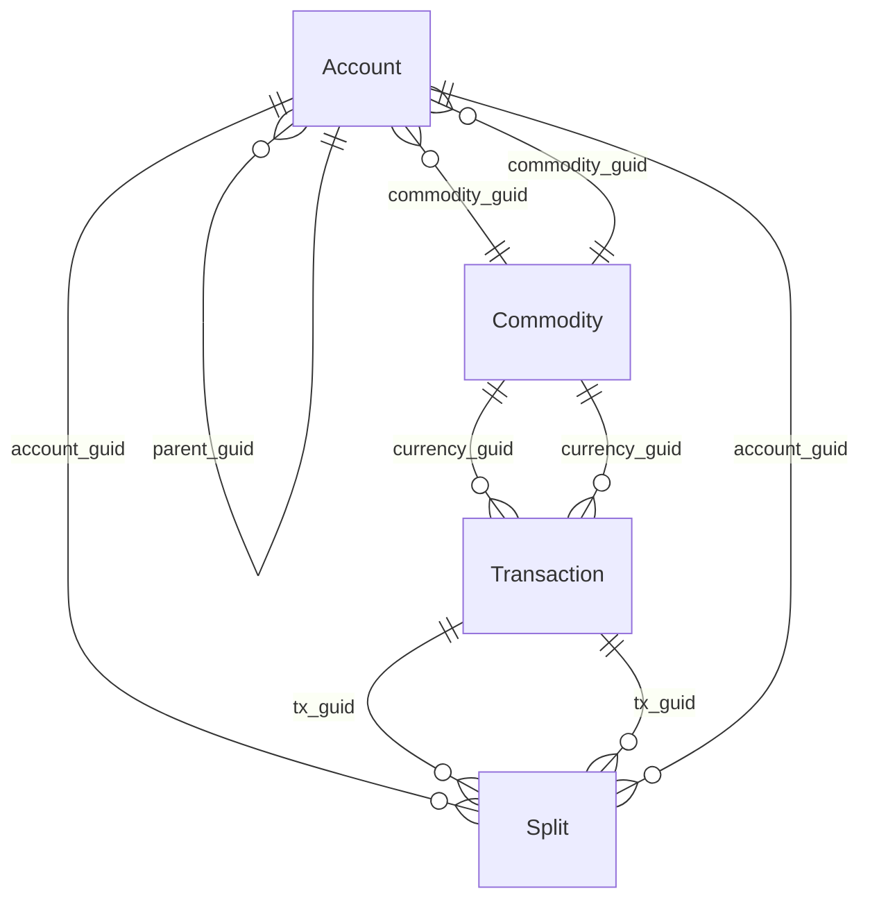

# Rebuild dossier: GnuCash

> Generated by `node tools/reborn.mjs dossier gnucash` on 2026-11-07 15:13 UTC.
> Source of truth: the YAML files next to this document. Do not edit this file by hand.
> Clean room: this dossier describes **behaviour**. It contains no original code, assets or branding.

## At a glance

| | |
|---|---|
| Target | GnuCash (GnuCash community) |
| Kind / platforms | exe / windows |
| Domain | double-entry accounting (small business and personal) |
| Versions studied | 5.17 |
| Technology | unknown |
| Features | 1: must 1 / partial 1 |
| Rules, screens, entities | 2, 2, 4 |
| Open questions | 3 |
| Exploration | 4 missions, 0 runs, 0 observations |
| Evidence entries | 24 |

## Features

| ID | Feature | Module | Priority | Status | Confidence | Screens | Rules | Tests |
|---|---|---|---|---|---|---|---|---|
| [F-001](#f-001) | Record a balanced transaction between two accounts | Ledger | must | partial | medium | S-002 | R-001, R-002 | 1 |

### F-001

**Record a balanced transaction between two accounts** · Ledger · priority **must** · partial (medium confidence)

**Goal.** As a bookkeeper, I record a dated transaction that moves an amount from one account to another so that both accounts' balances update and the books stay balanced.

**Actors.** bookkeeper

**Entry points.** S-002 (Transaction register (account entry)): Open an account register, start a new line

**Preconditions.**
- at least two accounts exist
- a currency/commodity is set on the accounts

**Inputs.**

| Label | Field | Type | Required | Default | Validation |
|---|---|---|---|---|---|
| Date | Transaction.post_date | date | yes |  |  |
| Description | Transaction.description | string |  |  |  |
| Transfer account | Split.account_guid | ref | yes |  |  |
| Amount (debit or credit) | Split.value_num | money | yes |  | the two splits must balance (R-001) |

**Steps.**
1. _user_: enters date, description, the other account and an amount [S-002]
2. _system_: creates two splits (one per account) as num/denom fractions (R-002)
3. _system_: checks the splits sum to zero; if not, reports imbalance / adds an Imbalance split (R-001)
4. _system_: updates both account running balances

**Business rules applied.**
- **R-001** A transaction must balance (double entry): The splits of a transaction must sum to zero in the transaction currency. If they do not, the engine reports an imbalance and completes the entry with a balancing split to an "Imbalance" account rather than storing an unbalanced transaction. `sum(split.value_num / split.value_denom for split in transaction.splits) == 0
if not balanced: add split to account "Imbalance-<CUR>" for the negated difference
`
- **R-002** Amounts are stored as exact rational fractions (numerator / denominator): Monetary amounts are not floats. Each amount is a pair (numerator, denominator); the denominator is the smallest currency unit (for example 100 for euros/cents). This avoids rounding drift across sums. `amount = value_num / value_denom          # e.g. 360.00 EUR -> value_num=36000, value_denom=100
a rebuild should store integer minor units (or a decimal/rational type), never a binary float
`

**Outputs.**
- _data-change_: one transaction and two splits stored (Transaction, Split)

**Errors and edge cases.**
- When the entry does not balance and no second account is given: the amount is posted to an Imbalance-<CUR> account so the books still balance

**Acceptance scenarios.**
- **AC-001** Given two accounts 'Bank' and 'Groceries' in EUR; when the user records 25.00 from Bank to Groceries on a given date; then Bank decreases by 25.00, Groceries increases by 25.00, the transaction balances to zero. Expected: .

**Rebuild notes.**

Model Transaction with 2+ Split children; store amounts as integer minor units (or a decimal/rational type), never a float (R-002). Enforce sum(splits)=0 on save; offer an Imbalance account as the fallback (R-001). The register screen (S-002) is a code-built grid: confirm its exact columns and the debit/credit convention from a run before finalising.

**Evidence.** craft 2: `ev_1eba78691fc38891237...` (engine balance/imbalance functions), `ev_bc68474c465691f6490...` (transactions/splits tables and num/denom columns)

**Open questions.** U-001, U-002

## Business rules

### R-001 A transaction must balance (double entry)

_validation_ · partial (medium) · evidence: craft 1

The splits of a transaction must sum to zero in the transaction currency. If they do not, the engine reports an imbalance and completes the entry with a balancing split to an "Imbalance" account rather than storing an unbalanced transaction.

```text
sum(split.value_num / split.value_denom for split in transaction.splits) == 0
if not balanced: add split to account "Imbalance-<CUR>" for the negated difference

```

Applies to: Transaction, Split.value_num, Split.value_denom

### R-002 Amounts are stored as exact rational fractions (numerator / denominator)

_rounding_ · partial (medium) · evidence: craft 1

Monetary amounts are not floats. Each amount is a pair (numerator, denominator); the denominator is the smallest currency unit (for example 100 for euros/cents). This avoids rounding drift across sums.

```text
amount = value_num / value_denom          # e.g. 360.00 EUR -> value_num=36000, value_denom=100
a rebuild should store integer minor units (or a decimal/rational type), never a binary float

```

Applies to: Split.value_num, Split.value_denom, Split.quantity_num, Split.quantity_denom

## Data model



### Account

A node in the chart of accounts. Accounts form a tree and carry the running balances; every split posts to one account. · partial · storage: SQLite (one of several backends; XML is the other) (accounts)

| Field | Label | Type | Required | Details |
|---|---|---|---|---|
| guid |  | string | yes | unique |
| name | Account name | string | yes |  |
| account_type | Account Type | enum |  |  |
| code | Account Code | string |  |  |
| description | Description | string |  |  |
| commodity_guid | Commodity/Currency | ref |  | → Commodity |
| commodity_scu |  | integer |  |  |
| parent_guid | Parent Account | ref |  | → Account |
| placeholder | Placeholder | boolean |  |  |
| hidden | Hidden | boolean |  |  |

### Commodity

A currency or security in which accounts and transactions are denominated (EUR, USD, a stock). · hypothesis · storage: SQLite (commodities)

| Field | Label | Type | Required | Details |
|---|---|---|---|---|
| guid |  | string | yes | unique |

### Split

One leg of a transaction. It posts a signed amount to a single account; the splits of a transaction must sum to zero (double entry). · partial · storage: SQLite (splits)

| Field | Label | Type | Required | Details |
|---|---|---|---|---|
| guid |  | string | yes | unique |
| tx_guid | Transaction | ref | yes | → Transaction |
| account_guid | Account | ref | yes | → Account |
| memo | Memo | string |  |  |
| action | Action | string |  |  |
| reconcile_state | Reconciled | enum |  |  |
| reconcile_date | Reconcile date | datetime |  |  |
| value_num | Value (numerator) | integer |  | computed by R-002 |
| value_denom | Value (denominator) | integer |  | computed by R-002 |
| quantity_num |  | integer |  | computed by R-002 |
| quantity_denom |  | integer |  | computed by R-002 |
| lot_guid | Lot | string |  |  |

### Transaction

A dated accounting entry. It groups two or more splits that must balance to zero. · partial · storage: SQLite (transactions)

| Field | Label | Type | Required | Details |
|---|---|---|---|---|
| guid |  | string | yes | unique |
| currency_guid | Currency | ref |  | → Commodity |
| num | Number/Reference | string |  |  |
| post_date | Date | date |  |  |
| enter_date | Date entered | datetime |  |  |
| description | Description | string |  |  |

## Screens

### S-001 New Account

_dialog_ · partial · Create or edit an account in the chart of accounts.

Layout: Account name and description at top; type list and parent-account tree; commodity/currency; flags (placeholder, hidden) and opening options. (From the shipped GtkBuilder file; exact arrangement to confirm from a screenshot.)

| Label | Control | Binds | Required | Validation |
|---|---|---|---|---|
| Account name | text | Account.name | yes |  |
| Account code | text | Account.code |  |  |
| Description | text | Account.description |  |  |
| Account Type | select | Account.account_type |  |  |
| Parent Account | lookup | Account.parent_guid |  |  |
| Security/currency | lookup | Account.commodity_guid |  |  |
| Placeholder | checkbox | Account.placeholder |  |  |
| Hidden | checkbox | Account.hidden |  |  |

Actions:
- OK
- Cancel

### S-002 Transaction register (account entry)

_master-detail_ · hypothesis · Enter and view the transactions of an account, with the running balance.

Layout: A grid of transactions; each row expands into its splits (account, debit, credit); a running balance column. Built in code at runtime (no DIALOG resource), so the exact columns must be confirmed from a screenshot.

| Label | Control | Binds | Required | Validation |
|---|---|---|---|---|
| Date | date | Transaction.post_date |  |  |
| Num | text | Transaction.num |  |  |
| Description | text | Transaction.description |  |  |
| Transfer (account) | lookup | Split.account_guid |  |  |
| Debit | money | Split.value_num |  |  |
| Credit | money | Split.value_num |  |  |
| Balance | display |  |  |  |
| Reconcile | display | Split.reconcile_state |  |  |

Actions:
- Enter (save transaction)
- Cancel
- Split

## Open questions

| ID | Question | Why it matters | Blocks | Probe |
|---|---|---|---|---|
| U-001 | What are the exact running balances after a known transaction, and how is the debit/credit side shown? | F-001's acceptance scenario has no expected values; the balance rule (R-001) stays below confirmed without an observed run. | F-001 | h-mission: Create a new book, two EUR accounts (Bank asset, Groceries expense), record 25.00 from Bank to Groceries, read back both balances and screenshot the register. |
| U-002 | What is the real database schema (types, primary and foreign keys, the denominator per currency)? | the entity cards have column names from the binary but no types or keys; R-002 needs the denominator confirmed. | F-001 | h-mission: Save the book created above as an SQLite file (File > Save As, SQLite), then hand the .gnucash file to block 2 to run `reborn sqlite`. |
| U-003 | Which screens exist for invoices, customers, taxes, and how do they flow? | the data model shows invoices/customers/taxtables tables and the UI files list 111 windows, but the business flows are not mapped. |  | h-mission: Tour the Business menu (customers, invoices, process payment), screenshot each window. |

## Traceability

| Feature | Rules | Screens | Entities | Evidence | Tests |
|---|---|---|---|---|---|
| F-001 | R-001, R-002 | S-002 | Transaction, Split, Account | craft 2 | AC-001 |

## Evidence register

24 entries in `evidence/index.yaml` (raw files stay in the investigator's local evidence store, never in git).

| Tool / operation | Count |
|---|---|
| rea-agents inspect-native-exports | 2 |
| rea-agents inspect-go-binary | 2 |
| rea-agents inspect-go-binary (complete evidence) | 2 |
| rea-agents inspect-rust-binary | 2 |
| rea-agents inspect-rust-binary (complete evidence) | 2 |
| rea-agents inspect-artifact | 2 |
| rea-agents inspect-artifact (complete evidence) | 2 |
| rea-agents inspect-pe-imports | 1 |
| rea-agents inspect-pe-resources | 1 |
| rea-agents inspect-pe-certificates | 1 |
| rea-agents inspect-pe-load-config | 1 |
| rea-agents inspect-managed-artifact | 1 |
| craft-anything native-strings-find | 3 |
| craft-anything core-feature-find | 1 |
| reborn-ui gtkbuilder-inventory | 1 |
