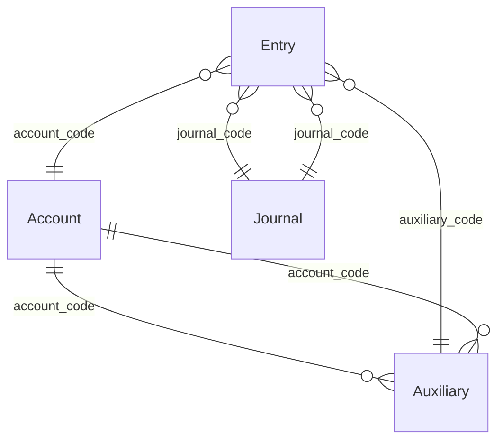

# Rebuild dossier: Windows desktop accounting software for small businesses

> Generated by `node tools/reborn.mjs dossier pc-compta` from inputs `ab77ab8145298729` (the same cards always give the same dossier).
> Source of truth: the YAML files next to this document. Do not edit this file by hand.
> Clean room: this dossier describes **behaviour**. It contains no original code, assets or branding.

## At a glance

| | |
|---|---|
| Target | Windows desktop accounting software for small businesses |
| Kind / platforms | exe / windows |
| Domain | general / auxiliary / analytical accounting (Algerian SCF) |
| Versions studied | Windows (internet build), DOS 8.01 |
| Technology | unknown |
| Features | 1: must 1 / hypothesis 1 |
| Rules, screens, entities | 3, 1, 4 |
| Open questions | 3 |
| Exploration | 3 missions, 0 runs, 0 observations |
| Evidence entries | 3 |

## Features

| ID | Feature | Module | Priority | Status | Confidence | Screens | Rules | Tests |
|---|---|---|---|---|---|---|---|---|
| [F-001](#f-001) | Record an accounting entry in a journal folio | Saisie | must | hypothesis | low | S-001 | R-001, R-002 | 1 |

### F-001

**Record an accounting entry in a journal folio** · Saisie · priority **must** · hypothesis (low confidence)

**Goal.** As an accountant, I record an entry in a journal so that the account and its auxiliary are updated, with the correct debit/credit side.

**Actors.** accountant

**Entry points.** S-001 (Entry input (saisie des ecritures)): Open a journal, a folio, start a line

**Preconditions.**
- the journal, account and auxiliary exist (or are created on the fly during input)

**Inputs.**

| Label | Field | Type | Required | Default | Validation |
|---|---|---|---|---|---|
| Date | Entry.date | date | yes |  |  |
| Compte | Entry.account_code | ref | yes |  |  |
| Auxiliaire | Entry.auxiliary_code | ref |  |  | if the account has a prefix, the code must start with it (R-002) |
| Montant | Entry.amount | decimal |  |  |  |

**Steps.**
1. _user_: chooses journal and folio [S-001]
2. _user_: enters date, account, optional auxiliary, amount
3. _system_: places the amount on debit or credit per the journal nature (R-001)
4. _system_: enforces the auxiliary prefix if set (R-002)

**Business rules applied.**
- **R-001** The journal nature decides the debit/credit side at input: During entry, the software uses the journal's nature (Purchases, Sales, Treasury, ...) to position the amount on the correct side (debit or credit) automatically.
- **R-002** An auxiliary prefix restricts which codes an account accepts: An account "subject to auxiliaries" can be given a prefix; it then accepts only auxiliary codes that start with that prefix. Example: account 470 with prefix 47 accepts only codes beginning with 47. `if account.soumis_auxiliaires and account.prefixe_auxiliaire:
    reject auxiliary_code unless auxiliary_code.startswith(account.prefixe_auxiliaire)
`

**Outputs.**
- _data-change_: one entry stored in the folio (Entry)

**Acceptance scenarios.**
- **AC-001** Given a Sales journal, account 411 subject to auxiliaries with prefix 41; when the accountant enters a 1000,00 DA line with auxiliary 41001; then the amount lands on the expected side for a Sales journal and the auxiliary 41001 is accepted. Expected: .

**Rebuild notes.**

Everything here is from the vendor's public sheet (status hypothesis). Do not build from this alone: block 1 must confirm the field order, the debit/credit behaviour and the prefix rule on the official evaluation version before this feature is implemented. Keep the 14-char code / 30-char label widths and the three analytical axes.

**Evidence.** manual 1: `doc:f89df11c9fd39e7e`

**Open questions.** U-001, U-002, U-003

## Business rules

### R-001 The journal nature decides the debit/credit side at input

_workflow_ · hypothesis (low) · evidence: manual 1

During entry, the software uses the journal's nature (Purchases, Sales, Treasury, ...) to position the amount on the correct side (debit or credit) automatically.

Applies to: Journal.nature, Entry.sens

### R-002 An auxiliary prefix restricts which codes an account accepts

_validation_ · hypothesis (low) · evidence: manual 1

An account "subject to auxiliaries" can be given a prefix; it then accepts only auxiliary codes that start with that prefix. Example: account 470 with prefix 47 accepts only codes beginning with 47.

```text
if account.soumis_auxiliaires and account.prefixe_auxiliaire:
    reject auxiliary_code unless auxiliary_code.startswith(account.prefixe_auxiliaire)

```

Applies to: Account.prefixe_auxiliaire, Entry.auxiliary_code

| Given | Expect | Source |
|---|---|---|
| account=470, prefix=47, auxiliary_code=47001 | accepted=true |  |
| account=470, prefix=47, auxiliary_code=51001 | accepted=false |  |

### R-003 Reconcilable accounts carry forward unreconciled entries at period open

_workflow_ · hypothesis (low) · evidence: manual 1

At the start of a fiscal year, a lettered (reconcilable) account receives, instead of a single opening balance, all the unreconciled entries that justify that balance, kept at their original dates.

Applies to: Account.lettrable

## Data model



### Account

A general-ledger account from the chart of accounts. May be lettered (reconcilable) and/or subject to auxiliaries. · hypothesis · storage: unknown (proprietary)

| Field | Label | Type | Required | Details |
|---|---|---|---|---|
| code | Compte | string | yes | max 14 |
| label | Intitule | string |  | max 30 |
| lettrable | Lettrable | boolean |  |  |
| soumis_auxiliaires | Soumis a auxiliaires | boolean |  |  |
| prefixe_auxiliaire | Prefixe auxiliaire | string |  |  |

### Auxiliary

A third party or sub-ledger code (customer, supplier, employee, product family) for individual tracking under control accounts. · hypothesis · storage: unknown (proprietary)

| Field | Label | Type | Required | Details |
|---|---|---|---|---|
| code | Numero auxiliaire | string | yes | max 14 |
| label | Intitule | string |  | max 30 |
| address | Adresse | text |  |  |
| identifiant_fiscal | Identifiant fiscal | string |  |  |
| nrc | N RC | string |  |  |
| article_imposition | Article d'imposition | string |  |  |
| telephone | Telephone | string |  |  |

### Entry

An accounting entry line inside a folio of a journal. Carries up to three extra analytical codes (Postes, Natures, Unites). · hypothesis · storage: unknown (proprietary)

| Field | Label | Type | Required | Details |
|---|---|---|---|---|
| journal_code | Journal | ref | yes | → Journal |
| folio | Folio | integer |  |  |
| date | Date | date |  |  |
| account_code | Compte | ref | yes | → Account |
| auxiliary_code | Auxiliaire | ref |  | → Auxiliary |
| amount | Montant | decimal |  | 2 decimals |
| sens | Sens | enum |  | values: D / C |
| poste | Poste | string |  |  |
| nature_analytique | Nature | string |  |  |
| unite | Unite | string |  |  |

### Journal

A book of entries of one nature. Its nature drives where the entry lands (debit or credit) during input. · hypothesis · storage: unknown (proprietary)

| Field | Label | Type | Required | Details |
|---|---|---|---|---|
| code | Code | string | yes | max 14 |
| label | Intitule | string |  | max 30 |
| nature | Nature | enum |  | values: Achats / Ventes / Tresorerie / Autre |

## Screens

### S-001 Entry input (saisie des ecritures)

_form_ · hypothesis · Enter accounting lines into a folio of a journal.

Layout: Unknown from documentation. The sheet says entries are grouped into folios per journal; input offers on-the-fly creation of journal/account/auxiliary and inline consultation of accounts, journals and the general ledger.

| Label | Control | Binds | Required | Validation |
|---|---|---|---|---|
| Journal | lookup | Entry.journal_code |  |  |
| Folio | number | Entry.folio |  |  |
| Date | date | Entry.date |  |  |
| Compte | lookup | Entry.account_code |  |  |
| Auxiliaire | lookup | Entry.auxiliary_code |  |  |
| Montant | money | Entry.amount |  |  |

Actions:
- Creer un compte/journal/auxiliaire en cours de saisie
- Consulter compte / journal / grand livre

## Open questions

| ID | Question | Why it matters | Blocks | Probe |
|---|---|---|---|---|
| U-001 | What does the entry screen look like and what is the exact field order and folio workflow? | no screen could be inventoried (proprietary binary, not analysed); the whole screen layer is missing. | F-001 | h-mission: On the official evaluation version, open a Sales journal, enter one balanced entry with an auxiliary, screenshot each step. |
| U-002 | How is data stored (file format, tables, types)? | the data model is inferred from the technical sheet; without the real files, types/keys are unknown and no migration can be written. |  | manual: Observe the evaluation version's data folder structure (file names/extensions only, no decompilation). |
| U-003 | Exact rounding and the maximum amounts behaviour. | the sheet gives caps (99 999 999 999,99 DA per entry) but not the rounding rule for tax/totals. |  | h-mission: Enter amounts with centimes and read back totals and any tax line. |

## Traceability

| Feature | Rules | Screens | Entities | Evidence | Tests |
|---|---|---|---|---|---|
| F-001 | R-001, R-002 | S-001 | Entry, Journal, Account, Auxiliary | manual 1 | AC-001 |

## Evidence register

3 entries in `evidence/index.yaml` (raw files stay in the investigator's local evidence store, never in git).

| Tool / operation | Count |
|---|---|
| crawl4ai public-documentation | 3 |
