# Rebuild dossier: Open-source point-of-sale desktop application

> Generated by `node tools/reborn.mjs dossier unicenta` from inputs `db189677a4fa2637` (the same cards always give the same dossier).
> Source of truth: the YAML files next to this document. Do not edit this file by hand.
> Clean room: this dossier describes **behaviour**. It contains no original code, assets or branding.

## At a glance

| | |
|---|---|
| Target | Open-source point-of-sale desktop application |
| Kind / platforms | exe / windows, linux, macos |
| Domain | point of sale (retail and restaurant till) |
| Versions studied | unicentaopos.jar (from the official SourceForge file) |
| Technology | Java (Swing desktop), Openbravo POS lineage; ships HSQLDB and Derby create scripts; 1089 classes under com.openbravo.pos (confirmed) |
| Features | 1: must 1 / partial 1 |
| Rules, screens, entities | 2, 1, 40 |
| Open questions | 2 |
| Exploration | 3 missions, 0 runs, 0 observations |
| Evidence entries | 1 |

## Features

| ID | Feature | Module | Priority | Status | Confidence | Screens | Rules | Tests |
|---|---|---|---|---|---|---|---|---|
| [F-001](#f-001) | Ring up a ticket and take payment | Sales | must | partial | medium | S-001 | R-001, R-002 | 1 |

### F-001

**Ring up a ticket and take payment** · Sales · priority **must** · partial (medium confidence)

**Goal.** As a cashier, I add products to a ticket, see the total with tax, take payment and get the change, so the sale is recorded.

**Actors.** cashier

**Entry points.** S-001 (Sale screen (till)): Sale screen

**Preconditions.**
- at least one product with a price and a tax category exists
- a cash session is open (CLOSEDCASH)

**Inputs.**

| Label | Field | Type | Required | Default | Validation |
|---|---|---|---|---|---|
| Product | Ticketlines.product | ref | yes |  |  |
| Units | Ticketlines.units | decimal | yes |  |  |
| Tendered | Payments.total | decimal |  |  |  |

**Steps.**
1. _user_: adds one or more products (each becomes a ticket line) [S-001]
2. _system_: computes line totals and the ticket total with tax (R-001)
3. _user_: chooses a payment method and tenders an amount
4. _system_: computes change, records receipt, payment and tax lines (R-002)

**Business rules applied.**
- **R-001** Ticket line and ticket totals: A ticket line total is units times unit price. The ticket total is the sum of its line totals plus the tax computed per tax rate. Each line references one tax (TICKETLINES.TAXID -> TAXES.RATE). `line_base  = TICKETLINES.UNITS * TICKETLINES.PRICE
line_tax   = line_base * TAXES.RATE                 # per line's tax
ticket_base = sum(line_base)
ticket_tax  = sum(line_tax)                          # stored per rate in TAXLINES (BASE, AMOUNT)
ticket_total = ticket_base + ticket_tax
`
- **R-002** Payment and change: A ticket is settled by one or more payments (cash, card, ...). The total paid must cover the ticket total; for cash, the change is the tendered amount minus the ticket total. `paid = sum(PAYMENTS.TOTAL for the receipt)
change = tendered_cash - ticket_total        # cash only
settled when paid >= ticket_total
`

**Outputs.**
- _data-change_: ticket, ticket lines, receipt, payment(s) and tax lines stored (Tickets, Ticketlines, Receipts, Payments, Taxlines)
- _print_: customer ticket/receipt

**Acceptance scenarios.**
- **AC-001** Given a product at 10.00 with a 20% tax, cash session open; when the cashier adds 3 units and tenders 40.00 cash; then ticket base 30.00, tax 6.00, total 36.00, change 4.00. Expected: .

**Rebuild notes.**

Data model is confirmed from the shipped schema. Build Ticket -> TicketLine (units, price, tax) -> Receipt -> Payment/TaxLine. Compute totals per R-001 but confirm the rounding and the RATECASCADE compound-tax order from an observed ticket before finalising. The sale screen (S-001) is a Swing panel built in code: capture it by a run.

**Evidence.** rea 1: `sql:6ae1364b7d43e617`

**Open questions.** U-001, U-002

## Business rules

### R-001 Ticket line and ticket totals

_computation_ · partial (medium) · evidence: rea 1

A ticket line total is units times unit price. The ticket total is the sum of its line totals plus the tax computed per tax rate. Each line references one tax (TICKETLINES.TAXID -> TAXES.RATE).

```text
line_base  = TICKETLINES.UNITS * TICKETLINES.PRICE
line_tax   = line_base * TAXES.RATE                 # per line's tax
ticket_base = sum(line_base)
ticket_tax  = sum(line_tax)                          # stored per rate in TAXLINES (BASE, AMOUNT)
ticket_total = ticket_base + ticket_tax

```

Applies to: Ticketlines.units, Ticketlines.price, Taxes.rate, Taxlines.base, Taxlines.amount

### R-002 Payment and change

_computation_ · partial (medium) · evidence: rea 1

A ticket is settled by one or more payments (cash, card, ...). The total paid must cover the ticket total; for cash, the change is the tendered amount minus the ticket total.

```text
paid = sum(PAYMENTS.TOTAL for the receipt)
change = tendered_cash - ticket_total        # cash only
settled when paid >= ticket_total

```

Applies to: Payments.total

## Data model

```mermaid
erDiagram
  Attributeinstance }o--|| Attributesetinstance : "attributesetinstance_id"
  Attributeinstance }o--|| Attribute : "attribute_id"
  Attributesetinstance }o--|| Attributeset : "attributeset_id"
  Attributeuse }o--|| Attributeset : "attributeset_id"
  Attributeuse }o--|| Attribute : "attribute_id"
  Attributevalue }o--|| Attribute : "attribute_id"
  Categories }o--|| Categories : "parentid"
  Customers }o--|| Taxcustcategories : "taxcategory"
  Leaves }o--|| People : "pplid"
  Payments }o--|| Receipts : "receipt"
  People }o--|| Roles : "role"
  Places }o--|| Floors : "floor"
  Products }o--|| Categories : "category"
  Products }o--|| Taxcategories : "taxcat"
  Products }o--|| Attributeset : "attributeset_id"
  ProductsCat }o--|| Products : "product"
  ProductsCom }o--|| Products : "product"
  ProductsCom }o--|| Products : "product2"
  Receipts }o--|| Closedcash : "money"
  ReservationCustomers }o--|| Reservations : "id"
  ReservationCustomers }o--|| Customers : "customer"
  ShiftBreaks }o--|| Breaks : "breakid"
  ShiftBreaks }o--|| Shifts : "shiftid"
  Stockcurrent }o--|| Products : "product"
  Stockcurrent }o--|| Attributesetinstance : "attributesetinstance_id"
  Stockcurrent }o--|| Locations : "location"
  Stockdiary }o--|| Products : "product"
  Stockdiary }o--|| Attributesetinstance : "attributesetinstance_id"
  Stockdiary }o--|| Locations : "location"
  Stocklevel }o--|| Products : "product"
  Stocklevel }o--|| Locations : "location"
  Taxes }o--|| Taxcategories : "category"
  Taxes }o--|| Taxcustcategories : "custcategory"
  Taxes }o--|| Taxes : "parentid"
  Taxlines }o--|| Taxes : "taxid"
  Taxlines }o--|| Receipts : "receipt"
  Ticketlines }o--|| Tickets : "ticket"
  Ticketlines }o--|| Products : "product"
  Ticketlines }o--|| Attributesetinstance : "attributesetinstance_id"
  Ticketlines }o--|| Taxes : "taxid"
  Tickets }o--|| Receipts : "id"
  Tickets }o--|| People : "person"
  Tickets }o--|| Customers : "customer"
```



### Applications

Table APPLICATIONS from the shipped database schema. · confirmed · storage: HSQLDB (APPLICATIONS)

| Field | Label | Type | Required | Details |
|---|---|---|---|---|
| id |  | string | yes | unique; max 255 |
| name |  | string | yes | max 255 |
| version |  | string | yes | max 255 |

### Attribute

Table ATTRIBUTE from the shipped database schema. · confirmed · storage: HSQLDB (ATTRIBUTE)

| Field | Label | Type | Required | Details |
|---|---|---|---|---|
| id |  | string | yes | unique; max 255 |
| name |  | string | yes | max 255 |

### Attributeinstance

Table ATTRIBUTEINSTANCE from the shipped database schema. · confirmed · storage: HSQLDB (ATTRIBUTEINSTANCE)

| Field | Label | Type | Required | Details |
|---|---|---|---|---|
| id |  | string | yes | unique; max 255 |
| attributesetinstance_id |  | ref | yes | → Attributesetinstance |
| attribute_id |  | ref | yes | → Attribute |
| value |  | string |  | max 255 |

### Attributeset

Table ATTRIBUTESET from the shipped database schema. · confirmed · storage: HSQLDB (ATTRIBUTESET)

| Field | Label | Type | Required | Details |
|---|---|---|---|---|
| id |  | string | yes | unique; max 255 |
| name |  | string | yes | max 255 |

### Attributesetinstance

Table ATTRIBUTESETINSTANCE from the shipped database schema. · confirmed · storage: HSQLDB (ATTRIBUTESETINSTANCE)

| Field | Label | Type | Required | Details |
|---|---|---|---|---|
| id |  | string | yes | unique; max 255 |
| attributeset_id |  | ref | yes | → Attributeset |
| description |  | string |  | max 255 |

### Attributeuse

Table ATTRIBUTEUSE from the shipped database schema. · confirmed · storage: HSQLDB (ATTRIBUTEUSE)

| Field | Label | Type | Required | Details |
|---|---|---|---|---|
| id |  | string | yes | unique; max 255 |
| attributeset_id |  | ref | yes | → Attributeset |
| attribute_id |  | ref | yes | → Attribute |
| lineno |  | integer |  |  |

### Attributevalue

Table ATTRIBUTEVALUE from the shipped database schema. · confirmed · storage: HSQLDB (ATTRIBUTEVALUE)

| Field | Label | Type | Required | Details |
|---|---|---|---|---|
| id |  | string | yes | unique; max 255 |
| attribute_id |  | ref | yes | → Attribute |
| value |  | string |  | max 255 |

### Breaks

Table BREAKS from the shipped database schema. · confirmed · storage: HSQLDB (BREAKS)

| Field | Label | Type | Required | Details |
|---|---|---|---|---|
| id |  | string | yes | unique; max 255 |
| name |  | string | yes | max 255 |
| notes |  | string |  | max 255 |
| visible |  | boolean | yes |  |

### Categories

Table CATEGORIES from the shipped database schema. 1 statement(s) on this table were not applied by the reader (column TEXTTIP declared twice (string, then boolean)): check them by hand. · partial · storage: HSQLDB (CATEGORIES)

| Field | Label | Type | Required | Details |
|---|---|---|---|---|
| id |  | string | yes | unique; max 255 |
| name |  | string | yes | max 255 |
| parentid |  | ref |  | → Categories |
| image |  | file |  |  |
| texttip |  | string |  | max 255 |

### Closedcash

Table CLOSEDCASH from the shipped database schema. · confirmed · storage: HSQLDB (CLOSEDCASH)

| Field | Label | Type | Required | Details |
|---|---|---|---|---|
| money |  | string | yes | unique; max 255 |
| host |  | string | yes | max 255 |
| hostsequence |  | integer | yes |  |
| datestart |  | datetime | yes |  |
| dateend |  | datetime |  |  |

### Csvimport

Table csvimport from the shipped database schema. · confirmed · storage: HSQLDB (csvimport)

| Field | Label | Type | Required | Details |
|---|---|---|---|---|
| id |  | string | yes | unique; max 255 |
| rownumber |  | string |  | max 255 |
| csverror |  | string |  | max 255 |
| reference |  | string |  | max 255 |
| code |  | string |  | max 255 |
| name |  | string |  | max 255 |
| pricebuy |  | decimal |  |  |
| pricesell |  | decimal |  |  |
| previousbuy |  | decimal |  |  |
| previoussell |  | decimal |  |  |

### Customers

Table CUSTOMERS from the shipped database schema. · confirmed · storage: HSQLDB (CUSTOMERS)

| Field | Label | Type | Required | Details |
|---|---|---|---|---|
| id |  | string | yes | unique; max 255 |
| searchkey |  | string | yes | max 255 |
| taxid |  | string |  | max 255 |
| name |  | string | yes | max 255 |
| taxcategory |  | ref |  | → Taxcustcategories |
| card |  | string |  | max 255 |
| maxdebt |  | decimal | yes |  |
| address |  | string |  | max 255 |
| address2 |  | string |  | max 255 |
| postal |  | string |  | max 255 |
| city |  | string |  | max 255 |
| region |  | string |  | max 255 |
| country |  | string |  | max 255 |
| firstname |  | string |  | max 255 |
| lastname |  | string |  | max 255 |
| email |  | string |  | max 255 |
| phone |  | string |  | max 255 |
| phone2 |  | string |  | max 255 |
| fax |  | string |  | max 255 |
| notes |  | string |  | max 255 |
| visible |  | boolean | yes |  |
| curdate |  | datetime |  |  |
| curdebt |  | decimal |  |  |

### Floors

Table FLOORS from the shipped database schema. · confirmed · storage: HSQLDB (FLOORS)

| Field | Label | Type | Required | Details |
|---|---|---|---|---|
| id |  | string | yes | unique; max 255 |
| name |  | string | yes | max 255 |
| image |  | file |  |  |

### Leaves

Table LEAVES from the shipped database schema. · confirmed · storage: HSQLDB (LEAVES)

| Field | Label | Type | Required | Details |
|---|---|---|---|---|
| id |  | string | yes | unique; max 255 |
| pplid |  | ref | yes | → People |
| name |  | string | yes | max 255 |
| startdate |  | datetime | yes |  |
| enddate |  | datetime | yes |  |
| notes |  | string |  | max 255 |

### Locations

Table LOCATIONS from the shipped database schema. · confirmed · storage: HSQLDB (LOCATIONS)

| Field | Label | Type | Required | Details |
|---|---|---|---|---|
| id |  | string | yes | unique; max 255 |
| name |  | string | yes | max 255 |
| address |  | string |  | max 255 |

### Moorers

Table moorers from the shipped database schema. · confirmed · storage: HSQLDB (moorers)

| Field | Label | Type | Required | Details |
|---|---|---|---|---|
| vesselname |  | string |  | max 255 |
| size |  | integer |  |  |
| days |  | integer |  |  |
| power |  | boolean | yes |  |

### Payments

Table PAYMENTS from the shipped database schema. · confirmed · storage: HSQLDB (PAYMENTS)

| Field | Label | Type | Required | Details |
|---|---|---|---|---|
| id |  | string | yes | unique; max 255 |
| receipt |  | ref | yes | → Receipts |
| payment |  | string | yes | max 255 |
| total |  | decimal | yes |  |
| transid |  | string |  | max 255 |
| returnmsg |  | file |  |  |
| notes |  | string |  | max 255 |

### People

Table PEOPLE from the shipped database schema. · confirmed · storage: HSQLDB (PEOPLE)

| Field | Label | Type | Required | Details |
|---|---|---|---|---|
| id |  | string | yes | unique; max 255 |
| name |  | string | yes | max 255 |
| apppassword |  | string |  | max 255 |
| card |  | string |  | max 255 |
| role |  | ref | yes | → Roles |
| visible |  | boolean | yes |  |
| image |  | file |  |  |

### Places

Table PLACES from the shipped database schema. · confirmed · storage: HSQLDB (PLACES)

| Field | Label | Type | Required | Details |
|---|---|---|---|---|
| id |  | string | yes | unique; max 255 |
| name |  | string | yes | max 255 |
| x |  | integer | yes |  |
| y |  | integer | yes |  |
| floor |  | ref | yes | → Floors |

### Products

Table PRODUCTS from the shipped database schema. · confirmed · storage: HSQLDB (PRODUCTS)

| Field | Label | Type | Required | Details |
|---|---|---|---|---|
| id |  | string | yes | unique; max 255 |
| reference |  | string | yes | max 255 |
| code |  | string | yes | max 255 |
| codetype |  | string |  | max 255 |
| name |  | string | yes | max 255 |
| pricebuy |  | decimal | yes |  |
| pricesell |  | decimal | yes |  |
| category |  | ref | yes | → Categories |
| taxcat |  | ref | yes | → Taxcategories |
| attributeset_id |  | ref |  | → Attributeset |
| stockcost |  | decimal |  |  |
| stockvolume |  | decimal |  |  |
| image |  | file |  |  |
| iscom |  | boolean | yes |  |
| isscale |  | boolean | yes |  |
| iskitchen |  | boolean | yes |  |
| printkb |  | boolean | yes |  |
| sendstatus |  | boolean | yes |  |
| isservice |  | boolean | yes |  |
| attributes |  | file |  |  |
| display |  | string |  | max 255 |
| isvprice |  | boolean | yes |  |
| isverpatrib |  | boolean | yes |  |
| texttip |  | string |  | max 255 |

### ProductsCat

Table PRODUCTS_CAT from the shipped database schema. · confirmed · storage: HSQLDB (PRODUCTS_CAT)

| Field | Label | Type | Required | Details |
|---|---|---|---|---|
| product |  | ref | yes | unique; → Products |
| catorder |  | integer |  |  |

### ProductsCom

Table PRODUCTS_COM from the shipped database schema. · confirmed · storage: HSQLDB (PRODUCTS_COM)

| Field | Label | Type | Required | Details |
|---|---|---|---|---|
| id |  | string | yes | unique; max 255 |
| product |  | ref | yes | → Products |
| product2 |  | ref | yes | → Products |

### Receipts

Table RECEIPTS from the shipped database schema. · confirmed · storage: HSQLDB (RECEIPTS)

| Field | Label | Type | Required | Details |
|---|---|---|---|---|
| id |  | string | yes | unique; max 255 |
| money |  | ref | yes | → Closedcash |
| datenew |  | datetime | yes |  |
| attributes |  | file |  |  |
| person |  | string |  | max 255 |

### ReservationCustomers

Table RESERVATION_CUSTOMERS from the shipped database schema. · confirmed · storage: HSQLDB (RESERVATION_CUSTOMERS)

| Field | Label | Type | Required | Details |
|---|---|---|---|---|
| id |  | ref | yes | unique; → Reservations |
| customer |  | ref | yes | → Customers |

### Reservations

Table RESERVATIONS from the shipped database schema. · confirmed · storage: HSQLDB (RESERVATIONS)

| Field | Label | Type | Required | Details |
|---|---|---|---|---|
| id |  | string | yes | unique; max 255 |
| created |  | datetime | yes |  |
| datenew |  | datetime | yes |  |
| title |  | string | yes | max 255 |
| chairs |  | integer | yes |  |
| isdone |  | boolean | yes |  |
| description |  | string |  | max 255 |

### Resources

Table RESOURCES from the shipped database schema. · confirmed · storage: HSQLDB (RESOURCES)

| Field | Label | Type | Required | Details |
|---|---|---|---|---|
| id |  | string | yes | unique; max 255 |
| name |  | string | yes | max 255 |
| restype |  | integer | yes |  |
| content |  | file |  |  |

### Roles

Table ROLES from the shipped database schema. · confirmed · storage: HSQLDB (ROLES)

| Field | Label | Type | Required | Details |
|---|---|---|---|---|
| id |  | string | yes | unique; max 255 |
| name |  | string | yes | max 255 |
| permissions |  | file |  |  |

### Sharedtickets

Table SHAREDTICKETS from the shipped database schema. · confirmed · storage: HSQLDB (SHAREDTICKETS)

| Field | Label | Type | Required | Details |
|---|---|---|---|---|
| id |  | string | yes | unique; max 255 |
| name |  | string | yes | max 255 |
| content |  | file |  |  |

### ShiftBreaks

Table SHIFT_BREAKS from the shipped database schema. · confirmed · storage: HSQLDB (SHIFT_BREAKS)

| Field | Label | Type | Required | Details |
|---|---|---|---|---|
| id |  | string | yes | unique; max 255 |
| shiftid |  | ref | yes | → Shifts |
| breakid |  | ref | yes | → Breaks |
| starttime |  | datetime | yes |  |
| endtime |  | datetime |  |  |

### Shifts

Table SHIFTS from the shipped database schema. · confirmed · storage: HSQLDB (SHIFTS)

| Field | Label | Type | Required | Details |
|---|---|---|---|---|
| id |  | string | yes | unique; max 255 |
| startshift |  | datetime | yes |  |
| endshift |  | datetime |  |  |
| pplid |  | string | yes | max 255 |

### Stockcurrent

Table STOCKCURRENT from the shipped database schema. · confirmed · storage: HSQLDB (STOCKCURRENT)

| Field | Label | Type | Required | Details |
|---|---|---|---|---|
| location |  | ref | yes | → Locations |
| product |  | ref | yes | → Products |
| attributesetinstance_id |  | ref |  | → Attributesetinstance |
| units |  | decimal | yes |  |

### Stockdiary

Table STOCKDIARY from the shipped database schema. · confirmed · storage: HSQLDB (STOCKDIARY)

| Field | Label | Type | Required | Details |
|---|---|---|---|---|
| id |  | string | yes | unique; max 255 |
| datenew |  | datetime | yes |  |
| reason |  | integer | yes |  |
| location |  | ref | yes | → Locations |
| product |  | ref | yes | → Products |
| attributesetinstance_id |  | ref |  | → Attributesetinstance |
| units |  | decimal | yes |  |
| price |  | decimal | yes |  |

### Stocklevel

Table STOCKLEVEL from the shipped database schema. · confirmed · storage: HSQLDB (STOCKLEVEL)

| Field | Label | Type | Required | Details |
|---|---|---|---|---|
| id |  | string | yes | unique; max 255 |
| location |  | ref | yes | → Locations |
| product |  | ref | yes | → Products |
| stocksecurity |  | decimal |  |  |
| stockmaximum |  | decimal |  |  |

### Taxcategories

Table TAXCATEGORIES from the shipped database schema. · confirmed · storage: HSQLDB (TAXCATEGORIES)

| Field | Label | Type | Required | Details |
|---|---|---|---|---|
| id |  | string | yes | unique; max 255 |
| name |  | string | yes | max 255 |

### Taxcustcategories

Table TAXCUSTCATEGORIES from the shipped database schema. · confirmed · storage: HSQLDB (TAXCUSTCATEGORIES)

| Field | Label | Type | Required | Details |
|---|---|---|---|---|
| id |  | string | yes | unique; max 255 |
| name |  | string | yes | max 255 |

### Taxes

Table TAXES from the shipped database schema. · confirmed · storage: HSQLDB (TAXES)

| Field | Label | Type | Required | Details |
|---|---|---|---|---|
| id |  | string | yes | unique; max 255 |
| name |  | string | yes | max 255 |
| category |  | ref | yes | → Taxcategories |
| custcategory |  | ref |  | → Taxcustcategories |
| parentid |  | ref |  | → Taxes |
| rate |  | decimal | yes |  |
| ratecascade |  | boolean | yes |  |
| rateorder |  | integer |  |  |

### Taxlines

Table TAXLINES from the shipped database schema. · confirmed · storage: HSQLDB (TAXLINES)

| Field | Label | Type | Required | Details |
|---|---|---|---|---|
| id |  | string | yes | unique; max 255 |
| receipt |  | ref | yes | → Receipts |
| taxid |  | ref | yes | → Taxes |
| base |  | decimal | yes |  |
| amount |  | decimal | yes |  |

### Thirdparties

Table THIRDPARTIES from the shipped database schema. · confirmed · storage: HSQLDB (THIRDPARTIES)

| Field | Label | Type | Required | Details |
|---|---|---|---|---|
| id |  | string | yes | unique; max 255 |
| cif |  | string | yes | max 255 |
| name |  | string | yes | max 255 |
| address |  | string |  | max 255 |
| contactcomm |  | string |  | max 255 |
| contactfact |  | string |  | max 255 |
| payrule |  | string |  | max 255 |
| faxnumber |  | string |  | max 255 |
| phonenumber |  | string |  | max 255 |
| mobilenumber |  | string |  | max 255 |
| email |  | string |  | max 255 |
| webpage |  | string |  | max 255 |
| notes |  | string |  | max 255 |

### Ticketlines

Table TICKETLINES from the shipped database schema. · confirmed · storage: HSQLDB (TICKETLINES)

| Field | Label | Type | Required | Details |
|---|---|---|---|---|
| ticket |  | ref | yes | → Tickets |
| line |  | integer | yes |  |
| product |  | ref |  | → Products |
| attributesetinstance_id |  | ref |  | → Attributesetinstance |
| units |  | decimal | yes |  |
| price |  | decimal | yes |  |
| taxid |  | ref | yes | → Taxes |
| attributes |  | file |  |  |

### Tickets

Table TICKETS from the shipped database schema. · confirmed · storage: HSQLDB (TICKETS)

| Field | Label | Type | Required | Details |
|---|---|---|---|---|
| id |  | ref | yes | unique; → Receipts |
| tickettype |  | integer | yes |  |
| ticketid |  | integer | yes |  |
| person |  | ref | yes | → People |
| customer |  | ref |  | → Customers |
| status |  | integer | yes |  |

## Screens

### S-001 Sale screen (till)

_pos-pad_ · hypothesis · Ring up a ticket: pick products, see the lines and totals, take payment.

Layout: Product pad/catalog on one side, the ticket lines grid with units/price/total in the middle, totals and the payment buttons at the bottom. (Inferred from the class names and the data model; confirm by a run.)

| Label | Control | Binds | Required | Validation |
|---|---|---|---|---|
| Product | grid | Ticketlines.product |  |  |
| Units | number | Ticketlines.units |  |  |
| Price | money | Ticketlines.price |  |  |
| Total | display |  |  |  |

Actions:
- Add product
- Payment → F-001
- Delete line

## Open questions

| ID | Question | Why it matters | Blocks | Probe |
|---|---|---|---|---|
| U-001 | What does the sale screen look like and what are the exact totals/change for a known ticket? | F-001's acceptance AC-001 has no expected values; R-001/R-002 rounding is unconfirmed; the Swing screen is not captured. | F-001 | h-mission: Open uniCenta, open a cash session, add 3 units of a 10.00 product taxed at 20%, tender 40.00 cash, read back base/tax/total/change and screenshot the sale screen. |
| U-002 | What do the STATUS / TICKETTYPE integer codes mean, and the RATECASCADE compound-tax order? | the schema stores them as integers/booleans without labels; a rebuild needs the meanings. |  | h-mission: Create a normal sale, a refund and a layaway; note how TICKETTYPE/STATUS differ. Configure two cascading taxes and observe the order. |

## Traceability

| Feature | Rules | Screens | Entities | Evidence | Tests |
|---|---|---|---|---|---|
| F-001 | R-001, R-002 | S-001 | Tickets, Ticketlines, Receipts, Payments, Taxlines, Products, Taxes | rea 1 | AC-001 |

## Evidence register

1 entries in `evidence/index.yaml` (raw files stay in the investigator's local evidence store, never in git).

| Tool / operation | Count |
|---|---|
| reborn-schema sql-schema | 1 |
